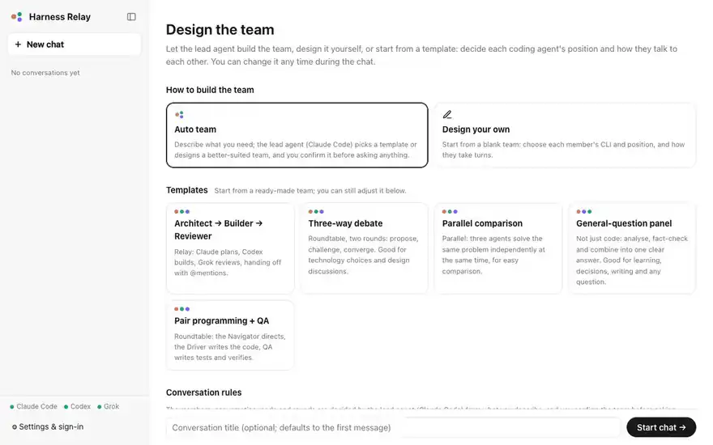

**English** | [繁體中文](README.zh-TW.md)

# Harness Relay

[](https://github.com/Agentic-System-Lab/harness-relay/actions/workflows/ci.yml)

**Website:** https://agentic-system-lab.github.io/harness-relay/

A ChatGPT-style group chat where **Claude Code, Codex and Grok** work together — on your code or any other question — and talk to each other.

Before each conversation you design the team: give every coding agent a position (architect, builder, reviewer, skeptic…), pick its model and reasoning effort, and choose how they take turns. Harness Relay then drives the real CLIs on your machine, passes each agent the messages it hasn't seen yet, and streams everything into one chat.

## Demo

[](docs/media/demo-en.mp4)

A new group, then Auto team on this repository: you create a group and describe what you need. The lead agent sorts the chat into the group, going by your first message, and adapts a template into a three-member team, explaining why. You confirm the team and ask your question; Claude Code, Codex and Grok read the code and answer in parallel, then weigh each other's findings in a second round, with their thinking and tool calls streaming into the chat (sped up while the agents work). At the end, a search finds the chat by what the agents wrote. [Watch the full-quality video (MP4)](docs/media/demo-en.mp4).

## Features

- **Three coding agents in one chat** — runs the `claude`, `codex` and `grok` CLIs you already have, with their own tools, sessions and logins.
- **Design the team per conversation** — roles, model, reasoning effort, turn order; design it yourself from a blank team, or start from five built-in templates (coding and general questions) or your own saved ones. Roles can be edited mid-chat.
- **Attach files** — paste screenshots, drop files or use 📎; every agent gets the files, and images are shown to all three CLIs directly.
- **Voice input (optional)** — press 🎙 in the message box and speak; [whisper.cpp](https://github.com/ggml-org/whisper.cpp) turns it into text on your computer, and recordings never leave it. Nothing is installed until you want it: the first press explains what gets downloaded, then installs the engine and a model in the background (follow it, switch models or remove it in Settings). macOS (Homebrew, Metal GPU), Linux and Windows (x64 / arm64).
- **Auto team** — describe what you need; a lead agent reads it and every template in full, then uses a template as it is, adapts one, or designs a new team, and says why. You confirm the team, then ask your first question; save the teams it designs or adapts as templates.
- **Agents talk to each other** — three conversation modes:
  - **Roundtable**: agents speak in order and build on each other, for up to N rounds; ends early when everyone replies `[PASS]`.
  - **Parallel**: everyone answers independently each round; later rounds see the earlier answers.
  - **Relay**: one agent at a time; an agent hands off by `@mentioning` a teammate.
- **`@mentions`** — address specific agents; only they reply.
- **Safe editing with git** — the working directory becomes a git repository automatically; each reply shows the files that agent changed, with a diff. In parallel mode every agent works in its own git worktree, and you apply the result you like.
- **Live streaming** — reply text and tool activity (file edits, shell commands) stream in as they happen; stop or continue at any time. Refused or failed tool calls show why. Mermaid code blocks are drawn as diagrams, and images and videos an agent saves in the working directory are shown in the chat.
- **Keep talking while they reply** — a message sent while the team is replying waits above the message box and reaches the next agent before its turn (one that @mentions someone waits for them); withdraw or edit it until then, or press ⌘/Ctrl+Enter to stop the team and send it now.
- **Agents ask before guessing** — when a good answer depends on something only you know, an agent asks you and the team waits; once you reply, that agent answers first with your answer in hand, and the others go on from there.
- **Approvals in the chat** — the permission (read-only / edit / full access) decides what agents may do without asking; anything beyond it is asked in the chat — allow once, always allow in this chat, or decline with a note.
- **See what agents think and do** — reasoning, plans / to-do lists and each tool's output stream into the chat.
- **Copy, edit and retry** — copy any message or the whole chat as Markdown; edit one of your messages, or retry an agent's reply, and the team answers again from there.
- **Clear status at a glance** — the sidebar marks conversations that need you, are replying, or have a new reply; conversations keep running when you switch away.
- **Groups and search** — make groups in the sidebar and drag conversations into them; the lead agent puts each new conversation in the group its first message fits (or leaves it in **Other**). Search finds conversations by anything written in them.
- **Settings & login page** — sign in to each CLI separately (device code / browser / paste-code flows), set API keys, executable paths, default model and effort, and the lead agent.
- **English and 繁體中文** — the UI follows your browser language (switchable in Settings); a guided tour introduces the main features on the first visit.
- **Local-first** — everything is stored in a single SQLite file; the server only listens on `127.0.0.1`.

## Requirements

- Node.js **22.13+** (uses the built-in `node:sqlite`)
- The agent CLIs you want to use, installed and on your `PATH`:
  - [Claude Code](https://docs.claude.com/en/docs/claude-code) (`claude`)
  - [Codex CLI](https://github.com/openai/codex) (`codex`)
  - [Grok CLI](https://github.com/xai-org/grok-build) (`grok`)

You don't need all three — the app works with any subset, and you can sign in from the Settings page.

Voice input is optional and installs itself when you turn it on: on macOS it needs [Homebrew](https://brew.sh); on Linux the prebuilt engine needs glibc 2.34 or later (Ubuntu 22.04, Debian 12 and newer).

## Quick start

```bash
git clone https://github.com/Agentic-System-Lab/harness-relay
cd harness-relay
npm install
npm run dev
```

Open **http://localhost:5173**, go to **Settings & Login** to check that each agent is signed in, then click **New chat**, choose Auto team, design your own team or pick a template, and start talking.

For a production-style single server:

```bash
npm run build
npm start          # serves the UI and API on http://127.0.0.1:8787
```

## Documentation

| | English | 繁體中文 |
| --- | --- | --- |
| User guide | [docs/user-guide.md](docs/user-guide.md) | [docs/user-guide.zh-TW.md](docs/user-guide.zh-TW.md) |
| Architecture | [docs/architecture.md](docs/architecture.md) | [docs/architecture.zh-TW.md](docs/architecture.zh-TW.md) |
| Developer guide | [docs/developer-guide.md](docs/developer-guide.md) | [docs/developer-guide.zh-TW.md](docs/developer-guide.zh-TW.md) |

## Safety

Agents run with the file-system permission you choose for the conversation (**read-only**, **edit**, or **full access**). Full access lets agents run any command without asking — use it only in directories you trust. Edit mode does not sandbox project code either: tests, builds and project scripts run code the agents can change, so use read-only for code or instructions you don't trust. The server binds to `127.0.0.1` and rejects cross-site requests, but anyone with access to your machine's localhost can drive the agents. See [Architecture → Security](docs/architecture.md#security).

API keys you save in Settings are kept in your operating system's credential store — the macOS Keychain, Windows Credential Manager, or the Secret Service (GNOME Keyring, KWallet) on Linux — not in the database. Only on a system without one, such as a headless Linux server, do they stay in `data/relay.db`, which only your user can read; to avoid that, set `ANTHROPIC_API_KEY` / `XAI_API_KEY` before starting Harness Relay instead of saving a key.

## Scripts

| Command | What it does |
| --- | --- |
| `npm run dev` | API server (port 8787, auto-restart) + Vite dev server (port 5173) |
| `npm run build` | Build the web UI into `dist/web` |
| `npm start` | Serve the built UI and the API from one process |
| `npm run typecheck` | Type-check server, client and tests |
| `npm test` | Run the test suite (Vitest) |
| `npm run site:preview` | Preview the website (`site/`) on http://127.0.0.1:4180 |

Every pull request and every push to `main` runs typecheck, tests and build on GitHub Actions ([`.github/workflows/ci.yml`](.github/workflows/ci.yml)). The [website](https://agentic-system-lab.github.io/harness-relay/) is the static page in [`site/`](site/), published to GitHub Pages by [`.github/workflows/pages.yml`](.github/workflows/pages.yml).

## Contributing

Bug reports, ideas and pull requests are welcome. [CONTRIBUTING.md](CONTRIBUTING.md) explains how to report a problem, set up the project and prepare a change; every change to user-facing text or docs comes in both English and 繁體中文.

## License

This project's code is licensed under the [Apache License 2.0](LICENSE).
