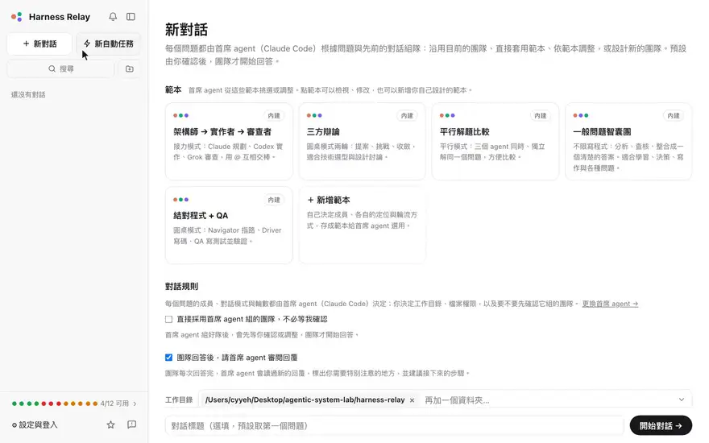

[English](README.md) | **繁體中文**

# Harness Relay

**網站：** https://agentic-system-lab.github.io/harness-relay/zh-TW/

[](https://codespaces.new/Agentic-System-Lab/harness-relay/tree/latest-release?quickstart=1)

**不安裝任何東西就能免費體驗：** 在你自己的 GitHub codespace 打開最新的正式版，七個非開源的 agent CLI 都已裝好、app 也已啟動，網址只有你的 GitHub 帳號打得開。詳見[在 GitHub Codespaces 試用](docs/codespaces.zh-TW.md#步驟)。

---

[](docs/media/demo-zh-TW.mp4)

一個在本機執行的任務助理，讓真正的 **Claude Code、Codex、Grok、Cursor、Antigravity、Copilot 和 Muse Code** CLI，以及五個用你選的模型來源執行的開源 coding agent（**OpenCode、Goose、Cline、OpenHands 與 Pi**）組成團隊：替每個 agent 安排角色、決定輪流發言的方式，它們就會處理你的程式碼或任何問題，並且互相回應。

每個問題都由首席 agent 從你的範本挑選團隊（或依範本調整、重新設計），你確認後團隊才開始回答。Harness Relay 會用你自己的登入與工具執行這些 CLI，把每個 agent 還沒看過的訊息交給它，並把所有內容即時串流到同一個聊天畫面。

## 目錄

- [使用情境](#使用情境)
- [功能](#功能)
- [需求](#需求)
- [快速開始](#快速開始)
  - [模型連線](#模型連線)
- [桌面 app](#桌面-app)
- [安全性](#安全性)
- [指令](#指令)
- [文件](#文件)
- [參與開發](#參與開發)
- [授權](#授權)

## 使用情境

這十二個範例只是起點。帶著好奇心，把自己想解決的問題交給團隊，探索更多可能性。每個範例都有實際執行的錄影，可到[官網](https://agentic-system-lab.github.io/harness-relay/zh-TW/use-cases/)依章節觀看。

- **[一個 bug 三種修法，留下最好的](https://agentic-system-lab.github.io/harness-relay/zh-TW/use-cases/#fix-a-bug)**：在平行模式下，Claude Code、Codex 和 Grok 各在自己的 git worktree 裡修好失敗的測試；你看過差異，把其中一個套用到工作目錄。
- **[把客戶訪談變成產品規格](https://agentic-system-lab.github.io/harness-relay/zh-TW/use-cases/#product-spec)**：附上五份客戶訪談；在接力模式下，一位整理痛點，下一位寫 PRD，最後一位挑戰它；動筆之前，他們會先問你要先為哪一群客戶做。
- **[讀完競品，再寫上市文案](https://agentic-system-lab.github.io/harness-relay/zh-TW/use-cases/#launch-copy)**：在唯讀模式下，agent 用 Harness Relay 自己的瀏覽器讀三家競品的價格頁，輪流寫出標語和上市貼文；再分支對話試另一種語氣。
- **[月結對帳：三份各自對，再比對](https://agentic-system-lab.github.io/harness-relay/zh-TW/use-cases/#reconcile-accounts)**：附上銀行對帳單和現金帳；在平行模式下，三位 agent 各自唯讀對帳，首席 agent 審閱比對每位的結果，標出該由你親自確認的事。
- **[追逾期帳款，追到收齊為止](https://agentic-system-lab.github.io/harness-relay/zh-TW/use-cases/#collect-payments)**：每個工作日 09:00 的自動任務，設定了要追蹤的目標，用 Harness Relay 自己的工具讀你的信、寫提醒信，信在待送出匣等你按「送出」；每張發票都處理完，它就停下。
- **[每場客戶會議，都有備而來](https://agentic-system-lab.github.io/harness-relay/zh-TW/use-cases/#call-brief)**：行事曆上每場客戶會議開始前半小時，自動任務開一段新對話，把活動當作資料交給團隊；agent 唯讀地用 Harness Relay 自己的工具讀上次會議的紀錄和客戶的信，算出使用量，其中一位扮演客戶的財務長。
- **[研究怎麼說，每個來源都附上](https://agentic-system-lab.github.io/harness-relay/zh-TW/use-cases/#literature-review)**：在唯讀模式下，agent 上網搜尋、讀研究，以圓桌辯論證據，寫出每個來源都附連結的摘要；首席 agent 審閱會標出意見不同之處。
- **[出一份小考，先讓學生試考](https://agentic-system-lab.github.io/harness-relay/zh-TW/use-cases/#write-a-quiz)**：附上課文；在接力模式下，一位寫考卷和解答，下一位像學生一樣作答，最後一位批改，不清楚的題目會退回改寫。
- **[用自己的模型伺服器修訂合約](https://agentic-system-lab.github.io/harness-relay/zh-TW/use-cases/#contract-review)**：每位 agent，連首席 agent 在內，都跑在你自己 vLLM 上的 Qwen3.8 27B；在接力模式下，一位改掉廠商草稿中每一條偏離審閱準則的條款，下一位檢查每處修改，最後一位寫說明，回覆的差異就是修訂紀錄。
- **[告警一響，就開始排查](https://agentic-system-lab.github.io/harness-relay/zh-TW/use-cases/#triage-an-alert)**：有 webhook 的自動任務，每次監控系統呼叫就開一段新對話；agent 唯讀地讀告警、log 和部署紀錄，找出最可能的原因，完成時鈴鐺會通知你。
- **[易用性測試前，先審一輪畫面](https://agentic-system-lab.github.io/harness-relay/zh-TW/use-cases/#design-review)**：附上三張截圖；在平行模式下，每位 agent 從自己的角度（無障礙、版面、文字）唯讀審查，列出最該先改的問題。
- **[英文一改，譯文就跟上](https://agentic-system-lab.github.io/harness-relay/zh-TW/use-cases/#translate-strings)**：自動任務等 `locales/en.json` 變動；在接力模式下，Antigravity 把新字串翻成繁體中文和日文，Copilot 不看英文把它們翻回英文，Claude Code 對照檢查，你在回覆中途補充的訊息也會送到他們手上。

## 功能

- **十二個 coding agent，同一個任務助理**：直接使用你已安裝的 CLI，保有它們各自的工具、session 與登入；開源 agent 則用你的 API key 或你自己的 OpenAI 相容伺服器執行；同一個團隊裡可以混搭。（[登入](docs/user-guide.zh-TW.md#2-分別登入各個-agent設定與登入)、[模型來源](docs/user-guide.zh-TW.md#模型連線)）
- **每個問題都有自己的團隊**：首席 agent 從你的範本挑選或設計團隊（角色、模型、推理強度、發言順序），你確認後才開始；團隊回答完，它會審閱回覆，標出需要你注意的地方。（[自動組隊](docs/user-guide.zh-TW.md#自動組隊)、[範本](docs/user-guide.zh-TW.md#範本)、[首席 agent 審閱](docs/user-guide.zh-TW.md#首席-agent-審閱)）
- **agent 之間互相溝通**：圓桌、平行或接力三種模式，也能用 `@` 指定成員。（[對話規則](docs/user-guide.zh-TW.md#對話規則)）
- **用 git 安全地改檔**：每個工作目錄（一個對話最多八個）都會成為 git repository，每則回覆都列出它改了哪些檔案並附上 diff，平行模式中每個 agent 在自己的 worktree 工作。（[檢視與套用修改](docs/user-guide.zh-TW.md#檢視與套用修改)）
- **由你掌控**：每個對話有自己的權限（唯讀、可編輯、完全存取），超出範圍的動作在對話中請你核准；agent 不確定時先問你而不亂猜；團隊回覆時你也能插話。（[核准](docs/user-guide.zh-TW.md#核准)、[對話](docs/user-guide.zh-TW.md#4-對話)）
- **團隊檢查**：在可編輯與完全存取的對話中，為整個團隊設定受保護路徑、commit 格式和 `npm test` 這類指令。Harness Relay 會自行檢查成果，也會在支援的工具呼叫前後執行 hook。（[團隊檢查](docs/user-guide.zh-TW.md#團隊檢查)）
- **一切即時呈現**：回覆、推理、計畫與工具動作即時串流；Mermaid 圖表、圖片與 agent 做出的檔案直接顯示在對話中；任何一則回覆都能複製、編輯、重試或分支。（[複製、編輯與重試](docs/user-guide.zh-TW.md#複製編輯與重試)、[分支對話](docs/user-guide.zh-TW.md#分支對話)）
- **Harness Relay 自己的工具**：給每個 CLI 的 agent（Grok、Muse Code 與 OpenCode 以外的開源 agent 只在完全存取時）一個它自己的瀏覽器、郵件與行事曆，透過同一個 MCP server；會送到別人那裡的東西在待送出匣等你送出。Microsoft 365、Outlook.com 與 Google 的行事曆與郵件在瀏覽器中登入（OAuth），權杖不會交給 agent。（[Harness Relay 的工具](docs/user-guide.zh-TW.md#harness-relay-的工具瀏覽器郵件與行事曆)）
- **自動任務**：在你執行它、到了設定的時間（例如每個平日 9:00 審查昨天的 commit）、某件事發生時（新郵件、即將開始的行程、pull request 或失敗的 CI、檔案；由 Harness Relay 自己檢查），或這台電腦上的程式呼叫它的 webhook 時，把訊息傳給團隊；自動任務可以跨天追蹤一個目標，直到 agent 回報已達成，失敗的執行也會重試。（[自動任務](docs/user-guide.zh-TW.md#自動任務)）
- **應用程式預覽**：從回覆或「檔案」按一下就能試用應用程式，團隊做出應用程式時也會自動打開。Relay 直接開啟靜態 HTML、依 npm 指令建置前端或執行後端，或在 Docker 中執行任何語言的 `Dockerfile` 或 compose 檔，顯示它的網頁，終端機程式則顯示它的終端機。遇到錯誤時，可以把錯誤文字加入聊天草稿。[預覽應用程式](docs/user-guide.zh-TW.md#預覽應用程式)
- **檔案、語音與分享**：附加檔案與截圖、瀏覽工作目錄、用只在你電腦上執行的語音輸入說話，並把對話分享成 Markdown 或連結。（[瀏覽檔案](docs/user-guide.zh-TW.md#瀏覽檔案)、[語音輸入](docs/user-guide.zh-TW.md#語音輸入)、[分享對話](docs/user-guide.zh-TW.md#分享對話)）
- **井然有序**：群組、釘選在最上面的對話、搜尋、側邊欄上每個對話的狀態、通知與提示音（手機上是推播通知），以及收著每一則通知的鈴鐺（每個瀏覽器都一樣）。（[群組](docs/user-guide.zh-TW.md#群組)、[釘選](docs/user-guide.zh-TW.md#釘選的對話)、[搜尋](docs/user-guide.zh-TW.md#搜尋)、[通知與提示音](docs/user-guide.zh-TW.md#通知與提示音)、[通知收件匣](docs/user-guide.zh-TW.md#通知收件匣)）
- **App 與工具**可連結常用 App、選擇能使用它們的助理，並在待送出匣審核要發出的訊息、Google 文件與 Obsidian 筆記的變更。[連結常用 App](docs/user-guide.zh-TW.md#常用-app)
- **設定一次，每個 CLI 都適用**：找不到的 CLI 在它的卡片上一鍵安裝（也能再移除），MCP 伺服器（用 OAuth 登入的也在這裡登入）、skill 與記憶的工具庫，每個 CLI 多個帳號、每個帳號的方案用量、各 CLI 自己載入的內容，以及在 [AgentsView](https://www.agentsview.io) 中檢視 agent 的 session。（[安裝 CLI](docs/user-guide.zh-TW.md#從設定頁安裝-cli)、[工具庫](docs/user-guide.zh-TW.md#工具庫mcp-伺服器skill-與記憶)、[多個帳號](docs/user-guide.zh-TW.md#多個帳號)、[方案用量](docs/user-guide.zh-TW.md#方案用量)、[AgentsView](docs/user-guide.zh-TW.md#agent-的-session各-cli-自己的資料夾與-agentsview)）
- **完全在本機，你的裝置都能用**：所有資料存在單一 SQLite 檔案，伺服器只監聽 `127.0.0.1`；透過 Tailscale 用手機連線；選用的桌面 app；English 與繁體中文。（[用手機連線](docs/remote-access.zh-TW.md#1-把伺服器分享到-tailnet)、[桌面 app](#桌面-app)）

每個功能的詳細步驟都在[使用者說明](docs/user-guide.zh-TW.md)。

## 需求

- Node.js **22.13 以上**（使用內建的 `node:sqlite`）。
- 任何一個 agent CLI，已安裝且在 `PATH` 中，或在設定頁[一鍵安裝](docs/user-guide.zh-TW.md#從設定頁安裝-cli)；不需要全部都裝。[安裝 agent 的 CLI](docs/user-guide.zh-TW.md#安裝-agent-的-cli) 列出每一個、怎麼安裝、驗證過的版本，以及沙箱需要的套件（在 Linux 上，開源 agent 需要 `bubblewrap`、`socat` 與 `ripgrep`），這些可以[由設定頁安裝](docs/user-guide.zh-TW.md#安裝沙箱需要的元件)。
- [Git](https://git-scm.com/downloads)，編輯與平行模式需要。

## 快速開始

```bash
git clone https://github.com/Agentic-System-Lab/harness-relay
cd harness-relay
npm install
npm run build
npm start
```

打開 `npm start` 在終端機印出的登入連結（`http://127.0.0.1:8787/#code=…`；Harness Relay 只接受登入過的瀏覽器，見[安全性](#安全性)），到「**設定與登入**」找一位已可用的助理，或連接一位助理。點「**開始新對話**」，寫下問題，確認工作目錄與權限後就能送出。你可以先確認團隊，也可以讓團隊直接回答。

- `git pull` 之後，請重新執行 `npm install` 和 `npm run build`，再執行 `npm start`。
- 要用手機使用，把它分享到你的 tailnet：詳見[用手機連線（Tailscale）](docs/remote-access.zh-TW.md#1-把伺服器分享到-tailnet)。
- 要開發 Harness Relay 本身？改用 `npm run dev`（網址是 <http://localhost:5173>）：詳見開發者說明的[執行](docs/developer-guide.zh-TW.md#執行)。

<a id="開源-agent-與模型來源"></a>
<a id="開源-agent-與自定義模型"></a>
<a id="開源-agent-的-api-key-與端點"></a>

### 模型連線

在 **設定 → 模型連線** 中，**開源助理的 API Key** 可為 OpenCode、Goose、Cline、OpenHands 與 Pi 設定 OpenAI、Anthropic 或 xAI 的金鑰。這五個助理，加上 Claude Code、Codex、Grok 與 GitHub Copilot，也能使用 **自訂端點**。展開後即可連接自己的 OpenAI 相容伺服器（vLLM、Ollama、LM Studio 或 llama.cpp）。輸入端點網址與金鑰（選填），按 **載入模型**，勾選需要的模型，再按 **儲存**。Relay 會檢查每個勾選或手動輸入的模型 ID。伺服器未提供任何模型資料時，會詢問是否仍要儲存未驗證的 ID。成員的模型寫成「模型來源/模型」，例如 `openai/gpt-5.4-nano` 或 `homelab/muse-glimmer-30b-nvfp4`。這五個開源助理需要 API key 或自訂端點，不能使用 Claude 訂閱帳號或 Grok 的登入。

怎麼設定，以及每個 agent 要注意的地方：使用者說明的[模型連線](docs/user-guide.zh-TW.md#模型連線)。每個 agent 怎麼運作，見「開源 agent」文件的 [OpenCode](docs/open-agents.zh-TW.md#opencode)、[Goose](docs/open-agents.zh-TW.md#goose)、[Cline](docs/open-agents.zh-TW.md#cline)、[OpenHands](docs/open-agents.zh-TW.md#openhands) 與 [Pi](docs/open-agents.zh-TW.md#pi)。

## 桌面 app

不想一直開著終端機？macOS（Apple Silicon）、Windows 與 Linux 的桌面 app 會在背景執行同一個伺服器，並在它自己的視窗裡顯示對話。關掉視窗後，伺服器會留在選單列或系統匣的圖示後面繼續執行，所以手機照常能用。它可以登入時自動啟動、不讓電腦睡著、一鍵分享到手機，也會自己更新。可以在設定頁安裝 agent 的 CLI，也會在[需要 Git 時詢問是否安裝](docs/user-guide.zh-TW.md#對話規則)。開源 agent 的沙箱可能需要 Node.js。

從[網站](https://agentic-system-lab.github.io/harness-relay/zh-TW/)或 [Releases](https://github.com/Agentic-System-Lab/harness-relay/releases) 下載。安裝檔還沒有簽署，所以第一次打開時系統會警告：使用者說明的[桌面 app](docs/user-guide.zh-TW.md#桌面-app) 說明該怎麼做、怎麼更新，以及怎麼自己建置。

## 安全性

agent 會修改你的檔案、執行指令，所以 Harness Relay 讓它們只在你設定的範圍內做事：

- **每個對話有自己的權限**：唯讀、可編輯或完全存取。完全存取讓 agent 不必詢問就能執行任何指令，只在你信任的目錄中使用；其他權限下，超出範圍的動作會在對話中詢問你。
- **完全存取以外的作業系統沙箱**：Claude Code、Codex、Grok、Copilot 與 Muse Code 用它們自己的，五個開源 agent 則在 [Harness Relay 自己的沙箱](docs/sandboxing.zh-TW.md#harness-relay-自己的沙箱)中執行。Cursor 與 Antigravity 沒有 Harness Relay 能用的沙箱，所以它們想執行的每個指令都會先問你（Cursor 在你的 Cursor 團隊自動執行允許清單上的除外）。各沙箱擋的東西不同，網路尤其如此（可編輯模式下，Grok 或 Copilot 執行的專案程式碼仍連得上網路），原生 Windows 上能用的沙箱也比較少，所以不信任的程式碼或指示請用唯讀。逐個平台的說明：[各平台的作業系統沙箱](docs/sandboxing.zh-TW.md#各平台)；逐個 CLI 的說明：[架構 → 權限對應](docs/architecture.zh-TW.md#權限對應)。
- **agent 碰不到的地方**：完全存取以外，碰不到你瀏覽器的資料夾與 Harness Relay 的資料庫；在含有 Harness Relay 本身、你的家目錄或某個 CLI 自己資料夾的目錄中，不能使用可編輯模式。（[agent 不能讀寫的地方](docs/sandboxing.zh-TW.md#agent-不能讀寫的地方)）
- **只接受你的瀏覽器**：伺服器只綁定 `127.0.0.1`、拒絕跨站請求，並且只接受你登入過的瀏覽器。只透過 `tailscale serve` 分享到你的 tailnet。（[架構 → 安全性](docs/architecture.zh-TW.md#安全性)、[用手機連線 → 安全性](docs/remote-access.zh-TW.md#安全性)）
- **金鑰存在系統的金鑰儲存區**：API key 與 MCP 伺服器的機密值存在 macOS 鑰匙圈、Windows 認證管理員或 Linux 的 Secret Service；沒有這類儲存區的系統，才加密後存在資料庫。（[API key](docs/user-guide.zh-TW.md#api-key選用)）

## 指令

| 指令 | 用途 |
| --- | --- |
| `npm start` | 由同一個程序在 <http://127.0.0.1:8787> 提供建置好的介面與 API |
| `npm run login` | 印出另一個一次性的登入連結，用在 `npm start` 印出的那個已經用過或太舊時 |
| `npm run dev` | 開發用：API 伺服器（port 8789，自動重啟）與 Vite（port 5173） |
| `npm run format:check`、`npm run typecheck`、`npm test`、`npm run build` | CI 對每個 pull request 執行的檢查（`npm run format` 用 Prettier 排版程式碼） |

其他指令（端對端測試、桌面 app、網站、示範影片、[檢查 agent CLI 的新版本](docs/developer-guide.zh-TW.md#檢查-cli-的新版本)）都在[開發者說明](docs/developer-guide.zh-TW.md#執行)，也說明了 [CI](docs/developer-guide.zh-TW.md#持續整合ci) 會執行什麼。

## 文件

想學會使用 Harness Relay，從[網站上的文件](https://agentic-system-lab.github.io/harness-relay/zh-TW/docs/)開始，每項工作一頁。下面的文件則說明每個細節，以及它怎麼運作。

| | English | 繁體中文 |
| --- | --- | --- |
| 使用者說明 | [docs/user-guide.md](docs/user-guide.md) | [docs/user-guide.zh-TW.md](docs/user-guide.zh-TW.md) |
| 架構 | [docs/architecture.md](docs/architecture.md) | [docs/architecture.zh-TW.md](docs/architecture.zh-TW.md) |
| 開發者說明 | [docs/developer-guide.md](docs/developer-guide.md) | [docs/developer-guide.zh-TW.md](docs/developer-guide.zh-TW.md) |
| 用手機連線（Tailscale） | [docs/remote-access.md](docs/remote-access.md) | [docs/remote-access.zh-TW.md](docs/remote-access.zh-TW.md) |
| 在 GitHub Codespaces 試用 | [docs/codespaces.md](docs/codespaces.md) | [docs/codespaces.zh-TW.md](docs/codespaces.zh-TW.md) |
| 開源 agent（OpenCode、Goose、Cline、OpenHands、Pi） | [docs/open-agents.md](docs/open-agents.md) | [docs/open-agents.zh-TW.md](docs/open-agents.zh-TW.md) |
| 各平台的作業系統沙箱 | [docs/sandboxing.md](docs/sandboxing.md) | [docs/sandboxing.zh-TW.md](docs/sandboxing.zh-TW.md) |
| 新增 coding agent 的流程 | [docs/adding-a-coding-agent.md](docs/adding-a-coding-agent.md) | [docs/adding-a-coding-agent.zh-TW.md](docs/adding-a-coding-agent.zh-TW.md) |
| 端對端測試的情境 | [e2e/README.md](e2e/README.md) | [e2e/README.zh-TW.md](e2e/README.zh-TW.md) |
| 桌面 app（給開發者） | [desktop/README.md](desktop/README.md) | [desktop/README.zh-TW.md](desktop/README.zh-TW.md) |
| 提案（尚未實作） | [docs/proposals/README.md](docs/proposals/README.md) | [docs/proposals/README.zh-TW.md](docs/proposals/README.zh-TW.md) |

## 參與開發

歡迎回報問題、提出想法或送出 pull request。[CONTRIBUTING.zh-TW.md](CONTRIBUTING.zh-TW.md) 說明怎麼回報問題、建立開發環境與準備修改；所有給使用者看的文字與文件都要同時有 English 與繁體中文。也可以直接在 app 裡[回報問題](docs/user-guide.zh-TW.md#回報問題)。參與的每個人都要遵守[行為準則](CODE_OF_CONDUCT.zh-TW.md)。發現安全性問題？請依 [SECURITY.zh-TW.md](SECURITY.zh-TW.md#回報漏洞) 的說明私下回報。

## 授權

Harness Relay 的程式碼以 [Sustainable Use License](LICENSE)（1.0 版，由 n8n 撰寫；SPDX 代號 [`SUL-1.0`](https://spdx.org/licenses/SUL-1.0.html)）授權，屬於 [fair-code](https://faircode.io/) 授權。你可以為了自己公司內部的業務（包括在工作上）、個人或非商業用途使用與修改它，也可以免費、為非商業目的分享給別人，修改過的也可以，但要附上它的條款（改過的話，還要註明你改了它）。你不能販售它：不能收費散布它，也不能收費提供給別人使用，例如代管服務。它是原始碼公開（source-available）的軟體，不是開放原始碼促進會（OSI）所定義的開源軟體。它包含的第三方套件與字型沿用各自的授權。以上只是摘要，條款以 [LICENSE](LICENSE) 為準。
