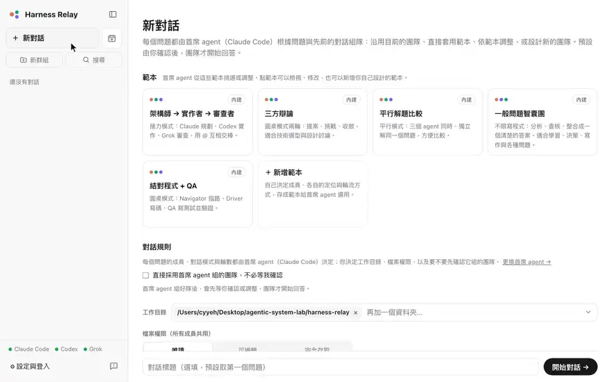

[English](README.md) | **繁體中文**

# Harness Relay

[](https://github.com/Agentic-System-Lab/harness-relay/actions/workflows/ci.yml)

**網站：** https://agentic-system-lab.github.io/harness-relay/zh-TW/

一個在本機執行的群組聊天室，讓真正的 **Claude Code、Codex、Grok、Cursor、Antigravity 和 Muse Code** CLI，以及五個用你選的模型來源執行的開源 coding agent（**OpenCode、Goose、Cline、OpenHands 與 Pi**）組成團隊：替每個 agent 安排角色、決定輪流發言的方式，它們就會處理你的程式碼或任何問題，並且互相回應。

每個問題都由首席 agent 從你的範本挑選團隊（或依範本調整、重新設計），你確認後團隊才開始回答：每個 agent 的定位（架構師、實作者、審查者、魔鬼代言人……）、模型與推理強度，以及對話模式（圓桌、平行或接力）。團隊設計放在範本裡。Harness Relay 會用你自己的登入與工具執行 `claude`、`codex`、`grok`、`cursor-agent`、`agy`、`muse`，用你的 API key 或你自己的模型伺服器執行開源 CLI，把每個 agent 還沒看過的訊息交給它，並把所有內容即時串流到同一個聊天畫面。

## 示範

[](docs/media/demo-zh-TW.mp4)

## 功能

- **十一個 coding agent 同一個聊天室**：直接使用你已安裝的 `claude`、`codex`、`grok`、`cursor-agent`、`agy`、`muse` CLI，保有它們各自的工具、session 與登入狀態，也能使用開源的 `opencode`、`goose`、`cline`、`openhands` 與 `pi` CLI。同一個團隊裡可以混搭。
- **用你自己的模型**：開源 agent 使用你在設定頁設定的模型來源：OpenAI、Anthropic、xAI 的 API key，或你自己的 OpenAI 相容端點（vLLM、Ollama、LM Studio、llama.cpp）。成員的模型寫成「模型來源/模型」，例如 `openai/gpt-5.4-nano` 或 `homelab/muse-glimmer-30b-nvfp4`。Claude 訂閱帳號與 Grok 的登入不能用在這些 CLI（只能用 API key）。Claude Code、Codex 與 Grok 也能在你自己的端點上執行：給成員選一個端點的模型即可。見[開源 agent 與模型來源](#開源-agent-與模型來源)。
- **用範本設計團隊**：角色、模型、推理強度、發言順序；五個內建範本（寫程式與一般問題）可以複製修改，也能在新對話頁新增、修改自己的範本。對話中也能隨時調整目前的團隊：自己動手改，或告訴首席 agent 想怎麼改。
- **附加檔案**：直接貼上截圖、拖曳檔案或按 📎；每個 agent 都拿得到檔案，圖片也會直接交給能接收圖片的 CLI 看。
- **語音輸入（選用）**：在輸入框按 🎙 說話，由你電腦上的 [whisper.cpp](https://github.com/ggml-org/whisper.cpp) 轉成文字，錄音不會離開這台電腦。不需要就不會安裝：第一次按下時會先說明要下載什麼，再於背景安裝引擎與模型（進度、換模型與移除都在設定頁）。支援 macOS（Homebrew、Metal GPU）、Linux 與 Windows（x64 / arm64）。
- **每個問題自動組隊**：首席 agent 會讀你的問題、先前的對話、目前的團隊與所有範本的完整內容，再決定沿用團隊、直接套用範本、依範本調整，或從頭設計新團隊，並說明原因；你確認後（也可以設定為直接採用）團隊就開始回答；@ 成員的追問則直接交給他。它設計或調整的團隊可以存成範本。
- **agent 之間互相溝通**，三種對話模式：
  - **圓桌**：依序發言、互相接續，最多 N 輪；所有人都回覆 `[PASS]` 時提前結束。
  - **平行**：每一輪大家各自獨立回答；下一輪才看得到彼此的答案。
  - **接力**：一次一位發言；agent 用 `@名稱` 把棒子交給隊友。
- **`@` 指定成員**：只有被 @ 的 agent 會回覆。
- **用 git 安全地改檔**：工作目錄會自動成為 git repository；每則回覆都會列出該 agent 改了哪些檔案並可查看 diff。平行模式中每個 agent 在自己的 git worktree 工作，再由你選擇要套用哪一份結果。
- **即時串流**：回覆文字與工具動作（改檔、執行指令）即時顯示；隨時可以停止或讓團隊繼續。被拒絕或失敗的工具呼叫會顯示原因。Mermaid 程式碼區塊會畫成圖表，agent 存在工作目錄裡的圖片與影片會直接顯示在聊天室，它為你做的檔案（PDF、簡報、試算表）則是可以下載的連結，在電腦或手機上都能下載。
- **在對話中核准**：權限（唯讀 / 可編輯 / 完全存取）決定 agent 不必詢問就能做哪些事；超出範圍的動作會在對話中詢問你：允許一次、本對話都允許，或拒絕並附上說明。開源 agent 也透過同樣的核准卡片詢問。
- **回覆中也能插話**：團隊回覆時送出的訊息會先停在輸入框上方，在下一位 agent 發言前送到（@ 了成員的訊息會等該成員發言）；送到之前可以撤回或編輯，也可以按 ⌘/Ctrl+Enter 停止團隊、立刻改問這個。
- **先問你，不亂猜**：好答案取決於只有你知道的事時，agent 會先問你，團隊停下來等；你回覆後，提問的 agent 先依你的回答給出完整答案，其他成員再接著往下。
- **排程**：在設定的時間（一次、每天、選定的星期幾，或每隔幾小時）把訊息傳給團隊，在同一個對話裡或每次開新對話；例如每個平日 9:00 審查昨天的 commit。側邊欄的 **新排程** 可以直接從排程開始，由首席 agent 挑選團隊。排程執行時可能沒人看著，所以預設會自動拒絕權限範圍以外的動作；Harness Relay 關閉期間錯過的時間會略過，或在開啟後補送一次。
- **看見 agent 的思考與動作**：推理過程、計畫 / 待辦清單，以及每個工具的輸出都會即時串流到對話中。
- **複製、編輯與重試**：把任何一則訊息或整段對話複製成 Markdown；編輯自己的某則訊息，或重試某個 agent 的回覆，團隊就會從那裡重新回答。
- **分支對話**：agent 回覆下方的 **分支對話**（分支圖示）會把到這則回覆為止的對話複製成新對話，讓你從那裡試另一個方向，原本的對話維持不變。
- **分享**：分享整段對話，或到某位 agent 某則回覆為止的內容，不含工具呼叫與思考過程：可以複製成 Markdown，或建立公開連結，打開是和聊天室一樣的頁面，附上 Harness Relay 的名稱與 logo，可以連到它的網站（用你的 GitHub CLI 建立 secret gist，透過 gistpreview.github.io 顯示）。回覆連結的檔案不限種類（文字檔、PDF、簡報、圖片…，每個最多 50 MB），可以挑選後放進另一個 secret gist，有連結的人都能下載。**設定 → 分享的對話** 會列出所有連結，可以移除不要的（兩個 gist 都會刪除）。
- **狀態一目了然**：側邊欄會標示需要你處理、正在回覆或有新回覆的對話；切換到其他對話時，原本的對話會繼續執行。
- **群組與搜尋**：在側邊欄建立群組，把對話拖進去；首席 agent 會依新對話的第一則訊息把它放進最適合的群組（都不適合就留在 **其他**）。群組裡的分支會列在它分支出來的對話底下，換群組時整串一起移動。搜尋可以用對話裡寫過的任何內容找到對話。
- **工具庫：MCP 伺服器、skill 與記憶**：在設定裡設定一次，不管成員跑在哪個 CLI 都能用，而且加在各 CLI 自己的設定之外。每一項可以給所有成員，或只給某幾種 CLI 的成員；記憶分成所有成員共用和各 CLI 專屬；也能針對單一成員調整。token 存在系統的金鑰儲存區。
- **在 AgentsView 中檢視 agent 的 session（選用）**：讓各 CLI 在 Harness Relay 中使用自己的資料夾（例如 `~/.relay-agents`），和你平常直接使用時分開；並在 [AgentsView](https://www.agentsview.io) 中把每個對話看成一個 thread，底下是各 agent 自己的 session（工具呼叫、token 與成本），十一種 CLI 都有：Cursor 與開源 agent 自己的 session AgentsView 讀不到，改用 Harness Relay 記下的 session（只有 AgentsView 認得的模型才有成本）。兩者都是設定，所以在 macOS、Linux、Windows 上都照常用 `npm start`。見[使用者說明](docs/user-guide.zh-TW.md#agent-的-session各-cli-自己的資料夾與-agentsview)。
- **多個工作目錄**：一個對話最多可以有八個資料夾：輸入路徑後按 Enter、從使用中的工作目錄挑選，或在系統的選擇資料夾視窗中選取。agent 從第一個開始，其他的也以同樣的權限交給它們（Cursor 只在第一個裡工作；可編輯模式下，寫入其他的之前會先問你）；每一個都會變成有自己快照的 git repository，平行模式下也有自己的 worktree，所以一個團隊可以同時在多個 repository 中工作（例如一個應用程式和它的文件）。
- **瀏覽工作目錄**：對話上方的 **檔案** 會列出工作目錄（平行模式下也可以看某位成員的 worktree），並預覽程式碼（附行號和語法上色）、Markdown、圖片與影片；任何檔案都可以下載，任何資料夾（包括目前所在的資料夾）也可以下載成 ZIP 檔。
- **每個 CLI 多個帳號**：每個 CLI 都能登入多個帳號，例如兩個 Claude 訂閱、Codex 的三個 ChatGPT 帳號、Grok 的三個 xAI 帳號（Cursor 在每個電腦使用者只保留一個登入，所以它額外的帳號用 API key 登入；Antigravity 把 Google 登入存在系統的金鑰儲存區，所以它額外的帳號用 Gemini API key 登入；Muse Code 把 Meta 登入存在 macOS 的登入鑰匙圈，所以它額外的帳號用 Meta API key 登入），各自有自己的登入、API key、資料夾、預設模型與推理強度，以及不載入哪些項目，並為每位團隊成員（以及首席 agent）選擇要用哪個帳號。見[使用說明](docs/user-guide.zh-TW.md#多個帳號)。
- **設定與登入頁**：分別登入各個 CLI（裝置碼、瀏覽器、貼上授權碼），設定執行檔路徑、模型來源與首席 agent，並為每個帳號設定 API key、預設模型與推理強度；也能查看各 CLI 在每個帳號裡自己載入的 skill、MCP 伺服器與它們的工具、內建工具、hook、subagent、plugin、指示與記憶，並讓 Harness Relay 執行時整類或逐項不載入（Cursor 與 Antigravity 沒辦法，Muse Code 只能對它的 MCP 伺服器與 hook 這樣做）。
- **回報問題**：側邊欄「設定」旁的圖示會用你的郵件程式或 Gmail 寫信給開發者，回報內容與版本、系統資訊都已填好；截圖可以拖進信裡，或用 `gh` 上傳成 secret gist 讓信裡附上連結，再寄出。
- **English 與繁體中文**：介面跟著瀏覽器的語言（可在設定頁切換）；第一次開啟時會有使用導覽介紹主要功能。
- **完全在本機**：所有資料存在單一 SQLite 檔案；伺服器只監聽 `127.0.0.1`。
- **手機也能用**：用 `tailscale serve` 分享到你的 [Tailscale](https://tailscale.com) tailnet（HTTPS，只有你的裝置連得到），就能用手機打開，也能加到主畫面，iOS 與 Android 都可以。詳見[用手機連線](docs/remote-access.zh-TW.md)。
- **桌面 app（選用）**：在 macOS、Windows、Linux 上不用開終端機也能執行：對話在它自己的視窗裡；關掉視窗時，選單列或系統匣的圖示會讓伺服器繼續執行（所以手機照常能用），可以登入時自動啟動、不讓電腦睡著，一鍵分享到手機。詳見[桌面 app](#桌面-app)。

## 需求

- Node.js **22.13 以上**（使用內建的 `node:sqlite`）
- 想使用的 agent CLI，已安裝且在 `PATH` 中：
  - [Claude Code](https://docs.claude.com/en/docs/claude-code)（`claude`）
  - [Codex CLI](https://github.com/openai/codex)（`codex`）
  - [Grok CLI](https://github.com/xai-org/grok-build)（`grok`）
  - [Cursor CLI](https://cursor.com/cli)（`cursor-agent`）
  - [Antigravity CLI](https://antigravity.google/download)（`agy`；在 macOS、Linux 與 Windows 上以 1.5.6 驗證過）
  - [Muse Code](https://dev.meta.ai/products/muse-code/)（`muse`；在 macOS 與 Linux 上以 1.4.18 驗證過，Windows 上則在沒有完成它沙箱設定的情況下驗證過）
  - 下列五個開源 agent 的任何一個，再加上給它們用的 API key 或你自己的端點

不需要全部都裝；任何組合都能用：Claude Code、Codex、Grok、Cursor、Antigravity（用你的 Google 帳號或 Gemini API key）與 Muse Code（用你的 Meta 帳號或 Meta API key）在設定頁登入，開源 agent 則在設定頁設定模型來源。

開源 agent，以及 Harness Relay 驗證過的版本（其他版本在轉接器依賴的地方可能不同）：

| Agent | 安裝 | 驗證過的版本 |
| --- | --- | --- |
| [OpenCode](https://www.npmjs.com/package/opencode-ai)（`opencode`） | `npm install -g opencode-ai@1.19.5` | 1.19.5 |
| [Goose](https://formulae.brew.sh/formula/block-goose-cli)（`goose`） | `brew install block-goose-cli` | 1.58.1 |
| [Cline](https://www.npmjs.com/package/cline)（`cline`） | `npm install -g cline@3.0.74` | 3.0.74 |
| [OpenHands](https://pypi.org/project/openhands/)（`openhands`） | `uv tool install openhands==1.16.0`（需要 [uv](https://docs.astral.sh/uv/)） | 1.16.0 |
| [Pi](https://www.npmjs.com/package/@earendil-works/pi-coding-agent)（`pi`） | `npm install -g @earendil-works/pi-coding-agent@1.5.1`（需要 Node.js 22.19 以上） | 1.5.1 |

完全存取以外，它們在 Harness Relay 自己的沙箱中執行（見[安全性](#安全性)）。macOS 上不需要另外安裝（在[桌面 app](#桌面-app) 裡則需要 `PATH` 上有 Node.js 22.12 以上）；Linux 上請安裝 `bubblewrap`、`socat` 與 `ripgrep`（`sudo apt-get install bubblewrap socat ripgrep`），Ubuntu 23.10 以上還要加上[各平台的作業系統沙箱 → 在 Linux 上](docs/sandboxing.zh-TW.md#在-linux-上)裡 `/usr/bin/bwrap` 的 AppArmor 設定檔。在原生 Windows 上它們只能以完全存取執行（要有沙箱請用 WSL2），Linux 上的 OpenCode 也一樣（Harness Relay 在那裡無法監看它的伺服器）。

語音輸入是選用的，開啟時會自動安裝：macOS 需要 [Homebrew](https://brew.sh)；Linux 的預先編譯引擎需要 glibc 2.34 以上（Ubuntu 22.04、Debian 12 或更新）。

把對話分享成連結也是選用的：需要 [GitHub CLI](https://cli.github.com)（`gh`）2.66.0 以上並用 `gh auth login` 登入，附上檔案時還需要 `git`。

## 快速開始

```bash
git clone https://github.com/Agentic-System-Lab/harness-relay
cd harness-relay
npm install
npm run build
npm start
```

打開 `npm start` 在終端機印出的登入連結（`http://127.0.0.1:8787/#code=…`；Harness Relay 只接受登入過的瀏覽器，見[安全性](#安全性)），先到「**設定與登入**」確認每個 agent 都已登入（開源 agent 則設定模型來源，見下方），再點「**新對話**」，選好工作目錄與權限，直接提出第一個問題：首席 agent 會先為它組隊。

`git pull` 之後，請重新執行 `npm install` 和 `npm run build`，再執行 `npm start`。

要用手機或其他裝置使用，把它分享到你的 tailnet：詳見[用手機連線（Tailscale）](docs/remote-access.zh-TW.md)。

要開發 Harness Relay 本身？改用 `npm run dev`：改程式時伺服器會自動重啟、介面會自動重新載入，網址是 <http://localhost:5173>。詳見[開發者說明](docs/developer-guide.zh-TW.md)。

### 開源 agent 與模型來源

OpenCode、Goose、Cline、OpenHands 與 Pi 在 Harness Relay 裡沒有登入流程，而是使用你在 **設定 → 模型來源** 設定的**模型來源**：

1. **API key**：貼上 OpenAI、Anthropic 或 xAI 的金鑰。每把金鑰都和各 CLI 的 API key 一樣，存在系統的金鑰儲存區。
2. **自訂端點**：按 **新增端點**，加入你自己的 OpenAI 相容伺服器（vLLM、Ollama、LM Studio、llama.cpp）：名稱、id（它的模型 id 的開頭，例如 `homelab`）、網址（例如 `http://10.0.0.5:8000/v1`；在這台電腦上的 Ollama 是 `http://localhost:11434/v1`：在這台電腦上的伺服器，網址必須寫出埠號）、它提供的模型名稱（Harness Relay 不會向它查詢），需要時再加上 API key。
3. 在團隊設定裡替每位開源 agent 成員選模型，寫成「模型來源/模型」：`openai/…`、`anthropic/…`、`xai/…`，或端點的 id 加上模型名稱，例如 `homelab/muse-glimmer-30b-nvfp4`。模型選單會先列出 CLI 自己的模型中、模型來源已設定的那些，再列出每個端點的模型；也隨時可以自己輸入 id。維持「預設」的成員，會用它選單上顯示的預設模型：設定頁該 agent 卡片上的預設模型，沒有的話，用 CLI 自己的預設模型（它的模型來源已設定時）；兩者都沒有時，選單會說明需要指定模型。

CLI 已安裝、且至少設定了一個模型來源時，開源 agent 就可以使用。每次執行只拿到它的模型所屬來源的那一把金鑰（也就是這裡儲存的）：絕不會拿到其他來源的金鑰，也不會拿到伺服器環境變數裡任何模型供應商的金鑰（`OPENAI_API_KEY`、`GEMINI_API_KEY` 之類）或 Cursor、Antigravity 與 Muse Code 的登入（`CURSOR_API_KEY`、`AGY_ADC_AUTH`、`META_API_KEY`）。那裡的其他憑證，例如 `GITHUB_TOKEN` 或 AWS 的變數，仍會傳給這些 agent，和其他 CLI 一樣。Claude 訂閱帳號與 Grok 的登入不能用在這些 CLI（Anthropic 不允許在第三方 agent 中使用它的訂閱），請改用 API key 或你自己的端點。

**Claude Code、Codex 與 Grok 在你自己的端點上執行。** 它們的模型選單會在自己的模型後面列出每個自訂端點的模型（例如 `homelab/gemma4:e4b`）：給成員選其中一個，那個 CLI 就在你的伺服器上執行，帶著端點的金鑰（有的話），絕不帶你的 Claude、ChatGPT 或 Grok 登入（或它們的 API key）。每個 CLI 用自己的 API，伺服器也要提供：Claude Code 用 Anthropic Messages API（`/v1/messages`），Codex 用 Responses API（`/v1/responses`），Grok 用 Chat Completions（`/v1/chat/completions`）；vLLM、Ollama、LM Studio 與 llama.cpp 三種都提供。這時 Claude Code 與 Codex 不需要登入；Grok 啟動時仍需要它自己的登入。這些執行只送這類伺服器都接受的推理強度：Claude Code 是 low 到 high，Codex 是 none 到 high（其他的改送 medium，例如你的 Codex 設定裡的 `xhigh`），Grok 不送。Grok 的部分，Harness Relay 會在 Grok 成員第一次用到端點的模型時，把端點的模型寫進 Grok 的 `config.toml`（一段有標記的區塊，不出現在 Grok 自己的模型選單）。Cursor、Antigravity 與 Muse Code 不能在你的端點上執行：它們只執行自家服務的模型（Muse Code 會先向 Meta API 要它的模型目錄，而 OpenAI 相容伺服器不提供）。

| | 協定 | 核准 | 你拒絕時的留言會傳給模型 | 沙箱需要的（完全存取以外） | 主要限制 |
| --- | --- | --- | --- | --- | --- |
| **OpenCode** | ACP（`opencode acp`） | 它的規則設為詢問，由 Harness Relay 判斷並問你 | 會 | 它自己伺服器的 loopback 埠 | 完全存取以外，Harness Relay 會監看 OpenCode 自己的伺服器，有任何其他東西操作它時就結束這次執行（在 macOS 上，它的指令讀得到那個伺服器的密碼）；完全存取以外它的 subagent 會關閉；它的 LSP 與 formatter 關閉 |
| **Goose** | ACP（`goose acp`） | 每個工具呼叫都詢問；唯讀時單純讀取的 shell 指令（`cat`、`ls`、`rg`…，只限單純的指令行，選項不會寫檔、也不會執行其他程式：沒有展開、萬用字元或 `xargs`，git 不算）不詢問 | 會，在 Goose 自己的「已拒絕」之後以一則訊息傳入 | macOS：用 HTTPS 模型來源時的憑證信任服務；這台電腦上 HTTP MCP 伺服器的埠 | 它的 skill 無法排除 |
| **Cline** | ACP（`cline --acp`） | 每個工具呼叫都詢問，讀取也是 | 不會：它的模型只看到 Cline 固定的「已拒絕」訊息（留言顯示在對話中） | 不需要額外開放 | 沒有 plan 模式與待辦清單；圖片以路徑傳入；專案的 hook 與規則沒有開關 |
| **OpenHands** | ACP（`openhands acp`） | 每個動作都詢問（它一起發出的呼叫會合成一張列出全部的卡片）；完全存取以外不提供它的 subagent | 不會：只有 OpenHands 自己固定的話 | 虛擬終端機（完全存取以外不用 tmux）；macOS 上要在「設定」打開它的開關才行，因為沙箱這時會開放所有終端機：它的指令可以在你其他的終端機視窗印出文字、讀取內容（但不能替你打字） | **停止**不會中止正在執行的指令（程序在兩秒後結束；它留下的動作在下一輪接續時會被拒絕，絕不執行）；專案的指示與 hook 一定會載入 |
| **Pi** | JSONL RPC（`pi --mode rpc`） | 完全存取以外，Harness Relay 的 gate 擴充功能在每個工具呼叫前詢問（Pi 自己不會詢問） | 會 | 不需要額外開放 | 沒有計畫或待辦清單；指示檔只能全部一起排除 |

每個 agent 的細節見[開源 agent](docs/open-agents.zh-TW.md)。


## 桌面 app

不想一直開著終端機？桌面 app 會在背景執行同一個伺服器，並在它自己的視窗裡顯示已登入的對話，沒有網址列。關掉視窗後，伺服器會繼續執行，選單列（macOS）或系統匣（Windows、Linux）留著一個圖示，所以手機照常能用；它的選單也能在瀏覽器打開對話。它會像終端機一樣找到 agent 的 CLI，可以登入時自動啟動、不讓電腦睡著，選單裡一個步驟就能透過 Tailscale 分享到手機。有更新的版本時（正式版本只看正式版本，候選版本也看之後的候選版本），它的選單和聊天介面都會提供，app 會自己更新。它需要 agent 的 CLI（編輯與平行模式還需要 Git），但不需要 Node.js；只有開源 agent 在完全存取以外執行時例外：Harness Relay 自己的沙箱要用登入 shell 的 `PATH` 上的 Node.js 22.12 以上執行。

從[網站](https://agentic-system-lab.github.io/harness-relay/zh-TW/)（提供最新的正式版本，不提供候選版本）或 [Releases](https://github.com/Agentic-System-Lab/harness-relay/releases) 下載你系統的安裝檔：macOS 是 `.dmg`（Apple Silicon；Intel Mac 請改從原始碼執行），Windows 是 `.exe`，Linux 是 `.AppImage`（Windows 與 Linux 都有 x64 與 Arm64）。安裝檔還沒有為發佈簽章，所以第一次開啟時系統會警告；詳見使用說明的[桌面 app](docs/user-guide.zh-TW.md#桌面-app)。要自己建置，在快速開始的 `npm install` 之後，於 clone 下來的資料夾執行（安裝檔會放在 `desktop/release/`）：

```bash
npm install --prefix desktop
npm run desktop:dist
```

`npm start` 和 `npm run dev` 照舊可用。

## 文件

| | English | 繁體中文 |
| --- | --- | --- |
| 使用者說明 | [docs/user-guide.md](docs/user-guide.md) | [docs/user-guide.zh-TW.md](docs/user-guide.zh-TW.md) |
| 架構 | [docs/architecture.md](docs/architecture.md) | [docs/architecture.zh-TW.md](docs/architecture.zh-TW.md) |
| 開發者說明 | [docs/developer-guide.md](docs/developer-guide.md) | [docs/developer-guide.zh-TW.md](docs/developer-guide.zh-TW.md) |
| 用手機連線（Tailscale） | [docs/remote-access.md](docs/remote-access.md) | [docs/remote-access.zh-TW.md](docs/remote-access.zh-TW.md) |
| 開源 agent（OpenCode、Goose、Cline、OpenHands、Pi） | [docs/open-agents.md](docs/open-agents.md) | [docs/open-agents.zh-TW.md](docs/open-agents.zh-TW.md) |
| 各平台的作業系統沙箱 | [docs/sandboxing.md](docs/sandboxing.md) | [docs/sandboxing.zh-TW.md](docs/sandboxing.zh-TW.md) |
| 新增 coding agent 的流程 | [docs/adding-a-coding-agent.md](docs/adding-a-coding-agent.md) | [docs/adding-a-coding-agent.zh-TW.md](docs/adding-a-coding-agent.zh-TW.md) |
| 端對端測試的情境 | [e2e/README.md](e2e/README.md) | [e2e/README.zh-TW.md](e2e/README.zh-TW.md) |
| 桌面 app（給開發者） | [desktop/README.md](desktop/README.md) | [desktop/README.zh-TW.md](desktop/README.zh-TW.md) |
| 提案（尚未實作） | [docs/proposals/README.md](docs/proposals/README.md) | [docs/proposals/README.zh-TW.md](docs/proposals/README.zh-TW.md) |
| ↳ 排程與事件觸發的執行 | [docs/proposals/triggers.md](docs/proposals/triggers.md) | [docs/proposals/triggers.zh-TW.md](docs/proposals/triggers.zh-TW.md) |
| ↳ agent 之間共用的記憶 | [docs/proposals/shared-memory.md](docs/proposals/shared-memory.md) | [docs/proposals/shared-memory.zh-TW.md](docs/proposals/shared-memory.zh-TW.md) |
| ↳ 網站預覽與 Generative UI | [docs/proposals/preview-and-generative-ui.md](docs/proposals/preview-and-generative-ui.md) | [docs/proposals/preview-and-generative-ui.zh-TW.md](docs/proposals/preview-and-generative-ui.zh-TW.md) |

## 安全性

agent 會以你為對話選擇的檔案權限執行（**唯讀**、**可編輯**或**完全存取**）。完全存取會讓 agent 不經詢問就執行任何指令，請只在你信任的目錄使用。在完全存取以外的權限，除了 Cursor 與 Antigravity 以外，每個 agent 的指令都在作業系統沙箱中執行，只能寫入工作目錄與暫存資料夾。Claude Code、Codex、Grok 與 Muse Code 用它們自己的沙箱：Codex 的沙箱也讓指令無法連網，Claude Code 的沙箱會在指令要連到每個主機時詢問你，Muse Code 的沙箱則會在指令要連網前詢問你。Grok 的沙箱只在 Linux 上擋得了網路，所以在可編輯模式下，Grok 執行的專案程式碼仍能連網：測試、建置和專案腳本執行的都是 agent 能修改的程式碼，所以不信任的程式碼或指示請用唯讀。在原生 Windows 上只有 Codex 的沙箱裝好就能用，Muse Code 的沙箱則要先以系統管理員權限執行一次 Muse 自己的設定（`muse sandbox windows setup`；在那之前，完全存取以外的權限下它的指令都會失敗，而在這個沙箱裡執行的指令尚未用 Harness Relay 驗證過；見[各平台的作業系統沙箱](docs/sandboxing.zh-TW.md)）。Cursor 在 Harness Relay 執行它的模式下，不管哪個系統都沒有沙箱：在完全存取以外的權限，它要執行的每個指令都會先詢問你（對話設為自動拒絕時則直接拒絕），你的 Cursor 團隊自動執行允許清單上的指令除外；你允許的指令會在沙箱外、以你的權限執行，也能連網。Antigravity 也沒有 Harness Relay 能用的沙箱（agy 自己的終端機沙箱，在它替 Harness Relay 執行的方式下，讓指令完全寫不進工作目錄；以 agy 1.5.6 在 macOS 上驗證過）：在完全存取以外的權限，它要執行的每個指令都會先詢問你（或直接拒絕），測試與建置也一樣；唯讀時每個寫入也會詢問，可編輯模式下寫到工作目錄以外，或寫到決定 agent 如何執行的地方（`.agents`、`.gemini`、`.claude`、`.git/hooks`…）也會詢問；你允許的指令會在沙箱外、以你的權限執行。只要有一次被拒絕，agy 就會立刻結束這一輪（你拒絕時的留言只顯示在對話中）。它從 `~/.gemini/config/` 載入的 hook 與 MCP 伺服器在沙箱外執行，專案自己的（在它的 `.agents` 資料夾裡）也會，而且 agy 不經詢問就會啟動它們：在完全存取以外的權限，工作目錄裡有這些時，Harness Relay 會在 agy 啟動前先問你。Muse Code 依 Harness Relay 每次執行替它寫的權限設定檔（permission profile）執行，並關掉 Muse 自己的核准評審（由一個模型決定要詢問什麼）：唯讀時它的檔案工具不能寫入，它要執行的每個指令都會先詢問你（你允許的指令在它的沙箱裡執行，可以寫入工作目錄）；可編輯模式下它的檔案工具可寫入工作目錄（寫進 `.muse`、`.agents` 或 `.git/hooks` 會詢問你；那裡其他 agent 的設定，例如 `.claude` 或 `.vscode`，它不經詢問就寫入，和 Claude Code、Codex 與 Grok 一樣），它的指令在它的沙箱裡不經詢問就執行，推送或發布的指令除外，那些會詢問你。Muse 會沿用 session 建立時的權限，所以權限有任何改變後，以及 Harness Relay 重新啟動後，Muse Code 的 agent 都會開新的 session。在完全存取以外的權限，它不信任任何工作區，所以專案自己的指示、skill 與 hook（`.muse/hooks.json`，Muse 會在沙箱外執行它）都不會載入。被拒絕後，它的模型只看到 Muse 自己說你拒絕了這個呼叫的那句話（你拒絕時的留言只顯示在對話中）。提高對話的權限時，每個 agent 不論跑在哪個 CLI，下一輪都會帶著完整的歷史開始新的 session（依 CLI 分別記錄），所以以較低權限執行過的 session 絕不會以較高權限接續；開源 agent 的狀態會先清空，清不掉時這一輪不執行。沙箱也讓 agent 碰不到你瀏覽器的資料夾與 Harness Relay 的資料庫（Cursor 自己的檔案工具只靠拒絕規則，而 Cursor 是拿寫下來的路徑去比對：受保護路徑換個大小寫，或指向它的連結，都擋不住；它的指令只靠詢問；Antigravity 則是拒絕它要讀寫那裡的請求，經由連結讀到工作目錄以外的也一樣，但它讀取工作目錄裡的檔案不會詢問，它的指令也只靠詢問；Muse Code 靠它權限設定檔裡的拒絕規則，對它的檔案工具與指令都有效）；工作目錄包含 Harness Relay 本身、你的家目錄或 CLI 自己的資料夾時，則會拒絕可編輯模式。伺服器只綁定 `127.0.0.1`、拒絕跨站請求，並且只接受你登入過的瀏覽器：用它啟動時印出的連結、`npm run login`，或已登入瀏覽器產生的代碼（給手機用）登入。所以你電腦上的其他程式，包括 agent 執行的程式碼，都無法透過它操作 agent，除非它們讀得到你瀏覽器的資料，或寫得到 Harness Relay 的 `data/` 資料夾（見[登入](docs/architecture.zh-TW.md#登入)）。只透過 `tailscale serve` 分享到你的 tailnet；請不要用其他方式開放它（見[用手機連線](docs/remote-access.zh-TW.md#安全性)）。詳見[架構 → 安全性](docs/architecture.zh-TW.md#安全性)。

五個開源 agent 沒有自己的沙箱，所以在完全存取以外，Harness Relay 會把它們每一個，連同它們啟動的一切，放進[它自己的沙箱](docs/sandboxing.zh-TW.md#harness-relay-自己的沙箱)執行，每次執行一個。這個沙箱以 [`@anthropic-ai/sandbox-runtime`](https://github.com/anthropics/sandbox-runtime) 建構（macOS 上是 Seatbelt，Linux 上是 bubblewrap，網路則經過一個會過濾的 proxy）。它只允許寫入這次執行自己的暫存資料夾與那個 agent 自己的 session、記錄資料夾，可編輯模式再加上工作目錄與對話的附件資料夾：唯讀時，即使你允許了修改，agent 也寫不進工作目錄。它不讓 agent 讀寫你瀏覽器的資料夾與 Harness Relay 的資料庫，也不讓它寫入自己的設定（Harness Relay 每次執行前都會寫入），所以一次執行無法替下一次放寬限制。網路方面，這次執行的模型來源不必詢問就連得到，其他主機會在對話中詢問你，但這台電腦自己的位址（或會解析到它的名稱）、agent 自己會連的少數主機，以及一次執行中第 30 個之後的主機，都不詢問就直接拒絕；Harness Relay 自己的埠（`PORT`、8787、8789 與 5173：`npm start` 與桌面 app 的，以及 `npm run dev` 的 API 與 Vite）則一律連不到。沙箱無法啟動時，這一輪會失敗，而不是在沙箱外執行；在原生 Windows 上這些 agent 只能以完全存取執行，Linux 上的 OpenCode 也一樣。少數 agent 各需要一個很窄、只給它自己的開口：OpenCode 是它自己伺服器的 loopback 埠；Goose 在 macOS 上走 HTTPS 時需要憑證信任服務（它可能繞過 proxy 帶出少量資料），以及連到這台電腦上 HTTP MCP 伺服器的埠（絕不在那些埠上監聽）；OpenHands 需要虛擬終端機（完全存取以外不用 tmux），在 macOS 上這會開放你所有的終端機，所以在那裡要你在「設定」打開它的開關，它才會在完全存取以外執行。每位對話成員的 agent 狀態（它的 session、記錄與快取）都在它自己的資料夾，其他對話或其他成員的執行都無法讀取或修改，刪除對話時也會一起移除。一次執行結束時，沙箱也會停掉它啟動、但已離開它行程群組的程序，Harness Relay 本身被強制結束時也一樣（在它下次啟動時）；在 macOS 上，完全 daemon 化、關掉所有檔案的程序是例外。它不限制讀取電腦上的其他地方（包括 `~/.ssh`），你允許的模型來源也完全連得到；在 macOS 上，指令也讀得到上層每個程序啟動時的環境變數（agent、Harness Relay 的伺服器，以及啟動它的 shell），所以請不要在環境變數裡放 API key 再啟動 Harness Relay，把金鑰存在設定頁。見[開源 agent → Harness Relay 的沙箱](docs/open-agents.zh-TW.md#harness-relay-的沙箱)。

在設定頁儲存的 API key，以及工具庫裡 MCP 伺服器環境變數與標頭的值，會放在作業系統的金鑰儲存區（macOS 鑰匙圈、Windows 認證管理員，或 Linux 的 Secret Service，例如 GNOME Keyring、KWallet），而不是資料庫。只有在沒有這類儲存區的系統（例如沒有桌面環境的 Linux 伺服器）上，才會留在只有你的帳號能讀取的 `data/relay.db`；Claude Code、Grok、Cursor、Antigravity 與 Muse Code 若想避免，可以不在設定頁儲存，改在啟動 Harness Relay 前設定 `ANTHROPIC_API_KEY` / `XAI_API_KEY` / `CURSOR_API_KEY` / `GEMINI_API_KEY` / `META_API_KEY`（在 macOS 上使用開源 agent 時不要這樣做：在那裡，它們沙箱中的指令讀得到伺服器啟動時的環境變數）。開源 agent 只使用 **設定 → 模型來源** 儲存的金鑰，存放方式相同。

## 指令

| 指令 | 說明 |
| --- | --- |
| `npm run dev` | 開發用：API 伺服器（port 8789，自動重啟）+ Vite 開發伺服器（port 5173），所以能和使用 8787 的桌面 app，或另一個 checkout 的 `npm start` 同時執行（一個資料夾只能有一個伺服器：和同一個 checkout 的 `npm start` 一起時會拒絕啟動） |
| `npm run build` | 把網頁介面建置到 `dist/web` |
| `npm start` | 由單一程序在 http://127.0.0.1:8787 提供建置好的介面與 API |
| `npm run login` | 印出一次性的登入連結（與代碼），用在 `npm start` 印出的那個已經用過或過期時 |
| `npm run typecheck` | 型別檢查伺服器、前端與測試 |
| `npm test` | 執行測試（Vitest） |
| `npm run test:e2e` | 執行端對端測試：在瀏覽器中操作介面，面對真正的伺服器，agent 是假的 CLI（先執行一次 `npm run test:e2e:install`） |
| `npm run test:e2e:live` | 同樣的測試，但用真正的 CLI 與你自己的模型（`E2E_LIVE_OLLAMA=<url>/v1`；見開發者指南「實機測試」）；CI 不執行 |
| `npm run site:preview` | 在 http://127.0.0.1:4180 預覽網站（`site/`） |
| `npm run icons` | 重新畫出 `src/web/public/` 的主畫面圖示與 web app manifest |
| `npm run demo` | 用真正的 CLI 重錄兩種語言的示範影片，並更新影片、截圖與網站的章節 |
| `npm run desktop` | 建置桌面 app 並直接執行，不安裝（先執行 `npm install --prefix desktop`） |
| `npm run desktop:dist` | 為目前的系統建置桌面 app 的安裝檔，放在 `desktop/release/` |

每個 pull request 與每次推送到 `main` 都會在 GitHub Actions 上執行型別檢查、測試與建置（[`.github/workflows/ci.yml`](.github/workflows/ci.yml)），並在 Linux、macOS 與 Windows 上執行端對端測試（[`.github/workflows/e2e.yml`](.github/workflows/e2e.yml)）。[網站](https://agentic-system-lab.github.io/harness-relay/zh-TW/)是 [`site/`](site/) 裡的靜態頁面，由 [`.github/workflows/pages.yml`](.github/workflows/pages.yml) 發佈到 GitHub Pages。

## 參與開發

歡迎回報問題、提出想法或送出 pull request。[CONTRIBUTING.zh-TW.md](CONTRIBUTING.zh-TW.md) 說明怎麼回報問題、建立開發環境與準備修改；所有給使用者看的文字與文件都要同時有 English 與繁體中文。參與的每個人都要遵守[行為準則](CODE_OF_CONDUCT.zh-TW.md)。發現安全性問題？請依 [SECURITY.zh-TW.md](SECURITY.zh-TW.md) 的說明私下回報。

## 授權

Harness Relay 的程式碼以 [Sustainable Use License](LICENSE)（1.0 版，由 n8n 撰寫；SPDX 代號 [`SUL-1.0`](https://spdx.org/licenses/SUL-1.0.html)）授權，屬於 [fair-code](https://faircode.io/) 授權。你可以為了自己公司內部的業務（包括在工作上）、個人或非商業用途使用與修改它，也可以免費、為非商業目的分享給別人，修改過的也可以，但要附上它的條款（改過的話，還要註明你改了它）。你不能販售它：不能收費散布它，也不能收費提供給別人使用，例如代管服務。它是原始碼公開（source-available）的軟體，不是開放原始碼促進會（OSI）所定義的開源軟體。它包含的第三方套件與字型沿用各自的授權。以上只是摘要，條款以 [LICENSE](LICENSE) 為準。
