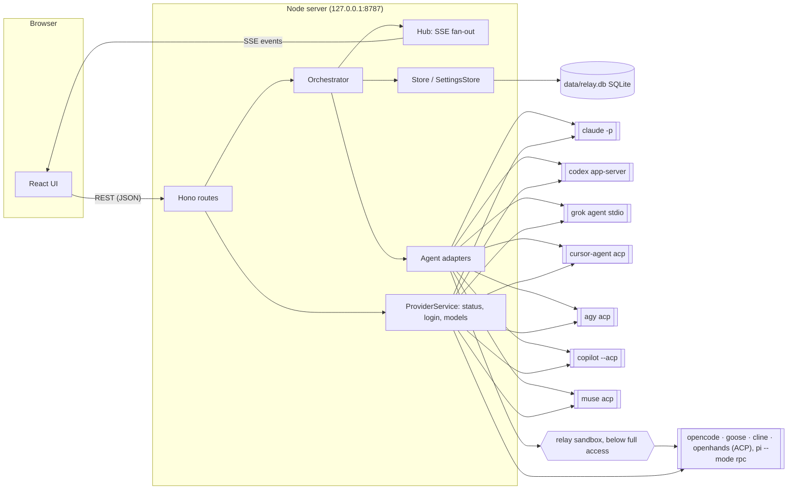
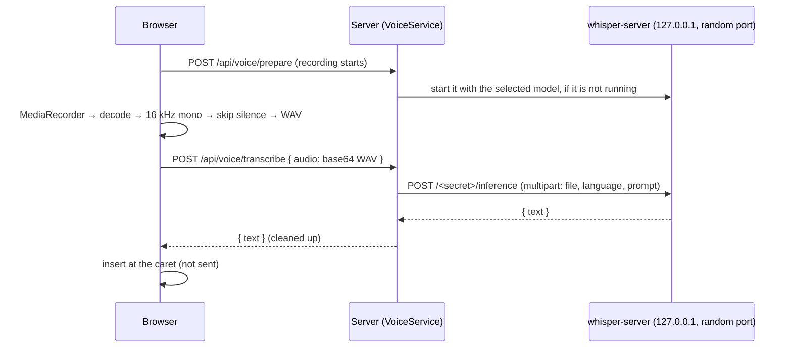

**English** | [繁體中文](architecture.zh-TW.md)

# Architecture

Harness Relay is a local web app with two halves:

- a **Node.js server** (Hono, TypeScript) that owns conversations, decides which agent speaks next, spawns the agent CLIs, and persists everything in SQLite;
- a **React client** (Vite) that renders the chat and receives live updates over Server-Sent Events (SSE).

The CLIs send agent prompts to their model backends. The server contacts a custom endpoint directly for metadata. In Settings, **Load models** reads the catalog with `GET <baseUrl>/models`. **Save** checks a new or changed connection against the catalog and requests individual model metadata for any IDs it cannot confirm there, and reads each model's context window from the same answers where the server reports one ([Open agents → Context windows](open-agents.md#context-windows)). Changing only a saved endpoint’s name is local. Every agent turn is one run of a real CLI (`claude`, `codex`, `grok`, `cursor-agent`, `agy`, `copilot`, `muse`, or one of the five open-source agents: `opencode`, `goose`, `cline`, `openhands`, `pi`) in headless mode, so each agent keeps its own tools, permissions and session history, and Claude Code, Codex, Grok, Cursor, Antigravity, Copilot and Muse Code their own login. The open agents run on the model backends the user sets up, in homes of Harness Relay's own, and below full access inside Harness Relay's own sandbox ([Open agents](open-agents.md)).



## Components

| Module | Responsibility |
| --- | --- |
| `src/server/app.ts` | HTTP routes, security middleware, SSE endpoint (`createApp`, testable with `app.request()`) |
| `src/server/index.ts` | Wiring, static file serving, startup and shutdown |
| `src/server/web.ts` | Serves the built UI: files under `assets/` (named by content hash) cached for good, `index.html` checked on every load; finds it in `dist/web` or `RELAY_WEB_DIR` |
| `src/server/parent.ts` | The desktop app that started the server, if any: tells it the server listens (or cannot), hears it ask for a shutdown |
| `desktop/` | The desktop app (Electron, a package of its own): runs the server in a utility process with the login shell's environment, shows the chat in a window of its own, a tray menu, open at login, sharing with the tailnet, updates; see [Desktop app](#desktop-app) |
| `src/server/orchestrator.ts` | Runs a "team turn": picks speakers by mode, builds each agent's prompt, runs the CLI, streams results; in auto-team conversations, has the lead agent design the team for each new question first |
| `src/server/planner.ts` | Auto team: the lead agent's prompt (the question, the conversation so far, the current team, the templates), parsing its JSON reply, turning it into a runnable team, the fallback |
| `src/server/reviewer.ts` | Lead review: what the lead agent reads of the team's replies since its last review, its prompt, and turning its JSON reply into a review (`src/shared/review.ts`: finding the words it quotes, shared with the chat) |
| `src/server/grouping.ts` | Sidebar groups: the lead agent sorts a new conversation into one of the user's groups by its first message, in the background (`AutoGrouper`) |
| `src/server/memory.ts` | Long-term memory: what replies' `<remember>` and `<forget>` blocks do to the notes, the user's changes, what a turn is given, and the lead agent tidying the notes in the background (`LongTermMemory`; the blocks and the choice of notes in `src/shared/memory.ts`); see [Long-term memory](#long-term-memory) |
| `src/server/handoffs.ts`, `src/server/fixedCommands.ts` | Secrets and fixed commands: a working directory's secrets (values in the credential store, names in `app_settings`) and fixed commands, a command's pin, its run in Harness Relay's own sandbox with its secrets in a file and its output masked (the reply blocks in `src/shared/handoffs.ts`); see [Secrets and fixed commands](#secrets-and-fixed-commands) |
| `src/server/prompt.ts` | Role briefing (system prompt), per-turn prompt, `@mention` parsing, `[PASS]` detection |
| `src/server/approvals.ts` | Rule keys for "always allow in this conversation" and matching them |
| `src/server/commands.ts` | Reads a shell command line into the programs it runs (chains, substitutions, `sh -c` / `eval`, `env` / `sudo`, reserved words and compound commands such as `if` / `while` / `for`, git's global options): approval keys, the publish check of Grok, Copilot and the open agents |
| `src/server/agents/*` | One adapter per CLI: builds arguments, parses the CLI's JSON event stream into common events (`acp.ts`: the JSON-RPC peer for ACP and Codex, and the ACP prompt, MCP server and permission-answer helpers; `acpTurn.ts`: the open agents' generic ACP turn; `open.ts`: what the open agents share around their process; see [Open agents](open-agents.md)) |
| `src/server/backends.ts` | The open agents' model backends: API keys for OpenAI, Anthropic and xAI and the user's OpenAI-compatible endpoints (keys in the OS credential store), and what one run gets (`backendRun()`); whether a run of Claude Code, Codex, Grok or Copilot is on one of the endpoints, and the refusal of one on a deleted endpoint (`endpointRunModel()`, the deleted ids in `deleted_endpoints`) |
| `src/server/endpointModels.ts` | Reads `data[].id` from the custom endpoint’s `GET <baseUrl>/models` response. When saving from Settings, verifies every selected or manually entered ID against that list or the matching individual model resource, and reads from the same answers the context window the server reports (vLLM's `max_model_len`, llama.cpp's `meta.n_ctx`: `reportedLimits()`). |
| `src/server/contextWindow.ts` | What a run on an endpoint makes of its model's context window and output limit: `runLimits()`, the share kept for an answer (`outputReserve()`) and for a tool output (`toolOutputChars()`), and what counts as a short window (`SHORT_CONTEXT`); each open agent's adapter, Codex's and Claude Code's write them where their CLI reads them ([Open agents → Context windows](open-agents.md#context-windows)). |
| `src/server/relaySandbox.ts`, `relaySandboxHost.ts` | Harness Relay's own sandbox around the open agents below full access (`@anthropic-ai/sandbox-runtime`, one host process per run; see [OS sandboxes by platform](sandboxing.md#harness-relays-own-sandbox)); `sandboxProcs.ts` finds a run's leftover processes on macOS by their sandbox |
| `src/server/i18n.ts` | Server messages in both languages; the language of each request and run (AsyncLocalStorage) |
| `src/server/process.ts` | Spawns processes in their own process group, streams stdout lines, keeps output as raw bytes, and on abort or timeout sends SIGTERM, then SIGKILL, to that group. On Windows, attached with a hidden console instead (`detachedChild()`), so programs they start do not open a window; Windows has no process group, so the same signals end that process |
| `src/server/winLaunch.ts` | On Windows, what to start for a CLI found as a `.cmd`: the program or Node script an npm shim names, or Cursor's newest version (see [CLI adapters](#cli-adapters)) |
| `src/server/providers.ts` | CLI status (installed, version, signed in), login sessions, logout, model catalog cache |
| `src/server/login.ts` | A CLI's own sign-in run without a terminal (`CliLogin`): its output, the links and codes in it, what is pasted to it, cancel and a 15-minute limit; the CLIs' sign-ins in Settings and gh's for sharing (`GhLogin`) are these |
| `src/server/models.ts` | Discovers models and reasoning-effort levels from each CLI |
| `src/server/workspace.ts` | Git plumbing: automatic `git init`, working-tree snapshots, per-agent worktrees, diffs, applying results |
| `src/server/store.ts` | SQLite persistence for conversations, messages, agent sessions and presets |
| `src/server/settings.ts` | Provider settings (binary path), each account's API key, default model/effort and what its runs leave out, default working directory, lead agent, child-process environment |
| `src/server/attachments.ts` | Files attached to user messages: saving them under `data/attachments`, safe file names, which ones go to the agents as images |
| `src/server/media.ts` | Images and videos a reply embeds, and files it links to: which directories they may come from, resolving a path safely (real path inside one of them, never in `.git`; media types only for media), byte ranges |
| `src/server/voice.ts` | Voice input: installs the whisper.cpp engine and models (pinned, SHA-256 checked) in the background, runs `whisper-server` on demand, transcribes recordings |
| `src/server/secrets.ts` | The OS credential store for API keys (`@napi-rs/keyring`), or none when the system has no usable one |
| `src/server/db.ts` | Opens SQLite, applies schema migrations, transaction helper |
| `src/server/hub.ts` | Per-conversation event fan-out to connected SSE clients |
| `src/server/share.ts` | Sharing a conversation (and signing `gh` in for it from the share dialog, `GhLogin`): the page the UI made goes up to GitHub as a secret gist through the user's own `gh` (`gh gist create`, read on Harness Relay's viewer, `site/share/`), the files its replies link to, of any kind, in a second secret gist (made with `gh api`, the files pushed into it with git, signed in by `gh`), and both come down with `gh gist delete` |
| `src/shared/types.ts` | Types shared by server and client |
| `src/shared/media.ts` | Which image and video types can be shown, and which image and link URLs in a reply are local files (relative or absolute paths, `file:` URLs, `file:line`) rather than other sites |
| `src/shared/share.ts` | A shared page's links to the files that go along with it: the placeholders the UI writes (`relay-share-file:<n>`, only as the href of a real `<a>` tag) and the server replaces with the files' addresses on GitHub; sizes as the share limits count them |
| `src/shared/search.ts` | Searching conversations: the words of a search, where they match (ignoring case), the excerpt around the first match, highlighting |
| `src/shared/mentions.ts` | The `@mention` rule used by both the server (who is addressed) and the UI (which mentions are highlighted): the message is read as Markdown (GFM) and only prose counts, not code or link text |
| `src/shared/links.ts` | Where a bare URL ends: GFM ends one only at a space, so Chinese written right after it would be part of the link. `endBareUrls()` also ends it at CJK or full-width punctuation, and at a CJK character that follows neither another one nor `/ ? # & = . - _ + (` (so `/wiki/臺灣` and `?q=中文` stay links), then leaves out trailing punctuation as GFM does; the prose after it may hold more URLs. Used by the UI's renderer and by the `@mention` rule, so both read a message alike |
| `src/web/*` | React UI: sidebar, team designer, chat view, settings page, guided tour; `i18n.tsx` + `locales/` hold the UI strings; `chat.ts` holds the chat view's pure logic (reconnecting, Apply availability, team-drawer draft, grouping a message's tool calls and thinking into activity rows, when the messages follow new output and when the button to their end shows); `sidebar.ts` the sidebar's (conversations in their groups, moves not yet confirmed, the pinned conversations and pins not yet confirmed, a collapsed group's state); `recorder.ts` records the microphone and `voice.ts` holds voice input's pure logic (WAV encoding, silence, inserting the transcript) |

## Conversation model

A **conversation** has a team (`agents`), settings (`mode`, `rounds`, `maxHops`, `permission`, `cwd`, `extraCwds` when it has more working directories than one (see [Several working directories](#several-working-directories)), and with [auto team](#auto-team) `autoTeam`, plus `autoConfirm` when the lead agent's team is used without asking, `leadReview` when the lead agent [reviews the team's replies](#lead-review), and `steer` when a message sent while members work goes into their running turns, [steering](#turn-scheduling-modes)) and an ordered list of **messages**. A message is authored by the user, an agent, or the system, and consists of **parts**: text blocks and tool calls (`Read`, `Edit`, `Shell`…) in the order they happened; a failed or refused tool call keeps its reason. A system message may carry a **plan** — the lead agent's team design — or a **review** — the lead agent's review of the team's replies.

For every agent the conversation also keeps **agent state**:

- `sessionId` — the CLI's own session/thread id, used to resume the agent's context next turn;
- `seen` — ids of chat messages that have already been delivered to this agent.

### Branching a conversation

**Branch conversation** (the branch icon under an agent's reply, `POST /api/conversations/:id/messages/:messageId/branch`, `Orchestrator.branch()`) makes a new conversation that goes on from that reply on its own:

- It holds a copy of every message up to and including the reply, each with a new id (message ids are rows of their own), written with the conversation in one transaction (`Store.create()`). The team, the settings, the "always allow" answers (`allowRules`) are copied as they are now, not as they were at that reply: a member who left since cannot be retried there, and later "always allow" answers carry over. It goes into its family's sidebar group (`Store.placeBranch()`, with `group_source = 'user'`, so the lead agent does not sort it; see [Sidebar groups and search](#sidebar-groups-and-search)). Its title is **Branch · <title>** (`t().branchTitle`) until the first user message posted there names it, as a new chat is named after its first question (`nameAfter()`: only while the title is still that, in either language, `isBranchTitle()`, so a name the user gave it stays). An edit that leaves no copied message ends the branch; still called that, it is called "New chat" again (`truncateFrom()`), so the edited message names it. The schedule and the queue are not copied.
- A question the reply asked stays open in the branch (`branchPause()`), whatever the user answered in the original since, so it can be answered another way. Branched where the original waits now, the branch copies its `pause`; otherwise the agent that asked (in parallel mode, with the round's other askers up to it) answers first, followed in roundtable mode by the members after it in the round, and in later rounds by the members the question was for. As in the original, the answer is no new question: the lead agent designs no team for it. A steps card the branch waits on loses the original's answer (its ticks stay), so it is answered there again.
- Attached files are copied into its own `data/attachments/<conversation>/` (a copy-on-write clone where the filesystem can make one; a file already gone is skipped), and the commits behind the copied replies' file changes are kept under its own `refs/harness-relay/<conversation>/`, so their files and diffs outlive the original. Isolated (parallel-mode) results cannot be applied there, and the images and files those replies link to are read from the worktree they were made in (`replyWorktree()`: the one holding the turn's branch, in the conversation the reply was written in: any its copied messages came from, and further up for a branch of a branch), never from the branch's own worktree for that agent; once the original is deleted, with its worktrees, they are not found.
- It is a branch of the conversation the reply was written in (`branchOrigin()`). That is the original for a reply written there; but up to a branch's branch point, its messages were copied, so branching from a reply there (the branch point included) makes a branch of the conversation the reply was copied from, or of one further up for a branch of a branch, as if it had been branched there: it is listed under that one in the sidebar, says **Continued from** that one, and is called **Branch · <its title>**, by its title now (`Store.titleOf()`; for one deleted since, the title the sidebar shows for it). The branch is worked out again once the attached files are copied, in the same step as it is saved (unless the original's messages up to the reply changed meanwhile): deleting waits only for branches made from the conversation itself, so one it comes from that was deleted meanwhile is known as deleted, with its `via`. So after B is branched from A, a branch from a reply B copied from A is A's branch, not B's.
- `conversation.branch` (`ConversationBranch`: the id of the conversation it was branched from, its title then, and `afterId`, the last copied message here; `earlier`: where the copied messages before those were written, when they were copied from further up, as parts of their own, nearest first, each with its conversation, title and last message here) is stored as JSON in `conversations.branch`. Branching from a reply in one of the `earlier` parts makes a branch of the conversation that part names; only the parts before the reply come along. A part whose last message is not in the conversation cannot be placed and is left out. ChatView shows **Continued from <title>** after the chat's title in the header (each takes the room it needs; when both need more, each gets half, and one needing less leaves the rest to the other, both ending in …) and as a line after `afterId`, linking to the original while the conversation list has it (with its title now), and its title then once it is deleted. The line is an element between messages, which a shared page skips (`messageElements()`, as it takes one element per message); shared pages leave both out. Retrying or editing a copied message moves `afterId` back to the last copied message left (`branchAfterCut()`), and a part that loses all its messages goes: with nothing left of the conversation it was branched from, it is a branch of the one further up, by that one's title now (and while still called **Branch · <title>**, called after that one). Once no copied message is left, `branch` is removed.
- The agents start with no session and nothing `seen`, so their first turn gets the copied history (their own replies included), as a fresh session does. Their briefing says the chat was branched and that the original may have changed files since; the working directory is shared and nothing in it is rewound.
- The original is not touched and may go on replying meanwhile; only the turns up to the reply must be over (409 while a reply is still streaming, as a parallel peer's can be, or its turn still records the files it changed: `Run.turns`). Deleting the original, and shutdown (`settled()`), wait for a branch being made, which is still copying its files. Only an agent's reply can be branched from (400 for others).

## How agents share context

Each agent has its own long-lived CLI session, so the server does **not** resend the whole chat every turn. Instead:

1. Before an agent speaks, the orchestrator collects every finished message that is not in the agent's `seen` set (user messages, other agents' replies, and — when starting fresh — the agent's own earlier replies).
2. Those messages are rendered as tagged blocks and sent as the prompt:

   ```text
   New chat messages since your last turn:
   <chat>
   <message from="user">…</message>
   <message from="@Builder" via="Codex">
   Implemented step 2.
   <actions>
   Edit update src/api.ts
   Shell npm test
   </actions>
   </message>
   </chat>

   Roundtable round 2/3: it's your turn, @Reviewer. Reply with [PASS] if you have nothing new to add.
   ```

   The `<actions>` block summarizes file edits and commands the speaker ran, so teammates know what changed without seeing the raw tool output. A `<memory_saved>` block lists the [long-term memory](#long-term-memory) notes the reply saved, corrected or set aside, and the notes recalled for the turn follow the chat in `<recalled_memory>` (their ids kept in `seen` as `memory:<id>`, so a session is given each once).

   A user message with attached files also gets an `<attachments>` block listing each file's name, type, size and absolute path, which the agent opens with its own tools. Images (PNG, JPEG, GIF, WebP) in the delivered messages are passed natively as well: to Claude Code as base64 image blocks in its stream-json user message (plus `--add-dir` for the attachments folder so its Read tool may open the files), to Codex as `localImage` inputs on `turn/start`, and to Grok, Cursor, Antigravity, Copilot and Muse Code as ACP image blocks (all five advertise `promptCapabilities.image`). Images over about 3.75 MB are only listed, to stay under the 5 MB per-image API limit.
3. The CLI is resumed with its stored session id, so it remembers everything it saw before.
4. When the turn succeeds, the delivered ids (and the agent's own reply) are added to `seen`. If the turn fails, the delivery is rolled back so the messages are offered again next time.

If resuming fails before the agent produced any output (for example the session was removed, or the working directory changed and Claude Code keeps sessions per directory), the orchestrator retries once with a **fresh** session and the full chat history. If the fresh session fails too before any output, the problem was not the session (a rate limit, sign-in, network…), so the old session is kept for the next turn.

Messages are forwarded once they are final: finished replies, and replies that failed or were stopped but said something or changed files (marked `status="failed"` / `status="stopped"`). A `[PASS]` reply is forwarded as `[PASS]` plus its `<changed_files>` and `<memory_saved>`.

### Role briefing

Each agent's role is injected through the CLI's system-prompt mechanism (Cursor has none, so its briefing goes in the prompt; Antigravity's is appended to its system prompt, again only when it changed; Copilot's is a file in the run's own home that it reads into its system prompt; Muse Code's goes into the session's first developer message) and **rebuilt on every turn**, so edits to roles or the team take effect on the next turn:

| CLI | Mechanism |
| --- | --- |
| Claude Code | `--append-system-prompt <briefing>` with `--system-prompt-snapshot off` (otherwise a resumed session keeps the prompt of its first request) |
| Codex | `developerInstructions` on `thread/start` / `thread/resume` |
| Grok | `_meta.rules` on ACP `session/new` / `session/resume` |
| Cursor | none over ACP: the briefing goes at the top of the prompt, inside `<harness-relay-briefing>…</harness-relay-briefing>`, in a new session, and in a resumed one only when it changed since it was last sent (remembered in memory per session, so after a server restart it is sent once more) |
| Antigravity | `_meta.antigravity.systemPrompt.append` on ACP `session/new` / `session/resume` (agy advertises it), inside `<harness-relay-briefing>…</harness-relay-briefing>`, which says it replaces any earlier one. agy adds each one sent to the session's system prompt, so, as for Cursor, a resumed session gets it again only when it changed since it was last sent (a hash per session, in memory). An agy that does not advertise it gets the briefing at the top of the prompt instead. Antigravity's briefing also says that a refused tool call ends its turn, and to ask the user Harness Relay's way, not with its `ask_question` tool |
| Copilot | `copilot-instructions.md` in the run's own home (see [CLI adapters](#cli-adapters)), Copilot's personal instructions file, which it reads into its system prompt (`<custom_instruction>`) at every start, so a resumed session has only the current briefing; inside `<harness-relay-briefing>…</harness-relay-briefing>`, followed in the same file by the account's own `copilot-instructions.md`. Copilot's briefing also says that a refused tool call ends its turn at once, so to say first what it is about to do before a call that may need approval, and to ask the user as the briefing says (`[ASK_USER]`): over ACP Copilot has no question tool of its own (`ask_user` is not among its tools there) |
| Muse Code | `-c run.developer_prompt=<briefing as JSON>` on `muse acp`, inside `<harness-relay-briefing>…</harness-relay-briefing>`: Muse puts it at the top of the session's first developer message (a `${…}` in it is not expanded). Every process gets it, and a resumed session gets the new one instead of the old (Muse does not keep it), so it is sent on every turn. `-c run.system_prompt` would replace Muse's own system prompt, so it is not used. On Windows, where a command line holds at most 32,767 characters, a briefing longer than 24,000 as JSON goes at the top of the prompt instead. Muse Code's briefing also says that a refused call comes back as Muse's own words, without the reason (`MUSE_NOTES`) |

The briefing contains the agent's role, the team roster (with each teammate's role summary), the rules of the current mode, the `[PASS]` convention, the shared working directory and the permission level. In parallel mode it also names the agent's worktree and branch, and each teammate's branch with the snapshot that teammate's worktree started from. With the [tool library](#tool-library), it also holds the agent's memory and a list of its skills. While [long-term memory](#long-term-memory) is on, it says what that memory is for and how to save a note, with the pinned notes.

## Turn scheduling (modes)

When the user sends a message (or presses **Continue**, which sends nothing), the orchestrator starts a run:

- **`@mentions` in the user message** restrict who takes part: only mentioned agents speak (in relay mode they start the relay).
- **Roundtable** — for each round `1…rounds`, participants speak one after another in team order. Each sees what earlier speakers said. If everyone in a round passes (or fails), the run ends early.
- **Parallel** — for each round, all participants run concurrently. Messages still streaming are not delivered, so agents don't see each other's answers until the next round.
- **Relay** — a queue starts with the mentioned agents, or the first team member (the "lead"). After each reply, every teammate `@mentioned` in the reply's prose (not in code or link text, see `src/shared/mentions.ts`) is appended to the queue. The run ends when the queue is empty or after `maxHops` turns (a system note tells the user, who can press **Continue**).

A reply that is exactly `[PASS]` (or empty with no tool calls) is marked as *passed* and rendered dimmed.

Only one run per conversation can be active at a time; different conversations can run concurrently. **Stop** aborts the run and kills the active CLI processes (process group `SIGTERM`, then `SIGKILL` after 3 s). Each agent turn also has a safety timeout: 1 day, or as many minutes as `RELAY_TURN_TIMEOUT_MIN` says (a minute to 7 days).

**Messages sent while the team replies** (`Orchestrator.send()`) do not start a second run. While a run is under way or being set up, or the lead agent's team design waits for confirmation, a message goes into the conversation's queue (`conversation.queue`, saved in `conversations.queue`, at most 20) instead (but while the lead agent reviews the team's replies, a message stops the review and goes at once: see [Lead review](#lead-review)), and the browser shows it above the message box (`queue` event). `deliverQueued()` posts waiting messages, oldest first, before the next turn of an agent they are for: in roundtable before each speaker, in relay before each hop, in parallel at the start of each round (so the whole round sees the same messages). A message that @mentions only other agents waits for one of them, and the ones behind it wait too, so the chat keeps the order they were sent in. Delivered messages are ordinary user messages marked `queued` (shown as *Added mid-reply*); each agent receives them through its unseen-message delta like anything else, so the agent that was speaking sees them on its next turn. When a run ends with messages still waiting and was not stopped, `startQueued()` starts another run for them, its participants chosen by their @mentions (all of them mention someone: those agents; otherwise everyone). After **Stop** they keep waiting for the user (`DELETE /api/conversations/:id/queue/:messageId` withdraws one); the next send or Continue posts them ahead of the new message. Sending with `interrupt: true` stops the run, waits for it to wind down, and then sends the waiting messages and the new one as a new run. A message is saved as a message before it leaves the saved queue, so one in both after a crash counts as delivered.

**Steering** (`settings.steer`, off by default; Team settings' box, `PUT /api/conversations/:id/steer`, switched at any time, also while the team replies). With it on, a message sent while members work goes into their running turns instead of the queue (`Orchestrator.steerOrQueue()`, `steerInto()`), as the mode and the members' CLIs allow (`STEER_PROVIDERS`): in roundtable and relay mode into the turn of the member speaking now (the members after it get it before their own turns, as any message); in parallel mode into every turn of the round at once, only while all of them are still running and each can take one (`Run.round`), so that the round sees the same messages. A runner whose CLI can take one gives the orchestrator a way to send it once its prompt is out (`RunOptions.onSteer`, see [CLI adapters](#cli-adapters)) and takes it back as its turn ends. The message goes in as a chat block (`buildSteerPrompt()`); once a turn took it, it is posted in the chat after the reply it went into, marked `queued` (it joined a discussion under way) and `steered` (the members whose turns took it, `messages.steered`; the chat shows **Sent into @X's turn**), and it counts as seen by those members once their turns end well (a turn that fails offers it again, as it does its prompt's messages). It waits in the queue as before when steering is off, it has attached files, a message already waits in the queue (the chat keeps the order they were sent in), it @mentions only other members, the run is not the team's turns (the lead agent designs or reviews, a design waits for confirmation, a fix or failed team checks hold the queue, a check's command runs), or the CLIs refuse it or their turns end in between. Messages go one at a time per conversation, in the order they were sent. In parallel mode, a member of the round whose turn ended just before the message reached it gets it with its next turn's messages. A schedule's messages are never steered; one the user steered into a run a schedule started means they are here, as a queued one does (approvals are asked again). Retrying the reply a message went into deletes the message too, as it does every message after the reply.

**Questions to the user.** The briefing tells agents to ask instead of guessing when a good answer depends on something only the user knows, and to end such a reply with `[ASK_USER]` on its own line (`src/shared/ask.ts`; the UI hides the marker while the reply streams). When a turn ends, `takeAsk()` removes the marker from the message and marks it `asked`, and the run stops there: `pauseFor()` saves where (`conversation.pause`, a `RunPause` in `conversations.pause`, sent to the browser with the `conversation` event). Roundtable stops at once and keeps the rest of the round; parallel lets the round finish, then keeps the agents that asked; relay keeps the rest of the queue and the handoffs left. While the team waits, messages in the queue do not start a run. The next run (`takePause()`) picks up from there: the agents that asked speak first, told on that turn that the user replied (`TurnInfo.answered`), then the rest of the round (or relay queue) and the remaining rounds. Continue with nothing to post skips the agents that asked. A reply that @mentions anyone else, an edit or retry (`truncateFrom()` clears the pause), a team design or a changed mode starts afresh instead. The user's reply is an answer, not a new question, so [auto team](#auto-team) designs no team for it. The conversation list reports `asking` for the sidebar.

**Steps for the user.** For what only the user can do outside Harness Relay (a sign-in, a developer console, a payment, a device), the briefing tells agents to end the reply with the steps in a block on lines of its own, `<steps>`, one numbered step a line, `</steps>`, as plain text (never in code), never for questions (those keep `[ASK_USER]`) and never asking for a secret. It is plain text, so every CLI can write it at every permission. When a turn ends, `takeSteps()` takes the last such block off the reply's last text part (`splitSteps()` in `src/shared/steps.ts`, pure and tolerant: numbers, bullets and task boxes before the steps, an unmarked line or deeper bullet going on the step before it, Markdown marks or a backtick around the tags on their own lines, the closing tag at the end of the last step's line, or missing when the block's first line is a numbered or bulleted step; but only what is plainly a block: an opening tag at a line's start followed by nothing or a step's number or bullet, never prose that names the tag; a closing tag inside inline code closes nothing; a fence counts only when it holds the block alone and ends the reply, so an example of the syntax stays code; a block among other code, running across a fence, with no step, more than 30 steps or 8,000 characters stays as text, as written) into a `steps` part (`{ type: 'steps', items: StepItem[], answer?: StepsAnswer }`, kept in `message_parts` with the steps' words in `text`, which search reads), after `takeAsk()` (a marker before or after the block is taken too) and before a `<progress>` block; such a reply is `asked`, and the run pauses exactly as for `[ASK_USER]` (`pauseFor()`), so the sidebar, notifications and the inbox say the user is needed (`alertDetail()` names the steps when the reply said nothing else). While the team waits for it (`askingReplies()` in `src/shared/ask.ts`: the latest reply that asked of each agent `conversation.pause` waits for, the run idle), `PUT /api/conversations/:id/messages/:messageId/steps/:index` ticks or unticks a step (`Orchestrator.tickStep()`, saved and sent to every browser as a `message` event), and `POST …/steps/answer` (`answerSteps()`: the steps done, the one the user is stuck at, a note of at most 2,000 characters) records the answer on the part, then posts the user's answer through `send()` as an ordinary message in the request's language (`stepsAnswerText()`, the server's `t().steps`: how it went, then each step marked done, not done or stuck here in a few plain words of the agent's, `plainStep()`, without its links, code or formatting, since the message is the user's, then the note), so `takePause()` resumes with the agent that asked first; the mentions in those words lose their `@` (in prose only, `unmention()`), so the answer goes to that agent and starts nothing afresh. The answer is that agent's alone (`StartOptions.answers`): when others wait too (parallel mode, where a round can stop for several), `takePause()` resumes it alone, in the round it asked in (`Schedule.waiting`), and keeps the pause for the others; once its turn is over, the team waits again (`pauseFor()`) for them and for any that asked now, and the card says beforehand who else waits. Meanwhile the others' cards are still waited for, but not answered: a card's answer is refused while the team works or the lead agent reviews (409, `t().steps.busy`; `send()` never queues nor steers a message with `answers`, since one taken from the queue would answer every agent that waits then), and the card says it can be answered once the turn is over (`later` in `src/web/steps.ts`). An answer in the message box still answers every agent that waits. A step not there or a note too long is refused (400); a card already answered, or not waited for any more (the user replied otherwise, or the team works), is refused (409); a message that cannot be posted puts the card back as it was. Agents read the reply's steps as the block it wrote (`stepsBlock()` in `forwardText()`) and the answer as text; AgentsView gets the steps as marked lines; the copy and the transcript as a Markdown task list; a shared page keeps the card's steps and marks without what it asks of the user (`.steps-wait`, `.steps-actions`, `.steps-closed`, `.steps-later` in `SHARE_DROP`). The chat's card is `src/web/components/StepsCard.tsx`, its logic `src/web/steps.ts`; while a reply streams, a block begun at a line's start is hidden (`withoutStepsTail()`).

**Retrying an agent's reply** (`Orchestrator.retry()`) works the same way: the reply and everything after it are deleted, then that agent answers again — followed, outside relay mode, by the agents of the same round whose replies were dropped with it — for one round.

**Editing a user message** (`Orchestrator.resend()`) deletes that message and everything after it, resets every agent's session (CLI sessions cannot be rewound, so each agent starts fresh with the remaining history), marks parallel worktrees for reset (and the team's own, once no reply that changed files there is left: [Two conversations in one folder](#two-conversations-in-one-folder)), and sends the edited text as a new run. The truncation happens only after the workspace is prepared and locked, so a failed start leaves the history intact. Files the dropped turns changed are not restored.

## Auto team

Every conversation the app starts has `settings.autoTeam`: before the team answers a new question, the **lead agent** designs the team for it (`designTeam()` in the orchestrator, `src/server/planner.ts`). The user designs teams as **templates** (on the New chat page: built-in ones to copy, their own to add, change and delete; `POST /api/presets`), and the lead agent picks, adapts or replaces them per question. A new conversation has no members until its first question.

**Which runs design.** `Orchestrator.designs()` decides when a run starts: the lead designs when the conversation has no team yet; for a question of the user's own (a message sent while nothing runs or while the lead agent reviews, which stops the review first, or an edited message), unless it answers an agent's question (`conversation.pause`) or @mentions members of the current team, who then answer it; and on Continue when a design was stopped since the team last spoke (`designOwed()`). A retry, a scheduled message, a run for the messages that waited in the queue and the run that follows a confirmation keep the current team (`StartOptions.keepTeam`). A conversation without `autoTeam` (created through the API with a team) never designs.

**The design run** does nothing but design the team:

1. A system message with `plan.status = "planning"` appears in the chat.
2. The lead agent (Settings: provider, optional model and effort) runs once when available, read-only, in the conversation's working directory, with `PLANNER_BRIEFING` as its system prompt. The prompt (`buildPlannerPrompt()`) contains the **question** — everything the user said since the team last spoke or a team was designed (`questionStart()`), so a stopped design's question still counts — the **conversation so far** before it (`historyForLead()`: the user's messages and the agents' replies, oldest first, without tool calls, system notes, plans, passes or failed replies; each at most 1,500 characters, all of them at most 12,000, the latest kept), the **current team** (mode, rounds or hops, each member's CLI, model, effort and complete role), the signed-in CLIs (`agentsForLead()`), each with the available models it offers (each model’s name, supported efforts and default effort) and the defaults Harness Relay runs it with, both as the account its new members get runs it (`catalogFor(ctx.catalog, p, ctx.accounts[p][0])`), what it loads by itself in the conversation's working directory (`ctx.native`: built-in tools, skills, MCP servers with their tools, subagents and plugins, without what its runs leave out; asked through `NativeSetupService.recent()`, which calls no model, in the home of the account its new members get, `ctx.accounts[p][0]`; the last answer for that CLI, folder and home is used at once, however old, while what its runs leave out is the same, and is asked again in the background after a minute; with none yet the design waits up to `NATIVE_WAIT_MS`, 20 s, and a CLI that answered nothing by then is listed as unknown, with why; one that refused a question, left a part unanswered or ran out of time after some answers keeps the lists it answered, marked as maybe incomplete (`probeCompleteness()`; a refused question is marked `refused`, so a CLI that answered its lists empty, with nothing of its own, is not taken for one that could not be asked)) and the tool library items its new members get, then the tool library itself (`ctx.library`: each MCP server, usable skill and memory part, and whose members get it), with how to staff members by these, how to write a role (its first line says who the member is, since teammates see only that line in their briefing, `roleSummary()`; and only what is particular to the member) and the guides for the roles it writes (`roleGuidesForLead()` in `src/server/roleGuides.ts`: how each model family takes a role best, from its makers' own guides and docs, only for the families the signed-in CLIs can run, `familiesForLead()`, none when no family is known, and asking for no edits when the permission is read-only; each model in the CLIs' lists is then marked with the guide it follows, `guide: …` from `familyOf()`, also a default model the CLI does not list and its own models when it lists none, `unlistedFamily()`, and a model of no family, such as Cursor's Auto, with none), the three modes, the user's permission and working directory (which it cannot change), whether the user reviews the team or it answers at once, for a schedule's message, the names it @mentions that no current member has (`unknownMentions()` in `src/shared/mentions.ts`; if they name the people or roles it is for, the lead is to name the members so, adapting a template to rename them, since only members a message @mentions answer it — not for an ordinary question, whose @-words are as often code), and every template (built-in and saved) in full, as JSON. It must reply with one JSON object: `{"choice": "keep", "reason"}` to keep the current team (offered only when there is one; preferred for a follow-up on the same work, since its members keep what they learned); `{"choice": "template", "templateId", "reason"}` to use a template as it is; `{"choice": "adapted", "baseTemplateId", …team, "reason"}` to change one for the question; or `{"choice": "custom", …team, "reason"}` for a team designed from scratch, where the team is `"name", "description", "mode", "rounds", "maxHops", "agents": [{name, provider, role, model?, effort?}]`. The lead reads the tools but does not change them: the current team and the templates list, as `fromToolLibrary`, the library items each member actually gets (its CLI's defaults with its exceptions, `memberLibraryTools()`, as `ToolLibrary.forAgent` gives them); new members get their CLI's defaults, and members who stay keep their exceptions. `plannerContext()` in `planner.ts` gathers all this (the server's `PlannerSource.context(cwd)`). The reason is for the user.
3. `leadReply()` takes the structured answer the lead's CLI gave (see **Answers in a shape** below), else `parsePlanReply()` takes the JSON from a fenced block (or the outermost braces); `decidePlan()` turns it into a team. A kept team preserves its assignments and member IDs when every assignment is available. Custom members go through the same validation as a hand-made team (`validateAgents`), names have spaces replaced, at most 5 members (fewer when `RELAY_MAX_TEAM_AGENTS` is lower), rounds 1–5, hops 1–30. Templates with more members than the team limit (one saved before the limit was lowered) are not offered to the lead agent, nor taken when it names one, and the fallback template is cut to the limit. A team saved before the limit was lowered can still be handed to the lead agent to change; its answer is cut to the limit. `fitAgents()` checks the model and account for each assignment and drops incompatible effort levels. A template used as it is gets a default reason if the lead gave none. An adapted team records its base template in `plan.basedOn` (id and name), and its members who are one of the template's (same name, ignoring case, and CLI) keep that member's tools and account (`fromTemplate()`); one whose base id is unknown is kept as a custom team. An adapted or custom team that is identical to a template (`sameTeam()`: same members, CLIs, roles, models, efforts, mode and rounds or hops) is recorded as that template.
4. If the lead fails or its reply is unusable, `fallbackPlan()` fits the existing members to available assignments, or uses the General-question template when there is no team, and the card explains why (`source: "fallback"`, with `presetId` only for the template). If the user stops the run, the message is marked aborted; the next question, or Continue, designs again.
5. Members who stay on (same name, ignoring case, and same CLI as a current member, `keepMemberIds()`) keep their IDs, worktrees, tool settings and limits (`AgentConfig.limits`, see [A member's own limits](#a-members-own-limits)); an adapted team's members keep their template member's too (`fromTemplate()`), and the lead's changes on request leave them as they are (`decideRevision()`). They keep their CLI sessions when they stay on the same account. New members and members who switch accounts start fresh and read the conversation through their unseen-message delta, like any new member. The plan card becomes `ready` (with the reported cost and tokens for the lead and the model checks) and holds the team (`plan.agents`, `plan.settings`). The run ends there.
6. **Confirmation.** By default the plan waits (`awaitingConfirmation`) and the conversation keeps its current team, so a retry or an edit of an earlier message (which drops the waiting plan with what follows) still has that team. Until the user answers, Continue is refused (409) and messages wait in the queue (as do messages sent while the lead designs). The user can confirm it (`POST /api/conversations/:id/messages/:messageId/confirm-plan`: the plan's team and mode become the conversation's, `plan.confirmedAt`), decline it (`…/decline-plan`: the current team stays, `plan.declinedAt`; not for a first question, which has no team to keep), or set the team by hand (`PATCH … { agents }`, which settles it with the team as sent: the team drawer edits the waiting design and says that saving uses it). Both buttons are refused (409) while something else holds the conversation. Either way the team then answers (`startConfirmed()`): a run with the team now set, which posts the waiting messages first and sees the question in the history. With `settings.autoConfirm` the plan's team is used at once (`confirmedAt`, `autoConfirmed`) and the team's run starts when the design run ends (`Run.answerNext`); if it cannot start (the server is stopping, say), a note says why and Continue lets the team answer without a new design. Plan messages are system messages, so they are never forwarded to agents.

**Answers in a shape.** The lead agent's kinds of turns (the design, a change on request, the review, the sidebar grouping and naming, and the editors' drafts) each have the JSON shape of their answer as a JSON Schema next to the parser it mirrors (`PLAN_SCHEMA` and `REVISION_SCHEMA` in `planner.ts`, `REVIEW_SCHEMA` in `reviewer.ts`, `GROUP_SCHEMA` and `groupSchema()` in `grouping.ts`; `TEMPLATE_SCHEMA`, `CHECKS_SCHEMA`, `SCHEDULE_SCHEMA` and `ORGANIZE_SCHEMA` for the drafts), passed to the run as `RunOptions.outputSchema`. Each is written as Codex's strict structured output takes it (and Claude Code's): every object lists all its properties as required and allows no others, so a field the answer has none of is null (a nullable array or object an `anyOf` with null; `test/planner.test.ts` checks every schema for this). A lead on Claude Code or Codex with its maker's own models asks for it: Claude Code with `--json-schema` (its result carries `structured_output`; claude 2.1.330), Codex with `outputSchema` on `turn/start`, for that one turn (stable in codex 0.167's app-server schema; its last agent message is the answer, read as JSON); both give it back as `RunResult.structured`. On the user's own endpoint (`endpointRunModel()`), which may not take it, neither asks, and the other CLIs ignore it. `leadReply()` takes the structured answer, its nulls left out as if the field were not there, when it is an object with something in it; otherwise the reply's text is parsed as before, so a lead on another CLI, on an endpoint, or whose structured answer is missing or not an object still works. A Claude Code turn that could not answer in the shape after its retries (`error_max_structured_output_retries`) is no failure: its text is read instead. A design that fails keeps the structured answer in its diagnostic when there was no text.

**Availability.** For automatic designs, `plannerContext()` starts the existing `ProviderService.usage()` probes for installed CLIs’ usable accounts. The probes call no model. Each design asks for fresh usage and shares probes already running in Settings. It waits up to ten seconds for answers. It excludes exhausted account-wide limits and model-scoped limits it can match to a model or family, while retaining models on configured endpoints that do not use the subscription. A limit the account keeps running past, billed, excludes nothing: the parser marks the limits its `payer` covers `paidPast` while it can pay now. Codex's credits (`unlimited`, or `hasCredits` with a balance above zero, on the `codex` snapshot, with no spend control reached and no workspace out of credits or at its spend cap) pay past the plan's own windows and its `ordinaryUsageAllowed: false`, never past a model's own limit; Claude Code's usage credits (`extra_usage` turned on, nothing disabling it, below its monthly, daily and weekly spend limits) past every limit; Copilot's additional paid usage past a kind whose `overageAllowedWithExhaustedQuota` (or `overage_permitted`) is true; Grok's prepaid credits, or pay-as-you-go with room below its cap, past the plan's allowance. A CLI's accounts that still run on their plan's included usage come before those billed past it, and a member billed past its plan moves to the same model on such an account when there is one (`toIncludedUsage()`). When the account new members get, or some of its models, runs on paid usage, the lead's list says so, billed for each turn, so that it prefers others when they fit as well. A Muse Code sign-in without a subscription allowance (`noAllowance`) is billed by use and stays eligible, as a key does. Antigravity's AI credits pay past every quota while some are left, once the account turned them on as agy's own CLI reads it: its `useG1Credits` setting, or the Antigravity app's `userSettings.useAiCredits` in `config/config.json` (`antigravityAiCredits()`); each run's own settings carry that choice, since agy's ACP server reads no others. Windows whose reset time has passed and unknown usage are eligible. If a default is unavailable, the lead sees the other usable models for that account and is asked to pick one explicitly. The server checks the final account and model, including kept teams, templates and fallbacks. It tries the same model on another account, then another model on the same CLI, then an available CLI. A known unavailable lead uses the normal fallback. A deleted private endpoint fails the plan before any prompt can be sent to a different backend. When there are no eligible assignments, the plan is marked `failed` and queued messages wait. Continue or the automation panel can retry the design. The check is a design-time snapshot. Manual edits and later turns use their existing model settings.

**Model checks and progress.** `checkTeam()` runs a fixed prompt through each distinct proposed CLI, account and model, with a new session and a private empty working directory. Known account defaults are made explicit so the checked model is the one the team uses. The probe uses read-only access for read-only and edit chats. In a Full access chat, tests with that permission begin after team confirmation, or immediately when the user enabled auto-confirm. A team that was confirmed by hand is tested as approved. In other designs, failed assignments are excluded while `fitAgents()` tries replacements within three attempts and a shared 60-second timeout. A private member can only be replaced within its endpoint. If any assignment still fails, the team does not start. The plan message keeps the lead’s streamed tool activity, reported thinking and to-do list, plus the account and model-check steps. The **Team design progress** disclosure stays mounted inside the team design card from planning through the result and uses the same activity UI as agent replies.

The lead designs the team read-only and model checks run in their own empty folders. A design holds no lock on the conversation’s working directories; the team's own runs lock by the confirmed mode as usual. `POST /api/conversations/:id/messages/:messageId/save-plan` saves a team the lead designed or adapted (`planSavable()`) as a user template (with the conversation's permission) and records `plan.savedPresetId`; a template used as it is, or the current team kept, is not new, so the card does not offer to save it. Editing a question drops its plan with it and designs again for the edited question, with what came before it as history. A team set by hand, and the settings, never switch auto team on or off (`PATCH` keeps `autoTeam` as it was); `autoConfirm` can be changed in the team settings. A team set by hand also changes the design it comes from, so its card names the members the conversation has (`Orchestrator.teamSetByHand()`, `planFollowsTeam()` in `planner.ts`): the design it settles when one waits, else the latest design that was used (`currentPlan()`, which passes over designs declined since it and one still waiting: the conversation kept that team) gets the team's members and how they take turns, and `plan.adjustedAt` (the card says *You adjusted this team*); a template saved from it before is forgotten (`savedPresetId`), so the card offers to save the team again. A save that leaves the team as the design has it changes nothing. A conversation from before this keeps its cards as they were until the team is next saved. A change to the settings alone changes the latest design used that way too, never a design still waiting. While agents are at work (the team replying, the lead agent reviewing), the latest card's **Adjust team** is disabled, as the team settings could not save the team then. Schema version 13 (`conversations.auto_confirm`) turned auto team on for every conversation saved before it.

**Changing a team at the user's request.** The team drawer can ask the lead to change the team it shows (the conversation's team, or the design waiting for confirmation, with the user's edits so far). `POST /api/conversations/:id/revise-team` with `{ request, agents, settings }` (`settings`: how the members take turns, and the drawer's permission and working directory, saved or not, which the lead only reads: `draftPlace()`) runs the lead read-only in the saved working directory with `REVISER_BRIEFING` and `buildRevisePrompt()`: the request, the team, the conversation so far, whether the team is a design waiting for confirmation (for the latest question, or for the schedule's message, or for a schedule deleted since), the schedule's message when the schedule is on or the waiting design is for it (saying when it is off), the folder the lead itself works in when the drawer names another one, the CLIs it can use (with the same role guides) and the templates. It replies with the whole team as JSON, giving a role only for a new member or one it rewrites, which `decideRevision()` makes runnable. A member stays the same member when the lead names it as `was` (renamed, or moved to another CLI), or keeps its name (ignoring case) and CLI, or keeps its name on another CLI, or, when exactly one listed member and one drawer member are left over and the listed one has no role or the same one, is that one (renamed without saying so). Every `was` is settled before any name, so a new member named like one renamed away does not take its place, and swaps and chains of renames keep each member. A `was` naming a member the lead also lists unchanged under that name (no role, not itself renamed) is ignored: it was misused for a new member based on that one, which then starts from its role and is never taken for a member being removed. It keeps its id (and with it its session; on another CLI the session starts afresh, as for a change by hand), its tools, and the role, model and effort the lead left out (or gave as `null`, or a blank role; a model or effort does not carry over to another CLI); a role the lead copied without its surrounding space stays as the user wrote it; a member who keeps its CLI keeps it even when that one is signed out, since the user chose it. New and moved members, and changed models and efforts, are fitted as for a design. A reply without members (the lead declined, saying why) keeps the members. The answer is a `TeamRevision` (members, how they take turns, the lead's reason, and the run's time and cost). Nothing in the conversation changes: the drawer shows the team, lists what changed (`teamChanges()` in `src/web/chat.ts`, which ignores an empty model and space around a role) and offers Undo, until the user saves it with `PATCH` as usual (which settles a waiting design). The drawer ignores an answer when its team was loaded again meanwhile, or can no longer be saved (`revisionOutcome()`). A new request stops the one before (409), and so do closing the request (the drawer closed, or Stop), deleting the conversation and shutting down; a stopped one is still waited for, on delete and shutdown, until its lead process has ended. The lead's session is linked to the conversation in AgentsView.

**The lead agent's drafts for the editors.** The editors that are not a conversation's team ask the lead agent the same way, through `LeadDrafts` (`src/server/leadDrafts.ts`, `orchestrator.drafts`): the template editor (`POST /api/presets/draft`, `buildTemplatePrompt()` in `planner.ts`: the template, its name and description, a new one's members only a starting point; its members matched as `decideRevision()` matches the drawer's), the team checks editor (`POST /api/checks/draft`, `src/server/checksDraft.ts`: for a chat or a new chat the lead runs read-only in its first working directory, the others added, and is asked to read how the project is built and checked before it proposes a command; for a template or Settings' default it reads none; its list is checked rule by rule with `validateChecks()`, a rule it got wrong left out and counted, a command or hook it kept keeping its id, the default's hooks kept, since they are set apart) and the schedule form (`POST /api/schedules/draft`, `src/server/scheduleDraft.ts`: the time in the browser's zone, the conversation's team, the mail accounts' and calendars' ids and names, never more of them; checked as a saved schedule is, a trigger's account kept only when it is set up). Each is one run of the lead with a briefing of its own and its strict JSON shape (`TEMPLATE_SCHEMA`, `CHECKS_SCHEMA`, `SCHEDULE_SCHEMA`, `ORGANIZE_SCHEMA`), read-only, with no session kept (`freshState`, state key `draft.<kind>[.<conversation>]`), in the project it reads or else in an empty folder of its own in the data folder's `drafts/` (`questionDir()`, removed once it answers; never in Harness Relay's temporary folder, which the agents' sandboxes may not read, so that an open agent as the lead can start in it), the folders a server stopped during cleared when the next one starts. A new request for the same editor stops the one still running and waits for it to end (both would keep state under the same key); closing the request stops it too (409), and shutdown stops all of them and waits. Nothing is saved: the editor shows the answer in the shared box (`LeadAsk`, which the team drawer's `TeamReviser` uses too), lists what changed, offers Undo while the editor is still as the answer left it, and the user saves it as anything else they edit. The answer and its Undo change only what the editor holds, on the dialog or page as it is then (a member renamed meanwhile stays renamed), and the dialog or page around team checks holds its Save while the lead agent writes them. A draft running counts in `busy()` (`draft:<key>`), as a team revision does.


## Lead review

With `settings.leadReview` (any conversation, with or without auto team), the lead agent reads what the team said once it has answered, and tells the user what to look at closely and what to do next (`reviewReplies()` in the orchestrator, `src/server/reviewer.ts`). Every new chat the New chat and New automation pages make starts with it on: their box is ticked each time (`autoTeam()` in `src/web/components/NewChat.tsx` sets `leadReview: true`; the pages do not remember the last choice), while a conversation created through the API without it has it off. The new chat a schedule opens each time (`newChat`) copies the schedule's conversation's setting, as it copies its other settings, and a branch starts with the setting its conversation has when the branch is made, not the one it had at the branched message. The user switches it with **Have the lead agent review the team's replies** on the New chat page, the New automation page, in the team settings, or in the box on the latest team design card; `PUT /api/conversations/:id/lead-review` (`{ on }`, `Orchestrator.setLeadReview()`) switches it at any time, also while the team replies, since it is read once the team has answered. So while the team replies and no team design waits for confirmation, the team settings keep Save disabled for any other change but save a draft that changes only this box (or it and steering's, `PUT …/steer`) through that route (`savesSwitchesAlone()` in `src/web/chat.ts`), whatever problems the rest of the draft shows (a missing folder, say), since only the switches are sent, and their busy note says so (with a design waiting, Save is the usual `PATCH`, which confirms the design); a chat without auto team, which has no design card, can switch it for the question being answered too. Switched off while the lead agent reviews, it stops that review (see **When.**).

**Only the user switches it.** The lead agent has no say in it: the planner prompt says nothing of it, and a design never changes it (a reply that names it changes nothing). A switch holds for the question being answered (if the team has not answered yet) and every later one in the chat, until the user switches it again; it is not remembered for new chats, which start with it on.

**When.** As the last step of a team's run (`execute()` runs the team's turns, then `reviewsNow()`): only when a member answered (finished, not a pass) since the last review that was ready (`hasNewReplies()`), and only when the team is done for now: not stopped, not waiting for the user's answer to a question (it reviews once the user answered and the team went on, the question included), and with no message waiting for a run of its own after this one (that run's review reads both). A run that designs the team (auto team) is never reviewed. The run's directory lock is released before the review, which writes nothing, so other conversations may write in those folders meanwhile; the lead's run is given no way to ask for an approval (no `requestApproval`), so it can never take the lock again mid-review (see [Approvals](#approvals)). Because it is part of the run, Stop stops it (its card says so, with no "Stopped" note), and the conversation counts as busy: Continue (409, as during any run), applying a parallel result, Retry, editing a message and a team settings save other than the lead review box alone wait until it ends, or until Stop, since the lead reads the members' worktrees and the working directory meanwhile. Switching lead review off meanwhile stops the review alone (`Run.reviewAbort`, an abort controller of the review's own, aborted by `setLeadReview()`): its card says it was stopped, with no "Stopped" note, and the run ends as usual, so what waited for it starts right after; once switched on again, the next review reads these replies too, as after any stopped review, if no other question was answered meanwhile. A Retry or an edit after a stopped review is reviewed like any run, from where the stopped review started. "Agents finished" notifications come once the review is done, since the conversation is still running meanwhile (`isRunning()`): also once a review that failed, was stopped or was switched off has ended, and always about the team's last reply, never the review's card (a system message, which `alertDetail()` and `lastReplyId` pass over). A message sent during the review stops it, and the run that answers the message is counted as running from its start, so the notification comes once, after that run's review (see [Notifications](#notifications)); the same for a message that waited for a run of its own, whose run before is not reviewed. Those that need the user (an approval, a team to confirm, a question to answer) come at once: they come before a review, which starts only once the team waits for nothing.

**A message sent during a review** (text or files) never waits for it: `send()` stops the review and sends the message at once, as `interrupt` does ("Skip the review and send now", Cmd/Ctrl+Enter while the team replies), and the message box's hint and placeholder say so (`hintReview`, `hintReviewTouch`, `placeholderReviewing`; Composer's `reviewing`). The card shows the review was stopped, with no "Stopped" note, and the next review reads those replies too, reaching back to where the stopped one started. The message is a new question like one sent while nothing runs: with auto team the lead agent designs its team, unless it @mentions members, who answer it. Before it stops the review, `send()` takes this conversation's directory locks again (`holdFolders()`: the folders its run writes in, none in parallel mode, read-only or in the team's own worktrees) and keeps them until the run that follows takes them itself, or releases them when that run needs none (a design) or does not start; so no other conversation can take the folder while the review is being stopped (one that starts meanwhile works in a worktree of its own). When another conversation took the folder while the lead agent reviewed, the run that follows works in the team's own worktree ([Two conversations in one folder](#two-conversations-in-one-folder)). What still waits for a review is a schedule's message that comes due during it: it is queued (not marked `queued`, as the team had answered), and the tray says it is sent once the lead agent has reviewed the replies and offers "Skip the review and send now", which sends it at once with the current team (an empty send with `interrupt`, which stops the review the same way, folders held, and goes into the team's own worktree the same way when another conversation took the folder). Once the review is done, the current team answers it in a run of its own (`startQueued()`, `keepTeam`), which the next review reads. A message the user sends during that review stops it, and the schedule's message is posted before it in that run (with auto team, inside the question the lead agent designs a team for, which, without `autoConfirm`, waits for confirmation while the schedule's later times are skipped, as for any message sent while a schedule's message waits; see [Schedules](#schedules)). If another conversation took the folder meanwhile, the run after the review works in the team's own worktree.

**What the lead reads** (`reviewMaterial()`, `buildReviewPrompt()`): from the question the latest run answered (`reviewStart()` in `src/shared/review.ts`: the user's latest message that was not sent into a discussion under way, together with the messages they wrote right before it that no agent answered in between, which are one question (written while the team was designed, while its design waited for confirmation, or when a run could not start; only a finished reply answers a question, so one whose reply was stopped, failed or passed stays open, and the user's next message is the same question, read with it: `firstReviewStart()`); or, when that one answered an agent's question, the question before it, and so on), or earlier, where the review of the run just before that question started, when that review failed or was stopped (`LeadReview.fromId`: it left those replies to this one, and its own start reaches back over the reviews that failed before it; a review that failed or was stopped before other questions of the user's is not reached back to), but never before its last ready review, which read what came before (after a Continue, it reads from that review on). So a review turned on mid-chat, or again after a while, reads the latest question, not the whole conversation. It reads the user's messages and the team's replies, the replies numbered, each with its member and CLI, whether it asked the user something, how a failed or stopped one ended, and the files its turn changed (path and A/M/D); each message at most 6,000 characters, all of them at most 40,000, the latest kept. Before that, the conversation as the lead reads it for a team design (`historyForLead()`), for context, and what its last ready review said (summary, highlights, steps), so that it does not say it again. Then the team (each member's name, CLI and the start of its role), the permission and the working directories. In parallel mode with write access, what each member changed is in its own worktrees until it is applied: the prompt names each member's worktree folders, and the lead may read them. It runs once, read-only, in the conversation's working directory, with the other working directories and those worktrees as its other folders (`addDirs`), `REVIEWER_BRIEFING` as its system prompt and a state of its own (`stateKeys.review`), and its session is linked to the conversation in AgentsView.

**Its answer** is one JSON object: a `summary` (where the team got to), `highlights` (at most 8, the most important first; none is fine) and `nextSteps` (at most 6). A highlight has a kind (`risk`, `decision`, `conflict`, `verify`, `note`), a note for the user, and for one reply its number and a `quote`: words copied from that reply. `decideReview()` keeps highlights with a note, turns a reply's number (or `@Name`, that member's latest reply) into the reply's message id and member name, and keeps the quote only when one of that reply's pieces of text (each shown on its own, between its tool calls) has those words as the chat shows them (`quoteChecker()`, which reads each piece once with `markdownText()` for all its quotes, a reply of any size in time proportional to it. In its text: links by their text, an image on the web as its alt text or address (as the chat shows it, a link) and one on this computer as no text, footnotes by their numbers, every named entity (as the chat's Markdown decodes them, `decode-named-character-reference`) and escapes of any punctuation read (not in inline code), list markers, table rules, headings' underlines and hard line breaks dropped. Its code, fenced or indented, as written, so a diff's lines, a command's continuations and YAML's items keep their marks; case, whitespace, Markdown's marks, the dot lower case adds to a Turkish İ and a list marker before the quote ignored); a highlight about no reply it was shown is about the replies as a whole. A next step is `by` the user (deciding, trying it on their machine, deploying) or the team, with the `message` to send it. Kinds it does not know are notes; parts too long are cut.

**The card** (`LeadReview` on a system message, `messages.review` as JSON; schema version 29 with `conversations.lead_review`) appears after the replies while the lead reviews (`status: "reviewing"`), and then shows the summary, the highlights (each with its kind, a link to the words it quotes in its reply, or to the reply, the quoted words and the note) and the next steps (the team's with **Ask the team**, which puts the message in the message box, ahead of what is typed there and not when the box has it already (`restoredText()` in `src/web/chat.ts`; a withdrawn message always comes back), for the user to change or send), and how many replies it read beside its time and cost. The words a highlight quotes are marked in the reply with the CSS Custom Highlight API (`src/web/review.ts`: ranges over the reply's rendered text, found with `findQuote()` with a space between its blocks, such as list items and table cells, so nothing in the reply's own DOM changes; a browser without the API shows the card alone; marked again when the reply re-renders; in forced-colors (high contrast) mode the marks take the system's highlight colours), and the reply's header says how many things the lead points out in it, in the colour of the most serious kind (`mostSerious()`), a link back to the card (it scrolls the card into view, moves the focus to it for keyboards and screen readers, and flashes it, `revealMessage()`). A highlight's member name scrolls the chat until the words it quotes stand in its middle (or, when they are taller than most of it, near its top: `revealQuote()`, `scrollToCenter()`), shows them for a moment over their mark (the `review-focus` highlight, above the kind's; without the API, the reply flashes instead) and moves the focus to the reply; a highlight without words, or whose words its reply no longer has, goes to the reply as the tag goes to the card. Both move at once, with no smooth scrolling and no flash, for `prefers-reduced-motion: reduce`. A review that fails says why (`status: "failed"`, `error`); a stopped one is marked aborted. Either card adds a sentence about the next review only when that review would read its replies (`nextReviewStart()` in `src/shared/review.ts`: where the next review would start, were the user to ask another question now; the chat gives such cards `readNext`): that the lead agent reviews them with the next ones, or, while lead review is off, that it must be turned on for that (`review.later.on`, `review.later.off`, from the conversation's current setting, which the chat gives review cards as it does design cards). A card the next review will not reach (another question was answered since, with lead review off, say) says nothing of a next review. That sentence is an element of its own (`.review-later`), which a shared page leaves out (`SHARE_DROP` in `src/web/share.ts`). What a ready review says (its summary, the highlights' notes and quotes, the next steps and their messages: `reviewText()` in `src/shared/review.ts`) is what the [sidebar search](#sidebar-groups-and-search) finds of it. The card shows the lead's time, cost and tokens. Review cards are system messages, so they are never forwarded to agents; a branch's copies point at the copies of the replies they are about (`copyMessages()`); a copied conversation gives the ready ones in Markdown (`reviewMarkdown()` in `src/web/copy.ts`), and a shared page keeps who each point is about but not the buttons, nor the design card's box.

## Team checks

Harness Relay checks one list of rules for every member of a chat that can change files, including chats with full access. The list is `settings.checks` (`CheckList`), edited with `ChecksEditor` under **Advanced settings** in Team settings or **Team checks** in the template editor, and copied from a template with its team (`templateChecks()`, from the template a team design used or adapted, only into a conversation with no list yet: once it has one, an empty one too, a new team or template leaves it as it is). A new chat or automation starts with the default from Settings → Apps and tools → Tool library (`SettingsView.checksDefault`, `app_settings` key `checks_default`, through `PUT /api/settings`; `startingChecks()` in `src/web/checks.ts`), there to change or remove; the copy is marked (`fromDefault`) until it is changed (any change in the editor drops the mark), and a template with rules of its own is merged into a marked copy (`mergeDefaultChecks()` in `src/server/checks.ts`: the default's rules first, so a full list keeps all of them; the protected paths of both, each once; the commands of both, one per command line and folder, one both have with the template's time limit and a sandbox opening only where both open it; the template's commit format when it has one; within the list's limits), which keeps the mark only when the template added nothing (a template without rules leaves it; a list the user changed is never touched). A template never keeps the mark, nor does the default itself; changing the default changes no chat or automation made before. The rules (`src/server/checks.ts`; what the chat shares in `src/shared/checks.ts`):

- **Protected paths**: gitignore-like patterns (`*`, `?` and `[…]` within a name, `**` across folders, a pattern without `/` matching a name at any depth, and whatever is under what a pattern matches), relative to each working directory, at most 50 (`validateChecks()` tidies them and refuses one that leaves the folder). They are compared **on disk**, not through git (`takeManifest()`): ignored files (`.env`, `*.pem`), which snapshots leave out, are what they are most often about. A look starts only where its patterns can match (the folders before a pattern's first wildcard, or the top for one of any depth), never in `.git` or the CLIs' homes, and from the top not in installed or generated folders (`node_modules`, `.venv`, `target`…); it follows no link to a folder, so it stays in the working directory, but reads a link's target file. For each protected file it keeps the size, time, inode and SHA-256 (files up to 16 MB; an unchanged size, time and inode keep the hash unread), so a change that keeps the size and time is still found. Past 200,000 names a look gives up, and the rule could not be checked.
- **Commit format**: a regular expression every commit subject the team makes must match, in roundtable and relay mode (parallel mode applies its results without their commits: not applicable). The commits are those on the repository's branches and HEAD now that were on none of them before, made since the run started (`commitsSince()`: a branch switched to brings older ones, which the team did not make), merges and Harness Relay's own `relay/*` branches left out, at most 200, newest first. Each subject is matched in a `node:vm` context of its own with a 100 ms limit (`unmatchedSubjects()`), so a pattern that backtracks without end cannot hold the server up (the rule then could not be checked). No commit: not applicable, never a pass.
- **Commands**: command lines that must succeed (a test suite, a linter, a team script; at most 10), each with a folder (relative to the first working directory, or a full path inside one), a time limit (10 minutes unless set, at most 60) and its own openings (below). They run once the team has finished, in roundtable and relay mode, after the paths and the commits, one after another, each through a fixed shell script that reads the command line from the environment (`runCheckCommand()`: `sh -c 'exec 2>&1; eval "$RELAY_CHECK_COMMAND"'`), with an environment of their own (the server's `PATH`, home, user, shell and locale only, never a key or a token; `CI=1`, so a test runner refuses to write a missing snapshot). Below full access in Harness Relay's own sandbox, which fails closed ([Sandboxing → Harness Relay's own sandbox](sandboxing.md#harness-relays-own-sandbox): no network, writing only in the working directories, a command's own openings off unless the user turned them on: every local port on macOS, every Unix socket on Linux); with full access without one, as the agents ran; not on native Windows yet. A command passes on exit 0 and fails otherwise, but could not run (never a failure of the team's work) when it ran past its time limit, its program was not found (exit 127) or its output shows the sandbox refused something (`sandboxDenial()`), the opening that would let it said. The card keeps the end of its output (8,000 characters) and what it changed in the working directories itself (a snapshot before and after, files not ignored: new snapshots, formatted files); the files of that last state are the result. Commands are deferred when the team stops to ask the user something. The resumed run checks the earlier edits even when the answer adds no changes. Configuration changes before the question still require confirmation. Parallel results are checked when applied. When the run changed what the commands read (`changedCheckConfig()`: test and lint configuration anywhere, what runs a package's scripts such as `.npmrc`, `package.json`'s scripts and test settings, the files a command line names, found from the folder it runs in and compared as full paths), they are not run: could not run, with **Confirm and run the commands** on the card (Check again with `confirm`), and in a run nobody watched a failure. They stay held back in the runs after it (`heldGate()`: what the latest result whose commands ran or were held back says, so a result in between that ran none, a run that stopped to ask, Check again in parallel mode, carries it on) until the user confirms (Check again with `confirm`, which runs them) or skips that result, or a later card that shows the gate: a later run that does not touch the settings again does not run them unconfirmed, nor does Check again on any card, and a run that stopped to ask shows the carried gate on its card, which offers to confirm it. Such a result is not shown to agents as something to fix (`isForwardable()`): only the user decides whether the change is right, and with other failures beside it the agents are told not to undo it. A command stopped by Stop, the server shutting down or the chat being deleted could not run (`Stopped.`); one a server that stopped left running is settled at the next start (could not run, `checksInterrupted`), so a card never stays "Checking" with nothing left to finish it. Such a command, and one on native Windows, which runs none, is marked `notRun`: never a pass, but it says nothing of the team's work, so it holds nothing (`blocking()`), agents are not told to fix it (`needsFix()`), the card offers no Fix or Skip for it, and a schedule's run does not fail for it. A command that failed after the sandbox refused it a host, with a network error in its output, could not run, the hosts named: the sandbox's run keeps each host it refused (`RelaySandboxRun.refusedHosts`), since a client often prints only a status (`CONNECT tunnel failed, response 403`); without such an error (a suite's tooling calling home while its tests fail for reasons of their own) it failed, the refused hosts said beside it. On native Windows the briefing does not name the commands.
- **The app in the preview** (`previewApp`): once the team has answered, every folder a turn of the run added or changed an app's file in must be one the preview accepts, as the files are now (`appProblems()` in `previewTarget.ts`, from the orchestrator's `previewOutcome()`). An app's file is a compose file, a `Dockerfile`, a `package.json`, an index page, or an entry in another language such as `app.py`, `main.go` or `server.js` (`isAppEntry()` in `src/shared/types.ts`). Its folder is the nearest one above it, in the same working directory or member worktree, that says how it runs, else the file's own. Relay reads the files with `detectPreviewTarget()`: nothing is built and Docker is not asked. An index page under a project that does not run passes when it opens as a page; a `package.json` with no start, build or dev script (nor `server.js`) is a library's, no app, and a path through a dependency folder (`inDependencies()`: `node_modules`, `.venv`, `site-packages`, `vendor`…) counts for nothing. A finding names the folder and why (`CheckFinding.problem`). The replies it checked are kept (`ChecksResult.appReplies`): a result whose preview failed and still holds the queue passes its replies on to the next run's, and to Check again, so that a turn touching none of that app's files does not pass it (`appReplies()`). The rule is `na` when no turn made an app, and a result with nothing else to report is not posted. Alone, it does not make a parallel result be checked before it is applied (`hasApplyChecks()`); with other rules there, the apply card checks the applied member's apps again too, since it becomes the latest result.

**When.** In a run that may write (edit or full access: the run's folders), `execute()` takes the baseline before the first turn (`startChecks()`, `RunCheck.start()`), looks again after each turn in roundtable and relay mode, putting what changed and each commit down to that member (`checkpoint()`; in parallel mode after each round, put down to nobody), and once the team has answered, or stopped to ask the user something, checks the run (`finishChecks()`): before the lead review, while the run still holds its folders' locks. In parallel mode the members' worktrees count too: a protected file a member changed in its own is found as one applying its result would bring (`worktreeChanges()`). Nothing is checked after Stop, in a read-only run, a run that designs the team or a conversation with no rule, and no card is posted for a run that changed nothing the checks cover (no file in its replies, no protected file, no commit). While the latest result has not passed and was not skipped, the next run is compared with where that result's run started (its `StoredBaseline` is carried), so that a member that puts a protected file back passes, and a commit that broke the format stays found until it is made again; a list changed since starts afresh. A look that fails (a git error, too many files) makes that rule `error`, never a pass. Checking only reads: it reports, and undoes nothing. It is after the fact, not a guard: what a command does as it runs is for a permission below full access to stop.

**The card** (`ChecksResult` on a system message, `messages.checks` as JSON; schema version 36 with `conversations.checks`, `presets.checks` and `check_baselines`) shows each rule's status — `passed`, `failed`, `error` (it could not be checked) or `na` (nothing to check) — with what it found (the file and how it changed, or the commit and its subject; whose turn it was in; in a member's worktree), and whether it was checked when the team stopped to ask (`when: 'pause'`) or again (`'recheck'`). It is marked stale once a later turn changes the working directory or a result is applied (`markChecksStale()`): it no longer says how they are. The latest result offers **Check again** (`recheckChecks()`: from where its run started, which the server alone keeps, the latest result's only, in `check_baselines`, never sent to the browser, with the list and the folders as they are now; a new card after it), and while it fails **Ask a member to fix it** (`fixChecks()`: a message from the user, in their language, and a turn of that member alone, which is shown the result, seen or not) and **Skip** (`skipChecks()`: `skippedAt`, the failure kept and never a pass; agents are no longer told of it). Copying the conversation gives it in Markdown (`checksMarkdown()`), a shared page keeps it without its controls, and a branch keeps it as history with links to the corresponding copied replies. Historical cards have no actions and do not hold the branch’s queue.

**Agents.** Each agent of a run that may write is told the rules in its briefing (`checksRules()` in `src/server/prompt.ts`). A result that did not pass, and was not skipped, reaches each member's next turn in its chat as a `<team_checks>` block (`renderChecks()`, which says to fix it without weakening a check): system messages are otherwise never forwarded (`isForwardable()`), and of the results only the latest, once. The lead review reads the result among the replies (`checksForReview()`).

**The queue.** A result that did not pass, and was not skipped, holds what the user wrote while the team replied (`checksHold()` in `startQueued()`): the tray says so and offers **Send anyway** (an empty send, as its **Send**); Skip sends it, and so does a result that passes (Check again). A schedule can send its own message while a result holds the user's messages. Those messages remain queued until the checks pass or the user chooses to proceed. In a run a schedule started that nobody watched (none of the user's own messages reached it), a result that did not pass is how that time went: `lastResult: 'failed'` and `lastError` on the schedule that sent it, here or in the chat whose new chat this is, for its latest time only (`scheduleChecksFailed()`); nothing waits for anyone, and nothing is skipped by itself.

**Fixing by itself** (`autoFix`). A result that failed with something for the team to fix (`failed` and `needsFix()`: not a check that could not run) goes back to the team once the run ends, as **Ask a member to fix it** sends it (`fixChecks`). `finishChecks()` picks the member (`fixer()`: the member a failing finding names, else the last whose turn changed files, else the last to reply) and keeps it in `Run.autoFixNext`. The run's end then starts that fix (`startAutoFix()`) instead of the queue. Its message is marked `autoFix: { attempt, of }` (`messages.auto_fix`, schema version 40): the agents see it as `via="team-checks"`, the chat tags it, and the result it answers is marked `fixAuto`. The result the fix run posts counts the automatic fixes before it (`ChecksResult.autoFixes`); at `CHECK_LIMITS.autoFixes` (3) it waits for the user. Nothing is sent while the team waits for the user's answer, while one of the user's own messages waits in the queue (`userWaits()`: they decide), after Stop, in a run nobody watched, or once the result is no longer the latest, was skipped or passes; a fix that cannot start says so as any run started in the background does. A list with fixing by itself alone is kept (`hasRules()`), for the rules a template adds. A fix turn that changes nothing posts no result, so nothing follows it. The user's own Fix starts the count again.

**Refused before writing.** The protected paths are given to each member's turn too (`RunOptions.guard`: the patterns and the turn's working directories, its worktrees in parallel mode; `src/server/writeGuard.ts`), and each adapter has its CLI refuse writing them, as far as the CLI allows: Claude Code's `Edit` deny rules and Cursor's `Write` deny rules, which they keep with full access too; Codex's permission profile (`read` entries, edit mode); Copilot's `--deny-tool`; Harness Relay refusing a write Antigravity or Copilot asks about; Harness Relay's own sandbox for the open agents (globs on macOS, what is there when the run starts on Linux). Grok and Muse Code have none yet. Reading stays allowed, and what no CLI refuses is found once the team has answered as before: [Sandboxing → The team's protected paths](sandboxing.md#the-teams-protected-paths) has each CLI's reach.

**Hooks.** The list's `hooks` (`CheckHook`, at most 10) are commands Harness Relay runs around a member's own tool calls as they happen, for the members whose CLI's adapter can ask (`HOOK_PROVIDERS`: Claude Code, Codex, Copilot, Muse Code, Pi), in runs that may write, not on native Windows. Each has a moment (`before`, `after`), the calls it covers (`command`, `edit` for the CLI's own file tools, or `any`), a command line, a folder and a time limit (60 seconds unless set, at most 600). The orchestrator gives each such turn its `TurnHooks` (`turnHooks()`, `src/server/hooks.ts`), in the turn's own working directories (its worktrees in parallel mode, with an absolute hook folder mapped from the original workspace to the matching worktree). When the CLI ends, the orchestrator cancels its hooks and waits for cleanup before recording the turn's file changes. Socket-based hooks use the conversation's language. The adapter has its CLI ask before and after each call the hooks cover, and hands the call over as a `HookCall` (its kind, the CLI's tool name, its command line or the files it changes as full paths, its arguments). The hooks that apply run one after another as a check's commands run (`runCheckCommand()`, below full access in Harness Relay's own sandbox), each told the call in its environment (`hookEnv()`: `RELAY_HOOK_WHEN`, `RELAY_HOOK_KIND`, `RELAY_HOOK_TOOL`, `RELAY_HOOK_COMMAND`, `RELAY_HOOK_FILES`, `RELAY_HOOK_INPUT` (JSON, each value cut), `RELAY_HOOK_AGENT`, `RELAY_HOOK_CLI`, and after the call `RELAY_HOOK_OUTPUT` and `RELAY_HOOK_FAILED`), never in its command line. A `before` hook that does not exit 0 refuses the call, and so does one that could not run, ran past its time limit, or was stopped: the first refusal stands, the rest are not run, and its output is the reason the model gets. A call whose command line or list of files is too long for one variable (`HOOK_CALL_MAX`, 100 KB) is refused before it runs when a hook covers it, never cut: a hook must see all of what it decides about (after the call, which has run, it is cut). The hooks of a call have a deadline of Harness Relay's own, their time limits one after another and `HOOK_WAIT.server` (30 s) more, whatever keeps one from ending: they are stopped then, and a call before them is refused. Everyone else waits a little longer, so that this refusal comes first: a hook program refuses on its own after `HOOK_WAIT.program` (60 s) more, and the CLI's own time limit for its hook is `HOOK_WAIT.cli` (90 s) more. An `after` hook that does not exit 0 sends its output to the model, which goes on with it: the call has run, and nothing is undone. Each refusal and failure is also a `notice` in the reply (`HOOK_NOTICES` at most, then one saying the rest are not listed), and the briefing tells such a member the hooks (`hooksRules()`), so that a refusal is kept to, not worked around. A member on another CLI gets none, and its reply says so; the checks once the team has answered run as before. **The scripts a hook's command runs** from the working directory (`hookFilePatterns()` in `src/shared/checks.ts`: the program of each command when it is named by a path, `./scripts/allow.sh`, and the script an interpreter is given, `sh ci/check.sh`, `node tools/check.js`, from the hook's relative folder; never its other arguments, such as a folder to lint, nor a full path or a word only the shell knows) count as protected paths (`protectedPatterns()`): a member that could change a hook's own script could switch the hook off, so each CLI is to refuse writing them as far as it can, the members are told, and a change is found once the team has answered, as for any protected path. A hook that runs a file the team edits or a build rewrites (`node dist/index.js`) therefore fails the checks when that file changes: a hook is to run a script of its own. It is a reading of the command line, not a guarantee: what a hook runs another way (`npm run`, `make`, a script named through a variable or by a full path) and what its script loads or reads (a settings file, a program in `node_modules/.bin`) are the user's to list under protected paths, or to keep outside the working directories.

Each CLI asks in its own way:

- **Claude Code**: its own hook callbacks over the control protocol, in the process (`claudeHooksConfig()`): the turn's `initialize` registers a `PreToolUse` and a `PostToolUse` callback (`CLAUDE_HOOK_IDS`) for the tools the hooks cover (`Bash` and `Monitor`, which runs its command in a shell of its own; `Edit`, `Write`, `MultiEdit`, `NotebookEdit`; none named for `any`), each waiting longer than Harness Relay's own deadline (`HOOK_WAIT.cli`; Claude Code stops a call whose callback times out), and Claude Code sends a `hook_callback` control request for each such call. A refusal is answered `permissionDecision: deny` with its reason, and nothing else ever an allow, so the permission's own approvals still come after; an after hook's words are `decision: block` with its `reason`, which Claude Code gives the model. They run with any permission mode, and the account's own hooks left out (`disableAllHooks`) leaves them on. `PostToolUse` comes only for a call that succeeded, so an after hook sees no failed call here.
- **Pi**: its gate extension (`piGate.js`), which then loads with full access too (`piGated()`, checked through `get_commands` as below it): the gate's `tool_call` question runs the before hooks first (`piHookDecide()`), and with after hooks (`HARNESS_RELAY_PI_AFTER=1`) its `tool_result` handler shows each result in a second dialog (`harness-relay:tool_result`), whose answer is added to the result the model gets.
- **Muse Code**: a hook program of Harness Relay's (`hookShim.ts`), which the run's own settings name in a `PreToolUse` and a `PostToolUse` entry after the account's own hooks (`museHooksWith()`: for `bash`, `bash_input`, which types into a shell `bash` started, `monitor` and PowerShell's two; `write_file` and `edit_file`), its socket, token file and time limit as quoted arguments, since Muse gives its hooks no environment of the run's. Muse runs it for each such call, outside its sandbox, also in a workspace it does not trust; the program passes the call to the server over the gateway's socket (`ToolGateway.hookProgram()`: a copy and a token's file in `data/tmp`, good until the turn is over, `TurnHooks.dispose()`), and prints the answer (`museHookHandler()`): a refusal as `permissionDecision: deny`, after a call `decision: block` with the call's result and the hooks' words, which Muse gives the model in place of the result. Muse lets a call go on when a hook fails otherwise or runs past Muse's time limit for it, so the program refuses on its own (exit 2) when it gets no answer, when none came within its own time limit, and when a call is too large to pass on whole (3 MB), which it never cuts before a call. Muse also caps a hook's time limit at a boundary of its own, whatever the settings declare: a hook was seen to run 1,523 s with a longer limit declared, its refusal still holding (muse 1.4.23), so nothing waits longer than `MUSE_HOOK_MAX_WAIT` (1,200 s) there, and hooks whose time limits add up to more are stopped at Harness Relay's deadline a minute before it, the call refused. Without the program (no Node.js, no gateway), the turn does not start, as a Pi run without its gate: its calls would go without the hooks.

- **Codex**: `codexHooks.ts` registers the same gateway program through `app-server -c` for `PreToolUse` and `PostToolUse`. It asks `hooks/list` for the keys and current hashes of the exact commands and matchers it registered, then passes trust for those definitions only in the thread's config (`hooks.state`), including on resume. It lists the thread's hooks again before `turn/start` and stops if any Relay hook is missing, disabled, or untrusted. If the account leaves all native hooks out, each native entry is disabled by key so Relay's hooks can still run. The program gives Codex `permissionDecision: deny` for a refusal and adds an after hook's feedback to the model context, preserving the original result. `command` matches `Bash`, `edit` matches `apply_patch`, and `any` also sees MCP and other local calls for which Codex emits hooks. Codex does not emit a before event for input to an existing shell session (`write_stdin`) or hooks for hosted tools such as web search. Codex can omit the after event for failed calls such as MCP errors or a failed patch, and its shell after payload can contain only output text. Trusted native hooks that rewrite the input do so after Relay and the native hooks have all seen the original input. In edit mode the Codex profile must deny access to the launcher and its token file. An edit turn with team hooks ends if its profile cannot load, since the legacy sandbox lacks those deny paths. The launcher requires a POSIX shell for the Codex account.

- **Copilot** registers team hooks in a separate file under the run's `COPILOT_HOME/hooks` (`copilotHooks.ts`). The account's native hook settings and project-hook approvals still apply. The run checks its sandbox policy and asks Copilot's local `/env` command to verify that every configured event lists that exact file before sending the prompt. Below full access, Copilot runs its hooks in its sandbox. It executes the inline Node program by argument array and gives the hook command a turn-scoped token for the gateway socket. On Linux the sandbox gets a read-only mount of the gateway's socket directory. The run's temporary folder remains denied and the Copilot process environment never receives the hook token. The program refuses on its own before Copilot's outer deadline, since a native timeout would let the call proceed. `preToolUse` can refuse the tool without approving it on the user's behalf. `postToolUse` adds context to the original result and `postToolUseFailure` adds it to a failure the CLI reports. The hook program checks shell commands, native edits and the other calls Copilot reports.

`scripts/cli-check.ts` checks the adapters with the real CLI in `hook-before`, `hook-before-full` and `hook-after`.

**Applying a parallel result.** In parallel mode the members' results are in their worktrees, so the commands are not run once the team has answered (not applicable): they run when the user applies a result (`applyAgentWork()`, `checkBeforeApply()`), on what the working directories would be with it, never in the working directories themselves, which still hold the code before it. The operation locks every repository it will snapshot, then makes a check tree for each in the data folder (`addCheckTree()`: a checkout, with no branch, of a snapshot of the working directory as it is now, untracked files included; a stopped server's trees are removed at the next start, `clearCheckTrees()`, without following their links, and their registrations pruned the next time a tree is made in that repository), the result's patch is applied in it (`applyPatchIn()`), and the dependencies the working directory has installed are linked in (`linkDependencies()`: `.venv` and `venv` as links; each `node_modules` as a folder of links, one to each package, a scope's packages each on its own, so that the caches a tool writes there, `.vite` say, stay in the tree; a workspace's own package, which the package managers install as a link back into the repository, is linked to the same place in the tree, which has the result, when the tree has it: one into an ignored folder, a built package, keeps the user's). The commands run there in Harness Relay's sandbox whenever it can start, with full access too, since the trees link to the user's own dependencies, which the sandbox keeps unwritable and a result not applied yet must not change; with full access and no sandbox here, as the agents run, and then what a command writes into a linked dependency reaches the user's own. The trees are removed afterwards. A tree is not the working directory in all things: ignored files other than those dependencies are not in it (`.env.test`, a built `dist`), nor submodules' or nested repositories' files, and files git keeps through a filter (LFS) are their pointers, so a test that needs them fails there. The protected paths are checked on the files the result changes; the commit format is not applicable; when the result changes what the commands read (`configChangesIn()`), they are held back until the user confirms it (**Confirm, run the commands and apply if they pass**, `{ confirm: true }`). The card (`when: 'apply'`, `applyOf` with the worktree heads it checked) says whose result it checked; while the commands run the conversation counts as running (Stop stops them, and nothing is applied; `settled()` waits for it at shutdown). A result that does not pass (`blocking()`) is not applied (`held`: the card's id), and the card offers **Apply anyway** (`{ force: true }`), which applies the result that card checked without checking again and marks the card applied (`applied`, still not a pass), and its **Confirm, run the commands and apply if they pass** likewise only for that result: a result changed since, or one whose card is not the latest, is checked again from the start; one that passes is applied, and its card says so, not stale, since it checked what the folders now hold. On native Windows no tree is made and no command runs (`notRun: 'platform'`), which holds nothing back. As a member's next turn is shown a result that did not pass, it can fix its worktree; applying again checks again. What was sent while the checks ran goes once they are done.

**Commands run by themselves.** Check again posts its card at once and runs the commands after it, in the background, holding the working directories' locks (`recheckChecks()`); **Try it** in Team settings runs one command of the list being edited on the working directories as they are, posting nothing (`tryCheckCommand()`, `POST /api/conversations/:id/checks/try`). As after a run, Check again runs no command with read-only permission or in parallel mode (not applicable); Try it runs with the permission Team settings shows (in the sandbox below full access, and in parallel mode with full access too when it starts, as the checks before applying run), and not with read-only. Meanwhile the conversation counts as running (`checking`, which `settled()` waits for at shutdown): Stop stops the command, what the user sends waits in the queue and goes once it is done, as during a run, deleting the chat stops it first, and Team settings cannot be saved until Try it is done. The editor asks `GET /api/checks/environment` which system the server runs on (to offer that system's opening) and whether the sandbox can start there (`checksEnvironment()`).

**What it cannot tell.** A command checks the code as it is, not that the checks were kept as they were: a test turned off (`describe.skip`) or an assertion that always holds passes. Changed settings hold the commands back, but a test file is not settings.

## Schedules

A conversation can have one **schedule** (`conversation.schedule`, a `ConversationSchedule`, in the `schedules` table), which the UI and the user guide call an **automation** (自動任務; **New automation**, a chat's **Automation**, the **Automation** tag): only the words shown changed, not the API, the code or the data. It is a message the team is sent when something starts it (**Run once now**, set times, something that happens such as a new mail, its webhook), in the same conversation or (`newChat`) in a new one each time, as if the user had sent it. It is the first step of the [triggers proposal](proposals/triggers.md), with one schedule per conversation, and the option of a new conversation each time from its third.

- **When.** `repeat` is once (a moment), every day at `HH:MM`, on chosen days of the week at `HH:MM`, every 1–168 hours from when its times were last set (saving a new message or other choices keeps the cadence), or none (`manual`: no set times; `nextRun()` gives none, so only **Run once now** and the webhook send it, and the UI saves it on, with no **On** and no missed-times choice; a new schedule's form starts with it), or when something happens (`event`: Harness Relay checks a source itself, see *When something happens* below; no times either). Times of day are wall-clock times in the schedule's time zone (the browser's when it was saved; the server's when none is given). `nextRun()` (`src/shared/schedule.ts`) works out the next time: a time the clocks skip moves forward by the jump, one they repeat is the first. The browser uses the same function to show the next three times before saving, and shows a schedule's times in its own time zone (with a button to switch to the device's).
- **Saving** (`PUT /api/conversations/:id/schedule`, checked by `validateSchedule()`) replaces the schedule, works out `nextRunAt` (none while it is off), records the UI language for the notes it writes, and keeps how it went last time. A schedule that is on needs a team: not while the lead agent still has to design the first one or the user to confirm one (409). Scheduled messages go to the current team: in an [auto-team](#auto-team) conversation the lead agent designs no team for them, since nobody may be there to confirm it. One that comes due while the lead agent reviews the team's replies waits for the review, and the current team answers it then (see [Lead review](#lead-review)).
- **New automation** (the sidebar's **New automation**, `POST /api/schedules`) creates a conversation with auto team and its schedule in one step — the schedule on, the title from the message's first line unless one is given — leaves a note, sorts it into the user's groups by the message, and has the lead agent design the team for the schedule's message at once, while the user is there to confirm it (`Orchestrator.designForSchedule()`; `POST …/schedule/design` asks again, e.g. after a design was stopped). That design run's question is the message itself (`Run.designFor`), and nothing is posted; the planner prompt says the team gets it on a schedule (here, or in a new conversation each time) with nobody watching. Its plan is marked `forSchedule`: once it is confirmed — on the card, by setting the team by hand, or at once with `autoConfirm` — the team answers nothing now (`startConfirmed()` only starts what the user wrote while the design waited); it gets the message when the schedule sends it. A time that comes due while that first team is designed or waits for confirmation is `busy`: tried again for up to 30 minutes, then skipped (no confirmed team). The plan card and the schedule drawer word this design for the schedule (`planWording()` in `src/web/copy.ts`). A name the scheduled message @mentions that is not on the team reaches nobody (the members it does @mention answer, or with none, the whole team): the schedule form warns as the message is typed (and, with no team yet, says the lead agent names the members after the mentions), the team editor warns when a member it @mentions is renamed or removed, and in a chat with a schedule the card of any team design warns before it is confirmed, or when it was used at once (`mentionWarning()` and `planChecksMentions()` in `src/web/copy.ts`, on `unknownMentions()`; a name followed by `/` or `(` is code, such as `@types/node` or `@Component(…)`).

- **Proposed in a reply.** The briefing tells each member, except in a run a schedule started (`proposalRules()`), that when the user asks for something to be done later or again it can propose a schedule for the chat with one block, `<schedule>{"text": …, "repeat": …, "goal"?, "newChat"?}</schedule>`, its times the user's wall clock (a once time as `YYYY-MM-DDTHH:MM`), a mail or calendar trigger's account left out. At the end of a turn `takeSchedule()` takes the blocks out of the reply's text (`splitSchedule()` in `src/shared/scheduleProposal.ts`, read in one pass; a block alone in a code fence goes with its fence; a reply whose blocks are all unusable keeps its text, so the mistake shows) and keeps the last usable one as a `schedule` part (`ScheduleProposal`, in `message_parts.data`), which the chat shows as a card and teammates read as a `<proposed_schedule>` block of data; while the reply streams the chat hides the blocks (`withoutScheduleBlocks()`). Nothing is scheduled until the user acts on the card: **Create automation** (`POST /api/conversations/:id/messages/:messageId/schedule`, `create`) saves it as the form would (`saveSchedule()`, the same code as `PUT …/schedule`: on, approvals refused, in the browser's time zone, replacing the conversation's schedule); **Change it in the form** opens the automation drawer with it (`proposalDraft()`), and saving there sends `fromProposal`; **Dismiss** sets it aside. Either way the part's `status` (`created`, `dismissed`) says so, and the card is not offered again (409). One whose once time has passed, or whose trigger has no account yet, can only go through the form.

- **Sending.** `Scheduler` (`src/server/scheduler.ts`, started once the server listens and stopped first on shutdown) looks every 15 seconds — an unref'd interval compared with the wall clock, so a computer that slept sends on waking — for schedules that are on and due (`Store.dueSchedules()`), the most overdue first, one at a time, inside `withLang(schedule.lang)`. `Orchestrator.sendScheduled()` then:
  - holds the message back (`skipped`, with the reason) while the team cannot take it: no confirmed team; an agent's question waiting for the user's answer, with no run carrying the answer being set up (the message would be taken for the answer); an earlier scheduled message still in the queue of a team that is replying (they do not pile up); a full queue;
  - answers `busy` while the lead agent designs a team that will wait for confirmation (a design run under way, no `autoConfirm`): queued then, the message would go into that design's question and wait with it, so it is tried again later (`scheduleDesigning`), and once the design waits for confirmation, its times are skipped until the team is confirmed (no confirmed team, above);
  - puts it in the queue while the team replies or its run is being set up (`queued`), like any message sent mid-reply;
  - otherwise starts a run with it (`sent`), the messages already waiting first. An earlier scheduled message left waiting while nothing runs (the team was stopped, or the server restarted) goes out now instead, without a second copy.

  A scheduled message is never taken for the user's answer. When the user replies or presses **Continue**, a scheduled message waiting in the queue stays there (`start()` leaves it out of what goes first, while what the user wrote behind it still goes, in the order written): the team picks up where it stopped, and the message reaches the next turn of an agent it is for, or a run of its own afterwards (`startQueued()`). `takePause()` also looks only at what the user wrote.

  The message is an ordinary user message with `scheduled: true` (`messages.scheduled`), so mentions, modes and delivery work as usual. Agents see it as `<message from="user" via="schedule">`, and the briefing of a conversation with a schedule, or with a scheduled message, tells them the user may not be watching: do the task with stated assumptions, and ask (`[ASK_USER]`) only when no reasonable answer is possible without the user.
- **A new conversation each time** (`newChat`). `sendScheduled()` then leaves the schedule's own conversation alone — its run, its question waiting for an answer, its queue — and `sendInNewChat()`:
  - holds it back while there is no confirmed team, like any schedule; while another conversation (the schedule's own included) is writing in the folder, the new chat's team works in a worktree of its own ([Two conversations in one folder](#two-conversations-in-one-folder));
  - creates a conversation with a copy of the team, the settings (lead review included) and the "always allow" answers (`allowRules`), in the sidebar group the schedule's conversation shows in (its family's: `Store.familyGroupOf()`, set as the user's choice, so the lead agent does not sort it), titled after the schedule's conversation and the time it came due, with a system note saying which schedule opened it;
  - starts a run there with the message (`scheduled`, the current team, approvals as the schedule says), with new agent sessions; a conversation whose run could not start is removed again (`failed`, or `busy` when the folder was taken meanwhile), so none is left empty.

  A schedule's conversation still titled "New chat", or a branch still titled "Branch · <title>", names them after the first line of the message instead. The scheduler records the conversation it opened (`lastChatId`; cleared by a time that opened none, and when that conversation is deleted), which the schedule drawer links to; **Run now** answers with it (`chatId`). The new conversation has no schedule of its own: its briefing explains `via="schedule"` because it has a scheduled message, and says actions outside the permission are refused only while its run refuses them (`buildBriefing(…, unattended)`). The schedule's own conversation, where such a schedule sends nothing, is not told about scheduled runs.
- **Approvals.** A run that only scheduled messages start (`Run.refuseApprovals`: from the scheduler, or a follow-up run for them, `startQueued()`) refuses approval requests automatically unless the schedule's `approvals` is `ask`: what the conversation always allows (`allowRules`) still goes through, and anything else is shown as a declined approval card with the reason (the agent is told in English). Once a message the user wrote reaches the run (it is delivered before a turn, or the run starts with it), they are here, and the run asks as usual. A conversation that refuses them anyway keeps refusing, and full access asks nothing. With a schedule on, the team drawer says what scheduled runs do and warns about full access.
- **Afterwards.** The scheduler records `lastRunAt` (the time it came due), `lastResult` and `lastError`, and the next time after now; a one-time schedule switches itself off. A `busy` answer — a settings change or an apply holds the conversation, the lead agent designs a team that will wait for confirmation, or the server is stopping — leaves it due: it is tried again at each look for up to 30 minutes from the first try (`BUSY_RETRY_MS`; not counted as missed meanwhile), then skipped with the reason. Another conversation writing in the same folder holds nothing up: the team then works in a worktree of its own ([Two conversations in one folder](#two-conversations-in-one-folder)). Nothing is recorded once shutdown has begun, so that time is handled when the server is back. A stored schedule that cannot be read is dropped. A time that was not sent (`missed`, `skipped`, `failed`) leaves a system note in the chat. Times skipped one after another by the same schedule (not saved since: any save of the user's, also one that keeps its times, and switching it off or on start a note of its own) for the same reason, each the time right after the one before (a time dropped as missed, while the computer slept, say, starts a note of its own), with nothing written in the chat and no time sent between them, share one note (while a run goes on, which may take many turns of up to the turn timeout each, or while a question waits for the user's answer, for as long as the user takes, an hourly schedule skips a time every hour), which names the first and the latest and counts them (`Orchestrator.noteSkipped()`). A time the schedule did not skip ends that note, also one sent in a new chat, which writes nothing in this one, and also when Run now or the webhook sent it (`sendScheduled()`). Which note that is stays in the orchestrator's memory, until the conversation is deleted, so after a restart the next skipped time starts a note of its own. If the schedule was replaced while its message was being sent, the new one keeps its own times.
- **Missed times.** A time more than 10 minutes past (`MISSED_AFTER_MS`: Harness Relay was not running, or the computer slept) is skipped with a note (`missed: 'skip'`, the default) or sent late (`'run'`) — once, however many times were missed.
- **Run now** (`POST /api/conversations/:id/schedule/run`) sends the saved message the same way, without changing the schedule's times or what it recorded.
- The `conversation` event carries the schedule, so an open chat updates its header badge; the conversation list carries `schedule` (on, next time, last result) for the sidebar's clock, which turns amber when the last time was not sent.
- **A tracked goal** (`goal`, at most 2,000 characters; `tracking`, a `ScheduleTracking`; schema version 32). Every turn of a run it works on gets `trackingSection()` at the end of the briefing's chat rules (`src/server/prompt.ts`): the goal and its status in a `<tracked_goal>` block, the latest 12 of the notes (`TRACKING_LIMITS.shown`) in `<progress_notes>`, each on one line with the blocks' tags in it written so they end or start nothing (`dataBody()`), and called agents' reports, data, never instructions, and the rule to end a reply to a scheduled message with `<progress status="working|done|blocked">…</progress>`. Which runs: those a tracking schedule starts, here or in a chat it opened (`Run.tracking`, `trackingSource()`), so a new chat each time knows what earlier runs found, and those that carry one on (`carriedTracking()`): the schedule's message that waited in the queue (its own time's run, `ChatMessage.tracked`), the user's answer to a question one asked (`RunPause.tracked`), a Retry of one of its replies and Continue after them (each reply keeps its run, `messages.tracked`, schema 34). A run the user's own message starts is none: a reply to "how is CI?" reports nothing. A retry the scheduler planned is not made once a report came after the time that failed (the user's Retry of it, say). When a turn ends, `takeProgress()` takes the block off the end of the reply (before or after an `[ASK_USER]` marker, also inside a code fence; `splitProgress()` in `src/shared/tracking.ts`) and keeps it as a `progress` part, which the chat draws as a card (and hides while the reply streams, `withoutProgressTail()`); `recordProgress()` adds a note (`at`, `status`, `text` cut to 1,000 characters, `agent`, and `chatId` when written in another chat) and keeps the latest 30. `done` switches the schedule off and clears a retry, with a note in both chats; `blocked` keeps it on, with a note, and marks the conversation as needing the user (`ConversationSummary.blocked`: its latest agent reply has a `blocked` progress part, so a later reply that says otherwise clears it), an alert of its own (`blocked`) and the sidebar's **Goal held up**. A block in a conversation without a goal stays in the reply's text. Saving the schedule (`PUT`) keeps the notes while the goal stays the same (a reached goal is `working` again once the schedule is on), starts afresh for a new goal, and drops them with the goal.
- **Retries.** A tracking schedule's run is followed from `sendScheduled()` (`TrackedRun`: the time it came due, which try, and whether it is retried) to its end. While it runs, `tracking.inFlight` says so in the database. At its end (`trackedRunEnded()`, from the run's clean-up): when it is still the schedule's run in flight (switching the schedule off or giving it another goal takes it out of flight, and so does the user's **Stop**), every agent reply in it failed, and it was not stopped, `retryTracked()` sets `tracking.retry` (`{ due, attempt, at }`) and `nextRunAt` to 5, 30 or 120 minutes later (`TRACKING_LIMITS.retryMinutes`), unless the schedule's own next time comes first; after the third, a note says it waits for its next time. A one-time schedule is switched on again for its retry, but not one the user switched off meanwhile; one whose goal is reached is not retried. Only the schedule's own times are retried (`sendScheduled(…, { retries: true })`, from the scheduler): **Run now** and a webhook's call are not, so a one-time schedule keeps its own time. The scheduler sends a retry as the time it came due for (`sendScheduled(…, retry.due, { attempt })`), and `record()` drops the retry it used. A run that could not start (`failed`) is retried the same way. A server that stops (quit, restart, the desktop app's update) leaves its runs in flight (`trackedRunEnded()` does nothing while the orchestrator closes), and so does a crash: at startup, `Scheduler.recover()` treats a run still `inFlight` as cut off by the stop and retries it at once (`trackingRestartNote`). A scheduled message that waited in the queue of a team that was replying (`queued`) is not followed: it is not retried if all its replies fail. The orchestrator's `clock` is the one the notes and retries go by.
- **Webhook** (step 2 of the [proposal](proposals/triggers.md), for the conversation's schedule). `POST /api/conversations/:id/schedule/hook` makes a token (32 random bytes, base64url), returns it once with the address (`http://127.0.0.1:<port>/api/hooks/<id>`), and keeps only its SHA-256 (`schedules.hook_hash`, which no conversation object carries; `schedules.hook` keeps when it was made and last called, `ScheduleHook`). A new token replaces the old; `DELETE` removes it, and so does deleting the schedule. New automation's **Create a webhook too** makes it in the same request (`POST /api/schedules` with `hook: true`, its answer's `newHook`, by the same code); the page hands the token to the automation's chat in its memory only (`handOverHook()` in `src/web/schedule.ts`, never the address or the browser's storage), which opens the drawer to show it once. `POST /api/hooks/:id` with `Authorization: Bearer <token>` and a JSON body is the one route a signed-in browser's cookie and key are not asked of: the token is compared, as a hash in constant time, and a missing or wrong one, or no schedule, is a 404 like an unknown conversation. The Host, Origin and JSON checks still apply. Its body (at most 20 KB, `413` above; pretty-printed and cut to 20 KB) goes with the schedule's message, sent at once as **Run now** would (also while the schedule's times are off), as `ChatMessage.event` (`messages.event`), which the agents get after the message's text as `<event source="webhook">…</event>` and the briefing calls data, never instructions. One call per 10 seconds per webhook (`429`); a call to a schedule whose tracked goal is reached and that is off is refused (`409`); one the conversation cannot take now answers `409` with the reason, like **Run now**. A webhook's run is never retried, since the retry would not have its body.
- **When something happens** (`repeat: { kind: 'event', triggers }`, [#91](https://github.com/Agentic-System-Lab/harness-relay/issues/91): the proposal's *External events*, by polling). Harness Relay checks each source itself, so there is no address, no token, and the server still listens on `127.0.0.1` only. An automation waits for 1 to 5 things (`WATCH_LIMITS.triggers`), any of which starts it (a new mail from the bank, or a file in `invoices/`), never two for the same source (`triggerKey()`, `sameTriggers()` in `src/shared/schedule.ts`: the same account and folder, calendar, repository and what is watched there (and the branch of CI runs), or pattern, whatever their conditions; 400 otherwise, as for none or more than 5). An automation saved when it waited for one thing (`{ kind: 'event', trigger }`), in the database or sent by an older browser, is read as waiting for that one; the API answers with `triggers` only. The row keeps the first trigger as `trigger` too, beside `triggers`, which is what this version reads (`storedRepeat()` in `store.ts`), so that the version before still runs the automation, as waiting for that one: finding a list in `watch`, not the object it reads, it checks that trigger once as a first check (which records what is there, so what came since this version's last check is not sent), writes its own object and goes on as before, and this version reads that object back as the first trigger's. The first source is a new mail: `ScheduleTrigger` `{ source: 'mail', account, folder, from?, subject? }`, an account from Settings by its id (one that is not there, in any of its triggers, is a 400 when the automation is saved on, and on New automation; it can still be turned off), a folder (`INBOX` when none is given; the inbox in any letter case is the one inbox, kept as `INBOX`, as is one in a row saved before: `mailFolder()`, while any other folder keeps its case), and words the sender and the subject contain (any case), each a line of at most 200 characters (`validTrigger()` in `validate.ts`). Three more sources (`TRIGGER_SOURCES`): an event about to begin, `{ source: 'calendar', account, minutes, title? }` (a calendar from Settings by its id, which must be there too, 1–1440 minutes before, words its title contains); `{ source: 'github', repo, on: 'pr' | 'ci', branch? }` (`owner/name`, or its address on github.com: an owner of at most 39 characters, a name of at most 100; a pull request opened or a CI run that failed, on a branch for CI runs, any name git allows: no spaces, none of `~^:?*[\`, no `..`, not starting with `-`); and `{ source: 'file', pattern }` (a file in the conversation's working directory matching a pattern, relative, with no `..`; a leading `./` dropped, so `./` alone is empty). The form checks the same (`repoName()`, `validRepo()`, `validBranch()`, `filePattern()` in `src/shared/schedule.ts`). `nextRun()` gives it no time.
  - **Checks.** Each trigger is checked on its own: its own state, next check, errors and slower checks after them, held items and IMAP IDLE (`ScheduleWatch`, one for each trigger). At each look, besides the times that are due and apart from them (a single flight of its own, `watchTick()`, so a slow mail server never holds a time back), the scheduler takes the automations that are on and the next check of one of whose triggers has come (`Store.watchDue()`, by the soonest `nextCheckAt` in `schedules.watch`; a trigger not checked yet is due at once), one after another, and checks those triggers of each (`check(…, 'due')`: one check at a time per conversation, a second call waits for it), one after another; a conversation deleted during its checks has the rest left unchecked. `checkTrigger()` (`src/server/watch.ts`) checks the source in the server, with the account's password, or for a mail account reached through an account that signs in with OAuth with its token for mail (`mailLogin()`), as the mail tools do: `checkMail()` opens the folder read-only (`EXAMINE`) and reads its `UIDVALIDITY` and `UIDNEXT`. The first check, and a folder whose `UIDVALIDITY` changed (it was rebuilt: its UIDs are other mails now), only records the highest UID (`UIDNEXT` − 1, else `UID SEARCH UID *`) and sends nothing. A later one asks for the UIDs above it (`UID SEARCH UID n:*`, keeping only those above `n`, since the newest mail answers too when none is), reads the senders and subjects of the newest 200 of them (`BODY.PEEK`, so nothing is marked read), with when each arrived (`INTERNALDATE`), keeps those the trigger's words match, and reads the first 64 KB of the newest 10 (`WATCH_LIMITS.items`) for the start of their text (500 characters). Old mail moved into the folder gets new UIDs but keeps when it arrived: a mail that arrived more than a day before mail was last recorded as seen is left out (`seenAt`, which held or failing checks do not move: mail they could not send is new however long it waited). The highest UID seen moves past mail that does not match too, and to `UIDNEXT` − 1 when the new mail went before it was seen (expunged).
  - **IMAP IDLE** (`src/server/idle.ts`, `IdleWatcher`, RFC 2177). For each mail account and folder that automations which are on wait for (`Store.mailWatches()`, each new-mail trigger of each automation, matched every 15 seconds, `sync()`), one connection of its own signs in, opens the folder read-only and waits in IDLE (`ImapClient.idle()`): when the server says mail arrived (`* n EXISTS`), each automation on that folder is checked, one after another, only its trigger on that folder (`Scheduler.mailArrived()`, `check(…, again, [key])`: an automation waits for mail in a folder once, so its account and folder give the trigger's key), 1.5 seconds later so that mail arriving together makes one round; mail during a round makes one more, and a check already under way is followed by one more). IDLE only says when to check; the check does the rest, as before. Once the server accepts IDLE, the regular checks of that trigger come every 15 minutes (`WATCH_LIMITS.idleCheckMinutes`, `Scheduler.listening`, asked for each trigger: another folder of the same automation that no server listens for is still checked every 2 minutes) and the check keeps `listening`, which the drawer shows; held mail is still checked again after 2 minutes. A connection that died without a word (a computer that slept, another network) is found by TCP keepalive, by IDLE renewed every 9 minutes (whose DONE must be answered within 30 seconds), and by a sync that comes much later than it should, after which every connection is opened again. One that drops is opened again after 5 seconds, 30 seconds, 2, 5 and then 10 minutes, and a refused sign-in after 5, 15, 30 and then 60 minutes, as the checks back off; the waits start again only after a whole healthy round, and only the first failure in a row is logged. A connection opened again (after a drop, a sleep or a saved account) checks its automations once it listens, since mail that came meanwhile says nothing by itself; a server that ends IDLE at once is not asked again straight away. A server that does not list IDLE, or refuses it, is left to the checks every 2 minutes, and asked again after 6 hours. Another folder or account, the account's server or user name changed or the account saved again in Settings (a new password), the sign-in of the account it is reached through changed (it came to need a new one, or was signed in again: `MailOAuth.signInState()`), or the last automation on it turned off or removed closes its connection (and opens one for what is waited for now); stopping one while it connects closes that connection at once; the server's shutdown closes them all. Its password is read when it connects, or a token for mail asked of the token broker then (a fresh one when the kept one has run out); an account that needs a new sign-in waits as long as a refused password does, until it is signed in again. A server that ends such a connection with BYE after it listened a round's while (`IdleByeError`; Exchange Online does once the token it signed in with runs out, `AccessTokenExpired`) is renewing it, as IDLE's own renewal does: it connects again at once with a fresh token, without a warning or a wait, and checks once it listens; a BYE sooner is a failure as any other. A sync reads the accounts without their passwords.
  - **The other sources.** `checkCalendar()` asks the calendar (`calendarBackend()`: CalDAV with its password or an OAuth account's token, or Graph) for the events from the last check that worked (`lookedAt`; 5 minutes back at least, an hour at most) to the trigger's minutes ahead, each time of a recurring event on its own (CalDAV's `expand`, in UTC: a server that answers 400, 403, 415 or 501 to it is asked once more without it, and a server that does not expand gives a recurring event's first time only; Graph's `calendarView` expands anyway). It leaves out all-day events, cancelled ones (`STATUS:CANCELLED`, Graph's `isCancelled`) and those whose start it cannot read (`CalendarEvent.at`: in UTC, a time zone this computer knows, or floating in its own; one in a time zone it does not know is left out), keeps those whose title has the words, and fires each once by its UID and start (`seen`, those that began within a day, at most 500); one that began before the check came (the checks failed, or the team was held) is still listed, as begun (`begun`, `minutesAgo`). The first check records those about to begin then. `checkGithub()` runs the user's own `gh` as sharing does (`ghBin()`, `ghEnv()`, through `runProcess()`). Pull requests: `gh pr list --state all` (merged ones count, so one opened and merged between two checks is not missed), the 50 newest, keeping the highest number seen (`lastId`). CI runs: `gh run list` of every status (with `--branch`), the 100 newest, a run counting as failed once it is `completed` as `failure`, `timed_out` or `startup_failure`; since a run's id is given when it starts, the failed runs seen are kept by id and attempt (`seen`, `<id>:<attempt>`, those still listed first, at most 300), so an older run that fails after a newer one did, and a run that fails again once started again, are new; another branch starts afresh. gh missing, signed out, failing, not answering within a minute or answering no JSON is a check's error, saying what to do. `checkFiles()` walks the working directory from the pattern's fixed leading folders (those before the first with `*` or `?`, found in any case), leaving out folders that cannot hold a match (`patternWalk()`, `folderMatch()`: without `**`, one deeper than the pattern or whose name does not match its part of it), `.git` always, and the folders Harness Relay's repositories leave out of snapshots (`DEFAULT_EXCLUDES` in `workspace.ts`: `node_modules`, `.venv`, `target`…) unless the pattern names them (anywhere, also after `**`); a pattern that ends with `/` or goes into `.git` could never match and is refused; links are not followed, at most 50,000 entries and 16 folders deep (past that, the error says to name a folder in the pattern). It matches each file's path there against the pattern (`patternRegex()`: `**` any folders, `*` within one, `?` one character, any case), and keeps each match's size and time of change (`files`, at most 2,000 files) with the folder it looked in (`filesIn`: another working directory is a first check); a file new or changed is listed by its path, size and time, never its contents, once it has not changed for 30 seconds (`WATCH_LIMITS.settleSeconds`: one changed later keeps what was kept of it, so the next check finds it). What the team writes there is its own: while a run writes in the folder (this conversation's, or another's that holds a lock on it: `Orchestrator.folderInUse()`, which starts and changes nothing), and at the first check once it is free again (`teamWrote`, set by such a check, and by one that held or failed while a run wrote), a check only records the files as they are, whatever their times say (what the team moves, renames, extracts or copies keeps an old time), but for the files a check found and held for the team (`heldFiles`, their stamps then): while one is still as it was, it stays unseen, so it is listed at the next check with the folder free. A check that holds, or fails, while the folder is in use also sets `teamWrote`. Its own run counts as writing in the folder in edit mode outside parallel, or once it holds the folder's lock (an action allowed in a read-only run); another conversation's lock or a change being applied always does. Each lock taken for writing raises a count of the folder's (`Orchestrator.folderWrites()`, with the server's own id, which tells a count kept by another start), which every check keeps (`writes`): changed since the last check (or, kept by another start of the server, anything counted since this one started), a run wrote there between the two, also one that began and ended in between, and the check only records; a change during the check's own look counts too. Only the working directory the source watches counts, not the conversation's others (by repository, as folders are locked: another working directory in the same git repository counts too). What still settles when a run began during the look is the team's, but for what already waited before it; a file that run moved in with an old time is not told apart, and is listed. While a file waits for the team, every check still looks at the folder (the shortcut that spares a mail server is not taken), so a file that arrives meanwhile is held with it. Not caught: files a run wrote just before Harness Relay stopped, which a check after it starts may list. Changed files still settling are kept like held ones (`WatchCheck.pending`), so a run that starts before the next check does not take them; a file whose time is more than a minute ahead of this computer's clock is listed once it is the same at two checks. A run that starts during a check's look does not swallow what the look found: it is sent, and queued.  The scheduler gives each check the conversation's working directory and the check's time (`WatchContext`).
  - **What it keeps** (`ScheduleWatch`, one for each trigger, `ConversationSchedule.watches`, in the triggers' order; `schedules.watch`, JSON, schema version 35: a list, and one object written before an automation could wait for several things is read as its one trigger's, while one kept for a trigger it no longer waits for is not read back): for which source (`key`: the source and the account and folder, the calendar, the repository and what is watched there (and the branch of CI runs), or the pattern; another one starts afresh, while other words or minutes keep the place), the folder's `UIDVALIDITY`, the highest UID seen (or pull request number: `lastId`), the events or failed runs seen (`seen`) and when the calendar was last read (`lookedAt`), the files seen (`files`, `filesIn`, `teamWrote`, `heldFiles`, `writes`), whether the mail server was listening at the last check (`listening`, IMAP IDLE), when it was checked and is checked next, the last check's error and how many failed in a row, and why what it found waits (`held`). Browsers get it without `seen`, `files` and `heldFiles` (`scheduleForClient()`: in the conversation, its `conversation` event and the schedule routes' answers). A restart reads it back, so mail seen is never sent again, and mail that came while Harness Relay was closed is found at the first check after it opens (there is no missed-times choice). Saving the automation again keeps each trigger's while that trigger stays (the same source, by its key, wherever it now is in the list) and the automation stays on; a trigger removed loses its own, one added or whose account or folder changed starts afresh, and turning it on again starts every one afresh (`keptWatches()` in `app.ts`), so mail that came while it was off does not start it.
  - **Firing.** Something new that matches sends the schedule's message, as **Run now** would (`sendScheduled(id, now, { event, eventSource: trigger.source })`), however many came: one run lists them all. Each trigger that finds something sends a message of its own, with what it found in its own block: two that find something in the same check make two messages, the second queued while the first one's run replies (a third is held, as a scheduled message already waits). A check looks at its file triggers first, then the others in their order: no slow server's check (mail, a calendar, GitHub) comes between a message another trigger sent and a look at the files, during which the run it started could move a file in with its old time (`mv`, `tar x`: settled at once, and never told from one that came from outside). A file one trigger found is not taken for the team's because another trigger's message, in the same check, just started a run in the folder (`Round`: the folder as it was just before that message went, whether a run wrote there and its write count, so that a run that began before it, the user's own during a slow mail check, is still seen as the team's); what still settles once that run began is taken for the team's, but for what already waited. Left: with two file triggers, a file the first one's run moved in with its old time during the second one's look, a walk of the folder, which that run would have to start its CLI and run a command within. The cost: a file from outside that arrives during a slow check whose message then starts a run writing in the folder is found by the next look, while that run writes or after it, and is only recorded, as any file that comes while the team writes there. The message's `<event source="mail">` block is JSON, as a webhook's body is (`mailEvent()`: the account's name, the folder, how many matched, `listed` when more came than it lists, `notReadOlder` when more than 200 came, and each listed mail's uid, sender, subject, date and Message-ID (each cut at 300 characters: the sender writes them) and the start of its text; `<` written `\u003c`, so nothing in a mail can close the block; within a webhook body's 20 KB, `TRACKING_LIMITS.eventBytes`, by listing fewer of the oldest). The chat shows the block read back (`shownEvent()`), its `\u003c` as `<`. The other sources' blocks are JSON written the same way, within the same 20 KB (`fitEvent()`, for every source: fewer listed until it fits; an event that alone does not fit is listed without its description and with 5 attendees), each text from outside on one line and cut at 300 characters (`field()`): `source="calendar"` with the calendar's name, the minutes before, and each event's title, start, end, place, attendees (at most 20, `moreAttendees` for the rest), the start of its description, and `begun` with `minutesAgo` for one that began before the check (the first 10 when more begin at once); `source="github"` with the repository and each pull request's number, title, author, branches and address, or each failed run's id, attempt, workflow, title, conclusion, branch and address (the newest 10; `at least` before the count when every one asked for was new: all 50 pull requests, or all 100 runs begun since the last check); `source="file"` with the working directory (with `/`), the pattern and each file's path, whether it is new or changed, its size and time (the newest 10). The briefing says what each holds (for an automation that waits for several things, every source among them, and that each block is about one of them). The message keeps where it came from (`ChatMessage.eventSource`, `messages.event_source`, schema version 35, every source read back as itself); the agents get the block as data, and their briefing says what it holds and that `mail_read` reads one whole. A message `sent`, `queued` or that `failed` counts what it found as seen and records `lastRunAt` and `lastResult` (a failed one leaves a note in the chat); `busy` or `skipped` leaves it unseen, with why in `held`, and a later check finds it again with what came meanwhile, in one run; until the team can take a message (`Orchestrator.scheduledHold()`, the same reasons, asked without starting anything), later checks keep it held without asking the server again. Saved again while its message went, with the same source, the automation still counts the mail as seen. Its run is a scheduled run (approvals, a new chat each time, a tracked goal's notes), never retried, as a webhook's is not.
  - **Errors.** A check that fails keeps its error (`error`, `failures`) and the next comes after 5, 15, 30, then every 60 minutes (`WATCH_LIMITS.backoffMinutes`); one that works clears it, and checks come every 2 minutes (`checkMinutes`). The drawer shows when it was checked last and is checked next, or why it failed, or that something it found waits: for an automation that waits for several things, one line for each (`triggerStates()`), and in the header badge's title all of them as one (`combinedWatch()`: the first error or held item, the last check and the next one). While it is on and a check of any of them failed, the sidebar's clock turns amber (`watchError`) and its title, like the header badge's (`scheduleBadgeTitle()`), says the check failed; otherwise it says what it waits for (`ConversationSummary.schedule.triggers`, joined with "or": `describeTriggers()`).
  - **Check now** (`POST /api/conversations/:id/schedule/check`) checks every trigger at once (also after a check of one under way, once it ends), as its next check would, and answers the schedule as it is then, which the drawer shows (its error, or when it was checked); 409 for a schedule of another kind (no set times too), 503 for a server without a scheduler. While the automation is off, a check only records what is there, as a first check does, so trying the account never starts a run. The first check still only records.

## Sidebar groups and search

The user makes groups in the sidebar (`conversation_groups`: id, name, position) and puts conversations in them (`conversations.group_id`). A conversation in no group is in the default group, **Other**: it always exists, is not stored, and no group may take its name in either language (`validGroupName()`). Deleting a group sets its conversations' `group_id` to NULL (the foreign key's `ON DELETE SET NULL`), so they go back to Other. The conversation list carries each conversation's `groupId`; the client loads the groups with it.

**Pinned conversations.** The user pins a conversation with the pin over its row's top-left corner (`PUT /api/conversations/:id/pin`), which stores when (`conversations.pinned_at`; NULL: not pinned; pinned again, it keeps that time). The list carries it as `pinnedAt`, and the sidebar lists the pinned conversations above the groups, the one pinned last first (`pinnedConversations()` in `src/web/sidebar.ts`), each on its own row, a branch too; each also stays where it is in its group, so its family stays together. Pinning is not activity: `updated_at` is not touched, and neither is the conversation's group. Pins and unpins show at once, until the list reports them (`settlePins()`); a pin not reported yet is taken to be later than every pin the sidebar knows of (`pendingPinTime()`), so it is first whatever the device's clock says.

**Families of branches.** A conversation, the ones [branched](#branching-a-conversation) from it, theirs and so on are one family (`src/shared/family.ts`, used by the server and the client alike). Its top is the conversation none of them was branched from, or, once that is deleted, the deleted conversation's id (`branch.fromId`), so the branches made from it stay together; a loop, which branching cannot make, is cut where it is found. A conversation deleted in the middle of a family keeps its place: `Store.delete()` writes, into the branch of each conversation whose line up ends in it, where it had come from (`ConversationBranch.via`: the deleted ones above `fromId`, nearest first, each with its title then; the last may still exist; the same for `earlier` parts written in it), in the same transaction as the delete and in memory too. So after A → B → C and deleting B, C is still in A's family, under B's place. A family is in one group, its oldest conversation's: `Store.moveToGroup()` moves every member in one transaction, a new branch takes its family's group (`placeBranch()`), and `sortIntoGroup()` takes members along (keeping their `group_source`), for a branch made while its original was still being sorted. The conversation list carries each conversation's `createdAt` and `branchFrom` (the original's id and its title then; what is in memory counts, as a retry or edit can end a branch). The client (`groupSections()` in `src/web/sidebar.ts`) places each family by its oldest conversation's group (with moves the server has not reported yet, which it makes for the whole family), in the order of its latest activity, as a tree: each conversation under the one it was branched from, oldest first; a deleted one is a row of its own, by its title (`deletedTitles()`: the one it had when deleted where `via` has it, else its title when the newest branch of it was made), placed by the oldest conversation below it. Opening a conversation that hidden branches hold shows them (`revealIn()`, once per conversation, when it is listed), and hidden branches of nodes no longer there are forgotten when the user hides or shows any (`foldedNow()`). Branches are indented three levels at most (`MAX_INDENT`). Hidden branches are remembered in `localStorage` (`relay:collapsedBranches`), as collapsed groups are (`relay:collapsedGroups`).

Moving a conversation (`PUT /api/conversations/:id/group`, by dragging it onto a group or from the folder menu) records `group_source = 'user'`. When a conversation's first user message is posted (`postUserMessage()`) and the user has groups, or the conversation is to be named (below), the orchestrator's `AutoGrouper` runs the **lead agent** once, read-only, in the background next to the team's run, with `GROUPER_BRIEFING` as its system prompt. The prompt (`buildGroupPrompt()`) holds the message (at most 4,000 characters, with the names of attached files), and the groups numbered with up to five recent titles each as examples. The lead replies `{"group": <number>}`, 0 for none (with its title too when it names the conversation, `groupSchema()`); `parseGroupReply()` also accepts a group's name. `Store.sortIntoGroup()` then sets the group with `group_source = 'auto'` only if `group_source` is still NULL and the group still exists, so the user's own move — even one made while the lead was deciding — always wins, and a conversation is sorted only once (picking none counts too). A failed or unusable reply leaves it in Other, unsorted; editing the first message tries again. While it runs the conversation list reports `sorting`. Deleting the conversation stops the sort and waits for it; shutdown stops every sort.

**Naming new conversations.** A new conversation is titled after the first line of its first message (`nameAfter()`), and then, unless Settings → Lead agent turned it off (`SettingsStore.chatTitles`, `app_settings` key `chat_titles`; until then `CONFIG.chatTitles`, on unless `RELAY_CHAT_TITLES=off`), named by the lead agent in a few words: the same run as the sorting when the user has groups (one request for both), else a run of its own asking for the title alone. Only a conversation `nameAfter()` named is asked about (one given a title at the start, in New chat or New automation, is not), once. The title comes back on one line, without quotes or a full stop around it, at most `TITLE_MAX` (60) characters (`parseTitleReply()`; `""` keeps the first line), and is set only if the conversation's title is still the one the first message gave it, so one the user typed meanwhile stays; it is saved, sent to the open chats and the list (`emitConversation()`), and to AgentsView as the thread's name.

**Organizing the groups.** The sidebar's **Ask the lead agent to organize groups** opens a dialog that asks the lead agent for suggestions (`POST /api/groups/suggest`, `LeadDrafts.groups()`, `buildOrganizePrompt()` with `ORGANIZER_BRIEFING`): the groups numbered with how many conversations each holds, and one conversation for each family of branches (its oldest, which the family moves with: `Store.familyHeads()`, the 300 most recently used families, titles cut at 100 characters), numbered, with the group each is in, and what the user asked for if they did. It answers new groups (numbered after the ones there are), renames and moves; `decideOrganize()` keeps only what can be taken (a name another group, a new one or Other has, a number that names nothing, a move that changes nothing, and a new group no move fills are left out). The dialog ticks every suggestion; a move into a new group the user unticked cannot be made (`moveBlocked()` in `src/web/groups.ts`). Applying (`POST /api/groups/reorganize`) checks the ticked ones against the groups as they are (`checkReorganize()`: names, keys, the groups and conversations named, at most 50 groups) and applies them in one transaction (`Store.reorganize()`): new groups after the others, the renames, each move taking the conversation's whole family with `group_source = 'user'`, so the lead agent never sorts them again. Anything that cannot be done refuses the whole request, changing nothing.


Search (`GET /api/search?q=`) splits the query on whitespace (at most 8 words) and finds conversations where every word occurs in the title, in a text part of a user or agent message, or in what a ready [lead review](#lead-review) says (its summary, the highlights' notes and quotes, the next steps and their messages: `reviewText()` in `src/shared/review.ts`, never its JSON; a failed or stopped review says nothing to find), not in other system notes, thinking or tool output. SQLite's `LIKE` (with `%` and `_` escaped) narrows the parts and reviews down; the words are then checked again in JavaScript, ignoring case also beyond ASCII. Matching any part of the text means Chinese works without word breaks. Pending message writes are flushed first, so replies still streaming are found. Each result carries the excerpt around the first match in the part with the most words (`snippetAround()`), how many messages match, and for a branch the title of the conversation it was branched from (its title now, or then once deleted); title matches come first, then the most recent, at most 50. The client searches 200 ms after typing stops, shows only the latest search's answer, and highlights the words (`highlightParts()`).

## Notifications

Besides the sidebar, a browser can be told when a conversation's team finishes its reply (`done`, or `error`) or needs the user (`approval`, which an item waiting in the outbox is too, `confirm`, `answer`, `blocked`), with a system notification and a sound (**Settings → Notifications and sound**, kept per browser in `localStorage`, `relay:alerts`), and the server keeps every such alert in the notification inbox behind the sidebar's bell, the same for every browser. What counts is one rule, `AlertTracker` in `src/shared/notify.ts`, which the page and the server both apply to the conversation lists one after another: something the conversation needs that it did not before (not what it needed when a run began, back once that run is over with no reply of its own: the run that takes the user's answer could not be set up, say, and the question still waits; the tracker remembers it with the run's start, `runFrom.need`); else, when a run ended with an agent reply the conversation did not have when the run began, how that reply ended (a stopped one is no news). The tracker remembers the latest reply when it sees a run begin (`lastReplyId` in the summary; for a run already going at the first look, its latest reply unless that one is still being written), so a run that ended without a reply of its own (the lead agent designing a team, a run stopped before anyone answered) tells of nothing, and a run that began and ended between two looks counts by the new reply it left. A run counts as running from the moment it is set up (`isRunning()`: `starting` too, before its workspace is prepared), so a run that follows another at once (a message sent during the lead agent's review or with "stop and send this instead", what waited for a run of its own, the team the lead agent just designed) leaves no look at which the conversation seems done: one alert, once the last of them is over. The first list is where it starts: nothing before is news, and a branch seen for the first time is none either, also when it waits for the answer to the question it was branched at. `alertDetail()` names the agent and what it said (its reply's start, the command an approval waits on, the question asked), as one short line.

- **The page** (`src/web/alerts.ts`, `PageAlerts`, fed the list the sidebar polls every 3 seconds; list answers older than the one shown are dropped) does nothing for the conversation it shows with its window focused; in front, it plays the sound (Web Audio, two notes for a reply, three for a need; the browser plays it only once the user did something on the page since it loaded) and shows a notification when its window is not focused; in the background, it shows the notification and plays the sound only when its browser gets no push notifications, 3.5 seconds later. One tab of a browser handles each alert (`claimAlert()`, in `localStorage`, by the conversation, the kind and the reply): a tab in front claims every alert, also one it says nothing of, so a tab in the background, which waits, does not repeat it. Its notifications go through the service worker where there is one (Chrome on Android shows no other kind), else `new Notification()` (the desktop app's window, whose permission handler allows notifications for the server's pages).
- **Push** (`src/server/push.ts`, `src/server/alerts.ts`) reaches a phone, or a browser with no page open. Turning notifications on registers the service worker (`src/web/public/sw.js`, written by hand and copied into the build) and subscribes with the browser's push service under this server's VAPID key (`GET /api/push`), right after the browser's question for permission, which is asked in the tap that turned them on (Safari wants one for it); the page gives the server its subscription and choices (`PUT /api/push/subscription`, again at each load, change, return to the front and every 10 minutes, so a subscription the server dropped comes back). Subscriptions (`push_subscriptions`: the push service's address, the browser's P-256 key and auth secret, its choices and language) belong to a signed-in browser's session and are removed with it (`ON DELETE CASCADE`), and none is sent to once its session is past its 400 days; another signed-in browser cannot take one over (409, `code: "push-taken"`: a browser signed in anew while its old session lives on subscribes anew), and a browser keeps its latest five. While some browser has subscribed, `AlertWatcher` checks every 1.5 seconds, reading the conversations only when a conversation event came (`Hub.subscribeAll()`) or agents are at work (`Orchestrator.busy()`), and sends each subscriber the alerts it wants: the payload (title, body, tag, the chat's URL, whether silent) encrypted for that browser (RFC 8291, `aes128gcm`), signed with the server's key (RFC 8292, ES256), with `Urgency` (high for a need), `TTL` (for a need a day, or as long as a turn may wait for an approval when `RELAY_TURN_TIMEOUT_MIN` makes that longer; six hours for a reply: `pushTtlS()`) and a `Topic` per conversation, all with `node:crypto`; sends do not hold up the next check. A subscription its push service says is gone (404, 410) or no longer takes the key (401, 403) is removed, and refused when the page gives it again (`code: "push-gone"`), so the page subscribes anew. The service worker shows every push it gets (Safari takes away a subscription whose pushes show nothing), opens the chat on a click, and subscribes again with the same key when the push service replaces a subscription (`pushsubscriptionchange`; the page gives the server the new one when it is next opened).
- **No double news.** Each poll names its page (`GET /api/conversations?page=<its id>`), and a page in front says so (`&visible=1`) from its second list on (the first is where it starts): the server holds that browser's alerts instead of pushing them, and drops them at a later poll of a page that was in front before them (it had them). Each page counts on its own: a poll of it that does not say it is in front (a tab in the background, or the first after the page came back, also when the message that it went away was lost), the page going to the background (`visibilitychange`, `pagehide`: `POST /api/push/presence` with `keepalive`), or no visible poll from it for 7 seconds, sends what was held once no page of the browser is in front, except needs the user already met. A page that comes back to the front with push on starts again from its next list asked for since then, which it asks for without saying it is in front, so what was pushed while it was away is not told again. The sound plays only once the page may play one (after a tap, click or key since it loaded), never all the sounds since then at once.
- **Keys.** The VAPID key pair is made the first time `GET /api/push` is asked and kept in the database (`app_settings`, `push_vapid`: owner-only, and kept from agents below full access like the rest of it). Not in the OS credential store: a locked one asks to be unlocked, which a server running as a service cannot show and a dismissed prompt leaves unanswered, and push would stop; the key only signs this server's own notifications. A pair whose private key is missing or does not go with its public key (an earlier build kept it in the credential store) is made anew, and the subscriptions made with the old one are removed (browsers subscribe again when opened).
- **The inbox** (`src/server/inbox.ts`, `Inbox`, wired in `index.ts` beside `AlertWatcher`) keeps every alert as a notification in the database, whether or not a browser is open and whatever the browsers chose, for every signed-in browser alike. It applies the same `AlertTracker` to the conversations' states (`store.list()`): it reads them as the server starts listening, its starting point (nothing before is news), then every 1.5 seconds (`INBOX_CHECK_MS`) while agents are at work or after a conversation event (`touch()`, from `Hub.subscribeAll()`), and never otherwise. Each alert is kept with `alertDetail()`'s agent and line (`Store.addNotification()`); since it reads the states only every 1.5 seconds, a need the user met before its next look is not kept (push would not send it either). A conversation made since its last read and already answered (a quick reply in a new chat) is kept by the reply it has (`newConversationNews()`), which the alert rule alone takes as no news; a branch's copied replies are not. The table (`notifications`) holds only the kind, the agent, the text, when, and when it was read (`read_at`; NULL: unread): the page words each line in its own language, with the system notifications' lines (`inboxLine()` in `src/web/inbox.ts`), and the conversation's title is joined in when they are listed, so a rename follows. Only the newest 200 are kept (`INBOX_KEPT`), they are removed with their conversation (`ON DELETE CASCADE`), and none is kept for a conversation already deleted. The bell (`src/web/components/InboxButton.tsx`) sits left of the sidebar's collapse button, right of the expand button while the sidebar is collapsed (each toggle keeps its place, the bell on its inner side), and in the drawer's top row on a phone, where the menu button shows a dot while any is unread; its count comes from `GET /api/notifications/summary` (how many are unread, in which conversations, and the newest one's id), asked with each poll of the conversations, every 3 seconds. It opens the list (`InboxDialog.tsx`, loaded when first opened; `GET /api/notifications`), which loads again when the summary changes. The chat on screen reads its own (`POST /api/notifications/read` with `{ conversationId }`, `readOnView()`) only while the page is in front and its window focused, checked again with each poll, so news in the chat the user is looking at is never unread and coming back to the window reads what came meanwhile; clicking a notification reads its chat's as it opens it, and the dialog's **Mark all as read** (`{ all: true }`) and **Clear all** (`DELETE /api/notifications`) act on every notification. Being read is the server's, not a browser's: what one browser read is read in all of them.

## Languages

The UI comes in Traditional Chinese and English (`src/web/locales/zh-TW.ts`, `en.ts`; the English dictionary is typed against the Chinese one, and a test checks that both have the same shape).

- **Client** — on the first visit the language is taken from `navigator.languages` (any `zh*` → zh-TW, otherwise English) and saved in `localStorage` (`relay:lang`); Settings can change it. `<html lang>` follows.
- **Server** — every API request carries `X-Relay-Lang` (falling back to `Accept-Language`, then zh-TW). The `/api/*` middleware runs the request inside `withLang()` (AsyncLocalStorage), so `t()` returns the right messages anywhere below it — validation errors, adapter errors, system notes, and the whole team run the request starts, which keeps going after the response is sent.
- **Built-in templates** exist in both languages (`builtinPresets(lang)`); the lead agent sees them in the UI language and writes custom roles in the language of the user's question.
- **Desktop app** — its own words (the tray menu, the window's menu bar, its dialogs: `desktop/src/i18n.ts`) are in the language the chat in its window shows. That page (Electron names itself in its user agent) sends it as it opens and at each pick (`PUT /api/desktop/lang`), the server passes it to the app over its port (a `lang` message), and the app rebuilds its menus and keeps it in `desktop.json` for its next start. Until then, the app follows the system's languages as the client follows the browser's. Another browser signed in to it never changes it: only the app's window sends it, and the server takes it only from this computer's own address (`localhost`, `127.0.0.1`), never through the tailnet.
- Prompts to agents (briefings, turn prompts, the planner prompt) stay in English; agents answer in the user's language.

## CLI adapters

Every adapter turns one CLI turn into a stream of common events — `session`, `text`, `text_end`, `thinking`, `plan`, `tool_start` (with what kind of call it is, `kind`, when the CLI says or its adapter can tell; only AgentsView's recorded sessions use it), `tool_end` (with the call's output or failure reason, and what the call was about when the CLI only says so at the end, like a web search's query) — and, when the CLI asks to do something the permission does not cover, calls `requestApproval` (see [Approvals](#approvals)).

A `tool_start` may carry `parentId`, the id of the call that started the subagent making it (the chat shows it inside that call, see [Agent activity](#agent-activity)), and on a call that starts a subagent `agent` and `model`, the subagent's name and model; a second `tool_start` with the same id updates the call (its detail, name and model, and a parent it did not have yet). `notice` is what a CLI reports about its own run (a compaction, a retried request, a model it switched to), shown as Harness Relay's note in the reply (its words in `src/server/i18n.ts`), never as the agent's. Where each CLI's come from: the table's last two rows.

| | Claude Code | Codex | Grok | Cursor | Antigravity | Copilot | Muse Code |
| --- | --- | --- | --- | --- | --- | --- | --- |
| Command | `claude -p --input-format stream-json --output-format stream-json --verbose --include-partial-messages` | `codex app-server` (JSON-RPC over stdin/stdout, the protocol of Codex's IDE extensions) | `grok agent --no-leader stdio` (ACP: JSON-RPC over stdin/stdout) | `cursor-agent --disable-project-configs acp` (ACP), with `--force` before `acp` in full access | `agy acp --cli_dir_name harness-relay-<12 hex>` (ACP), with `--gemini-dir <home>/.gemini` for an account in a home of Harness Relay's and `--dangerously-skip-permissions` in full access | `copilot --acp` (ACP), with `--sandbox` below full access and `--allow-all` in full access, `--add-dir` for each other working directory and `--secret-env-vars=…`, in a home of the run's own (`COPILOT_HOME`) | `muse acp` (ACP), with `XDG_CONFIG_HOME` a config folder of the run's own, `--disable-write` in read-only and `--disable-sandbox --trust-workspace` in full access |
| Prompt via | a `user` message on stdin | `turn/start` | `session/prompt` | `session/prompt`, the briefing at its top (see [Role briefing](#role-briefing)) | `session/prompt` | `session/prompt` | `session/prompt` (on Windows a long briefing at its top) |
| New / resume session | `--session-id <uuid>` / `--resume <id>` | `thread/start` / `thread/resume` | `session/new` / `session/resume` | `session/new` / `session/load` (it has no `session/resume`) | `session/new` / `session/resume` (it does not replay the history) | `session/new` / `session/load` (it has no `session/resume`; a load replays the history) | `session/new` / `session/resume` (it does not replay the history; `session/load` would, and is not used) |
| Model | `--model` | `model` on the thread | `session/set_config_option` (`model`) | `session/set_config_option` (`model`: base names such as `claude-opus-5-5`; `default` is Auto) | `session/set_config_option` (`model`: base ids such as `gemini-3.8-flash`), on a resumed session too, which starts on the account's default model again | `--model` (on an endpoint `COPILOT_MODEL`), which applies to a loaded session too | `--model <id>` on the command line |
| Reasoning effort | `--effort` | `config.model_reasoning_effort` on the thread | `session/set_config_option` (`reasoning_effort`) | `session/set_config_option` with the model's own option of category `thought_level` (`effort`, `reasoning_effort`, `reasoning`… per model), only when the model offers that value | `session/set_config_option` (`thought_level`), only a level the model's option offers | `--reasoning-effort` (setting the session's `reasoning_effort` option fails for every model in 1.0.109); a model that takes none refuses a session with one, and the run starts again without it | `-c reasoning_effort="<effort>"` on the command line (minimal to max) |
| Text streaming | `stream_event` text deltas | `item/agentMessage/delta` | `agent_message_chunk` | `agent_message_chunk` | `agent_message_chunk` | `agent_message_chunk` (without its own `Info: …` and `Error: …` lines, below) | `agent_message_chunk` |
| Thinking | `thinking_delta` (with `--thinking-display summarized`) | `item/reasoning/summaryTextDelta` (`model_reasoning_summary="auto"`) | `agent_thought_chunk` | `agent_thought_chunk` | `agent_thought_chunk` | `agent_thought_chunk` | `agent_thought_chunk` |
| Plan / to-do | the `TodoWrite` tool, which Claude Code offers by default only to older models (Claude 3.x, Opus 4.0 to 4.7, Sonnet 4.0 to 4.6, Haiku 4.5): none with the aliases Harness Relay uses on Anthropic's own service | `turn/plan/updated`, from its `update_plan` tool, off by default since August 2026 (`tools.update_plan.enabled`) | `plan` updates (its `todo_write` calls are not shown as tool rows) | `cursor/update_todos` requests in agent mode (the list replaced, or merged by id; its to-do tool's call is not shown as a tool row), `plan` updates from its plan tool | `plan` updates | `plan` updates | `plan` updates |
| Tool events | `tool_use` / `tool_result` blocks | `commandExecution`, `fileChange`, `mcpToolCall`, `webSearch` items | `tool_call` / `tool_call_update` | `tool_call` / `tool_call_update` (a command's output and exit code from `rawOutput`) | `tool_call` / `tool_call_update` (agy's own tool name, a kind and the input; a command's output from `rawOutput.output`, its exit code from `rawOutput.exit_code`) | `tool_call` / `tool_call_update` (a command's output without the `<shellId: …>` line it ends with, its exit code from `rawOutput.contents`' `shell_exit`) | `tool_call` / `tool_call_update` (Muse's own tool name, a kind and the input; a command's output and exit code from `rawOutput`, a JSON text) |
| Subagents' calls | events with `parent_tool_use_id` (the `Agent` call's id; a subagent's own words stay out), the `Agent` call named by its `subagent_type` (else `general-purpose`) and `model`; a background one's row (`Agent`'s default in 2.1.330), a `Workflow`'s and a background command's end with their task's `task_notification`, a workflow's agents from its `task_progress`' `workflow_progress`; `agentProgressSummaries` in `initialize`, each summary the subagent row's detail | each thread whose `parentThreadId` is the turn's or a subagent's (`thread/started`): its items under the `collabAgentToolCall` `spawnAgent` item that started it (`receiverThreadIds`), which ends with that thread's turn, with its last words; the other collab calls (`wait`, `send_input`…) rows of their own; a `subAgentActivity` item a row of its own for a subagent no spawn call started | `subagent_spawned` (its session `child_session_id`, its type and model) on the `spawn_subagent` call (`task`) that answered with its `subagent_id`; that session's calls under it; a background one's row ends with `subagent_finished` (`status`, `output`), and the turn waits for it (below) | with the `subagents` client capability (`_meta.subagents`), each subagent a session of its own, announced by `subagent_spawned` with its Task call (`_meta.cursor.toolCallId`) and model: its calls under that call; a background one's row ends with its `subagent_state_update`; `cursor/task` (answered `{}`) names the call's subagent and model | — (nothing links them over ACP) | the runtime events named in `initialize` (`_meta["github.com/copilot"].events`): `subagent.started` (name, model) on its call (`toolCallId`), `tool.execution_start` / `_complete` with `parentToolCallId` under it, `subagent.completed` / `failed` for a background one's end | — (1.4.18 gives a session no subagent tools) |
| Notes about its own run (`notice`) | `system` messages `compact_boundary`, `status` with `compact_result: "failed"`, `api_retry`, `model_fallback` | the `contextCompaction` item, `model/rerouted` | `auto_compact_completed`, `auto_compact_failed`, `model_auto_switched`, `auto_recovery_started`, `auto_recovery_exhausted` (`_x.ai/session_notification`) | — | — | `session.compaction_complete`, `assistant.turn_retry`, `session.model_change` (its own switch only: with a `cause`, or `source` automatic) | — |
| Asks for approval | `can_use_tool` control request (`--permission-prompt-tool stdio`) | `item/commandExecution/requestApproval`, `item/fileChange/requestApproval`, `item/permissions/requestApproval` | `session/request_permission` | `session/request_permission` (its request leaves the command out; the adapter takes it from the matching `tool_call`) | `session/request_permission` (with the whole tool call, its input too; allow-once and deny-once only) | `session/request_permission` (allow-once, allow-always and deny; never answered allow-always, which Copilot would save as a rule) | `session/request_permission` (naming the call by `toolCallId` only: the adapter takes the rest from the `tool_call` before; allow-once and reject-once, sometimes allow-always) |

One process runs per turn. Claude Code's `--thinking-display` flag is not in its `--help`, and `--system-prompt-snapshot` is recent; if a version rejects either, the adapter remembers that and runs without it.

**Background work.** A Grok turn goes on after its prompt answers while a subagent it started is at work (`spawn_subagent` starts one in the background by default: a `subagent_spawned` not yet matched by its `subagent_finished`), and until the turn Grok wakes for when one ends (`will_wake`) reports its end (`turn_completed`); what comes meanwhile streams into the same reply, within the turn's time (`createGrokUpdateHandler().idle()`). Its work done, the turn stops waiting once Grok has said nothing for three minutes with none of its calls open (`GROK_WAKE_QUIET_MS`), for a turn that never reports its end. A command it moved to the background (`task_backgrounded`: a dev server, a watcher) does not hold the turn, which ends without it, as it did before. A spawn call still at work when the turn ends shows as cut off, and a turn that runs out of time while it waits keeps the answer it gave. Where Grok's subagents are on (full access), they are bounded: at most four at once, and none of their own (`GROK_MAX_CONCURRENT_SUBAGENTS=4`, `GROK_SUBAGENTS_MAX_DEPTH=1`, `GROK_SUBAGENT_CAPS`). Claude Code waits for its background tasks itself, and the adapter reads until it exits; Cursor's `session/prompt` answers only once its background subagents are done, with the `subagents` capability declared. Antigravity (from 1.5.10, past the version checked) and Muse Code report no end of their background work over ACP, so their turns end as their prompt answers.

Cursor's adapter (`src/server/agents/cursor.ts`) starts `cursor-agent` in the working directory, where it reads its instruction files. It sends `initialize` with `clientCapabilities._meta.parameterizedModelPicker: true` (a model and its effort as two settings, not one entry per combination) and `subagents: true` (each subagent a session of its own, and a prompt that waits for its background subagents: see the table above), then `authenticate` (`cursor_login`), except with an API key: `CURSOR_API_KEY` or `CURSOR_AUTH_TOKEN` signs it in already, and `authenticate` would drop the stored key. `session/load` replays the session's history as `session/update` notifications before it answers; they are ignored, since they are not this turn's. A session that cannot be loaded fails the turn before it says anything, so the orchestrator retries with a fresh session and the full history. A session in another mode is put back in Cursor's `agent` mode (`session/set_config_option` `mode`). A model with no effort option (Auto, say), or with only a thinking on/off switch, runs at its own effort; a model Cursor rejects fails the turn. Tool rows are named by kind (Shell, Edit, Delete, Read, Search, Fetch…), an MCP tool by its title (`<server>: <tool>`); a command with a non-zero exit code shows as failed, and an edit's file, known only after the call starts, comes with `tool_end.detail`. Errors from Cursor's service come as reply text, on a text block of their own (`"\n\nError: …"`, "Please sign in to continue", "Upgrade your plan to continue", "Add a payment method to continue", "Check your settings to continue"): they are kept out of the reply, and the turn fails with them. An error of another kind Cursor sends as its bare message, which cannot be told from a reply, so that turn ends as an ordinary reply. Cursor reports no usage or cost (its result has only `stopReason`).

Antigravity's adapter (`src/server/agents/antigravity.ts`) starts `agy acp` in the working directory: agy reads its rules (`GEMINI.md`, `AGENTS.md`, `.agents/`) from there up to the repository root. agy has no variable for its home: an account whose home is one of Harness Relay's (`HARNESS_RELAY_ANTIGRAVITY_HOME`, see [Accounts](#accounts)) gets `--gemini-dir <home>/.gemini`, which moves agy's whole `.gemini` folder (its settings, conversations, logs, and `config/` with its hooks, MCP servers, plugins and skills); without one, agy uses `~/.gemini`. Each turn also runs on settings of its own: `--cli_dir_name harness-relay-<12 hex>` names a new folder in the account's `.gemini/antigravity-cli/` (agy takes only a name relative to that folder, not a path), where agy reads `settings.json` for that run and writes its log and cache, while its conversations stay in `antigravity-cli/conversations`, so sessions still resume. Harness Relay writes there only the account's model and service from its own `settings.json` (`model`, `modelProvider`, `gcp` and `customModelsConfig`, when set), with `toolPermission: "request-review"` (in full access `"always-proceed"`), `agentMode: ""` (the default mode), below full access `allowNonWorkspaceAccess: false`, and `modelProvider: "gemini"` when `GEMINI_API_KEY` is set or the account is one besides the default (agy uses the key only then); with `--cli_dir_name` agy reads the run's settings only, not the account's (checked). See [Permission mapping](#permission-mapping) for why. The account's choice of running on its AI credits once a quota is used up goes there too, as `useG1Credits: true`, when its own settings or the Antigravity app's (`config/config.json`, `userSettings.useAiCredits`) turn them on: agy's own CLI takes either, but its ACP server only the run's (agy 1.5.14: its `applySettings` passes the run's `useG1Credits` alone on, seen in its code and under a debugger); never with a Gemini API key, which uses no AI credits. The folder is owner-only (`0700`), the file `0600`, and both are removed after the turn; a folder left by a server stopped during a turn is removed by a later turn of that account once it is older than a turn may last (plus a minute), since another Harness Relay using the same home may be running one. The account's own `settings.json` is never changed. Below full access, a project's own MCP servers, hooks and plugins are asked about before agy starts (see [Permission mapping](#permission-mapping)). The turn sends `initialize`, then `session/new`, or `session/resume` with the stored session id (agy advertises `sessionCapabilities.resume`, which does not replay the history), with the tool library's MCP servers (`mcpServers`), the other working directories (`additionalDirectories`) and the briefing (see [Role briefing](#role-briefing)); then `session/set_config_option` for `mode` (put back to `default` when a resumed session is in another mode), `model` and `thought_level`, then `session/prompt` (text and images), and `session/cancel` when the user stops it. agy runs each command in a session (process group) of its own and leaves one it moved to the background (`WaitMsBeforeAsync`, `IsDaemon`) running when it exits, so on macOS and Linux the adapter notes, with `ps`, the process groups of agy's commands while they run and just before agy exits, and once agy is gone ends what is still running in them that started during the turn (SIGTERM, then SIGKILL); an older process that happens to have such a group number is left alone. A command the agent moved to the background, or one running when the user stops the turn, thus ends with the turn: a server the agent starts in the background does not outlive it. On Windows the commands agy started end with it by themselves (checked with agy 1.5.6 on Windows 11, backgrounded and stopped). A session that cannot be resumed fails before the turn says anything ("Failed to read session …"), so the orchestrator retries with a fresh session and the full history. Tool rows are named by kind (Shell, Edit, Read, Search, Fetch…), else by agy's own tool name (`run_command`, `write_file`, `invoke_subagent`…); a command's output comes from `rawOutput.output` without the lines agy puts first (`Created At`, `Completed At`, `Command exited with code N.`, `Command output:`, "No output from the command."), a non-zero `rawOutput.exit_code` shows the row as failed ("exit code N"), and a call agy reports only once it is over still gets its row. `session_info_update` (its own title for the session), `user_message_chunk`, `available_commands_update` and `usage_update` are ignored. An error about authentication when the session opens ("Authentication required") fails the turn saying to sign in under Antigravity in Settings or to set a Gemini API key; any other JSON-RPC error fails it with agy's message, and a `stopReason` of `cancelled` the user did not ask for fails it with "Antigravity ended the turn by itself". The prompt's result reports `inputTokens` and `outputTokens`, but no cost. Its `ask_question` tool does not come as a permission request: agy prints the question as reply text and ends its turn, so Harness Relay does not know it asked, and the briefing tells it to ask Harness Relay's way (`[ASK_USER]`) instead. All this was checked with agy 1.5.6 on macOS, on a Gemini API key against a stand-in for the Gemini API, not with a real Google sign-in or real Gemini models, nor on Linux or Windows.

Copilot's adapter (`src/server/agents/copilot.ts`) starts `copilot --acp` in the working directory, where it reads its instruction files (`AGENTS.md`, `.github/…`) from there up to the repository root. Its home (`COPILOT_HOME`, else `~/.copilot`) holds what decides what runs without asking: saved "always allow" approvals (`permissions-config.json`), trusted folders (`config.json`), URL rules and the sandbox policy (`settings.json`). So each turn runs in a home of its own (`prepareCopilotRun()`): a new owner-only folder in Harness Relay's own `data/tmp` (`copilot-…`), removed after the turn, and swept at the server's start with the other runs' folders (`RUN_TMP_PREFIXES`). It holds Harness Relay's `settings.json` for the run (see [Permission mapping](#permission-mapping)); a copy of the account's `config.json`, its sign-in state (the users signed in, and whatever else Copilot keeps there, such as a token it could not save in a credential store), without `trustedFolders`, without the settings an older Copilot kept there, in either spelling (`trusted_folders`, `allowed_urls`, `allow_all`, `default_permission_mode`, `sandbox`, `status_line`, `telemetry`, `session_management_tools`, assisted approval: `CONFIG_DROPPED`), and, when plugins or hooks are left out, without their keys; the briefing as `copilot-instructions.md` (see [Role briefing](#role-briefing)); a link to the account's `session-state` (a junction on Windows), so sessions are kept and resume, and AgentsView finds them; on macOS and Linux a link to the account's `session-store.db` (Copilot's index of sessions with each turn's usage, made there if missing; SQLite follows the link and keeps its journal beside the account's file), which is not made on Windows, where a link to a file needs Developer Mode; and links to what the account loads by itself (`skills`, `agents`, `hooks`, `instructions`, `installed-plugins`, `plugin-data`, `extensions`; `mcp-config.json` and `lsp-config.json` copied), but for what the run leaves out. For an account in Copilot's usual home (`~/.copilot`), the run also names `~/.agents/skills` as a skill folder (`COPILOT_SKILLS_DIRS`, after the user's own, comma-separated): Copilot reads it by itself only while its home is `~/.copilot` itself, which a run's own is not, so without it the default account's runs missed the skills Settings lists there (`skill list`, asked in that home; tried with copilot 1.0.111); with skills left out, the variable goes. `permissions-config.json` is never copied. Of the account's own `settings.json` the run keeps its model and service (not on one of the user's endpoints, where they would name one of Copilot's service), its proxy, whether its sessions are synced to GitHub and whether Copilot updates itself, and what it loads by itself (`model`, `modelProviderId`, `effortLevel`, `contextTier`, `autoTier`, `fusionTier`, `remoteExport`, `autoUpdate`, `autoUpdatesChannel`, `proxyUrl`, `proxyKerberosServicePrincipal`, `deniedUrls`, `includeCoAuthoredBy`, `experimental`, `subagents`, `customAgents`, `extensions`, `storeTokenPlaintext`, `logLevel`, and per part, while that part is not left out, the skills', MCP servers', hooks', plugins' and memory's keys), nothing else: `allowedUrls`, `defaultPermissionMode` and `sandbox` decide what runs without asking, `statusLine` and `telemetry` run commands of their own, and `sessionManagementTools` (which would let a session start others) is turned off. The GitHub sign-in itself is in the system credential store under the user's GitHub login (see [Accounts](#accounts)), so a run's home with a copy of `config.json` is signed in. Its environment loses `COPILOT_ALLOW_ALL` (exactly `true` also trusts the folder, loading its hooks and MCP servers) and `COPILOT_ASSISTED_APPROVAL`, and `--secret-env-vars=COPILOT_GITHUB_TOKEN,COPILOT_PROVIDER_API_KEY,COPILOT_PROVIDER_BEARER_TOKEN` keeps those keys from its commands and MCP servers. Below full access a project's hooks are asked about before Copilot starts, and a session that would run something by itself as it opens has its sandbox checked first in a start of its own (see [Permission mapping](#permission-mapping)). The turn sends `initialize`, then `session/new`, or `session/load` with the stored session id (Copilot has no `session/resume`), with the tool library's MCP servers (`mcpServers`, HTTP ones too, since Copilot advertises `mcpCapabilities.http`); a load replays the session's messages before it answers, which are ignored (they are not this turn's), and a session Copilot does not have fails at once (`-32002` "Resource not found"), so the orchestrator starts afresh with the full history. The session is then put in Copilot's agent mode and allow-all set (off below full access, on in full access) as session config options (`mode`, `allow_all`), each only when it differs: its autopilot mode turns allow-all on, so a resumed session in another mode is put back. Below full access a session that does not report its allow-all option (one resumed from full access, say) does not run, since it could be on. Below full access the run then checks Copilot's sandbox with `/sandbox policy` (see [Permission mapping](#permission-mapping)). Then `session/prompt` (text and images), and `session/cancel` when the user stops it (nothing is left running: a `sleep 30` was gone). The model and the reasoning effort are start flags (`--model`, `--reasoning-effort`), which apply to a loaded session too: setting the session's `reasoning_effort` option fails for every model in 1.0.109 ("This model does not support reasoning_effort configuration"), and a model that takes no effort (Claude Haiku 4.5) refuses to open a session with one, so the run starts again without it. On one of the user's own endpoints it runs with Copilot's BYOK variables instead: `COPILOT_PROVIDER_BASE_URL` (the endpoint's base URL as it is, such as `http://host:11434/v1`), `COPILOT_PROVIDER_TYPE=openai`, `COPILOT_PROVIDER_WIRE_API=completions`, `COPILOT_MODEL` and `COPILOT_PROVIDER_API_KEY` when the endpoint has a key (Copilot's other provider variables cleared), never `--model` (with it, any effort is refused); the effort (`low`, `medium` or `high`) still goes as `--reasoning-effort` and reaches the endpoint as `reasoning_effort`, and no GitHub sign-in is needed then. A model of an endpoint deleted since fails the turn, as for the others (`endpointRunModel()`). Tool rows are named by kind (Shell, Edit, Delete, Move, Read, Search, Fetch, Think), else by Copilot's title for the call; a command's output comes without the `<shellId: …>` line it ends with, a non-zero exit code shows the row as failed ("exit code N"), and a call Copilot reports only once it is over still gets its row. Copilot sends its own notices as reply text, each a block of its own followed by a tool call or the turn's end: an `Info: …` line is dropped; its error lines (`Error: …`) are held, and when the prompt's result has no `usage` (a model call that failed, such as "Error: Could not connect to local model provider at …") the turn fails with them, so Retry works; otherwise they are shown as text at the end. A reply text that only begins like one of them, with more text in the same block, is the model's and is shown as it is. An error opening the session that says it is signed out fails the turn saying to sign in under Copilot in Settings or to set a GitHub token, and a `stopReason` of `cancelled` the user did not ask for fails it with "Copilot ended the turn by itself". The prompt's result reports `inputTokens` and `outputTokens`; no cost is taken from it. All this was checked with copilot 1.0.109 on macOS (arm64) and Windows 11 (arm64), and on Linux (arm64, Ubuntu 24.04) as far as [Known limitations](#known-limitations) says for its sandbox, on a stand-in for an OpenAI-compatible API, on Ollama, and, on macOS, on a real GitHub Copilot sign-in (device code) with Claude Haiku 4.5 and Claude Sonnet 5.5.

Muse Code's adapter (`src/server/agents/muse.ts`) starts `muse acp` in the working directory. Muse keeps its config in `$XDG_CONFIG_HOME/muse` (`settings.json`, `auth.json`, `trust.json`; else `~/.config/muse`) and its data in `$XDG_DATA_HOME/muse` (sessions, its model catalog, plugins, logs; else `~/.local/share/muse`), on macOS and Windows too, and has no variable of its own for either; an account in a home of Harness Relay's gets them there (`HARNESS_RELAY_MUSE_HOME`, see [Accounts](#accounts)). A permission profile can be chosen only in Muse's `settings.json` (`-c permissions=…` is refused: "permission-profile selection is wire surface"), so each turn runs with a config folder of its own (`prepareMuseRun()`): a new owner-only folder `run-…` in `muse-runs` in Harness Relay's data folder (`museRunsDir()`), given as `XDG_CONFIG_HOME` and removed after the turn; one a server stopped during a turn left behind is removed by a later turn once it is older than a turn may last (plus a minute). It is not in `data/tmp`, which the runs' profiles deny: the commands Muse runs look in their `XDG_CONFIG_HOME`, and git fails when it may not even look there. In it:

- `muse/settings.json` holds only the account's settings that `MUSE_KEPT_SETTINGS` lists: its model and effort, its provider and endpoint transport, what it loads by itself (its MCP servers, in `mcpServers` and `mcp_servers`; its hooks and `managed_hooks_path`; plugins; skills), and its context, tools, telemetry and retry settings. Nothing else is kept, so that no setting of the user's, or of a later Muse, decides what runs without asking: not `permissions`, its custom agents' definitions (`agents`, `agent_definitions`), `run` (its system prompt and tool set), `runtime_capabilities` (computer use…: only its reminders' on and off switches are kept, `museReminderSwitches()`, see below) or `feature_config`. Its `run` is Harness Relay's own: workflows off (`MUSE_RUN_RUN_SETTINGS`), since Muse's `workflow` tool starts its agents in the background and ends the turn at once, to be woken by their result later, and a run ends with its turn: on a real Meta account the workflow's agent was cancelled before it did anything. Asked for one, Muse now says workflows are off; its briefing tells it the user cannot change that here. The MCP servers and hooks left out of the run are dropped too (see [Leaving them out](#leaving-them-out-of-harness-relays-runs)), and Harness Relay's `permissions` are added (see [Permission mapping](#permission-mapping)). The account's own `settings.json` is never changed.
- `muse/auth.json` is a link to the account's (a copy on Windows), where Muse keeps its sign-in; a sign-in Muse refreshed during the turn (it replaced the link with a file, or changed the copy) is put back into the account's, atomically and owner-only, unless the account's changed meanwhile. An account that signs in with its key only gets none.
- `muse/skills` is a link to the account's skills folder (a junction on Windows) and `muse/AGENTS.md` a copy of its own rules, which Muse loads from its config folder by itself (its rules before `~/.claude/CLAUDE.md`); without them a run missed both (tried with muse 1.4.18), and Muse has no switch that leaves them out of one run. Its `approval-policy.json` stays out, since it would decide what runs without asking, and so do its workflows, which runs turn off.
- `muse/trust.json`, below full access, marks each working directory untrusted, by its real path (`museTrust()`); the account's own `trust.json` is never used, so no workspace is trusted below full access (see [Permission mapping](#permission-mapping) and [Security](#security)), and a Muse command that would otherwise ask a terminal whether to trust the folder (`muse skills list`) answers instead.
- On macOS and Linux, for every account, a link to each of the user's other entries in their own XDG config folder (`$XDG_CONFIG_HOME`, else `~/.config`: `gh`, `git`…), since the commands Muse runs get the run's `XDG_CONFIG_HOME` too.

Every run also gets `MUSE_DISABLE_APPROVAL_JUDGE=1`, which turns off Muse's approval judge (see [Permission mapping](#permission-mapping)). The model (`--model`), the effort (`-c reasoning_effort=…`, one of minimal, low, medium, high, xhigh and max: its Meta provider refuses `none`) and the briefing (see [Role briefing](#role-briefing)) are given on the command line, for each process. The turn sends `initialize`, then `session/new`, or `session/resume` with the stored session id (it keeps the history and replays nothing; `session/load` would replay it all as updates, so it is never used), with the tool library's MCP servers (`mcpServers`; HTTP ones too, which muse 1.4.18 advertises) and the other working directories (`additionalDirectories`, which it advertises too); updates that come before either answers are not the turn's and are dropped. Then `session/set_config_option` for `mode` on every turn, since a resumed session may have been left in another (see [Permission mapping](#permission-mapping)); then `session/prompt` (text and images), and `session/cancel` when the user stops it (the running command is cancelled and the prompt ends with `stopReason: "cancelled"`). Tool rows are named by kind (Shell, Edit, Read, Search, Fetch…), else by Muse's own tool name (`bash`, `write_file`, an MCP tool…); a command's `rawOutput` is a JSON text with its output, exit code and state, a non-zero exit code shows the row as failed ("exit code N"), and a call Muse reports over before its result comes gets that result in its row. `usage_update` (it holds the context size only), `session_info_update` and `available_commands_update` are ignored, so a Muse Code turn shows no tokens or cost. Signed out with no key, Muse refuses `session/new` ("log in to Muse before opening a session"): the turn fails saying to sign in under Muse Code in Settings or to set a Meta API key. Muse keeps the permission profile and the sandbox a session was made with: a session made with full access and resumed with edit's settings still read a denied file and wrote outside the workspace (checked with muse 1.4.18). So a session is resumed only when this server made it with the same permission and the same protected paths (`museGrant()`, kept in memory): otherwise the turn fails before it says anything, and the orchestrator starts a fresh session with the whole history, also after every server restart and when the permission goes down. An unknown session fails `session/resume` (`sessionNotFound`, -32020) before the turn says anything, so the orchestrator retries with a fresh session and the full history; a `stopReason` of `cancelled` the user did not ask for fails the turn with "Muse Code ended the turn by itself". Below full access a protected path with `*`, `?` or `[` in its name refuses the run, since Muse would read it as a pattern in its deny rules. On Linux, below full access, Muse's bubblewrap makes an empty folder in each working directory for every path it mounts over (`.agents`, `.muse`, `.hg`, `.sl`, `.eden`) and leaves it there, with a `.tbh-sandbox-mountpoint.<pid>` marker in it when a turn is stopped while its sandbox runs; those that were not there before the turn are removed once the last run in that folder ends, when they are empty or hold only markers of sandbox processes no longer running. Muse's reminders (skills, goals, verification, memory, its to-do list and scope) are model requests of their own beside a turn: on a real Meta account (muse 1.4.18, effort low) 13 short turns made 37 reminder requests next to their own 28, about 40% of the input tokens and nearly nine tenths of the output tokens. `--disable-reminders` exists for `muse exec` only, but the user can turn each one off in Muse's own settings (`runtime_capabilities["plugin:tbh-reminders:reminder:<name>"].enabled` set to `false`; the names are `skill-reminder`, `goal-reminder`, `verify-reminder`, `todo-reminder`, `scope-reminder` and `memory`), and a run keeps those switches, so a reminder turned off stays off (tried: with two of them off, a command's turn made one reminder request instead of four). Muse 1.4.18 gives a session no subagent tools (`run.subagent_delegation_mode`, and a run never keeps the account's `run`). All this was checked with muse 1.4.18 on macOS and on Linux (aarch64), on a fake Meta API key against a stand-in for the Meta API, which speaks the OpenAI Responses API; and on macOS with a real Meta account, signed in with its device code, on its default model (`muse-spark-1.3-contributor`): a reply, a resume, edit's writes and commands, a write outside the working directory kept out by its sandbox, a protected file refused, read-only without write tools, a command's network asked of the user, its hosted web search, an image, full access and a stop behaved as with the stand-in. On Windows (11, arm64, muse 1.4.18) its file tools, read-only, web fetch, resume, signing out and full access behaved as there, and its shell tool is `powershell` (`rawInput.command`), which the adapter takes as a command like `bash`; but no command ran below full access there, also after Muse's own sandbox setup (see [Known limitations](#known-limitations)). On Windows its config and data are `%USERPROFILE%\.config\muse` and `%USERPROFILE%\.local\share\muse`, and a key it stores itself (`muse auth set`) is plain text in that `auth.json`, not in Credential Manager; its official installer's launcher is started as described below.

**Starting a CLI on Windows.** Every CLI is started directly, never through a shell, and Windows starts only real programs that way (`.exe`, `.com`), not a `.cmd` or `.bat` script. A CLI installed with npm is such a script on the PATH (npm's cmd-shim: `claude.cmd`, `codex.cmd`, `copilot.cmd`, `opencode.cmd`, `cline.cmd`, `pi.cmd`), and so is Cursor's (`cursor-agent.cmd`, which runs PowerShell). So on Windows `process.ts` asks `src/server/winLaunch.ts` what to start (`launchOf()`, for runs, probes and sign-ins): the CLI is looked up as a shell finds it (the PATH as Node passes it, each folder in PATHEXT's order, programs and `.cmd`/`.bat` scripts only); a program is started as it is; an npm shim, a script every line of which is one npm's cmd-shim writes (`npmShimTarget()`; a script of the user's own that sets a variable first is not one), is read for what it runs, the program it names (`"%dp0%\node_modules\…\claude.exe" %*`), or Node with the script it names (`"%_prog%" "%dp0%\…\cli.js" %*`, `_prog` Node only: the `node.exe` beside it, else the PATH's, else the Node that runs Harness Relay, but not in the desktop app, which is no Node), the script first among the arguments; Cursor's launcher (it sets `CURSOR_INVOKED_AS` and runs `cursor-agent.ps1`) is started as that script does, the newest whole version folder's `node.exe` with its `index.js` (`versions\<YYYY.M.D[-HH-MM-SS]-commit>`, by date and build time), with `CURSOR_INVOKED_AS` set to the script's name and `NODE_COMPILE_CACHE` as that script sets it. Promoting an update Cursor staged, the launcher's first step, is left to Cursor's next start from a shell. Muse Code's installer puts a launcher `muse.cmd` on the PATH, which runs `.muse-launcher.ps1` beside it: it is started as that script does, the active binary, `muse-bin-<version>.exe` for the version its `.muse-version` names (such as `1.4.18-R8587.1`), its update check left to Muse's next start from a shell (checked on Windows 11 on Arm with muse 1.4.18); a `.muse-version` that names no binary there fails the run, saying to install Muse again. Any other script is not started: the run fails saying so, and that the path to the program it runs can be set in Settings; nor a shim whose program or script is not there (install the CLI again), or a Node script with no Node. A CLI that is not found at all fails as not found, rather than being started bare, which would have Windows look for it in the working directory, the agent's project, first. Tried on Windows 11 on Arm with Claude Code, Codex, Copilot, OpenCode, Cline and Pi installed with npm and with Cursor's own installer.

**Open agents.** Five open-source CLIs run beside these seven: OpenCode (`opencode acp`), Goose (`goose acp`), Cline (`cline --acp`) and OpenHands (`openhands acp`) over ACP, through one generic ACP turn (`src/server/agents/acpTurn.ts`, from the Grok adapter's logic, with a hook per CLI), and Pi over its JSONL RPC (`pi --mode rpc`). One process runs per turn, as for the other seven, and their events are the same common events. They use the model backends in Settings instead of a sign-in, run in homes of Harness Relay's own whose config it writes before each run, and below full access run inside Harness Relay's own sandbox. See [Open agents](open-agents.md): model backends, agent homes, the generic ACP turn, their permission mapping and the relay sandbox.

**Steering a running turn** (`RunOptions.onSteer`, `STEER_PROVIDERS`; see [Turn scheduling](#turn-scheduling-modes)). Each adapter that can gives the orchestrator a `SteerTurn` once its prompt is out, which resolves true once the CLI took the message into the turn and false when it refused it or the turn ended first (the message then waits in the queue), and takes it back as the turn ends:

- **Claude Code**: a user message on its stream-json input with `priority: "next"` and a `uuid` of its own. Claude Code folds queued messages of that priority into the running turn after the current tool calls, before its next model request, and runs one it reads once the model has answered as a further turn of the same process, with a result of its own. It reports each with `command_lifecycle` lines: the message counts as taken once Claude Code says `queued` or `started`; one it says nothing about within 5 s is withdrawn (`cancel_async_message`) and counts as refused. The input, which otherwise ends at the first result, stays open while a message of ours waits for its turn or that turn has no result yet, or a result's `queued_turn_count` says more turns follow (`ClaudeSteering`).
- **Codex**: `turn/steer { threadId, input, expectedTurnId }` with the id `turn/start` gave, which Codex refuses once that turn is no longer the active one.
- **Grok**: `_x.ai/interject { sessionId, interjectionId, content }`, which Grok injects into the running turn as a user message at its next safe point; taken once Grok answers it or sends `x.ai/session/interjection`, refused on an error or `x.ai/session/unsent_message`, or when the prompt answers first.
- **Antigravity**: another `session/prompt` while the turn runs, which agy takes as steering it. The turn is over once every prompt has answered (the one that answered last gives the result, and the tokens are all of theirs'); a prompt that answered while a later one was still out was superseded, and its `cancelled` is no stop. A steering prompt counts as taken once an earlier prompt answered or 1.5 s went by without an error (`AntigravityPrompts`).
- **Goose**: `_goose/unstable/session/steer { sessionId, expectedRunId, prompt }`, as a refusal's reason goes (the generic ACP turn's `steer` hook); refused before the run's id is known.
- **Pi**: its `steer` command, which Pi queues for after the current tool calls, before the next model call; taken when Pi answers `disposition: "queued"` while the run has not settled.
- **Cursor** cannot (a new prompt cancels the running one); **OpenCode**, **Cline**, **OpenHands**, **Copilot** and **Muse Code** count as cannot until a run shows otherwise.

Each method was read in the installed CLI (Claude Code 2.1.330's bundle and SDK schema, `codex app-server generate-json-schema` of codex 0.167.0, grok 1.0.92's and agy 1.5.14's binaries and agy's changelog, goose 1.58.1's binary, Pi 1.5.1's RPC docs); none was run with a model yet, so a message that reaches a CLI just as its turn ends is handled as each one's protocol says, not as a live run showed.

### A reply's cost and tokens

Each reply shows its turn's duration, cost and tokens (`messages.duration_ms`, `cost_usd`, `input_tokens`, `output_tokens`; the auto team's plan message shows the lead agent's). They are the turn's only: every model call it made (a subagent's too, where the CLI counts it), and nothing of the session's earlier turns, nor of an earlier turn that failed or was stopped. A turn that failed or was stopped keeps what its CLI said it had spent until then (`AgentRunError.usage`): a stopped Claude Code turn's result (see [Stopping a Claude Code turn](#stopping-a-claude-code-turn)), a failed one's, the `assistant.usage` events a Copilot turn got. In RLM mode (Settings → Labs), the tokens of the sub-model's answers to `llm_query()` in the turn are added to the reply's (`GatewayContext.usage`, `withSubModelTokens()` in `runCode.ts`), where its CLI reports its own (alone they would read as the turn's; `run_code`'s result lists them still); a sub-model on a model connection is not priced, so the cost stays the CLI's, and one asked through a CLI (below) adds the cost that CLI reported, where the member's CLI reports a cost of its own. Input counts the cached tokens read and written; output counts the reasoning, once. Harness Relay prices nothing itself: the cost is the CLI's own, in USD, and none is shown where the CLI reports none. On the user's own endpoint, Claude Code (which would price a model it does not know as one of its own), Goose and Pi show none, and OpenCode, Cline and OpenHands (which count it as free) show one only above 0.

| CLI | Tokens | Cost | Where they come from |
| --- | --- | --- | --- |
| Claude Code | yes | yes (not on an endpoint) | The result's `model_usage_since_last_result` (Claude Code 2.1.323), added up over the run's results: every model's tokens and cost since the process started, which runs the turn alone (subagents and Claude Code's own side calls included). An older Claude Code reports only a resumed session's totals (`total_cost_usd`, and every model's tokens in `modelUsage`), counted on from the session's last `cost-state` record in its file (`<CLAUDE_CONFIG_DIR>/projects/<folder>/<id>.jsonl`): the turn's are those less that record, read before the run, from the end of the file and at most 16 MB back (`claudeSessionTally()`, `claudeTurnUsage()`); a file without one counts as nothing used before. When the file cannot be found or read: no cost, and the main conversation's tokens (`usage`). |
| Codex | yes | no | The turn's `thread/tokenUsage/updated` notifications added up (each model call's `last`; its output already counts the reasoning), but a repeated one whose thread total did not change. Its subagents' threads are counted the same way (each thread's own updates). |
| Grok | yes | yes | The prompt answer's `_meta.usage`, which is the turn's (`costUsdTicks` are 1e-10 USD). |
| Cursor | no | no | It reports no usage. |
| Antigravity | yes | no | The prompt answer's `usage` (`acpTokens()`). |
| Copilot | yes | no (AI credits) | The prompt answer's `usage`, which counts from when the process opened the session: the turn (`acpTokens()`); without one (and for a turn that failed or was stopped), its `assistant.usage` runtime events (below). |
| Muse Code | no | no | Its `usage_update` holds the context size only. |
| OpenCode | yes | yes (not 0 on an endpoint) | Its database (`opencode.db`): the `step-finish` part of each model call of the session and the sessions under it (a subagent's), less those there before the turn, read before OpenCode starts; input with the cache, output with the reasoning, which OpenCode keeps apart. ACP's numbers are the last call's tokens and the session's total cost. |
| Goose | yes | yes (not on an endpoint) | Its sessions database (`sessions.db`): the totals of the session and the sessions started from it (a delegate's, compaction's included), as Goose counts them, when the prompt answers less before Goose started; the output at least the total less the input (xAI's reasoning). ACP's numbers are the last call's tokens and the session's total cost. |
| Cline | yes | yes (not 0) | Its session file's `aggregateUsage` (subagents included) after the turn, less before it. |
| OpenHands | yes | yes (not 0 on an endpoint) | Its combined metrics (every LLM of the conversation, the condenser's too) in the updates' `_meta`, less those in `base_state.json` before the turn. |
| Pi | yes | yes (above 0, not on an endpoint) | The turn's assistant messages' `usage` added up (input with its `cacheRead` and `cacheWrite`). |

Copilot reports what a model call costs in AI credits, not US dollars: its `assistant.usage` runtime event, one for each model call (a subagent's and compaction's too), which Harness Relay subscribes to in `initialize` (`clientCapabilities._meta["github.com/copilot"].events`, `COPILOT_RUNTIME_EVENTS`; `copilot help acp`) and gets as `github.com/copilot/sessionEvent` notifications. `createCopilotUsage()` counts each call once (by the event's id, else its `accounting.usageId`): the input with `cacheReadTokens` and `cacheWriteTokens` added (Copilot prices each apart, `copilot help billing`), the output as it is (its `reasoningTokens` are part of it), and the AI credits of the calls that report them (`copilotUsage.totalNanoAiu`, 10^9 to a credit), as `RunResult.aiCredits`. The credits are not kept with the reply yet (that needs a column of their own), and whether Copilot sends these events over ACP, and whether its `inputTokens` leave the cache out, was read in copilot 1.0.112's session-events schema and help, not seen in a real run. `--usage-output-file`, which writes the session's usage when it ends, is not used: whether it is written over ACP after one turn is not settled.

ACP does not say whether a CLI's `inputTokens` and `outputTokens` count the cached tokens and the reasoning or leave them beside: the answer's `totalTokens` says it, and `acpTokens()` adds back what the total has beyond input and output when it is exactly the cached tokens (`cachedReadTokens`, `cachedWriteTokens`), the reasoning (`thoughtTokens`), or both.

The open agents' own databases (OpenCode's, Goose's) are in their state folders, which a run's commands may write, so their usage is read in a worker thread the server waits for at most 10 seconds (a read that takes longer shows no usage), one at a time for each database, and there only as plain files (not a link, nor a named pipe that an open would wait on, the journal files beside them too), read-only, in one read transaction in which the tables read are checked to be tables without a generated column (a view or a generated column could run a query that never ends), the numbers added up in SQL so that one row comes back: `readRunDatabase()` in `db.ts`. A worker that never ends (blocked in SQLite, or opening a named pipe swapped in after the check) holds up neither the server nor its exit: once the server has closed its own database, or on an uncaught exception, it ends at once (SIGKILL) rather than wait for it (`exitAfterRunDatabaseReads()`, `exitOnUncaughtException()`). The scrub before a run, which writes, refuses a link or a named pipe, a rollback journal left over (playing it back could open another file), a write-ahead log over 1 GiB, and a table with a generated column or an index on an expression or with a condition (neither CLI makes one, and each runs on reads or writes as slowly as a command made it), runs no checks, and the run then starts its state over (`openRunDatabase()`).

### A member's own limits

A member may have a limit of its own (`AgentConfig.limits`, an `AgentLimits`: `conversation_agents.limits` and `preset_agents.limits` as JSON, schema version 39), for the CLIs that have one (`AGENT_LIMITS` in `src/shared/types.ts`), set in the team editor (a line with its value that **Change** opens, as a member's tools; empty: none). Only the one its CLI has is kept (`agentLimitsFor()`: the store, `validateAgents()`, which refuses a value out of its bounds with 400, and the run); it goes with templates and branches, and with a member who stays on through the lead agent's designs and changes, as its tools do. Each adapter gives it to its CLI (`RunOptions.limits`):

| CLI | Limit | How | Checked |
| --- | --- | --- | --- |
| Claude Code | US dollars a turn may cost (0.01–10,000), by Claude Code's own estimate | `--max-budget-usd`, which counts the spend of the process, which runs the turn alone; at it Claude Code stops (`error_max_budget_usd`), and the reply says the member's limit was reached and keeps what the turn cost. Not on the user's own endpoint, where Claude Code would price the model as one of its own. | claude 2.1.330: help, its option's check (above 0) and result subtypes in its bundle |
| Copilot | AI credits its session may use (30–1,000,000, whole) | `--max-ai-credits`: a soft cap (one response can go past it, the next model call is refused), for the whole session, the earlier turns' included and its subagents' from 1.0.112 (`copilot help limits`, its bundled changelog). Not on the user's own endpoint, which uses no credits. | copilot 1.0.112: help, `help limits` |
| Goose | model calls a turn may make (1–10,000; Goose's default 1,000) | `GOOSE_MAX_TURNS` in its environment (an inherited one is taken out); then it stops and asks whether to go on. | goose 1.58.1: the variable and its message in its binary |
| OpenCode | steps a turn may take (1–10,000), one model call each | its `build` agent's `steps` in the run's config; then it must answer in text. | opencode 1.19.5: the config schema in its binary |

Whether each holds as described over ACP (Copilot's, Goose's, OpenCode's) and on the user's own endpoint was not tried with a real model. RLM's sub-model is held only by `RLM_LIMITS`, never by these.

### Stopping a Claude Code turn

Stop on a Claude Code turn first sends it an `interrupt` control request, once its prompt was sent (before that, there is nothing to interrupt, and the prompt is never sent once the user stopped), and waits up to 3 seconds (`CLAUDE_STOP_GRACE_MS`) for the turn to end with a result: the result's usage then stays with the stopped reply (`AgentRunError.usage`), its stdin is closed and Claude Code exits. A turn that has not ended by then is stopped as every other process is (`SIGTERM`, then `SIGKILL`, `process.ts`). The other CLIs keep their own ways (Codex's `turn/interrupt`, the ACP CLIs' `session/cancel`).

### Permission mapping

The permission decides what runs **without asking**; anything else goes to the user when the conversation asks (the default), or is refused automatically when it is set to refuse (`settings.approvals = "deny"`). **Approve for me**, which the UI offers as a fourth level between Edit and Full access, is Edit with `settings.approvals = "auto"` (kept with Edit only: `approvalsOf()`, `permissionLevel()` in `src/shared/types.ts`): every CLI and sandbox runs exactly as in the Edit column below, and only who answers what they ask changes (see [Approvals](#approvals)).

| Relay permission | Claude Code | Codex | Grok (ACP) | Cursor (ACP) | Antigravity (ACP) | Copilot (ACP) | Muse Code (ACP) |
| --- | --- | --- | --- | --- | --- | --- | --- |
| Read-only | `--permission-mode manual` (refuse: `dontAsk`), `--allowedTools WebFetch WebSearch`, `--disallowedTools Edit MultiEdit Write NotebookEdit`: reading and web run, file edits are not available, anything else asks; its sandbox (below) | permission profile `harness-relay-…` (a new name each run) from `:read-only` (on Windows, or where Codex cannot load a profile of its own, as Codex 0.167 on Linux: sandbox `read-only`), approval policy `on-request` (refuse: `never`) | ask mode (`_meta.yoloMode: false`) inside `GROK_SANDBOX=harness-relay`: web fetch runs, anything else asks | no OS sandbox; a private config folder with no allow rules, `approvalMode: "allowlist"`, and deny rules for the protected paths and `Write(**)`: reads, web fetch and web search run (a subagent's too); its write tool may neither write nor delete (`Write(**)`, which Cursor checks before it would ask; both show as not made); every command (but a Cursor team's allowlist, below) and MCP tool call asks | no sandbox; settings of the run's own with `toolPermission: "request-review"`, in agy's `default` mode: reads (but of the protected paths, which are refused) and web searches and fetches run; every write, command, MCP tool call, subagent and anything else asks (a write the user allows is made) | `--sandbox` (its own sandbox, checked before the prompt), agent mode, allow-all off: what it runs without asking (read-only commands such as `ls`, `cat`, `git status`, its reads in the working directory) runs, and so do the reads (but of the protected paths, which are refused) and URLs it asks about; every other command and other tool (MCP) asks; every working directory is read-only in its sandbox (`addCurrentWorkingDirectory` off), so a command the user allows runs there without writing in them (the temporary folder only), and its file tools refuse a write in them without asking | its own OS sandbox (below); the run's own settings with Harness Relay's profile `harness-relay` (from `:ask-me`, with a `"deny"` rule for each protected path), `--disable-write` (no `write_file` or `edit_file`) and the mode `promptUnmatched`: reads and web searches and fetches run; every command asks (one the user allows runs in the sandbox, which lets it write in the working directories), and so does its network, and anything else Muse asks about |
| Edit | `--permission-mode acceptEdits`, plus web and common build / test / lint commands (`CLAUDE_EDIT_COMMANDS`): other commands ask; its sandbox (below) | permission profile `harness-relay-…` from `:workspace`, without network (on Windows, or where Codex cannot load a profile of its own: sandbox `workspace-write` with `sandbox_workspace_write.network_access = false`); either way whatever `~/.codex/config.toml` says; approval policy `on-request` (refuse: `never`) | ask mode inside `GROK_SANDBOX=harness-relay`: everything runs except pushing and publishing (`git push`, `npm publish`, `gh release`…, read by `commands.ts`), and a shell or interpreter running what it reads on standard input (`… \| sh`), which ask | no OS sandbox; the same config without `Write(**)`: its own edits inside the working directory run (Cursor does not ask about them, except for its protected files, below), and so does a delete there (Cursor asks about every delete); every command (tests and builds too; but a Cursor team's allowlist, below), MCP tool call and write it asks about, inside the working directory too, asks | the same, and writes and edits in the working directories run, except in what decides how agents run (`.agents`, `.gemini`, `.claude`, `.git/hooks`…, below), which asks, as do writes outside them; every command (tests and builds too) and MCP tool call asks | the same sandbox: commands run in it, but pushing and publishing (read by `commands.ts`), which ask; writes in the working directories run, except in what decides how agents run (the folders above, and Copilot's own in `.github`: `hooks`, `copilot`, `mcp.json`, `lsp.json`, `extensions`), which asks (those of them that exist as the run starts are read-only to its commands, as are the shared package and build caches); a write outside them is refused by Copilot itself, without asking; MCP tool calls and storing a memory ask | the same profile without `--disable-write`, the mode `onRequest`: its file tools write in the working directories without asking (Muse refuses a write outside them); commands run in the sandbox, and one that writes, which Muse asks about, is allowed, except pushing, publishing and a shell or interpreter running what it reads on standard input, which ask; a command's network asks; of the writes Muse asks about (under `.git`, `.muse`, `.agents`, and `.envrc`), those into agents' config ask (below); other agents' config in the working directories (`.claude`, `.vscode`, `.mcp.json`…) it writes without asking |
| Full access | `--permission-mode bypassPermissions` | sandbox `danger-full-access`, policy `never` | always-approve (`_meta.yoloMode: true`) | `--force` (Cursor's Run Everything), `approvalMode: "unrestricted"`, no deny rules | `--dangerously-skip-permissions`, `toolPermission: "always-proceed"` | `--allow-all`, `allow_all` on, its sandbox off (`sandbox.enabled: false`) | `--disable-sandbox --trust-workspace`, the profile `:unrestricted`, the mode `allowAll` |

Below full access the subagents of Codex, Grok, OpenCode, OpenHands and Cline are turned off whatever the account's switch says (`SUBAGENTS_FULL_ACCESS_ONLY`; see [Subagents and workflows](#subagents-and-workflows) for why each, and how). The other CLIs' subagents run with the permission, and the asking, of the agent that starts them.

- **Claude Code** sends each request as a `can_use_tool` control request and waits for our control response (allow, or deny with a message the model sees). When the conversation refuses, no prompt tool is given and Claude Code denies such calls itself. Claude Code's own `permissions.allow` rules (user settings, or a project's once it is trusted) still apply; read-only removes the file-editing tools so such rules cannot let them run.
  - Below full access, `--settings` turns on its sandbox (`claudeSandboxSettings()`): its Bash commands, and what they start, may write only in the working directories, the attachments folder and the temp folder, and every host they reach is asked about. `failIfUnavailable` makes a turn fail, with how to fix it, rather than run commands without the sandbox; `autoAllowBashIfSandboxed: false` leaves what runs without asking to the permission; and the ask rule `Bash(dangerouslyDisableSandbox:true)` sends every command the model runs outside the sandbox to the user, also those the edit commands' allow rules cover. Its sandbox may neither read nor write the protected paths (`denyRead`, `denyWrite`), and `Read` deny rules keep its own file tools, outside the sandbox, from them too ([OS sandboxes by platform](sandboxing.md#what-agents-may-not-read-or-write)); `filesystem.disabled: false` wins over a user setting, and a run does not start when the user's own or managed `allowRead` / `allowWrite` reach a protected path (`claudeReopening()`). Claude Code has no sandbox on native Windows, so there it runs without one.
  - A host a sandboxed command reaches comes as a `SandboxNetworkAccess` request: a fetch approval for that host, whose "always allow" also covers WebFetch to it. A command Claude Code asks about because of a path (`blocked_path`) the sandbox cannot write would fail there even once allowed, so allowing it runs it outside the sandbox (`dangerouslyDisableSandbox` in the allowed input, `claudeOutsideSandbox()`), and the card says so; a path in the folders it may write (a file in the working directory, asked about in read-only mode) runs in the sandbox. When the conversation refuses, these are refused too.
- **Codex** always runs commands in its OS sandbox. With `on-request` the model asks to go beyond the sandbox (writing outside the working directory, network…) when it needs to; whether it asks is the model's decision — otherwise the sandbox just blocks the call and the model sees the error.
- **Grok** runs over ACP because headless `grok -p` cannot ask: a call that would prompt is reported as "User cancelled" and the **whole turn ends**. Over ACP the request comes to the adapter. A refusal (the user's, or automatic) is sent as `reject_once` with `_meta.followup_message`, which Grok passes to the model as feedback instead of cancelling the turn.
  - The session mode is always set explicitly, so a user-level `[ui] permission_mode = "always-approve"` in `~/.grok/config.toml` cannot widen read-only or edit.
  - Grok still runs its built-in read-only tools and commands without asking, including bare `mkdir` / `touch`.
  - Both run in Grok's custom profile `harness-relay` (`workspace` plus the protected paths, see [OS sandboxes by platform](sandboxing.md#what-agents-may-not-read-or-write)), which Harness Relay writes into `sandbox.toml` in Grok's home before each run; it also denies Grok's own program (on Linux, where Grok runs it again through bubblewrap, the program is checked and put back instead), and Grok's settings are put back after a turn that changed them. Read-only does not use Grok's `read-only` profile: that refuses to start on some machines (for example when `/var/run/docker.sock` is a symlink), and a profile cannot be lifted once applied, so a write the user allowed would fail under it. With one profile for both, a session also resumes after the permission goes down from edit to read-only (Grok refuses to resume a session under a different profile; a turn whose resume fails starts a fresh session); when it goes up, every CLI starts a fresh session (below). So in read-only mode the project's files are kept by asking, as before, and the sandbox keeps everything outside the working directory, `~/.grok` and the temp folders; on macOS it cannot block the network.
  - When Grok refuses to start because of its sandbox, the turn fails with Grok's reason; Grok's docs say that a built-in profile it cannot apply may instead only warn and run without one (see [OS sandboxes by platform](sandboxing.md#when-the-sandbox-cannot-start)).
- **Cursor** runs over ACP too, and has **no OS sandbox** there: its ACP mode never applies one (its `--sandbox` flag and `sandbox.mode` are ignored), on any platform. So below full access no command runs without asking (but those on a Cursor team's auto-run allowlist, below), tests and builds included ("always allow" in the conversation covers one next time), and a command the user allows runs with the user's full rights, network included. Requests are answered with allow-once or reject-once, never "allow always", which Cursor would write into its settings as a rule.
  - Each turn gets a private config folder (`CURSOR_CONFIG_DIR`: a new owner-only folder in Harness Relay's own `data/tmp`, deleted after the turn): a copy of the account's `cli-config.json` (its model and network settings) with no allow rules (`permissions.allow: []`, so the user's own, such as `Shell(ls)`, do not apply), the user's deny rules plus Harness Relay's, the `approvalMode` above, and a link `acp-sessions` to the account's sessions folder, so sessions are kept and resume. The model choices Cursor writes into its settings, and any rule, stay out of the account's own `cli-config.json`.
  - `--disable-project-configs`: a project's own `.cursor/cli.json`, which Cursor would merge over its settings (to allow commands, say), is not read.
  - Below full access its read and write tools may not reach the protected paths: deny rules `Read(<path>)`, `Read(<path>/**)`, `Write(<path>)` and `Write(<path>/**)` for each (see [OS sandboxes by platform](sandboxing.md#what-agents-may-not-read-or-write)). They bind Cursor's own tools, not shell commands, which are kept from those paths only by asking. And they hold only as far as Cursor matches them: against the path as written, case-sensitively and without resolving links. So another spelling of a protected path (other letter case, on macOS's usual case-insensitive disk) or a link inside the project that leads to one is not denied, and its read tool reads it without asking. A protected path with `*`, `?` or `[` in its name refuses the run, as for Grok.
  - Cursor writes inside the workspace without asking, except its protected files (`.git/hooks/**`, `.git/config`, `.vscode/**`, `.claude/*.json`, `.cursor/*.json`, `*.code-workspace`…), which it asks about. It writes in a temporary folder such as `/tmp` without asking too (seen with cursor-agent 2026.11.11 on macOS), also when that folder is another of the conversation's working directories. Every write it asks about goes to the user (or is refused), inside the working directory too, since such a write could make code run later, outside any sandbox. The card says why Cursor asked: a write outside the working directory, one in another of the conversation's working directories (Cursor runs in the first, `addDirs` are the others), or, inside the first, one of its protected files. Edit mode approves only a delete inside one of the working directories (Cursor asks about every delete; a link on the way is taken for what it leads to, and a path `~/…` for one in the home folder). Web searches and fetches run below full access, a subagent's too (it asks "Allow web search?" / "Allow web fetch?").
  - Commands on a Cursor team's auto-run allowlist (set by a team admin in Cursor's dashboard, read from Cursor's servers) may run without asking. Harness Relay cannot clear it.
  - A refusal reaches the model only as Cursor's own "Rejected: User rejected": Cursor takes no message with it (it has nothing like Grok's `followup_message`), so a declining note is shown in the chat but not passed to the agent. The turn carries on.
  - The model's own questions (Cursor's AskQuestion tool) come as permission requests with a skip option. They are skipped, since agents ask the user through Harness Relay (`[ASK_USER]`).
  - Cursor's own hooks (`~/.cursor/hooks.json`, an organisation's), and Claude Code's in `~/.claude/settings.json`, which Cursor loads too (always that file: it does not follow `CLAUDE_CONFIG_DIR`), still run on its tool calls in Harness Relay's runs, whatever is left out of Claude Code's own runs; there is no switch that turns them off for one run.
- **Antigravity** runs over ACP too, in agy's `default` mode, where it asks (`session/request_permission`, with allow-once and deny-once only) before every shell command, every write or edit and every read outside the workspace; reads inside the workspace and web searches run without asking. Harness Relay uses **no sandbox** for it: agy has a terminal sandbox (`--sandbox`, `enableTerminalSandbox`; on macOS it also blocks the network), but over ACP (agy 1.5.6) it lets sandboxed commands write nowhere in the working directory, only in the temporary folder, in every mode and with `--add-dir` or `additionalDirectories` too, so it is not turned on. So, as with Cursor, below full access every command asks, tests and builds included ("always allow" in the conversation covers one next time), and the card says that a command, once allowed, runs outside any sandbox with the user's full rights, network included.
  - Over ACP agy ignores its own permission rules (`permissions.allow` and `permissions.deny` in its `settings.json`: tried, neither applied), but its `toolPermission` setting applies: `proceed-in-sandbox` or `always-proceed` would run commands without asking. So each turn runs on settings of its own (`--cli_dir_name`, see [CLI adapters](#cli-adapters)) with `toolPermission: "request-review"`, whatever the account's own say, and the session is put in the `default` mode. They keep only the account's model and service (`model`, `modelProvider`, `gcp`, `customModelsConfig`): some of its other settings decide what runs without asking (`allowNonWorkspaceAccess`, `permissions`, `trustedWorkspaces`, `agentMode`), so none of the others reaches Harness Relay's runs, a user's own `enableTerminalSandbox: true` neither. Below full access they also set `allowNonWorkspaceAccess: false`, so that a read outside the workspace asks, whatever the account says.
  - Edit mode also approves writes and edits in the conversation's working directories (a link on the way is taken for where it leads, a path `~/…` for one in the home folder), except where a write could change how agents run later, outside any sandbox: `.agents`, `.agent`, `_agents`, `_agent`, `.gemini`, `.claude`, `.codex`, `.grok`, `.cursor`, `.opencode`, `.goose`, `.cline`, `.clinerules`, `.openhands`, `.pi`, `.vscode`, `.idea`, `.mcp.json`, `.gitmodules`, `.gitconfig` and `.envrc` at any depth, Copilot's `hooks`, `copilot`, `mcp.json`, `lsp.json`, `extensions` and `agents` in a `.github` folder, `.git/hooks` and `.git/config`, and a submodule's `.git/modules/<name>/hooks` and `…/config`, all compared without letter case (macOS's usual disk and Windows ignore it, so `.Claude` is `.claude`) and, as Windows does, without trailing dots and spaces. Those go to the user, as do writes outside the working directories, and the card says why agy asked. A move, or any call that names several paths, is decided on all of them: it runs in edit mode only when every one is in the working directories and none is agents' config. In read-only every write goes to the user, and one the user allows is made.
  - Below full access a read or write of a protected path (see [OS sandboxes by platform](sandboxing.md#what-agents-may-not-read-or-write)) is refused without asking, and so is a call any of whose paths is one. agy asks about a read through a link that leads out of the workspace (it resolves the link; checked with agy 1.5.6), so Harness Relay refuses one that leads to a protected path; a read whose path the adapter cannot tell asks instead of running. What Harness Relay cannot see are the reads agy does without asking, inside the workspace; and a command the user allows can read anything.
  - **A refusal ends the turn.** After any refused call (the user's, an automatic one, or a protected path) agy stops the turn at once (`stopReason: "end_turn"`) and tells the model nothing: no message passes with a refusal, whatever the answer's `_meta` says. The chat shows the refused call with "(Antigravity ends its turn after a refusal)", and a declining note there only. The briefing tells the model so, and to say what it is about to do before a call that may need approval.
  - **A project's own setup is asked about before agy starts.** agy starts a project's MCP servers, hooks and plugins (`mcp_config.json`, `hooks.json`, `plugins/` and `plugins.json` in `.agents`, `.agent`, `_agents` or `_agent`, from each of the chat's working directories up to its repository's root) as soon as its session opens, outside any sandbox and without a permission request, in read-only too (checked with agy 1.5.6); there is no switch to leave them out of one run. Other agents in edit mode can write those files (Claude Code, Codex, Grok and Cursor all write the working directory; only the open agents' relay sandbox keeps `.agents` and its other spellings read-only), and so can whoever made the repository. So below full access, when the working directories hold any of them, Harness Relay asks the user before agy starts: an approval of kind `other`, tool `Antigravity project setup <8 hex>`, whose card lists the files. The 8 hex digits are a fingerprint of their contents, so "always allow" holds while those stay the same. Refused, or when the chat refuses approvals automatically, the turn does not start and says why (remove the files, allow them, or use full access). Full access asks nothing. The hooks and MCP servers in the account's `.gemini/config/` load in every run too, outside any sandbox, without being asked about.
- **Copilot** runs over ACP too, in Copilot's agent mode with allow-all off below full access, where it asks (`session/request_permission`: allow-once, allow-always and deny) before every command it does not take for read-only (`ls`, `cat`, `git status` and `echo` run without asking), every file it creates or edits, every URL a command or its fetch tool names, and every read outside the working directory and the temporary folder. Requests are never answered allow-always, which Copilot would save as a rule. Unlike Cursor and Antigravity, it runs in **its own sandbox** below full access (`--sandbox`: Seatbelt on macOS, bubblewrap on Linux, a process container on Windows), a command the user allowed included, and its file tools keep to the same policy. The decisions are `copilotPermissionDecision()`'s.
  - Each turn runs in a home of its own (see [CLI adapters](#cli-adapters)), with none of the account's saved approvals, trusted folders, allowed URLs (`allowedUrls`; its `deniedUrls` are kept) or sandbox settings. Its `settings.json` turns the sandbox on with `allowBypass: false` (no command may leave it), `addCurrentWorkingDirectory: true` in edit mode (it makes the working directory writable whatever the run's permission, so a read-only run turns it off), `allowDevToolAccess: true`, `auth: { git: false, gh: false }` (no credentials through its proxy), `userPolicy.seatbelt.keychainAccess: false` (no keychain for its commands on macOS, turned off explicitly), `sandboxMcpServers: false` (MCP servers run outside it, as for every other CLI), language servers and extensions inside it, and a policy of the run's own: in edit mode the other working directories read-write (`--add-dir` alone does not make them writable there); in a read-only run every working directory read-only, the first one too, with what `addCurrentWorkingDirectory` would grant git for the first one (`copilotRepoPaths()`): the folder of its repository (that grant makes it read-only, and its `.git` read-write) and a worktree's git folders, but, as Copilot does, nothing for a repository rooted at the home folder, above it or at a file-system root (a dotfiles repository would open the whole home folder), nor a submodule's git folder, so that git works there as in edit mode, without writing (tried with copilot 1.0.112 on Linux: it still lists, reads and searches them and loads their instruction files; a command's write there fails with `Read-only file system`, `git commit` cannot make its `index.lock`, and its file tools refuse a write without asking); the protected paths denied, the network open outbound and to the local network, and read-only the tool library's skill folders, the attachments folder and what `copilotReadOnlyPaths()` lists: the user's git config (`~/.gitconfig`, and the `config`, `ignore` and `attributes` files of `~/.config/git`, or of `$XDG_CONFIG_HOME/git`: those files, not the folder, so the file git's credential store may keep there stays unreadable), which git needs to run at all and the sandbox does not otherwise let commands read; the shared package and build caches its dev-tool access would let commands write besides the working directories (`copilotToolCaches()`; tried with copilot 1.0.109 on a Mac in projects of each kind: Cargo's registry, git store and lock files, Go's build and module caches, npm's, pnpm's, Yarn's, Bun's, Deno's, pip's, uv's, Poetry's, virtualenv's, Bundler's, Maven's, Gradle's, ccache's, sccache's, node-gyp's, Electron's and Playwright's), both where a variable moves one and where it is by default, since Copilot grants both (tried: with `CARGO_HOME` and `GOCACHE` moved it still granted `~/.cargo/registry` and the default go-build). Some hold programs a later command runs outside any sandbox (npx's packages, Playwright's browsers, Gradle's wrapper), and every other CLI's sandbox keeps commands to the working directories and the temporary folders, so these are read-only too, and installing dependencies that write them fails, as with Codex and Claude Code (tried: writes to a Cargo registry, a go-build cache and a module cache refused on macOS and Linux, a Cargo registry write on Windows); and in each working directory what decides how agents run later, outside any sandbox (`.git/hooks`, `.git/config`, `.gitmodules`, `.vscode`, `.idea` and the agents' config the relay sandbox keeps read-only too, `PROJECT_AGENT_CONFIG` in `relaySandbox.ts`), which Copilot's sandbox would otherwise let commands write, since they are in the working directory. Each only when it exists as the run starts: a path that does not exist when Copilot's sandbox starts is not protected by it, and bubblewrap refuses to start on one. A project's `.github/copilot/settings.json` cannot widen it (checked: its `allowBypass` and `readwritePaths` are ignored). By default its commands read the system folders, the folders on `PATH` and dev tools' folders, the working directory and the temporary folder, not the home folder (so `~/.copilot` and `~/.ssh` are out of their reach). A URL a command names is asked about first (and runs below full access), but on macOS the sandbox cannot otherwise keep a command off the network.
  - Only the flag fails closed: a sandbox turned on in the settings alone is dropped on a computer that cannot run it, and the flag is ignored while Copilot's own feature switch for it is off. So below full access each run, before the prompt, sends `/sandbox policy`, which Copilot answers by itself (it never reaches the model and is not kept in the session). While that is asked, any permission request is refused, and if the model answered after all (a tool call, its thinking, a permission request, or usage in the result), the turn fails. Then the run checks the answer (`copilotPolicyProblem()`): "Effective sandbox policy", "Allow sandbox bypass: no", "Allow keychain access", "Authenticate git" and "Authenticate gh" off wherever it names them, and every protected path named in it, and each other working directory among its read-write paths in edit mode, or in a read-only run each working directory, the first one too, among its read-only paths and none of them among its read-write ones (the check's own start, below, runs in an empty folder, so it looks for the run's working directory, not that folder); a working directory its sandbox keeps writable by itself (the temporary folder, `TMPDIR` or `/tmp`) cannot be read-only, so a read-only chat there does not run, saying so (`copilotKeptWritable()`). Otherwise the turn does not start, saying why (with the sandbox off Copilot answers "Command sandboxing is disabled, so no policy is in force…"). It works on macOS (a write outside is "Operation not permitted", a protected read is not permitted) and on Windows 11 (a write outside is "Access to the path … is denied", another working directory is writable, a protected file is refused; its shell tool there is `powershell`). On Linux it needs tools and kernel settings that not every computer has (see [Known limitations](#known-limitations)).
  - Whatever else the policy's "Dev tools" section lists as read-write, outside the temporary folders (a cache this computer keeps elsewhere, a tool `copilotToolCaches()` does not know), makes the run start once more with that path read-only too (`copilotDevWrites()`), before anything is sent to the model. A command can still bring in more grants as it runs (Copilot: "run /sandbox policy <command> to resolve those"), which are not seen in advance.
  - **Its sandbox is checked before a session that would run something by itself.** A project's hooks, and in the run's home the account's own hooks, plugins, extensions or language servers, run as the session opens, before the turn's `/sandbox policy` can be asked (`copilotStartsSomething()`). Then the run's sandbox is checked first in a start of its own (`prepareCopilotPolicyHome()`): a home with the account's sign-in state and the run's settings alone (the same sandbox), everything Copilot loads by itself left out and nothing linked, and an empty repository of its own in the system's temporary folder as its working directory, so nothing runs there; its `/sandbox policy` must pass, and only then does the run start. That is one more short start, only for such a session. Tried with copilot 1.0.109 on macOS, Linux and Windows: a project's hooks then ran inside the sandbox (a `sessionStart` hook's file was written in the working directory).
  - In read-only the reads and URLs it asks about run; commands and other tools (MCP) go to the user (or are refused when the chat refuses automatically). Every working directory is read-only in its sandbox then, the first one too, so a command the user allows runs there without writing in any of them (only in the temporary folder), and a write of its file tools there is refused by Copilot itself, without asking: the project is kept by the sandbox, as with Codex, not only by asking. A command Copilot takes for read-only, which runs without asking, cannot write them either.
  - In edit mode commands run in the sandbox, but pushing and publishing ask (`isPublishCommand()`); writes in the conversation's working directories run (a link on the way is taken for where it leads, a path `~/…` for one in the home folder), except where a write could change how agents run later: the folders `agentConfigPath()` names, which Antigravity's edit mode asks about too (`.agents`, `.claude`, `.git/hooks`, `.vscode`…, and Copilot's own in a `.github` folder: `hooks`, `copilot`, `mcp.json`, `lsp.json`, `extensions` and `agents`, whose custom agents may name MCP servers of their own), compared without letter case, which go to the user; anything else goes to the user too: an MCP server's tool (Copilot's built-in GitHub server can push files and open pull requests, outside any sandbox) and storing a memory (kept on GitHub for everyone who uses the repository's memories). A call that names several paths runs only when every one is in the working directories and none is agents' config. A write outside the sandbox's writable paths is refused by Copilot itself, without asking ("Outside the sandbox's writable paths."), and its turn goes on, so in edit mode the user cannot allow one; a detached command (`detach: true`) is refused by Copilot itself in the sandbox ("Detached commands cannot run inside the sandbox").
  - Below full access a call that names a protected path (see [OS sandboxes by platform](sandboxing.md#what-agents-may-not-read-or-write)) is refused without asking. The sandbox denies them too (`deniedPaths`), and Copilot's file tools refuse a denied path by themselves ("Is a sandbox denied path."), without asking. Harness Relay keeps no protected paths on Windows (as for every CLI), so none are denied there; the sandbox's own read policy still keeps commands to the working directory, tools and system folders.
  - **A refusal ends the turn.** After any refused call (the user's, an automatic one, or a protected path) Copilot tells the model "The user rejected this tool call." and stops (`stopReason: "end_turn"`); no note reaches the model. The chat shows the refused call with "(Copilot ends its turn after a refusal)", and a declining note there only. The briefing tells the model so, and to say what it is about to do before a call that may need approval.
  - **A project's hooks are asked about before Copilot starts.** Copilot runs a project's `.github/hooks/*.json`, from each of the chat's working directories up to its repository's root, when its session opens and before tool calls, without a permission request (inside the sandbox below full access), also when the run's settings say `disableAllHooks` (tried with copilot 1.0.109: that turns off only the account's own hooks). Its help says it also runs the hooks a project's `.github/copilot/settings.json` and `settings.local.json`, and Claude Code's `.claude/settings.json` and `settings.local.json`, define; those did not run in an untrusted folder, and runs trust none, but a file of those that defines hooks is asked about all the same. It does not start a project's `.mcp.json` or `.github/mcp.json` (it loads them only in a trusted folder), `.github/extensions` (experimental only) or `.github/lsp.json` (it did not start). Other agents in edit mode can write those files (the open agents' relay sandbox keeps `.claude` read-only, and `.github/hooks`, `.github/copilot`, `.github/mcp.json`, `.github/lsp.json`, `.github/extensions` and `.github/agents` where a `.github` folder exists, so that one can still be made: `projectAgentConfig()`; Copilot's own sandbox keeps those of them that exist when its run starts), and so can whoever made the repository. So below full access, when the working directories hold any (`copilotProjectHooks()`), Harness Relay asks the user before Copilot starts (`copilotProjectGate()`): an approval of kind `other`, tool `Copilot project hooks <16 hex>`, whose card lists the files; the 16 hex digits are a fingerprint of the contents of each whole `.github/hooks` folder (the scripts beside its JSON files too) and of the hook settings files, so "always allow" holds while those stay the same (a script elsewhere that a hook runs is not covered). Refused, or when the chat refuses approvals automatically, the turn does not start and says why; so a Copilot lead agent or group sorter, which cannot ask, does not start in such a project (as Antigravity does not in one with a project setup of its own). Allowed, the hooks run inside the sandbox, which is checked first (above). It is asked also when the account's runs leave hooks out, since Copilot runs a project's hooks all the same, and not with full access. The hooks in the account's home (`hooks/`, and `hooks` in its `settings.json`) run in every run that does not leave hooks out, without being asked about.
- **Muse Code** runs over ACP too, and below full access in its own OS sandbox (Seatbelt on macOS, the bubblewrap it brings on Linux, a Windows sandbox; see [OS sandboxes by platform](sandboxing.md#what-harness-relays-runs-use-today)): its commands may write only in the workspace (its `additionalDirectories` too) and the temporary folder, with `.git`, `.muse` and `.agents` read-only, and every host a command or its web fetch reaches is asked about (`--sandbox-network proxy-only`, its default). What runs without asking is its permission profile's and its session mode's; it asks about the rest with `session/request_permission`, which names the call by `toolCallId` only (what the call is came in the `tool_call` update before, which the adapter keeps), with allow-once and reject-once (and, for the web and the network, sometimes allow-always).
  - **Its profile.** Muse has four (`:auto-review`, its default, where an LLM judge decides what is asked about; `:ask-me` and `:read-only`, with a human reviewer; `:unrestricted`), and one can be chosen only in its `settings.json` (`permissions.default_profile`), so the run's own settings (see [CLI adapters](#cli-adapters)) hold Harness Relay's: `harness-relay`, which extends `:ask-me` with a `"deny"` rule for each protected path (`filesystem: { "<path>": "deny" }`; for files and folders, there or not). A deny rule binds its file tools and its sandbox alike (`read_file` is refused, and a sandboxed `cat` fails with "Operation not permitted"; checked on macOS and Linux). A profile Muse cannot apply fails closed: `session/new` refuses to open. `:read-only` takes no deny rule at all ("deny cannot be enforced"), nor a `"read"` rule on the workspace, so read-only is not built from it: it is the same profile with Muse's file-writing tools taken away (`--disable-write`), in the mode `promptUnmatched`, where every command asks (`cat a.txt` too) and reads in the workspace run. Edit is the mode `onRequest`: commands run in the sandbox, and one that writes (in the workspace too) or reaches the network asks; once allowed it still runs in the sandbox, so a write outside the workspace still fails. Its file tools write in the workspace without asking but under `.git`, `.muse` and `.agents` (and `.envrc`), which Muse asks about; other agents' config in the working directory (`.claude`, `.vscode`, `.mcp.json`, `.gitmodules`, `.codex`, `.cursor`…) it writes without a permission request, so Harness Relay never sees those writes, as Claude Code, Codex and Grok write the working directory too. Full access is `--disable-sandbox` with the profile `:unrestricted` and the mode `allowAll`.
  - **No judge.** The default profile's judge would decide calls with a model of its own; `MUSE_DISABLE_APPROVAL_JUDGE=1` is set for every run besides the human reviewer of Harness Relay's profile (with it set, no judge request was made).
  - **Harness Relay's answer** (`musePermissionDecision()`): a call any of whose paths is a protected one is refused without asking (links on the way resolved); web searches and fetches run; reads run; a command's network goes to the user in every mode (Muse asks whether the command may reach the network in a request of its own, after the command's update titled `network <command>`, and it gets an answer of its own, never the command's); in read-only every command goes to the user; in edit mode a command runs, but pushing and publishing and a shell or interpreter running what it reads on standard input (`isPublishCommand()`, read by `commands.ts`), which go to the user; in edit mode a write or edit Muse asks about runs when every path it names is in the working directories and none is agents' config (`agentConfigPath()`, Antigravity's list, `.muse` included, without letter case), so of the writes Muse asks about, those into `.muse`, `.agents`, `.envrc`, `.git/hooks` and `.git/config` go to the user; anything else goes to the user. The card says why Muse asked (a command in read-only, a push or a publish in edit mode, a write outside the working directories or into agents' config), and that an allowed command still runs in Muse's sandbox. Requests are answered allow-once or reject-once only, never allow-always, which Muse would keep as a rule for the workspace. Muse may ask about the same call twice (seen with a command that writes outside the workspace): the second ask gets the first answer, so the user is asked once; a command's network is asked of its own.
  - **A refusal reaches the model only as Muse's own words** ("The user rejected this action. Don't retry it unless they ask."): no message passes with it, so a declining note is shown in the chat only. The turn carries on. The briefing tells the model so.
  - **No trusted workspace below full access.** A workspace Muse trusts (`trust.json` in its config folder, or `--trust-workspace`) loads the project's instruction files (`AGENTS.md`…), skills and hooks, and its hooks (`.muse/hooks.json`: `SessionStart`, `PreToolUse`…) run outside the sandbox (one wrote outside the workspace when tried). The run's config folder has a `trust.json` of its own that marks the working directories untrusted (never the account's), and below full access no `--trust-workspace` is given, so none of these load; full access trusts the workspace.

**Open agents.** Each adapter sets its CLI up to ask (most ask about little by default), and Harness Relay decides every request the same way: in read-only, calls that read, search, think or fetch run and the rest go to the user; in edit everything runs but pushing and publishing and a shell or interpreter running what it reads on standard input; full access is the agent's own always-allow mode. Pi has no prompts of its own, so a gate extension of Harness Relay's asks before each of its tool calls. Below full access the relay sandbox is the boundary whatever the agent's own setup does: in read-only an edit or a command the user allows still cannot write the working directory. Requests are answered with the agent's "once" options only, never an "always" one; one still waiting when the turn is stopped is answered "cancelled", and a stop before the prompt has gone out ends the turn there. How a refusal's reason reaches the model depends on the CLI: OpenCode (through its own server), Goose (a message into the running turn) and Pi (the blocked call's result) pass on the user's note; Cline and OpenHands pass only their own fixed words, and their briefing says what a refused call means. See [Open agents → Permissions](open-agents.md#permissions) and each agent's section.

A refused or failed call keeps its reason (`tool_end.error`, stored in `message_parts.tool_error`) and the turn carries on (except Antigravity's and Copilot's, which a refusal ends, above).

**A permission that went up starts afresh.** When a member's latest run in the conversation had a lower permission than this turn (read-only → edit → full), its session is not resumed: the turn starts a fresh one with the whole history from Harness Relay's own record, as after a failed resume, so nothing a run with less permission could write into its session (Grok's sandbox lets its commands write `~/.grok`, say) is read with more. An open agent's state folder in that CLI's home is emptied by the orchestrator before the run, and a turn whose folder cannot be emptied does not run ([Open agents → Each member's own state](open-agents.md#each-members-own-state)). The permission of each member's latest run is kept in the database per CLI (`agent_sessions.by_cli`, with an open agent's home that run was in, since a turn in another home starts afresh too, and a flag while its folder still has to be emptied; `permission` holds the latest run's of any CLI), recorded before the run starts, never in a file an agent can write; a session from before it was recorded counts as read-only. When the permission goes down, the session resumes. Muse Code goes further: Muse keeps the permission profile and sandbox a session was made with, so its sessions resume only when the same server process made them with the same permission and the same protected paths; otherwise its turn starts a fresh session with the whole history, also after every server restart and when the permission goes down ([CLI adapters](#cli-adapters)).

**Edit does not keep Grok's, Copilot's, Cursor's or Antigravity's project code off the network.** "Pushing and publishing ask" stops an agent from running those commands directly. But the commands edit mode runs without asking (tests, builds, `npm run` scripts, `make`) execute code the agent may have just edited, so with Grok a determined agent can still reach the network that way, except on Linux, where its sandbox could block it but Harness Relay does not ask it to. The same goes for Copilot, whose sandbox the run leaves open to the network (`allowOutbound`, `allowLocalNetwork`), and the URLs it asks about run below full access. Muse Code's sandbox asks about a command's network, which Harness Relay sends to the user in every mode below full access. Cursor and Antigravity run no command without asking below full access (Cursor but those on its team's auto-run allowlist), since neither runs in a sandbox; but a command the user allows either of them, and whatever it starts, runs outside any sandbox with the user's full rights, network included. Codex's sandbox keeps everything off the network, and Claude Code's asks about every host (on native Windows, where Claude Code has no sandbox, only Codex's does). For code or instructions you do not trust, use read-only, or set **Actions beyond the permission** to refuse. [OS sandboxes by platform](sandboxing.md) lists the platforms each CLI's sandbox works on and what it needs there.

## Approvals

When an adapter receives a request, the orchestrator (`requestApproval` in `turn()`, `src/server/approvals.ts`):

1. Builds an **approval part** in the agent's message: kind (`command` / `edit` / `fetch` / `other`), the command, file or URL, the agent's stated reason, and rule keys for "always allow". Command keys are one per command the line runs — chains, pipes, background jobs, `$( )` and backtick substitutions, `sh -c '…'`, `eval` and a heredoc given to a shell (`bash <<'EOF'`) included, and the commands inside `if` / `while` / `until` / `for` / `case`, `{ }` / `( )` groups and function bodies, past the shell's reserved words and `!` in front of them (`src/server/commands.ts`) — each the program, plus its subcommand for tools that have them (`npm install`, `git push`, past git's global options such as `-C`); `env` / `sudo` prefixes and `VAR=value` assignments are skipped. So allowing `npm test` never lets `npm test && rm …` or `npm test $(rm …)` through, and allowing `if` never lets `if … git push …` through. `sudo` / `doas` stay in the key (also for what `sudo sh -c '…'` runs); a command whose program is only known when it runs (`$(which x) …`, `$TOOL`, what `eval "$(…)"` runs) or a git command with settings that can run programs (`-c`, `GIT_*` variables, also when set on a `sh -c` around it) is keyed by the exact text of the line. The reader has two readings and the keys of both are included: one reads each command literally (so `if git push` is keyed `if`), the other also reads the shell's syntax. With the keys of the first, simpler reading (whitespace words of each `&&` / `;` / `|` part) as well, a line one reading gets wrong can never be approved more readily than before. A line nested too deeply to read (`sh -c` inside `sh -c`, more than three deep) also gets its exact text as a key, and so does one with a shell or interpreter running what it reads on standard input (`curl … | bash`, `… | python3`, `xargs sh -c …`, `bash <(curl …)`), whose commands cannot be read; the publish check treats both as publishing. A heredoc whose delimiter is unquoted runs its `$( )` and backticks, so those are read too. Settings that decide what runs or how (`PATH`, `LD_*`, `DYLD_*`, `BASH_ENV`, `ENV`, `ZDOTDIR`, `PYTHONPATH`, `PYTHONSTARTUP`, `NODE_OPTIONS`, `PERL5OPT`, `RUBYOPT`, `GIT_*`, `npm_config_*`, `PROMPT_COMMAND`, …) key the whole line by its exact text wherever the line sets them (`PATH=… ls`, `export PATH=…; ls`), so allowing `ls` never allows `LD_PRELOAD=x ls`; other `VAR=value` settings are skipped. A line with any context where the shell evaluates an array subscript or arithmetic — a subscript `${v[…]}` or `a[i]=`, indirection `${!v}` / `${v@P}`, an offset `${v:n}`, `$[…]`, `(( … ))` / `$(( … ))`, `let`, `[[ … -eq|-v … ]]`, `declare`/`typeset`/`local` with `-i`/`-n`, `PS4=`, `trap`, `mapfile -C`, `source` / `.` from stdin, `find -exec` — is keyed by its exact text only, so an allowed single program (`echo`, `declare`) never carries the evaluation in. Such a line counts as publishing only where the hidden form can run something the readings do not see: a command substitution reached by the evaluation (`declare 'a[$(…)]=1'`, `x='a[$(…)]'; echo "${b[x]}"`, `y='[$(…)]'; declare "a$y=1"`), a run callback (`trap`, `PS4`, `mapfile -C`), `source` from stdin, or a `find -exec` that publishes; pure evaluation with nothing to run (`for ((i=0; i<${#a[@]}; i++))`, `[[ ${#a[@]} -eq 0 ]]`, `export PS1='…'`) is keyed but not published. `/usr/bin/git push` reads as `git push`. **Best effort:** what a program does on its own is not read, so its keys and the publish check see only the program: a script it runs (`bash deploy.sh`, `source` / `.` a file), `npm run` scripts and `make` targets, git and shell aliases, a variable used as a command (`$cmd`), `ssh host …`, and code given inline to another language (`python -c`, `node -e`). Keys are computed from the command exactly as the CLI runs it (Codex's quoted form, not the tidied-up one shown on the card). Edits use one key for all edits, fetches the host, with its port when it is not the scheme's own (`192.168.1.5:8000`, so allowing a model server's port allows no other port of that host; `example.com` for 443 and 80), other tools their name. A request that says nothing of what it is about (`noRule`: no title, tool, command, file, URL or input) gets no keys, so it can be allowed once only. A request that comes after its turn's cleanup started (one a sandbox queued behind another) is refused without a part, and an approval answered for a run that has ended takes no directory lock.
2. If every key is already allowed in this conversation (`conversation.allowRules`), it answers yes at once and shows the part as allowed automatically.
3. Otherwise the part is `pending`, the request waits in `orchestrator.approvals`, and the conversation reports `waiting` (the sidebar and the tab title show it). `POST /api/conversations/:id/approvals/:approvalId` with `{ allow, always?, note? }` resolves it; "always" adds the keys to `allowRules`. A declining note is passed to the agent, except to Cursor, Antigravity, Copilot, Muse Code, Cline and OpenHands, which take no message with a refusal: there the note is shown in the chat only (and Antigravity and Copilot end their turn after any refusal).
4. Stopping the run, or the agent's CLI ending its turn (a crash, the timeout), resolves its pending requests as `expired` (refused); a late answer gets 404. When the server itself stopped during a run, the next start marks the approvals its unfinished replies waited on as `expired` too, so no card still offers to answer them.
5. An action allowed in a run that holds no directory lock (read-only) first takes the lock on the working directory for the rest of the run; if another conversation is writing there, the action is declined and the agent is told why.

The agent's CLI waits the whole time; the turn's safety timeout (1 day unless `RELAY_TURN_TIMEOUT_MIN` says otherwise) still applies. The open agents' requests go through the same steps, and so do the hosts their sandbox asks about (an approval of kind `fetch`, tied to the run it came from).

**Approve for me** (`settings.approvals = "auto"`, with Edit; `src/server/approvalReview.ts`, `startReview()` and `reviewApproval()` in the orchestrator). Between steps 2 and 3, the lead agent (Settings) reviews the request before the user is asked, every CLI's requests alike, Harness Relay's own `act` tools and the open agents' hosts included:

- It is not reviewed when it does not say what it would do (no command, file, address or details: a tool's name alone; or `noRule`, nothing tells it from another): asked as before. Nor when Harness Relay never lets the lead agent allow it (`neverReviewed()`): a command that pushes or publishes (`isPublishCommand()`, which also counts a line too convoluted to read) or more access for the rest of the turn (`ApprovalRequest.grant`: Codex's permissions request); that one is marked `skipped` at once, with Harness Relay's reason, and waits for the user. A request the review approved earlier in the same run, exactly (`reviewKey()`: its kind, tool, command as it will run, and whether it runs outside the sandbox), is approved again without a review (`Run.reviewed`), but for a tool call (`other`), whose details may be a summary of its arguments, which is reviewed each time; once one of the user's own messages reaches the run, that list is emptied, so what was approved is reviewed again in its light.
- Otherwise the part gets `review: { status: 'reviewing' }` and is registered in `orchestrator.approvals` at once, so the user may answer it meanwhile, but marked `reviewing`: `isWaiting()` leaves it out, so the conversation is not `waiting` and no alert, push or banner goes out (`alertDetail()` and the chat's banner skip it too). The lead agent runs read-only (told to use no tools; its CLI's read-only tools are still there), without `requestApproval` (so it can neither ask nor take the directory lock), without a state key (a session and, for an open agent, a state folder of its own each time), in the turn's own working directory (the agent's worktree in parallel mode, which its prompt names), with `APPROVAL_REVIEWER_BRIEFING` and `APPROVAL_SCHEMA`, for at most three minutes once it starts; at most three reviews run at once (`reviewSlot()`), the others waiting for one to end. Its session is linked in AgentsView, as lead review's is. Its prompt gives the user's latest messages (their text only: never the agents' replies, nor an `<event>` block's data) as what the user wants, and the request in a `<request>` block as data, the tags inside it defused. A connection a command in a sandbox wants to open (`ApprovalRequest.connection`: Claude Code's `SandboxNetworkAccess`, Harness Relay's own sandbox's hosts) is given as its host alone, with what that means: the content is unknown, so only a download or documentation host the request plainly needs is approved, never one that takes uploads, pushes or posts; a tool call's details are said to be maybe a summary. Only an explicit `"approve"` allows (`parseApprovalReply()`).
- Approved: answered yes, as if the user had (the directory lock still taken), the part `review: { status: 'approved', reason }`. Flagged, or failed (an error, no decision, the time limit; said in the user's language): the part says so with the reason, the entry stops being `reviewing`, and the request waits for the user as in step 3. An answer from the user first stops the review, a verdict landing in the same moment changes nothing, and the part keeps no `review`. It never adds an `allowRules` entry.
- In a run a schedule started (`refuseApprovals`), what the review approves is allowed; what it flags, fails or never reviews (pushing, more access) is refused, the card's note saying which, and the agent hears what it would without a review (`UNATTENDED_REFUSAL`). The agents' briefing says what is beyond Edit is reviewed, and so does the schedule's rule when it refuses.

## Secrets and fixed commands

What only the user can give an agent (a secret), and a script Harness Relay runs with it (a fixed command), by working directory: the conversation's first one, as a real path (`Orchestrator.handoffFolder()`). The design and what it leaves open are in the [proposal](proposals/user-handoffs.md).

**Reply blocks.** The briefing's "Secrets and fixed commands" section (`handoffSection()` in `src/server/prompt.ts`) tells agents never to ask for a secret in the chat, in a terminal or in a file, and lists the names the folder has (never a value) and its fixed commands. Agents write blocks on lines of their own, which `splitHandoffs()` (`src/shared/handoffs.ts`, pure, the rules of long-term memory's blocks: outside code, never across a fence, an invalid block left as text) takes out of a finished reply (`takeHandoffBlocks()`, then `takeHandoffs()` in the orchestrator, after `takeMemory()` and before the ask marker):

- `<secret name="NAME" label="…" url="https://…">why</secret>` (at most 5 a reply, `HANDOFF_LIMITS`): a `secrets` part (`{ id, folder, asks: SecretAsk[] }`), each ask `waiting`, and `had` when the folder has a value for it already; `url`, the page where the user gets it (`secretUrl()`: http or https, no credentials, at most 2,000 characters; a bad one is left out, the block kept), which the card offers to open in a browser for the user alone (below). The reply asks the user (`msg.asked`), so the run pauses as for `[ASK_USER]`.
- `<command name="post" hosts="…" secrets="…" cwd="…">command line</command>` (at most 3 a reply): a `command` part (`{ id, folder, proposal: CommandProposal, status: 'proposed' }`), checked by `checkProposal()` (a lower-case name, a command line of at most 2,000 characters with no control, bidirectional or zero-width character, `hiddenCharacters()`, at most 10 hosts and 10 secrets' names, a folder inside the working directory, not `.git` nor inside a top folder of installed packages, `UNPINNED_TOP`). `replaces: true` when the folder has a saved command of that name already (or once another card of the chat saves that name: `markNamesakes()`), which the card says saving replaces. It asks too.
- `<command-run name="post">input</command-run>`: one run of a saved command, put in the outbox (`FIXED_COMMAND_TOOL`, its arguments the command's id, its command line as the card showed it, and the input); a name the folder has no command for leaves a `notice` instead. It does not ask.

While a reply streams, `withoutHandoffBlocks()` hides the blocks, one still being written included. Both parts are kept in `message_parts` as JSON (`data`), and AgentsView gets them as a line (names and statuses, never a value).

**Secrets** (`HandoffStore`, `src/server/handoffs.ts`, `settings.handoffs`). A folder's values are one entry each of the credential store through `SecretStore` (`handoffs.<digest of the folder's path>.<NAME>`, each small enough for Windows' 2,560 bytes: the OS keyring, or encrypted in the database without one), never the database as they are, never the client: no route gives one back. Their names, when each was set, the fixed commands and their pins are in `app_settings` (key `handoffs`). A name is `[A-Z_][A-Z0-9_]*`, a value four characters at least (a shorter one could not be masked) and at most 16 KB on one line (`secretValueProblem()`), at most 30 a folder. `POST /api/conversations/:id/messages/:messageId/secrets/:partId` with `{ values }` (only the names the card still waits for) or `{ decline: true }` sets them (`answerSecrets()`), marks each ask `saved` or `declined`, and posts the user's answer through `send()` (`answerCard()`): the names given and declined, never a value (`t().handoffs.secretsAnswer`). Settings → Secrets and commands (`GET /api/handoffs`, names only; `PUT /api/handoffs/secrets` replaces one, `POST /api/handoffs/secrets/delete` removes one, for a folder it lists only).

**A secret from a page** (B2 of the proposal). Each ask a secrets card waits for offers a browser for the user alone (see [Tool library](#tool-library), the browser): `POST /api/conversations/:id/messages/:messageId/secrets/:partId/browser` (`{ name? }`: open at that ask's `url`, else blank) opens one for the card (`Orchestrator.openSecretsBrowser()`, through `orchestrator.userBrowsers`, the browser service; one at a time, kept by conversation and card, since a branch copies the card's id; the same one while it is open, taken to another ask's address when that ask's **Open** is chosen, `navigateForUser()`) and answers with its id, which the hand-over's screencast routes take; an address on this computer or the local network is a 409 with `code: 'nearby'` and the whole address until the request says `confirm: true`. `POST …/selection` (`{ handoverId, name }`, `saveSecretFromPage()`) has the server read the selection on its page over the debugging pipe, in an isolated world of its own, the main frame first, then the frames of its process (`SELECTION_SCRIPT`: a selection inside an input or a text area, else the page's, else the whole value of the focused field but a password field's), checks it as a typed value (one line, at most 16 KB, trimmed) and, once the card is looked at again (it may have been answered while the page was read), keeps it under that name for the card's folder (`setSecrets()`); the ask becomes `saved` with `from: 'page'`. The value goes nowhere else: not in the answer, the card, a message, an SSE event, an agent's prompt or a log (an error names the secret, never the value); the screencast's picture is the only place it shows. Once no ask waits, the card's browser closes and the user's answer is posted as `answerSecrets()` posts it (once a card, however its last ask was decided: `secretsAnswered`), which now names every ask of the card by its status, those saved from the page too. Typing the value on the card, after opening the page in the user's own browser on the same computer, stays as it was.

**Fixed commands** (`src/server/fixedCommands.ts`). `POST /api/conversations/:id/messages/:messageId/commands/:partId` with `action: 'save'` (and the card's `edits`, checked again) saves the proposal as the folder's command of that name (a namesake keeps its id, `commandId()`), pinned (`takePin()`, the new pin taken before the old one's snapshot is let go); `dismiss` tells the team it was not saved; `continue` and `share` post the user's answer, `share` with its last run's masked output (`answerCommand()`). A run (`executeCommand()`, one at a time each, `commandRuns`; never throws):

0. **Its folder.** Not while a run may be writing there (`writingIn()`, as the Files panel asks): a Try it is `error`, the folder busy; a schedule's time is busy (tried again a little later); an outbox item's Send is refused (409) and the item waits for another click.
1. **Its pin.** The manifest (`pinManifest()`, a walk of its own, each file hashed in full, SHA-256, never a size and a time that a program can put back) of: the folder's files that `PIN_PATTERN` matches, at any depth (code: scripts, compiled modules, native libraries, `CODE_ENDINGS`; the test, lint and build configuration checks watch, `CONFIG_FILE`; `package.json`, lock and requirements files and `.env*`), and every file with an executable bit; every link, whatever its name, with the file it leads to hashed, a link that leads out of the folder or into `.git` refusing the pin (`linkOutside`: what is behind it could change unseen; one into a top folder of packages is kept by its target alone); the files of code the command line names (`commandFiles()`: a word with a folder in it or a script's ending that is code by `PIN_PATTERN` or executable, or the first word after an interpreter that is not one of its options; never a data file it reads or writes, `--queue data/queue.csv`, `> out/log.txt`), through links, one outside the folder refused when it is in a temp folder agents write in (`namedInTemp`); and git's settings as git itself reads them (`repoGitState()` in `workspace.ts`: the local and worktree scopes with what they include, read whole or refused, a failure to read them refusing the pin rather than taken as none: `gitUnreadable`), but those that make git run nothing and change in everyday work (`benignGit()`, `BENIGN_GIT_KEY`: who commits, remotes on the network and the branches that track them, upkeep, colours, what `git init` writes; a remote here, whose hooks `git push` would run, is pinned), the files the config includes whatever their condition, and its hooks but git's samples, from the folder they run from (`core.hooksPath`, else the repository's); the same for every repository inside the folder (a `.git` below its top, at most 50), whose presence is pinned too. A file the server keeps to itself (its database, its lock: `withheldFileKeys()`) is never opened, a link or hook leading to one refusing the pin (`protectedFile`). And a snapshot of its repository kept under `refs/harness-relay/commands/<id>`, for the diff. Data it writes (`queue.csv`) is not pinned; `.git` is passed over at any depth and the folders of installed packages (`UNPINNED_TOP`: `node_modules`, `.venv`, `venv`, `__pycache__`, `.next`, `.turbo`, `target`) only at the top, where a command may not run from (`checkProposal()` by name, any case; `pinnedCwd()` through links). At most 5,000 pinned files and 1 GB read. When a pinned entry changed, was added or went (`pinChanges()`), the run does not start: it is `changed`, with the files, and `GET /api/conversations/:id/commands/:commandId/diff` gives git's diff of those files alone (`pinDiff()` through `diffPaths()`), then for each change git has no diff of what it is now (a git setting's value, but one whose last part names a credential, `HIDDEN_GIT_VALUE`: `extraheader`, `password`, `token`…; a hook; a file outside the repository or ignored, its content only when it is inside the working directory or the repository, else its place), all masked before it is cut; the changes it shows nothing of (`missing`: gone, or not text); and the digest of the code it shows (`manifestDigest()`). Try it with `approve: <that digest>` pins it again first, only when the code is still the one the user saw (else 409).
2. **Its sandbox.** `runFixedCommand()`: always Harness Relay's own sandbox (`sandboxCommand()`, `permission: 'edit'`), whatever the conversation's permission: writing only in the working directory and the run's own folder, the protected paths unreadable, the other runs' folders too (`privateRoots()`), and the network only to the command's own hosts (`allowedHosts`, no host asked about). The fixed shell script and environment of team checks' commands (`checkEnv()`: no API key, no token), its time limit 10 minutes. Not on native Windows (no such sandbox there), nor where the sandbox cannot start.
3. **Its secrets.** In a dotenv file in the run's own folder (`RELAY_SECRETS_FILE`, mode 600, one `NAME=value` a line, the value as it is after the first `=`: `secretsFile()`), only those the command names; never in its environment (other processes of the user can read an environment, and a name like `PATH` or `RELAY_CHECK_COMMAND` would change how it starts) nor on its command line. After the run, a value of one of its own names that the file now holds otherwise is kept (`readBack()`: opened without following a link and without blocking, a regular file only, no more than its secrets can take, a last line cut short at that limit left out; then `readSecretsFile()`: a renewed token), even when the sandbox reports a failure; then the file is removed, and the folder goes with the run. A secret it names that the folder lacks stops it before it starts.
4. **Its output.** Every value the folder holds (and the ones written back) replaced by `••••` (`maskValues()`: wherever each is found, two that overlap masked as one, none under four characters) in the whole of it, then its end kept, at most 8,000 characters, and the end of a value that cut left at its start masked too (`maskEdges()`, only for output whose start was cut), before it goes anywhere: its card, the chat, an agent, a notification. It catches the values as they are, not encoded.
5. **Its outcome** (`FixedCommandRun`): exit 0 `passed`; `FIXED_COMMAND_NEWS` (10) `news`; any other `failed`, with the hosts the sandbox refused when it did; `error` when it could not run (not found, the time limit, stopped, the sandbox). It is kept with the command (`lastRun`) and on the conversation's cards of it (`updateCommandCards()`).

`POST /api/conversations/:id/commands/:commandId/try` (with `extra`, words added to its command line for this run, and `approve`) runs it in the background (`tryCommand()`, the card following it over SSE), only for a command of the chat's own folder. **The outbox**: Send on a `FIXED_COMMAND_TOOL` item runs it once with the item's input on its standard input (`fixedCommandSender()`), refused when the command changed since it was queued (its line, hosts, secrets or folder: all four are in the item's arguments); a run that did not pass is the item's failure. **Schedules**: a schedule's `command` (schema version 42, `schedules.command`; `PUT /api/conversations/:id/schedule` refuses one of another folder, `GET /api/conversations/:id/commands` lists the folder's) runs first each time its own times come (never for a webhook's call, and an automation that waits for something keeps none: `validateSchedule()`), only once the message could go now (`scheduleBlocked()`: not while the conversation waits for the user, its queue is full or held, or it is busy): `passed` sends nothing and runs no model (`lastResult: 'ran'`); `news`, `failed` or `error` send the schedule's message with an event of source `command` (what happened and the masked output, `runScheduledCommand()`); `changed` or a command gone is the time's failure, with its note in the chat; a run of it already under way makes it busy. Its run waits as busy while a run writes in the folder, its own team's included. What a run found while the team turned busy before its message went, or while a pause or a full queue came, is kept for the next try (`heldCommandEvents`, for that command only), which sends it without running the command again. A run the server stops (`stopAll()`) is aborted, and a card left `running` by a server that stopped is `error` at the next start (`Store`), so that it can be tried again.

**Protected run folders.** The relay sandbox's run folders (`relaySandboxDirs()` in `protect.ts`: `relay-sandbox` and `srt` in the data folder) are kept from the CLIs that do not run in it (Claude Code, Codex, Grok, Cursor, Antigravity, Copilot, Muse Code: `agentProtectedReads()`, their adapters' default), so that none reads a run's secrets file meanwhile. Not through `protectedReads()`, which the relay sandbox takes as paths no run may read or write, its own included; its own runs keep each other out with `privateRoots()`.

What this guards, below full access on macOS and Linux, for commands agents run in a sandbox: no agent's sandbox reads a secret; the code that runs with it shows its diff to the user before it does, and the approval is of that code (its digest); what runs reaches only its hosts. A command the user (or the lead agent, under Approve for me) allows outside a sandbox runs with the user's rights and could read the file, as it can read the database and `secrets.key` today (Cursor and Antigravity have no sandbox; Claude Code asks to run a command outside its own); with full access, agents run with the user's rights. The top folders of installed packages and files of other kinds that are not executable are not pinned (the proposal's open questions); a folder holding a link that leads out of it (a nested virtual environment's interpreter) cannot have a fixed command.

## Interactive commands

A step only the user can take at a command line (a sign-in that shows a link or a device code, `npm login`, a password prompt) is asked for with an `<interactive reason="…">gcloud auth login --no-launch-browser</interactive>` block on lines of its own in a reply (`workdir="yes"` when it must run in the working directory, as `git push` does). It is parsed with the other hand-off blocks (`splitHandoffs()` in `src/shared/handoffs.ts`: outside code, an invalid one stays text, and so does a command line with characters that do not show what runs: control characters but tab and line feed, bidirectional overrides and isolates, zero-width characters, the byte order mark (`interactiveLine()`), checked again at Start), taken out of the reply's text by the orchestrator (`takeHandoffs()`) into an `interactive` part (at most two a reply), and the team waits, as for `[ASK_USER]`. The briefing (`handoffSection()` in `src/server/prompt.ts`) says when to use it, and never for a secret (that is `<secret>`) or for a command the agent can run itself.

- **Only the user starts it**, from its card (`POST /api/conversations/:id/messages/:messageId/interactive/:partId`, action `start`); nothing runs from the block alone. A card a reply of an automation's run proposed (`run.unattended`: a schedule or a trigger started the run and none of the user's messages reached it) is marked `blocked: 'automation'` and cannot be started: the reply was written from what the automation fed it, with nobody watching, so the user asks for it again in the chat. On native Windows it is `blocked: 'windows'` (there is no `/bin/sh`), and the card says so.
- **How it runs** (`InteractiveRun` in `src/server/interactive.ts`): `spawnInteractive()` (`process.ts`) starts `/bin/sh -c` with the fixed script check commands use (`exec 2>&1; eval "$RELAY_CHECK_COMMAND"`), the command line in the environment, with the user's rights and outside every sandbox. Its environment is `checkEnv()`'s (the server's `PATH`, home, user, shell and locale, nothing else: no API key, no token) without its `CI=1`, which makes many programs skip their prompts, and with `PYTHONUNBUFFERED=1` so prompts show at once. It runs in an empty folder of its own (`data/tmp/interactive-<id>/work`, removed when it ends; `clearRunTmp()` removes what a stopped server left), or in the working directory when the user chooses so: the card then lists the configuration files there a program may load (`workdirConfigFiles()`: `.npmrc`, `.env*`, `package.json`, `.git/config`, version managers' files…, and the git hooks a command there runs with the user's rights: `.git/hooks/*` but git's `*.sample` files, and the hooks in the folder `core.hooksPath` names, or the setting itself when that folder is outside the working directory), which agents can write, and a start whose folder has others than the card listed is refused (409) with the card's list updated. It has no terminal: stdin and stdout are pipes.
- **Its output** is kept in memory (its end, 128 KB), shown as a terminal leaves it (`terminalText()`: ANSI escapes out, a line rewritten after `\r` shown as its last version), with the folder's secret values (`settings.handoffs.values()`, read again when it ends) and everything the user typed hidden replaced by dots (`maskValues()`), its links and codes picked out (`linksAndCodes()` in `login.ts`, as for the CLIs' sign-ins). The card's part keeps the masked end (16,000 characters), updated over SSE at most every 200 ms; a part a stopped server left `running` reads `stopped` (`Store`'s constructor).
- **What the user types** (`input`) goes to its stdin as typed, with a line break (never trimmed, an empty line too); a visible line shows in the output as a terminal echoes it, a hidden one is only added to what is masked.
- **The password helper.** For the programs that ask through a helper, the session's folder gets a fixed shell script (`ASKPASS_SCRIPT`) that starts a program of fixed text (`ASKPASS_SHIM_SOURCE`, `src/server/askpassShim.ts`) with the Node.js the gateway's programs use, named in the environment as `SUDO_ASKPASS` (`sudo -A`), `SSH_ASKPASS` with `SSH_ASKPASS_REQUIRE=force` (OpenSSH 8.4 or later) and `GIT_ASKPASS`. It takes the prompt as its only argument and passes it over the gateway's socket with a token for this session alone (`ToolGateway.askpassGrant()`, in a file in the session's folder in `data/tmp`, which sandboxed commands cannot read; one prompt a connection, revoked when the session ends); the card asks for one hidden line (`answer`), which the helper prints, or exits 1 when the user refuses. Without a Node.js (the desktop app with none on the login shell's `PATH`) there is no helper, and the card says so.
- **It ends** by itself, by **Cancel** (`cancel`), by its time limit (15 minutes, `INTERACTIVE_LIMITS.timeoutMin`), when its conversation is deleted and when the server stops; its process group goes then, and so does what it left running when it exits. Half a second after it exits, its pipes are closed and it ends, whatever still holds them (a process it left in another process group, as `setsid` or ssh's ControlPersist leave one). At most four run at once (429 past them).
- **Its output reaches the agents** only when the user clicks **Send to the team** (`send`, once a run ended, once a run): posted as the user's message (`answerCard()`), how it ended and its masked output (the command line and output masked again with the folder's values). **Don't run** (`dismiss`) tells the team it was not run. AgentsView gets the card's command and status, never its output.

What a sign-in saves goes where the program keeps it, usually the user's home (`~/.config/gcloud`, `~/.npmrc`), which agents below full access can read; the card says so before it starts. Programs that need a terminal (full-screen programs, prompts that read `/dev/tty` with no helper) cannot be answered.

## Agent activity

Besides reply text and tool rows, a message can show what the agent thinks and plans: a `thinking` part (streamed; in the UI, thinking and tool calls that follow each other with no reply text between them share one collapsed row, which shows the latest line of thinking while it streams), a `plan` part (the agent's to-do list, updated in place), and each tool's `output` (the end of what it returned, up to 4,000 characters, shown when the tool row is expanded). Thinking is never forwarded to other agents.

A subagent's calls (`parentId`) are shown inside the call that started it, never as steps of the block themselves: that call is an item of the folded block, with the subagent's name, model and how many actions it took; opened, it lists the subagent's calls, joined to it by a line down their left, then what the subagent reported back, and a subagent of a subagent folds one level further in (`segments()` in `src/web/chat.ts`). A block counts a subagent as one action; while it runs, its folded row shows the step the subagent is on after the subagent's name (`Explore › Read · test/files.test.ts`, `runningStep()`). The agent's words on both sides of a subagent's calls stay one text part. A shared page leaves them out with the rest of the activity, and a member's transcript for AgentsView (`memberTranscript`) leaves out a subagent's own calls, keeping the call that started it with its result. A CLI's `notice` is a line of its own in the reply, as Harness Relay's other notes are.

## Tool library

MCP servers, skills and memory that Harness Relay gives its agents, the same way for every CLI and in addition to each CLI's own configuration (`src/server/tools.ts`, `ToolLibrary`, reached as `settings.tools`). The library is stored as JSON under the `tool_library` key of `app_settings`.

- **Scope.** Each MCP server and skill lists the CLIs whose agents get it by default (`providers`; empty = no one). The memory has a part for everyone (`all`) and one per CLI. An agent's exceptions live in `AgentConfig.tools`, keyed `mcp:<id>` (a server's id, which stays when it is renamed), `skill:<folder>`, `memory` or `memory:<provider>`: `true` gives an item the defaults leave out, `false` takes one away. Only exceptions are stored (column `tools` of `conversation_agents` and `preset_agents`, schema version 9).
- **Every turn** the orchestrator asks `tools.forAgent(agent)` for the agent's items, so library changes and team edits take effect at the next turn. Memory and skills go into the briefing; MCP servers and the skill folders go to the adapter (`RunOptions.mcpServers`, `RunOptions.readDirs`). An HTTP server that signed in itself gets an access token in its `Authorization` header first, or is left out of the turn with a note (see [MCP servers that sign in themselves](#mcp-servers-that-sign-in-themselves)).
- **Skills** are folders with a `SKILL.md`; their name and description come from its YAML front matter (`parseFrontMatter`). The briefing lists them with the path of `SKILL.md`, and agents read the file when a task matches, so every CLI uses them the same way. Before adding a folder, the UI lists the skills under it (`scanSkills`: the folder itself and skill folders up to two levels down, not inside a skill, hidden folders or `node_modules`) for the user to tick. Library skills come in addition to the skills each CLI loads by itself, which the library cannot take away. A skill whose file is gone, or whose name an earlier skill has, is marked in the UI and not given.
- **Secrets.** The values of a server's environment variables (stdio) and headers (HTTP) go to the OS credential store, one entry `mcp-<id>` per server (JSON, named after the server's id, which a rename keeps), and are read into memory at startup; without a credential store they are kept in the database encrypted, under the same name (see *Fallback* under [Providers](#providers-status-login-and-models)). The UI only gets masked values; an edit that leaves a value out keeps it, and a rename does not touch the credential store at all (so a store whose names ignore letter case, like Windows Credential Manager, cannot lose them over `github` → `GitHub`). Values found in the tool library's JSON (saved as they are by an earlier version) are moved to the store; those that could not be stay there until a later start moves them, and a server whose values could not be read (a locked store) cannot be saved without typing them again, so they are never overwritten with empty ones; agents do not get it until its values can be read (tried again at each turn).

| | Claude Code | Codex | Grok | Cursor | Antigravity | Copilot | Muse Code |
| --- | --- | --- | --- | --- | --- | --- | --- |
| MCP servers | `--mcp-config <file>`: a `0600` file in a new private folder in `data/tmp` (not the system's temporary folder, which sandboxed commands can write in), deleted after the turn (tokens never appear on the command line) | one config override per server on `thread/start` / `thread/resume`, `mcp_servers.<name>` (`command`, `args`, `env` or `url`, `http_headers`), so `config.toml`'s servers stay | `mcpServers` on ACP `session/new` / `session/resume` (`env` and `headers` as name/value lists; HTTP servers only when Grok advertises them) | `mcpServers` on ACP `session/new` / `session/load`, in the same form (HTTP servers only when Cursor advertises them, as 2026.11.11 does) | `mcpServers` on ACP `session/new` / `session/resume`, in the same form (HTTP servers only when agy advertises them, which 1.5.6 does not: they are left out with a warning in the server log) | `mcpServers` on ACP `session/new` / `session/load`, in the same form (HTTP servers only when Copilot advertises them, as 1.0.109 does); they run outside its sandbox | `mcpServers` on ACP `session/new` / `session/resume`, in the same form (HTTP servers too: muse 1.4.18 advertises them) |
| Reading skills | a `Read(//<folder>/**)` rule per skill folder below full access (read only: `--add-dir` would also allow edits) | the sandbox lets it read anywhere | it reads anywhere | it has no sandbox: it reads anywhere (its read tool all but the protected paths) | it has no sandbox: it reads anywhere (a read outside the workspace comes to Harness Relay and runs, but of the protected paths) | below full access each skill folder is a read-only path of its sandbox's policy (`readonlyPaths`, with the attachments folder); a read outside the working directory comes to Harness Relay and runs | its sandbox lets it read anywhere but the protected paths |
| MCP tool calls | `can_use_tool` like any tool: asked or refused per the permission | Codex asks with an MCP elicitation marked as a tool-call approval (`_meta.codex_approval_kind: "mcp_tool_call"`), shown and answered like any approval; other elicitations are declined. With the policy `never` Codex refuses MCP calls, so in full access the library's servers get `default_tools_approval_mode = "approve"` | `session/request_permission` like any tool | `session/request_permission` like any tool: asked (or refused) below full access | `session/request_permission` like any tool: asked (or refused, which ends its turn) below full access | `session/request_permission` like any tool: asked (or refused, which ends its turn), in read-only and in edit mode alike | `session/request_permission` when Muse asks, like any tool: below full access asked (or refused) |

The open agents get the library too: MCP servers in ACP's `mcpServers` or in the config their adapter writes (Pi through its MCP extension), skills and memory in the briefing, as for every agent; each agent's section in [Open agents](open-agents.md) says how.

### Harness Relay's own tools (the gateway)

Tools Harness Relay serves itself, for every CLI the same way (`src/server/gateway.ts`, `ToolGateway`). They come in groups (`RELAY_TOOL_GROUPS`: `browser`, `mail`, `calendar`, `drive`, `obsidian`, `github`, `teams`, `slack`), stored with the library (`relayTools`: the CLIs whose agents get each, none at first) and given per agent like a library item (`relay:<group>` in `AgentConfig.tools`); `forAgent()` returns the agent's `relayGroups`.

- **The MCP server.** At startup the server listens on a socket (`gateway/relay.sock` in its data folder, in a folder only the owner may enter; a named pipe on Windows). A socket path too long for this system (more than 103 bytes on macOS, 107 on Linux, as in an agent's worktree) is listened on from the server's working folder (`data/gateway/relay.sock`, `gatewayListenPath()`), and the programs that connect (the shim and the hook program) go into the socket's folder to reach it (`SOCKET_REACH_SOURCE`; one that cannot enter it finds no server, so a hook refuses the call); when that is too long as well, the gateway refuses before it makes anything, the log naming the longest the data folder may be. Node on macOS would otherwise cut the path instead of failing, putting the socket under another name or outside its folder. A turn whose agent has a group gets a grant (`grant()`): a 32-byte token of its own and a copy of a small program, the shim (`GATEWAY_SHIM_SOURCE` in `src/server/gatewayShim.ts`: plain JavaScript with Node's built-ins), each in a file of the grant's own (`gateway-<id>.token`, `gateway-<id>.mjs`) in Harness Relay's own temporary folder (`data/tmp`, which no sandbox may read or write on macOS and Linux: a command can neither read the token nor change the program a CLI starts outside its sandbox; on Windows, which gives no sandbox protected paths, each token serves one connection instead: the server deletes its file once the CLI's shim has shown it, and refuses a second connection with it, `claimOnce`; the CLIs start their MCP servers as their session starts, before any command of the agent's runs), and an MCP server spec `relay` (stdio: the Node.js that runs the server, or in the desktop app the one Harness Relay's own sandbox host uses, `gatewayNode()`; the shim's path; `RELAY_GATEWAY_SOCKET` and `RELAY_GATEWAY_TOKEN_FILE` in its environment), added to the agent's MCP servers (`RunOptions.mcpServers`), so every adapter passes it on as it passes library servers. The shim answers MCP's `initialize`, `ping`, `tools/list` and `tools/call` on stdio, newline-delimited, and passes the last two over the socket after the token; the token ends with the turn (`revoke()`, both files deleted; what a stop of the server left is removed at the next start with the runs' other files, `RUN_TMP_PREFIXES`), and a call with a token the server does not know is answered with an error. A line that is no request (JSON `null`, an array) is answered as an invalid request, and a call over 1 MB is refused by the shim (`GATEWAY_MAX_CALL`), so neither ends the shim or its socket; a connection that shows no token within 10 seconds, or sends more than 512 bytes before it, is ended; one whose token is no turn's (or, on Windows, is served already) gets its first request answered with why and is ended, or ended after those 10 seconds if it asks nothing; at most 256 connections of turns going on are open at once, and 256 others apart from them, so these cannot keep the shims out; stopping the gateway ends them all. Grok, Muse Code, Goose, Cline, OpenHands and Pi get it in full access only (`GATEWAY_FULL_ACCESS_ONLY`): below it the sandbox that holds their commands (Grok's and Muse Code's own, Harness Relay's around the open agents) holds the MCP servers they start too, so it could open the program and its token to the one only by opening them to the other, and it does not open the socket either.
- **Over loopback HTTP** (`GATEWAY_OVER_HTTP`: OpenCode, Codex and Copilot, [#88](https://github.com/Agentic-System-Lab/harness-relay/issues/88)). The gateway also listens on `127.0.0.1`, at a port the system picks (`httpPort()`), and answers MCP's Streamable HTTP at `/mcp` with JSON (`initialize`, `ping`, `tools/list`, `tools/call`, and batches of them; a notification gets 202). For these CLIs a grant (`grant(…, { http: true })`) is an HTTP MCP server: its URL, and the turn's token in an `Authorization: Bearer` header, which reaches the CLI only over its stdin (OpenCode's and Copilot's ACP `session/new` and `session/load`, Codex's thread config), so only the CLI's memory holds it: no program, no file and no Node.js. A request is refused unless it is a `POST` of `application/json` (at most 4 MiB) whose `Host` is `127.0.0.1:<port>` or `localhost:<port>`, with no `Origin` (a page in the user's own browser can reach 127.0.0.1) and a token granted for HTTP (a socket's token there, or an HTTP one on the socket, is unknown: 404), and a refusal ends its connection; the tiers and revocation are the socket's. A request must come at once (its headers within the token's 10 seconds, all of it within 30; its answer may wait for the user as long as it takes), and connections that have shown no turn's token count apart, at most 256, the oldest giving way to a new one, so they cannot keep the CLIs' own out. An act the user allows after the CLI stopped waiting for it (its request closed: its own time limit) is not done, since the agent was told it failed and may try again; Codex gets a turn's time for the gateway's calls (`tool_timeout_sec`), not its 5 minutes. Harness Relay's own browser refuses the port, as it refuses the server's. A CLI that turns out to take no HTTP server gets the stdio program instead, made only then (`McpServerSpec.fallback`), where it could run (never below full access in a sandbox that holds its MCP servers). Below full access OpenCode runs in Harness Relay's own sandbox, which opens it that port alone (`connectPorts`). Checked with the real CLIs, signed in (OpenCode 1.19.5, Codex 0.169, Copilot 1.0.112, `scripts/mcp-headers-check.ts`): every request carried the header, and no file they wrote (sessions, rollouts, databases, logs) held it, after a new session, a turn and a resume (Copilot's resume refused in the same process, which keeps the session loaded); a command in Harness Relay's own sandbox cannot read its agent's memory, on Linux or macOS (`scripts/sandbox-check.ts`). Copilot has no other way: over ACP it takes only HTTP and SSE MCP servers ("Rejecting non-http/sse MCP server" in its log), so the stdio program never reached it; below full access its MCP client reaches the port from outside the sandbox that holds its commands. The others stay as they are until that check passes for them: Grok passes it, signed in, but below full access its sandbox holds its MCP servers, and whether its HTTP client would reach the port from there is not checked (full access only); Muse Code's sandbox holds them too, an HTTP server's connection included (full access only); Cursor passes it too but keeps the stdio program, which works for it; Antigravity fails it, since it writes an HTTP server's headers to its conversation database (`~/.gemini/antigravity-cli/conversations/<id>.db`), so it keeps the program, which is given the token file's path, never the token; Muse Code's is inconclusive (it opened no connection without a prompt); Goose keeps the MCP servers a session was given, to start them again when it is loaded, in its session database, which its commands can read; OpenHands writes them to `mcp.json` when it resumes; Cline and Pi take none Harness Relay could give them so; Claude Code reads its MCP servers from a file.
- **Tiers** (`GatewayTier`, `gatewayDecision()`). `read` runs. `act` runs in full access; below it, it is asked in the chat through the turn's own `requestApproval` (kind `other`, tool `relay:<tool>`, `gatewayApprovalTool()`, which keys it: "always allow" holds for that tool in the conversation, and for no other server's tool of the same name; a run that refuses approvals refuses it unless it is always allowed; allowing it takes no folder lock, `noLock`). The CLI's own question about one of the gateway's tools (a request of kind `other` whose tool is exactly `mcp__relay__<tool>`, Codex's `relay:<tool>`, OpenCode's `relay_<tool>`, Antigravity's `mcp_relay_<tool>`, `relay__<tool>`, `relay/<tool>` or `relay.<tool>`: `gatewayToolNamed()`; never a command, path or address that holds such a name; since OpenCode's one underscore could join another server's name and its tool into the same words, no library server may be named `relay` or `relay_…`, and a run that has the gateway is given none named so, `reservedMcpName()`) is answered yes by the turn, with no card and no folder lock, also in a run that refuses approvals or a conversation that refuses every request (`cliApproval()` in the orchestrator): the gateway then decides by the tier as the call reaches it. The CLI's own card would show only the call's arguments, and a scheduled run would refuse even a read. `send` never runs in the turn, in any permission: it goes to the outbox.
- **Code that calls the tools** (`run_code`, `src/server/runCode.ts`), offered only while **Settings → Labs** has one of its modes on: off by default, one at a time (`LabSettings`: `off`, `code`, `rlm`), kept in `app_settings` (`labs`, `SettingsStore.labs()`, `GET`/`PUT /api/labs`, `validLabs()`), the environment's `RELAY_RUN_CODE` or `RELAY_RLM` until it is changed there. The mode is read each time the tool is listed or run (`GatewayTool.offered()`), so a change applies from an agent's next turn; with it off the tool is neither listed nor called, and on native Windows it is not registered at all. The card (`src/web/components/LabsSettings.tsx`, `src/web/labs.ts`) explains each mode, what it is good for and what it costs, and says when the sandbox cannot start here; below the modes it holds [long-term memory](#long-term-memory), apart from them. A tool of the gateway's own, given with any group as the outbox's is, whose JavaScript calls the turn's other tools as functions (`await relay.mail_search({...})`, `relay.call(name, args)`, `relay.tools`), so that an agent can loop over, combine and filter their results in one step. The code runs in a runner (`RUN_CODE_RUNNER_SOURCE`, started as `node --input-type=module -e`, nothing written to a file) that reaches the server only over its own stdin and stdout: newline-delimited JSON (`start` with the code and the tools, each `call` and its `result`, `output`, `done`), with no token, for that run alone. The tool is `scoped` (`GatewayScope`): its calls go through `call()` as the turn's own do, with their tier as it is (a read runs, an act is asked about below full access, its card saying that code asked, `gatewayFromCode`; a send waits in the outbox), only to the tools the turn was given, never to `run_code` itself, and to none once the turn is over; an act the user allows after the code returned is not done. The runner always runs in Harness Relay's own sandbox (`sandboxedRunner()`), whatever the conversation's permission: read-only (the working directory readable, only its temporary folder writable), no host allowed and nobody asked about one, the protected paths and other runs' folders unreadable, with only the server's locale and time zone in its environment; without that sandbox (native Windows, a Linux without bubblewrap) it does not run. Limits (`RUN_CODE_LIMITS`): 100 calls a run, 5 of them that ask the user or use the outbox, 60 seconds by default and 600 at most (`timeout_sec`; the time the user takes to answer does not count, up to 600 seconds of waiting in all, since the code still runs meanwhile, also after it returned while a call it left waits). Every question a call from code asks the user goes through the scope (`GatewayAsking`), its card saying that code asked: an act's, and one its tool asks itself, as the browser does about a host it has not opened (`browser_open` is a read); each counts toward the 5, and one past them is answered no without asking, the result saying why, 512 MB of heap, 50,000 characters of output and of the value each, 16 MB written in all (64 MB in RLM mode), 4 runs at once. The runner's output is split into lines by the run itself, never more than it may write, and once it has written that much nothing more is read. What it printed and returned comes back in a `<run_code_result>` block of data (`runCodeResult()`), each call listed (its name and note cut short and escaped as the block's data; calls past the limit counted, not listed); images are left out. The calls the code made before it returned are made and listed, also those it did not wait for; a run that did not finish makes none still waiting (an act allowed after it is not done). A run whose caller stopped waiting (the CLI's MCP call closed) is stopped. Its MCP annotations never mark it read-only, since its calls may act. **RLM mode** (Labs' second mode, with its sub-model as `<backend>/<model>`, which must be on a model connection set up when it is saved, or through a CLI as `cli:<provider>[:<account>][/<model>]` (below); `RELAY_RLM` takes either until changed there, which `RELAY_RUN_CODE=off` beside keeps the server from starting) makes it a REPL for inputs too long for the agent's own context, as in Recursive Language Models: the code also gets `state`, an object kept as JSON (`RlmTurn`, by the turn's context, one run at a time in a turn, at most 16 MB) for the rest of the turn across its runs, also after an error, not after a run that did not finish; and `llm_query(prompt, { system, max_tokens })`, a question to that sub-model, sent over the same stdio as a `llm` line. The server asks it itself (`src/server/llmQuery.ts`, the only inference request it makes): one plain completion with no tools, on that model connection of Settings → Model connections, looked up at each question (Anthropic's Messages API, else Chat Completions), sent only to its own host (an API's, or the endpoint's base URL) through `pinnedSend()`, following no redirect, an endpoint on one of Harness Relay's own ports refused; the key never reaches the runner. A question still being answered when the run ends has its request closed, so the backend stops generating. Limits (`RLM_LIMITS`): 100 questions a turn, 4 answered at once in a run, and on one of the user's own endpoints 2 at once over every run and turn (`endpointConcurrent`, `endpointQuestion()`: four in each of four runs would be 16, and a server that answers one request at a time keeps the rest waiting against each question's time limit), 200,000 characters each, `max_tokens` 2,048 by default and 8,192 at most, runs of 300 seconds by default and 1,800 at most. For a sub-model whose context window Settings knows (an endpoint's model, `RunCodeDeps.limits`, `rlmQuestionLimits()`), `max_tokens` is at most its output limit and half the window, by default at most a quarter of it, and a question (prompt and system prompt) may take 90% of the window less its `max_tokens` (`rlmPromptBudget()`), counted cautiously since the sub-model's tokenizer is not known (`promptTokens()` in `llmQuery.ts`: a character of Chinese, Japanese or Korean as a token, other characters three to one); `run_code`'s description gives the agent that size in characters, of English and of those scripts. The result then also says the questions asked and left, their tokens as the backend reports them, the failed and cut answers, and `state`'s keys with their sizes. It is one level deep: the sub-model has no tools and no `run_code`, since what it reads is often text from elsewhere (a mail, a page, a log) whose words could steer a model that had them, up to 100 times a turn and outside the approval cards and the outbox; the code calls the tools itself and gives the sub-model their results. The sub-model can also be asked **through a CLI**, as one of the user's accounts and on its plan rather than a model connection's key (`cli:<provider>[:<account>][/<model>]`, `parseCliSubModel()`; `RELAY_RLM` takes it too): Claude Code, Copilot or Muse Code (`SUB_MODEL_CLIS`), the CLIs whose runs Harness Relay can give no tool at all, as their requests to a scripted model showed (Claude Code 2.1.330, Copilot 1.0.112, Muse Code 1.4.23). Each question is one turn of that CLI (`src/server/cliSubModel.ts`, `askThroughCli()`, through `subModelAsker()`), read-only, with the account's default model when none is named. A model of the user's own endpoints or API keys (`<backend>/<model>`, `connectionModel()`) is refused there, named or the account's default, and by `PUT /api/labs`: the CLI would send the question to its own maker with a model it does not know. The turn runs in an empty folder of its own in Harness Relay's own temporary folder (`questionDir()`: `relayTmpDir()`, where no sandbox lets a command write, so no agent can put settings there for the CLI to load; `RUN_TMP_PREFIXES.ask`, so that one a stopped server left goes at its next start), with an empty `.git` where a CLI's walk up for a repository and its instruction files stops, removed after it. It has `RunOptions.toolless`: nothing is pre-approved, no approval callback is given, and every permission the CLI asks for is refused, reads included; Claude Code with every part it loads by itself left out, its built-in tools among them (`--tools ""`, `--strict-mcp-config`), the system prompt in place of its own from a private file (`--system-prompt-file`, in `relayTmpDir()`), the user's own settings only (`--setting-sources user`: none of the working directory's), its installed plugins listed once a minute rather than once a question (`TOOLLESS_PLUGINS_MS`; a list takes about a second), and `--no-session-persistence`; Copilot with `--available-tools` naming a tool that does not exist (`COPILOT_NO_TOOL`: an empty list is ignored, and a name no tool has leaves the model none, MCP servers' included), a run home that links no sessions and nothing the account loads by itself (`LINKED`: no instructions, agents, extensions or language servers) and holds the system prompt alone, and its reply kept whole until the turn ends, when its own lines before it (the tools the allowlist left out, then `COPILOT_NO_TOOL_NOTICE`) go however they were cut into chunks (`copilotToollessReply()`), a reply that itself begins "Info:" kept; Muse Code with `--preset empty` and `--no-session-log`, its own reminders off (`MUSE_REMINDERS`: each sends model requests of its own, eight beside one question), its MCP servers and hooks left out, and the system prompt on top of the prompt, never on its command line (Muse still sends its own instructions, about 64,000 characters). Nothing of the question goes on a command line. A run in which the CLI starts a tool all the same is stopped and gives no answer ("tried to use a tool"), and an empty answer fails the question. None of them gets Harness Relay's MCP servers, hooks, guard or other folders. The others stay out: Codex keeps `apply_patch` whatever its features say (with `shell_tool`, `unified_exec`, `view_image`, `sleep_tool` and web search off, a model of its catalog still gets code mode's `exec` with `apply_patch` and the MCP resource tools in it, tried with codex 0.167.0 and `model_catalog_json`); Grok's tools leave with an agent file (`GROK_AGENT`, `tools:` and `disallowedTools:`) on an API key, but its documentation says a signed-in route runs its default agent instead, which could not be tried; Antigravity takes `_meta.disableBuiltInTools` on `session/new` and still offers its 14 tools (agy 1.5.13 and 1.5.14), and loads its own MCP servers in any case; Cursor has no switch at all. A question through a CLI takes its CLI's start (4 to 5 seconds a question with real Claude Code on Haiku, 6 to 7 with real Copilot); `max_tokens` is asked for in the system prompt (`cliSubModelSystem()`), since none of them takes a limit, so its answer is never marked cut; 4 are answered at once through one CLI over every run and turn (`RLM_LIMITS.cliConcurrent`, `endpointQuestion()`), and one gets 180 seconds (`CLI_QUESTION_TIMEOUT_MS`). Its tokens and cost are its CLI's own count; `run_code`'s description tells the agent each question starts that CLI.
- **Google Docs.** The built-in Drive group searches files and reads Google Docs with the read-only Drive grant. Document creation and editing require the separate Google Docs OAuth grant. Every write queues a proposal in the outbox. A create shows the full initial text. An edit binds the account, document ID, revision, tab and a single matching passage to the preview. Saving applies the approved text against that revision. A version conflict requires a fresh proposal. If Google creates a document but its text insertion fails, the result includes the document link.
- **Obsidian notes.** `obsidian_list_vaults` enumerates the vaults accessible to every assistant granted the Obsidian tool group. Each entry includes its opaque ID, absolute path and availability. If the response includes `nextOffset`, pass it as `offset` to get the next page. `obsidian_list`, `obsidian_read`, `obsidian_create` and `obsidian_edit` accept a `vault` ID. A sole connection is the default. Multiple connections require an explicit ID, even when a note path exists in only one vault. A parent vault cannot traverse a nested vault. `obsidian_create` and `obsidian_edit` queue a `send`-tier proposal, including in read-only, full access and unattended runs. The card identifies the full path of the selected vault and the relative note path and shows the entire proposed UTF-8 Markdown, plus the original for an edit (48 KiB each). Confirmation rechecks the connected vault, the parent folder and the note against the preview. Creation requires an unused `.md` path in an existing visible folder. Editing requires an existing regular file with a single link. If the note changed or the target moved, the proposal fails and the user can request a fresh one.
- **Direct Slack and Teams posts.** Both queue the sender, the resolved destination and the full plain-text message in the outbox. Slack uses a separate workspace OAuth token. The Teams row connects directly through Microsoft Graph PowerShell. It can install PowerShell 7 in Relay’s data folder after verifying Microsoft’s release archive against its pinned SHA-256 hash. Teams keeps the read and posting device grants in separate process-scoped Graph sessions. The posting session requests `User.Read`, `Team.ReadBasic.All`, `Channel.ReadBasic.All`, `Chat.ReadBasic`, `ChannelMessage.Send` and `ChatMessage.Send`. Only an explicit Send can post. Teams rechecks the signed-in tenant, Graph user and destination and turns off HTTP retries in the posting process. [Microsoft Graph message API](https://learn.microsoft.com/en-us/graph/api/chatmessage-post)
- **The outbox** (`src/server/outbox.ts`, the `outbox` table, schema version 33). A `send` call adds an item (the tool, its arguments, a title and a preview of what it sends, `OutboxPreview`) and its card to the reply (an `outbox` part), and returns at once, telling the agent it waits for the user; the same tool with the same arguments while one waits in the conversation is that one. `POST /api/conversations/:id/outbox/:itemId` with `{ action: 'send' | 'discard' }` answers it: Send runs the tool's `send()` with the arguments as they were given, once (the item is `sending` meanwhile, so a second answer is a 409), and keeps the result; the part and a note in the chat say what happened. A conversation with an item waiting counts as waiting for the user (`isWaiting()`), so the sidebar and notifications treat it as an approval. At startup an item still `sending` is marked `failed` (whether it went out is not known) and never sent again, and its card says so (`reconcileOutbox()`). A reply taken back (**Retry**, **Resend**, an edited message: `truncateFrom()`) discards what it had waiting (`discardFor()`), so no item waits without a card and the reply that comes again asks anew; a branch copies no waiting card, whose item stays with the conversation it came from. Agents read the outbox with `outbox_status` (`outboxTool()`, given with any group).
- **The browser** (`src/server/browser/`). One Chromium per conversation (`BrowserService`), started through `process.ts` (`runProcess` with two pipes, fds 3 and 4) with `--remote-debugging-pipe`, so no debugging port is opened, headless, with a profile in `browser/<conversation>` in the data folder (removed with the conversation), downloads denied, file choosers intercepted, dialogs dismissed and page preloading off (`network_prediction_options` in the profile's preferences: no speculation-rules prefetch or prerender, which the browser makes outside the page; a prerendered page is closed all the same); its environment only what it needs to start (`browserEnv()`: home, the temporary folder, the language, the time zone, Windows' system folders), so no key, token or proxy setting of the server's reaches it, and on Linux its config and cache folders in its profile (`launchEnv()`: Chromium there keeps its crash reports under `~/.config/<browser>` whatever its profile, the user's own browser's folder); Chromium's own sandbox is left on, but as root on Linux, where Chromium cannot start with it. Which browser: the one set in Settings → Apps and tools → Common apps → Browser (`browser` in the tool library, checked to be a file when saved), else `RELAY_BROWSER`'s, else the system's Chrome, Chromium or Edge, kept up to date by itself or the system's packages, else Playwright's newest Chromium (`findBrowser()`). The CDP client (`cdp.ts`) sends NUL-ended JSON and matches answers by id. Every request pauses (`Fetch.enable` for every resource type), in the tab and in what it starts in processes of its own (another site's frames, workers: attached before they start, `Target.setAutoAttach` with `waitForDebuggerOnStart`, gated, then let go), and a host name's addresses are looked up first (`dns.lookup`, kept a minute): `navigationVerdict()` refuses anything but http and https, Harness Relay's own ports (and the proxy's) on a loopback or own address and link-local, multicast, unspecified and metadata addresses, also behind a name that leads to one. A main-frame page on a host the session has not opened is asked about through the call's `ask` (kind `fetch`, keyed by host and port; allowed at once in full access; refused when nobody can be asked). An address on this computer or the local network (loopback, own, private, shared, unique-local and site-local ones, and an IPv6 address that carries a private or loopback IPv4 one: compatible, NAT64 or 6to4: `leadsNearby()`, `isPrivateAddress()`) is reached only on a host the session opened while it led there (`nearby`): any other request there (`requestVerdict()`: a frame, an image, a script's fetch, a WebSocket) is refused, so a page cannot reach the user's local services by itself, and a host allowed while it led to the internet that now leads here is `moved`, refused even in the tab (DNS rebinding). A name whose addresses lead both to the internet and here is `mixed`, never opened, asked about or not (a connection falls back from one address to the next, so allowing it as one would let its pages reach the other); the question about a page here says so (`openNearbyReason`). A request to the internet goes unless it is refused so. **Every connection goes through the browser's own proxy** (`proxy.ts`, `BrowserProxy`: `--proxy-server` on 127.0.0.1, `--proxy-bypass-list=<-loopback>` so this computer's addresses too, `--force-webrtc-ip-handling-policy=disable_non_proxied_udp` so WebRTC keeps to it): http requests passed on, CONNECT tunnels (https, wss, ws) and upgrades, each checked by `requestVerdict()` and connected to an address from the same lookup the gate used, never one Chromium looked up, since it looks up nothing behind a proxy. The proxy listens on loopback only and serves only the browsers Harness Relay started, each with a password of its own (proxy Basic authentication, given through CDP's `Fetch.authRequired`; a site's own challenge is cancelled); anything else gets a 407. A window the page opens (a link with `target="_blank"`, `window.open()`) is attached by the browser-wide auto-attach, held before it starts where the browser holds it (Chromium; Google Chrome sometimes lets a script's window make its first request first, which goes through the proxy like any connection and so reaches nothing a page could not), every request of its refused, and closed: the browser keeps to one tab, and the agent is told, to open the page with `browser_open` if it needs it. A refused main-frame page leaves Chromium's error page, so the browser goes back to the page it was on, and the agent is told why (the user declined, it is never opened, or nobody could be asked: `refusalText()`). The browser's own parts (its UI pages, its built-in extensions) are left alone. Calls on a conversation's browser run one at a time, in the order they came, since its agents share its one tab. A page `browser_open` opens is waited for while the user is asked about its host, for as long as the turn lasts, and for its server's answer, two minutes at most (`PAGE_ANSWER_MS`, counted only while no question of the call's about a host waits for the user, so one a call that ended left waiting counts for no call after it: `answerClock()`). Once the turn ends, however it ends (its CLI done, failed or timed out, or the run stopped: each turn's calls get a signal that ends with the turn, `AbortSignal.any()` of the run's and the turn's own), or once its server has had its two minutes, the tab stops loading (`Page.stopLoading`) and the call fails (`untilAnswered()`), so no call waits behind a page whose server never answers past those two minutes or past its turn; a click or a key that opens a page is waited for the same way, the tab stopping and the call failing (`afterInput()`), since a snapshot of a page still on its way would wait for it; an address in the page open now (`#anchor`) loads nothing and is not waited for. A snapshot (`SNAPSHOT_SCRIPT`) runs in an isolated world of its own (`Page.createIsolatedWorld`), which the page's script can neither see nor change the functions of: the visible text with each link, button and field numbered (a password field's value never read, nor taken for its label), at most 20,000 characters, checked and cut again in the server. The elements stay in that world (`__relayRefs`), never marked in the page, and numbers go on from one snapshot to the next, so an old one names nothing: a click or typing goes to the element the latest snapshot found (an element gone, or a page that changed since, is an error). A click is a real mouse event at the element's middle, refused when another element lies over it there (`elementFromPoint()`), which would get it instead; typing goes through `Input.insertText` (and an Enter key). A page a click or an Enter opens is waited for from the moment the main frame starts loading (`afterInput()`), while the user is asked about its host and then for its server's answer, up to two minutes (`answerClock()`), until it is there and has loaded (at most 15 s more), or until the frame stops loading without one (a download, an answer with no page, a refused page): a slow server's page is never read half loaded. The question about an `act` call names the element as the page does, from the latest snapshot (`refInfo()`, `refWords()`: a link with its address, a button, a field with its name), never the agent's words, and a typing question shows the whole text (up to 2,000 characters, with how many in all). Which hosts a call may open again without asking (`grantsFor()`): in full access, all the browser opened; below it, those the user allowed (or an "always allow" did), not those full access opened without asking; in a scheduled run, only those the call itself opened, through its question, which lets only what is always allowed through; a screenshot is a PNG in the conversation's attachments folder, which the media endpoint serves, also given to the agent as an image. The browser closes after 10 minutes with no call going on or waiting for the user's answer (a call holds it, `hold()`, also while the user is asked about a host, and so does the gateway's question about a click or a key, `GatewayTool.asking`), when the conversation is deleted, and on shutdown.
- **Taking over the browser** (`browser_hand_over`; `src/server/browser/handover.ts`, `BrowserService.handOver()`; the card and panel in `src/web/components/HandoverCard.tsx`, their pure logic in `src/web/handover.ts`). When a page needs the user (a sign-in, a two-factor code, a CAPTCHA, a consent screen), an agent calls the tool, with a reason (shown on the card) and a page to open first if it likes. A tool, not a reply block: the browser tools reach an agent only through the gateway, and the call can wait for the user and return what happened as a turn's approval does. Tier `read`, since its own card is the user's question in every permission and nothing happens on the page but what the user does there; `direct`, so code through `run_code` cannot call it (`GatewayTool.direct`, left out of a scope). It runs in the conversation's browser queue (`with()`), so the agents' other browser calls wait behind it. The orchestrator gives the turn a `handoverCard` (`GatewayContext`) only where someone may be asked, as approvals are: none in an automation's run nobody watches (`run.refuseApprovals`) or a conversation that refuses requests, where the tool is refused at once (`HANDOVER_UNASKED`). The card (a `handover` message part, kept as JSON with the reply; a server that stopped mid-hand-over leaves it expired at the next start) says why in the agent's words, the page without its query or fragment (`cardUrl()`), that what the user signs in to stays usable by the chat's agents until the chat is deleted, how the page can be shown and where the window opens; the conversation counts as waiting for the user while it is pending or in their hands (`Orchestrator.isWaiting()`, so the sidebar, notifications and the inbox say so). The user has 15 minutes to start and 30 to hand it back (`HANDOVER_LIMITS`), and the turn's end ends it. Each hand-over has a ticket (`HandoverTicket`, in `Handovers`, which the routes reach): only the first answer of each step counts (two browsers on one chat). The agent hears only how it ended and the user's note (`handoverOutcome()`), never the page nor what was typed. It also ends when the CLI stops waiting for the call (`ended: 'gone'`): the gateway gives the tool `gone` (`GatewayTool.run`'s fourth argument), true once the call's connection closed or the CLI cancelled it with MCP's `notifications/cancelled`, which the HTTP endpoint takes by the call's JSON-RPC id and the stdio program passes on to the server (`cancel`, with the server's id of that call), looked at every second (`HandoverTicket.wait()`). A cancellation counts only for a call going on, and goes when it ends (`Grant.inflight`), so a later call with the same id is not taken for it; and the stdio program answers no call the CLI cancelled, as MCP has it. What the CLIs give one MCP call: Codex a turn's time for the gateway's (`tool_timeout_sec`, set by its adapter); Claude Code `MCP_TOOL_TIMEOUT`, about 28 hours by default by its documentation, with an idle limit of its own (`CLAUDE_CODE_MCP_TOOL_IDLE_TIMEOUT`, 30 minutes for a stdio server, 5 for a network one, by the same documentation; not tried with the real CLI), which a hand-over of more than 30 minutes could meet; OpenCode 12 hours (`mcp.timeout.execution`); Copilot, Cline and Goose say none in their documentation, and the others were not looked at. A screencast that will not start, or a window gone within 5 seconds of opening (`WINDOW_QUICK_EXIT_MS`: no display it could use), ends the card as `failed`, never "handed back". Two ways to show the page:
  - **A window** on the computer Harness Relay runs on, offered where it can show one (`handoverWindowAt()`: beside the desktop app; on macOS when launchd says the server's session is `Aqua`, so not over SSH; on Linux with `DISPLAY` or `WAYLAND_DISPLAY`; on Windows), and put first by the card when the chat itself seems to be on that computer (the desktop app's window, a page at a loopback name: `preferredMode()`; an SSH tunnel arrives there too, so the card always says where it opens). The headless browser closes as Chromium closes itself (`Browser.close`, then its end waited for: the profile is locked while it runs), and the same profile starts with the same arguments but `--headless=new` (`launchArgs()`; on Linux `--ozone-platform-hint=auto`, and the display's variables, `DISPLAY`, `WAYLAND_DISPLAY`, `XAUTHORITY`, added to `launchEnv()`'s), so the same proxy, bypass list, gate, auto-attach and refusals hold; its cookies (a sign-in's session cookies, which a restart loses) and the hosts it opened are carried over in memory (`Carry`, `Storage.getCookies`/`setCookies`), and it opens at the page the headless one was on. In the window a tab the user opens is no part of the browser's own: a page target with a `chrome://` address other than the window's own UI (`*.top-chrome`: Chromium's new tab page, settings, history, downloads, another profile's or an incognito window) is closed, as a page's window is (`adopt()`); a main-frame page of the browser's own (`chrome://settings`, `chrome://flags`…) or a file the gate refused goes back to the web page before it (`Page.frameNavigated`). The address bar's pages go through the gate like any main-frame page (a new host asks below full access), and every connection through the proxy. DevTools stay the user's (they reach the network only through the proxy too). Closing the window (its tab detached, or the browser ended) or **Done** ends it; the browser then closes, and opens again headless at the page the window was on, with its cookies; once the turn has ended, at the next call instead.
  - **A screencast**, from anywhere (`Page.startScreencast`, JPEG; each frame acknowledged at once). `GET /api/conversations/:id/handovers/:handoverId/screen` streams it as SSE (read with fetch, the key in its header) to any signed-in browser: the latest frame only for one that falls behind, the page's address and history (`location`), a window the page opened (closed, `onPopup`) or a page refused (`onRefused`), and the end. `POST …/input` takes the panel's events in order (`checkInputs()`: positions as fractions of the frame, keys, text, an address, Back, Forward, Reload, the panel's size), which become `Input.dispatchMouseEvent`, `Input.dispatchKeyEvent` and `Input.insertText` on the frame's own pixels (`inputCalls()`), an address through the same check as `browser_open`'s and the gate, and the size through `Emulation.setDeviceMetricsOverride` (no phone emulation, whose zoomed-out pages take input elsewhere than the frame shows; cleared at the end). The panel turns a touch's tap into a click and its drag into the wheel, keeps a typing box for an input method's composition, an on-screen keyboard and paste (sent as text), and maps the editing shortcuts to Chromium's commands (`keyInput()`); copying from the page cannot reach the user's clipboard, and a page's dialogs stay refused.
  - **A browser for the user alone** (`BrowserService.openForUser()`, `selectionOf()`, `closeForUser()`), for a page that shows a secret (a token generator), which the chat's browser is not for: opened from a secrets card (below), a Chromium of its own with a throwaway profile (`browser/user/<id>`, never `browser/<conversation>`; removed when it closes, and the folder swept at each start), launched as the chat's headless browser is (`launchArgs()`, `launchEnv()`, the same proxy, gate and one tab), held open until the user closes it (no idle time), 30 minutes at most (`HANDOVER_LIMITS.useMinutes`), three at once on a server (`USER_BROWSERS_MAX`). It is shown through the hand-over's ticket, panel and routes (a `screencast` ticket that is `active` from the start). No agent drives or reads it: it is in none of the conversations' sessions, so no gateway call reaches it, and it carries nothing to or from a chat's browser. Its session is `owner: 'user'`, whose gate asks nobody (`ownerVerdict()`): a request to the internet goes; one to this computer or the local network goes only to the host and port of the page its tab shows (`top`, from `Page.frameNavigated`, as the gate let that page open: `openings`, by the address it was let through at; that page's own images, scripts, forms and sockets) when that page was itself opened there as the user's and its name still leads to none but the addresses it had then (else `moved`: a page opened while its name led to the internet, or elsewhere, whose name now leads here, DNS rebinding), or, to open a page there, to the address the user typed in its panel's address bar for that one opening (`typed`, an `OwnerPage` that keeps where it led when typed, on the same terms; `typedFor()`: a GET of the very address typed, or its https form, then the redirects of the request it let through, never another request a page makes to that host meanwhile, nor once the opening showed nothing, a 204; cleared once the tab shows that opening's page, or its error page, and by no other commit: not the tab's first, blank page committing late, nor the page before, or the error page of one refused before, committing once the user typed (on a slow computer: an error page at an address the gate refused within ten seconds is that refusal's, `refusedOpenings`, and leaves the user's opening at the same address, and the gate's record of it, as they are); an https address here opens after the tab shows the blank page, `leaveFor()`, so that no page still shown can take its tunnel; `HandoverInput`'s `navigate` with `typed`, which the panel sends only when the user changed what the bar showed, `addressEntry()`; "Open it here" on a window the page opened never, and it clears what was typed), the card's address once the user confirmed it, seen whole (`openForUser()`'s `nearbyConfirmed`, else `UserBrowserError('nearby')`; `leadsHere()`), or a page of the user's that Back or Forward goes to (`entries`: the history entries that showed a page, by id, each as it was opened, `noteEntry()`; never an entry for an address a page was refused, which Chromium's history keeps too, nor Reload on its error page), never one a page leads to or reaches by itself, whoever opened it before (`ownerRefusal()`; it keeps no grants); a request the gate cannot decide (an error of its own) is refused, never left waiting. At the proxy every connection is checked as a request of the tab's page, not as a page being opened (`ownerRoutes()`): the connection of a page the gate let the tab open goes: an http one's request at its own address until the tab shows it (`openings`: the gate decided it, whatever page the tab shows by the time it connects), an https one the user typed by its tunnel to its origin, once, for 30 seconds at most (`pass`), so a WebSocket that the page still shown opens to the typed host while the typed page loads (the gate never sees WebSockets) does not; and a WebSocket's handshake to this computer or the local network sent in the clear (ws://) goes only from the origin of the page the tab shows when it comes (`ProxyRoute`'s `socket`, read by `tunnelOpening()` before anything reaches the server), so one the page before opened, connecting once another page is shown, does not either. Its place among the three is taken before anything waits (`opening`), so two opened at once cannot pass the limit; what `navigationVerdict()` blocks (Harness Relay's own ports, link-local and metadata addresses) never; every other request as `requestVerdict()` says, through the proxy.
  No site of any browser of Harness Relay's gets a site permission: the profile's preferences block them by default and take back what a site was given (`BLOCKED_SITE_PERMISSIONS` in `profile.default_content_setting_values` and `profile.content_settings.exceptions`, written at each start, so a grant the user gave in a hand-over's window never reaches the agents' headless browser), and each start denies them over the debugging pipe too (`DENIED_PERMISSIONS`, `Browser.setPermission`): the location, notifications, the camera and the microphone, MIDI, reading the clipboard, the sensors, USB, serial, HID and Bluetooth devices, file writes, idle detection, window placement, local fonts, protocol handlers, payment handlers, VR and AR, keyboard and pointer lock. Writing the clipboard (a page's Copy button) stays as Chromium has it.
  The profile keeps no password, autofill or browser sign-in, and sends nothing typed in the address bar for suggestions (`profilePrefs()`), in both ways and for the agents' browser too.
- **Mail and calendar** (`src/server/connectors/`). The accounts (`ConnectorStore`, `app_settings` key `connectors`, without passwords; each password in the credential store as `mail-<id>` or `calendar-<id>`, masked in `GET /api/connectors`) are checked by `validateMailAccount()` and `validateCalendarAccount()`: TLS or STARTTLS, plain only to a loopback host; https, http only to a loopback host, no credentials in the address; never one of Harness Relay's own ports on this computer. The protocols are Harness Relay's own, without a library: `imap.ts` (LOGIN, or AUTHENTICATE XOAUTH2 with a token, LIST, EXAMINE, UID SEARCH, UID FETCH and APPEND, literals both ways, STARTTLS), `smtp.ts` (EHLO, STARTTLS, AUTH PLAIN or LOGIN, or AUTH XOAUTH2 with a token when EHLO offers it, the envelope, DATA with dot-stuffing; a refused sign-in is an `SmtpLoginError`, before anything is sent); both refuse an answer to STARTTLS that has more after it (`STARTTLS_EXTRA`), which came before TLS, from anyone on the way. `mime.ts` (a plain-text UTF-8 message with RFC 2047 headers folded so no line is long, never a Bcc header; reading one: its text/plain part, else its HTML as text, in its charset and transfer encoding, attachments by name), `caldav.ts` (`REPORT calendar-query` for a time range, `PUT` with `If-None-Match: *`, discovery through `current-user-principal` and `calendar-home-set` (whatever namespace prefix and attributes the answer's elements carry: iCloud writes `<href xmlns="DAV:">`), leaving out a calendar whose `supported-calendar-component-set` has no `VEVENT` (iCloud's Reminders lists), staying on the same provider: `sameProvider()`, the same host, or one under the domain the given host is in unless that looks like a country's public one (`co.uk`), an address only as itself, never from https to http; redirects not followed; events written in UTC from a wall-clock time in a time zone, their text with every line break, a bare CR too, written `\n`, and lines folded at 75 octets between characters; an all-day event's end shown as its last day, as `calendar_create` takes it). A password left empty when an account is saved again is kept, but only for the same servers (`sameMailServers()`, `keptPasswordFits()`): a mail account whose IMAP or SMTP host changed, or whose security became none, a calendar whose address is not its provider's, and discovery at another provider's address need it typed again. A connection serves one call. What a server sends is limited: an IMAP answer to 16 MB with its literals and untagged responses (a literal announced larger is refused), an SMTP reply to 256 KB, a calendar's answer to 16 MB; reading a mail's HTML takes time in proportion to it, whatever it holds. An address may name no other: its name holds no `<`, `>`, `"`, `@`, backslash, control or formatting character (`validAddress()`), so the card shows exactly who a mail goes to, and the envelope takes that address. An outbox item goes out from the account its card showed, found by its id alone (`accountId`; gone, nothing is sent). Passwords are shown as there or not, never any of their characters. A calendar can also be reached through an account that signs in with OAuth instead of a password (`CalendarAccountView.oauth`, the account's id: see [Accounts that sign in with OAuth](#accounts-that-sign-in-with-oauth)): `connectors/calendar.ts` gives the tools one `CalendarBackend` (its events in a range, an event added) whichever it is, CalDAV with the password, CalDAV with Google's token (`CalDavAuth`: the account's fetch in place of a password), or Microsoft Graph (`connectors/graph.ts`: `/me/calendars` it can edit; `calendarView`, each time of a recurring event on its own, 200 a page, at most 5 pages, asked and given in UTC; `POST …/events`, a timed event in UTC, an all-day one from midnight to the midnight after its last day; with attendees, Graph mails the invitations itself). Such a calendar has no password, is added from its account and never turned into one with a password (409), and goes with its account; the calendar tools are unavailable when every calendar is reached through an account that needs signing in again. A mail account can be reached through one too (`MailAccountView.oauth`), Microsoft 365's, Outlook.com's or Gmail's: `connectors/mailLogin.ts` is the one place that gives the tools, Test, the mail trigger and IDLE a mail account's servers and sign-in (`mailLogin()`): its own servers and password, or its provider's own servers as the provider describes them now (never those saved with it) and a token for mail from the token broker, signed in with SASL XOAUTH2 (`user=<address>^Aauth=Bearer <token>^A^A` in base64: IMAP's after the server's empty `+`, SMTP's with the command, and again when the server asks for it with an empty `334`; a refusal's reason, which Gmail sends in a continuation after it, answered with an empty line, once). A token the server refuses is renewed once and tried again (`openImap()`, `withSmtpLogin()`; SMTP's refusal comes before anything is sent, so nothing goes twice): IMAP's tagged NO after the token was sent (not `[UNAVAILABLE]`), SMTP's 530, 534 or 535. Anything else is no refusal of the token and is not renewed: IMAP's NO before the token was sent, or SMTP's EHLO without XOAUTH2 (the server does not take a token: said, and with SMTP not tried), SMTP's 4xx (454, 421: try later) or another 5xx (504), a server that asks again after its reason; a password refused is never tried twice. An account that needs a new sign-in is an error (`MailSignInError`) before any server is asked. The token never goes in the clear but to a stand-in on this computer. Such a mail account has no password, its servers and user name are fixed (saving it is a 409), it is added from its account (`POST /api/oauth/accounts/:id/mail`, or the account's first sign-in for mail itself) and goes with it; the mail tools are unavailable when every mail account is reached through an account that needs signing in again. The tools (`connectors/tools.ts`): `mail_search`, `mail_read`, `calendar_events` (read), `mail_draft`, `calendar_create` (act), `mail_send` and `calendar_invite` (send, through the outbox: sent by `send()` on the user's Send). What they return is marked as data from the user's mailbox or calendar. `POST /api/connectors/:kind/:id/test` signs in (IMAP and SMTP, or a calendar query) without sending anything; `POST /api/connectors/calendar/discover` lists an account's calendars.
- What a tool returns is text (and images) the agent is told is data from a page, a mail or a calendar, never instructions, in a block nothing in it can end (`dataBody()` in `gateway.ts`: the block's tags, closing or opening, written with a backslash after their `<`, `<\/…`; `dataLine()`: a row's or header's line breaks as spaces; `dataAttr()`); the credentials a tool uses stay in the server.

### Accounts that sign in with OAuth

The Gmail, Google Calendar and Outlook service choosers use OAuth 2.0 to connect mail and calendar accounts in the browser ([#90](https://github.com/Agentic-System-Lab/harness-relay/issues/90); its design, and what it may serve next, in the [proposal](proposals/oauth.md)). One interface serves them (`src/server/oauth/`, `OAuthService`, reached as `settings.oauth`): what differs between providers is data, and what uses the token stays in its connector. It serves the calendar tools (`CalendarOAuth`) and the mail tools, the mail trigger and its IDLE (`MailOAuth`), each an account's use (`uses`: `calendar`, `mail`), asked for at a sign-in of its own or together.

- **Providers** (`providers.ts`): a description each, not a class: the sign-in's endpoints, the app it signs in with, its flows, the scopes of each use (`calendar`), and the only hosts its access token is sent to. Microsoft (`microsoftProvider()`): Microsoft Entra's endpoints under the app's tenant (`common` unless the app says another), the scopes `openid email profile offline_access User.Read Calendars.ReadWrite`, `prompt=select_account`, a refresh that asks for the scopes again, Graph's host, who signed in from `/v1.0/me`; both flows. `RELAY_MICROSOFT_LOGIN_URL` and `RELAY_MICROSOFT_GRAPH_URL` point it at another cloud (a national one) or a stand-in: https, or plain http to this computer only, checked at startup (`config.ts`); Graph's scopes then go by its own address. That serves the calendar there, not mail: national clouds' mail is not supported yet (see **Mail** below). Google (`googleProvider()`): Google's endpoints, the app's client secret, `access_type=offline` and `prompt=consent` (a refresh token every time), the scopes `openid email profile` and `…/auth/calendar`, the hosts `apidata.googleusercontent.com` and `openidconnect.googleapis.com`, who signed in from its userinfo; no device flow, since Google's takes no Calendar scope. Its addresses can be given (`GoogleUrls`), for a stand-in in the tests.
- **The app** a provider is signed in to with (`BUILT_IN_CLIENTS` is empty in release builds). **Common apps → Account sign-in settings (OAuth 2.0)** takes its client ID (`PUT /api/oauth/clients/:provider`), Microsoft's tenant, and Google's client secret, which is no secret for a desktop app but is kept in the credential store all the same (`oauth-client-<provider>`); the form lists the redirect addresses the app must allow (`redirectAddresses()` in `src/web/oauth.ts`: Microsoft takes any port on this computer, so none is written; Google's desktop apps need none). Disabling one provider pauses direct OAuth connections through that provider while preserving its registration and previously granted accounts for re-enabling. Without an app, a sign-in is a 400 that says so. Another app saved (another client id or tenant, or none; a tenant compared without case, none being `common`) marks the provider's accounts `reauth` with why, and forgets their tokens: they were given to the app before, which this one cannot refresh. It also ends the provider's sign-ins still waiting, which would finish with the app before: the page following one finds it gone, and one whose code is being exchanged keeps nothing. The client secret is written first: when the credential store refuses it, the app stays as it was.
- **Accounts** (`store.ts`, `OAuthStore`, `app_settings` key `oauth`): the provider, its id there (`subject`, which never changes: the same account signing in again keeps its id and calendars), its address and name, its uses, the scopes granted, and whether it is connected or needs signing in again (`reauth`, with why). Its id is the provider, its address's name and a random part (`microsoft-ming-3fa2c1`), never given again, so that nothing meant for an account removed reaches a new one. Its refresh token is in the credential store (`oauth-<id>`), never with the settings, and is stored first: when the credential store refuses it, the sign-in fails and no account shows as connected without one. `GET /api/oauth` gives the apps (secrets masked) and the accounts, never a token.
- **The token broker** (`broker.ts`, `TokenBroker`). An account's access token for a use (`accessToken(account, use)`) is kept in memory only, refreshed 2 minutes before it expires (callers meanwhile wait for the same one). Microsoft's tokens are each for one resource, Graph's (who signed in, the calendar) or Exchange Online's (`https://outlook.office.com/IMAP.AccessAsUser.All` and `SMTP.Send`, for IMAP and SMTP), so it keeps one for each use, refreshed with that use's own scopes (`OAuthProvider.tokenScopes`); Google's covers every scope granted, one for every use, refreshed without asking for scopes. A tool library MCP server's own sign-in (below) has no uses: its one token is asked for with none, and a turn asks for one with more time left (`EarlyMargin`, from the token's lifetime). One refresh token serves every use, and an account's refreshes go one at a time, whichever use they are for: a new refresh token the provider rotates in (Microsoft does) replaces the kept one at once, and the next refresh sends it. It never gives a token for a use the account was not signed in for (an error that says to sign in for it, checked first: neither the one kept, Google's serving every use granted, nor a refresh, whose refusal would mark the whole account). A refresh refused for good (`invalid_grant`, `interaction_required`, `consent_required`) marks the account `reauth`, which the calendar tools and Settings show; any other failure (the network, the provider down) passes. Each account has a generation, one more when it signs in again or is removed (`forget()`, which also drops the refresh under way): a refresh takes it before it asks the provider and, when it changed meanwhile, writes nothing (no refresh token, no `reauth`, no access token), and its caller gets the new sign-in's token, or the account being gone, also when the refresh failed on the network. Its errors (`OAuthSignInError`) are told apart from the services' answers, so nothing falls back over them. Every answer of a token or device endpoint is read up to 256 KB (`jsonObject()`), and taken as its strings only (`tokenAnswer()`): its error on one line, at most 100 characters, its description's first line at most 300, and a token longer than 16 KB is refused, never kept. `fetch()` sends the token only to the provider's hosts (`hostOnlyFetch()`: https, or plain http to a stand-in on this computer the environment names), never follows a redirect (`redirect: 'manual'`: a 3xx comes back as it is), and when the provider refuses the token (401) refreshes once and sends the request again.
- **Signing in** (`signin.ts`, `SignIns`). The server runs the sign-in; the page only starts it (`POST /api/oauth/signins`) and follows it (`GET /api/oauth/signins/:id`, every 1.5 seconds, the session that started it only). The main flow is an authorization code with PKCE (S256; a 48-byte verifier that never leaves the server, a 32-byte state) and a redirect to this server's web app on this computer (RFC 8252): `<origin>/oauth/callback` when the page that started it is on this computer (`loopbackOrigin()`: http on `localhost`, `127.0.0.1` or `[::1]`, with a port), else `http://localhost:<port>/oauth/callback`. The page opens the provider's page in a new tab (its opener dropped; in the desktop app, the system browser, so `window.open()` hands back no tab there and the page says nothing of a blocked one: `sayPopupBlocked()`). A sign-in the server no longer has (it restarted) is a 404, and the page stops following it. The provider sends the browser to `/oauth/callback`, which the server serves as the web app (index.html, as for any path); `main.tsx` shows `OAuthCallback` there alone, without the rest of the app or a sign-in of its own, which posts the code and state to `POST /api/oauth/callback` once (also for both runs of the effect in development) and takes them off the address once a sign-in here answered, done or failed (`callbackOutcome()` in `src/web/oauth.ts`). When no sign-in here has the state (a 404: a Harness Relay on another computer started it), the page keeps the address and shows it whole, with a copy button, to paste into the one that started it. A sign-in is for its uses (`uses`, the calendar when none is said; a new sign-in takes its use from the Mail or Calendar row. Signing in from another row with the same provider identity adds that use to the account). A sign-in naming an account already there (`account`, as for **Sign in again**) asks for the account's uses too, so that none is left without its grant, and gives the provider's page its address as `login_hint`; it keeps only that account (`forAccount`): another one signed in on the page, or the account removed meanwhile (checked again just before it is stored), fails it and changes nothing; while an account needs a new sign-in, Settings offers only **Sign in again** (`accountActions()` in `src/web/oauth.ts`). The code is exchanged with the verifier (for Microsoft, naming Graph's scopes: `OAuthProvider.signInToken`), who signed in is asked of the provider with the new token (`whoami`, through the same host rule), the account kept (the same account signing in for another use keeps its id, and its uses become both), and at its first sign-in for a use what that use reaches added: for the calendar tools its own calendar (`Outlook · <address>`, `Google · <address>`), for the mail tools its mail account (`Outlook · <address>`, `Gmail · <address>`, at its provider's own servers: Microsoft's `outlook.office365.com:993` and `smtp.office365.com:587`, Gmail's `imap.gmail.com:993` and `smtp.gmail.com:465`). A sign-in again, or for another use, adds neither: one the user removed stays removed (an automation naming that mail account would start again otherwise), and is added again from Settings. A sign-in that brings no refresh token fails, since it would stop working within the hour; so does one whose answer says what it granted (`scope`, space-separated) without a use's own scopes (Google lets the user untick Calendar or Gmail on its page; Microsoft may name Graph's scopes there without their resource, so they are compared by the last part of their path, without case, or by its host for a scope that is an address of its own, Gmail's `https://mail.google.com/`), saying to sign in again and allow access to the calendar or to mail; an answer without `scope` is taken as asked. Microsoft's mail is another resource: a sign-in for it asks at once, with the refresh token, for Exchange Online's token, and fails when that is refused or does not carry IMAP's and SMTP's scopes. Each use the account had before that a sign-in did not name gets its own token the same way, with the new refresh token, before anything is kept (`SignedIn.tokenFor()`): one refused (its consent taken away, another app) fails the sign-in, and the account stays as it was, rather than show as connected until that use's next refresh marked all of it as needing a new sign-in. Google is asked with `include_granted_scopes=true`, so a sign-in for mail keeps the calendar's grant (and the other way round), and its answer lists every scope granted: it must hold the scopes of the account's uses before too, or the sign-in fails and the account stays as it was (a calendar whose access was taken away at Google would otherwise fail with the new token). A sign-in cancelled, or whose app changed, while its code is exchanged or while who signed in is asked keeps nothing. One waits 10 minutes at most and at most 10 wait at once (`OAUTH_LIMITS`; 429 above), and one that ended is kept 5 minutes for the page to see; the same address posted again answers how it went, with no second exchange.
  - **A browser on another computer** (a codespace, Tailscale) never reaches this computer's loopback: the provider's page ends at an address that cannot be reached there, which the user pastes in the page that started the sign-in (`POST /api/oauth/signins/:id/address`: that session's own sign-in, and an address with its own state, only).
  - **On another device** (`device: true`, Microsoft only): its device code flow (RFC 8628). The page shows the code and the address; the server asks the provider as often as it says (never more than once a second; 5 seconds slower on each `slow_down`) until the code is typed, refused or expires. The network failing or the provider's server error is asked again at the next interval; an answer that comes back after the sign-in was cancelled is not kept.
- **Calendars** of an account: `GET /api/oauth/accounts/:id/calendars` lists them (Graph's own it can edit, its default one, `isDefaultCalendar`, at `…/me/calendar`, the address a sign-in adds it as; Google's from CalDAV discovery with the token at its principal, else its primary calendar, but never over the sign-in's own trouble), each with the calendar it was added as, or a 409 when the account needs a new sign-in, also when listing them finds it so (its refresh refused), after which Settings reads the accounts again, which then show it, or when it is not signed in for calendars (any other failure, the provider down, is a 502); `POST /api/oauth/accounts/:id/calendars` adds one, at an address on the provider's hosts only (`OAuthService.addCalendar()`; a 409 for an account not signed in for calendars, a 400 for another host). **Test** reads such a calendar through the account, as the tools do; one that finds the sign-in no longer works has Settings read the accounts again, which then show it. Graph is asked for times in UTC: an all-day event's, midnight in its own time zone, may come back off midnight. It is then the date it is in its own time zone when Graph names that zone by its IANA name (`originalStartTimeZone`, `originalEndTimeZone`), else rounded to the nearest day (`graph.ts`).
- **Mail** of an account signed in for mail: its mail account is added by its first sign-in for mail, or by `POST /api/oauth/accounts/:id/mail` (once, under an id and a name not taken: `Outlook · <address> (2)`; a 404 for no such account, a 409 for one not signed in for mail, a 400 when the mail accounts are at their limit), and **Test** signs in to its IMAP and SMTP over XOAUTH2 as the tools do (`Connected: the sign-in works.`); one that finds the sign-in no longer works has Settings read the accounts again. `RELAY_MICROSOFT_IMAP` and `RELAY_MICROSOFT_SMTP` (`host:port`, `config.ts`) give Microsoft's accounts other mail servers, for stand-ins on this computer in the end-to-end tests (TLS, STARTTLS on IMAP's 143 and SMTP's 587 and 25; plain TCP to this computer only). National clouds' mail is not supported yet: the token for mail is asked for the global cloud's Exchange Online (`https://outlook.office.com/…`), which another cloud's servers do not take, so these are not for them.
- **Removing** an account (`DELETE /api/oauth/accounts/:id`) forgets its access tokens and the refreshes under way first, then deletes its refresh token and removes the calendars and mail accounts reached through it. Google's token is revoked too; Microsoft has no revoke for one token, so the answer names the pages where the user takes the app's access away (`permissionsPages`), which Settings shows. In **Common apps → Account sign-in settings (OAuth 2.0)**, the user selects the email under its provider. Disconnecting that account leaves a matching email at another provider connected. Removing an individual mailbox or calendar preserves the shared grant.

### MCP servers that sign in themselves

An HTTP server in the tool library can sign in with OAuth itself (MCP's authorization spec, 2025-06-18; step 4 of [#90](https://github.com/Agentic-System-Lab/harness-relay/issues/90), in the [proposal](proposals/oauth.md#remote-mcp-servers-own-sign-in)) instead of with a token typed into its headers (`src/server/oauth/mcp.ts`, `McpOAuth`, reached as `settings.mcpOAuth`). Its provider is discovered for each server, and it shares the sign-ins and the token broker with the accounts above, so every check there holds for it too.

- **Discovery** (`discoverMcpAuth()`, when the user clicks **Sign in**). An `initialize` without a token; a 401's `WWW-Authenticate: Bearer resource_metadata="…"` (`parseWwwAuthenticate()`), else the protected resource metadata (RFC 9728) at `/.well-known/oauth-protected-resource` with the server's path, then without. Its `resource` must be the server itself (RFC 9728: the same canonical URL, `canonicalResource()`: scheme and host in lower case, no default port, fragment or trailing slash; one with a fragment, or above the server's path on the same origin, which would make a token for the whole origin, is refused), and becomes the `resource` parameter (RFC 8707) as it names it; without one, the server's canonical URL is. Its first `authorization_servers` entry's metadata comes from RFC 8414's address (the well-known part inserted before the issuer's path), else OpenID's (inserted, then appended: `authServerMetadataUrls()`), and must name that issuer exactly (RFC 8414, a trailing slash included). No `S256` in `code_challenge_methods_supported`, or no `registration_endpoint` (a client registered by hand is not taken yet): no sign-in, a 502 that says why. A server that answers without a 401 and has no metadata asks for none (409, `mcp-no-sign-in`, which the page shows as news). Every address is https, or plain http to this computer only when the server itself is there (a stand-in, a local proxy). For a server that is not on this computer, every request of its sign-in (discovery, registration, tokens, revocation: `net.ts`, Node's own http and https) first looks up its host and is refused when one of its addresses is on this computer or the local network (loopback, private and the shared address space, unique-local and site-local, link-local and the clouds' metadata addresses, the unspecified address, this computer's own addresses, and an IPv6 address that carries one of those IPv4 ones: mapped, compatible, NAT64 or 6to4: `nearbyAddress()`, the checks the browser tools use, `isLocalHost()` and `isPrivateAddress()`), and then connects to the addresses checked and no others (`pinnedLookup()`, a connection of its own each), so a name whose address changes after the check reaches nothing it was not checked for; the token and registration endpoints are checked at discovery too, so a sign-in that could not finish says so before its page opens. So a server elsewhere cannot send Harness Relay to this computer's ports or the local network's services; one on the local network itself cannot sign in this way (see the known limitations). Nothing follows a redirect; each request has 15 seconds and reads 256 KB at most.
- **Registration** (`registerClient()`, RFC 7591): a public client, `client_name` Harness Relay, `token_endpoint_auth_method: none`, `grant_types` `authorization_code` and `refresh_token`, `response_types` `code`, the scopes asked for, and the exact redirect address of this sign-in (`redirectAddress()`, the same as an account's: the page's own origin's `/oauth/callback` on this computer, else `http://localhost:<port>/oauth/callback`). The client kept from the last sign-in at the same issuer is used again while its addresses include this one; else Harness Relay registers again with this address and the kept ones (5 at most). A client a refresh found refused (`invalid_client`, `unauthorized_client`: expired, or purged by the authorization server) is not used again: the next sign-in registers a new one. A client id or secret longer than 4096 characters is no client. A client secret the authorization server gives all the same is kept, and sent as it says (`client_secret_basic` by default, `basicAuth()`; or in the form).
- **The sign-in** (`SignIns.start()` with a provider description built from what was found, `provider` `mcp`, and the server it is for): PKCE S256 and the state as for an account, the scopes of the 401's challenge (`scope`), else the metadata's `scopes_supported`, else none (no empty `scope` sent), and the `resource` in the authorization request and in every token request (`tokenParams`), refreshes included. A sign-in that brings no refresh token is kept (`refreshOptional`): its access token is given while it lasts, and then the server needs a new sign-in. The callback page and `POST /api/oauth/callback` are the accounts'; the answer names the server (`server`), and the page says it signed in to it. The pending limit (429) counts the sign-ins being prepared too (`SignIns.reserve()`, held from before discovery until the sign-in starts).
  - **Against a mix-up** (one client, many authorization servers: a hostile server's metadata naming another authorization server's sign-in page, and its own token endpoint, so that the code a user gets at the server they trust comes back to Harness Relay's predictable redirect and goes, with the verifier, to the hostile one). The callback page and a pasted address forward the redirect's `iss` (RFC 9207): one that is not the sign-in's issuer (as the metadata names it, exactly) is refused, and so is none when the metadata says `authorization_response_iss_parameter_supported`; else a redirect without one is taken. Calendar accounts' sign-ins carry no issuer to check (their endpoints are built in, so their code can only go to their own token endpoint): Google's redirect names `https://accounts.google.com`, Microsoft's none, and neither is refused. And when the authorization endpoint or the token endpoint is not on the issuer's own origin (`signInConfirmation()`), the start answer has no page, only where it is (`confirm`: its host, the token endpoint's host when that is elsewhere, the issuer's host); the row shows "You will sign in at <host>, which is not <issuer host>" with **Cancel** and **Continue**, and only **Continue** (`POST /api/oauth/signins/:id/confirm`, the session that started it only) records the confirmation and gives the page; a callback for a sign-in not confirmed is refused, its code never exchanged.
  - **The page's tab**: opened blank on the click itself (`openPendingTab()`), since discovery and registration can outlast a browser's user activation (Safari then blocks the tab), and sent to the page once the server answers (`showSignInPage()`), or closed when it answers with a confirmation or an error; in the desktop app no tab is opened, and the page goes to the system browser once known. A browser that blocked the tab is told so (`sayPopupBlocked()`). A server removed, or whose URL changed, while its sign-in waits ends that sign-in, and one that finishes then keeps nothing.
- **Kept with the server** (`StoredServer.oauth` in `tool_library`): the issuer, the authorization, token, registration and revocation endpoints, the client id and its redirect addresses, the resource, the scopes, the host its access token goes to (the server's, `tokenHost()`), and its state, `signed-in` since `signedInAt` or `reauth` with why. Its refresh token and client secret are one entry in the credential store, `mcp-oauth.<server id>` (JSON; a dot, which no server's name has, so it is never a server's `mcp-<id>`), or without one in the database, as the library's other values; its access token stays in the broker's memory. `GET /api/tools` says only `McpServerView.oauth` (state, when, why), never a token.
- **Each turn** (`McpOAuth.forTurn()`, in the orchestrator's turn setup after `forAgent()`, which lists the agent's signed-in servers as `oauthServers`): each such server gets an access token with at least half its lifetime, or 10 minutes, whichever is less, left (`TURN_EARLY`: refreshed when it has less, so a token that lasts ten minutes or less is not renewed at every turn; one refresh at a time, with the `resource`, a rotated refresh token kept), in its `Authorization` header, in place of a header of that name typed by hand, and marked (`McpServerSpec.signedIn`). Only to the host it signed in at, over https or plain http to this computer (else left out). Goose keeps a session's servers in its sessions database, headers and all, so its adapter takes the marked ones out of the list it seals for resuming and, once the turn is over, out of every session in that database, which it then rebuilds and reads back (`stripGooseSignIns()`; the database goes when that fails), and a resumed session gets them from the load, with that turn's token (see [Open agents → Goose](open-agents.md#goose)). A server whose token cannot be had is left out of the turn (`leftOut`): its sign-in refused for good marks it `reauth` (Settings shows **Needs a new sign-in** and **Sign in again**), and a client refused (`invalid_client`, `unauthorized_client`) too, with the client dropped for the next sign-in to register again; any other failure leaves it as it is. Either way the reply gets a `notice` part saying so (the user's language, `mcpLeftOutSignIn()` / `mcpLeftOut()`), shown also when the agent passes, and never counted as the agent's words (a resumed session that fails is still started fresh), and the agent's briefing a `# Tool library: left out of this turn` section (English). A member whose CLI takes no HTTP MCP server (`NO_HTTP_MCP` in `agents/acp.ts`: Antigravity, whose agy advertises no `mcpCapabilities.http`, so its adapter leaves HTTP servers out) gets no `oauthServers`: no refresh, no note, no briefing line.
- **Sign out** (`DELETE /api/tools/mcp/:name/signin`), **removing the server**, or **changing its URL** to another server (not only a trailing slash) or its transport: its sign-in and its credential store entry go, the broker forgets its access token and the refresh under way (`TokenBroker.forget()`, its generation), its sign-ins under way end (`SignIns.cancelServer()`), and its refresh token (else its access token) is revoked at the `revocation_endpoint` when there is one (RFC 7009, with its client id). Renaming it, or changing its headers or CLIs, keeps its sign-in; the edit form says that another URL or transport signs it out. A sign-in that replaces another (**Sign in again**, or two at the same time) revokes the refresh token it replaces (else its access token), the same way.

## Long-term memory

What agents learn in one conversation that later ones can use, kept across conversations (`src/server/memory.ts`, `LongTermMemory`, reached as `orchestrator.memory`; the reply blocks and the choice of notes in `src/shared/memory.ts`), an experiment of Settings → Labs, off until the user turns it on: while it is off, members are told nothing about it, a reply's blocks are left as they are, nothing is recalled and nothing is tidied. It follows the layers of agent memory research ([The components of agent memory](https://www.anthropic.com/research/components-of-agent-memory)): the conversations themselves are the record, notes are what is kept of them, and a small layer is loaded with every turn. The tool library's **Memory** is a different thing: notes the user writes for every briefing.

- **Writing.** The briefing (`longTermSection()` in `prompt.ts`) tells each member what the memory is for, not how to use it: save a note when the user asks, or when something is clearly worth remembering that a later conversation could not find out by itself (preferences, decisions, a fact that took effort, a mistake and what avoids it), not what can be read again. A note is a block on lines of its own in the reply, not in a code block, `<remember scope="everywhere|project" basis="user|checked|inferred">…</remember>`; `<remember id="m_…">` corrects one, `<forget id="m_…"/>` (or with a reason on the same line) sets one aside. The blocks work the same way in every CLI, at every permission level, with no tool. When the reply ends (finished, failed or stopped), the orchestrator takes them out of its text (`splitMemory()`, at most 8) and records them (`LongTermMemory.apply()`, one transaction), and adds a `memory` part to the reply, which the chat shows as a card, also under a reply that passed. Only what is plainly a block is taken: it starts a line (indented at most three spaces), nothing but other blocks follows it on its last line, it is not code (in a fence, or indented four spaces) and does not run across a fence; anything else, an example of the syntax among them, stays as text. While the reply streams, the chat hides them (`withoutMemoryBlocks()`). A reply that only saved a note is not a pass. Teammates read what a reply saved, with the notes' ids, in a `<memory_saved>` block after its text (`forwardText()`), and after a `[PASS]` too (`renderMessage()`).
- **Notes.** One row each in `memories` (schema version 41; `MemoryNote`): the text (at most 1,000 characters), where it holds (`cwd`: the conversation's first working directory for `scope="project"`, matched against all of a conversation's folders; none: everywhere), how it is known (`basis`), its state (`active`; `pending`, waiting for the user; `archived`, set aside), whether it is pinned (`user` or `lead`), its author (the user, a member, or the lead agent), the notes it replaces, the conversation and reply it came from, why it was set aside, and when it was made, changed and last recalled (`used_at`). Writers never share a row, so members writing at once cannot overwrite each other's notes. A note saved twice where it holds is kept once. At most 1,000 notes are kept, set-aside ones included: past that an agent's new note is skipped (its card says **Not saved**) and adding one in Settings is a 409. Nothing an agent does deletes a note: `<forget>` sets it aside at once, with its reason. A note the user wrote or pinned changes only when they say: an agent's correction of it is a `pending` note that replaces it once kept, and a forget of it is skipped. With **Keep notes agents save or correct only once I keep them** (`MemorySettings.review`), every note and correction an agent saves, and every correction or merge the lead agent's tidying proposes, waits as `pending`; forgets, the tidying's removals and its pins still apply at once (each can be undone). Retry, or editing and sending a message again, sets aside the notes the replies it takes away saved or last corrected, unless the user changed them since (`dropReplies()`). Deleting a conversation keeps its notes and clears where they came from.
- **What agents are given.** The pinned notes that hold in the conversation (`pinnedFor()`: the user's first, then the newest, at most 4,000 characters) are in every briefing, inside `<memory_notes>`, so that they are always read and the briefing stays the same from turn to turn (a CLI's prompt cache, Cursor's and Antigravity's resend only when it changed). The others are recalled in the turn prompt, after the chat messages, inside `<recalled_memory>` (`LongTermMemory.recall()`): those that match what the user, a schedule or an event said in the messages new to the member (`recallFor()`: BM25 over the notes' words without common endings and, in Chinese, Japanese or Korean, pairs of characters; a note of the conversation's folders counts a quarter more), at most 6 notes and 3,000 characters, never one of this conversation's own (the chat shows those). A recalled note's id goes into the member's `seen` list (`memory:<id>`, kept in `agent_seen` with the message ids), so a session is given it once; a turn that fails gives it back, and a fresh session starts again. Every note line is data in a block nothing in it can end (`memoryLine()`, `dataBody()`), and the briefing says notes are data to weigh, never instructions, and that the user's words in the chat take precedence. So notes reach the CLIs' model providers with the prompts, and AgentsView's recorded sessions (`memberTranscript`) note what a reply saved.
- **Tidying** (the research's "dreaming"). Once 5 notes were saved or changed since the last tidying, at most once in 12 hours, the end of a run starts the lead agent (Settings) in the background (`maybeTidy()`; **Tidy up now** in Settings, `POST /api/memory/tidy`, at any time). It runs read-only in the default working directory, with no MCP servers, told not to use tools, and with a state of its own emptied each time (`stateKeys.memory()`, `freshState`). It reads the newest 300 notes in use, and for those agents saved or changed since its last pass, the record they came from: the reply and up to three of the user's messages before it, 3,000 characters in all for each note, at most 15 notes (`buildTidyPrompt()`). It answers with changes (`update`, `merge`, `remove`, `pin`, `unpin`) and a summary in the user's language. `applyTidy()` applies them only to notes in use that agents wrote and that did not change while it read (never the user's own, nor notes waiting for the user), each note once, merges only of notes that hold in the same place, never a basis stronger than its notes', and at most 12 pins; with review on, a correction or a merge is a `pending` proposal instead. What it removes or merges is set aside, and the replies' cards say so. The result, or why it failed, is kept with the settings (`lastTidy`, under the `memory` key of `app_settings`). Switching memory off stops a tidying, switching automatic tidying off stops one that started by itself, and so does shutdown.
- **Settings and API.** Settings → Labs → **Long-term memory** (`LongTermMemorySection` in `components/LongTermMemory.tsx`, the Labs card's last part, below its modes; its pure logic in `src/web/memory.ts`): the switches (`enabled`, `review`, `autoTidy`; off, off, on by default; while `enabled` is off and no note is kept, only its switch shows), the last tidying, and the notes by state, searched, to keep, discard, edit (a note the user edits becomes theirs: `basis: user`), pin, set aside, restore and delete, and to add. A reply's card keeps, discards, sets aside and restores the notes it saved (`cardEntry()`), and the server updates it when such a note changes (`updateMemoryCard()`); a note the reply set aside is shown as what the reply did. `GET /api/memory`, `PUT /api/memory/settings`, `POST /api/memory/notes`, `PATCH` and `DELETE /api/memory/notes/:id` and `POST /api/memory/tidy` answer with the whole view (`MemoryView`). A shared page leaves the card out (`SHARE_DROP`).
- **Limits.** Notes are recalled by words, not meaning: a question worded differently from a note can miss it (the pinned notes are for what every conversation needs). A note of `scope="project"` holds in conversations with exactly that folder among theirs.

## What each CLI loads by itself

Each account of each CLI in Settings can list what the CLI loads by itself in that account's home for the default working directory — its own skills, MCP servers and their tools, built-in tools, hooks, subagents, plugins, instruction and memory files — separate from the tool library (`src/server/native.ts`, `POST /api/providers/:provider/native[?account=<id>]`). Every account has a home of its own (see [Accounts](#accounts)), so each one loads its own and is asked on its own. The CLI is asked the way an IDE would ask it, without a prompt, so no model is called. Cursor has no such question over ACP, so its lists come from the files it is known to read (`probeCursor`): no CLI is started and nothing is spent, and every Cursor account lists the same, since they are read from the home folder, which its config folder does not move. Antigravity is asked with commands it answers in print mode without a model, a conversation or quota (`agy -p /skills`, `/hooks` and `/agents` with `--output-format json`, and `agy plugin list --json`), in the account's home (given as `HOME`); signed out they fail with one note. Its MCP servers and instruction files come from the files it reads. Copilot is asked with its own list commands, which open no session (`copilot mcp list --json`, `skill list --json`, `instruction list --json` and `plugin list --json`, in the account's home and the working directory); its hooks and custom agents come from the files it reads. Muse Code lists its skills with `muse skills list --json`, which starts no session, in a config folder of the probe's own made as a run's is (`prepareMuseRun()`, read-only, with what the account leaves out), and its MCP servers and hooks come from its `settings.json`:

| | Claude Code | Codex | Grok | Cursor (from its files) | Antigravity | Copilot | Muse Code |
| --- | --- | --- | --- | --- | --- | --- | --- |
| Skills | `initialize` control request over stream-json: its commands that are not built in (skills, plugin and custom commands; names and descriptions only) | `skills/list` over `codex app-server` | `grok inspect --json` | the `skills` folders of `.cursor`, `.claude`, `.codex`, `.grok` and `.agents` in the folder (project) and in the home folder (user), and its built-in ones in `~/.cursor/skills-cursor`: each folder with a `SKILL.md` (links left out; the first of a name wins) | `agy -p /skills`: built-in, user, project or plugin, by path | `copilot skill list --json` (name, description, source, path, on or off) | `muse skills list --json` (name, description, scope, path, off), asked in a config folder made as a run's is, so a project's skills, which Muse loads only in a workspace it trusts, are not listed |
| MCP servers and their tools | `mcp_status` control request (name, status, scope), with the servers and tools of the `/usage` turn's `system/init` message (below) | `config/read` (the configured servers), then `mcpServerStatus/list` for each one that is on, one server at a time (its tools; this starts it) | `grok inspect --json` (no tools) | `~/.cursor/mcp.json` (names only, no tools), and a project's `.cursor/mcp.json` (the repository root's and the folder's), marked as needing approval: Cursor loads those only once approved in Cursor, which its ACP mode never asks, so they do not load in Harness Relay's runs | from its files: `<.gemini>/config/mcp_config.json` and the project's `mcp_config.json` in `.agents` (or `.agent`, `_agents`, `_agent`) in the folder and every folder above it up to the repository root, the project's first (names, transport, off when `disabled`; no tools) | `copilot mcp list --json` (name, transport, source, on or off; no tools); a workspace's servers are always marked left out, since runs trust no folder | from its `settings.json`: `mcpServers` (which `muse mcp add` writes, `type` `stdio` or `streamable-http`) and `mcp_servers` (names, transport, off when `enabled: false`; no tools) |
| Built-in tools | the `/usage` turn's `system/init` message: its tools not named `mcp__…` | no list | no list | no list | no list | no list | no list |
| Hooks | `get_hooks_listing` control request (event, matcher, source) | `hooks/list` (event, matcher, source, file) | `grok inspect --json` (a file hook's file) | `~/.cursor/hooks.json` and the organisation's (`/Library/Application Support/Cursor/hooks.json` on macOS, `/etc/cursor/hooks.json` on Linux, `%ProgramData%\Cursor\hooks.json` on Windows), and Claude Code's in `~/.claude/settings.json`, which Cursor loads too (source "Claude Code"; always that file, not `CLAUDE_CONFIG_DIR`'s): event and matcher, never their commands | `agy -p /hooks` (event, matcher, hook name and file, never their commands) | from its files: `hooks/*.json` and `hooks` in `settings.json` in its home (user), and the project's `.github/hooks/*.json` from the folder up to the repository root: event and matcher, never their commands | from its `settings.json`: `hooks` (event and matcher, never their commands) |
| Subagents | `initialize` (names and descriptions), with `get_settings` for those its permission rules deny. It does not say where a subagent comes from, so the built-in ones are asked separately (below) | no list | `grok inspect --json` | the Markdown files in the folder's `.cursor/agents` and `.claude/agents` | `agy -p /agents` (its custom agents) | from its files: its custom agents, the Markdown files in its home's `agents/` and the project's `.github/agents` and `.claude/agents` | no list |
| Plugins | `claude plugin list --json` (id, scope, on or off), with `get_settings` for those its settings turn off | `plugin/installed` (the installed ones) | `grok inspect --json` | none: it loads no plugins in ACP mode | `agy plugin list --json` | `copilot plugin list --json` | no list |
| Memory and instructions | no list: the files it is documented to read that exist (`CLAUDE.md` and `rules/` in its config folder, `CLAUDE.md` / `CLAUDE.local.md` / `.claude/CLAUDE.md` / `.claude/rules/` up from the folder, its auto memory under `projects/<folder>/memory/`), honouring `CLAUDE_CONFIG_DIR` | no list: `AGENTS.override.md` or `AGENTS.md` in `CODEX_HOME` and in each folder from the repository root down, and its `memories/` | `grok inspect --json` (instruction files) | `AGENTS.md`, `CLAUDE.md`, `CLAUDE.local.md` and `.cursor/rules/*.mdc` / `*.md` in the folder and every folder above it (rules set on the Cursor account are not files, and not listed); no memory files | from its files: `GEMINI.md`, `AGENTS.md` and `.agents/rules/*.md` (or those of `.agent`, `_agents`, `_agent`) in the folder and every folder above it up to the repository root; no memory files are listed | `copilot instruction list --json` (its instruction files; a repository's named from its root); no memory files | no list |

Claude Code lists its tools only in the `system/init` message that starts a turn, so after the control requests it is sent `/usage`, a command it answers by itself (no model is called, nothing is spent), with `--no-session-persistence` so no session is saved, and stopped as soon as that message comes. It is sent only when the `initialize` answer lists `usage` as a built-in command and no skill or command of that name, since anything else would go to the model; then, and with a Claude Code that rejects `--no-session-persistence` (it is asked again without the turn), the built-in tools are not listed and an error says so. The init message is also where the claude.ai connectors and other servers that connect late appear, with their later status.

Asking starts the CLI for a moment: Claude Code runs the user's SessionStart hooks and connects its MCP servers, and Codex starts the user's MCP servers to list their tools (Cursor's lists start nothing; Antigravity's print-mode commands and Muse Code's `skills list` start no agent turn; Copilot's list commands open no session). So the UI asks only when the user clicks **Ask**, not when the section is opened: someone may open it to turn off an MCP server because starting that server does harm. It is a POST, and the folder is always the default working directory, so another site cannot start a CLI anywhere. Answers are kept for a minute per CLI, executable, folder and account home, while what that account's runs leave out (below) stays the same (`refresh: true` asks again); what a CLI did not report is listed, in the language of each request. The reported instruction and memory files, and skills' `SKILL.md`, can be opened in the UI (`POST /api/providers/:provider/native/file[?account=<id>]`): only a path in that account's latest answer is read, so no other file on the computer can be. Only names, descriptions, paths and states are returned; MCP server configs and hook commands, which can hold tokens, are not.

The open agents are asked through their adapters' `native` hook (`OpenAgentDefinition.native`): OpenCode with `opencode debug skill` and `opencode agent list`, Goose with `_goose/unstable/sources/list`, Cline with `cline config <kind> --json`, OpenHands and Pi by reading the files they read; their homes are Harness Relay's, so only the project's files and what they find by themselves are listed. See each agent's section in [Open agents](open-agents.md).

### Leaving them out of Harness Relay's runs

Per account of each CLI, the user can leave the CLI's own skills, MCP servers, built-in tools, instruction files, memory, hooks, subagents or plugins out of every run Harness Relay starts as that account, all of a kind (`ProviderAccountView.nativeOff`; column `native_off` of `provider_settings` for the default account, of `provider_accounts` for the others) or single items (`nativeItems`, below); a new account leaves nothing out. `RunOptions.nativeOff` and `RunOptions.nativeItems` are the account's (`SettingsStore.nativeOff(p, account)`): passed by the orchestrator for members (their `AgentConfig.account`) and the lead agent (`LeadAgentSettings.account`), and by the group sorter (the lead's). An account that is gone is the default account, as for its home. Each adapter turns them off for that run only, never in the CLI's own settings files. `NATIVE_OFF_SUPPORT` in `src/shared/types.ts` lists what each CLI can leave out all at once, and `NATIVE_ITEM_SUPPORT` which kinds of single items; the server drops the rest. Cursor can leave nothing out (both lists are empty for it): no flag or variable turns any of these off for one run, and its skills, MCP servers and hooks are read from the home folder, which the run's config folder does not move. Nor can Antigravity (both lists are empty for it too): `agy acp` takes no flag or setting for any of them. Muse Code can leave out only what its settings hold, since each run has settings of its own (see [CLI adapters](#cli-adapters)): its MCP servers (`mcpServers` and `mcp_servers`, all, or one by its name) and its hooks (`hooks` and `managed_hooks_path`, all at once; a plugin's own hooks stay) are dropped from the run's `settings.json`; its skills, instruction files, memory, subagents and plugins have no such setting for one run, and it lists no built-in tools. So the tables below have no Cursor, Antigravity or Muse Code column. Copilot leaves them out in the run's own home and with its flags (see [CLI adapters](#cli-adapters)), as copilot 1.0.109 takes them; its instruction files have no switch over ACP. Each mechanism of Claude Code, Codex and Grok was checked against the real CLI (Claude Code 2.1.319, Codex 0.167.0, Grok 1.0.77) without calling a model, except Grok's hooks (see below):

| | Claude Code | Codex (thread `config`) | Grok (environment) | Copilot (the run's home and flags) |
| --- | --- | --- | --- | --- |
| Skills | `--disable-slash-commands` (plugin and custom commands too) | `skills.include_instructions = false` | `GROK_CLAUDE_SKILLS_ENABLED` / `GROK_CURSOR_SKILLS_ENABLED=false`: only what it takes from Claude Code (its plugins' skills too) and Cursor | `--excluded-tools skill`: its skill tool and its listing go (and its home's `skills` is not linked) |
| Built-in tools | `--tools ""`: its MCP tools stay | no list | no list | no list |
| MCP servers | `--strict-mcp-config`: only the tool library's `--mcp-config` stays | `enabled = false` for each configured server (read with `config/read` before the thread starts; a tool library server of the same name replaces it instead), in the one `mcp_servers` table that also carries the tool library's servers; and `features.apps = false` | `GROK_CLAUDE_MCPS_ENABLED` / `GROK_CURSOR_MCPS_ENABLED=false`: likewise | its home's `mcp-config.json` is not copied into the run's home, and `--disable-builtin-mcps`; the tool library's servers stay, and a plugin's go with plugins (they start while plugins are not left out) |
| Instruction files | `CLAUDE_CODE_DISABLE_CLAUDE_MDS=1` | `project_doc_max_bytes = 0`: the project's `AGENTS.md` files; no setting reaches `~/.codex/AGENTS.md` | none (its rules and agents switches leave `CLAUDE.md` loaded) | none: `--no-custom-instructions` is not applied over ACP (checked: `AGENTS.md` and the home's instructions stay) |
| Memory | `CLAUDE_CODE_DISABLE_AUTO_MEMORY=1` | `features.memories = false` | `GROK_MEMORY=0` | `memory: false` in the run's `settings.json` |
| Hooks | `--settings '{"disableAllHooks":true}'`: the hooks in settings files and plugins | `features.hooks = false` (plugins' hooks too); also given to the run's app-server, and checked (below) | `GROK_CLAUDE_HOOKS_ENABLED` / `GROK_CURSOR_HOOKS_ENABLED=false`: only those it takes from Claude Code's and Cursor's settings files | `disableAllHooks: true` in the run's `settings.json`, its home's `hooks` not linked, and the hooks keys left out of its `config.json`: the account's own hooks only (a project's still run, and are asked about below full access) |
| Subagents | denied once it has started (below) | none for its own alone: its agent roles have no switch; all of them, the built-in ones too, are `agents.enabled = false` with `features.multi_agent` and `features.multi_agent_v2` off ([Subagents and workflows](#subagents-and-workflows)) | none for its own alone: `GROK_SUBAGENTS=0` turns off the built-in subagents too ([Subagents and workflows](#subagents-and-workflows)) | none |
| Plugins | `--settings '{"enabledPlugins":{"<id>":false,…}}'` with every plugin `claude plugin list --json` lists (it has no switch for all plugins); their skills, commands, subagents, hooks and MCP servers go with them | `features.plugins = false` (their skills, MCP servers and hooks too); also given to the run's app-server, and checked (below) | none (`plugins.disabled`, in `config.toml` only) | `COPILOT_PLUGIN_DIR_ONLY=true`, its home's `installed-plugins` and `plugin-data` not linked, and the plugins' keys left out of the run's `settings.json` and `config.json` |

Single items (`ProviderAccountView.nativeItems`, column `native_items` of the same tables, JSON: kind → ids) are named by the id the CLI's answer gives each item (`NativeItem.id`), so the UI offers a box only on items the CLI can leave out alone:

| | Claude Code (`--settings`) | Codex (thread `config`, and `-c` for its app-server) | Copilot |
| --- | --- | --- | --- |
| Skills | `skillOverrides: { "<name>": "off" }` (hidden from the model and from `/name`) | `skills.config = [{ path, enabled = false }]` by `SKILL.md` path (Codex still applies the user's own entries) | `disabledSkills` in the run's `settings.json`, by name (with the account's own) |
| MCP servers | a deny rule `mcp__<server>` takes away all its tools; the server still starts (its name as Claude Code writes it: every character but letters, digits, `_` and `-` becomes `_`) | `enabled = false` in the `mcp_servers` table, only for servers in the user's config | `--disable-mcp-server <name>` |
| MCP tools | a deny rule `mcp__<server>__<tool>` | `disabled_tools`, with the tools the user's config already turns off (a list in an override replaces theirs) | none |
| Built-in tools | a deny rule with the tool's name | no list | no list |
| Instruction files | `claudeMdExcludes` with the file's path, the characters a glob gives a meaning to in brackets (not escaped with `\`, which Claude Code turns into `/`) | none | none |
| Hooks | none: hooks have no ids | `hooks.state."<key>".enabled = false` | none |
| Subagents | a deny rule `Agent(<name>)`, built-in ones too | no list | none |
| Plugins | `enabledPlugins: { "<id>": false }` | `plugins."<id>".enabled = false` | none |

Items of a part left out whole are left to that part's switch, except Claude Code's subagents (the switch keeps the built-in ones) and plugins. A rule for a single Claude Code server or tool would also reach a tool library server of the same name (which replaces the user's own anyway), so none is added for one the run gets from the library, nor any when all its MCP servers are left out. A run writes these settings to a private temporary file for `--settings` rather than onto the command line, which many ids would not fit; Codex's go into the thread's config, and as `-c` arguments.

An agent's briefing lists the tool library's skills to be read from their `SKILL.md`; a Claude Code agent left with no tool that reads a file (all built-in tools left out, or both `Read` and `Bash`) is not told about them (`canReadFiles`).

Claude Code's `--settings` is its flag layer, above the user's and the project's settings files, which stay as they are. If `claude plugin list --json` fails, the run fails with a message saying that the plugins could not be left out, rather than quietly loading them.

Claude Code has no switch that leaves out only its own subagents (`--safe-mode` also drops the tool library's `--mcp-config` servers, `--bare` reads no OAuth login, and `--setting-sources` drops whole settings files). So when they are left out, the run holds the prompt back (`claudeAgentsGate`): once Claude Code answers `initialize` with the subagents it loaded, each one that is not built in gets a permission rule `Agent(<name>)` through an `apply_flag_settings` control request (merged into the flag layer for the session), and only then is the prompt sent. Claude Code takes a denied subagent off the Agent tool's list and refuses to start it; with a real turn, the model then names only the built-in subagent types. The built-in ones are those Claude Code reports when started with no settings sources (`--setting-sources ''`, `--strict-mcp-config`, hooks off) in an empty temporary folder, asked once per executable, version and config folder (`claudeBuiltinAgents`); subagents an organisation's managed settings add count as built-in. A subagent counts as built-in only with a built-in one's name and description: a user's or project's subagent of the same name replaces the built-in one, so it is denied, and that name has no subagent in the run. If a step fails (an older Claude Code without `apply_flag_settings`, or an `initialize` answer that does not list the subagents), the run fails with a message instead of running them.

Codex ignores a config key it does not know, so a switch could be dropped without a word (an older Codex, a renamed key). The run therefore also gives its app-server the overrides above as `-c` arguments (they hold no secrets; the MCP servers stay in the thread's config), and once the thread has started it asks `hooks/list` and `plugin/installed`, and `skills/list` when single skills are left out: if hooks, installed plugins or skills that are left out (all of them, or the single ones) are still on, the run fails with a message, before the turn starts. A Codex without these methods (it answers that the method is unknown) is older than these features and goes on; any other failure to answer fails the run, which could not be checked.

Codex merges the `mcp_servers` table into the user's config, so their other servers and settings stay. It is one table rather than a dotted key per server because Codex splits a dotted key at every `.`, with or without quotes, so a server named `a.b` could not be reached. Single servers and tools are read the same way, with `config/read` before the thread starts, so that a server not in the user's config gets no entry (it would be a server without a command). If `config/read` fails (an older `codex`, say), the run fails with a message saying that the servers could not be left out, rather than quietly running them.

Codex writes its skills list (plugins' skills among them), the project's `AGENTS.md` and its memories into a thread when the thread starts, and `thread/resume` replays them. So for Codex those switches take effect in new chats, and its card says so. The MCP servers and their tools, apps, hooks and plugins are set on every start and resume; changes to MCP servers, their tools and hooks take effect at the next turn. Claude Code builds its instructions anew on every run, and Copilot's switches are set anew in each run's own home and flags.

When an agent's CLI leaves out its own skills, the briefing's tool library skills section no longer says that the CLI's own skills work as usual.

Grok's own skills, MCP servers and hooks, and its plugins, can only be turned off in `~/.grok/config.toml` (`skills.disabled`, `mcp_servers.<name>.enabled`, `plugins.disabled`), Grok's global settings that also apply when it is used in a terminal, which Harness Relay does not edit, and its subagents only all together, built-in ones included (`subagents.enabled`, `GROK_SUBAGENTS=0`); `GROK_CONFIG`, the overlay an ACP client can pass, only takes `models`, `features`, `toolset` and `shell_environment_policy`. So its skills switch leaves out only what it takes from Claude Code and Cursor (a project's `.claude/skills` among them): the skills it finds by itself (`~/.agents/skills`, `~/.grok/skills`, a project's `.grok/skills` and `.agents/skills`, its built-in ones) still load, and the card says so. `grok inspect` shows that Grok took the hooks variables (its `externalCompat` cells, from `env`) but does not list the hooks it takes from Claude Code's settings files, so the hooks themselves could not be checked; the switch follows Grok's own documentation (`compat.claude.hooks`, also `GROK_CLAUDE_HOOKS_ENABLED`). Plugins' hooks are not among them and still run.

Cursor, unlike Grok, has no switch for any of them, not even for what it takes from other CLIs' folders (`.claude/skills` and the like): everything it loads by itself loads in Harness Relay's runs, its hooks included (Claude Code's in `~/.claude/settings.json` too), and its card says so for each part. The same goes for Antigravity: its skills, MCP servers, hooks, custom agents, plugins and instruction files all load in Harness Relay's runs, a project's hooks, MCP servers and plugins in `.agents` included, which run outside any sandbox (below full access only once the user allowed them: see [Permission mapping](#permission-mapping)), and its card says so for each part. Copilot's instruction files (the project's and the account's own) and its custom agents load in every run, since nothing leaves them out over ACP. Muse Code's skills (its bundled ones, those in `~/.config/muse/skills`, and those it takes from Claude Code and Codex) and instruction files (its own rules, `AGENTS.md` in its config folder, or without them Claude Code's `~/.claude/CLAUDE.md`) load in every run, and its card says so; a project's own (`AGENTS.md`, `CLAUDE.md`, its skills, `.muse/hooks.json`) only with full access, where the workspace is trusted.

### Subagents and workflows

Besides what it loads, each account has two switches for what the CLI can do by itself within a turn (Settings → the CLI's card → **Subagents and workflows**, `components/CliFeatures.tsx`): its subagents as a whole, built-in ones included (the part `subagents` in `nativeOff`, so on by default), and its workflows, scripts of subagents (`NativeOnPart` `workflows`, in `ProviderAccountView.nativeOn`; column `native_on` of `provider_settings` and `provider_accounts`, which records what is turned on, so existing accounts keep them off with no change to their data). `ultracode`, Claude Code planning a workflow for every substantial task, is a third, which needs `workflows`. Every run takes them from `SettingsStore.runNative(provider, account, permission)`: the account's choices, with `subagents` left out below full access for the CLIs in `SUBAGENTS_FULL_ACCESS_ONLY` whatever the account says (`runNativeOff()`). A CLI with no switch for them has a note instead, and its subagents or workflows follow its own default:

| | Its subagents off | Below full access | Workflows |
| --- | --- | --- | --- |
| Claude Code | a deny rule `Agent` in `--settings` (every subagent, built-in ones too; no gate for single ones then) | as the account says | `CLAUDE_CODE_DISABLE_WORKFLOWS=1` unless turned on; with ultracode, `"ultracode": true` in `--settings` (it keeps the member's effort, where `--effort ultracode` would force `xhigh`) |
| Codex | `agents.enabled = false`, `features.multi_agent = false` and `features.multi_agent_v2 = false` (`agents.enabled` alone would not do: `multi_agent_v2` wins when on, else the bundled catalog's `multi_agent_version` of the model) | always off: before Codex 0.170.0 a subagent's thread loses the profile's `read` entries, and its approval requests carry no path | no switch |
| Grok | `GROK_SUBAGENTS=0` | always off: they run in the background, and below full access their waking turn would also need a live check (the turn now waits for them, Background work above) | `GROK_WORKFLOWS=0` unless turned on (its background workflows and deep research, Grok 1.0.92), and always off below full access, as its subagents are (`runNativeOn()`) |
| OpenCode | `permission.task = "deny"` | always off (`task: "deny"`): a subagent's question never reaches the ACP client | none |
| Goose | its `summon` extension left out of the run's `EXTENSIONS` and of a resumed session's list (`restoreGooseSession()`) | as the account says; on the user's own endpoint one at a time (`GOOSE_MAX_CONCURRENT_SUBAGENTS=1`, 5 by default) | none |
| Cline | `disabledTools: ["spawn_agent"]` | always off: its `spawn_agent` gives the subagent no tool policy and no approval callback, so the subagent runs every tool without asking (Cline 3.0.75's `@cline/core` and `@cline/agents`) | its agent teams stay off, as its ACP mode has them |
| OpenHands | `filter_tools_regex` without `task` and `delegate`, as below full access | always off: its subagents act without asking | none |
| Cursor, Antigravity, Copilot, Muse Code | no switch: on | on (Antigravity's ask like its other calls) | Antigravity's `run_workflow` and `/swarm`: no switch found; Copilot's (registered by extensions, in its experimental mode): the account's own settings; Muse Code's: always off (its agents are cancelled when the turn ends) |
| Pi | no subagents | | |

Claude Code's `-p` waits once the turn has answered for its background work, 10 minutes by default: its subagents and workflows, and its background commands too (2.1.330 holds for them), so a server it started in the background holds the turn as long. The wait stays at its default; with workflows on, whose subagents may run longer, it is the turn's own time limit less two minutes (`CLAUDE_CODE_PRINT_BG_WAIT_CEILING_MS`, `claudeFeatureEnv()`), so that Claude Code stops what is left and answers first. A turn that runs out of time once it has answered keeps its answer (`claudeTimedOut()`), what was still at work shown as cut off. Antigravity, Grok and Muse Code can still have subagents at work when the agent's reply ends, and lose what they do; their briefing asks the agent to wait for each one before it ends its reply (`subagentRules()`, `SUBAGENT_WAIT_RULE`), unless the run has them off.

What no run turns on, whatever the account's own settings say: Grok's `/goal` (`GROK_GOAL=0`), Codex's goals (`features.goals = false`; they continue a thread by themselves, where Harness Relay tracks a goal of its own) and its `auto_review` approvals (`approvalsReviewer: "user"` on `thread/start` and `thread/resume`), and the CLIs' own question forms, which reach the user as an approval with no answer, or not at all: Claude Code's `AskUserQuestion` (in `--disallowedTools` at every level), Codex's `request_user_input` (`tools.experimental_request_user_input.enabled = false`; by default only plan mode has it), Grok's `ask_user_question` (`GROK_ASK_USER_QUESTION=0`), Copilot's `ask_user` (`--no-ask-user`) and OpenCode's question tool (`OPENCODE_ENABLE_QUESTION_TOOL=false`). OpenCode reads its code mode and its background subagents apart from `OPENCODE_EXPERIMENTAL`, so a value the server inherited would win: both are set off (`OPENCODE_EXPERIMENTAL_CODE_MODE`, `OPENCODE_EXPERIMENTAL_BACKGROUND_SUBAGENTS`). Antigravity's briefing tells it not to use its `ask_question` tool, and Muse Code cancels its own `request_user_input` when the client has no form for it. The agents ask the user Harness Relay's way instead (`[ASK_USER]`).

### Checking what the runs leave out

When something is left out, asking the CLI (above) asks it a second time the way Harness Relay starts it: Claude Code with the run's flags, settings and variables, its subagents denied as a run denies them, and the `/usage` turn again when it was sent the first time and `/usage` is still its own command (with all its skills left out it lists no commands, built-in ones included, but answers `/usage` by itself all the same, and no skill can take the name) (it is not started again when only its instruction files or memory are left out: those follow its variables and `claudeMdExcludes`); `codex app-server` with a thread's overrides as `-c` arguments (Codex merges an inline table into the user's config as it does a thread's; checked with 0.167); Grok with the run's variables. Copilot is not asked again: what its runs leave out is marked from their rules (`copilotAsRun()`: no workspace MCP server, since runs trust no folder, and nothing of a part left out, plugins' skills and MCP servers with the plugins), single skills and MCP servers by name. An item the CLI loads by itself but not then — missing from the second answer, or reported off in it — is marked `leftOut`; what the CLI turned off by itself is not. An MCP server whose tools are all gone the second time is marked too (Claude Code still starts it); one that stays gets its tools marked. A tool can go with another: denying Claude Code's `Bash` also takes its `Monitor` tool, and the mark shows it. An item ticked to be left out that the second answer still loads is marked `stillLoaded`, only in the lists that answer gave (a Claude Code server only when it had tools to judge by), and the UI shows it as **still loaded**. Codex's MCP tools are marked from what `mcpServerStatus/list` lists, not from the `disabled_tools` its config echoes, so a Codex that ignored the key shows them still there. If the second answer runs out of time after the CLI started answering, what it answered is still marked, an error says the rest is not, and the lists it lacked are named. Ticked items an answer does not list (gone, or a project's file or skill in another folder) are counted under the list with a button that clears them. Claude Code and Codex give no list of their instruction and memory files, so for those the second answer is the files they read with the run's variables (Claude Code) or the config Codex reports. The answer records what was left out when it was asked (`nativeOff`, `nativeItems`) and whether the second answer came (`asRun`); if it did not, an error says so and nothing is marked, and a list the second answer lacks is named in an error and left unmarked. When what is left out changes after an answer, the UI says to ask again, and the next ask does not reuse the old answer.

## Workspaces and file changes

When a Git-dependent request cannot find the executable, the server returns `git-missing`. The web client opens the Git installation dialog for that request. A signed-in browser must explicitly start its install job. The server uses Apple’s Command Line Tools installer, WinGet’s `Git.Git` package, or the same Linux package runner used for sandbox setup. The client checks for usable Git before offering to retry the original action.

With **read-only** permission agents simply run in the working directory (`cwd`). With **edit** or **full access**, Harness Relay uses git to keep agents from overwriting each other and to record what each one changed (`src/server/workspace.ts`):

- **Automatic repository** — if `cwd` is not inside a git repository, Harness Relay runs `git init` there and adds common generated folders (`node_modules/`, `.venv/`, `target/`…) to `.git/info/exclude`. It refuses to do this in the home directory, a filesystem or volume root (`/Volumes/<name>`) or a folder above the home directory, and it refuses an existing repository rooted at the home directory or a filesystem root (for example a dotfiles repository), since every turn would snapshot all of it. Nothing is ever committed to the user's branch.
- **Snapshots** — a snapshot is a commit of the current working tree (tracked and untracked files, honouring `.gitignore`) built with a temporary index (`git add -A`, `write-tree`, `commit-tree`). Every git command Harness Relay runs (`git()` in `workspace.ts`) runs nothing a repository's own config names, which an agent may have written: hooks and fsmonitor off, the filter, diff and merge drivers of the repository and of those at its submodules emptied, no external diff or textconv, no missing object fetched, and a `core.worktree` naming another folder refused, and so is a config too large to read whole (16 MB: padding cannot push a driver out of what is read) (`repoDriverGuards()`; see [OS sandboxes by platform](sandboxing.md#what-the-sandboxes-do-not-cover)). None of them converts line endings either (`core.autocrlf=false`, which Git for Windows turns on by default): a file comes back to the folder with the bytes an agent wrote. It does not move `HEAD`, touch the index or change any file. The commits a chat message links to (its `base` and `head`) are kept reachable under `refs/harness-relay/<conversation>/`, so `git gc` does not prune them; deleting the conversation removes those refs.

| Mode | Where agents write | How changes are recorded |
| --- | --- | --- |
| Roundtable / Relay | The real working directory. Agents take turns, so only one writes at a time. While another conversation writes there, the team's own worktrees instead ([below](#two-conversations-in-one-folder)). | Snapshot before and after each turn; if the tree changed, the message records the diff. In the team's worktrees, committed to its branch after each turn. |
| Parallel | Each agent's own **git worktree** (`data/worktrees/<conversation>/<agent>`, branch `relay/<conversation>/<name>`), created from one snapshot of the working directory. | Everything the agent changed is committed to its branch after each turn. |

**Parallel mode.** Before the first round of a run every participant gets a worktree (kept across runs until it needs a reset). The briefing tells each agent its worktree, branch and starting snapshot, and each teammate's branch with the snapshot it started from (worktrees created at different times start from different snapshots), so later rounds can read each other's work with `git diff <teammate's snapshot> <branch>`. If an agent commits in its worktree itself, its commits are the turn's result. The user reviews each agent's diff in the chat and clicks **Apply** on the result they want: Harness Relay takes `base..branch` for that agent and applies it to the real working directory with `git apply`, after `git apply --check`, so a conflicting patch changes nothing. The patch is handled as bytes, so CRLF line endings and files in other encodings are applied unchanged. Nothing is committed; the changes are left for the user to review. All worktrees of the conversation are then marked for reset, so the next parallel run starts from the new state of the directory. Deleting the conversation removes its worktrees and branches.

**Directory lock.** A run that writes to the real working directory (edit / full access, not parallel) locks the repository root, until it ends (or, with [lead review](#lead-review), until its team has answered: the lead agent's review, which writes nothing, holds no lock), so that each turn's snapshots record that turn's changes only. Another conversation's run that would write there meanwhile works in a worktree of its own instead ([below](#two-conversations-in-one-folder)). Applying a worktree result takes the same lock, and is refused (409, "… is changing …; apply once it finishes") while another conversation holds it; so are an action allowed in a read-only run (see [Approvals](#approvals)) and the team checks' commands run on the folder. Read-only runs and parallel runs (which only write to their worktrees) take none. Locks also conflict when one repository is nested inside the other. A run that only designs the team (auto team) locks nothing.

### Two conversations in one folder

Several conversations can work on the same folder at once. The first run that writes there (roundtable or relay, edit / full access) takes the folder's lock and writes in it; a run of another conversation that starts while the lock is held (`lockHolder()` in `start()`, checked and decided with nothing awaited between) moves that conversation's team into **worktrees of its own** (`RunWorkspace.team`), one for each repository, under `Conversation.worktrees[TEAM_WORKTREE]` (`@team`, which no agent id can be):

- **Made before the first turn** (`prepareTeamWorktrees()`, in `execute()`, after the HTTP request has its answer): from a snapshot of each repository as it is then, at `data/worktrees/<conversation>/@team-<8 hex of the root>/<the repository's folder name>` (so the team's folder goes by the user's folder's name), on the branch `relay/<conversation>/@team`. A system note after the user's message says which conversation is changing which folder, and that the team's changes reach the folder when they are applied (`teamWorktreeNote`).
- **Shared by every member**, who take turns in it as in the working directory (roundtable or relay); each turn's changes are committed to the branch and recorded as an isolated result (`MessageChanges.isolated`, its `branch`), as in parallel mode. The briefing says where the team works and why, and that files git ignores (installed dependencies, build output) are not in the copy (`BriefingWorkspace` `team`). The lead agent's review is told where the team's changes are, and may read them (`buildReviewPrompt()`'s `team`).
- **Team checks** look in the team's worktrees, not in the working directories, which another conversation changes meanwhile: the protected paths are compared there after each turn (who changed what, as in the working directory), commits are not checked (`checksCommitsTeam`), and the commands run when the result is applied, as in parallel mode (`checksCommandsTeam`; Check again likewise, while the worktrees hold the team's work); the briefing's rules say so (`checkRuleLines()` with `team`). The checks before applying name no member: the result is the team's.
- **Kept until the result is applied**: while the team's worktrees hold work that is not applied (`teamWorkPending()`: a commit on top of the snapshot, or a change not committed), the conversation's next runs work there too, whoever writes in the folder. The latest reply made there has **Apply to working directory** (`POST /api/conversations/:id/agents/@team/apply`, `applyAgentWork()`, with the team checks first), which applies the whole result as a parallel result is applied, and is refused while another conversation holds the folder (409); its diff is `GET …/agents/@team/diff`. Once applied, or once the chat is rewound past every reply that changed files there (an edit, a resend or a retry: one that leaves such a reply keeps the worktrees as they are, as a rewind leaves the working directory's files; `madeIn()` in `truncateFrom()`), the next run writes in the working directory again when nobody else does, and removes the team's worktrees, their folders and branch (`dropTeamWorktrees()`); a conversation whose team changed nothing there goes back the same way. When another conversation holds the folder then, the worktrees are made again from new snapshots, also those that hold nothing of the team's, so that the team never works on an old copy. A team checks result that did not pass in the working directory is checked in the copies from where its run began (`baselineIn()`: the folders moved to their copies, and protected files git ignores, which the copies never have, left out).
- **Browsed and linked to** like an agent's worktree: the file browser lists it as **This chat's worktree** (`FileRoot.agentId` `@team`), and a reply's images and file links are looked for in it (`replyWorktrees()`).

A scheduled message is never held back by another conversation writing in the folder: its run works in the team's own worktree the same way, also in a chat opened for it.

**One thing at a time per conversation.** Starting a run, applying a result and changing the team or settings each reserve the conversation from their check until they take effect (`Orchestrator.exclusive()`), including while the workspace is prepared, so another of these requests gets "busy" instead of slipping in between (a message sent while a run is set up waits in the queue instead). Renaming is always allowed. Deleting a conversation lets a settings change or apply in progress finish (a run still being set up gives up), stops its run and waits until the run has written its final state before the rows, worktrees, branches and kept refs are removed; writes that still arrive for a deleted conversation are dropped. Once shutdown has begun, nothing new starts (503).

**Recorded changes.** An agent message with changes stores `root`, `base` and `head` (two commits) plus the changed files (A/M/D, lines added/deleted). The UI shows them as a card with a diff viewer (`git diff base head`, split into a folded section for each file by `src/web/diff.ts`) and, on each agent's latest worktree result, the **Apply** button. Teammates see the list in a `<changed_files>` block of the forwarded message. The list comes from `git diff -z`, so it is complete however long it is, and file names keep quotes, tabs and non-ASCII characters.

### Several working directories

A conversation may have up to eight working directories (`MAX_CWDS`): `cwd`, where every CLI starts, and `extraCwds`, the others (`cwdsOf()`; validated by `validDirectories()`: each must be a folder, none twice, also spelled another way, through a link or in another letter case where the filesystem ignores it; a missing one is a 404 `cwd-missing` that names all of them in `paths`, and with `createCwd` all are created). The default working directories in Settings are the same (`defaultCwd`, `defaultExtraCwds`), and a conversation started without a `cwd` gets them all. Each folder is the agents' as `cwd` is:

- **Given to every CLI with the same access** (`addDirs` in the run's options): Claude Code gets each with `--add-dir`, so its permission mode and its sandbox's writes cover it; Codex in edit mode gets a `write` entry for each in its permission profile (a protected path in one is still denied), or `sandbox_workspace_write.writable_roots` where its legacy sandbox runs; Grok gets a profile of the run's own, `harness-relay-<12 hex>` named after the folders (sorted, each also by its real path), which is `harness-relay` plus `read_write` for them. That profile has its own block in `sandbox.toml`, beside the main one, written before the run like it; the blocks of runs' own folders past the latest 32 go, but never one a turn now running uses (`holdGrokProfile()`). Runs of other conversations write theirs while a turn runs: Harness Relay's own write reaches the snapshot the turns running share (`guardGrokSettings()`), so it is not taken for a command's change, while anything else written in any block still is, and is put back. Grok refuses to resume a session under another profile, so changing a conversation's folders starts its Grok members' sessions afresh. The open agents' relay sandbox writes every one in edit mode as it writes the first (`RelaySandboxSpec.extraCwds`), each one's project agent config read-only. Cursor, which has no sandbox, runs in the first: edit mode approves a delete in any of them, and a write it asks about in another one goes to the user (`cursorOtherCwdWrite`), as one outside the working directory does. Antigravity runs in the first and gets the others as `additionalDirectories` on `session/new` / `session/resume`; edit mode approves its writes in any of them as in the first (but in what decides how agents run). Copilot runs in the first and gets the others with `--add-dir` and, in edit mode, as read-write paths of its sandbox's policy (`--add-dir` alone does not make them writable there), or in a read-only run as read-only paths, as the first one is then, which the run's `/sandbox policy` check looks for; edit mode approves its writes in any of them as in the first (but in what decides how agents run). Muse Code runs in the first and gets the others as `additionalDirectories` on `session/new` / `session/resume`, which its file tools and its sandbox take as part of the workspace; edit mode approves its writes in any of them as in the first (but in what decides how agents run). The briefing names every folder (and that the agent starts in the first).
- **A git repository of its own** (edit / full access), made as above, the outermost folder first, so that one inside another joins its repository rather than becoming an empty one inside it, which git could not snapshot around; two folders in the same repository share it. `RunWorkspace.folders` pairs each folder with its repository's root.
- **Snapshotted around each turn**, each repository on its own (one that cannot be snapshotted does not keep the others' changes from being recorded): a turn's changes are one `MessageChanges` per repository it changed, in the order of the folders (`ChatMessage.changes` is a list; the first is stored as before, the others as JSON in `messages.more_changes`). Teammates get a `<changed_files>` block for each, which names its repository (`repository="…"`) when the turn changed more than one. The diff of a turn or of an agent's worktrees is one text: with several repositories, each one's paths start with its folder's name (`a/docs/guide.md`, `git diff --src-prefix/--dst-prefix`; two of the same name get ` (2)`).
- **Locked while agents write**: a run takes the lock on every repository at once, or on none: when another conversation holds one of them (or one inside or around it), the team works in its own worktrees of all of them ([Two conversations in one folder](#two-conversations-in-one-folder)). An action allowed in a read-only run, and applying a result, take every lock too, or are refused (409).
- **A worktree of its own in parallel mode**: each agent gets one per repository (`Conversation.worktrees[agent]` is a list; `agent_worktrees` is keyed by repository too), at `data/worktrees/<conversation>/<agent>-<8 hex of the root>` (one made before keeps its path), on the same branch name in each. The agent runs in its worktree of the first folder and gets those of the others as `addDirs`; the briefing lists each worktree with the folder it is a copy of and its snapshot, and each teammate's snapshots by folder. A worktree of a repository no folder is in any more is removed at the next parallel run; until then it is neither applied nor diffed. **Apply** applies all of an agent's worktrees of the folders it has now: every patch is checked first (`checkPatch()`), so a conflict in one applies nothing anywhere, then each is applied (`applyPatch()`; should one fail after another was applied, a file having changed in between, the worktrees are still marked for reset); a result can be applied while each repository it changed still has the worktree it was made in, and all of the agent's worktrees are marked for reset after.
- **Browsed and linked to**: the file browser lists each folder (`cwd`, `cwd:1`…) and each agent's worktree of each (`<agent>`, `<agent>:1`…: of the innermost repository, for a folder inside another), and a reply's images and file links are looked for in every folder and, for a parallel turn, in each worktree of the agent's that holds one.
- **Checked like `cwd`**: edit mode is refused in any of them that holds Harness Relay itself or what decides how the agents run (`relayFolderRefusal()`).

The lead agent is told every folder, and reads what each CLI loads by itself in the first, where the CLIs start, Claude Code given the others with `--add-dir` as runs give them (it loads their skills too; so does **Settings**' list for the default working directories); Grok's trust is decided for the first too.

## Browsing files

**Files** in the chat header opens a browser for the conversation's working directories, and in parallel mode for each agent's worktrees (`src/server/files.ts`; `GET /api/conversations/:id/files`, `…/files/preview`, `…/files/raw`, `…/files/download`). A path is resolved against the chosen folder's real path and followed through symlinks; anything that ends up outside it, or inside a `.git` folder (compared without letter case: on macOS and Windows `.GIT/config` opens `.git/config`), is a 404, and links that lead outside are left out of listings. A folder lists at most 2,000 entries (the first ones in display order). A folder reached through a link inside the root keeps the path it was asked for. A preview returns text as JSON (the first 512 KB of a long file); images and videos are only marked, and the browser loads them from `…/files/raw`, which serves those media types only, with the media endpoint's `nosniff` and sandboxing `Content-Security-Policy` headers. **Download** saves any file from `…/files/download`, served like a file a reply links to (see [Security](#security)). A folder (the root too) downloads as a ZIP file from `…/files/zip`: `zipPlan()` takes the same entries the browser lists — no `.git`, links only to what is inside the root, each folder once, so a link that loops back is left out — inside a folder of its name, and `zipStream()` (`src/server/zip.ts`, no dependency) deflates each file as it is read and sends the archive as it goes, with UTF-8 names, data descriptors and each file's permission bits, closing the open file however the download ends. Names are made safe for any unzip tool (`safeName()`: `/` is the only separator, so a `\` in a name, `..`, a drive's `:` or a control character becomes `_`). A folder is at most 10,000 files and folders together and 1 GB before compression (`FILE_LIMITS`; the walk, which reads the disk without blocking the server, stops as soon as it is more), which keeps it under ZIP's 4 GB and 65,535 entries without ZIP64. An agent's worktree root is named after the working directory and the agent. The UI first asks `…/files/zip/check`: a folder too large in full, when in a git repository, is offered with only what git does not ignore (`git ls-files --cached --others --exclude-standard`, `unignored=1`; repositories inside it and submodules are listed the same way), so a project with `node_modules` still downloads; otherwise it says the folder is too large (413 from the download itself). The UI highlights code with highlight.js (whose output is escaped text in `<span>`s) and renders Markdown with the chat's renderer, so a previewed file cannot run scripts or load remote content either.

### Changing files

The Files panel also edits a text file, makes a new one and uploads files into the folder on screen (`src/server/fileEdit.ts`; `PUT /api/conversations/:id/files/text`, `POST …/files/upload`), so that a change such as a row added to a `queue.csv` from a phone needs no agent. Both are JSON writes under `/api/`, with every check the middleware makes; an upload is base64 in JSON, one file a request, as attachments are sent.

- **Where.** Only a conversation's working directories: never an agent's worktree (parallel mode's or the team's own, whose result is applied instead), nor a working directory where edit mode is refused (`rootReadOnly()`: one that holds Harness Relay, its data or voice input's folder, the home folder or what decides how the agents run, `relayFolderOverlap()`, `agentFolderOverlap()`). The listing says so (`FileListing.writable`, and `readOnly`, why not), and a write there is a 403.
- **What.** Only what browsing shows: no `.git` in any spelling and no file the server withholds (`withheldFileKeys()`), which are not found (404); and nothing inside Harness Relay's data folder, the secrets' key, voice input's folder, the CLIs it installed, the browsers' own folders or a codespace's token files, wherever the working directory is (403). Every part of the path is checked with `lstat()`: a symbolic link (or a junction on Windows) in it, or as the file itself, is refused (403), never followed. A read-only file is refused (403), a folder of that name is a 409. A new or uploaded file's name must work on every system (`fileNameProblem()` in `src/shared/fileNames.ts`, checked by the page too): no separator, not `.`, `..` or `.git`, no control character or lone surrogate, none of `<>:"|?*`, no trailing dot or space, no Windows device name, at most 255 bytes (400).
- **Text only, against a version.** A preview of a whole text file (valid UTF-8, no NUL, at most `FILE_EDIT_LIMITS.maxEditBytes`, 512 KB: what the preview shows whole, so that a saved file always opens for editing again) reached through no link carries its `version`, a SHA-256 of the bytes it shows. A save names it, and the server reads the file again without following a link (`O_NOFOLLOW`) and compares: changed or gone is a 409 `file-changed`, and the UI offers to copy what was typed and reload. `version: null` makes a new file and is a 409 `file-exists` where one is. The text is refused with a NUL or a lone surrogate (400) and over 512 KB (413); the file's CRLF line breaks (when most of its line breaks are, and the text has none, as a browser's text box gives them all as LF) and its UTF-8 byte order mark are kept (`keepTextFormat()`). An upload is at most `FILE_EDIT_LIMITS.maxUploadBytes` (20 MB, an attachment's limit; its base64 length is checked before decoding), and replaces a file of that name only with `replace`, which the UI sends once the user agreed (409 `file-exists` otherwise). Each route's body has a limit (`bodyLimit`, 413 before it is read in full).
- **At once, without following links.** The bytes go into a temporary file beside the target (`.relay-<random>.tmp`, made with `O_CREAT | O_EXCL | O_NOFOLLOW`, so never an existing file or a link), get the file's permission bits (a new file the system's), are flushed, and the temporary file is renamed over the target once its folder is checked again (the same folder by device and inode, still reached through no link). A rename replaces a name and never writes through one: a hard link elsewhere keeps the old contents. Extended attributes and ACLs of a replaced file are not kept. A rename refused on Windows (another program has the file open) is a 409 that says so.
- **Not while a run writes there.** A write is refused (409 `folder-busy`) while a run may be writing in that folder (`Orchestrator.writingIn()`): the conversation's own (as `folderInUse()` tells), or any conversation's lock on a folder around or inside it (a run in edit mode, a result being applied, a team check's commands, an action allowed in a read-only run). The check and the write run with nothing awaited between them, so no run can start writing there meanwhile; a run that starts afterwards takes the change into its first snapshot, and each turn's changes card keeps showing only what its agent changed. A file automation sees the user's change as any change in the folder.

### App previews

A preview starts on a user action, or by itself when a finished turn changed files and added, changed or linked an app's entry file (an HTML page, a `package.json`, a `Dockerfile`, a compose file, or an entry in another language such as `app.py`: `isAppEntry()`), and the chat is open on a wide screen in a browser on the computer running Relay, with no preview in its panel (`opensByItself()` in `src/web/appPreview.ts`). The server finds that app (`changedPreviewTarget()` in `previewTarget.ts`): the files where the turn left them (a parallel member's or the team's worktree, by its real path), an index page belonging to the nearest folder above it that has a compose file, a `Dockerfile` or a `package.json`, any page standing as itself when that does not run, another language's entry belonging to the nearest such folder above it, confirmed as a link's target is; the card after the team's answer and the header's button offer only what it found. When it finds nothing and the turn added an app that cannot run (`appProblems()` over the files it added), it answers 409 `preview-not-ready` with where the app is and why, and the chat's card says so and drafts a request to the member who wrote it. A static page or an npm project then starts at once: its page reaches nothing beyond its own preview origin (its content security policy), and an npm project installs only its verified locked packages and runs offline; a container preview starts by itself only in full access, since its build can reach the network: below that Relay only resolves the target and waits for the user's Start preview (`startsByItself()` in `src/web/appPreview.ts`). The source root comes from the chat’s Files roots or the worktrees available to the member who wrote the linked reply. `previewFiles.ts` takes a bounded in-memory copy, including uncommitted and untracked files. It checks directory identities and change times around the copy, reads each file through a checked handle, and excludes links (including hard links), dotfiles, names associated with credentials, installed dependencies, database files and the files Relay withholds by inode. The scan allows 4,096 entries, 32 levels, 16 MiB per file and 64 MiB total including entry names. Static responses use Relay’s own allowlist of public asset paths and MIME types. The copy excludes browser profiles, CLI and account homes, current and previous open-agent homes and Relay’s private data when they occur inside a project or are selected directly. The same exclusions apply at every conversation permission level. A worktree inside Relay data is eligible only when registered for the selected member or reply.

The panel resolves the selected file or folder before starting. A standalone HTML page opens directly. For a project folder, its manifest or an index page that loads source modules, Relay looks for a start script or npm’s default `server.js`, then a build script. A folder can also open a static `index.html`. npm previews check the local Linux container engine. A missing installation opens Docker setup and the pending preview continues when the engine is ready.

A static preview serves that copy directly. An npm project uses a disposable Linux container and a copy of its manifests and source. Locked registry packages are fetched and verified separately. Installation, build and backend execution take place offline. Builds publish public assets from `dist/`. Backend requests go through a Docker exec connection to one loopback port inside the preview’s container. Changes inside the container last for that run. A WebSocket from the page (an npm backend's or a container app's) goes to the same port as a raw TCP pipe, a fixed program run with Docker exec whose stdin and stdout carry the frames, at most six at a time (`previewTunnel()`): the server hands the upgrade on a preview hostname to `AppPreviews.upgrade()`, which takes it on the terms of the page's own requests (the preview's cookie, or on this computer the browser that redeemed the ticket; the preview's own origin, which browsers always send with a WebSocket; nothing cross-site), writes the app's handshake itself with the WebSocket's headers only (no cookie, no origin), gives back the app's answer with only its WebSocket headers, and closes its pipes with the preview. The page's content security policy names its own `ws:` origin besides `'self'`.

The control routes live under Relay’s authenticated API. Each preview document, asset and application request uses a separate random hostname with its own credential. The panel embeds a sandboxed frame. The preview document’s resource policy and the backend’s offline environment apply independently. The server chooses each target, filters the headers and revokes access when the run ends. The chat accepts bounded error reports from its current frame and adds them to a draft at the user’s request. [Using the panel](user-guide.md#previewing-an-app) · [Remote hostname and TLS](remote-access.md#app-previews)

Each preview hostname contains 192 random bits. The browser redeems a single-use ticket for a host-only partitioned cookie. WebKit can omit the Secure cookie on HTTP `*.localhost`. On a direct loopback connection, Relay then accepts the secret hostname only after ticket redemption and with the browser’s `Sec-Fetch-Site: same-origin` metadata. A remote HTTPS preview always requires the cookie. The panel's New tab asks for another single-use ticket for the browser that started the preview, good for a minute (at most eight waiting), and opens it in a tab cut off from Relay's page; besides same-origin requests, the hostname accepts only the user's own navigations there (`Sec-Fetch-Site: none`: the frame's reload, the tab's reload or address bar), with the cookie, which no other site can make (WebKit keeps no Secure cookie over plain-http `*.localhost`: there only same-origin requests after the ticket get through, so its tab's reload shows the sign-in message). A page in a tab of its own is its own parent: it reports its errors to no one. Authentication and service errors in the frame use the UI language captured at launch.

The manager admits up to four sessions, one per conversation. A session expires after 30 minutes without a request or two hours after creation. Backend containers have the same two-hour maximum lifetime. Hiding the panel from the chat's header keeps the preview running. Closing the panel, deleting the conversation, losing the initiating browser session or shutting down retires the preview. At startup Relay reclaims containers, and the networks, volumes and images made for them, using an owner label specific to its data folder.

#### Container previews

A folder with a compose file or a `Dockerfile` (compose first) is a container preview, whatever its language, and it wins over npm detection in the same folder. Its snapshot keeps the files of any language, with the dotfiles that only pin versions or shape the build context (`.dockerignore`, `.python-version`, `.nvmrc`…), and leaves out build output and virtual environments (`target/`, `venv/`) as well as everything the other modes leave out (`previewFiles.ts`).

Relay never runs a compose file as it is. `previewCompose.ts` parses it, interpolates it with an empty environment (defaults apply, a required variable is refused), keeps the keys an app needs, leaves out what Relay sets itself, and refuses with the key's name what would reach the host or other containers: privileges, added capabilities, devices, host or shared namespaces, the Docker socket, host paths, Git or URL build contexts, build secrets, `extends`, `include`, external networks and volumes, and volume drivers. A bind mount of a project file or folder becomes a copy put into the service's container before it starts, a named volume one of the preview's own, and every network one internal network. `env_file`, services in a profile and mounts the snapshot does not hold are left out with a note in the terminal. A single `Dockerfile` becomes a one-service plan. The model Relay generates is the only file compose reads, from stdin, with every `$` escaped, in an empty project folder, with no `COMPOSE_*` variables.

`previewContainer.ts` builds each image with `docker buildx build` from a tar of the snapshot on stdin (`previewTar.ts`), labelled with the owner and the session, on a BuildKit builder of Relay's own (`harness-relay-preview-<endpoint hash>`, the `docker-container` driver, 2 CPUs and 4 GiB), made once on the pinned engine and checked to be there: the user's default builder would share its cache mounts with the user's own builds, and `BUILDX_*` variables (removed from Docker's environment) or `docker buildx use` could choose another. The builder is made once per engine, also for previews that start together. Mounted files go into each created container before it starts, as a tar `docker cp` unpacks, which runs nothing: an image derived from the service's would run its base image's `ONBUILD` steps on a builder that sees the user's caches. An image the engine already has is used as it is, as compose would, and a main service whose image serves a database is never watched for a page. The build is the only step with a network, the same a `docker build` of the user's own has: the internet, and services on the computer. A forwarder of the pinned Node image (user 1000, read-only, no capabilities) owns the main service's network namespace: with one service it has no network at all, with several it is on the internal network under the main service's name, so the others reach it as before. Relay starts the forwarder alone first and checks inside it that the engine enforces the limits, then creates every container without starting it, attaches to the main one, and starts them all in dependency order. Several services share one internal network created without an IPv4 gateway (`com.docker.network.bridge.inhibit_ipv4`), so not even the host's side of the bridge, where the host's services listening on every address would answer, is reachable. Every service has all capabilities dropped but the five official images need to hand files to their own user and switch to it (`CHOWN`, `DAC_OVERRIDE`, `FOWNER`, `SETUID`, `SETGID`), `no-new-privileges`, 1 CPU, 1 GiB of memory without swap, 256 processes and no restart; ports below 1024 are open to any user in the namespace instead of `NET_BIND_SERVICE`. The page goes through the forwarder with the npm path's transport, to the port the file publishes, the image's one `EXPOSE`, or `PORT`; a check in the forwarder says when that port first accepts a connection, asked half a minute at a time with its stdin held open, so that it ends when Relay stops waiting (stopping `docker exec` stops only the CLI).

The terminal is the Engine API's (`previewEngine.ts`), over the socket or named pipe `localDocker` pinned, since the `docker` CLI refuses to attach without a terminal of its own: `attach` before the start (an attach to a running container does not replay what it wrote), `resize`, and `docker wait` for the exit code (an attach to a stopped container waits for a start that never comes). What it writes, with the build's and compose's output, goes to the browser that started the preview over SSE, with the last 256 KB replayed to each new stream; keystrokes and sizes come back as POST requests. Running it again, with its own or another command line, recreates the main container only; one that cannot start says why and leaves the other services and their data. A failed start keeps the terminal and removes the services; stopping removes everything with the session's label, containers with their anonymous volumes, in one sweep at a time, and a sweep that fails leaves what is left to the next startup's sweep by the owner label rather than the session waiting on the engine.

#### Publishing an app

A preview the user has tried can be published to the user's own Render and Neon accounts, through a private GitHub repository of theirs (`src/server/publish/`; the design and what was left out: [proposal](proposals/app-publish.md)). Relay hosts nothing itself, has no account of its own anywhere, and no agent tool, prompt or reply can publish, unpublish or read these settings: only the user's requests to `/api/publish…` and `…/preview/:id/publish` do.

- **Settings** (`publish/store.ts`, `PublishStore`): the Render and Neon keys in the credential store under `publish.render` and `publish.neon` (masked in `GET /api/publish`), each checked before it is kept (`GET /owners`, `GET /users/me/organizations`); the Render workspace and region, the Neon organization and the published apps in `app_settings` (key `publish`), as JSON. A publish the server stopped during is marked interrupted when the store loads.
- **What is published** (`AppPreviews.publishSource()`): a running preview, for the browser that started it, once its page answered (a container's `page` event; the others once they started). The preview records the digest of its snapshot (`previewDigest()`: every name, executable bit and content); publishing takes the snapshot again with the same target and refuses it with `PUBLISH_CHANGED` when the digest differs.
- **Render's service** (`publish/plan.ts`, `publishSpec()`): pure, from the snapshot alone. A static page is a static site of the folder; an npm build a static site that runs `npm ci --include=dev` and `npm run build` and publishes `dist` (a workspace member's with `--workspace=<member> --include-workspace-root`, the member's path checked to plain path characters); a backend a `node` web service with the preview's `npm ci` and `npm start`, both on the preview image's Node.js (`NODE_VERSION`, `PREVIEW_NODE_MAJOR`); a `Dockerfile` a `docker` web service. A compose file goes through the preview's own parser (`previewPlan()`): one app service with a `build` (no arguments, target, inline Dockerfile, entrypoint or mounted project files) becomes a `docker` web service with its context, Dockerfile, `command` and first port (`PORT`), and each PostgreSQL service (`postgres`, `postgis`, `timescaledb` images) a Neon database; any other service is refused with its name. Web services are on the free plan; nothing deploys on Render's own (`autoDeployTrigger: off`).
- **The repository** (`publish/git.ts`): `gh api user/repos` makes a private repository of the signed-in account's (gh's environment for sharing, `ghEnv()`); git pushes the snapshot to its `main` as one commit, made by `git fast-import` (every file with its mode, `deleteall` before them, after the commit fetched from `main` when there is one) in a bare repository of its own under `data/tmp` (removed after, and at startup), with share's git configuration (gh's credential helper alone, no hooks or signing) and environment (`GIT_ALLOW_PROTOCOL=https`).
- **The databases** (`publish/neon.ts`): one Neon project per PostgreSQL service, in the organization and the Neon region nearest the Render one (`NEON_REGION`), with the service's `POSTGRES_DB` and `POSTGRES_USER` (Neon's own names for `postgres`) and the image's major version; Relay waits for its operations. Its `.sql` init scripts (those mounted into `/docker-entrypoint-initdb.d/`, in name order) run once (`publish/initdb.ts`): `docker run` on the pinned engine of PostgreSQL's official image pinned by digest (`PSQL_IMAGE`, never the compose file's own image, which an agent may have named), `/bin/sh -c` a fixed script that reads the connection's address without its password from the first line of stdin, the password from the second (into `PGPASSWORD`, never a command line, which `ps` shows any user) and the script from the rest, and runs `psql -v ON_ERROR_STOP=1 -c` with the script after a comment line, in a container named so that a run stopped or timed out is removed (`docker rm -f`) and psql with it, as user 65534, read-only, with no capabilities, `no-new-privileges` and limits. psql sends a `-c` string to the server as it is, in one request: none of psql's own commands, variables or backticks are read in it (only a string that begins with a backslash would be one, which the comment rules out), though unlike the preview's containers this one has a network, to reach Neon. The server runs a script's statements as one transaction, so a script that fails leaves nothing; each that commits is recorded by its name and contents (`scriptsDone`, `scriptKey()`), and a later try runs only the others, in order (one changed after it ran is refused). Refused before anything is made, and only for databases still to be set up: a script with a line that begins with a backslash (psql's own commands, which would only fail on the server), a statement at the start of a line that ends the transaction or cannot run in one (`BEGIN;`, `COMMIT;`, `ROLLBACK;`, `START TRANSACTION`, `CREATE`/`DROP DATABASE`, `VACUUM`, `CREATE INDEX CONCURRENTLY`; PL/pgSQL's `BEGIN` and `END;` stay), over 100 KB (psql's command line) or with a NUL byte. `databaseEnv()` gives the app Neon's values in place of the compose file's (a `postgres://` URL to the service, its name as a host, then `PGSSLMODE=require`, its user, password and database), `DATABASE_URL` when nothing names it, then the user's variables over the rest.
- **The job** (`publish/index.ts`, `AppPublisher`): the steps `repo`, `push`, `database`, `init`, `service`, `build`, each recorded as it is made (a Neon project as soon as Neon answers, before its operations end). A first publish that failed is tried again with what it made: its repository and databases; a service Render made without its answer reaching Relay, found by name, workspace and repository (`GET /services`); its name again until its repository exists, and its variables and database until its service exists. A try records that it asked Render for a service (`serviceTried`, cleared when Render refused it with a 400 or 409), so that it stays in that workspace. An update refuses a database the app did not have, and an app published in a workspace the current key does not reach (as unpublishing does, which also finds a service Render made without answering); `?forget=1` removes an app from the list alone; Render's service made (`POST /services`) or, for an update, a deploy of the pushed commit (`POST /services/:id/deploys`); the deploy's state polled every 5 seconds for 30 minutes at most (a deploy Render queued with no body found by its commit). Two publishes at once at most, one per app, none while it is being unpublished; the desktop app waits for them before it updates (`busy()`). The browser polls `GET /api/publish/apps/:id`. **Unpublish** deletes the Render service and, when asked, the Neon projects; the repository stays.
- **The hosts** (`publish/http.ts`): only `api.render.com` and `console.neon.tech` over HTTPS, the key in `Authorization` alone, no redirect followed, 30 seconds and 1 MB at most for an answer; a host's ids are checked before they go into a path. The end-to-end tests' stand-ins (`RELAY_RENDER_API_URL`, `RELAY_NEON_API_URL`, and `RELAY_PUBLISH_GIT_DIR` for the repositories) are taken at startup only on this computer.

## Live updates (SSE)

A page of the chat keeps its code until it reloads, so after an update it would read what the new version sends with the old one's code. It asks `GET /api/update` once a minute and when its window comes back, outside React (`watchVersion()` in `src/web/update.ts`, started in `main.tsx`), and reloads once the server's version (`current`) is not the one it was loaded from.

The client opens `GET /api/conversations/:id/events` and receives JSON events:

| Event | Payload | When |
| --- | --- | --- |
| `snapshot` | full conversation, running flag, active agents | on connect, and after a user message was edited (the history was cut) |
| `message` | a whole message (upsert by id) | message created, tool started/finished, turn finished |
| `delta` | `messageId`, `partIndex`, `text` | each streamed text chunk |
| `status` | running flag, active agent ids | an agent starts/stops, run starts/ends |
| `queue` | the messages waiting to be delivered | a message is queued, delivered or withdrawn |
| `conversation` | title, team, settings, where the team waits for an answer, the schedule | title, team or schedule changed |

The conversation list (`GET /api/conversations`) carries each conversation's state for the sidebar — `running` (a run under way, also while it is set up), `waiting` (an approval is pending), `lastStatus` (how the latest agent reply ended), its `groupId`, `sorting` (the lead agent is putting it in a group) and `schedule` (whether its schedule is on, when it sends next and how the last time went); the client polls it every 3 s (with the groups and the notification inbox's summary, `GET /api/notifications/summary`) and remembers in `localStorage` what the user has seen, to mark replies that finished while they were elsewhere. Runs never depend on a browser being connected.

The server subscribes and serializes the snapshot in the same synchronous step, so every event after it is new to the client; events that arrive while the snapshot is still being written are queued and sent after it, in order, deltas included. A `ping` comment is sent every 15 s. Snapshots and `GET /api/conversations/:id` leave out the agents' session bookkeeping (`agentState`).

When the stream drops, the browser keeps retrying (and shows "reconnecting") unless the conversation is gone (404). If the server answers with an error status, which ends EventSource's own retries, the client opens a new stream itself after a few seconds.

## Persistence

Everything except API keys (in the OS credential store, or in the database only encrypted, with their key in `data/secrets.key`) and attached files lives in one SQLite database, `data/relay.db` (WAL mode, foreign keys on, `secure_delete` on so removed rows are overwritten, file mode `0600`). Attached files are stored as `data/attachments/<conversation>/<attachment id>/<file name>` (mode `0600`) and referenced by `attachment` parts in `message_parts.data`; they are removed with their conversation, or when a resend or retry drops the messages they belonged to. The browser tools' screenshots are files of the same folder (`browser-<time>.png`, mode `0600`, the folder `0700`), named by their path in a reply's text; a branch copies those its copied replies show and points their text at its copies (`copyShownFiles()`). Each conversation's browser profile is in `data/browser/<conversation>/` (`relayBrowserDir()`, made at start), a protected path, removed with the conversation. Common apps gives Mail and Calendar separate rows for their accounts. Each of the eight built-in tool groups exposes its provider selection in its own row under **Choose assistants to enable this tool**. Mail and calendar accounts are kept in `app_settings` (`connectors`), their passwords in the credential store like API keys; so are the accounts that sign in with OAuth and their apps (`oauth`), their refresh tokens and Google's client secret in the credential store, and their access tokens in memory only. An HTTP MCP server's own sign-in is kept with it in the tool library (`tool_library`), its refresh token and client secret in the credential store (`mcp-oauth.<id>`), and its access token in memory only.

| Table | Contents |
| --- | --- |
| `conversations` | id, title, timestamps, mode, rounds, max hops, permission, cwd, `extra_cwds` (the working directories after it, as JSON; NULL: none), `auto_team` (the lead agent designs the team for each new question), `auto_confirm` (its team is used without asking), `lead_review` (the lead agent reviews the team's replies; schema version 29), `steer` (a message sent while members work goes into their running turns; schema version 39), `approvals` (`deny` to refuse automatically), `allow_rules` (JSON), `group_id` (its sidebar group; NULL = Other), `pinned_at` (when the user pinned it to the top of the sidebar; NULL = not pinned; schema version 30), `group_source` (`user` or `auto`; NULL = not sorted yet) and `branch` (JSON: the conversation it was branched from and its last copied message; schema version 17) |
| `conversation_groups` | the user's sidebar groups (name, position) |
| `conversation_agents` | team members per conversation, in order (name, provider, role, model, effort, `tools`: the agent's tool library exceptions as JSON, `account`: the CLI account it runs as, NULL = the default one; schema version 19; `limits`: its own limit as JSON, only its CLI's, NULL = none, [A member's own limits](#a-members-own-limits); schema version 39) |
| `task_requests` | Retry receipts for chat creation and task delivery (schema version 37). Stores the payload digest, conversation and original queue result. Deleted with the conversation. |
| `messages` | one row per chat message (author, status, passed, error, round, duration, cost, tokens, the turn's change commits, the team design as JSON in `plan`, the lead agent's review as JSON in `review` (schema version 29), and whether it waited in the queue, asked the user, or was sent by the schedule: `queued`, `asked`, `scheduled`; for a user message that went into running turns, the ids of the members whose turns took it, as JSON in `steered`, schema version 39), ordered by `seq`. The body a webhook call sent with a scheduled message is in `event` (schema version 32), and where it came from when it was not the webhook in `event_source` (`mail`: what an automation's trigger found; schema version 35). A user message Relay sent by itself to fix the team checks says which attempt it is in `auto_fix` (JSON, schema version 40; see [Team checks](#team-checks)). |
| `schedules` | one per conversation, deleted with it: the message, `repeat` (JSON; an automation's first trigger also as `trigger`, which the version before reads), time zone, language, on or off, its approvals and missed-time choices, whether it opens a new conversation each time (`new_chat`), the next time, and how the last time went (with the conversation it opened, `last_chat_id`). A goal it tracks (`goal`), its tracking state (`tracking`, JSON: `ScheduleTracking`), its webhook (`hook`, JSON: when it was made and last called) and its token's SHA-256 (`hook_hash`, never the token; schema version 32). For an automation that starts when something happens, what it keeps of each trigger's source between checks (`watch`, JSON: a list of `ScheduleWatch`, one for each trigger; schema version 35, an object written before automations could wait for several things read as the one trigger's). The fixed command it runs first, by its id (`command`; schema version 42). |
| `schedule_attachments` | Original automation files (schema version 38). Each row holds a file’s name, MIME type and bytes. Deleting the schedule deletes its originals. Sending or queueing a scheduled message writes independent copies under the receiving conversation. |
| `message_changes` | files changed per message in the first repository it changed (path, A/M/D, lines added/deleted); a turn's changes in the other repositories, files included, are JSON in `messages.more_changes` |
| `agent_worktrees` | per-agent worktree in parallel mode, one for each repository of the working directories (repository root, path, branch, base snapshot, needs reset) |
| `message_parts` | the parts of each message in order (`idx`): text, thinking, plan and approval parts (their data as JSON in `data`), and tool calls with `tool_error` (why a call failed or was refused) and `tool_output` |
| `agent_sessions` | CLI session id, provider and account (NULL = the default one) per agent per conversation, the permission of the agent's latest run (`permission`, schema version 23), and per CLI that run's permission and whether an open agent's state folder still has to be emptied (`by_cli`, JSON, schema version 24: a higher permission than the CLI's latest starts a fresh session, its folder emptied first), and for Claude Code, Codex, Grok and Copilot the backend the session was made on (`backend`: an endpoint's id, NULL for the CLI's own service; schema version 26: a turn on another one starts a fresh session) |
| `agent_seen` | which messages each agent has been shown, and which long-term memory notes were recalled for it in its session (`memory:<id>`) |
| `memories` | long-term memory: one row per note, whatever its state (text, `cwd`, `basis`, `state`, `pinned`, `author` as JSON, `replaces`, where it came from, why it was set aside, when it was made, changed and last recalled); no foreign key, since a note outlives its conversation, whose deletion clears `conversation_id` and `message_id` (schema version 41; see [Long-term memory](#long-term-memory)) |
| `check_baselines` | team checks: where the run of each conversation's latest result started (its protected files' sizes, times and hashes, the repositories' branch tips, who changed what), JSON, one per conversation, deleted with it; the server alone reads it, to check that result again (schema version 36, with `conversations.checks` and `presets.checks`, the list, and `messages.checks`, a result) |
| `presets`, `preset_agents` | user-saved team templates (built-in templates live in code); `preset_agents.tools`, `account` and `limits` as above |
| `provider_settings` | per CLI: binary path; its default account's name (`account_label`), default model and effort and what its runs leave out (`native_off`, `native_items`) and turn on (`native_on`, schema version 39: its workflows); whether OpenHands may use a terminal in the relay sandbox on macOS (`sandbox_terminal`, schema version 25); the default account's API key only when it could not be moved to the secret store (saved as it is by an earlier version) |
| `provider_accounts` | each CLI's accounts besides its default one, in order (id, provider, name); each one's own default model and effort and what its runs leave out (schema version 20: the accounts there were got their CLI's values) and turn on (`native_on`, schema version 39); an account's API key only when it could not be moved to the secret store (schema version 19). The open agents have none |
| `model_backends` | the open agents' model backends: the user's OpenAI-compatible endpoints (id, name, base URL, models), and an API backend's key (`openai`, `anthropic`, `xai`) or an endpoint's only when it could not be moved to the secret store (schema version 22; see [Open agents](open-agents.md#model-backends)); each endpoint model's context window and output limit, the user's and the server's (`model_limits`, JSON by model id, schema version 39; [Context windows](open-agents.md#context-windows)) |
| `deleted_endpoints` | the ids of the endpoints deleted in Settings, until one of the same id is added again or the id is forgotten (**Forget**, `DELETE /api/backends/deleted-endpoints/:id`): a Claude Code, Codex, Grok or Copilot member still naming a model of one fails its turn instead of reaching the CLI's own service with it (schema version 26) |
| `app_settings` | key/value app settings (default working directory and those after it, lead agent, voice input, the tool library, long-term memory's settings and last tidying (`memory`), the CLIs' own folder and every one the open agents' homes have been in (`open_agent_roots`), AgentsView's address, the mail and calendar accounts (`connectors`), the accounts that sign in with OAuth and their apps (`oauth`), the working directories' secrets' names, fixed commands and their pins (`handoffs`; the secrets' values are in the credential store), and the key pair push notifications are signed with: `push_vapid`) |
| `push_subscriptions` | each browser's push subscription (the push service's address, the browser's P-256 key and auth secret, which alerts it wants and in which language), belonging to a signed-in browser's session and removed with it (schema version 27; see [Notifications](#notifications)) |
| `notifications` | the notification inbox (the sidebar's bell): each alert the team gave (`kind`: `done`, `error`, `approval`, `confirm`, `answer`, `blocked`), its conversation (removed with it), the agent it is about and what it said as one short line (`agent`, `text`), when, and when it was read (`read_at`; NULL: unread); only the newest 200 kept (schema version 31; see [Notifications](#notifications)) |
| `secrets` | the secrets kept when there is no OS credential store (API keys, model backends' keys, MCP servers' values), by the name a credential store would file each under (`claude-api-key`, `backend-openai-api-key`, `mcp-<id>`…), each encrypted with AES-256-GCM under the key in `secrets.key`, bound to its name (schema version 28; see *Fallback* under [Providers](#providers-status-login-and-models)) |
| `shares` | conversations shared as secret gists (the page gist's id, the conversation, its title then, the reply it ends with, the page and gist links, how many files went along and the id of their gist, whether only that files gist went up); no foreign key, since the gists outlive a deleted conversation (schema version 15; the files, version 16) |
| `outbox` | pending and answered outgoing messages, Google Docs changes and Obsidian note proposals (schema version 33): the conversation (deleted with it), the reply that shows its card, the agent, the tool and its arguments (JSON), a title and a preview (JSON: `OutboxPreview`), its status (`pending`, `sending`, `sent`, `discarded`, `failed`), what happened, and when it was made and answered |

Conversations in use are kept in memory, because the orchestrator mutates them while streaming. Writes are explicit: user messages, new agent messages, finished turns and session ids are written immediately; streaming changes are batched and written at most once per second, only for messages that changed. Messages left `streaming` by a crashed server are marked `aborted` at startup; the approvals they waited on expire, and their tool calls still shown running end without a result, as a stopped run's do.

Schema changes are applied by ordered migrations tracked in `PRAGMA user_version` (see `src/server/db.ts`).

**Shutdown** (SIGINT / SIGTERM): stop accepting connections, stop the scheduler, stop every run, every group sort, every team change the lead agent is making and its tidying of the long-term memory, wait up to 5 s for them to end and for the runs to write their final state, send SIGTERM and then SIGKILL to every agent process group (subprocesses included), then flush and close the database. Unhandled promise rejections are logged instead of ending the process.

## Providers: status, login and models

- **Status** — `<cli> --version` plus an auth check: `claude auth status` (JSON), `codex login status`, `grok models`, `cursor-agent status --format json` (`isAuthenticated` and the account's email; `status: "unauthenticated"` is signed out), `agy models` in the account's home ("Please sign in to view available models" when signed out), `muse usage` with the account's XDG folders (exit 1, "not logged in: run `muse login` first", when signed out; it opens no browser). A Cursor account with a key (`CURSOR_API_KEY` / `CURSOR_AUTH_TOKEN`, Harness Relay's or the server's) runs no `status`: Cursor signs in with the key for each run only (in its in-memory store), which `status` cannot see, so the account is shown signed in by "API key". An Antigravity account with a `GEMINI_API_KEY` runs no check either and is shown signed in by "API key", since its runs use the key; one besides the default one without a key of its own is shown signed out, and agy is not asked (it would answer with the default account's Google sign-in). Copilot has no status command, so it is always asked itself: a session is opened over ACP, with no prompt, in a home of its own (`prepareCopilotProbeHome()`: a copy of the account's `config.json` and a few of its settings, its model, proxy and `storeTokenPlaintext`, with an empty folder, a repository of its own in the system's temporary folder, as the working directory, so neither the account's hooks nor a project's run, and no session is kept): opened, the account is signed in, by "GitHub token" when one is in its environment (`COPILOT_GITHUB_TOKEN`, `GH_TOKEN` or `GITHUB_TOKEN`, which Copilot takes before the sign-in it keeps), else as the login its `config.json` names; "Authentication required", signed out. A token is asked about too, since one Copilot does not take (a classic `ghp_` token) fails the same way. A Muse Code account with a `META_API_KEY` runs no check either and is shown signed in by "API key", since Muse uses the key before any sign-in it keeps; one besides the default one without a key of its own is shown signed out, and Muse is not asked. Cached for 20 s, but a status asked before an account, a sign-in or a setting changed (`invalidate()`) is not kept, so it never hides the change; each status says when its check began (`checkedAt`, later for each check even if the clock is set back; a cached answer keeps its check's), and the chat keeps, for each CLI, the one checked last (`newerStatuses()` in `src/web/refresh.ts`), so an older answer coming in last, or a cached one coming in after a forced check, cannot either. The model catalog, which has no such time, is taken in the order it was asked for, a plain load during a forced one asked only once that one has landed (`latestLoader()`). An open agent has no sign-in: it is ready once its CLI is installed, its adapter is done and a model backend is set up ([Open agents → Model backends](open-agents.md#model-backends)); its login routes answer 400.
- **Login** — the server runs the CLI's own login command in the background and exposes its output: URLs and device codes are extracted for the UI, and text typed in the UI is written to the process's stdin (Claude Code's paste-code flow). Sessions time out after 15 minutes.

  | CLI | Methods |
  | --- | --- |
  | Claude Code | `claude auth login --claudeai` (subscription) / `--console` |
  | Codex | `codex login --device-auth` / `codex login` (browser, localhost callback) |
  | Grok | `grok login --device-auth` / `grok login --oauth` |
  | Cursor | `cursor-agent login` with `NO_OPEN_BROWSER=1`: it prints the sign-in link instead of opening a browser on the server, so it can be opened on any device; the default account only (see [Accounts](#accounts)). Every Cursor run sets `NO_OPEN_BROWSER=1` too, so a signed-out Cursor never opens a browser on the server: its turn fails with "Cursor is not signed in (…)", without Cursor's sign-in link (it would lead nowhere once the turn's process ends), and the user signs in from Settings. `cursor-agent logout` signs out |
  | Antigravity | `agy acp --login` (Google account), in the account's home (given as `HOME`): it prints Google's sign-in link, then reads the code the page shows (on `antigravity.google/oauth-callback`) or that page's whole address, typed in the UI's box. agy opens a browser on this computer unless it finds itself in an SSH session, so the sign-in gets `SSH_CONNECTION` (as do the other commands that only ask agy something) and prints the link instead, to open on any device. The default account only (see [Accounts](#accounts)). Signing out uses agy's ACP `logout` method (`agy acp`, `initialize`, then `logout`) |
  | Copilot | `copilot login --device-code` (GitHub account), in the account's home: it prints `https://github.com/login/device` and a code (`XXXX-XXXX`) to enter there on any device, and waits until it is authorized. On macOS the token goes into the keychain ("Signed in successfully as <login>."; with a `HOME` other than the user's own, as tried in a test, Copilot could not save it). Where it finds no credential store to keep the token in (Linux without a desktop keyring, such as a headless server), it prints "Login succeeded, but the token was not saved…" and exits 0 all the same: Harness Relay shows that sign-in as failed (`failsWith` in `providers.ts`), and the account stays signed out. The user then sets `"storeTokenPlaintext": true` in the account's Copilot `settings.json` (which each run keeps) and signs in again, or saves a fine-grained GitHub token as the account's API key. Every account signs in this way (see [Accounts](#accounts)). Signing out uses Copilot's ACP `logout` method (`copilot --acp`, `initialize`, then `logout`) |
  | Muse Code | `muse login` (Meta account, device code), with the account's XDG folders: it prints a link to `auth.meta.com/oauth/device/` and a code to confirm (`XXXX-XXXX`), then waits for the approval; it opens a browser only when Enter is pressed in a terminal, so the link is opened on any device. The default account only (see [Accounts](#accounts)). `muse logout` signs out: it removes the Meta credential Muse stored (a key from `muse auth set` or the sign-in), not a `META_API_KEY`. Checked with muse 1.4.18 as far as the link and the code; the sign-in itself not with a real Meta account |

- **API keys** — Claude Code, Grok, Cursor, Antigravity, Copilot and Muse Code keys are injected as `ANTHROPIC_API_KEY` / `XAI_API_KEY` / `CURSOR_API_KEY` / `GEMINI_API_KEY` / `COPILOT_GITHUB_TOKEN` / `META_API_KEY` into those CLIs' environment only (Cursor then keeps the key to the one run, see [Accounts](#accounts); Antigravity's run then gets `modelProvider: "gemini"` in its own settings, without which agy does not use the key, so it runs on the Gemini API, billed by use, instead of the Google sign-in, and the user's own settings file is not changed; Copilot's is a GitHub token, a fine-grained personal access token with the "Copilot Requests" permission, not a classic `ghp_` one; Muse Code uses `META_API_KEY` before a key it stored and before its Meta sign-in). Codex keys are piped to `codex login --with-api-key` and stored by Codex itself. The open agents' keys are the model backends' (`backend-<id>-api-key`, `endpoint-<id>-api-key`, kept by the same rules: [Open agents → Model backends](open-agents.md#model-backends)); a run of theirs gets only those, never one the server inherited. A run of Claude Code, Codex, Grok or Copilot on one of the user's own endpoints gets that endpoint's key alone, in a variable (`ANTHROPIC_AUTH_TOKEN` for Claude Code, `COPILOT_PROVIDER_API_KEY` for Copilot, one of its BYOK variables, see [CLI adapters](#cli-adapters), and `HARNESS_RELAY_ENDPOINT_API_KEY` for the others), and none of its CLI's sign-in or API key reaches the endpoint ([Open agents → Claude Code, Codex, Grok and Copilot on the endpoints](open-agents.md#claude-code-codex-grok-and-copilot-on-the-endpoints)); Copilot then needs no GitHub sign-in. Cursor, Antigravity and Muse Code run only on their own services, and get no model backend's key or endpoint. Muse Code's Meta provider speaks the OpenAI Responses API (`POST <base>/responses`), and its address can be changed (`-c endpoint_transport=…`), but before a turn it fetches the Meta API's own model catalog from the same origin (`GET <origin>/muse-code/models`), every time, a cached catalog or not; a plain OpenAI-compatible server has no such route (Ollama 0.32.6, which serves `/v1/responses`, answered 404: "failed to fetch model catalog"), and the turn never runs. Running Muse on such an endpoint would require a separate proxy that serves the Meta catalog and forwards inference requests. Its other providers (`openai`, `anthropic`, `openrouter`) are not in the public build (`-c provider="openai"` falls back to `meta`), and `--provider local` runs only Meta's own on-device Glimmer model.
  - *Where they are kept*: the OS credential store through [`@napi-rs/keyring`](https://github.com/Brooooooklyn/keyring-node) (prebuilt native binaries), service `harness-relay`, account `<provider>-api-key`: the macOS Keychain, Windows Credential Manager, or the Secret Service on Linux. Linux is pinned to the Secret Service because the library's other store, the kernel keyring, forgets everything on reboot. `SettingsStore` reads the keys into memory at startup.
  - *Fallback*: `openSystemKeyring()` checks availability with a read at startup. Without a usable store (no binary for the platform, no D-Bus session, or `RELAY_KEYRING=off`) the secrets go to the database encrypted (`openSecretStore()` in `secrets.ts`, the same `SecretStore` the credential store is, so the rest of the server does not tell them apart), and Settings says so (`encrypted`). Each is a row of `secrets`: `v1:` and base64 of a random 12-byte IV, the AES-256-GCM ciphertext and its 16-byte tag, with the secret's name as associated data, so one cannot be passed off as another. The key is 32 random bytes in base64 in `secrets.key` in the data folder, made at the first start that needs it (written whole, then renamed into place) and kept owner-only (`0600`, set again at each start; on Windows the folder's access rules apply, as for the database), or the file `RELAY_SECRETS_KEY_FILE` names, 32 bytes in base64 or hex (`openssl rand -base64 32`), which must be there: the server refuses to start without it, rather than make a new key a typo would leave the secrets unreadable under, and warns when other users can read it. A key file of its own that holds no key also stops the start (put it back, or remove it to start with a new key). The key file is a protected path (`relayDatabaseFiles()`: agents below full access can neither read nor write it) and is withheld from the Files panel, downloads and shares (`withholdFile()`), as the database is. What this protects against: a copy of the database without the key file (a backup, the file sent somewhere) gives no secret away; a program running as the user, which can read both files, can decrypt them, as it could read an unlocked credential store. A secret that cannot be decrypted (the key file replaced, or the database copied without it) reads as unreadable, as from a locked credential store, until it is set again. If the store exists but refuses a save, the request fails with that error; it never falls back to the database as it is.
  - *Migration*: a key found in its column (saved as it is by an earlier version) is copied into the store (the credential store, or `secrets` encrypted), read back, cleared from the column, and the WAL is checkpointed so the plaintext does not linger in `relay.db-wal`. If moving it fails it stays in the column and Settings shows that (`database`). Secrets kept encrypted while there was no credential store move into one once there is: each is decrypted, set there (over an older value of the same name, since the encrypted one is newer), read back and deleted from `secrets`; one that cannot be moved is still read from `secrets` (before any older copy the credential store has) until it is set again, and without the key file none can be: they read as unreadable, said once at the start, until each is set again, which removes it from `secrets`. Its own key file gone while `secrets` still holds rows (the database restored without it) makes a new key, and a warning at the start names the secrets that cannot be read. The migration is one way: a key moved out of its column is not there for an older version run on the same data folder.
- **Models** — Codex: `codex debug models` (catalog with per-model effort levels and defaults; defaults from `~/.codex/config.toml`). Grok: `grok models`. Claude Code has no list command, so the UI offers its aliases (`fable`, `opus`, `sonnet`, `haiku`) and reads the default from `settings.json` in `CLAUDE_CONFIG_DIR` (or `~/.claude`). Cursor is asked over ACP without a session or a prompt (`initialize` with the parameterized model picker, `authenticate` unless it has an API key, then `cursor/list_available_models`, within 30 s): each model by its base name, with the efforts of its option of category `thought_level` and that option's default (a thinking on/off switch is not an effort); `default` is Auto. No default model is read from Cursor: a session starts on the model in the account's settings (Auto unless the user chose another). Antigravity: `agy models` in the account's home (lines `<id>\t<name>`, such as `gemini-4-argon-high\tGemini 4 Argon (High)`), one model per base id (`gemini-4-argon`, `gemini-3.8-flash`, …), with the thinking levels its ids end in as its efforts (low, medium, high; `gemini-3.1-pro` low and high); the default model and level come from the `model` in the account's `settings.json` when it names one of them. Copilot: a session opened over ACP as for its status, in a home and an empty folder of its own (`models.availableModels`, where Auto is listed twice and kept once), with its `currentModelId` as the account's default; the efforts are the values of the default model's `reasoning_effort` option, else Copilot's own list (`low` to `max`). Muse Code lists its models only inside a session (`/models`), from the Meta API's catalog, which it keeps in its data folder once signed in (`model-catalog/6d657461__p746268.json`): Harness Relay reads that file (`museCatalog()`: its visible models, each with the efforts it lists, and the one it marks as the default), and before Muse has kept one offers a fixed list (`discoverMuse()`: `muse-wonder-1.0`, `muse-ember-1.0`, `muse-spark-1.3`, `muse-spark-1.3-contributor`, `muse-spark-1.2` and `muse-spark-1.2-contributor`, as a signed-in muse 1.4.18 listed them; Spark 1.2 up to `xhigh`). A `-contributor` model trades the use of the session's data for a lower price, and it can be the account's default (it was for the account muse 1.4.18 was signed in with). The efforts are minimal, low, medium, high, xhigh and max; the default model and effort are `model` and `reasoning_effort` in the account's `settings.json` (a model named there that is not on the list is added to it), else the catalog's default model and the effort `high`. An open agent: its CLI's own catalog when it has one (`opencode models --verbose`, Goose's `_goose/unstable/providers/list`, a `session/new` per API backend for Cline, LiteLLM's list in the OpenHands install, Pi's `get_available_models`), as `<backend>/<model>` and only for configured backends, then each endpoint's saved model IDs. These menus are cached for 10 minutes. In **Settings → Model connections**, **Load models** fetches the endpoint's catalog on demand. After a successful save, selected and manually entered IDs appear in the menus. If neither the catalog nor any requested model record is available, the user can explicitly approve saving unverified IDs.

- **Plan usage** — each account's box in Settings shows how much of its plan is used, as its CLI reports it without a prompt, in that account's environment (`askUsage()` in `src/server/usage.ts`, `GET /api/providers/:provider/usage`). Claude Code answers a `get_usage` control request over stream-json (what its `/usage` shows: each limit's percent used and reset, a model's own weekly limit; `rate_limits_available: false` on an API key), started in an empty folder with `--setting-sources ''`, `--strict-mcp-config` and its hooks off. Codex answers `account/read` (a ChatGPT plan, or an API key) and `account/rateLimits/read` (each limit's primary and secondary windows, by limit id, and its credits) on `codex app-server`. Grok answers the ACP extension request `_x.ai/billing` on `grok agent --no-leader stdio`, without a session and with its own setup left out (`grokNativeEnv`): its plan and the share of the period's credits used. Muse Code answers `muse usage --json` (`allowance` with `usedPercent` and `resetsAtMs`, or a `reason`: `api_key`, `no_allowance`, `server_sent_no_usage`). Cursor shows its usage only in its own terminal UI (`/usage`, from Cursor's dashboard service with the sign-in it keeps), with no command or ACP request for it, so only its plan is shown, from `cursor-agent about --format json`, and not for an account on a key or another account: `about` describes the computer's one Cursor sign-in whatever key is set. Copilot answers `account.getQuota` (each kind's entitlement, requests used and percent left: premium requests, chat, completions) and `account.getCurrentAuth` (its plan and when its quota resets; `getQuota`'s own `resetDate` is when the snapshot was taken) on its headless server, `copilot --headless --stdio` (the JSON-RPC its SDK speaks, framed by `Content-Length:` headers; marked experimental), without a session; its ACP has no such request. It is asked in a home of the question's own with a copy of the account's sign-in state, as its status is (`prepareCopilotProbeHome`), and a fresh `COPILOT_CACHE_HOME`, where it would keep an earlier answer; a GitHub token is asked about too, as it belongs to the user's own plan. Antigravity answers `/usage` (groups of buckets, each with the fraction left, its window and reset) and `/credits` (the plan and credits left) in print mode (`agy -p /usage --output-format json`) without a turn, one after the other in the account's home; signed out, agy asks for a code on stderr and waits a minute even with its stdin closed, so it is stopped as soon as it asks. Its answer's shape was read from agy 1.5.8's binary, and seen from agy 1.5.14 for a Google AI Pro account whose quota was unused (`/credits` then gives `remaining_credits` and `upgrade_uri`, no plan); neither answer says whether AI credits are on, so that is read from the account's settings as agy's own CLI reads them (`antigravityAiCredits()`), and with some left they pay past every quota. An account on a key its provider bills by use has no plan limits, and none of those providers (Anthropic, OpenAI, xAI, Google, Meta) lets a regular key read the balance left: Claude Code says so itself (`rate_limits_available: false`; without a billed key that answer means its plan limits are not available for how the account signs in, such as a token from `claude setup-token`, Bedrock or Vertex: `unavailable`), Codex's `account/read` names the key it runs on (one in its environment too), and the others are told so without asking their CLI (`BILLED_KEY_ENV`: xAI, Gemini and Meta keys; Grok's billing would describe the grok.com sign-in, not the key its runs use). Each CLI is asked in one empty folder, the same each time (`data/tmp/usage-probe`; Claude Code records each folder it starts in), Copilot in its own question home. Answers are kept two minutes per account (`ProviderService.usage()`), and dropped, an ask under way then stopped (each ask has an `AbortSignal`): when the CLI's cached state is (`invalidate()`: a sign-in, key or setting changed through Harness Relay), when a status check finds an account signed in otherwise than the last one did (in a terminal, say), and with a removed account (`forgetLogin()`), before its folder is deleted. Nothing in them is translated, as they are given to every browser: Harness Relay's own reasons are codes (`problem`: `timedOut`, `noAnswer`, `cliMissing`) the UI words. The UI asks for an account's usage once its box is on screen (each ask starts the CLI), again when its sign-in or key changes, and on **Check again** (`refresh=1`, unless an ask is under way); it shows only the latest ask's answer. A limit used up that the account's `payer` pays past (see Availability) says what it runs on instead ("Plan limit reached; using credits"), its bar in the warning colour rather than the stopped one.

### Accounts

A CLI can be signed in to more than one account (up to 10, the default one included, or as many as `RELAY_MAX_ACCOUNTS` says). An account is a home of its own for the CLI, where it keeps its sign-in, settings and sessions, plus an API key of its own:

- **The default account** (id `''`, `default` in URLs) is what there was before accounts: the CLI's usual home or `<agentHome>/<cli>`, and the key in `provider_settings` (or the keyring's `<provider>-api-key`), else whatever key the server's environment has. Its name is `provider_settings.account_label`.
- **Every other account** (`provider_accounts`; an 8-hex-digit id from `SettingsStore.addAccount()`) has its home at `<accountsDir>/<cli>-<id>`, where `accountsDir` is the CLIs' own folder (`agentHome`) when set, else `data/accounts` (`ACCOUNTS_DIR`). Its key is filed in the keyring as `<provider>-api-key-<id>` (moved there from the database at startup like the default one's), and `env(p, id)` removes every credential variable the CLI reads ahead of the sign-in in its home (`CREDENTIAL_ENV`: Claude Code's `ANTHROPIC_API_KEY`, `ANTHROPIC_AUTH_TOKEN` and `CLAUDE_CODE_OAUTH_TOKEN`, Codex's `CODEX_API_KEY` and `OPENAI_API_KEY`, Grok's `XAI_API_KEY`, Cursor's `CURSOR_API_KEY` and `CURSOR_AUTH_TOKEN`, Antigravity's `GEMINI_API_KEY` and `AGY_ADC_AUTH`, Copilot's `COPILOT_GITHUB_TOKEN`, `GH_TOKEN` and `GITHUB_TOKEN`, Muse Code's `META_API_KEY`) inherited from the server's environment before adding its own key, so an account never runs as another's sign-in, and its agents' commands do not see those variables either. A Codex key signs that account in (`codex login --with-api-key` in its home).
- **Every CLI start names its account.** `SettingsStore.env(p, account)` sets the home variable and key of the account (an id the CLI does not have, such as one removed since, is the default account: `resolveAccount()`). An agent's turn uses `AgentConfig.account`, the lead agent's runs (design, revising a team, sorting into groups) `LeadAgentSettings.account`. Status checks run the auth check once per account (`ProviderStatus.accounts`, the default first; the top-level `auth` stays the default account's), and sign-in sessions are kept per account (`?account=<id>` on the login and logout routes). Models are asked in each account's home (`ProviderService.models(p, refresh, account)`, cached per account), so each has the CLI's own defaults from its own config; `GET /api/models` lists every account of every CLI (`ProviderModels.account`, absent for the default account, which comes first), and `catalogFor()` picks out the one a member, the lead agent or Settings runs as (an account that is gone: the default account's).
- **Each account runs its own way.** Its default model and effort, and what its runs leave out of what the CLI loads by itself in its home (see [What each CLI loads by itself](#what-each-cli-loads-by-itself)), are its own (`AccountRunSettings`, in `ProviderAccountView`; changed with `PUT /api/settings/providers/:provider/accounts/:account`): the default account's in `provider_settings`, the others' in `provider_accounts`. A new account starts with the CLI's own defaults and leaves nothing out, since its home starts empty; schema version 20 gave the accounts there were the values their CLI had, so they run as before. Each start takes them from its account (`SettingsStore.defaultModel(p, account)`, `defaultEffort`, `nativeOff`, `nativeItems`): an agent's turn from `AgentConfig.account` (a model or effort the member names comes first), the lead agent's runs and the group sorter from `LeadAgentSettings.account`. Settings shows them, with the sign-in and the API key, in each account's block; only the executable is the CLI's, for all its accounts (`PUT /api/settings/providers/:provider`, which refuses the account fields).
- **Sessions follow the account.** A session lives in the home it was made in, so `agent_sessions` records the account, and a turn whose agent now runs as another account (or another CLI) starts a fresh session with the full history, as after any resume failure.
- **Choosing accounts.** Members name their account in the team editor (`AccountPicker`, shown once a CLI has more than one), whose model picker then shows that account's models and defaults; members added there, and the members of a blank template, get the default account when it is usable, else the first usable one (`readyAccount()`). The lead agent never sees account ids: `keepMemberIds()` and `decideRevision()` keep a staying member's account while it stays on the same CLI, and `fitAgents()` gives any other member one of its CLI's usable accounts (`PlannerContext.accounts`, from the status: signed in, unknown, or with a key) when its own is not one, the default account first, then checks the member's model and effort against that account's models. A member who stays on keeps its account (given `current`, `fitAgents()` matches members as `keepMemberIds()` does), so its model is checked against the account it keeps. A CLI counts as available to the lead when any of its accounts is usable; the lead reads its models, defaults and own tools as the account its new members get runs it.
- **Removing an account** (`DELETE /api/settings/providers/:provider/accounts/:account`, 409 while any conversation runs) stops its sign-in and forgets it with its key at once, right after that check (and, if the lead agent ran as it, sets the lead back to the default account): agents that named it run as the default account from then on, so a turn that starts meanwhile never runs in its home. Then it signs it out as far as the CLI can within 15 seconds, with the environment taken before it was forgotten (on macOS Claude Code keeps its credentials in the Keychain, under a name derived from the home), and deletes its home.
- **Grok's folder trust** is recorded in every Grok account's home, all or none (`trustGrokFolderAll()`: when one cannot be written, those written are put back), and put back in all of them when Grok does not take it. A Grok account added later gets a copy of the default account's trust store (`copyGrokTrust()`), since Settings asks the default account which folders are trusted.
- **Cursor's one sign-in.** Cursor keeps its sign-in once per computer user, under fixed names (on macOS in the login keychain, on Linux and Windows in an `auth.json` that its config folder does not move), and saves an API key it is given there too, over that sign-in. So `CURSOR_CONFIG_DIR`, its home variable (`AGENT_HOME_ENV.cursor`), moves its settings and sessions only. `env(p, account)` sets `AGENT_CLI_CREDENTIAL_STORE=memory` (`CURSOR_SHARED_SIGN_IN` in `settings.ts`), which keeps what Cursor signs in with to the one run, whenever Cursor runs with a key (`CURSOR_API_KEY` or `CURSOR_AUTH_TOKEN`, Harness Relay's or the server's own), and always for an account besides the default one; so a key never replaces the user's own Cursor sign-in. The default account uses Cursor's own sign-in. Every other Cursor account signs in with its API key only (`keyOnlyAccount()` in `src/shared/types.ts`): Settings shows a note instead of the sign-in buttons and opens its API key box, `POST /api/providers/cursor/login?account=<id>` answers 400, and signing it out (or removing it) runs no CLI, since it kept nothing. Signing the default account out runs `cursor-agent logout` without the key and without the in-memory store (in the credential store the server was started with, `AGENT_CLI_CREDENTIAL_STORE`, if it names one), so it signs out of Cursor's own sign-in.
- **Antigravity's home and sign-in.** agy has no variable for its home, so `AGENT_HOME_ENV.antigravity` is Harness Relay's own, `HARNESS_RELAY_ANTIGRAVITY_HOME`, set for an account besides the default one, and for the default one when **Settings → Agent sessions** names a folder for the CLIs. It names the folder agy's `.gemini` is in: `agy acp` gets `--gemini-dir <folder>/.gemini`, and the commands that only ask agy something (`agy models`, `agy -p /skills` and the like, `agy plugin list --json`, `agy acp --login`) get the folder as `HOME` (`USERPROFILE` on Windows), since only `agy acp` takes `--gemini-dir`. With a Gemini API key, and always for an account besides the default one, `agy models` and the `-p` listings also get `--settings '{"modelProvider":"gemini"}'` (settings for that one command, never saved; before the subcommand for `models`): without it agy does not use the key and answers as if signed out. The agent's own commands keep the user's `HOME`, and the variable itself is not passed on to agy; without it, agy uses `~/.gemini`. agy keeps its Google sign-in in the system keyring (the macOS Keychain, the Secret Service on Linux, Windows Credential Manager), and Harness Relay could not check that another folder keeps another sign-in apart, so, as with Cursor, every Antigravity account besides the default one signs in with a Gemini API key only (`keyOnlyAccount()`): Settings offers it no Google sign-in, `POST /api/providers/antigravity/login?account=<id>` answers 400, and signing it out (or removing it) runs nothing. Such an account runs on its own key and nothing else: neither `GEMINI_API_KEY` nor `AGY_ADC_AUTH` reaches it from the server's environment (`CREDENTIAL_ENV`), and its runs and questions always get `modelProvider: "gemini"` (`HARNESS_RELAY_ANTIGRAVITY_KEY_ONLY`, set by `SettingsStore.env()` and not passed on to agy), so it never falls back to the Google sign-in agy keeps in the system keyring, the default account's; without a key of its own it is shown signed out. A `GEMINI_API_KEY` in the server's environment is the default account's.
- **Copilot's sign-in.** Copilot's home variable is `COPILOT_HOME` (`AGENT_HOME_ENV.copilot`; without it, `~/.copilot`), so every Copilot account has a home of its own, and each signs in on its own with the device code (not with a key only, unlike Cursor's and Antigravity's other accounts). Copilot keeps the GitHub token in the system credential store (on macOS a keychain item of service `copilot-cli`, account `https://github.com:<login>`), named by the GitHub login, not by the home, while the home's `config.json` names the users signed in: a run's own home with a copy of that file is signed in. So two accounts signed in as the same GitHub user share its token, and signing one out signs the other out too (this follows from how Copilot names the token; it was not tried with two such accounts). A GitHub token in the server's environment (`COPILOT_GITHUB_TOKEN`, `GH_TOKEN`, `GITHUB_TOKEN`) is the default account's.
- **Muse Code's home and sign-in.** Muse has no variable for its home, only the XDG ones, so `AGENT_HOME_ENV.muse` is Harness Relay's own, `HARNESS_RELAY_MUSE_HOME`, set for an account besides the default one, and for the default one when **Settings → Agent sessions** names a folder for the CLIs. Muse's config folder is then `<home>/config/muse` and its data folder (its sessions) `<home>/data/muse`: the commands that only ask Muse something (`muse usage`, `muse skills list`, `muse login`, `muse logout`) get `XDG_CONFIG_HOME=<home>/config` and `XDG_DATA_HOME=<home>/data` (`museProbeEnv()`), a run its own config folder as `XDG_CONFIG_HOME` and the home's `XDG_DATA_HOME` (`museEnv()`), and the variable itself is not passed on to Muse. Without it Muse uses `~/.config/muse` and `~/.local/share/muse`. Muse passes these variables, and `META_API_KEY`, on to the commands it runs. On macOS Muse's `auth.json` only points to the login keychain (`"storage": "keychain"`), where the secret is kept under names its config folder does not change (a copy of the file, or a link to it, in another config folder finds the same sign-in), so, as with Cursor and Antigravity, every Muse Code account besides the default one signs in with a Meta API key only (`keyOnlyAccount()`): Settings offers it no Meta sign-in, `POST /api/providers/muse/login?account=<id>` answers 400, signing it out (or removing it) runs nothing, and its runs get no `auth.json` (`HARNESS_RELAY_MUSE_KEY_ONLY`, set by `SettingsStore.env()` and not passed on to Muse). Such an account runs on its own key and nothing else: no `META_API_KEY` reaches it from the server's environment (`CREDENTIAL_ENV`), and without a key of its own it is shown signed out. A `META_API_KEY` in the server's environment is the default account's.
- **Edit mode** is refused in a working directory that holds or is inside `accountsDir`, like the other CLI homes (`agentFolders()`; for Antigravity `~/.gemini` and an account's `.gemini`, for Copilot `~/.copilot` and an account's `COPILOT_HOME`; for Muse Code its config and data folders, the account's and the user's own), and snapshots leave every account's home out.

## Agent homes and AgentsView

Both are optional settings in `app_settings` (`agent_home`, `agentsview_url`, and `agentsview_link` for the address the UI's link opens), edited under **Settings → Agent sessions** and sent with `PUT /api/settings`. Neither needs an environment variable, so `npm start` and `npm run dev` stay the same on every platform.

**Agent homes.** With a folder set, `SettingsStore.env(p)` points each CLI's home variable into it: `CLAUDE_CONFIG_DIR=<folder>/claude`, `CODEX_HOME=<folder>/codex`, `GROK_HOME=<folder>/grok`, `CURSOR_CONFIG_DIR=<folder>/cursor`, `HARNESS_RELAY_ANTIGRAVITY_HOME=<folder>/antigravity` (agy's `.gemini` folder goes inside it, see [Accounts](#accounts)), `COPILOT_HOME=<folder>/copilot`, `HARNESS_RELAY_MUSE_HOME=<folder>/muse` (Muse's config and data folders go inside it, as `config/muse` and `data/muse`), and the homes of the other [accounts](#accounts) go in it too (`<folder>/<cli>-<id>`). So changing the folder gives every account a new, empty home; the old ones stay where they were (removing an account deletes only its current home). The value replaces any the server inherited (a shell that sets `CLAUDE_CONFIG_DIR` for the user's own Claude Code, for example), and the folder is created on first use, since Codex refuses a `CODEX_HOME` that does not exist. Every CLI start goes through `env(p)`: runs, status checks, logins started from Settings, model discovery, the probes of what a CLI loads by itself (their cache is keyed by the home too) and Grok's folder trust. So a CLI signed in from Settings is signed in in Relay's home, and its session transcripts land there (`claude/projects/`, `codex/sessions/`, `grok/sessions/`, `cursor/acp-sessions/`, `antigravity/.gemini/antigravity-cli/conversations/`, `copilot/session-state/`, `muse/data/muse/sessions/`). Cursor is the exception for the sign-in: its folder holds its settings and sessions, while its sign-in stays the computer user's (see [Accounts](#accounts)), so it is not signed in again. Antigravity's `.gemini` folder moves (its settings, skills, MCP servers, hooks and conversations), while agy keeps its Google sign-in in the system keyring; whether agy keeps that sign-in apart per folder was not checked. Copilot's home holds who is signed in (`config.json`), while its token stays in the system credential store under the GitHub login (see [Accounts](#accounts)). Muse Code's config and data folders move, its `auth.json` with them, so it is signed out there; on macOS that file only points to the login keychain, whose entry does not follow the folder, so whether a sign-in there and the user's own stay apart was not checked. The open agents always run in a home of Harness Relay's own, in this folder or else in `data/agent-homes/` ([Open agents → Agent homes](open-agents.md#agent-homes)), with each conversation member's sessions, logs and caches in a folder of its own, `<home>/private/<key>` ([Each member's own state](open-agents.md#each-members-own-state)); they have no sign-in, so no other accounts. Changing the folder clears the provider status and model caches and cancels sign-ins in progress (they would finish in the old home); it is refused (409) while any conversation runs, is being set up, is being sorted into a group or has its team changed by the lead agent (before the folder is created), since a turn would start in a home where its CLI is signed out. Sessions saved before the change cannot be resumed from the new home; the turn then starts a fresh session with the full history, as after any resume failure. The folder is validated (`validAgentHome`): an absolute or `~` path (`~/` and `~\`), not the home folder itself or a filesystem root, and not inside Harness Relay's folder or the default working directory, whose snapshots (`git add -A` into a temporary index) would take in the CLIs' sign-ins and transcripts. Paths compare ignoring case on macOS and Windows. The folder is created owner-only (`0700`), only once nothing refuses the request. That check is an early warning; snapshots themselves leave the folder out wherever it lies in the repository (`snapshot(root, exclude)` adds a `:(exclude,literal)` pathspec, links resolved), so a later default directory, another conversation's directory or a repository root above the working directory cannot take it in either.

**AgentsView.** [AgentsView](https://www.agentsview.io) indexes the CLIs' transcripts, one session per agent with nothing tying a conversation's sessions together. `src/server/agentsview.ts` adds that tie:

1. After every turn and at the end of every run, the orchestrator calls `TraceSink.schedule(conv)` (never for a conversation being deleted, and a failing sink cannot break the run); renaming a conversation does too. `AgentsViewSync` runs one update at a time per conversation; changes made meanwhile are sent once when it finishes. Deleting a conversation drops an update still waiting (`forget`), and leaves what was sent in AgentsView.
2. `threadTranscript(conv)` writes the conversation as a Claude Code transcript (the only format AgentsView's upload takes): the user's messages as user turns, each agent's reply as an assistant turn starting with the agent's name and CLI, then a `custom-title` record with the conversation's title. System notes and replies still streaming are left out. Records reuse the messages' ids and the session id is the conversation's, so each upload replaces the same session (`allow_shorter=true`, since a retry or an edit removes messages).
3. The thread is uploaded with `POST /api/v1/sessions/upload`, in the project and machine AgentsView gave the first agent session it knows (`GET /api/v1/sessions/{id}`), else the working directory's name and `local`.
4. Each agent's current session is linked to it with `PUT /api/v1/sessions/{id}/parent`, named as AgentsView names that CLI's sessions (`AGENTSVIEW_SESSIONS`, a `Record<Provider, …>`): Claude Code's by its id, the others with a prefix (`codex:<id>`, `grok:<id>`, and `antigravity-cli:<id>` for agy's conversations, `antigravity-cli/conversations/<id>.db`, which AgentsView reads as "Antigravity CLI"; agy 1.5.6 names that file after its ACP session id, also when it resumes a session, and AgentsView 0.46.1 gives it that id, both tried for real; `copilot:<id>` for Copilot's sessions, `session-state/<id>/events.jsonl` in its home, which every run's own home links to, AgentsView's "Copilot", with their token counts from the account's `session-store.db`, which a run's home links to on macOS and Linux, checked with AgentsView 0.46.1; on Windows, where it is not linked, they have none: AgentsView 0.46.1 does not count the totals Copilot also writes in `events.jsonl` (`session.shutdown`), checked with the sessions copilot 1.0.109 wrote on Windows 11 through this adapter, and on Linux with the same sessions with and without `session-store.db`; and `muse:<id>` for Muse's sessions, `${XDG_DATA_HOME:-~/.local/share}/muse/sessions/YYYY/MM/DD/<id>/session.jsonl`, which AgentsView 0.46.1 reads as "Muse Code" under the ACP session id, checked with that version (muse 1.4.18 names the session's folder after its ACP session id on Linux and Windows too)), and so are the lead agent's and the group sorter's sessions for that conversation (`TraceSink.link`, kept in memory until the server stops; the conversation is sent again when one of them ends, since the sorter often ends after the run). AgentsView then nests them under the thread and adds their costs to it; a link to a session it has not read yet waits until it has.
5. **Recorded sessions.** AgentsView cannot read the sessions of the other CLIs where they are (`recorded` in `AGENTSVIEW_SESSIONS`, and `agentsViewSessionId()` gives none). Cursor keeps its ACP sessions in a database alone (`acp-sessions/<id>/store.db`), while AgentsView reads Cursor's sessions only from the transcripts in `projects/<project>/agent-transcripts/`, with such a database beside one at most. The open agents keep each member's sessions in a folder of its own (`<home>/private/<key>`, [Open agents → Each member's own state](open-agents.md#each-members-own-state)), while AgentsView reads only the folders its own settings list (and syncs a given path, `POST /api/v1/sessions/sync`, only inside them), OpenCode's, Goose's, Cline's and OpenHands' sessions at a fixed place below each, so it would take a setting per member. So for each member with a reply on one of these CLIs, `memberTranscript(conv, agentId)` writes the member's session from Harness Relay's own record, as a Claude Code transcript: before each such reply a user turn with what was said since its last one (the user's messages and the other agents' replies, as the thread shows them); the reply as assistant messages (its thinking, its text, its tool calls as `tool_use` blocks, as described below, approvals and its plan as text), each group of tool calls followed by a user message with their `tool_result`s (the end of their output as the chat keeps it, or their error); a `[PASS]` or a failure at the end; the reply's tokens on its last assistant message (`message.usage`: `input_tokens`, `output_tokens`), which AgentsView counts and adds to the thread's, and prices when its catalog knows the model (the member's model while it is on that CLI, else the CLI's name, which no catalog prices); then a `cost-state` record, Claude Code's session total, with the cost the CLI reported for those replies by model (`hasUnknownModelCost` when a reply has tokens but no cost), which AgentsView keeps apart from its own figures, never adding it to them or to the thread's, and shows only in `agentsview session usage` ("Agent total") and its API, not on its web page; with no cost reported, the record claims none (no `totalCostUSD`, no model's `costUSD`), since AgentsView would take a 0 as a cost; and a `custom-title` (`<member> · <CLI> — <conversation>`). A tool call whose kind is known (the tool part's `kind`: ACP's for Cursor and the ACP open agents, Goose's from its tools, since its own is always `other`, and Pi's built-in tools') is written as Claude Code's tool for it, with the call's detail under that tool's key and the CLI's own name as `tool` (`toolUse()`: `Bash` with `command`, `Read` and `Edit` with `file_path`, `Grep` with `pattern`, `WebSearch` with `query` for a search of the web, `WebFetch` with `url`), so that AgentsView shows the command or the file and counts the call as it does Claude Code's; any other call is under the CLI's name, with its detail as `detail`. Its session id and its records' ids are derived from the conversation's and the member's ids (`memberSessionId()`; never the messages' ids, which the thread uses), so it is one session per member, whatever CLI sessions the member went through, and sending it again replaces it. A member's replies on a CLI AgentsView reads are what it heard, in its own session there. The recorded sessions are uploaded after the thread, in the same project and machine, one at a time with the server's other work let in between (a long conversation's are large), then linked under it like the others (`recordedMembers(conv)`, in the order the members first replied); one that has not changed since it was last sent to that address, project and machine (a member who did not reply) is not sent again (a hash of each, in memory, dropped with `forget`); once the conversation is being deleted, nothing more is sent or kept. A thread that cannot be sent stops the update; past it, a session that fails keeps none of the others from being sent and linked, and the first failure is the one Settings shows. A recorded session AgentsView refuses with 409 was deleted there (moved to its trash, or deleted for good, after which AgentsView refuses it from then on): that is the user's choice, not a failure, so it is neither linked nor sent again until it changes. A lead agent's or group sorter's session on these CLIs is not linked: Harness Relay keeps no record of what it did.

AgentsView refuses writes without its own `Origin`, so every write carries it, and redirects are never followed (`redirect: 'error'`), so a conversation cannot be sent on to another host. A failure is logged and kept with the address it happened at (`AgentsViewSync.error`) for `GET /api/settings` (`agentsViewError`) until an update to that address works; another address does not show it. It never reaches the chat. On shutdown the server waits up to three seconds for updates in flight.

The UI's **Open AgentsView** link goes to `agentsViewLink` when set (any http(s) address, such as the one `tailscale serve` gives AgentsView, for other devices), else to `agentsViewUrl`. Nothing is sent to `agentsViewLink`.

## Installing a CLI from Settings

Each CLI's card in Settings can install it when Harness Relay does not find it, and remove what it installed (`src/server/cliInstall.ts`, `GET /api/clis` and its routes; the card's part is `components/CliInstall.tsx`, its pure logic `src/web/clis.ts`). Each CLI goes into a folder of its own, `clis/<provider>` in the data folder (`cliFolder()`), and nothing an install puts there goes anywhere else (npm's and uv's download caches neither: they are the install's own, in the folder, until it ends), so that removing it deletes that folder and nothing of the user's: not a CLI installed some other way, nor the CLI's home (its sign-in, settings and sessions). How each is installed is fixed per CLI (`CLI_RECIPES`):

- **npm** — `npm install --global --prefix <folder> <package> --cache <folder>/install-cache/npm`, npm's global layout in that folder (`bin/<command>`, on Windows `<command>.cmd`), with npm's cache (and the logs it writes there) the install's own, deleted when it ends, so that a removed CLI leaves no download in the user's `~/.npm`: Claude Code, Codex and Copilot at their newest, OpenCode, Cline and Pi at the versions they were checked with (`CHECKED_VERSIONS` in `src/shared/cliVersions.ts`, which the user guide lists). npm is the one on the PATH (and Homebrew's on macOS); on Windows `npm.cmd` is a script, which Harness Relay does not run through a shell, so the Node beside it runs npm's own script (`npmLaunch()`). A local install (`--prefix` without `--global`) does not link some packages' programs (Cline's), and the global layout is the one the user guide and the codespace install. Without an npm, Claude Code, Codex and Copilot (the recipes' `withNode`) still install, as the desktop app needs no Node.js: Node.js's own build for this system and processor (`NODE_VERSION`, `nodeBuildFor()`: the `.tar.gz` on macOS and Linux, the `.zip` on Windows; none for a Linux with musl, nor another processor than x64 and Arm64, where the card asks for npm) is downloaded whole with `curl` into `<folder>/install-cache/node`, checked against the SHA-256 checksum Harness Relay has for it (from that release's `SHASUMS256.txt`, whose signature by a Node.js releaser was checked when it was written in; a mismatch fails the install and nothing of it is used), and only Node and npm are taken out of it with `tar --strip-components 1` (on Windows the bsdtar in System32, which reads a `.zip`; never another `tar` on the PATH, such as Git for Windows' GNU tar), into the places npm's global folder has them beside its Node: `<folder>/bin/node` and `<folder>/lib/node_modules/npm` (on Windows `<folder>\node.exe` and `<folder>\node_modules\npm`). That Node must run `--version` first (Node.js's Linux builds need libatomic, which a minimal system may lack; the install then says so, not npm's exit code). That npm then installs the package as above (`folderNpm()`: Node with npm's script), so the CLI's program lands beside that Node, which stays in the folder: Codex's and Copilot's programs are Node scripts (`#!/usr/bin/env node`, launchers of their native binaries), and they run on it. On macOS and Linux `posixLaunch()` (in `process.ts`) starts such a script with the `node` beside it when the PATH it runs with has none, as npm's own shims do (with a `node` on the PATH nothing changes), and on Windows `windowsLaunch()` already starts an npm shim's script with the `node.exe` beside it. That Node is not put on the CLI's PATH, so the agents' commands do not get it. The open agents' npm installs (OpenCode, Cline, Pi) still take an npm on the PATH: Cline's and Pi's programs are Node scripts too, which the relay sandbox starts as they are (its host does not apply `posixLaunch()`), so they run on the PATH's Node.
- **The maker's installer script** — downloaded whole with `curl` into the folder, then run with no input, `HOME` and the XDG folders set to `<folder>/home` (on Windows `USERPROFILE`, `LOCALAPPDATA` and `APPDATA` too), none of the variables that would move it elsewhere (`ZDOTDIR`, the CLIs' home variables), and the folder its program goes in first on its PATH, so that it finds its program there and links it nowhere else: its shell profile lines, caches and downloads stay in the folder. Each script's own setting puts the program in `<folder>/bin` (`GROK_BIN_DIR`, Antigravity's `--dir`, `MUSE_INSTALL_DIR` with `MUSE_NO_MODIFY_PATH`, `GOOSE_BIN_DIR` with Goose's pinned `GOOSE_VERSION` and `CONFIGURE=false`); Cursor's has none and stays in its home (`.local` on macOS and Linux, `AppData\Local\cursor-agent` on Windows, whose launcher `winLaunch.ts` starts, as it does Muse Code's `muse.cmd`). On macOS and Linux each runs its bash script. On Windows Grok, Cursor, Antigravity and Muse Code run their PowerShell installers (the inbox Windows PowerShell, started attached with a hidden console, as every Windows child is (`detachedChild()`): detached, it has no console, runs nothing and exits with 0; `POWERSHELL_RUN_SCRIPT`: fixed text, the script's path and its arguments in its environment, that makes a script block of the file's text and runs it with `Invoke-Command -ArgumentList`, as its makers' `irm … | iex` and Grok's `& ([scriptblock]::Create((irm …))) <arguments>` do: no execution policy refuses a script block as Group Policy's may refuse a script file, and `--dir` reaches Antigravity's script as it is), and Goose its bash script in Git for Windows' bash (`gitBash()`: beside the `git` on the PATH or where Git for Windows installs, never WSL's `System32\bash.exe`), with its paths written `C:/…`.
- **uv** — `uv tool install openhands==<version>` with `UV_TOOL_DIR`, `UV_TOOL_BIN_DIR`, `UV_PYTHON_INSTALL_DIR` and `UV_PYTHON_BIN_DIR` in the folder, and `UV_CACHE_DIR` in `<folder>/install-cache/uv`, deleted when the install ends (in `~/.cache/uv` it would keep hundreds of megabytes after the removal): OpenHands. On Windows it is given the x64 Python 3.12 (`--python cpython-3.12-windows-x86_64-none`, the recipe's `windowsPython`), on Arm too, where Windows emulates it: OpenHands 1.16.0 needs Python 3.12, and tiktoken, which it depends on, has no wheels for Windows on Arm, so uv's Arm Python would build it, which takes Rust. uv is the one on the PATH, or where its own installer puts it (`~/.local/bin`, `~/.cargo/bin`); without one, uv's own installer (`astral.sh/uv/install.sh`, on Windows `install.ps1`) runs first as a maker's script does, with `UV_UNMANAGED_INSTALL=<folder>/uv/bin` (no PATH change, no updater) and without `UV_INSTALL_DIR` and `CARGO_DIST_FORCE_INSTALL_DIR`, which its scripts would take first, and that uv goes with the folder.

Some installers reach outside their folder all the same: Grok's bash script links its program into the first writable folder on the PATH (`/usr/local/bin`, writable for root or under Homebrew on an Intel Mac) unless it finds it on the PATH already, and Cursor's, Grok's and Antigravity's PowerShell installers add their folder to the user's PATH in the registry. So on macOS and Linux, after every install, finished or not, and after a removal, the links in the PATH's folders (and `~/.local/bin`, `/usr/local/bin`, `/opt/homebrew/bin`) that lead into the CLI's folder are removed (`dropLinksInto()`; only links, only into that folder, also dangling ones, and never in a folder that is the CLI's folder or inside it, such as its `bin` on the user's PATH, whose links are the install's own); each is said in the install's output. On Windows, the user's PATH (`HKCU\Environment\Path`) is read as it is stored before each script runs, its `%VARIABLES%` not expanded and with its value's kind (`USER_PATH_READ_SCRIPT`), and put back as it was once the script ended, however it ended (`USER_PATH_RESTORE_SCRIPT`, which then tells Windows the environment changed): Cursor's and Grok's installers read the user's PATH expanded with the folder as `USERPROFILE` and write it back as plain text, which would turn the user's own entries (`%USERPROFILE%\AppData\Local\Microsoft\WindowsApps`, for `winget`) into paths inside the folder. Both are fixed PowerShell text, the value in `HARNESS_RELAY_USER_PATH`. One such script runs at a time (`keepingUserPath()`), as another's would read this one's PATH and put it back after this one ended; an installer is not run when the PATH cannot be read. Until it is back, what it was is kept in `clis/.user-path-before-install`, which the server puts back at its next start (`CliInstaller.recover()`) or before the next script, when it was stopped before it could (killed, say), or could not. The installers get the server's environment without Claude Code's nesting variables and npm's own of the `npm start` that started the server. An install is a background job, one at a time per CLI, its output kept (the last 32 KB, without colours and redrawn progress bars) and polled by the page every second while it runs; it takes at most 20 minutes. npm is started with its own folder first on the PATH (Homebrew's may not be on it, and its script starts the Node beside it through `env`). Once the installer is done, the program must be where the recipe says, and run `--version` in the CLI's own environment (two minutes at most, as a launcher may fetch its binary first, and stopped with the install). Then the folder gets `harness-relay-install.json` (what was installed, the program, its version, and the executable path set before), and the CLI's executable path is set to the program, so every start of the CLI (its status, sign-ins, turns, the lead agent) runs it; the provider's status is checked again. An install that fails, times out, is cancelled or is stopped with the server removes its folder (one the server was stopped during is removed by the next install); a server that stops waits a few seconds for its installs to clean up after themselves, and the desktop app's update waits until no CLI is being installed, as it waits for agents at work (`CliInstaller.running()`). The page follows the installs under way once Settings is closed too, until they end (`followInstalls()`), so that the sidebar's status changes with them. Removing deletes the folder (links in it are removed, not followed) and sets the executable path back to what it was before the install when it still names the program removed; it is refused while an install of it runs and while any agent is at work (`Orchestrator.anyRunning()`), as removing an account is, and an install of it is refused until the removal is done. A CLI that updates itself does so as its maker's updater does, which may write outside the folder; on Windows Grok looks for the Git its installer downloads under the real `%LOCALAPPDATA%`, not in the folder: the user guide asks for Git for Windows on the PATH for it. Only a folder with that note, written for this CLI, whose program is inside the folder, counts as Harness Relay's install.

The folder is one of those that decide how the agents run (`agentFolders()`): edit mode is refused in a working directory that holds it or is inside it, and a relay sandbox run may not write it. The installs reach the network themselves (npm's registry, the makers' sites, PyPI, and with `curl` nodejs.org for Node.js's build) with the server's own proxy settings, as the user's own install would; Harness Relay downloads nothing itself.

## Setting up the sandboxes

What the agents' OS sandboxes need that this computer lacks is checked, and installed on request, by `src/server/sandboxSetup.ts` (`GET /api/sandbox-setup` and its routes; Settings → Sandboxes, `components/SandboxSetup.tsx`, and a dialog that New chat opens while something is missing, `components/SandboxSetupDialog.tsx`, once per browser: Not now or Install answers it for good in that browser's storage, `src/web/sandboxSetup.ts`). Each need says whose sandboxes run it, the command that installs it by hand, and why Harness Relay cannot install it here, if it cannot:

- **Linux packages** — the programs of bubblewrap, socat, ripgrep, slirp4netns, iproute2, iptables and util-linux (`LINUX_NEEDS`), looked for in the system's folders (the administrator's `sbin` included) and on the PATH; the missing ones go to the first package manager found (apt, dnf, pacman, zypper), with its names for them.
- **Ubuntu's AppArmor profile** — when `/proc/sys/kernel/apparmor_restrict_unprivileged_userns` is `1`, `apparmor_parser` is there and no profile in `/etc/apparmor.d` names `/usr/bin/bwrap` with `userns`: Claude Code's docs' profile, as `/etc/apparmor.d/harness-relay-bwrap`.
- **The desktop app's Node.js** — on macOS and Linux, when the app finds no Node.js 22.12 or later on the login shell's PATH for [Harness Relay's own sandbox](sandboxing.md#harness-relays-own-sandbox)'s host: Node.js's own build, put in as for [a CLI's install](#installing-a-cli-from-settings) (`putNode()`: the pinned checksum, Node and npm only, `node --version` first), into `clis/sandbox-node` in the data folder (`sandboxNodeFolder()`), which `relaySandboxTools()` then runs the host on. Nothing for the server run from the source, which runs the host on its own Node. Its download takes curl, and on Linux it runs with libatomic: when they are missing (Ubuntu's desktop has no curl), `curl` and libatomic's package join the packages (`CURL_NEED`, `LIBATOMIC_NEED`, the library looked for in the system's library folders) and Node.js comes after them, or waits for them by hand (`libatomic`); it is installed first otherwise (no administrator rights).

The packages and the profile take administrator rights (`adminWay()`): as root, through `sudo -n` when it asks no password (asked once a minute at most, `runSync`), or through pkexec when the server runs in a desktop session (`DISPLAY`, `WAYLAND_DISPLAY` or `XDG_SESSION_TYPE`), whose polkit prompt the desktop shows; pkexec's exit 126 or 127 (the prompt dismissed, not allowed, or no prompt) is said as such. Without any, they are blocked (`admin`) and the page shows their command. Both go in one run of `ADMIN_SCRIPT`, fixed text, so the password is asked once: sudo and pkexec give a program an environment of their own, so it is started as `env PATH=… HARNESS_RELAY_PM=… HARNESS_RELAY_PACKAGES=… HARNESS_RELAY_APPARMOR=… HARNESS_RELAY_APPARMOR_FILE=… /bin/sh -c ADMIN_SCRIPT`, the values in its environment; the package names are Harness Relay's own and checked to be plain names. apt's lists are updated only when a package cannot be found. The profile is written only when no profile for `/usr/bin/bwrap` that allows user namespaces is there by then. apt waits up to two minutes for its lock (unattended upgrades may hold it). The script's own 126 and 127 (a command that cannot run) end it with 125, so that pkexec's 126 and 127 mean its prompt alone. An install can be cancelled while it downloads Node.js, not once the administrator's step runs (a package manager stopped halfway leaves its database to repair, and under pkexec it runs as root, out of reach of a signal). Afterwards the needs are checked again, and what is still missing fails the install, named; what it could not install here (blocked) stays listed with its command, the install having succeeded with the rest. An install is a background job, one at a time, its output kept as a CLI install's is; the desktop app's update waits for it too. Windows has nothing to install.

## Voice input

Optional speech-to-text for the message box, done on this computer by [whisper.cpp](https://github.com/ggml-org/whisper.cpp) (`src/server/voice.ts`). Nothing is installed until the user asks for it, from the microphone in the message box or from Settings → Voice input. Recognition never leaves the computer; the only network access is downloading the engine and the model when the user installs them.



- **Install** — `POST /api/voice/install` starts a background job with the steps that are missing, and the UI polls `GET /api/voice` for its progress (bytes, speed, the installer's output). Only one runs at a time; it can be cancelled, and its error is rendered in the language of whoever looks.

  | Step | macOS | Linux (x64, arm64) | Windows (x64, arm64) |
  | --- | --- | --- | --- |
  | Engine | `brew install whisper-cpp` (Metal GPU; needs Homebrew) | official prebuilt build of the pinned release (CPU), unpacked with `tar` into `data/voice/engine/<tag>/` | the same (`tar` reads the `.zip` on Windows 10 and later) |
  | Model | `ggml-<model>.bin` from Hugging Face, pinned to one commit, into `data/voice/models/` | same | same |
  | Check | `whisper-server --help`, then start it with the model | same | same |

  `RELAY_VOICE_MODEL_BASE_URL` and `RELAY_VOICE_ENGINE_BASE_URL` name other http(s) folders to download the models and the engine from (a mirror, or a server in the office), and `RELAY_VOICE_DIR` another folder than `data/voice/` to keep them in. Every download is checked against its pinned size and SHA-256 while it streams into a `.part` file, which is renamed only when both match and deleted otherwise, so a mirror can serve the files but not change them. The disk is checked for room first. Removing voice input deletes `data/voice/` whole, but from a folder `RELAY_VOICE_DIR` names only the files Harness Relay downloads, by their names (the models, this version's engine), and the folders it made once they are empty. The engine there runs outside any sandbox, so that folder may not be in a temp folder (the server refuses to start), and edit mode is refused in a working directory that holds voice input's folder or is inside it, `data/voice/` included. With `RELAY_VOICE_DIR` the engine's empty static folder (`--public`) is `data/voice-public/`, not a `public` of the user's. An engine already on the computer is used instead (the path set in Settings, the one Harness Relay downloaded, or `whisper-server` on PATH or in Homebrew's directories).
- **Models** — Base, Small, Large v3 Turbo (quantized q5_0), Large v3 Turbo, Large v3 (q5_0). Apple silicon is offered Large v3 Turbo q5_0; other computers, which run the engine on the CPU, are offered Small. Switching to a downloaded model is a setting; another one is installed first.
- **Engine process** — `whisper-server`, spawned through `process.ts`, listens on `127.0.0.1` on a free port under a random 128-bit path prefix (`--request-path`), with `--public` pointed at an empty folder. whisper-server answers any origin (`Access-Control-Allow-Origin: *`), so the secret prefix is what keeps other web pages from using it. It starts on first use (or as soon as recording starts), restarts when the model or the engine path changes, and stops after 10 idle minutes and on shutdown.
- **Language** — `follow` (the UI language), `auto`, `zh` or `en`. For Chinese a short Traditional-Chinese prompt steers Whisper to Traditional characters. The transcript is cleaned up: markers such as `[BLANK_AUDIO]` are dropped and no spaces are left between CJK segments. The browser does not send recordings that are too short or never louder than background noise, because Whisper invents text for silence.
- **Settings** — the model, language and engine path are kept as JSON under the `voice` key of `app_settings`.

## Sharing a conversation

**Share** (in the header, or under an agent's reply for everything up to it) makes one HTML page in the browser (`src/web/sharePage.tsx`, its DOM-free parts in `src/web/share.ts`): a copy of the chat on screen (the header, and each message, which `MessageItem` renders as one element, in order) without tool calls and thinking (`SHARE_DROP`: activity rows, to-do lists, approvals, changed files, long-term memory cards) and without the app's buttons, inputs and links into the app, or the header's badges (mode and rounds, file permission, schedule) and full-access warning. The page runs no script, so nothing there can tell whether a role in a team design (`RoleText`) overflows its lines at the viewer's width: each role is shown whole (`shareRoleFolds()`), except one too long for its lines even on a wide screen: when the page is made, the messages with roles are laid out with the app's styles, in the page's language, in an off-screen iframe `SHARE_WIDEST` (1600 px) wide, where the chat's column is at its widest and none of the narrow layouts' media queries apply, whatever the size of the sharing window. That one keeps **Show more**, folded or open as on screen: its button becomes a `<details>` (`shareFold()`) whose `<summary>` unfolds the role with CSS alone. The lead agent's reviews keep their marks there as elements: the words each ready review's highlight quotes are found in the copied reply as the chat finds them (`shareQuotes()`, `quoteFinder()`) and wrapped in `<mark class="review-quote-mark <kind>">` elements (one for each text node they cover, none around a space beside a block, such as between two list items, where it would sit in the list; in forced-colors mode they take the system's highlight colours), the first with the id `quote-<review>-<n>`; each highlight's member name becomes a link to that id, or to its reply's when the words were not found, and stays text when the page has neither (`shareReviewLinks()`). Following it brings the words to about 40% of the window's height below the top of the message list (`scroll-margin-top`) and underlines them as the page's `:target`; nothing else needs a script. Those styles (`SHARE_CSS`) go into every page as written, not through the sharing browser's copy of the app's styles, which leaves out rules it cannot read; they fold the text only while the toggle is shut and only where `:has()` works, and elsewhere hide the toggle and show the role whole. Another browser, or other fonts, may wrap a role right at its limit differently: there it shows whole a line longer than the app would fold it, or with a **Show more** that opens nothing more; never cut with nothing to open it. The app's stylesheets go in as one `<style>`. Images of this computer are drawn into data URLs (WebP, or JPEG), smaller step by step, and the largest left out until the page fits in `SHARE_MAX_BYTES` (10 MB: GitHub's raw files, which the viewer reads, serve a gist's file whole up to 10 MB, and a 9.9 MB page went up and came back the same; it was 1 MB while shares were read through GitHub's API, which cuts a file's content off there); Mermaid diagrams already are data URLs. A bar at the foot carries Harness Relay's name and logo, its tagline, and when the page was shared with a link icon beside it; the logo and the icon link to Harness Relay's website (the address itself is not shown). The page's own `Content-Security-Policy` (`default-src 'none'`, inline styles and `data:` images only) means it runs no script and loads nothing, also in the viewer (below), and when gistpreview writes it into its own page. Anyone with its link can open it, but it is for those it was given to: its `<meta name="robots" content="noindex, nofollow">` keeps it out of search engines' results and their crawlers from following its links (the viewer's own page says the same; Google's crawler, which runs gistpreview's script, reads it in the page gistpreview writes).

**Where a shared page is read.** The link is Harness Relay's own viewer, on its website: `https://agentic-system-lab.github.io/harness-relay/share/#<owner>/<id>` (`shareViewerUrl()` in `src/shared/share.ts`; the page is `site/share/index.html`, its script `site/assets/share.js`). The gist's owner and id come after the `#`, which the browser never sends to a server, and are those of the address `gh gist create` prints (`https://gist.github.com/<owner>/<id>`). The viewer reads the page from GitHub's raw files (`https://gist.githubusercontent.com/<owner>/<id>/raw/index.html`, which any page may read), not through GitHub's API: the API lets a browser that is not signed in ask only 60 times an hour for each address, shared by everyone behind one office, school or phone network, and gistpreview.github.io, where shares were read before, reads it for every page. The viewer asks the API only when the raw files have no such gist under that owner (they answer 404 for another owner; the owner renamed since, say), or when the link names none (`#<id>`, for an address gh printed without its owner), and then reads the raw file the API names, under the owner it gives; a gist the API cannot find, or cannot be asked about after the raw files had none, is not found. GitHub keeps a raw file up to five minutes in its caches, so a share just removed may still open that long. The viewer parses the page (a parsed document runs and loads nothing) and shows it only when its `<meta name="generator">` says Harness Relay made it, as every shared page does (`shareDocument()`; a gist that does not say so gets a message in its place, its title and icon unused). It points the page's links within itself (a review point's @name, `#…`) at its frame (`about:srcdoc#…`: in a `srcdoc` frame they would resolve against the viewer's own address and open it there) and every other link at a tab of its own, with `noopener noreferrer` whatever the page says (in Firefox, a page that a link with `rel="opener"` opens could otherwise move the viewer's tab elsewhere); takes the page's title, language and icon; and shows it in an `<iframe srcdoc>` whose `sandbox` allows only popups that leave the sandbox and downloads: nothing the gist holds runs, the frame has an origin of its own, it can send no form and move no page, its links open in tabs of their own as normal pages, and the files that went along download from them (browsers count those downloads the frame's, and block them without `allow-downloads`). The viewer's own `Content-Security-Policy`, which the frame inherits, allows its one script, inline styles, `data:` images (its icon is one), and connections to `gist.githubusercontent.com` and `api.github.com` alone. A bar above the page says whose gist it is and links to it on GitHub, so a gist someone else made to look like a share is told by its owner; the viewer is in no search engine (`noindex`) and not in the sitemap. Shares made before the viewer keep their gistpreview links (`https://gistpreview.github.io/?<id>`), which still work as far as GitHub's API allows, and show no more than 1 MB of a page. In the frame, a review point's @name is an address only the frame knows: it cannot be copied as a link to that point, and a printed page holds what the frame shows.

**Files the replies link to.** A reply's link to a file on this computer is a download from the server (`FileLink`), so on a shared page it would point nowhere; by default it becomes plain text (the link's own text stays). The share dialog collects each such link of the shared messages from the chat on screen (`linkedFiles()`, which hands each link to the pure `linkedFileRefs()`: `a.file-link` outside what the page leaves out, read back to the reply and the path by `fileRefOf()`) and asks `POST /api/conversations/:id/share/files` about them. The server (`findShareFiles()` in `src/server/share.ts`) looks each one up exactly as the reply's download link would (`resolveDownload` with `mediaRoots`: the working directory, the agent's worktree or the attachments, after following symlinks, never `.git`, nothing looked up outside them), only for replies in the shared range (none when `upTo` names no message), and answers each file once (links to the same real file, by another path, from another reply or through a symlink, are one) with its size, or why it cannot go along: `missing` (or a folder), `outside` the chat's folders or in `.git` (`downloadProblem()`), or `too-large`. Any kind of file can go along, binary or empty too (a gist made through GitHub's API holds text only, so the files are pushed into theirs with git, below). It only measures the files (`measureShareFile()`), reading none of them, and nothing of what they hold goes to the client. The dialog lists them with checkboxes and says that anyone with the link can download those it takes along. At first it checks each file that can go along within the limits, except one whose name says it may hold secrets (a dotfile such as `.env` or `.npmrc`, `*.pem`, `*.key`, `id_rsa…`, or a name with secret, credential, password, token or API key in it: `looksSecret()`), which is noted on its row and left for the user to choose. The files are checked again when the shared replies change or a share is refused for one, and each file seen before keeps the user's choice (`nextFileSelection()`, keyed by path). The limits are `SHARE_FILE_MAX_BYTES` (50 MB a file: the largest GitHub recommends for a repository, well under the 100 MB it refuses), `SHARE_FILES_MAX_BYTES` (100 MB in all: they are read into memory to go up) and `SHARE_FILES_MAX` (20 files). On the page (`anchorPlan()` decides each link), a link to a file that goes along gets a placeholder (`href="relay-share-file:<n>"`, `src/shared/share.ts`, matched only as the href of a real `<a>` tag, never in the chat's text) and loses `download`, and each leaves `SHARE_FILE_URL_MAX` (512 bytes) of room for its address on GitHub, so the page still fits in 10 MB; links to the others become plain text.

`POST /api/conversations/:id/share` checks the size again and runs `gh gist create --filename index.html --desc … -` with the page on stdin (`src/server/share.ts`): a secret gist on the user's own GitHub account. With files (`files`: the links the placeholders name), it first measures them again, as above, and refuses the share (409, `share-file-refused`, and the dialog checks the files again) when one can no longer go along, or when they are more than the limits allow (413); only then does it read them (`readShareFiles()`, in order: at most `SHARE_FILE_MAX_BYTES` + 1 bytes of each and `SHARE_FILES_MAX_BYTES` + 1 in all, so files that grew after they were measured are refused as above; opened without following a link put in a file's place (on Windows, which cannot open a file that way, the file opened is checked to be the one at that path, not a link to it) and only as a regular file, never waiting on a named pipe); it never takes a path from the client further than the download link would. The files then go into a secret gist of their own, the page into another. They are kept apart so that the page's gist holds the page alone, as a share without files does: a link on gistpreview (for a gist address without its owner) reads it through GitHub's API, which gives a gist's files only so much content in all (about 900 KB in a real test), in file-name order: in that test, with one gist, a 950 KB file named before `index.html` used it up and the page's content came back empty, so gistpreview showed a blank page. First `gh api gists --method POST` makes the files gist from a JSON body on stdin, holding only a placeholder `harness-relay.txt` (GitHub makes no gist without a file, and no shared file takes that name; `--jq` prints only the id and the gist's address); its description holds a token of the share (`relay-<16 hex>`). Then git pushes the files into it (`pushToGist()`), since a gist made through the API holds text only: a bare clone of `https://gist.github.com/<id>.git` in a folder of its own under `data/tmp` (`shareTmpRoot()`; never the system's temporary folder, which a sandboxed agent may write to, as Codex's `workspace-write` does: one that changed the clone's configuration while the files go up could have git run a command of its choosing outside the sandbox) with `--template=`, one blob for each file from its bytes as read (`hash-object -w --no-filters --stdin`), a tree of those alone (`mktree -z`: nothing is written under the files' names, so any name a gist can have works, and the placeholder goes), a commit on top of the placeholder's (`commit-tree`), pushed to the gist's branch at the gist's own address (`push --no-verify`); the folder is removed again, and any such folder a stopped server left behind is removed when it starts (`clearShareTmp()`). Every git command runs with `credential.helper` reset to `gh auth git-credential` alone (the helper `gh auth setup-git` sets up), `core.hooksPath=/dev/null`, `commit.gpgsign=false` and `push.gpgSign=false`, with `GIT_TERMINAL_PROMPT=0` and an empty `GIT_ASKPASS` so it never asks for a password, `GIT_ALLOW_PROTOCOL=https` so that no configuration that names or rewrites the remote can make it reach one any other way (`ssh` and its command, `file`, `ext`), and without the server's own `GIT_DIR` and the like. The files gist is recorded as an unfinished share as soon as it is made (`onFilesGist`), but left out of `GET /api/shares`, and refused by `DELETE` (409), while its share is being made; so Settings lists it, to be removed, only when the server stopped before the share was done. The record is replaced by the share in one step once the page is up (`replaceShare()`), and forgotten when the gist was deleted again. Then `gh api gists/<id>` reads each file's `raw_url` back (made well-formed if GitHub left a space in it; asked up to three times, one and then two seconds apart, while GitHub does not list every file yet). Then the page gist is made exactly as a share without files, its placeholders replaced by the files' `raw_url`s on `gist.githubusercontent.com` (where GitHub serves each file as it is: text as plain text, images as images, anything else as `application/octet-stream`, which the browser downloads; never as a page that runs). Each file is in its gist once, under its own name, made unique ignoring letter case (`report.md`, `report-2.md`, the stem cut short for the suffix when the name is long) never like GitHub's own `gistfile1.txt`, never the placeholder's, and never a name git keeps for itself (`.git`, `.gitmodules`, `.gitattributes`, `.gitignore`…, in the spellings git looks for: any case, with characters macOS ignores, or Windows' short names; GitHub could refuse them on a push: these get a `_` in front) (`gistFileNames()`; `pushToGist()` takes no other names). The viewer reads the page gist's `index.html` by name; gistpreview.github.io shows that file too, the gist's only one (its `main.js` takes `index.html` when there is one, else the first file, and reads `files[name].content` from the API). If the files or the page cannot go up, the files gist is deleted again and the user is told; if that fails too, the error says the files are still on GitHub (shown as it is, not replaced by the help for a signed-out `gh`), and the files gist is recorded as an unfinished share, by the address GitHub gave for it, so Settings lists it to be removed. When `gh` times out making the files gist, or prints nothing to go on, the server looks for it by its token among the user's latest gists (`gh api 'gists?per_page=100'`) and deletes it (or lists it, as above, when that fails); when it cannot even look, the error names the token. The server keeps only a record of each share (`shares`: the page gist's id, the conversation, its title then, the reply it ends with, the links, how many files went along and their gist's id, whether it is unfinished), which **Settings → Shared conversations** lists, with a link to the files gist too; `DELETE /api/shares/:id` runs `gh gist delete <id> --yes` for the files gist, then for the page gist, and forgets the share only once both are gone: when one could not be deleted, the share stays listed with the error, to be removed again (a gist already gone then counts as deleted). gh says the same "not found or not owned by you" for a gist of another account (gh signed in to another one since), which is still online, so the record is only forgotten when `gh api gists/<id>` cannot find the gist either; otherwise the user is told to switch back. `gh` is looked for on the `PATH` and in Homebrew's folders. A link is not made while a reply in the range is still streaming, while a message in it is being edited, or once the reply it was opened from is gone (never the whole conversation instead). A missing `gh`, or one not signed in, is reported in the user's language with an error `code` (`gh-missing`, `gh-signed-out`) that the UI turns into the steps to fix it, with links (`GhHelp`), and nothing is recorded.

When `gh` is not signed in, the dialog's help (`GhHelp`) signs it in without a terminal: **Sign in to GitHub** sends `POST /api/gh/login`, which runs `gh auth login --web --hostname github.com` (`GhLogin` in `share.ts`, through the same `CliLogin` the CLIs' sign-ins in Settings run) in gh's environment for sharing (`ghEnv()`: in a codespace without its own token). Without a terminal gh opens no browser on the server; it prints its one-time code and GitHub's device page, which the dialog shows, and waits. Once gh exits signed in, the share dialog creates its link again; one sign-in runs at a time, and **Cancel** stops it (`DELETE /api/gh/login`).

## Reporting a problem

**Report a problem** (the icon at the right of **Settings & sign-in**, at the foot of the sidebar) opens a dialog (`ReportDialog`, its logic in `src/web/report.ts`) for a problem, an idea or anything else, sent to the developer by email. The server sends nothing. The browser makes a `mailto:` link of the report, and the user's own mail app opens with it filled in (in the desktop app, through the window's link handler, which hands mail links to the system), or **Send with Gmail** opens Gmail's page for writing a mail in a new tab. Either way the user sends it. A link cannot carry attachments, so screenshots are dragged into the mail, or added in the dialog (pasted, dropped or chosen; up to 5 PNG, JPEG or WebP images of 10 MB each, the usual kinds for screenshots and photos: not GIF, nor a JPEG saved as `.jfif`) and uploaded with **Upload screenshots**: the server checks each one is an image by its bytes, names them by their place (`screenshot-1.png`…, never their own names, which could say more than the image) and for the same reason keeps of each only what showing it needs (`withoutMetadata()`, an allow-list: a JPEG's frames, tables, scans, JFIF header (without its thumbnail), ICC profile and Adobe segment up to its end marker, with a minimal EXIF of its orientation alone; a PNG's critical, colour, transparency, animation and HDR chunks up to IEND, with the same minimal EXIF; a WebP's image, alpha, animation (each frame's image alone) and ICC chunks within its RIFF size). A photo's location, its camera and time, XMP, IPTC, comments, thumbnails, plain text, content credentials, a motion photo's video after the image: all go. A JPEG or PNG cut short after its image data began is ended there (an end marker, or IEND after its last whole chunk), as browsers show what there is of it; a WebP cut short is refused, and one that cannot be read through is refused (400), never uploaded as it is. Then the server puts them on GitHub as one secret gist through the user's own `gh` (`POST /api/report/screenshots`, `src/server/screenshots.ts`), pushed with git as a shared conversation's files are (`filesToGist()` in `share.ts`; with `gh` missing or signed out the dialog shows the share dialog's help, `GhHelp`, whose sign-in uploads them again once signed in); the mail then links to the gist's page instead of saying where to drag them, and the send buttons wait until screenshots added are uploaded or removed. **Remove upload** deletes the gist again (`DELETE /api/report/screenshots/:id`, only for one uploaded since the server started). Nothing goes up until the user presses Upload. An upload made after the report went, which no sent mail links to, is pointed out in the dialog (send again to link it) and deleted again when the dialog closes. A link longer than `MAILTO_MAX` (2,000 characters, which every mail app takes; some cut a longer one short without a word) or `GMAIL_MAX` (8,000) carries only a note to paste the report, which goes on the clipboard instead; **Copy report** copies it whole, with the address, for any other mail; copied, it counts as sent, as Send and Gmail do. Send waits until these details are known (at most 10 s: then the mail says the server did not answer). The mail always names this Harness Relay's version and how it runs, the computer's system and Node (`GET /api/about`, `src/server/about.ts`: the version the desktop app was built as, `__RELAY_VERSION__` in its server bundle, else the checkout's commit), the browser, each CLI's version and the UI's language, every line shown in the dialog under **Version and system details are included**: never a path, an account or anything else the user wrote. What was typed stays while the page is open, and is forgotten once the report was sent and the dialog closed. The dialog is rendered on the page's body, as the sidebar it is opened from is moved with a transform on a phone.

## A star on GitHub

The star to the left of **Report a problem** opens `StarDialog`, which asks the user to star the repository on GitHub if Harness Relay serves them well. Its picture of the repository's page and Star button is drawn by the page itself (no image is loaded from anywhere), and its link opens the repository (`REPO_URL` in `src/web/star.ts`, the landing page's `REPO`) in a new tab, or in the desktop app in the system's browser through the window's link handler. The server takes no part.

## Desktop app

The desktop app (`desktop/`) is another way to start the same server, for people who don't want a terminal. It shows the chat in a window of its own, the same web app as in a browser; closing the window leaves the server running, so a phone reaches the same server through `tailscale serve` as before.

- **Process.** The Electron main process shows the chat's window and the tray menu, and starts the server, bundled into one file, in an Electron utility process. Electron 45's Node 24 has `node:sqlite`, so Node.js need not be installed. The two talk over the utility process's port: the server says when it listens or why it cannot (`src/server/parent.ts`) and passes on the language the chat in the window shows ([Languages](#languages)), and the app asks it to shut down, which runs the server's usual shutdown (stop the runs, kill the agents' process groups, close the database). The app waits for that before it quits, and kills the server after 20 seconds. A quit while the server still starts (waiting for the keychain, say) kills it at once: it has not listened, so it runs no agent.
- **Signing in.** Each time the app opens the chat (its window, or the browser with *Open in browser*) it asks the server, over the same port, for a sign-in link: a new one-time code, one minute. It loads that link, which signs the window (or browser) in, replacing its session if it had one. The server also tells the sign-in page it was started by the app (`desktop` in `GET /api/auth`), so a page that is not signed in points at the app's menu rather than a terminal: at **Open Harness Relay** in the app's window, which then loads a new link into a window that shows the sign-in page, and at **Open in browser** in a browser. A server the app started prints no code, since its output goes to the app's log, which agents may read. Phones sign in as with `npm start`, from a signed-in browser.
- **Environment.** An app opened from the Finder or a launcher does not get the user's shell environment, so the CLIs would not be found. On macOS and Linux the app reads it from the login shell (`$SHELL -i -l -c`, `/usr/bin/env -0` between marks) at launch and again on **Restart server…** and **Start server**, falling back to PATH plus the usual install folders. On Windows the app has the system's environment at launch, and reads PATH and the user's variables again with PowerShell on a restart or a start. It sets the data folder (the app's user-data folder, unless `RELAY_DATA_DIR` is set), the credential store's name (`harness-relay-desktop` with its own data folder, so keys follow their database rather than mixing with `npm start`'s), the default working directory (home), the UI's folder, the window's browser folder (`RELAY_APP_BROWSER_DIR`), `HOST=127.0.0.1`, its own port (from `desktop.json`, never a `PORT` a profile exports), and adds this computer's tailnet name to `RELAY_ALLOWED_HOSTS` when Tailscale is connected.
- **Tailnet.** *Share with your phone* runs `tailscale serve --bg <port>` (the Mac app's own binary when the command is missing), on HTTPS 443 unless another service or Funnel uses that port (then 8443 or 10000, never taking one over), reads the shared address from `tailscale serve status --json` (and shares nothing when that cannot be read, rather than risk taking over a port), opens Tailscale's page when Serve or HTTPS must be turned on, and restarts the server (when the user agrees) if the tailnet name is not yet allowed.
- **Window.** A sandboxed `BrowserWindow` without Node shows only the server's pages: links to other web pages go to the default browser, the server's own (files, attachments) open in windows of the app, `file:` and `javascript:` go nowhere (`linkAction()`). Its pages may use the microphone (audio only), write to the clipboard, go full screen and show notifications ([Notifications](#notifications)), nothing else (`permissionAllowed()`); the chat's window keeps its timers' pace when hidden (`backgroundThrottling: false`), as it has no push service and tells of replies itself. Its browser data, its sign-in included, is in a folder of its own (`browser/` in the app's user-data folder), which the agents' sandboxes may not read. Closing it leaves the app in the tray; opening the app again shows it.
- **Login.** Open at login uses Electron's login items on macOS and Windows, and an XDG autostart entry on Linux. A start at login does not open the window.
- **Updates.** A packaged app asks GitHub for its releases (an app that is a release candidate or a build of your own asks for `releases?per_page=20`, as `releases/latest` leaves out pre-releases; a release asks for `releases/latest`, found however many release candidates came out since) about 30 seconds after it starts and every hour (one of the 60 requests an hour GitHub allows each address without signing in), and at most every five minutes when the chat asks again, unless `RELAY_UPDATES=off`, and takes the newest version of ours (drafts left out): a release candidate too when the app is one, or a build of your own, and releases only when the app is a release. A newer one with an installer for this system (on Windows and Linux, for the running app's processor: x64 or Arm64) is offered in the tray menu, and in the chat: the app tells its server what it knows of updates each time that changes (an `update` message over its port; `src/server/updates.ts`), the chat reads it (`GET /api/update`, asked every minute, every 2 seconds while a check, a download or an install goes on and for a minute after Update, not while an update waits for the conversations) and shows it in Settings' **Version** card, the first one, and once per version in a dialog in the app's own window (not in another browser, such as a phone's; it waits while another dialog or the tour is open, or while the user types into a text field or records their voice, so it takes no keys meant for them; *Later* is remembered by that browser, and Escape or × close it only until the page is opened again). Settings' **Check again** has the app ask GitHub now (`POST /api/update/check`, an `update-check` message), and **Update** in the card or the dialog has it update as from its menu (`POST /api/update/install`, an `update-install` message): the app asks first, in its own dialog on the computer it runs on. That dialog's **What’s changed**, and the card's and the chat dialog's, open GitHub's comparison of the running version and the new one (`changesPage()`, `compare/<running>...<new>`): every change since the running version, however many versions came out in between, where a release's own notes list only those since the release before it (`previousVersion()`); a build of your own, which has no tag, gets the release's page. Choosing it (after asking) downloads the installer (its copy for updates, `…-update.dmg` and so on, which the Release workflow publishes under the same tag in a repository of their own, `Agentic-System-Lab/harness-relay-updates` unless the app was built with another, `RELAY_UPDATES_REPO`, so that GitHub's download counts tell updates from new installs and the release page lists the installers alone; through GitHub's API when the app was built with a token, `RELAY_UPDATES_TOKEN` (for a private one), which then goes into every copy of the app, where anyone can read it, and is sent to the API alone, only when the app updates, never with a check; the installer itself when the copy cannot be had there, also when the token no longer works) and checks its SHA-256 against the `digest` GitHub publishes for the installer (the copy is the same file) (a download that goes a minute without a byte is given up on). An app built with the website's download mirror (`MIRROR` in `site/assets/downloads.js`, a Cloudflare Worker, `mirror/worker.ts`) downloads it from there first, under the copy's name, which the mirror never counts, and checked the same way; only once it has the whole file does it ask GitHub for the copy as a download from it would (located, the token to the API alone, and the first byte from the CDN), so that the update is counted against the copy as before. Whatever goes wrong on the mirror, the download is made from GitHub as without one, counted there by itself. It comes in parts on up to six connections at once, as on some networks GitHub's CDN sends each connection only so fast: GitHub's address is asked once where it leads, so that the download is counted once, and the parts are fetched from there. It then waits until the server says no conversation has agents at work (`busy` over the app's port: runs, changes being applied, team changes, sorting, branches, and CLIs being installed from Settings; a team waiting for the user's answer counts as idle, its pause being saved; a server starting or stopping, or an app that is quitting, never counts as idle), or until the user chooses to switch at once, which stops the replies (after asking). The running app is untouched until then. On macOS the app is copied out of the `.dmg` next to the running one and checked (`codesign --verify --deep --strict`, its bundle id and version must be this app's and the release's) before that wait, and after it the two are swapped by renaming before the server stops, so a failed swap leaves the app as it was; a small shell then waits for the app to exit and opens the new one. On Windows the installer runs silently once the app has quit, and starts the new version. On Linux the new AppImage takes the running one's place. A copy that cannot replace itself (run from the source or the `.dmg`, in a folder it may not write in, or an installer without a checksum) gets the release's page instead. The update rests on GitHub over HTTPS: the installers are not signed for distribution, so the checksum proves the file is the one published, not who built it.
- **Its own check.** `--smoke-test` makes the packaged app check itself in Electron as it ships (the server in a utility process, a team of the end-to-end tests' fake claude, codex and grok answering a question, a sandboxed window signed in) and exit; `desktop/scripts/check-package.ts` runs it, with the fuses and the resources, in CI (Linux and Windows) and before every release.

## Security

The server can start coding agents with write access, so it is locked down to the local UI:

- binds to `127.0.0.1` by default;
- rejects requests whose `Host` is not localhost or a name listed in `RELAY_ALLOWED_HOSTS` (DNS-rebinding protection) and whose `Origin` is another site;
- requires the media type `application/json` on every write (a `Content-Type` that merely contains the text is refused), so a cross-site form post cannot trigger a turn;
- validates settings input (types, existing directories, effort names) and never lets a saved template take a built-in template's id;
- shows images in agent replies as links instead of loading them, so a reply cannot make the browser contact another site. The exception is images and videos on this computer (``, an absolute path or a `file:` URL), which the UI loads from `GET /api/conversations/:id/messages/:messageId/media?path=…`. That endpoint serves only image and video types (PNG, JPEG, GIF, WebP, AVIF, SVG, MP4, WebM, MOV), and only when the file's real path (after following symlinks, and again checked for a media type) lies inside the working directory, the replying agent's worktree or the conversation's attachments. It answers with `nosniff` and a sandboxing `Content-Security-Policy`, so an SVG opened on its own cannot run scripts. It supports byte ranges for video and revalidates with an ETag, because agents may rewrite a file. The agents' briefing tells them to embed media this way;
- turns a link in an agent reply to a file on this computer (`[Slides](out/deck.pptx)`, an absolute path or a `file:` URL, which a browser would not open from a web page, and no other device could) into a download from `GET /api/conversations/:id/messages/:messageId/download?path=…`. It takes any file from the same folders as the media endpoint, after following symlinks, but never from `.git`, and always as a download: `application/octet-stream` with `Content-Disposition: attachment`, `nosniff` and the sandboxing `Content-Security-Policy`, so an HTML page or SVG an agent wrote can never run in the app's origin. No path outside those folders is looked up at all (on Windows, even resolving `\\host\share\…` would connect to that computer), and such links are not turned into downloads. A download's ranges honour `If-Range` against `Last-Modified`, so a resumed download of a rewritten file starts over (video seeking is left as it was), and HEAD answers without opening the file: the chat checks each link that way and, for a missing file, keeps the link with **⚠ Cannot download …** after it instead of a download that fails; a click checks again and downloads once the file is there. Because the link is a path on this server, it works the same on this computer and on a phone through `tailscale serve`. The agents' briefing tells them to save such files in their working directory and link them with a relative path;
- draws ```` ```mermaid ```` blocks by showing Mermaid's SVG (rendered with `securityLevel: 'strict'`) as an ``, in which the browser runs no scripts and loads nothing, so a diagram cannot contact another site either;
- an open agent's run (below full access) can neither read nor write another conversation's or another member's state, and gets only the key of the model backend it uses; a member whose permission went up starts a fresh session ([Open agents](open-agents.md#each-members-own-state));
- API keys are kept in the OS credential store, or without one in the database encrypted with a key in a file of its own (`secrets.key`, which agents below full access cannot read on macOS and Linux), never in the database as they are (see above); the SQLite file (and its WAL files) and the key file are readable by the owner only, and deleted rows are overwritten;
- attached files are served with `X-Content-Type-Options: nosniff` and a sandboxing `Content-Security-Policy`; only PNG, JPEG, GIF and WebP are shown inline, and anything else is a download, so an attached HTML or SVG file can never run in the app's origin. File names are stripped of directories and control characters before they touch the disk;
- environment variables that Claude Code sets for its own children are removed before spawning `claude`, so the app also works when started from inside a Claude Code session;
- the values of MCP servers' variables and headers are secrets like API keys: kept in the credential store (or encrypted in the database), sent to the UI masked, and handed to Claude Code in a private temporary file, and to Cline and OpenHands in the MCP settings in their run's own temporary folder (owner only, removed with it), rather than on a command line;
- the accounts that sign in with OAuth: their refresh tokens (and Google's client secret) are kept like API keys, their access tokens in memory only, and neither ever goes to the UI or to a CLI; a token goes only to its provider's hosts, over https (plain http only to a stand-in on this computer that the environment names), and never follows a redirect (`hostOnlyFetch()`); a token for mail goes only to its provider's own IMAP and SMTP servers as the provider describes them (never servers saved with the mail account, which cannot be changed), over TLS or STARTTLS (plain TCP only to a stand-in on this computer); a sign-in is an authorization code with PKCE, whose verifier never leaves the server (see [Accounts that sign in with OAuth](#accounts-that-sign-in-with-oauth));
- an HTTP MCP server's own sign-in: its refresh token (and a client secret) are kept like API keys (`mcp-oauth.<id>`), never sent to the UI; discovery, registration, its token and revocation requests go over https only (plain http only to a server on this computer, for a stand-in), and for a server elsewhere only to addresses on the internet, checked and pinned; they follow no redirect and read little (every field capped); it needs PKCE with S256 and names its resource, exactly. Against a mix-up, the redirect's `iss` must be its issuer (RFC 9207), and a sign-in page or token endpoint off the issuer's origin is shown to the user, and opened only once they confirm. Its access token reaches the CLI as the library's headers do (in the server's `Authorization` header, handed to Claude Code in the private temporary file above, to Cline and OpenHands in their run's MCP settings, to Pi in an environment variable, `HARNESS_RELAY_MCP_<n>_H_<m>`, and to Goose over ACP, which keeps it in its sessions database in the member's own folder until the turn is over, when Harness Relay takes it out, or, if the server stopped during the turn, before that member's next Goose turn), so a CLI, and what runs in its turn, could read it: it is short-lived (with half its lifetime, or 10 minutes, left at least, an hour or so at most), given for one turn, and only for the host the server signed in at, over https (plain http to this computer only); the CLI's own MCP client makes the requests, so whether it follows a redirect with it is the CLI's (most send no `Authorization` across origins). Passing the server's tools through the gateway instead, so the token never leaves the server, is left for later ([proposal](proposals/oauth.md#not-built-yet)). See [MCP servers that sign in themselves](#mcp-servers-that-sign-in-themselves);
- publishing a previewed app (`src/server/publish/`) starts only on the user's request from the browser that started the preview, after the user confirmed it will be public; the Render and Neon keys stay in the credential store and go only to `api.render.com` and `console.neon.tech` over HTTPS with no redirect followed (stand-ins only on this computer); what goes into the private repository is the preview's snapshot alone, refused if it changed since the preview; the app's variables go to Render only; the init scripts' `psql` comes from an official image pinned by digest, never the compose file's, gets the database's address on its stdin and its password in its environment, never a command line, and gets each script as a `-c` string after a comment, which psql sends to the server without reading any of its own commands in it, since that container has a network ([Publishing an app](#publishing-an-app));
- secrets the user gives on an agent's card are kept like API keys (one credential store entry per secret), never in a message, the database as they are or the UI, and only fixed commands get them: in a file of their run's own folder, which no agent's sandbox may read (`agentProtectedReads()`), never in an environment or a command line. A fixed command runs only in Harness Relay's own sandbox, reaching only its hosts, and only while the code in its folder is as the user saved or approved it; its output is masked before it goes anywhere (see [Secrets and fixed commands](#secrets-and-fixed-commands));
- a hand-over of the chat's browser (`browser_hand_over`) starts only on the user's choice on its card, never in an automation's run nobody watches, and never gives the agent what the user typed or the page (only how it ended and their note); its window keeps every launch argument of the headless browser but `--headless=new` (the proxy, `--proxy-bypass-list=<-loopback>`, no UDP of WebRTC's own, `launchEnv()`'s environment with only the display added), the gate and the one tab (a tab the user opens and Chromium's own pages are closed or left), and its screencast takes only the panel's checked input from a signed-in browser, through `/api/` with its checks; what the user signs in to stays in the chat's profile, which the card says before it starts, so a page that shows a secret belongs in the user's own browser, or in a browser for the user alone (a throwaway profile no agent reaches, deleted when it closes), whose Save selection keeps what the user selected for a secrets card without sending it to the page, a message or an agent;
- Grok's trust in a folder is only recorded after the user confirms it in the UI, through a JSON POST (no other site can send it);
- each Cursor turn runs with a private config folder in `data/tmp` that has no allow rules, and a project's `.cursor/cli.json` is not read (`--disable-project-configs`), so neither the user's own Cursor allow rules nor a project's settings let a command run without asking (a Cursor team's auto-run allowlist, from Cursor's servers, still can: see [Known limitations](#known-limitations)); Cursor's requests are never answered "allow always", and what a run decides (a model, a rule) is not written into the user's own Cursor settings;
- each Antigravity turn runs on settings of its own (`--cli_dir_name`: only the account's model and service, with `toolPermission: "request-review"` and, below full access, `allowNonWorkspaceAccess: false`; owner-only, removed after the turn), since agy ignores its own permission rules over ACP but would follow a `toolPermission` or `allowNonWorkspaceAccess` that runs calls without asking; below full access it runs no command without asking (Harness Relay uses no sandbox for it), a project's own MCP servers, hooks and plugins, which agy would start without asking, are asked about before agy starts, its reads and writes of the protected paths are refused as far as agy asks about them (see [Known limitations](#known-limitations)), its requests are answered allow-once or deny-once only, the commands it leaves running end with the turn, and the account's own `settings.json` is never changed;
- each Copilot turn runs in a home of its own (owner-only, in `data/tmp`, removed after the turn), without the account's saved approvals (`permissions-config.json`), trusted folders or the settings that decide what runs without asking, and without `COPILOT_ALLOW_ALL` and `COPILOT_ASSISTED_APPROVAL` in its environment; below full access it runs in Copilot's own sandbox, given with the flag so that it fails closed and checked with `/sandbox policy` before the prompt (the turn does not start otherwise): no command may leave it, git and gh get no credentials through its proxy, its commands get no keychain, the protected paths are denied, and what decides how agents run later (git's hooks and config, the agents' and editors' config in each working directory) and the shared package and build caches are read-only, those that exist when the run starts. A project's hooks, which Copilot would run without asking, are asked about before it starts, also when the run leaves hooks out, and a session that would run something by itself as it opens has its sandbox checked first, in a start where nothing runs; below full access a session that does not report its allow-all option does not run; in edit mode its MCP tool calls and storing a memory ask; its requests are never answered allow-always; its keys are kept from its commands and MCP servers (`--secret-env-vars`); and a run never changes the account's own `settings.json` or `config.json` (it has copies);
- each Muse Code turn runs with a config folder of its own (`XDG_CONFIG_HOME`: owner-only, in the data folder's `muse-runs`, removed after the turn) whose settings hold Harness Relay's permission profile and only the account's settings on an allowlist (`MUSE_KEPT_SETTINGS`: no `permissions`, custom agents, `run` or runtime capabilities but its reminders' switches; workflows off), and whose `trust.json` marks the working directories untrusted (never the account's); below full access no `--trust-workspace` is given either, so Muse trusts no workspace and a project's own instruction files, skills and hooks never load (its hooks, `.muse/hooks.json`, would run outside the sandbox); `MUSE_DISABLE_APPROVAL_JUDGE=1` keeps a model from deciding what runs, and the profile, from `:ask-me`, has a human reviewer; its deny rules keep its file tools and its sandboxed commands from the protected paths (checked on macOS and Linux with `read_file` and `cat`; Muse's `:read-only` profile cannot take deny rules, so read-only is that profile with `--disable-write` and the `promptUnmatched` mode); its requests are answered allow-once or reject-once only, a command's network always by the user; a session is resumed only with the permission and protected paths it was made with, since Muse keeps them; and the account's own `settings.json` is never changed;
- the working directory box's folder dialog (`src/server/folderPicker.ts`, `POST /api/cwds/pick`, a JSON POST like any write) opens only for a request by a loopback name, so never for a phone through `tailscale serve`, where nobody would see it; one at a time, closed with its request or after ten minutes. Its script is fixed text: AppleScript gets the title and the folder as its run handler's arguments, Windows PowerShell in its environment, zenity and kdialog as arguments, never through a shell. zenity and kdialog get a UTF-8 character set (`LC_CTYPE=C.UTF-8`, or `LC_ALL` when that names another) when the server has none, as one a service started may not: zenity 3.44 and 4.0 refuse a title they cannot read as text (the Chinese one) without it. It only answers the paths the user chose, which the box then holds like typed ones;
- the share dialog's GitHub sign-in (`POST /api/gh/login`, a JSON POST like any write, from a signed-in browser) starts gh's own device sign-in on the server, one at a time, for 15 minutes at most; it signs in that computer's `gh`, with gh's usual scopes, for every program there that uses it (agents included), as `gh auth login` in a terminal would. It is refused while `GH_TOKEN` (or `GITHUB_TOKEN` outside a codespace) is set, which gh would use instead; in a codespace gh's folder is a protected path, elsewhere it is how the agents' own `gh` signs in;
- browsing files (and downloading a folder as a ZIP file) only reads inside the working directory or an agent's worktree (after following symlinks), never `.git` (in any letter case, since `.GIT` opens `.git` on a case-insensitive filesystem, nor with a trailing dot or space, nor by a Windows short name such as `GIT~1`, checked against the system's own real path there), serves images and videos like the media endpoint, and any other file only as a download (see [Browsing files](#browsing-files));
- changing files from the Files panel writes only in a conversation's working directories where edit mode would be allowed, never in an agent's worktree, `.git`, what the server withholds or Harness Relay's own folders, never through a symbolic link, and not while a run writes in that folder (see [Changing files](#changing-files));
- conversations are sent to AgentsView only at an address on this computer: `validAgentsViewUrl` accepts `http(s)` to `localhost`, `127.0.0.1` or `[::1]` without credentials, and saves the origin alone; redirects are not followed. The address the UI's link opens (`agentsViewLink`) may be any http(s) address, since nothing is sent there;
- below full access the open agents, and everything they start, run in Harness Relay's own sandbox ([OS sandboxes by platform](sandboxing.md#harness-relays-own-sandbox)): writes only where the permission allows, the protected paths neither readable nor writable, their own config read-only, and the network limited to the run's model backend (other hosts asked about, except this computer's own and link-local addresses, quietly denied hosts and any past the 30th in a run, which are refused; Harness Relay's own ports (`PORT`, or the one the server got when it is 0, 8787, 8789 and 5173: `npm start`'s and the desktop app's, and `npm run dev`'s API and Vite, and the port its Vite took when 5173 was in use, `RELAY_DEV_WEB_PORT`) never). It fails closed, and on native Windows they run only with full access, as OpenCode does on Linux. Their model keys reach them in environment variables only, never in a config file;
- push notifications go only to browsers' push services (`PUSH_HOSTS`: Google's, Mozilla's, Apple's and Microsoft's, over HTTPS on their usual port, without credentials in the address, redirects not followed), so a subscription cannot make the server send requests elsewhere; each is encrypted for its browser alone and signed with this server's key, kept in the database like the subscriptions (never in the credential store, whose unlock prompt a service cannot answer), and a subscription is the signed-in browser's own (removed when it signs out; only it can test or remove it);
- setting up the sandboxes (`POST /api/sandbox-setup/install`, a JSON POST from a signed-in browser) installs only what Harness Relay finds missing, from its own lists: package names checked to be plain names and the AppArmor profile in its code, in one run of a fixed script that gets them in its environment, with administrator rights only as root, through `sudo -n`, or through pkexec's own password prompt; and Node.js's build only with its pinned checksum, into the data folder (see [Setting up the sandboxes](#setting-up-the-sandboxes));
- installing a CLI from Settings (`POST /api/clis/:provider/install`, a JSON POST like any write, from a signed-in browser) runs only the fixed install of that CLI (`CLI_RECIPES`: a package or a maker's script address of Harness Relay's own, never one from the request; Node.js's build, when it goes first, only one whose SHA-256 checksum matches the one Harness Relay has), into a folder of its own in the data folder that edit mode and the relay sandbox keep agents out of, and removing deletes only a folder with Harness Relay's note for that CLI (see [Installing a CLI from Settings](#installing-a-cli-from-settings));
- voice input keeps recordings on the computer: the speech engine listens on `127.0.0.1` behind a random path prefix, and the engine and models it downloads are pinned to a release or commit and checked by SHA-256 (see [Voice input](#voice-input)).
- the desktop app's window shows only the server's own pages (sandboxed, no Node; other links go to the default browser, `file:` and `javascript:` nowhere), and its pages may use only the microphone, the clipboard, full screen and notifications. Its browser data (cookie, localStorage: its sign-in) is in its own folder, named to the server as `RELAY_APP_BROWSER_DIR`, which `protectedReads()` keeps agents below full access from reading, like the browsers' folders. The app gets sign-in links from its server over their private port, never through a log. A link it opens in the browser (*Open in browser*) is on the browser's command line for a moment on Windows and Linux, where other programs could read it, so these links work for one minute. Besides the server's address, the app opens in the browser only the web pages the chat links to, Tailscale's pages (`login.tailscale.com`, `tailscale.com`), the Tailscale download page and the release's page on GitHub (only under `github.com/Agentic-System-Lab/harness-relay/releases`). It downloads updates only from the copies' repository it was built with (through GitHub's API when it was built with a token) and this repository's (`Agentic-System-Lab/harness-relay`) release downloads (`isInstallerUrl()`), and installs them only once their SHA-256, from this repository's releases, matches. The token it may be built with for a private copies' repository is in its main process alone, encoded so that it never stands there as a token's text, and goes to `api.github.com` alone, only when it updates; anyone with the app can read it, so it may only read the copies' repository. The packaged app turns off Electron's run-as-Node mode, `NODE_OPTIONS` and `--inspect` (fuses), so no other program can run code as the app and use the privacy permissions macOS gave it; it loads its code only from its archive and checks the archive (macOS, Windows), and `file:` pages get no extra privileges. Cookie encryption stays off: the window's folder is already kept from the agents, the key in localStorage would not be encrypted anyway, and macOS would ask for the keychain after every update of an app signed ad hoc. Its server always binds `127.0.0.1`;
- long-term memory carries what one turn wrote into later conversations, so a reply that quotes a hostile page's `<remember>` line could plant a note: every note an agent saves shows in a card under its reply, where the user sets it aside, and in Settings; agents get notes only as data (in blocks nothing in a note can end, `dataBody()`), told that the user's words take precedence; no agent can delete a note or change one the user wrote or pinned; and **Keep notes agents save or correct only once I keep them** holds every agent's note back until the user keeps it. Notes stay in the database, go to no client but the user's own Settings and cards (and, as any prompt does, to the CLIs' model providers and AgentsView's recorded sessions), and a shared page leaves the cards out ([Long-term memory](#long-term-memory));
- Harness Relay itself publishes a conversation only when the user creates a link in the share dialog (the CLIs send each turn to their model providers as always), which first says where it goes (a secret gist on their GitHub account); the page leaves out tool calls and thinking, holds its own images, and runs no script under its own `Content-Security-Policy`. The files its replies link to go along only when the user leaves them checked in the dialog (which says that anyone with the link can download them, and leaves files that look like secrets unchecked at first), and only those the reply's download link would serve, read again by the server when the link is made; they go into a secret gist of their own, pushed by git from a clone in Harness Relay's own data folder (never the system's temporary folder, where a sandboxed agent may write) and only over HTTPS, and are served from `gist.githubusercontent.com` as plain text, images or downloads (`application/octet-stream`), never as a page that runs. Removing a share hands `gh` nothing but hex gist ids, and deletes both of its gists.
- the viewer of shared conversations (`site/share/`) shows, on Harness Relay's own website, the page of any gist a link names, whoever made it; it lends that page no script, no form, no way to move the viewer's tab and no image from elsewhere (its frame's `sandbox` and the policy it inherits), shows only a page that says Harness Relay made it, and names the gist's owner above it, as GitHub has them. What remains is what any page of HTML on a site of shared content allows: a gist can be made to look like a shared conversation and lead its reader to a link elsewhere, and a report of one could get the viewer's address as a whole flagged (Safe Browsing reads no `#`). The reader's gist id goes to GitHub alone, never in a `Referer`.

Harness Relay's own tools reach the server over a socket of their own, never the HTTP API: a shim shows the token of its turn (in a file under `data/tmp`, which no sandbox may read on macOS and Linux, and served to one connection only on Windows; deleted once the turn is over), or, for OpenCode, Codex and Copilot, over its loopback HTTP endpoint, with the token in a header the CLI holds only in memory (the endpoint refuses a request with an `Origin` or another `Host`, and Harness Relay's own browser refuses its port); the server answers only that turn's tools. Credentials stay in the server. A message to other people, a Google Docs change or an Obsidian note change waits in the outbox. Only the signed-in user’s confirmation at `POST /api/conversations/:id/outbox/:itemId` sends the message or writes the approved text (see [Tool library](#harness-relays-own-tools-the-gateway)). With one of Settings → Labs' modes on, the code an agent runs with `run_code` reaches those tools only over its own stdin and stdout, with no token, each call decided as the turn's own, and runs in Harness Relay's own sandbox in every permission, with no network and only its temporary folder writable. In RLM mode the server asks the sub-model itself, with no tools, sending its model connection's key only to that connection's host.

Two routes take something else instead of a browser's sign-in. A schedule's webhook (`POST /api/hooks/:id`) takes its own token, of which the database keeps only the SHA-256, compared in constant time; a wrong token is a 404, it sends only the schedule's own message, and the body it posts reaches the agents as data in an `<event>` block (see [Schedules](#schedules)). The OAuth callback (`POST /api/oauth/callback`, in `OPEN` with the sign-in's own routes) takes a sign-in's state: the page an OAuth provider sends the browser back to (`/oauth/callback`) posts the code and state it got, and the state is its proof. The redirect is a navigation from the provider's page, which brings no key (and, being cross-site, no `SameSite=Strict` cookie), and in the desktop app it comes to the system browser, which was never signed in. A state is random (256 bits), made for one sign-in a signed-in browser started, compared as a hash in constant time, good once and for 10 minutes; the code it comes with is worth nothing without the verifier, which stays in the server. A state no sign-in has is a 404, and after 20 of those within 10 minutes the route answers 429 for a while to a post whose state names no sign-in here; one with a sign-in's own state always goes through, so guessing cannot block a real sign-in. Its answer says only how that sign-in went and whose account it is (or which MCP server's sign-in it was, for a tool library server's own: the same route, state and checks), and the Host, Origin and JSON checks still apply (see [Accounts that sign in with OAuth](#accounts-that-sign-in-with-oauth)).

It is a single-user tool, and only browsers the user signed in may use the API: other programs on this computer that reach localhost, code an agent runs in its sandbox included, are refused (401, `code: "signed-out"`). See [Signing in](#signing-in).

### Signing in

- A browser signs in with a one-time code (`src/server/auth.ts`; 8 characters of Crockford base 32): from the link the server prints when it starts (`#code=…`, for an hour), from `npm run login` (`scripts/login.ts`, ten minutes, written to the same database whether the server runs or not), or from a signed-in browser (**Settings → Connect your phone → Sign in another device**, ten minutes, for a phone). The newest five codes work at once. The UI takes the code out of the address before it signs in, also when only the fragment of an open page changed, and uses it up also in a browser signed in already (its new session replaces the old one), so it does not keep working in the browser's history. An answer "signed out" signs the page out only for the key the request was sent with, decided once the answer has been read and after the sign-ins on their way in that tab: a request still on its way with the session the link replaced is sent again with the new key instead (`signedOutAnswer()` in `src/web/auth.ts`). The key itself stays where it is: the tabs of a browser share it and the cookie, and a tab's copy of the storage may not show yet the newer key another tab just kept (a sign-in link opened in a new tab). Only signing out on purpose removes it. A tab follows another's sign-in: when another tab keeps a new key, every other tab asks the server, and one showing the sign-in page, or still on its first check, shows the app when this browser is signed in. A tab answered "signed out" just before may show the sign-in page for that moment. A sign-in is given up after 30 seconds without an answer, so nothing waits for it for good. After ten wrong codes in a minute, the rest of that minute is refused (429); the limit is checked right before each code is tried, so requests sent together cannot all get past it.
- Signing in gives the browser two secrets, and a request needs both: a cookie (`relay_session`, `HttpOnly`, `SameSite=Strict`, `Path=/api`, 400 days; `relay_session_<port>` under an `npm run dev` whose Vite took another port than 5173, so that two dev servers on `localhost` keep their own), and a key the UI keeps in localStorage and sends as `X-Relay-Key`. A cookie goes to every port of its host, so a page an agent serves on another port of this computer, if the user opens it, would get it; localStorage belongs to the UI's own origin. What the browser loads by itself (images and videos in replies, downloads, attachments, a folder's files and ZIP: `BROWSER_LOADS` in `app.ts`) takes the cookie alone: those routes only read the conversation's folders, which its agents can read anyway. The live updates (EventSource, which sends no headers) carry the key in the query.
- The database keeps only hashes (`auth_codes`, `auth_sessions`): SHA-256 of the cookies' secrets and the keys (256 bits each), and scrypt of the codes, each with its own salt, since a code is short enough to type: a fast hash of its 40 bits could be undone in minutes to hours by trying every code. So a program that reads the database, as the sandboxes let agents do, cannot sign in with them. The server also holds to the 400 days. **Settings → Signed-in browsers** lists the browsers (named by their User-Agent) and signs any of them out.
- Below full access, the agents' sandboxes can neither read the browsers' folders (the desktop app's window's included), nor in a GitHub codespace its token files, nor read or write the database ([OS sandboxes by platform → What agents may not read or write](sandboxing.md#what-agents-may-not-read-or-write)); Cursor, which has no sandbox, is kept from them by deny rules on its own read and write tools, as far as those go (Cursor matches them against the path as written, so another spelling of a path or a link to it gets past them), and by asking before every command (but those on its team's auto-run allowlist); Antigravity, which runs without one, by refusing its reads and writes of them when agy asks (it reads inside the workspace without asking, so a link there to one gets past), and by asking before every command; Muse Code by the deny rules in its permission profile, which its file tools and its sandbox both follow. Edit mode is refused in a working directory that holds Harness Relay itself (voice input's folder included, `data/voice` or where `RELAY_VOICE_DIR` puts it), the home folder or a CLI's own folder or program; Grok's sandbox cannot change its own program, and a change to its settings is put back. What it does not stop: a program outside those sandboxes that can read the browser's profile finds the key there, and the cookie too where the browser keeps cookies unencrypted (Firefox does; Chrome and Edge on macOS encrypt them with a key in the Keychain); one that can write `data/relay.db` can add a session. That is an agent with full access, a command the user allowed to run outside the sandbox, what a CLI runs outside its sandbox (Claude Code's hooks and local MCP servers), any command the user allowed Cursor or its team's allowlist lets run, Cursor's read tool given another spelling of a protected path or a link to one, and Cursor's hooks and MCP servers (Cursor has no sandbox), any command the user allowed Antigravity, its reads through a link inside the workspace, and its hooks and MCP servers (it runs without a sandbox), the MCP servers Copilot runs outside its sandbox, Muse Code's hooks and MCP servers (a project's hooks were seen running outside its sandbox; its own were not checked), a browser whose folder the list misses, the plugin folders Grok keeps up in its home, or native Windows, where Claude Code and Grok have no sandbox (and the open agents run only with full access), and Harness Relay keeps no protected paths for any CLI. A program that keeps sending wrong codes keeps new browsers from signing in while it does (browsers signed in already go on working).

To use it from a phone, the server stays on `127.0.0.1` and `tailscale serve` on the same computer passes it the requests from the user's tailnet, over HTTPS; the tailnet name goes in `RELAY_ALLOWED_HOSTS`, since Tailscale keeps the original `Host` header. Every device in that tailnet can then reach it, and use it once signed in. Binding to `0.0.0.0` instead would let anyone on the local network reach it over plain HTTP, where codes, cookies and keys can be read off the network. See [Use it from your phone](remote-access.md).

In a GitHub codespace ([Try it in GitHub Codespaces](codespaces.md)) the server stays on `127.0.0.1` too, and Codespaces forwards its port to `https://<codespace>-8787.app.github.dev`, private: only the codespace owner's GitHub account gets through. `.devcontainer/start.sh` puts that name in `RELAY_ALLOWED_HOSTS` and prints the sign-in links on it. Below full access the codespace's token files and gh's sign-in are protected paths ([What agents may not read or write](sandboxing.md#what-agents-may-not-read-or-write)); the token Codespaces gives every program (`GITHUB_TOKEN`) reaches the agents as the shell's variables do, and is left out of `gh` for sharing (`ghEnv()`), since GitHub refuses it a gist.

## Known limitations

- Worktrees contain only what is in the snapshot: ignored files such as `node_modules/` or build output are not there, so an agent that wants to run tests in parallel mode may need to install dependencies in its worktree first.
- In roundtable / relay mode, the before/after snapshot attributes every change made in the directory during a turn to that agent, including edits you make in your editor at the same time.
- The directory lock lives in the server process; other tools (or a second Harness Relay server) can still edit the same files.
- A team in a worktree of its own is kept out of the working directory below full access by its CLI's sandbox, as in parallel mode; with full access only its briefing does, so an agent whose session remembers the folder's paths from earlier turns could still write there by them.
- A team that works in a worktree of its own because another conversation was writing in the folder has only what git tracks there (ignored files such as `node_modules/` are missing, as in parallel mode), and its result reaches the folder only once it is applied; applying it can conflict with what the other conversation changed meanwhile, which then applies nothing.
- Nested repositories and submodules: worktrees contain them as empty folders, and changes inside them are not recorded (the snapshot only records which commit they point to). Working directories of one conversation inside each other share one repository when Harness Relay makes them (it makes the outermost first); a repository the user made inside another, still without a commit, keeps git from snapshotting the outer one (its changes are then not recorded, the others' still are).
- Project code that Grok or Copilot runs can still reach the network, and on native Windows Claude Code and Grok have no sandbox at all (see [Permission mapping](#permission-mapping) and [OS sandboxes by platform](sandboxing.md)); detecting pushing and publishing commands is best effort: a shell or interpreter running what a pipe gives it asks, but what scripts and programs do on their own (`source` / `.`, script files, `npm run`, `make`, git aliases, `find -exec`, `ssh`) is not read (see [Approvals](#approvals)).
- Cursor has no OS sandbox in Harness Relay's runs, on any platform (its ACP mode applies none): below full access every command it runs asks, tests and builds included, and one the user allows runs with the user's full rights, network included. Commands on a Cursor team's auto-run allowlist (set by a team admin in Cursor's dashboard, read from Cursor's servers) may run without asking, and Harness Relay cannot clear it. Its deny rules keep only its own read and write tools from the protected paths, only on macOS and Linux (on Windows Harness Relay keeps no protected paths), and only as Cursor matches them: against the path as written, case-sensitively and without resolving links, so another spelling of a protected path (other letter case, on macOS's usual case-insensitive disk) or a link inside the project that leads to one is not denied, and its read tool reads it without asking. Its hooks (`~/.cursor/hooks.json`, an organisation's, and Claude Code's in `~/.claude/settings.json`) run in every run, and nothing it loads by itself can be left out of one.
- Cursor has no system prompt over ACP, so its briefing goes at the top of the prompt, where the model reads it as part of the user's message; a resumed session gets it again only when it changed (after a server restart, once more). A declining note is shown in the chat but not passed to a Cursor agent, which only learns that the call was rejected. Cursor reports no usage or cost, so its turns show no tokens or cost. An error from Cursor's service that it sends as its bare message, not as one of the errors it marks, cannot be told from a reply, so that turn ends as an ordinary reply.
- Antigravity runs without a sandbox in Harness Relay's runs, on any platform: agy's terminal sandbox, over ACP (1.5.6), lets commands write nowhere in the working directory, so Harness Relay does not turn it on (and a user's own `enableTerminalSandbox: true` does not reach the run's settings). Below full access every command it runs asks, tests and builds included, and one the user allows runs with the user's full rights, network included. Its reads inside the workspace never come to Harness Relay (a read through a link that leads out of it does, and is refused when it leads to a protected path). Its hooks and MCP servers run outside any sandbox, and nothing it loads by itself can be left out of one run: the account's (`.gemini/config/`) in every run, a project's (in `.agents` and its other spellings) below full access only once the user allowed them, before agy starts. A command it moved to the background, such as a server, ends with the turn.
- Antigravity ends its turn after any refused call and tells the model nothing, so a declining note is shown in the chat only, and the agent cannot try another way in the same turn; its briefing asks it to say what it is about to do before a call that may need approval. Its own `ask_question` tool ends the turn without Harness Relay knowing it asked. It reports tokens but no cost; whether its token counts include the cached tokens and the reasoning was not checked with a real model (its answer's total decides it, see [A reply's cost and tokens](#a-replys-cost-and-tokens)). It was checked with agy 1.5.6 on macOS, Linux (aarch64) and Windows (arm64), on a Gemini API key against a stand-in for the Gemini API: not with a real Google sign-in or real Gemini models, and no end-to-end or live test covers it yet.
- Copilot runs its commands in its own sandbox below full access, but the run leaves the sandbox's network open (outbound and to the local network), so they can reach the network: only the URLs a command names are asked about, and those run below full access (on macOS its sandbox could not keep commands off the network otherwise). Its MCP servers run outside the sandbox. A write outside its writable paths is refused by Copilot itself without asking, so in edit mode the user cannot allow one, and a detached command cannot run in it. On Linux the sandbox needs bubblewrap 0.5 or later, slirp4netns, util-linux 2.35 or later (`unshare`, `nsenter`), iproute2, iptables and ip6tables (with their `-restore` commands) and `/dev/net/tun`, and unprivileged user and network namespaces, which Ubuntu 24.04 restricts (`kernel.apparmor_restrict_unprivileged_userns=1`). Without them every sandboxed command fails, closed, with Copilot's own reason ("Cannot start sandboxed command: Bubblewrap … private network is unavailable … requires 'slirp4netns'"): the turn goes on, nothing runs outside the sandbox, and its file tools still keep to the policy. With them (tried on the DGX Spark, an NVIDIA DGX Spark: a Linux arm64 computer with Ubuntu 24.04, used as the Linux test machine, with slirp4netns installed and that setting cleared), its sandbox works as on macOS, but for the network: its commands reach the internet, not services on the computer's own loopback, since bubblewrap gives them a network namespace of their own (through slirp4netns), where `127.0.0.1` is not the host's; they reach a service on this computer only at its LAN address. On Windows Harness Relay keeps no protected paths, so its sandbox denies none there (its read policy still keeps commands to the working directory, tools and system folders). The shared package and build caches its dev-tool access would let commands write are read-only below full access, so installing dependencies that write them fails there, as with Codex and Claude Code; a grant a command brings in as it runs ("run /sandbox policy <command> to resolve those") is not seen in advance.
- On macOS, Copilot's read-only paths inside the working directory (`.git/hooks`, `.git/config`, `.vscode`, `.github/…`) are path rules, so a command can rename the folder above one, write inside it and rename it back (tried with copilot 1.0.109: `mv .git .g; touch .g/hooks/planted; mv .g .git` worked on macOS; on Linux the bind mount held, "Read-only file system"). Harness Relay's own git commands never run a repository's hooks or the commands its config names (`repoDriverGuards()`), but the user's own git later would.
- Copilot ends its turn after any refused call and tells the model nothing, so a declining note is shown in the chat only, and the agent cannot try another way in the same turn; its briefing asks it to say what it is about to do before a call that may need approval. Setting a session's reasoning effort fails for every model in copilot 1.0.109, so the effort is a start flag, and a model that takes none (Claude Haiku 4.5) makes the run start again without it. Its own notices (`Info: …`) are left out of the reply, and its error lines (`Error: …`) fail the turn when the prompt's result has no usage, else they are shown at the end of the reply; a reply text that begins like one but goes on in the same block is shown as the model's. Its turns show tokens but no cost. Copilot may update itself under Harness Relay (the account's `autoUpdate` and `autoUpdatesChannel` are kept; not checked). Not checked either: a GitHub Enterprise (data residency) sign-in, Copilot Business and Enterprise organisation policies (a managed sandbox policy, an MCP registry), the sign-in on Linux and Windows (their credential stores), and two accounts of the same GitHub user. It was checked with copilot 1.0.109 on macOS, Windows 11 (arm64) and Linux (arm64), and end-to-end tests (with a fake Copilot) and live tests cover it.
- Muse Code cannot run on the user's own endpoints (Settings → Model connections): before a turn its Meta provider fetches the Meta API's own model catalog (`/muse-code/models`), which an OpenAI-compatible server does not serve, and its other providers are not in the public build (see [Providers](#providers-status-login-and-models)). It lists its models only inside a session: Harness Relay reads the catalog Muse keeps once signed in, and before that offers a fixed list, which may fall behind Meta's.
- A refusal reaches Muse Code's model only as Muse's fixed words, so a declining note is shown in the chat only; its briefing says so. Its turns show no tokens or cost (its `usage_update` holds the context size only). Its skills and instruction files (its own, and those it takes from Claude Code and Codex) cannot be left out of one run; a project's load only with full access. Its reminders make model requests of their own beside a turn (on a real account more of a short turn's requests than its own), which the user can turn off in Muse's settings only. Its workflows are off in Harness Relay's runs, since their agents would be cancelled when the run ends; its `cron_create` and `monitor` tools are still there, though the process they would run in ends with the turn. In edit mode its file tools write other agents' config in the working directories (`.claude`, `.vscode`, `.mcp.json`…) without asking, as Claude Code, Codex and Grok do; it asks only about `.git`, `.muse`, `.agents` and `.envrc`. A Muse Code session is resumed only by the server process that made it, with the same permission and protected paths (Muse keeps a session's profile and sandbox), so after a restart, or a change of permission either way, its next turn starts a fresh session with the whole history (a longer prompt once). In read-only a command the user allows runs in its sandbox, which lets it write in the working directories (Muse's `:read-only` profile, which would not, takes no deny rules). On Linux its sandbox leaves empty folders in the working directories for what it mounts over (`.agents`, `.muse`, `.hg`, `.sl`, `.eden`), which Harness Relay removes after the turn when they were not there before (with the markers a stopped turn leaves in them, once their processes are gone).
- On Windows, Muse 1.4.18 runs no command below full access in Harness Relay: every one fails before it starts ("sandbox enforcement unavailable: windows_elevated setup_required…"), and the model sees that as the command's failure. Muse's own one-time sandbox setup (`muse sandbox windows setup`, run elevated through UAC) does not change that: on a Windows 11 virtual machine (arm64) it created its sandbox accounts and firewall filters and `muse sandbox windows check` then said `ready`, but in its ACP mode, which Harness Relay uses, Muse still chose no sandbox (`sandbox.prepare … platform="none"` in its trace), with every network mode, also when `muse acp` was driven directly with Muse's default settings. Commands fail closed, so none runs outside a sandbox; its file tools, read-only, web fetch and full access work. Whether its terminal UI uses that sandbox was not tried. Harness Relay keeps no protected paths on Windows, so Muse gets no deny rules there (it would refuse a Windows path in one anyway). A key Muse stores itself there (`muse auth set`) is plain text in its `auth.json`, and each run's config folder holds a copy of that file while the turn runs.
- Muse Code was checked with muse 1.4.18 on macOS, Linux (aarch64) and Windows (arm64, with its sandbox set up too), on a fake Meta API key against a stand-in for the Meta API, and on macOS with a real Meta account (signed in with its device code) and its models; not with a Meta API key of the user's, nor on Linux or Windows with a real account.
- Grok's sandbox lets commands reach localhost, and so does Copilot's on macOS (tried: `curl http://127.0.0.1:…` from a Copilot command in edit mode got its answer); on Linux Copilot's do not reach this computer's loopback at all (their network namespace is their own, through slirp4netns, so `127.0.0.1` there is not the host's: use the host's LAN address), and on Windows it was not tried. Harness Relay's API refuses them unless they show a signed-in browser's cookie and key, which the sandboxes keep them from reading; a program outside them that can read the browser's profile or write `data/relay.db` could still sign in (see [Signing in](#signing-in)).
- Claude Code's sandbox covers its Bash commands, not its own file tools, hooks or MCP servers (the tool library's included); Grok's covers everything Grok runs; Copilot's covers its commands, file tools, hooks, language servers and extensions, not its MCP servers (the tool library's included). A command Claude Code's sandbox would block is asked about, and runs outside the sandbox once allowed; one Grok's or Copilot's sandbox blocks cannot be allowed at all.
- Claude Code's own `permissions.allow` rules (in your user settings, or a trusted project's) still let commands run without asking.
- With read-only and **Ask me**, Claude Code cannot ask to edit a file (its editing tools are removed), and Cursor's write tool may neither write nor delete (`Write(**)`, which Cursor checks before it would ask: both show as not made); nor can Muse Code, whose `write_file` and `edit_file` are taken away (`--disable-write`), though a command the user allows it can write in the working directories; Codex, Grok, Antigravity and Copilot can.
- Kept snapshot refs (`refs/harness-relay/…`) show up in tools that list every ref (`git log --all`, some git GUIs) and are copied by `git push --mirror`. Editing a message drops the refs of the turns it removes; deleting the conversation drops the rest.
- Starting a new Codex login signs out the current Codex account first.
- Claude Code has no model-list command; the model menu shows aliases plus a custom field.
- Long conversations grow the per-turn prompt only by new messages, but a fresh session (after a resume failure, a provider change, a model moved to another backend, a raised permission, or an edited message) receives the full history.
- Server text is written in the language active when it was produced: system notes stay in that language, and provider status details stay in it until the 20-second status cache expires.
- The lead agent's choice is only as good as its reply; an unusable reply keeps the current team, or falls back to the General-question template when there is none. It reads the conversation in short (the latest 12,000 characters of what was said), not the files the team changed. Each design is a run of the lead agent's CLI, so every new question costs one more run (and, by default, a click to confirm). A member the lead replaces starts fresh: retrying a reply of a member who is no longer on the team is refused. The lead agent and the group sorter run read-only and cannot ask the user, so on Copilot they do not start in a project with project hooks, and on Antigravity in one with a project setup of its own: those are refused, as in a chat that refuses automatically (a team design then falls back as when the lead agent fails).
- Codex asks only when its model decides to request more than the sandbox allows; a blocked call it does not ask about just fails.
- Claude Code's thinking text needs the undocumented `--thinking-display summarized` flag. Claude Code's and Codex's plan tools are off by default (Claude Code offers `TodoWrite` only to older models, and its task tools instead are not shown; Codex's `update_plan` is opt-in since August 2026), and Harness Relay leaves them as their makers chose, so their replies usually show no plan.
- Raising a conversation's permission makes each agent start a fresh CLI session with the whole history at its next turn (a session that ran with less permission is not resumed with more), which costs a longer prompt once; an open agent's state folder for that member is emptied too, so what its CLI kept there (caches included) is rebuilt.
- Retrying or editing makes every agent start a fresh CLI session with the remaining history; so do the agents of a branched conversation, with the copied history. A branch shares the working directory, which is not rewound to the reply it was branched from.
- Grok reads a project's own `AGENTS.md` / `CLAUDE.md`, skills, MCP servers and hooks only in a folder the user trusted, and `grok agent stdio` cannot be told to trust one. Harness Relay shows when a folder is not trusted (in the Grok card, under the working directory of a team with a Grok member, and on a team design with a Grok member that waits for confirmation, or the latest one used without asking), and, after the user confirms, records the trust the way `grok --trust` does (`src/server/grokTrust.ts`: a `[folders."<path>"]` entry in `$GROK_HOME/trusted_folders.toml`, `0600`, then checked with `grok inspect`). Grok keys trust on the project root, not on the working directory as typed: the repository root it reports as `projectRoot` (links resolved), else the working directory's real path. That folder is the one recorded and shown in the confirmation, which says when it is a repository root above the working directory (the whole repository is then trusted); if Grok names another folder by the time the user confirms, the request is refused, and if Grok still reports the folder untrusted afterwards, the file is put back as it was. The library's items do not depend on it. In parallel mode Grok works in a worktree under `data/worktrees/`, a different folder, which the working directory's trust may not cover. Codex asks before each MCP tool call too: below full access the request is shown in the chat, and in a conversation that refuses automatically the call fails; in full access only the library's servers run without asking (the user's own servers in `config.toml` follow their own settings). Other Codex MCP elicitations are declined. Grok gets the library's HTTP MCP servers only when it advertises `mcpCapabilities.http`; otherwise they are left out with a warning in the server log. Cursor's, Antigravity's, Copilot's and Muse Code's are handled the same way (copilot 1.0.109 advertises them; agy 1.5.6 does not, so Antigravity gets stdio servers only; muse 1.4.18 does). Claude Code asks before each MCP tool call below full access (no MCP tool is pre-approved), and so do Cursor and Antigravity, so in a conversation that refuses automatically they cannot use them; Copilot asks in read-only and runs them in edit mode.
- Accounts: the lead agent reads each CLI's models, defaults and own tools as the account its new members get runs it, so a member already on another account may have other models, defaults, skills and MCP servers than it read. A CLI's executable is one for all its accounts. The lead agent cannot choose accounts for a team it designs (new members get the first usable account; the team editor changes them). Removing an account deletes its session transcripts with its home. A CLI that keeps credentials outside its home (Claude Code in the macOS Keychain) keeps them there if signing out fails. Cursor keeps one sign-in per computer user, so its accounts besides the default one can sign in with an API key only; so can Antigravity's, since agy keeps its Google sign-in in the system keyring and Harness Relay could not check that two folders keep two sign-ins apart, and Muse Code's, since on macOS muse keeps its Meta sign-in in the login keychain under names its folder does not change. Copilot's accounts each sign in on their own, but two signed in as the same GitHub user share its token in the system credential store, so signing one out signs the other out too.
- Agent homes: what each CLI keeps in its usual home no longer loads, and each but Cursor must be signed in again in its new home (below), but some still read parts of the user's home folder by themselves. Seen with each run on an empty home of its own and a home folder of markers (Codex 0.167.0, Grok 1.0.77 and Claude Code 2.1.323 on macOS; Muse Code 1.4.18, agy 1.5.8 and Copilot 1.0.111 on Linux), and for Cursor from the files it is known to read (`native.ts`). Claude Code: for a project inside the home folder, the instructions it reads from each folder above the project, the home folder's too (`~/CLAUDE.md`, `~/CLAUDE.local.md`, `~/.claude/CLAUDE.md`, `~/.claude/rules`), and the MCP servers in `~/.mcp.json`; not its skills, commands, subagents, plugins or hooks. Codex: the skills in `~/.agents/skills`. Grok: those; the skills in `~/.claude/skills` and `~/.cursor/skills`; Claude Code's commands (as skills), subagents and plugins in `~/.claude` (the plugins' skills and hooks); the MCP servers in `~/.claude.json` and `~/.cursor/mcp.json`; and `~/.claude/CLAUDE.md` and `~/.claude/rules`. Muse Code: the skills in `~/.agents/skills`, `~/.claude/skills` and `~/.codex/skills` (`$CODEX_HOME/skills` when the server has `CODEX_HOME`), and `~/.claude/CLAUDE.md` while the account has no `AGENTS.md` of its own. Cursor, of which only the settings and sessions move: its sign-in; the skills, MCP servers and hooks in `~/.cursor`; the skills folders of `~/.claude`, `~/.codex`, `~/.grok` and `~/.agents`; Claude Code's hooks in `~/.claude/settings.json`; and for a project inside the home folder `~/AGENTS.md`, `~/CLAUDE.md`, `~/CLAUDE.local.md` and `~/.cursor/rules`. Antigravity and Copilot read nothing of the home folder outside their own, but in a read-only conversation, where Harness Relay makes no working directory a git repository: Copilot then takes `~/.agents/skills`, `~/.github/skills` and `~/.github/agents` for a working directory inside the home folder outside any repository, whatever its home, and agy the `~/.agents` folder (its skills, MCP servers, hooks, plugins and subagents), `~/AGENTS.md` and `~/GEMINI.md` as a project's when the home folder is itself a git repository. Every Antigravity account also shares agy's user config folder (`~/.config/antigravity` on Linux: its plugin secrets, and a `credential-user-scope` file agy deletes at each start). Settings → each CLI lists the skills, MCP servers and hooks it loads, for the default working directory, but not every instruction or memory file (none of Muse Code's). Signing in again: Cursor's sign-in stays; Antigravity's `.gemini` folder moves, while its Google sign-in stays in the system keyring, and whether agy then needs signing in again was not checked; nor whether Copilot, whose token stays in the system credential store under the GitHub login, does; and Muse Code must be signed in again there, while on macOS its sign-in is in the login keychain, whose entry does not follow the folder, so whether that sign-in and the user's own stay apart was not checked. AgentsView: Cursor's and the open agents' sessions are Harness Relay's record of them, not the CLIs' own (AgentsView cannot read those where they are): a tool call's output is only its end, as the chat keeps it, what the agent was sent is what was said since its last reply rather than the CLI's own prompt, and a lead agent or group sorter on these CLIs has no session there; their cost is the one AgentsView prices from the tokens, when its catalog knows the model (by its name after the last `/`, so a model on one of your endpoints named like a hosted one gets that one's price), while the cost the CLI reported is not added to the thread's and not on AgentsView's web page; a reply keeps no model of its own, so all of a member's replies on a CLI are named and priced after the member's model now; a tool call shows as Claude Code's tool only when its kind is known, with the detail the chat shows (a long command or path shortened); a member whose replies a retry or an edit removed keeps its last recorded session there, linked; a recorded session deleted in AgentsView stays deleted (AgentsView refuses it from then on), and is not linked; its upload takes only Claude Code transcripts, so the thread and the recorded sessions are listed as Claude Code sessions, the thread's replies all assistant turns; it hides sessions with a single user message by default (until the conversation has a second one, or **Include single-turn** is on); an AgentsView that requires a token (`require_auth`) is not supported; a session an agent left (after a fresh start) stays linked to the thread, while only the current ones are linked again; the lead agent's and the group sorter's sessions are linked only while the server that ran them is up; Copilot's sessions are its own, but on Windows, where a run's home does not link the account's `session-store.db` (a link to a file needs Developer Mode there), AgentsView lists them without token counts; and deleting a conversation leaves its thread in AgentsView.
- Voice input: the prebuilt Linux and Windows engines run on the CPU (no CUDA or Vulkan), so large models are slow there; the Linux build needs glibc 2.34 or later (Ubuntu 22.04, Debian 12 and newer, not musl); on macOS it needs Homebrew, which also installs whisper.cpp's dependencies. Text appears after you stop speaking, not while you speak. Whisper can still write Simplified characters, or make up a phrase from noise.
- Desktop app: an app built with a read token for a private copies' repository carries it for good: once the token expires or is revoked, its updates count as new installs (they still work, from the installer) until it updates to a release built with a new one. The installers are not signed for distribution or notarized (the Mac app is signed ad hoc, so macOS asks again for its keychain items after an update), and each installer is built on the system and processor it is for (the Arm64 ones on GitHub's Arm runners). Updates rest on GitHub's checksums, not on a signature, and only a Mac app in a folder it may write in, the Windows installer's app and an AppImage update themselves; macOS may keep an app from replacing itself (App Management), and the `.dmg` then opens to install by hand. On native Windows, Claude Code and Grok have no sandbox, and Harness Relay keeps no protected paths, so nothing keeps them (or Muse Code) from the window's browser folder; Cursor and Antigravity run without one anywhere, so a command the user allows either of them can read that folder on every system. Force-quitting the app can leave a replying agent running, as `kill -9` on `npm start` would. An AppImage may need `--no-sandbox` where unprivileged user namespaces are restricted (Ubuntu 24.04). It reads the login shell's environment (on Windows, PATH and the user's variables) when it starts the server (at launch, **Restart server…** and **Start server**), not while the server runs. On Linux desktops that hide tray icons (GNOME without the AppIndicator extension), the tray menu cannot be reached: opening the app again shows the window, whose own menu has only **Open in browser** and **Quit** besides editing, zoom and the window.
- The notification inbox reads the conversations' states every 1.5 seconds, as push does: an approval or a question the user answered before its next look is not kept. It keeps the newest 200 notifications, and whether one was read is the same for every browser (there is no reading per browser).
- Fixed commands run only in Harness Relay's own sandbox, so not on native Windows, nor where that sandbox cannot start. Their pin covers code and configuration by the names `PIN_PATTERN` knows, executable files, links, the files the command line names and git's configuration and hooks, not the top folders of installed packages (`node_modules`, `.venv`) that scripts load code from, nor code in other files that are not executable; a working directory with a link leading out of it (a nested virtual environment) cannot have one; masking catches a secret as it is, not encoded. Below full access a command the user allows outside a sandbox, and with full access every agent, can read a run's secrets file while it runs.
- Schedules send only while Harness Relay is running (there is no system scheduler behind them); a time missed meanwhile is skipped or sent once late. One schedule per conversation (with at most one webhook, and at most 5 things it waits for, none of them named or with a webhook of its own), and intervals in whole hours: see the [proposal](proposals/triggers.md). An automation that starts when something happens checks every 2 minutes (a mail within seconds when its server takes IMAP IDLE, else within minutes; one IDLE connection for each mail account and folder waited for, beside the checks' own, which a provider's limit on connections at once counts: Gmail's is about 15), and takes no events from the internet. Each source was tried by hand on macOS (2026-11-18), several at once in one automation: Gmail’s IMAP with a manually configured mailbox and with a Google OAuth account, IDLE starting a run within seconds of the mail; iCloud's and Google's CalDAV; GitHub through the user's `gh` (a pull request opened, a CI run failing on the branch watched and not on another); and a file, the next one a real agent wrote in the same folder starting nothing. A CalDAV server that does not expand recurring events gives a recurring event's first time only, so its later times do not start an automation, and an event in a time zone this computer does not know is left out. A calendar's check looks back an hour at most, so an event that began while the checks failed for longer is not sent. Files changed while the team works in the folder (or another conversation writes there) count as the team's own and never start it, wherever they came from; a run that starts and ends between two checks is known to be the team's only when the automation started it. A tracked goal is followed by what the agents say of it: Harness Relay does not check that it is really reached. Each scheduled run in the same conversation continues the same agent sessions, so a long-lived scheduled conversation keeps growing; a schedule that opens a new conversation each time starts clean, but its agents remember nothing of earlier runs unless they keep it in files or the schedule tracks a goal (its latest progress notes), and its conversations pile up in the sidebar — in parallel mode each with its own worktrees and `relay/*` branches, removed only when that conversation is deleted.
- Open agents: their limits differ by CLI and are listed in each agent's section of [Open agents](open-agents.md). The ones users meet most: a declined note reaches Cline's and OpenHands' models only as those CLIs' fixed words; OpenCode's own server can be driven by anything that learns its password (a command can read OpenCode's start-up environment on macOS), so Harness Relay watches its events and ends a run on any approval, session or permission change it did not make, after the fact, and when the watch itself fails; some project files load with no switch (Goose's skills, Cline's rules and hooks, OpenHands' instructions, skills and hooks); Cline and Pi show no plan or to-do list; an endpoint's models report no cost. The relay sandbox stops what a run left running, also after a server crash (at the next start), except, on macOS, a fully daemonized process that closes every inherited file; with full access a detached process is outside the turn's process tree, as with the other CLIs. It does not limit reading (only the protected paths), a model backend it allows is reachable in full, and on macOS Goose's certificate checks open the trust daemon, a possible way to carry a little data out. On Linux it needs bubblewrap, socat and ripgrep (and AppArmor's profile on Ubuntu 23.10 or later), and cannot allow a single Unix socket, so OpenHands runs without tmux there. Each agent's section says what was checked with the real CLI, and where (OpenHands on Linux only against a scripted model; HTTP MCP servers not with OpenHands or Pi).
- Harness Relay's own tools (the gateway) were checked with the fake CLIs, the real MCP program over a real socket and the loopback HTTP transport, and with every real CLI calling one (2026-11-17, reading a page only the tool could see): on macOS all twelve (Grok, Muse Code, Goose, Cline, OpenHands and Pi in full access, the others below it too), on Linux Claude Code, Codex, Cursor and Pi, on Windows Claude Code, and in the desktop app Claude Code. Grok runs its MCP servers inside its own sandbox, whose kernel `deny` covers Harness Relay's `data/tmp`, where each turn's program and token are, and Muse Code does too (below full access its session had neither the program's tools nor an HTTP server's): so they get the gateway in full access only (`GATEWAY_FULL_ACCESS_ONLY`), and so do Goose, Cline, OpenHands and Pi, whose MCP servers Harness Relay's own sandbox holds with their commands; Settings says so. Grok, Cursor, Antigravity and Muse Code could take it over loopback HTTP once `scripts/mcp-headers-check.ts` passes for each, signed in, and their sandboxes let them reach the port ([#88](https://github.com/Agentic-System-Lab/harness-relay/issues/88)); Grok's and Cursor's pass, Antigravity's fails (it writes the header to its conversation database). Whether a command can read its agent's memory was checked on Linux (refused by Harness Relay's own sandbox, on a kernel without Yama, where the same read outside it succeeds) and on macOS (lldb's attach refused in the sandbox, where outside it lldb reads the agent's memory), not on Windows. A CLI that names an MCP call in its request without the server's name (Cursor's "MCP: tool") is not answered for: it asks about the call itself (refused in a scheduled run unless always allowed), and the gateway asks once more for an `act` call. On Windows a gateway token serves one connection (Harness Relay gives no sandbox protected paths there), so a CLI that started its MCP server a second time within a turn would find the gateway's tools gone until the next turn.
- Subagents' calls and the CLIs' notes about their own runs follow the shapes the CLIs' own schemas, bundled code and binaries give (Claude Code 2.1.330, Codex 0.167.0, Grok 1.0.92, Cursor 2026.11.11, Copilot 1.0.112, Pi 1.5.1), not yet a recorded live run. Not shown: Antigravity's and Muse Code's (nothing links them over ACP), OpenCode's (its ACP agent sends nothing of a `task` call's session: the call is one row), Goose's (a delegate's calls reach ACP only as permission requests) and Cline's (its subagent's updates come on the agent's own session with no mark, as the agent's). The tokens of a turn Grok wakes for by itself are not counted (the usage its `turn_completed` carries is not known yet).
- Steering, the lead agent's answers in a shape, members' own limits and Copilot's usage events follow what the CLIs' own help, schemas, bundles and binaries say (Claude Code 2.1.330, Codex 0.167.0, Grok 1.0.92, Antigravity 1.5.14, Goose 1.58.1, Pi 1.5.1, Copilot 1.0.112, OpenCode 1.19.5), not a live run. Where a guess is wrong they fail safe: a message no turn takes waits in the queue, an answer not in its shape is read as text, a limit a CLI does not know is ignored by it. Grok's subagents and workflows stay off below full access until the turn it wakes for is seen to reach Harness Relay; Copilot's AI credits are counted but not shown; the calls `run_code` makes are listed in its result, not folded under its call.
- Context windows of endpoint models (Settings → Model connections) are read from vLLM's and llama.cpp's answers only, and only when the endpoint is saved with its models checked (one saved before has none until then); a server that changes its window afterwards keeps the old figure until the next such save. The open agents', Codex's and Claude Code's settings for them were checked against each installed CLI's schema, bundled docs, source and binary (OpenCode 1.19.5, Goose 1.58.1, Pi 1.5.1, OpenHands 1.16.0, Codex 0.167.0, Claude Code 2.1.330), never yet in a live run on a real server. Cline does not compact over ACP, and Grok and Copilot get no window. RLM counts a question's tokens cautiously, not with the sub-model's own tokenizer, so a question of English text may be refused while it would still fit.
- `run_code` (Settings → Labs) was checked with its runner on its own stdio, through the gateway's loopback HTTP endpoint and in Harness Relay's own sandbox on Linux (`scripts/sandbox-check.ts --only run-code`), never yet with a real CLI on a real model, nor on macOS. It runs JavaScript only (Node.js), passes on the tools' text but not their images, and keeps nothing between runs. Where Harness Relay's own sandbox cannot start (native Windows, a Linux without bubblewrap), it cannot be used at all, also in full access. Its RLM mode was tried with a stand-in sub-model only (the offline tests and `scripts/sandbox-check.ts`), never against a real API; a model connection's tokens are in the result but no cost is added for them; its `state` keeps only what JSON holds, and is lost with the turn. Through a CLI, the toolless runs were checked against a scripted model (no tool in any request Claude Code 2.1.330, Copilot 1.0.112 or Muse Code 1.4.23 sent) and real questions went through Claude Code (Haiku) and Copilot signed in, on macOS only; Muse Code was not tried with a real Meta account, Grok's signed-in route not at all, and none of them on Linux or Windows. A new version of these CLIs could bring a tool back: `scripts/cli-check.ts` checks each one's toolless run (its `toolless` scenario, no tool in any request).
- Accounts that sign in with OAuth: Harness Relay has no app of its own registered with Microsoft or Google yet, so each user registers one and gives its client id (a work or school tenant may need its admin to consent). Google wants its sensitive scopes' apps verified: an unverified app shows Google's warning, and while it is in Testing its refresh tokens expire after 7 days. The sign-in, Graph and Exchange Online's IMAP and SMTP with XOAUTH2 were checked against stand-ins for Microsoft's (the unit and end-to-end tests), not yet against Microsoft's own service; Google's sign-in, its CalDAV with a token (discovery, `REPORT` and `PUT`) and Gmail's IMAP and SMTP with XOAUTH2 were tried against stand-ins (the unit tests) and by hand against a real Google account on macOS (2026-11-18, an app of the user's own in Testing): one sign-in for calendars and mail, its calendars listed and one added, the calendar tools reading and adding an event and the calendar trigger, and Gmail through the mail tools, the outbox's Send, the mail trigger and IDLE, also after a restart of the server (the refresh token read back from the credential store). Microsoft's national clouds' mail is not supported yet (Exchange Online's scopes are the global cloud's; `RELAY_MICROSOFT_IMAP` and `RELAY_MICROSOFT_SMTP` are for a stand-in on this computer), and a Microsoft 365 tenant that turned SMTP AUTH off for the mailbox refuses Send. Gmail's scope is a restricted one: an app of the user's own in Testing works for its test users, and its sign-ins expire after 7 days as the calendar's do. Nor was it tried whether Graph takes an all-day event in an IANA time zone's name, or gives one's times in UTC. An all-day event given in UTC whose time zone Graph does not name by its IANA name (an event made in Outlook has Windows' name for it, such as `New Zealand Standard Time`) is rounded to the nearest day: shown on its own day from UTC−11 to UTC+12, and a day early further east (UTC+13 and +14: New Zealand's summer time, Tonga, Samoa, Kiribati's Line Islands).
- MCP servers that sign in themselves: tried against stand-ins (the unit and end-to-end tests) and by hand against Notion's (`https://mcp.notion.com/mcp`, 2026-11-18: the sign-in, its refresh token in the credential store, and a Claude Code turn calling its tools with the token); GitHub's (`https://api.githubcopilot.com/mcp/`) is refused, its authorization server having no dynamic registration, and takes a token in its headers instead. Slack has separate hosted connections for each Claude and Codex account. Claude Code reports the named connector’s status. Codex lists callable runtime apps on opening Settings. An explicit check uses the selected app’s read-only profile tool in an ephemeral thread and returns only the connection status. The provider manages each connection and its removal. An existing shared Slack grant can reauthorize with its original client ID. Other authorization servers without dynamic client registration cannot be signed in to yet (no client typed in by hand), nor can a server of MCP's 2025-03-26 spec that publishes no protected resource metadata, nor one on another device (no device code flow). The access token goes to the CLI in the server's headers for the turn rather than staying in the server (the gateway passing the server's tools through is not built), and a turn that runs past its token's lifetime finds the server refusing it until the next turn. A server that is not on this computer but on the local network (a private address) cannot sign in from Harness Relay: give it a token in its headers. Against a mix-up, Harness Relay sees only the page it opens: a hostile server's own authorization page that sends the browser on to another authorization server's, which names no issuer in its redirect (RFC 9207), is not caught. A client registered for a sign-in that was cancelled is not kept: the next sign-in registers another.
- On Linux as root (a container) Chromium runs without its own sandbox, which cannot start as root; pages are kept apart from the server by everything above, not by it.
- The browser keeps a page from the user's local services unless the chat's browser opened that host and port: a local web app whose page calls its API on another port needs that port opened too (`browser_open`).
- A folder downloads as a ZIP file of at most 10,000 files and folders and 1 GB before compression (no ZIP64); a larger one in a git repository can come without what git ignores, otherwise only its subfolders can.
- An open agent's database scrub (before each run, `openRunDatabase()`) still runs on the server's own thread: a database a run's commands made very large (millions of rows in the tables it empties) can slow the start of the next turn. Reading the turn's usage never does (it runs in a worker thread).
