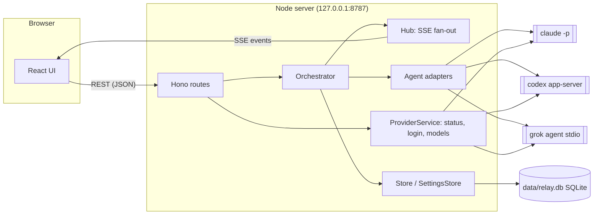
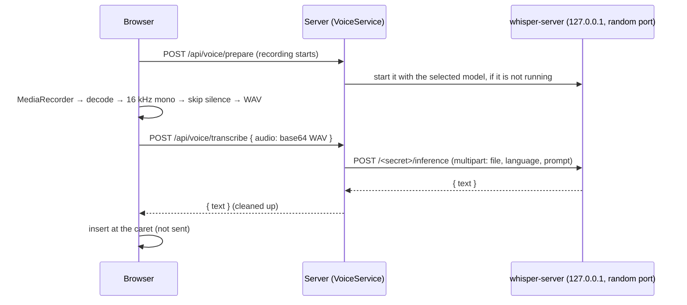

**English** | [繁體中文](architecture.zh-TW.md)

# Architecture

Harness Relay is a local web app with two halves:

- a **Node.js server** (Hono, TypeScript) that owns conversations, decides which agent speaks next, spawns the agent CLIs, and persists everything in SQLite;
- a **React client** (Vite) that renders the chat and receives live updates over Server-Sent Events (SSE).

The server never calls model APIs directly. Every agent turn is one run of a real CLI (`claude`, `codex`, `grok`) in headless mode, so each agent keeps its own tools, permissions, login and session history.



## Components

| Module | Responsibility |
| --- | --- |
| `src/server/app.ts` | HTTP routes, security middleware, SSE endpoint (`createApp`, testable with `app.request()`) |
| `src/server/index.ts` | Wiring, static file serving, startup and shutdown |
| `src/server/web.ts` | Serves the built UI: files under `assets/` (named by content hash) cached for good, `index.html` checked on every load |
| `src/server/orchestrator.ts` | Runs a "team turn": picks speakers by mode, builds each agent's prompt, runs the CLI, streams results; in auto-team conversations, has the lead agent design the team for each new question first |
| `src/server/planner.ts` | Auto team: the lead agent's prompt (the question, the conversation so far, the current team, the templates), parsing its JSON reply, turning it into a runnable team, the fallback |
| `src/server/grouping.ts` | Sidebar groups: the lead agent sorts a new conversation into one of the user's groups by its first message, in the background (`AutoGrouper`) |
| `src/server/prompt.ts` | Role briefing (system prompt), per-turn prompt, `@mention` parsing, `[PASS]` detection |
| `src/server/approvals.ts` | Rule keys for "always allow in this conversation" and matching them |
| `src/server/commands.ts` | Reads a shell command line into the programs it runs (chains, substitutions, `sh -c`, `env` / `sudo`, git's global options): approval keys, Grok's publish check |
| `src/server/agents/*` | One adapter per CLI: builds arguments, parses the CLI's JSON event stream into common events (`acp.ts`: the JSON-RPC peer for Grok's ACP) |
| `src/server/i18n.ts` | Server messages in both languages; the language of each request and run (AsyncLocalStorage) |
| `src/server/process.ts` | Spawns processes in their own process group, streams stdout lines, keeps output as raw bytes, handles abort/timeout (SIGTERM, then SIGKILL to the whole group) |
| `src/server/providers.ts` | CLI status (installed, version, signed in), login sessions, logout, model catalog cache |
| `src/server/models.ts` | Discovers models and reasoning-effort levels from each CLI |
| `src/server/workspace.ts` | Git plumbing: automatic `git init`, working-tree snapshots, per-agent worktrees, diffs, applying results |
| `src/server/store.ts` | SQLite persistence for conversations, messages, agent sessions and presets |
| `src/server/settings.ts` | Provider settings (binary path, API key, default model/effort), default working directory, lead agent, child-process environment |
| `src/server/attachments.ts` | Files attached to user messages: saving them under `data/attachments`, safe file names, which ones go to the agents as images |
| `src/server/media.ts` | Images and videos a reply embeds, and files it links to: which directories they may come from, resolving a path safely (real path inside one of them, never in `.git`; media types only for media), byte ranges |
| `src/server/voice.ts` | Voice input: installs the whisper.cpp engine and models (pinned, SHA-256 checked) in the background, runs `whisper-server` on demand, transcribes recordings |
| `src/server/secrets.ts` | The OS credential store for API keys (`@napi-rs/keyring`), or none when the system has no usable one |
| `src/server/db.ts` | Opens SQLite, applies schema migrations, transaction helper |
| `src/server/hub.ts` | Per-conversation event fan-out to connected SSE clients |
| `src/shared/types.ts` | Types shared by server and client |
| `src/shared/media.ts` | Which image and video types can be shown, and which image and link URLs in a reply are local files (relative or absolute paths, `file:` URLs, `file:line`) rather than other sites |
| `src/shared/search.ts` | Searching conversations: the words of a search, where they match (ignoring case), the excerpt around the first match, highlighting |
| `src/shared/mentions.ts` | The `@mention` rule used by both the server (who is addressed) and the UI (which mentions are highlighted): the message is read as Markdown (GFM) and only prose counts, not code or link text |
| `src/web/*` | React UI: sidebar, team designer, chat view, settings page, guided tour; `i18n.tsx` + `locales/` hold the UI strings; `chat.ts` holds the chat view's pure logic (reconnecting, Apply availability, team-drawer draft); `sidebar.ts` the sidebar's (conversations in their groups, moves not yet confirmed, a collapsed group's state); `recorder.ts` records the microphone and `voice.ts` holds voice input's pure logic (WAV encoding, silence, inserting the transcript) |

## Conversation model

A **conversation** has a team (`agents`), settings (`mode`, `rounds`, `maxHops`, `permission`, `cwd`, and with [auto team](#auto-team) `autoTeam`, plus `autoConfirm` when the lead agent's team is used without asking) and an ordered list of **messages**. A message is authored by the user, an agent, or the system, and consists of **parts**: text blocks and tool calls (`Read`, `Edit`, `Shell`…) in the order they happened; a failed or refused tool call keeps its reason. A system message may carry a **plan** — the lead agent's team design.

For every agent the conversation also keeps **agent state**:

- `sessionId` — the CLI's own session/thread id, used to resume the agent's context next turn;
- `seen` — ids of chat messages that have already been delivered to this agent.

## How agents share context

Each agent has its own long-lived CLI session, so the server does **not** resend the whole chat every turn. Instead:

1. Before an agent speaks, the orchestrator collects every finished message that is not in the agent's `seen` set (user messages, other agents' replies, and — when starting fresh — the agent's own earlier replies).
2. Those messages are rendered as tagged blocks and sent as the prompt:

   ```text
   New chat messages since your last turn:
   <chat>
   <message from="user">…</message>
   <message from="@Builder" via="Codex">
   Implemented step 2.
   <actions>
   Edit update src/api.ts
   Shell npm test
   </actions>
   </message>
   </chat>

   Roundtable round 2/3: it's your turn, @Reviewer. Reply with [PASS] if you have nothing new to add.
   ```

   The `<actions>` block summarizes file edits and commands the speaker ran, so teammates know what changed without seeing the raw tool output.

   A user message with attached files also gets an `<attachments>` block listing each file's name, type, size and absolute path, which the agent opens with its own tools. Images (PNG, JPEG, GIF, WebP) in the delivered messages are passed natively as well: to Claude Code as base64 image blocks in its stream-json user message (plus `--add-dir` for the attachments folder so its Read tool may open the files), to Codex as `localImage` inputs on `turn/start`, and to Grok as ACP image blocks (it advertises `promptCapabilities.image`). Images over about 3.75 MB are only listed, to stay under the 5 MB per-image API limit.
3. The CLI is resumed with its stored session id, so it remembers everything it saw before.
4. When the turn succeeds, the delivered ids (and the agent's own reply) are added to `seen`. If the turn fails, the delivery is rolled back so the messages are offered again next time.

If resuming fails before the agent produced any output (for example the session was removed, or the working directory changed and Claude Code keeps sessions per directory), the orchestrator retries once with a **fresh** session and the full chat history. If the fresh session fails too before any output, the problem was not the session (a rate limit, sign-in, network…), so the old session is kept for the next turn.

Messages are forwarded once they are final: finished replies, and replies that failed or were stopped but said something or changed files (marked `status="failed"` / `status="stopped"`). A `[PASS]` reply is forwarded as `[PASS]` plus its `<changed_files>`.

### Role briefing

Each agent's role is injected through the CLI's system-prompt mechanism and **rebuilt on every turn**, so edits to roles or the team take effect on the next turn:

| CLI | Mechanism |
| --- | --- |
| Claude Code | `--append-system-prompt <briefing>` with `--system-prompt-snapshot off` (otherwise a resumed session keeps the prompt of its first request) |
| Codex | `developerInstructions` on `thread/start` / `thread/resume` |
| Grok | `_meta.rules` on ACP `session/new` / `session/resume` |

The briefing contains the agent's role, the team roster (with each teammate's role summary), the rules of the current mode, the `[PASS]` convention, the shared working directory and the permission level. In parallel mode it also names the agent's worktree and branch, and each teammate's branch with the snapshot that teammate's worktree started from. With the [tool library](#tool-library), it also holds the agent's memory and a list of its skills.

## Turn scheduling (modes)

When the user sends a message (or presses **Continue**, which sends nothing), the orchestrator starts a run:

- **`@mentions` in the user message** restrict who takes part: only mentioned agents speak (in relay mode they start the relay).
- **Roundtable** — for each round `1…rounds`, participants speak one after another in team order. Each sees what earlier speakers said. If everyone in a round passes (or fails), the run ends early.
- **Parallel** — for each round, all participants run concurrently. Messages still streaming are not delivered, so agents don't see each other's answers until the next round.
- **Relay** — a queue starts with the mentioned agents, or the first team member (the "lead"). After each reply, every teammate `@mentioned` in the reply's prose (not in code or link text, see `src/shared/mentions.ts`) is appended to the queue. The run ends when the queue is empty or after `maxHops` turns (a system note tells the user, who can press **Continue**).

A reply that is exactly `[PASS]` (or empty with no tool calls) is marked as *passed* and rendered dimmed.

Only one run per conversation can be active at a time; different conversations can run concurrently. **Stop** aborts the run and kills the active CLI processes (process group `SIGTERM`, then `SIGKILL` after 3 s). Each agent turn also has a 45-minute safety timeout.

**Messages sent while the team replies** (`Orchestrator.send()`) do not start a second run. While a run is under way or being set up, or the lead agent's team design waits for confirmation, a message goes into the conversation's queue (`conversation.queue`, saved in `conversations.queue`, at most 20) instead, and the browser shows it above the message box (`queue` event). `deliverQueued()` posts waiting messages, oldest first, before the next turn of an agent they are for: in roundtable before each speaker, in relay before each hop, in parallel at the start of each round (so the whole round sees the same messages). A message that @mentions only other agents waits for one of them, and the ones behind it wait too, so the chat keeps the order they were sent in. Delivered messages are ordinary user messages marked `queued` (shown as *Added mid-reply*); each agent receives them through its unseen-message delta like anything else, so the agent that was speaking sees them on its next turn. When a run ends with messages still waiting and was not stopped, `startQueued()` starts another run for them, its participants chosen by their @mentions (all of them mention someone: those agents; otherwise everyone). After **Stop** they keep waiting for the user (`DELETE /api/conversations/:id/queue/:messageId` withdraws one); the next send or Continue posts them ahead of the new message. Sending with `interrupt: true` stops the run, waits for it to wind down, and then sends the waiting messages and the new one as a new run. A message is saved as a message before it leaves the saved queue, so one in both after a crash counts as delivered.

**Questions to the user.** The briefing tells agents to ask instead of guessing when a good answer depends on something only the user knows, and to end such a reply with `[ASK_USER]` on its own line (`src/shared/ask.ts`; the UI hides the marker while the reply streams). When a turn ends, `takeAsk()` removes the marker from the message and marks it `asked`, and the run stops there: `pauseFor()` saves where (`conversation.pause`, a `RunPause` in `conversations.pause`, sent to the browser with the `conversation` event). Roundtable stops at once and keeps the rest of the round; parallel lets the round finish, then keeps the agents that asked; relay keeps the rest of the queue and the handoffs left. While the team waits, messages in the queue do not start a run. The next run (`takePause()`) picks up from there: the agents that asked speak first, told on that turn that the user replied (`TurnInfo.answered`), then the rest of the round (or relay queue) and the remaining rounds. Continue with nothing to post skips the agents that asked. A reply that @mentions anyone else, an edit or retry (`truncateFrom()` clears the pause), a team design or a changed mode starts afresh instead. The user's reply is an answer, not a new question, so [auto team](#auto-team) designs no team for it. The conversation list reports `asking` for the sidebar.

**Retrying an agent's reply** (`Orchestrator.retry()`) works the same way: the reply and everything after it are deleted, then that agent answers again — followed, outside relay mode, by the agents of the same round whose replies were dropped with it — for one round.

**Editing a user message** (`Orchestrator.resend()`) deletes that message and everything after it, resets every agent's session (CLI sessions cannot be rewound, so each agent starts fresh with the remaining history), marks parallel worktrees for reset, and sends the edited text as a new run. The truncation happens only after the workspace is prepared and locked, so a failed start leaves the history intact. Files the dropped turns changed are not restored.

## Auto team

Every conversation the app starts has `settings.autoTeam`: before the team answers a new question, the **lead agent** designs the team for it (`designTeam()` in the orchestrator, `src/server/planner.ts`). The user designs teams as **templates** (on the New chat page: built-in ones to copy, their own to add, change and delete; `POST /api/presets`), and the lead agent picks, adapts or replaces them per question. A new conversation has no members until its first question.

**Which runs design.** `Orchestrator.designs()` decides when a run starts: the lead designs when the conversation has no team yet; for a question of the user's own (a message sent while nothing runs, or an edited message), unless it answers an agent's question (`conversation.pause`) or @mentions members of the current team, who then answer it; and on Continue when a design was stopped since the team last spoke (`designOwed()`). A retry, a scheduled message, a run for the messages that waited in the queue and the run that follows a confirmation keep the current team (`StartOptions.keepTeam`). A conversation without `autoTeam` (created through the API with a team) never designs.

**The design run** does nothing but design the team:

1. A system message with `plan.status = "planning"` appears in the chat.
2. The lead agent (Settings: provider, optional model and effort) runs once, read-only, in the conversation's working directory, with `PLANNER_BRIEFING` as its system prompt. The prompt (`buildPlannerPrompt()`) contains the **question** — everything the user said since the team last spoke or a team was designed (`questionStart()`), so a stopped design's question still counts — the **conversation so far** before it (`historyForLead()`: the user's messages and the agents' replies, oldest first, without tool calls, system notes, plans, passes or failed replies; each at most 1,500 characters, all of them at most 12,000, the latest kept), the **current team** (mode, rounds or hops, each member's CLI, model, effort and complete role), the signed-in CLIs with their models and effort levels, the three modes, the user's permission and working directory (which it cannot change), whether the user reviews the team or it answers at once, the names the question @mentions that no current member has (`unknownMentions()` in `src/shared/mentions.ts`; the lead is to name the members it addresses so, adapting a template to rename them, since only members a message @mentions answer it), and every template (built-in and saved) in full, as JSON. It must reply with one JSON object: `{"choice": "keep", "reason"}` to keep the current team (offered only when there is one; preferred for a follow-up on the same work, since its members keep what they learned); `{"choice": "template", "templateId", "reason"}` to use a template as it is; `{"choice": "adapted", "baseTemplateId", …team, "reason"}` to change one for the question; or `{"choice": "custom", …team, "reason"}` for a team designed from scratch, where the team is `"name", "description", "mode", "rounds", "maxHops", "agents": [{name, provider, role, model?, effort?}]`. The reason is for the user.
3. `parsePlanReply()` takes the JSON from a fenced block (or the outermost braces); `decidePlan()` turns it into a team. A kept team is the current team as it is (ids too). Custom members go through the same validation as a hand-made team (`validateAgents`), names have spaces replaced, at most 5 members, rounds 1–5, hops 1–30. `fitAgents()` moves members whose CLI is not signed in to the lead's CLI and drops models or efforts that CLI does not offer. A template used as it is gets a default reason if the lead gave none. An adapted team records its base template in `plan.basedOn` (id and name); one whose base id is unknown is kept as a custom team. An adapted or custom team that is identical to a template (`sameTeam()`: same members, CLIs, roles, models, efforts, mode and rounds or hops) is recorded as that template.
4. If the lead fails or its reply is unusable, `fallbackPlan()` keeps the current team, or uses the General-question template when there is none, and the card explains why (`source: "fallback"`, with `presetId` only for the template). If the user stops the run, the message is marked aborted; the next question, or Continue, designs again.
5. Members who stay on (same name, ignoring case, and same CLI as a current member, `keepMemberIds()`) keep their ids, and with them their CLI sessions and worktrees; the others start fresh and read the conversation through their unseen-message delta, like any new member. The plan card becomes `ready` (with the lead's cost and tokens) and holds the team (`plan.agents`, `plan.settings`). The run ends there.
6. **Confirmation.** By default the plan waits (`awaitingConfirmation`) and the conversation keeps its current team, so a retry or an edit of an earlier message (which drops the waiting plan with what follows) still has that team. Until the user answers, Continue is refused (409) and messages wait in the queue (as do messages sent while the lead designs). The user can confirm it (`POST /api/conversations/:id/messages/:messageId/confirm-plan`: the plan's team and mode become the conversation's, `plan.confirmedAt`), decline it (`…/decline-plan`: the current team stays, `plan.declinedAt`; not for a first question, which has no team to keep), or set the team by hand (`PATCH … { agents }`, which settles it with the team as sent: the team drawer edits the waiting design and says that saving uses it). Both buttons are refused (409) while something else holds the conversation. Either way the team then answers (`startConfirmed()`): a run with the team now set, which posts the waiting messages first and sees the question in the history. With `settings.autoConfirm` the plan's team is used at once (`confirmedAt`, `autoConfirmed`) and the team's run starts when the design run ends (`Run.answerNext`); if it cannot start (another conversation writes in the folder), a note says why and Continue lets the team answer without a new design. Plan messages are system messages, so they are never forwarded to agents.

A run that designs the team writes nothing (the lead is read-only and nobody else speaks), so it locks no directory; the team's own runs lock by the confirmed mode as usual. `POST /api/conversations/:id/messages/:messageId/save-plan` saves a team the lead designed or adapted (`planSavable()`) as a user template (with the conversation's permission) and records `plan.savedPresetId`; a template used as it is, or the current team kept, is not new, so the card does not offer to save it. Editing a question drops its plan with it and designs again for the edited question, with what came before it as history. A team set by hand, and the settings, never switch auto team on or off (`PATCH` keeps `autoTeam` as it was); `autoConfirm` can be changed in the team settings. Schema version 13 (`conversations.auto_confirm`) turned auto team on for every conversation saved before it.

## Schedules

A conversation can have one **schedule** (`conversation.schedule`, a `ConversationSchedule`, in the `schedules` table): a message the team is sent at set times, in the same conversation or (`newChat`) in a new one each time, as if the user had sent it. It is the first step of the [triggers proposal](proposals/triggers.md), with one schedule per conversation, and the option of a new conversation each time from its third.

- **When.** `repeat` is once (a moment), every day at `HH:MM`, on chosen days of the week at `HH:MM`, or every 1–168 hours from when its times were last set (saving a new message or other choices keeps the cadence). Times of day are wall-clock times in the schedule's time zone (the browser's when it was saved; the server's when none is given). `nextRun()` (`src/shared/schedule.ts`) works out the next time: a time the clocks skip moves forward by the jump, one they repeat is the first. The browser uses the same function to show the next three times before saving, and shows a schedule's times in its own time zone (with a button to switch to the device's).
- **Saving** (`PUT /api/conversations/:id/schedule`, checked by `validateSchedule()`) replaces the schedule, works out `nextRunAt` (none while it is off), records the UI language for the notes it writes, and keeps how it went last time. A schedule that is on needs a team: not while the lead agent still has to design the first one or the user to confirm one (409). Scheduled messages go to the current team: in an [auto-team](#auto-team) conversation the lead agent designs no team for them, since nobody may be there to confirm it.
- **New schedule** (the sidebar's **New schedule**, `POST /api/schedules`) creates a conversation with auto team and its schedule in one step — the schedule on, the title from the message's first line unless one is given — leaves a note, sorts it into the user's groups by the message, and has the lead agent design the team for the schedule's message at once, while the user is there to confirm it (`Orchestrator.designForSchedule()`; `POST …/schedule/design` asks again, e.g. after a design was stopped). That design run's question is the message itself (`Run.designFor`), and nothing is posted; the planner prompt says the team gets it on a schedule (here, or in a new conversation each time) with nobody watching. Its plan is marked `forSchedule`: once it is confirmed — on the card, by setting the team by hand, or at once with `autoConfirm` — the team answers nothing now (`startConfirmed()` only starts what the user wrote while the design waited); it gets the message when the schedule sends it. A time that comes due while that first team is designed or waits for confirmation is `busy`: tried again for up to 30 minutes, then skipped (no confirmed team). The plan card and the schedule drawer word this design for the schedule (`planWording()` in `src/web/copy.ts`). A name the scheduled message @mentions that is not on the team reaches nobody, so the whole team answers: the schedule form warns as the message is typed (and, with no team yet, says the lead agent names the members after the mentions), the team editor warns when a member it @mentions is renamed or removed, and the card of a team designed for the schedule warns before it is confirmed (all with `unknownMentions()`).
- **Sending.** `Scheduler` (`src/server/scheduler.ts`, started once the server listens and stopped first on shutdown) looks every 15 seconds — an unref'd interval compared with the wall clock, so a computer that slept sends on waking — for schedules that are on and due (`Store.dueSchedules()`), the most overdue first, one at a time, inside `withLang(schedule.lang)`. `Orchestrator.sendScheduled()` then:
  - holds the message back (`skipped`, with the reason) while the team cannot take it: no confirmed team; an agent's question waiting for the user's answer, with no run carrying the answer being set up (the message would be taken for the answer); an earlier scheduled message still in the queue of a team that is replying (they do not pile up); a full queue;
  - puts it in the queue while the team replies or its run is being set up (`queued`), like any message sent mid-reply;
  - otherwise starts a run with it (`sent`), the messages already waiting first. An earlier scheduled message left waiting while nothing runs (the team was stopped, or the server restarted) goes out now instead, without a second copy.

  A scheduled message is never taken for the user's answer. When the user replies or presses **Continue**, a scheduled message waiting in the queue stays there (`start()` leaves it out of what goes first, while what the user wrote behind it still goes, in the order written): the team picks up where it stopped, and the message reaches the next turn of an agent it is for, or a run of its own afterwards (`startQueued()`). `takePause()` also looks only at what the user wrote.

  The message is an ordinary user message with `scheduled: true` (`messages.scheduled`), so mentions, modes and delivery work as usual. Agents see it as `<message from="user" via="schedule">`, and the briefing of a conversation with a schedule, or with a scheduled message, tells them the user may not be watching: do the task with stated assumptions, and ask (`[ASK_USER]`) only when no reasonable answer is possible without the user.
- **A new conversation each time** (`newChat`). `sendScheduled()` then leaves the schedule's own conversation alone — its run, its question waiting for an answer, its queue — and `sendInNewChat()`:
  - holds it back while there is no confirmed team, like any schedule, and answers `busy` while another conversation (the schedule's own included) holds a lock on the folder, checked before anything is created;
  - creates a conversation with a copy of the team, the settings and the "always allow" answers (`allowRules`), in the same sidebar group (`Store.groupOf()`, set as the user's choice, so the lead agent does not sort it), titled after the schedule's conversation and the time it came due, with a system note saying which schedule opened it;
  - starts a run there with the message (`scheduled`, the current team, approvals as the schedule says), with new agent sessions; a conversation whose run could not start is removed again (`failed`, or `busy` when the folder was taken meanwhile), so none is left empty.

  A schedule's conversation still titled "New chat" names them after the first line of the message instead. The scheduler records the conversation it opened (`lastChatId`; cleared by a time that opened none, and when that conversation is deleted), which the schedule drawer links to; **Run now** answers with it (`chatId`). The new conversation has no schedule of its own: its briefing explains `via="schedule"` because it has a scheduled message, and says actions outside the permission are refused only while its run refuses them (`buildBriefing(…, unattended)`). The schedule's own conversation, where such a schedule sends nothing, is not told about scheduled runs.
- **Approvals.** A run that only scheduled messages start (`Run.refuseApprovals`: from the scheduler, or a follow-up run for them, `startQueued()`) refuses approval requests automatically unless the schedule's `approvals` is `ask`: what the conversation always allows (`allowRules`) still goes through, and anything else is shown as a declined approval card with the reason (the agent is told in English). Once a message the user wrote reaches the run (it is delivered before a turn, or the run starts with it), they are here, and the run asks as usual. A conversation that refuses them anyway keeps refusing, and full access asks nothing. With a schedule on, the team drawer says what scheduled runs do and warns about full access.
- **Afterwards.** The scheduler records `lastRunAt` (the time it came due), `lastResult` and `lastError`, and the next time after now; a one-time schedule switches itself off. A `busy` answer — a settings change or an apply holds the conversation, another conversation is writing in the same folder, or the server is stopping — leaves it due: it is tried again at each look for up to 30 minutes from the first try (`BUSY_RETRY_MS`; not counted as missed meanwhile), then skipped with the reason. Another conversation's lock on the folder is checked before the run is set up, so a message the user sends meanwhile is not left in a queue nobody runs. Nothing is recorded once shutdown has begun, so that time is handled when the server is back. A stored schedule that cannot be read is dropped. A time that was not sent (`missed`, `skipped`, `failed`) leaves a system note in the chat. If the schedule was replaced while its message was being sent, the new one keeps its own times.
- **Missed times.** A time more than 10 minutes past (`MISSED_AFTER_MS`: Harness Relay was not running, or the computer slept) is skipped with a note (`missed: 'skip'`, the default) or sent late (`'run'`) — once, however many times were missed.
- **Run now** (`POST /api/conversations/:id/schedule/run`) sends the saved message the same way, without changing the schedule's times or what it recorded.
- The `conversation` event carries the schedule, so an open chat updates its header badge; the conversation list carries `schedule` (on, next time, last result) for the sidebar's clock, which turns amber when the last time was not sent.

## Sidebar groups and search

The user makes groups in the sidebar (`conversation_groups`: id, name, position) and puts conversations in them (`conversations.group_id`). A conversation in no group is in the default group, **Other**: it always exists, is not stored, and no group may take its name in either language (`validGroupName()`). Deleting a group sets its conversations' `group_id` to NULL (the foreign key's `ON DELETE SET NULL`), so they go back to Other. The conversation list carries each conversation's `groupId`; the client loads the groups with it.

Moving a conversation (`PUT /api/conversations/:id/group`, by dragging it onto a group or from the folder menu) records `group_source = 'user'`. When a conversation's first user message is posted (`postUserMessage()`) and the user has groups, the orchestrator's `AutoGrouper` runs the **lead agent** once, read-only, in the background next to the team's run, with `GROUPER_BRIEFING` as its system prompt. The prompt (`buildGroupPrompt()`) holds the message (at most 4,000 characters, with the names of attached files), and the groups numbered with up to five recent titles each as examples. The lead replies `{"group": <number>}`, 0 for none; `parseGroupReply()` also accepts a group's name. `Store.sortIntoGroup()` then sets the group with `group_source = 'auto'` only if `group_source` is still NULL and the group still exists, so the user's own move — even one made while the lead was deciding — always wins, and a conversation is sorted only once (picking none counts too). A failed or unusable reply leaves it in Other, unsorted; editing the first message tries again. While it runs the conversation list reports `sorting`. Deleting the conversation stops the sort and waits for it; shutdown stops every sort.

Search (`GET /api/search?q=`) splits the query on whitespace (at most 8 words) and finds conversations where every word occurs in the title or in a text part of a user or agent message (not system notes, thinking or tool output). SQLite's `LIKE` (with `%` and `_` escaped) narrows the parts down; the words are then checked again in JavaScript, ignoring case also beyond ASCII. Matching any part of the text means Chinese works without word breaks. Pending message writes are flushed first, so replies still streaming are found. Each result carries the excerpt around the first match in the part with the most words (`snippetAround()`) and how many messages match; title matches come first, then the most recent, at most 50. The client searches 200 ms after typing stops, shows only the latest search's answer, and highlights the words (`highlightParts()`).

## Languages

The UI comes in Traditional Chinese and English (`src/web/locales/zh-TW.ts`, `en.ts`; the English dictionary is typed against the Chinese one, and a test checks that both have the same shape).

- **Client** — on the first visit the language is taken from `navigator.languages` (any `zh*` → zh-TW, otherwise English) and saved in `localStorage` (`relay:lang`); Settings can change it. `<html lang>` follows.
- **Server** — every API request carries `X-Relay-Lang` (falling back to `Accept-Language`, then zh-TW). The `/api/*` middleware runs the request inside `withLang()` (AsyncLocalStorage), so `t()` returns the right messages anywhere below it — validation errors, adapter errors, system notes, and the whole team run the request starts, which keeps going after the response is sent.
- **Built-in templates** exist in both languages (`builtinPresets(lang)`); the lead agent sees them in the UI language and writes custom roles in the language of the user's question.
- Prompts to agents (briefings, turn prompts, the planner prompt) stay in English; agents answer in the user's language.

## CLI adapters

Every adapter turns one CLI turn into a stream of common events — `session`, `text`, `text_end`, `thinking`, `plan`, `tool_start`, `tool_end` (with the call's output or failure reason) — and, when the CLI asks to do something the permission does not cover, calls `requestApproval` (see [Approvals](#approvals)).

| | Claude Code | Codex | Grok |
| --- | --- | --- | --- |
| Command | `claude -p --input-format stream-json --output-format stream-json --verbose --include-partial-messages` | `codex app-server` (JSON-RPC over stdin/stdout, the protocol of Codex's IDE extensions) | `grok agent --no-leader stdio` (ACP: JSON-RPC over stdin/stdout) |
| Prompt via | a `user` message on stdin | `turn/start` | `session/prompt` |
| New / resume session | `--session-id <uuid>` / `--resume <id>` | `thread/start` / `thread/resume` | `session/new` / `session/resume` |
| Model | `--model` | `model` on the thread | `session/set_config_option` (`model`) |
| Reasoning effort | `--effort` | `config.model_reasoning_effort` on the thread | `session/set_config_option` (`reasoning_effort`) |
| Text streaming | `stream_event` text deltas | `item/agentMessage/delta` | `agent_message_chunk` |
| Thinking | `thinking_delta` (with `--thinking-display summarized`) | `item/reasoning/summaryTextDelta` (`model_reasoning_summary="auto"`) | `agent_thought_chunk` |
| Plan / to-do | the `TodoWrite` tool | `turn/plan/updated` | `plan` updates (its `todo_write` calls are not shown as tool rows) |
| Tool events | `tool_use` / `tool_result` blocks | `commandExecution`, `fileChange`, `mcpToolCall`, `webSearch` items | `tool_call` / `tool_call_update` |
| Asks for approval | `can_use_tool` control request (`--permission-prompt-tool stdio`) | `item/commandExecution/requestApproval`, `item/fileChange/requestApproval`, `item/permissions/requestApproval` | `session/request_permission` |

One process runs per turn. Claude Code's `--thinking-display` flag is not in its `--help`, and `--system-prompt-snapshot` is recent; if a version rejects either, the adapter remembers that and runs without it.

### Permission mapping

The permission decides what runs **without asking**; anything else goes to the user when the conversation asks (the default), or is refused automatically when it is set to refuse (`settings.approvals = "deny"`).

| Relay permission | Claude Code | Codex | Grok (ACP) |
| --- | --- | --- | --- |
| Read-only | `--permission-mode manual` (refuse: `dontAsk`), `--allowedTools WebFetch WebSearch`, `--disallowedTools Edit MultiEdit Write NotebookEdit`: reading and web run, file edits are not available, anything else asks | sandbox `read-only`, approval policy `on-request` (refuse: `never`) | ask mode (`_meta.yoloMode: false`): web fetch runs, anything else asks |
| Edit | `--permission-mode acceptEdits`, plus web and common build / test / lint commands (`CLAUDE_EDIT_COMMANDS`): other commands ask | sandbox `workspace-write` with network access pinned off (`sandbox_workspace_write.network_access = false`, whatever `~/.codex/config.toml` says), approval policy `on-request` (refuse: `never`) | ask mode inside `GROK_SANDBOX=workspace`: everything runs except pushing and publishing (`git push`, `npm publish`, `gh release`…, read by `commands.ts`), which asks |
| Full access | `--permission-mode bypassPermissions` | sandbox `danger-full-access`, policy `never` | always-approve (`_meta.yoloMode: true`) |

- **Claude Code** sends each request as a `can_use_tool` control request and waits for our control response (allow, or deny with a message the model sees). When the conversation refuses, no prompt tool is given and Claude Code denies such calls itself. Claude Code's own `permissions.allow` rules (user settings, or a project's once it is trusted) still apply; read-only removes the file-editing tools so such rules cannot let them run.
- **Codex** always runs commands in its OS sandbox. With `on-request` the model asks to go beyond the sandbox (writing outside the working directory, network…) when it needs to; whether it asks is the model's decision — otherwise the sandbox just blocks the call and the model sees the error.
- **Grok** runs over ACP because headless `grok -p` cannot ask: a call that would prompt is reported as "User cancelled" and the **whole turn ends**. Over ACP the request comes to the adapter. A refusal (the user's, or automatic) is sent as `reject_once` with `_meta.followup_message`, which Grok passes to the model as feedback instead of cancelling the turn.
  - The session mode is always set explicitly, so a user-level `[ui] permission_mode = "always-approve"` in `~/.grok/config.toml` cannot widen read-only or edit.
  - Grok still runs its built-in read-only tools and commands without asking, including bare `mkdir` / `touch`.
  - Read-only does not use Grok's `read-only` sandbox profile: it refuses to start on some machines (for example when `/var/run/docker.sock` is a symlink). In edit mode a sandbox that cannot start fails the turn with Grok's reason.

A refused or failed call keeps its reason (`tool_end.error`, stored in `message_parts.tool_error`) and the turn carries on.

**Edit does not sandbox project code.** "Pushing and publishing ask" stops an agent from running those commands directly. But the commands edit mode runs without asking (tests, builds, `npm run` scripts, `make`) execute code the agent may have just edited, so with Claude Code and Grok a determined agent can still reach the network that way. Codex's sandbox keeps everything off the network. For code or instructions you do not trust, use read-only, or set **Actions beyond the permission** to refuse.

## Approvals

When an adapter receives a request, the orchestrator (`requestApproval` in `turn()`, `src/server/approvals.ts`):

1. Builds an **approval part** in the agent's message: kind (`command` / `edit` / `fetch` / `other`), the command, file or URL, the agent's stated reason, and rule keys for "always allow". Command keys are one per command the line runs — chains, pipes, background jobs, `$( )` and backtick substitutions and `sh -c '…'` included (`src/server/commands.ts`) — each the program, plus its subcommand for tools that have them (`npm install`, `git push`, past git's global options such as `-C`); `env` / `sudo` prefixes and `VAR=value` assignments are skipped. So allowing `npm test` never lets `npm test && rm …` or `npm test $(rm …)` through. `sudo` / `doas` stay in the key; a command whose program is only known when it runs (`$(which x) …`) or a git command with settings that can run programs (`-c`, `GIT_*` variables) is keyed by its exact text. The keys of the first, simpler reading (whitespace words of each `&&` / `;` / `|` part) are always included as well, so a line the reader gets wrong can never be approved more readily than before. Keys are computed from the command exactly as the CLI runs it (Codex's quoted form, not the tidied-up one shown on the card). Edits use one key for all edits, fetches the host name, other tools their name.
2. If every key is already allowed in this conversation (`conversation.allowRules`), it answers yes at once and shows the part as allowed automatically.
3. Otherwise the part is `pending`, the request waits in `orchestrator.approvals`, and the conversation reports `waiting` (the sidebar and the tab title show it). `POST /api/conversations/:id/approvals/:approvalId` with `{ allow, always?, note? }` resolves it; "always" adds the keys to `allowRules`. A declining note is passed to the agent.
4. Stopping the run, or the agent's CLI ending its turn (a crash, the timeout), resolves its pending requests as `expired` (refused); a late answer gets 404.
5. An action allowed in a run that holds no directory lock (read-only) first takes the lock on the working directory for the rest of the run; if another conversation is writing there, the action is declined and the agent is told why.

The agent's CLI waits the whole time; the turn's 45-minute safety timeout still applies.

## Agent activity

Besides reply text and tool rows, a message can show what the agent thinks and plans: a `thinking` part (streamed; collapsed in the UI with its latest line visible while it streams), a `plan` part (the agent's to-do list, updated in place), and each tool's `output` (the end of what it returned, up to 4,000 characters, shown when the tool row is expanded). Thinking is never forwarded to other agents.

## Tool library

MCP servers, skills and memory that Harness Relay gives its agents, the same way for every CLI and in addition to each CLI's own configuration (`src/server/tools.ts`, `ToolLibrary`, reached as `settings.tools`). The library is stored as JSON under the `tool_library` key of `app_settings`.

- **Scope.** Each MCP server and skill lists the CLIs whose agents get it by default (`providers`; empty = no one). The memory has a part for everyone (`all`) and one per CLI. An agent's exceptions live in `AgentConfig.tools`, keyed `mcp:<id>` (a server's id, which stays when it is renamed), `skill:<folder>`, `memory` or `memory:<provider>`: `true` gives an item the defaults leave out, `false` takes one away. Only exceptions are stored (column `tools` of `conversation_agents` and `preset_agents`, schema version 9).
- **Every turn** the orchestrator asks `tools.forAgent(agent)` for the agent's items, so library changes and team edits take effect at the next turn. Memory and skills go into the briefing; MCP servers and the skill folders go to the adapter (`RunOptions.mcpServers`, `RunOptions.readDirs`).
- **Skills** are folders with a `SKILL.md`; their name and description come from its YAML front matter (`parseFrontMatter`). The briefing lists them with the path of `SKILL.md`, and agents read the file when a task matches, so every CLI uses them the same way. Before adding a folder, the UI lists the skills under it (`scanSkills`: the folder itself and skill folders up to two levels down, not inside a skill, hidden folders or `node_modules`) for the user to tick. Library skills come in addition to the skills each CLI loads by itself, which the library cannot take away. A skill whose file is gone, or whose name an earlier skill has, is marked in the UI and not given.
- **Secrets.** The values of a server's environment variables (stdio) and headers (HTTP) go to the OS credential store, one entry `mcp-<id>` per server (JSON, named after the server's id, which a rename keeps), and are read into memory at startup; without a credential store they stay in the database, also by id. The UI only gets masked values; an edit that leaves a value out keeps it, and a rename does not touch the credential store at all (so a store whose names ignore letter case, like Windows Credential Manager, cannot lose them over `github` → `GitHub`). Values that could not be moved to the credential store stay in the database until a later start moves them, and a server whose values could not be read (a locked store) cannot be saved without typing them again, so they are never overwritten with empty ones; agents do not get it until its values can be read (tried again at each turn).

| | Claude Code | Codex | Grok |
| --- | --- | --- | --- |
| MCP servers | `--mcp-config <file>`: a `0600` file in a new private temporary folder, deleted after the turn (tokens never appear on the command line) | one config override per server on `thread/start` / `thread/resume`, `mcp_servers.<name>` (`command`, `args`, `env` or `url`, `http_headers`), so `config.toml`'s servers stay | `mcpServers` on ACP `session/new` / `session/resume` (`env` and `headers` as name/value lists; HTTP servers only when Grok advertises them) |
| Reading skills | a `Read(//<folder>/**)` rule per skill folder below full access (read only: `--add-dir` would also allow edits) | the sandbox lets it read anywhere | it reads anywhere |
| MCP tool calls | `can_use_tool` like any tool: asked or refused per the permission | Codex asks with an MCP elicitation marked as a tool-call approval (`_meta.codex_approval_kind: "mcp_tool_call"`), shown and answered like any approval; other elicitations are declined. With the policy `never` Codex refuses MCP calls, so in full access the library's servers get `default_tools_approval_mode = "approve"` | `session/request_permission` like any tool |

## What each CLI loads by itself

Each CLI's card in Settings can list what that CLI loads by itself for the default working directory — its own skills, MCP servers and their tools, built-in tools, hooks, subagents, plugins, instruction and memory files — separate from the tool library (`src/server/native.ts`, `POST /api/providers/:provider/native`). The CLI is asked the way an IDE would ask it, without a prompt, so no model is called:

| | Claude Code | Codex | Grok |
| --- | --- | --- | --- |
| Skills | `initialize` control request over stream-json: its commands that are not built in (skills, plugin and custom commands; names and descriptions only) | `skills/list` over `codex app-server` | `grok inspect --json` |
| MCP servers and their tools | `mcp_status` control request (name, status, scope), with the servers and tools of the `/usage` turn's `system/init` message (below) | `config/read` (the configured servers), then `mcpServerStatus/list` for each one that is on, one server at a time (its tools; this starts it) | `grok inspect --json` (no tools) |
| Built-in tools | the `/usage` turn's `system/init` message: its tools not named `mcp__…` | no list | no list |
| Hooks | `get_hooks_listing` control request (event, matcher, source) | `hooks/list` (event, matcher, source, file) | `grok inspect --json` (a file hook's file) |
| Subagents | `initialize` (names and descriptions), with `get_settings` for those its permission rules deny. It does not say where a subagent comes from, so the built-in ones are asked separately (below) | no list | `grok inspect --json` |
| Plugins | `claude plugin list --json` (id, scope, on or off), with `get_settings` for those its settings turn off | `plugin/installed` (the installed ones) | `grok inspect --json` |
| Memory and instructions | no list: the files it is documented to read that exist (`CLAUDE.md` and `rules/` in its config folder, `CLAUDE.md` / `CLAUDE.local.md` / `.claude/CLAUDE.md` / `.claude/rules/` up from the folder, its auto memory under `projects/<folder>/memory/`), honouring `CLAUDE_CONFIG_DIR` | no list: `AGENTS.override.md` or `AGENTS.md` in `CODEX_HOME` and in each folder from the repository root down, and its `memories/` | `grok inspect --json` (instruction files) |

Claude Code lists its tools only in the `system/init` message that starts a turn, so after the control requests it is sent `/usage`, a command it answers by itself (no model is called, nothing is spent), with `--no-session-persistence` so no session is saved, and stopped as soon as that message comes. It is sent only when the `initialize` answer lists `usage` as a built-in command and no skill or command of that name, since anything else would go to the model; then, and with a Claude Code that rejects `--no-session-persistence` (it is asked again without the turn), the built-in tools are not listed and an error says so. The init message is also where the claude.ai connectors and other servers that connect late appear, with their later status.

Asking starts the CLI for a moment: Claude Code runs the user's SessionStart hooks and connects its MCP servers, and Codex starts the user's MCP servers to list their tools. So the UI asks only when the user clicks **Ask**, not when the section is opened: someone may open it to turn off an MCP server because starting that server does harm. It is a POST, and the folder is always the default working directory, so another site cannot start a CLI anywhere. Answers are kept for a minute per CLI, executable and folder, while what is left out (below) stays the same (`refresh: true` asks again); what a CLI did not report is listed, in the language of each request. The reported instruction and memory files, and skills' `SKILL.md`, can be opened in the UI (`POST /api/providers/:provider/native/file`): only a path in the CLI's latest answer is read, so no other file on the computer can be. Only names, descriptions, paths and states are returned; MCP server configs and hook commands, which can hold tokens, are not.

### Leaving them out of Harness Relay's runs

Per CLI, the user can leave its own skills, MCP servers, built-in tools, instruction files, memory, hooks, subagents or plugins out of every run Harness Relay starts, all of a kind (`ProviderSettingsView.nativeOff`, column `provider_settings.native_off`) or single items (`nativeItems`, below); `RunOptions.nativeOff` and `RunOptions.nativeItems` are passed by the orchestrator for members and the lead agent, and by the group sorter. Each adapter turns them off for that run only, never in the CLI's own settings files. `NATIVE_OFF_SUPPORT` in `src/shared/types.ts` lists what each CLI can leave out all at once, and `NATIVE_ITEM_SUPPORT` which kinds of single items; the server drops the rest. Each mechanism was checked against the real CLI (Claude Code 2.1.319, Codex 0.167.0, Grok 1.0.77) without calling a model, except Grok's hooks (see below):

| | Claude Code | Codex (thread `config`) | Grok (environment) |
| --- | --- | --- | --- |
| Skills | `--disable-slash-commands` (plugin and custom commands too) | `skills.include_instructions = false` | `GROK_CLAUDE_SKILLS_ENABLED` / `GROK_CURSOR_SKILLS_ENABLED=false`: only what it takes from Claude Code (its plugins' skills too) and Cursor |
| Built-in tools | `--tools ""`: its MCP tools stay | no list | no list |
| MCP servers | `--strict-mcp-config`: only the tool library's `--mcp-config` stays | `enabled = false` for each configured server (read with `config/read` before the thread starts; a tool library server of the same name replaces it instead), in the one `mcp_servers` table that also carries the tool library's servers; and `features.apps = false` | `GROK_CLAUDE_MCPS_ENABLED` / `GROK_CURSOR_MCPS_ENABLED=false`: likewise |
| Instruction files | `CLAUDE_CODE_DISABLE_CLAUDE_MDS=1` | `project_doc_max_bytes = 0`: the project's `AGENTS.md` files; no setting reaches `~/.codex/AGENTS.md` | none (its rules and agents switches leave `CLAUDE.md` loaded) |
| Memory | `CLAUDE_CODE_DISABLE_AUTO_MEMORY=1` | `features.memories = false` | `GROK_MEMORY=0` |
| Hooks | `--settings '{"disableAllHooks":true}'`: the hooks in settings files and plugins | `features.hooks = false` (plugins' hooks too); also given to the run's app-server, and checked (below) | `GROK_CLAUDE_HOOKS_ENABLED` / `GROK_CURSOR_HOOKS_ENABLED=false`: only those it takes from Claude Code's and Cursor's settings files |
| Subagents | denied once it has started (below) | none: its agent roles have no switch, and `features.multi_agent = false` would take away the built-in subagents too | none: `subagents.enabled` (also `GROK_SUBAGENTS=0` or `--no-subagents` for one run) turns off the built-in subagents too |
| Plugins | `--settings '{"enabledPlugins":{"<id>":false,…}}'` with every plugin `claude plugin list --json` lists (it has no switch for all plugins); their skills, commands, subagents, hooks and MCP servers go with them | `features.plugins = false` (their skills, MCP servers and hooks too); also given to the run's app-server, and checked (below) | none (`plugins.disabled`, in `config.toml` only) |

Single items (`ProviderSettingsView.nativeItems`, column `provider_settings.native_items`, JSON: kind → ids) are named by the id the CLI's answer gives each item (`NativeItem.id`), so the UI offers a box only on items the CLI can leave out alone:

| | Claude Code (`--settings`) | Codex (thread `config`, and `-c` for its app-server) |
| --- | --- | --- |
| Skills | `skillOverrides: { "<name>": "off" }` (hidden from the model and from `/name`) | `skills.config = [{ path, enabled = false }]` by `SKILL.md` path (Codex still applies the user's own entries) |
| MCP servers | a deny rule `mcp__<server>` takes away all its tools; the server still starts (its name as Claude Code writes it: every character but letters, digits, `_` and `-` becomes `_`) | `enabled = false` in the `mcp_servers` table, only for servers in the user's config |
| MCP tools | a deny rule `mcp__<server>__<tool>` | `disabled_tools`, with the tools the user's config already turns off (a list in an override replaces theirs) |
| Built-in tools | a deny rule with the tool's name | no list |
| Instruction files | `claudeMdExcludes` with the file's path, the characters a glob gives a meaning to in brackets (not escaped with `\`, which Claude Code turns into `/`) | none |
| Hooks | none: hooks have no ids | `hooks.state."<key>".enabled = false` |
| Subagents | a deny rule `Agent(<name>)`, built-in ones too | no list |
| Plugins | `enabledPlugins: { "<id>": false }` | `plugins."<id>".enabled = false` |

Items of a part left out whole are left to that part's switch, except Claude Code's subagents (the switch keeps the built-in ones) and plugins. A rule for a single Claude Code server or tool would also reach a tool library server of the same name (which replaces the user's own anyway), so none is added for one the run gets from the library, nor any when all its MCP servers are left out. A run writes these settings to a private temporary file for `--settings` rather than onto the command line, which many ids would not fit; Codex's go into the thread's config, and as `-c` arguments.

An agent's briefing lists the tool library's skills to be read from their `SKILL.md`; a Claude Code agent left with no tool that reads a file (all built-in tools left out, or both `Read` and `Bash`) is not told about them (`canReadFiles`).

Claude Code's `--settings` is its flag layer, above the user's and the project's settings files, which stay as they are. If `claude plugin list --json` fails, the run fails with a message saying that the plugins could not be left out, rather than quietly loading them.

Claude Code has no switch that leaves out only its own subagents (`--safe-mode` also drops the tool library's `--mcp-config` servers, `--bare` reads no OAuth login, and `--setting-sources` drops whole settings files). So when they are left out, the run holds the prompt back (`claudeAgentsGate`): once Claude Code answers `initialize` with the subagents it loaded, each one that is not built in gets a permission rule `Agent(<name>)` through an `apply_flag_settings` control request (merged into the flag layer for the session), and only then is the prompt sent. Claude Code takes a denied subagent off the Agent tool's list and refuses to start it; with a real turn, the model then names only the built-in subagent types. The built-in ones are those Claude Code reports when started with no settings sources (`--setting-sources ''`, `--strict-mcp-config`, hooks off) in an empty temporary folder, asked once per executable, version and config folder (`claudeBuiltinAgents`); subagents an organisation's managed settings add count as built-in. A subagent counts as built-in only with a built-in one's name and description: a user's or project's subagent of the same name replaces the built-in one, so it is denied, and that name has no subagent in the run. If a step fails (an older Claude Code without `apply_flag_settings`, or an `initialize` answer that does not list the subagents), the run fails with a message instead of running them.

Codex ignores a config key it does not know, so a switch could be dropped without a word (an older Codex, a renamed key). The run therefore also gives its app-server the overrides above as `-c` arguments (they hold no secrets; the MCP servers stay in the thread's config), and once the thread has started it asks `hooks/list` and `plugin/installed`, and `skills/list` when single skills are left out: if hooks, installed plugins or skills that are left out (all of them, or the single ones) are still on, the run fails with a message, before the turn starts. A Codex without these methods (it answers that the method is unknown) is older than these features and goes on; any other failure to answer fails the run, which could not be checked.

Codex merges the `mcp_servers` table into the user's config, so their other servers and settings stay. It is one table rather than a dotted key per server because Codex splits a dotted key at every `.`, with or without quotes, so a server named `a.b` could not be reached. Single servers and tools are read the same way, with `config/read` before the thread starts, so that a server not in the user's config gets no entry (it would be a server without a command). If `config/read` fails (an older `codex`, say), the run fails with a message saying that the servers could not be left out, rather than quietly running them.

Codex writes its skills list (plugins' skills among them), the project's `AGENTS.md` and its memories into a thread when the thread starts, and `thread/resume` replays them. So for Codex those switches take effect in new chats, and its card says so. The MCP servers and their tools, apps, hooks and plugins are set on every start and resume; changes to MCP servers, their tools and hooks take effect at the next turn. Claude Code builds its instructions anew on every run.

When an agent's CLI leaves out its own skills, the briefing's tool library skills section no longer says that the CLI's own skills work as usual.

Grok's own skills, MCP servers and hooks, and its plugins, can only be turned off in `~/.grok/config.toml` (`skills.disabled`, `mcp_servers.<name>.enabled`, `plugins.disabled`), Grok's global settings that also apply when it is used in a terminal, which Harness Relay does not edit, and its subagents only all together, built-in ones included (`subagents.enabled`, `GROK_SUBAGENTS=0`); `GROK_CONFIG`, the overlay an ACP client can pass, only takes `models`, `features`, `toolset` and `shell_environment_policy`. So its skills switch leaves out only what it takes from Claude Code and Cursor (a project's `.claude/skills` among them): the skills it finds by itself (`~/.agents/skills`, `~/.grok/skills`, a project's `.grok/skills` and `.agents/skills`, its built-in ones) still load, and the card says so. `grok inspect` shows that Grok took the hooks variables (its `externalCompat` cells, from `env`) but does not list the hooks it takes from Claude Code's settings files, so the hooks themselves could not be checked; the switch follows Grok's own documentation (`compat.claude.hooks`, also `GROK_CLAUDE_HOOKS_ENABLED`). Plugins' hooks are not among them and still run.

### Checking what the runs leave out

When something is left out, asking the CLI (above) asks it a second time the way Harness Relay starts it: Claude Code with the run's flags, settings and variables, its subagents denied as a run denies them, and the `/usage` turn again when it was sent the first time and `/usage` is still its own command (with all its skills left out it lists no commands, built-in ones included, but answers `/usage` by itself all the same, and no skill can take the name) (it is not started again when only its instruction files or memory are left out: those follow its variables and `claudeMdExcludes`); `codex app-server` with a thread's overrides as `-c` arguments (Codex merges an inline table into the user's config as it does a thread's; checked with 0.167); Grok with the run's variables. An item the CLI loads by itself but not then — missing from the second answer, or reported off in it — is marked `leftOut`; what the CLI turned off by itself is not. An MCP server whose tools are all gone the second time is marked too (Claude Code still starts it); one that stays gets its tools marked. A tool can go with another: denying Claude Code's `Bash` also takes its `Monitor` tool, and the mark shows it. An item ticked to be left out that the second answer still loads is marked `stillLoaded`, only in the lists that answer gave (a Claude Code server only when it had tools to judge by), and the UI shows it as **still loaded**. Codex's MCP tools are marked from what `mcpServerStatus/list` lists, not from the `disabled_tools` its config echoes, so a Codex that ignored the key shows them still there. If the second answer runs out of time after the CLI started answering, what it answered is still marked, an error says the rest is not, and the lists it lacked are named. Ticked items an answer does not list (gone, or a project's file or skill in another folder) are counted under the list with a button that clears them. Claude Code and Codex give no list of their instruction and memory files, so for those the second answer is the files they read with the run's variables (Claude Code) or the config Codex reports. The answer records what was left out when it was asked (`nativeOff`, `nativeItems`) and whether the second answer came (`asRun`); if it did not, an error says so and nothing is marked, and a list the second answer lacks is named in an error and left unmarked. When what is left out changes after an answer, the UI says to ask again, and the next ask does not reuse the old answer.

## Workspaces and file changes

With **read-only** permission agents simply run in the working directory (`cwd`). With **edit** or **full access**, Harness Relay uses git to keep agents from overwriting each other and to record what each one changed (`src/server/workspace.ts`):

- **Automatic repository** — if `cwd` is not inside a git repository, Harness Relay runs `git init` there and adds common generated folders (`node_modules/`, `.venv/`, `target/`…) to `.git/info/exclude`. It refuses to do this in the home directory, a filesystem or volume root (`/Volumes/<name>`) or a folder above the home directory, and it refuses an existing repository rooted at the home directory or a filesystem root (for example a dotfiles repository), since every turn would snapshot all of it. Nothing is ever committed to the user's branch.
- **Snapshots** — a snapshot is a commit of the current working tree (tracked and untracked files, honouring `.gitignore`) built with a temporary index (`git add -A`, `write-tree`, `commit-tree`). It does not move `HEAD`, touch the index or change any file. The commits a chat message links to (its `base` and `head`) are kept reachable under `refs/harness-relay/<conversation>/`, so `git gc` does not prune them; deleting the conversation removes those refs.

| Mode | Where agents write | How changes are recorded |
| --- | --- | --- |
| Roundtable / Relay | The real working directory. Agents take turns, so only one writes at a time. | Snapshot before and after each turn; if the tree changed, the message records the diff. |
| Parallel | Each agent's own **git worktree** (`data/worktrees/<conversation>/<agent>`, branch `relay/<conversation>/<name>`), created from one snapshot of the working directory. | Everything the agent changed is committed to its branch after each turn. |

**Parallel mode.** Before the first round of a run every participant gets a worktree (kept across runs until it needs a reset). The briefing tells each agent its worktree, branch and starting snapshot, and each teammate's branch with the snapshot it started from (worktrees created at different times start from different snapshots), so later rounds can read each other's work with `git diff <teammate's snapshot> <branch>`. If an agent commits in its worktree itself, its commits are the turn's result. The user reviews each agent's diff in the chat and clicks **Apply** on the result they want: Harness Relay takes `base..branch` for that agent and applies it to the real working directory with `git apply`, after `git apply --check`, so a conflicting patch changes nothing. The patch is handled as bytes, so CRLF line endings and files in other encodings are applied unchanged. Nothing is committed; the changes are left for the user to review. All worktrees of the conversation are then marked for reset, so the next parallel run starts from the new state of the directory. Deleting the conversation removes its worktrees and branches.

**Directory lock.** A run that writes to the real working directory (edit / full access, not parallel) locks the repository root. Another conversation trying to write to the same repository at the same time gets an error until the first run ends; applying a worktree result takes the same lock. Read-only runs and parallel runs (which only write to their worktrees) are not blocked, unless a read-only run is allowed an action (see [Approvals](#approvals)). Locks also conflict when one repository is nested inside the other. A run that only designs the team (auto team) locks nothing.

**One thing at a time per conversation.** Starting a run, applying a result and changing the team or settings each reserve the conversation from their check until they take effect (`Orchestrator.exclusive()`), including while the workspace is prepared, so another of these requests gets "busy" instead of slipping in between (a message sent while a run is set up waits in the queue instead). Renaming is always allowed. Deleting a conversation lets a settings change or apply in progress finish (a run still being set up gives up), stops its run and waits until the run has written its final state before the rows, worktrees, branches and kept refs are removed; writes that still arrive for a deleted conversation are dropped. Once shutdown has begun, nothing new starts (503).

**Recorded changes.** An agent message with changes stores `root`, `base` and `head` (two commits) plus the changed files (A/M/D, lines added/deleted). The UI shows them as a card with a diff viewer (`git diff base head`) and, on each agent's latest worktree result, the **Apply** button. Teammates see the list in a `<changed_files>` block of the forwarded message. The list comes from `git diff -z`, so it is complete however long it is, and file names keep quotes, tabs and non-ASCII characters.

## Browsing files

**Files** in the chat header opens a browser for the conversation's working directory, and in parallel mode for each agent's worktree (`src/server/files.ts`; `GET /api/conversations/:id/files`, `…/files/preview`, `…/files/raw`, `…/files/download`). A path is resolved against the chosen folder's real path and followed through symlinks; anything that ends up outside it, or inside a `.git` folder (compared without letter case: on macOS and Windows `.GIT/config` opens `.git/config`), is a 404, and links that lead outside are left out of listings. A folder lists at most 2,000 entries (the first ones in display order). A folder reached through a link inside the root keeps the path it was asked for. A preview returns text as JSON (the first 512 KB of a long file); images and videos are only marked, and the browser loads them from `…/files/raw`, which serves those media types only, with the media endpoint's `nosniff` and sandboxing `Content-Security-Policy` headers. **Download** saves any file from `…/files/download`, served like a file a reply links to (see [Security](#security)). A folder (the root too) downloads as a ZIP file from `…/files/zip`: `zipPlan()` takes the same entries the browser lists — no `.git`, links only to what is inside the root, each folder once, so a link that loops back is left out — inside a folder of its name, and `zipStream()` (`src/server/zip.ts`, no dependency) deflates each file as it is read and sends the archive as it goes, with UTF-8 names, data descriptors and each file's permission bits, closing the open file however the download ends. Names are made safe for any unzip tool (`safeName()`: `/` is the only separator, so a `\` in a name, `..`, a drive's `:` or a control character becomes `_`). A folder is at most 10,000 files and folders together and 1 GB before compression (`FILE_LIMITS`; the walk, which reads the disk without blocking the server, stops as soon as it is more), which keeps it under ZIP's 4 GB and 65,535 entries without ZIP64. An agent's worktree root is named after the working directory and the agent. The UI first asks `…/files/zip/check`: a folder too large in full, when in a git repository, is offered with only what git does not ignore (`git ls-files --cached --others --exclude-standard`, `unignored=1`; repositories inside it and submodules are listed the same way), so a project with `node_modules` still downloads; otherwise it says the folder is too large (413 from the download itself). The UI highlights code with highlight.js (whose output is escaped text in `<span>`s) and renders Markdown with the chat's renderer, so a previewed file cannot run scripts or load remote content either.

## Live updates (SSE)

The client opens `GET /api/conversations/:id/events` and receives JSON events:

| Event | Payload | When |
| --- | --- | --- |
| `snapshot` | full conversation, running flag, active agents | on connect, and after a user message was edited (the history was cut) |
| `message` | a whole message (upsert by id) | message created, tool started/finished, turn finished |
| `delta` | `messageId`, `partIndex`, `text` | each streamed text chunk |
| `status` | running flag, active agent ids | an agent starts/stops, run starts/ends |
| `queue` | the messages waiting to be delivered | a message is queued, delivered or withdrawn |
| `conversation` | title, team, settings, where the team waits for an answer, the schedule | title, team or schedule changed |

The conversation list (`GET /api/conversations`) carries each conversation's state for the sidebar — `running`, `waiting` (an approval is pending), `lastStatus` (how the latest agent reply ended), its `groupId`, `sorting` (the lead agent is putting it in a group) and `schedule` (whether its schedule is on, when it sends next and how the last time went); the client polls it every 3 s and remembers in `localStorage` what the user has seen, to mark replies that finished while they were elsewhere. Runs never depend on a browser being connected.

The server subscribes and serializes the snapshot in the same synchronous step, so every event after it is new to the client; events that arrive while the snapshot is still being written are queued and sent after it, in order, deltas included. A `ping` comment is sent every 15 s. Snapshots and `GET /api/conversations/:id` leave out the agents' session bookkeeping (`agentState`).

When the stream drops, the browser keeps retrying (and shows "reconnecting") unless the conversation is gone (404). If the server answers with an error status, which ends EventSource's own retries, the client opens a new stream itself after a few seconds.

## Persistence

Everything except API keys and attached files lives in one SQLite database, `data/relay.db` (WAL mode, foreign keys on, `secure_delete` on so removed rows are overwritten, file mode `0600`). Attached files are stored as `data/attachments/<conversation>/<attachment id>/<file name>` (mode `0600`) and referenced by `attachment` parts in `message_parts.data`; they are removed with their conversation, or when a resend or retry drops the messages they belonged to.

| Table | Contents |
| --- | --- |
| `conversations` | id, title, timestamps, mode, rounds, max hops, permission, cwd, `auto_team` (the lead agent designs the team for each new question), `auto_confirm` (its team is used without asking), `approvals` (`deny` to refuse automatically), `allow_rules` (JSON), `group_id` (its sidebar group; NULL = Other) and `group_source` (`user` or `auto`; NULL = not sorted yet) |
| `conversation_groups` | the user's sidebar groups (name, position) |
| `conversation_agents` | team members per conversation, in order (name, provider, role, model, effort, `tools`: the agent's tool library exceptions as JSON) |
| `messages` | one row per chat message (author, status, passed, error, round, duration, cost, tokens, the turn's change commits, the team design as JSON in `plan`, and whether it waited in the queue, asked the user, or was sent by the schedule: `queued`, `asked`, `scheduled`), ordered by `seq` |
| `schedules` | one per conversation, deleted with it: the message, `repeat` (JSON), time zone, language, on or off, its approvals and missed-time choices, whether it opens a new conversation each time (`new_chat`), the next time, and how the last time went (with the conversation it opened, `last_chat_id`) |
| `message_changes` | files changed per message (path, A/M/D, lines added/deleted) |
| `agent_worktrees` | per-agent worktree in parallel mode (repository root, path, branch, base snapshot, needs reset) |
| `message_parts` | the parts of each message in order (`idx`): text, thinking, plan and approval parts (their data as JSON in `data`), and tool calls with `tool_error` (why a call failed or was refused) and `tool_output` |
| `agent_sessions` | CLI session id and provider per agent per conversation |
| `agent_seen` | which messages each agent has been shown |
| `presets`, `preset_agents` | user-saved team templates (built-in templates live in code); `preset_agents.tools` as above |
| `provider_settings` | per CLI: binary path, default model, default effort; the API key only when there is no system credential store |
| `app_settings` | key/value app settings (default working directory, lead agent, voice input, the tool library, the CLIs' own folder, AgentsView's address) |

Conversations in use are kept in memory, because the orchestrator mutates them while streaming. Writes are explicit: user messages, new agent messages, finished turns and session ids are written immediately; streaming changes are batched and written at most once per second, only for messages that changed. Messages left `streaming` by a crashed server are marked `aborted` at startup.

Schema changes are applied by ordered migrations tracked in `PRAGMA user_version` (see `src/server/db.ts`).

**Shutdown** (SIGINT / SIGTERM): stop accepting connections, stop the scheduler, stop every run and every group sort, wait up to 5 s for the runs to write their final state, send SIGTERM and then SIGKILL to every agent process group (subprocesses included), then flush and close the database. Unhandled promise rejections are logged instead of ending the process.

## Providers: status, login and models

- **Status** — `<cli> --version` plus an auth check: `claude auth status` (JSON), `codex login status`, `grok models`. Cached for 20 s.
- **Login** — the server runs the CLI's own login command in the background and exposes its output: URLs and device codes are extracted for the UI, and text typed in the UI is written to the process's stdin (Claude Code's paste-code flow). Sessions time out after 15 minutes.

  | CLI | Methods |
  | --- | --- |
  | Claude Code | `claude auth login --claudeai` (subscription) / `--console` |
  | Codex | `codex login --device-auth` / `codex login` (browser, localhost callback) |
  | Grok | `grok login --device-auth` / `grok login --oauth` |

- **API keys** — Claude Code and Grok keys are injected as `ANTHROPIC_API_KEY` / `XAI_API_KEY` into those CLIs' environment only. Codex keys are piped to `codex login --with-api-key` and stored by Codex itself.
  - *Where they are kept*: the OS credential store through [`@napi-rs/keyring`](https://github.com/Brooooooklyn/keyring-node) (prebuilt native binaries), service `harness-relay`, account `<provider>-api-key`: the macOS Keychain, Windows Credential Manager, or the Secret Service on Linux. Linux is pinned to the Secret Service because the library's other store, the kernel keyring, forgets everything on reboot. `SettingsStore` reads the keys into memory at startup.
  - *Fallback*: `openSystemKeyring()` checks availability with a read at startup. Without a usable store (no binary for the platform, no D-Bus session, or `RELAY_KEYRING=off`) keys stay in the `provider_settings.api_key` column and Settings says so. If the store exists but refuses a save, the request fails with that error; it never falls back to the database silently.
  - *Migration*: a key found in the database while a credential store is available (saved by an earlier version, or while there was none) is copied into the store, read back, cleared from the column, and the WAL is checkpointed so the plaintext does not linger in `relay.db-wal`. If moving it fails it stays in the database and Settings shows that.
- **Models** — Codex: `codex debug models` (catalog with per-model effort levels and defaults; defaults from `~/.codex/config.toml`). Grok: `grok models`. Claude Code has no list command, so the UI offers its aliases (`fable`, `opus`, `sonnet`, `haiku`) and reads the default from `settings.json` in `CLAUDE_CONFIG_DIR` (or `~/.claude`). Cached for 10 minutes.

## Agent homes and AgentsView

Both are optional settings in `app_settings` (`agent_home`, `agentsview_url`, and `agentsview_link` for the address the UI's link opens), edited under **Settings → Agent sessions** and sent with `PUT /api/settings`. Neither needs an environment variable, so `npm start` and `npm run dev` stay the same on every platform.

**Agent homes.** With a folder set, `SettingsStore.env(p)` points each CLI's home variable into it: `CLAUDE_CONFIG_DIR=<folder>/claude`, `CODEX_HOME=<folder>/codex`, `GROK_HOME=<folder>/grok`. The value replaces any the server inherited (a shell that sets `CLAUDE_CONFIG_DIR` for the user's own Claude Code, for example), and the folder is created on first use, since Codex refuses a `CODEX_HOME` that does not exist. Every CLI start goes through `env(p)`: runs, status checks, logins started from Settings, model discovery, the probes of what a CLI loads by itself (their cache is keyed by the home too) and Grok's folder trust. So a CLI signed in from Settings is signed in in Relay's home, and its session transcripts land there (`claude/projects/`, `codex/sessions/`, `grok/sessions/`). Changing the folder clears the provider status and model caches and cancels sign-ins in progress (they would finish in the old home); it is refused (409) while any conversation runs, is being set up or is being sorted into a group (before the folder is created), since a turn would start in a home where its CLI is signed out. Sessions saved before the change cannot be resumed from the new home; the turn then starts a fresh session with the full history, as after any resume failure. The folder is validated (`validAgentHome`): an absolute or `~` path (`~/` and `~\`), not the home folder itself or a filesystem root, and not inside Harness Relay's folder or the default working directory, whose snapshots (`git add -A` into a temporary index) would take in the CLIs' sign-ins and transcripts. Paths compare ignoring case on macOS and Windows. The folder is created owner-only (`0700`), only once nothing refuses the request. That check is an early warning; snapshots themselves leave the folder out wherever it lies in the repository (`snapshot(root, exclude)` adds a `:(exclude,literal)` pathspec, links resolved), so a later default directory, another conversation's directory or a repository root above the working directory cannot take it in either.

**AgentsView.** [AgentsView](https://www.agentsview.io) indexes the CLIs' transcripts, one session per agent with nothing tying a conversation's sessions together. `src/server/agentsview.ts` adds that tie:

1. After every turn and at the end of every run, the orchestrator calls `TraceSink.schedule(conv)` (never for a conversation being deleted, and a failing sink cannot break the run); renaming a conversation does too. `AgentsViewSync` runs one update at a time per conversation; changes made meanwhile are sent once when it finishes. Deleting a conversation drops an update still waiting (`forget`), and leaves what was sent in AgentsView.
2. `threadTranscript(conv)` writes the conversation as a Claude Code transcript (the only format AgentsView's upload takes): the user's messages as user turns, each agent's reply as an assistant turn starting with the agent's name and CLI, then a `custom-title` record with the conversation's title. System notes and replies still streaming are left out. Records reuse the messages' ids and the session id is the conversation's, so each upload replaces the same session (`allow_shorter=true`, since a retry or an edit removes messages).
3. The thread is uploaded with `POST /api/v1/sessions/upload`, in the project and machine AgentsView gave the first agent session it knows (`GET /api/v1/sessions/{id}`), else the working directory's name and `local`.
4. Each agent's current session is linked to it with `PUT /api/v1/sessions/{id}/parent` (Claude Code's session by its id, the others as `codex:<id>` and `grok:<id>`), and so are the lead agent's and the group sorter's sessions for that conversation (`TraceSink.link`, kept in memory until the server stops; the conversation is sent again when one of them ends, since the sorter often ends after the run). AgentsView then nests them under the thread and adds their costs to it; a link to a session it has not read yet waits until it has.

AgentsView refuses writes without its own `Origin`, so every write carries it, and redirects are never followed (`redirect: 'error'`), so a conversation cannot be sent on to another host. A failure is logged and kept with the address it happened at (`AgentsViewSync.error`) for `GET /api/settings` (`agentsViewError`) until an update to that address works; another address does not show it. It never reaches the chat. On shutdown the server waits up to three seconds for updates in flight.

The UI's **Open AgentsView** link goes to `agentsViewLink` when set (any http(s) address, such as the one `tailscale serve` gives AgentsView, for other devices), else to `agentsViewUrl`. Nothing is sent to `agentsViewLink`.

## Voice input

Optional speech-to-text for the message box, done on this computer by [whisper.cpp](https://github.com/ggml-org/whisper.cpp) (`src/server/voice.ts`). Nothing is installed until the user asks for it, from the microphone in the message box or from Settings → Voice input. Recognition never leaves the computer; the only network access is downloading the engine and the model when the user installs them, so the server still calls no model API.



- **Install** — `POST /api/voice/install` starts a background job with the steps that are missing, and the UI polls `GET /api/voice` for its progress (bytes, speed, the installer's output). Only one runs at a time; it can be cancelled, and its error is rendered in the language of whoever looks.

  | Step | macOS | Linux (x64, arm64) | Windows (x64, arm64) |
  | --- | --- | --- | --- |
  | Engine | `brew install whisper-cpp` (Metal GPU; needs Homebrew) | official prebuilt build of the pinned release (CPU), unpacked with `tar` into `data/voice/engine/<tag>/` | the same (`tar` reads the `.zip` on Windows 10 and later) |
  | Model | `ggml-<model>.bin` from Hugging Face, pinned to one commit, into `data/voice/models/` | same | same |
  | Check | `whisper-server --help`, then start it with the model | same | same |

  Every download is checked against its pinned size and SHA-256 while it streams into a `.part` file, which is renamed only when both match and deleted otherwise. The disk is checked for room first. An engine already on the computer is used instead (the path set in Settings, the one Harness Relay downloaded, or `whisper-server` on PATH or in Homebrew's directories).
- **Models** — Base, Small, Large v3 Turbo (quantized q5_0), Large v3 Turbo, Large v3 (q5_0). Apple silicon is offered Large v3 Turbo q5_0; other computers, which run the engine on the CPU, are offered Small. Switching to a downloaded model is a setting; another one is installed first.
- **Engine process** — `whisper-server`, spawned through `process.ts`, listens on `127.0.0.1` on a free port under a random 128-bit path prefix (`--request-path`), with `--public` pointed at an empty folder. whisper-server answers any origin (`Access-Control-Allow-Origin: *`), so the secret prefix is what keeps other web pages from using it. It starts on first use (or as soon as recording starts), restarts when the model or the engine path changes, and stops after 10 idle minutes and on shutdown.
- **Language** — `follow` (the UI language), `auto`, `zh` or `en`. For Chinese a short Traditional-Chinese prompt steers Whisper to Traditional characters. The transcript is cleaned up: markers such as `[BLANK_AUDIO]` are dropped and no spaces are left between CJK segments. The browser does not send recordings that are too short or never louder than background noise, because Whisper invents text for silence.
- **Settings** — the model, language and engine path are kept as JSON under the `voice` key of `app_settings`.

## Security

The server can start coding agents with write access, so it is locked down to the local UI:

- binds to `127.0.0.1` by default;
- rejects requests whose `Host` is not localhost or a name listed in `RELAY_ALLOWED_HOSTS` (DNS-rebinding protection) and whose `Origin` is another site;
- requires the media type `application/json` on every write (a `Content-Type` that merely contains the text is refused), so a cross-site form post cannot trigger a turn;
- validates settings input (types, existing directories, effort names) and never lets a saved template take a built-in template's id;
- shows images in agent replies as links instead of loading them, so a reply cannot make the browser contact another site. The exception is images and videos on this computer (``, an absolute path or a `file:` URL), which the UI loads from `GET /api/conversations/:id/messages/:messageId/media?path=…`. That endpoint serves only image and video types (PNG, JPEG, GIF, WebP, AVIF, SVG, MP4, WebM, MOV), and only when the file's real path (after following symlinks, and again checked for a media type) lies inside the working directory, the replying agent's worktree or the conversation's attachments. It answers with `nosniff` and a sandboxing `Content-Security-Policy`, so an SVG opened on its own cannot run scripts. It supports byte ranges for video and revalidates with an ETag, because agents may rewrite a file. The agents' briefing tells them to embed media this way;
- turns a link in an agent reply to a file on this computer (`[Slides](out/deck.pptx)`, an absolute path or a `file:` URL, which a browser would not open from a web page, and no other device could) into a download from `GET /api/conversations/:id/messages/:messageId/download?path=…`. It takes any file from the same folders as the media endpoint, after following symlinks, but never from `.git`, and always as a download: `application/octet-stream` with `Content-Disposition: attachment`, `nosniff` and the sandboxing `Content-Security-Policy`, so an HTML page or SVG an agent wrote can never run in the app's origin. No path outside those folders is looked up at all (on Windows, even resolving `\\host\share\…` would connect to that computer), and such links are not turned into downloads. A download's ranges honour `If-Range` against `Last-Modified`, so a resumed download of a rewritten file starts over (video seeking is left as it was), and HEAD answers without opening the file: the chat checks each link that way and, for a missing file, keeps the link with **⚠ Cannot download …** after it instead of a download that fails; a click checks again and downloads once the file is there. Because the link is a path on this server, it works the same on this computer and on a phone through `tailscale serve`. The agents' briefing tells them to save such files in their working directory and link them with a relative path;
- draws ```` ```mermaid ```` blocks by showing Mermaid's SVG (rendered with `securityLevel: 'strict'`) as an ``, in which the browser runs no scripts and loads nothing, so a diagram cannot contact another site either;
- API keys are kept in the OS credential store, not the database (see above); the SQLite file (and its WAL files) are readable by the owner only, and deleted rows are overwritten;
- attached files are served with `X-Content-Type-Options: nosniff` and a sandboxing `Content-Security-Policy`; only PNG, JPEG, GIF and WebP are shown inline, and anything else is a download, so an attached HTML or SVG file can never run in the app's origin. File names are stripped of directories and control characters before they touch the disk;
- environment variables that Claude Code sets for its own children are removed before spawning `claude`, so the app also works when started from inside a Claude Code session;
- the values of MCP servers' variables and headers are secrets like API keys: kept in the credential store, sent to the UI masked, and handed to Claude Code in a private temporary file rather than on its command line;
- Grok's trust in a folder is only recorded after the user confirms it in the UI, through a JSON POST (no other site can send it);
- browsing files (and downloading a folder as a ZIP file) only reads inside the working directory or an agent's worktree (after following symlinks), never `.git` (in any letter case, since `.GIT` opens `.git` on a case-insensitive filesystem, nor with a trailing dot or space, nor by a Windows short name such as `GIT~1`, checked against the system's own real path there), serves images and videos like the media endpoint, and any other file only as a download (see [Browsing files](#browsing-files));
- conversations are sent to AgentsView only at an address on this computer: `validAgentsViewUrl` accepts `http(s)` to `localhost`, `127.0.0.1` or `[::1]` without credentials, and saves the origin alone; redirects are not followed. The address the UI's link opens (`agentsViewLink`) may be any http(s) address, since nothing is sent there;
- voice input keeps recordings on the computer: the speech engine listens on `127.0.0.1` behind a random path prefix, and the engine and models it downloads are pinned to a release or commit and checked by SHA-256 (see [Voice input](#voice-input)).

It is a single-user tool: there is no authentication, and any process that can reach your localhost can use it.

To use it from a phone, the server stays on `127.0.0.1` and `tailscale serve` on the same computer passes it the requests from the user's tailnet, over HTTPS; the tailnet name goes in `RELAY_ALLOWED_HOSTS`, since Tailscale keeps the original `Host` header. Every device in that tailnet can then use it. Binding to `0.0.0.0` instead would let anyone on the local network drive the agents over plain HTTP. See [Use it from your phone](remote-access.md).

## Known limitations

- Worktrees contain only what is in the snapshot: ignored files such as `node_modules/` or build output are not there, so an agent that wants to run tests in parallel mode may need to install dependencies in its worktree first.
- In roundtable / relay mode, the before/after snapshot attributes every change made in the directory during a turn to that agent, including edits you make in your editor at the same time.
- The directory lock lives in the server process; other tools (or a second Harness Relay server) can still edit the same files.
- Nested repositories and submodules: worktrees contain them as empty folders, and changes inside them are not recorded (the snapshot only records which commit they point to).
- Edit mode does not sandbox project code for Claude Code and Grok (see [Permission mapping](#permission-mapping)); detecting pushing and publishing commands is best effort.
- Claude Code's own `permissions.allow` rules (in your user settings, or a trusted project's) still let commands run without asking.
- With read-only and **Ask me**, Claude Code cannot ask to edit a file (its editing tools are removed); Codex and Grok can.
- Kept snapshot refs (`refs/harness-relay/…`) show up in tools that list every ref (`git log --all`, some git GUIs) and are copied by `git push --mirror`. Editing a message drops the refs of the turns it removes; deleting the conversation drops the rest.
- Starting a new Codex login signs out the current Codex account first.
- Claude Code has no model-list command; the model menu shows aliases plus a custom field.
- Long conversations grow the per-turn prompt only by new messages, but a fresh session (after a resume failure, a provider change, or an edited message) receives the full history.
- Server text is written in the language active when it was produced: system notes stay in that language, and provider status details stay in it until the 20-second status cache expires.
- The lead agent's choice is only as good as its reply; an unusable reply keeps the current team, or falls back to the General-question template when there is none. It reads the conversation in short (the latest 12,000 characters of what was said), not the files the team changed. Each design is a run of the lead agent's CLI, so every new question costs one more run (and, by default, a click to confirm). A member the lead replaces starts fresh: retrying a reply of a member who is no longer on the team is refused.
- Codex asks only when its model decides to request more than the sandbox allows; a blocked call it does not ask about just fails.
- Claude Code's thinking text needs the undocumented `--thinking-display summarized` flag; Claude Code's to-do list appears only when its `TodoWrite` tool is available.
- Retrying or editing makes every agent start a fresh CLI session with the remaining history.
- Grok reads a project's own `AGENTS.md` / `CLAUDE.md`, skills, MCP servers and hooks only in a folder the user trusted, and `grok agent stdio` cannot be told to trust one. Harness Relay shows when a folder is not trusted (in the Grok card, under the working directory of a team with a Grok member, and on a team design with a Grok member that waits for confirmation, or the latest one used without asking), and, after the user confirms, records the trust the way `grok --trust` does (`src/server/grokTrust.ts`: a `[folders."<path>"]` entry in `$GROK_HOME/trusted_folders.toml`, `0600`, then checked with `grok inspect`). Grok keys trust on the project root, not on the working directory as typed: the repository root it reports as `projectRoot` (links resolved), else the working directory's real path. That folder is the one recorded and shown in the confirmation, which says when it is a repository root above the working directory (the whole repository is then trusted); if Grok names another folder by the time the user confirms, the request is refused, and if Grok still reports the folder untrusted afterwards, the file is put back as it was. The library's items do not depend on it. In parallel mode Grok works in a worktree under `data/worktrees/`, a different folder, which the working directory's trust may not cover. Codex asks before each MCP tool call too: below full access the request is shown in the chat, and in a conversation that refuses automatically the call fails; in full access only the library's servers run without asking (the user's own servers in `config.toml` follow their own settings). Other Codex MCP elicitations are declined. Grok gets the library's HTTP MCP servers only when it advertises `mcpCapabilities.http`; otherwise they are left out with a warning in the server log. Claude Code asks before each MCP tool call below full access (no MCP tool is pre-approved), so in a conversation that refuses automatically it cannot use them.
- Agent homes: the CLIs no longer read the user's own settings, MCP servers, skills, memory and plugins, and each must be signed in again in its new home. AgentsView: its upload takes only Claude Code transcripts, so the thread is listed as a Claude Code session whose replies are all assistant turns; it hides sessions with a single user message by default (until the conversation has a second one, or **Include single-turn** is on); an AgentsView that requires a token (`require_auth`) is not supported; a session an agent left (after a fresh start) stays linked to the thread, while only the current ones are linked again; the lead agent's and the group sorter's sessions are linked only while the server that ran them is up; and deleting a conversation leaves its thread in AgentsView.
- Voice input: the prebuilt Linux and Windows engines run on the CPU (no CUDA or Vulkan), so large models are slow there; the Linux build needs glibc 2.34 or later (Ubuntu 22.04, Debian 12 and newer, not musl); on macOS it needs Homebrew, which also installs whisper.cpp's dependencies. Text appears after you stop speaking, not while you speak. Whisper can still write Simplified characters, or make up a phrase from noise.
- Schedules send only while Harness Relay is running (there is no system scheduler behind them); a time missed meanwhile is skipped or sent once late. One schedule per conversation, intervals in whole hours, and no event (webhook) triggers yet: see the [proposal](proposals/triggers.md). Each scheduled run in the same conversation continues the same agent sessions, so a long-lived scheduled conversation keeps growing; a schedule that opens a new conversation each time starts clean, but its agents remember nothing of earlier runs unless they keep it in files, and its conversations pile up in the sidebar — in parallel mode each with its own worktrees and `relay/*` branches, removed only when that conversation is deleted.
