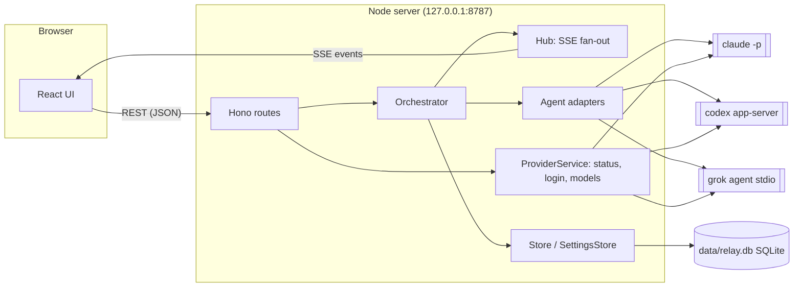

**English** | [繁體中文](architecture.zh-TW.md)

# Architecture

Harness Relay is a local web app with two halves:

- a **Node.js server** (Hono, TypeScript) that owns conversations, decides which agent speaks next, spawns the agent CLIs, and persists everything in SQLite;
- a **React client** (Vite) that renders the chat and receives live updates over Server-Sent Events (SSE).

The server never calls model APIs directly. Every agent turn is one run of a real CLI (`claude`, `codex`, `grok`) in headless mode, so each agent keeps its own tools, permissions, login and session history.



## Components

| Module | Responsibility |
| --- | --- |
| `src/server/index.ts` | HTTP routes, security middleware, SSE endpoint, static file serving, startup/shutdown |
| `src/server/orchestrator.ts` | Runs a "team turn": picks speakers by mode, builds each agent's prompt, runs the CLI, streams results; designs the team first in auto-team conversations |
| `src/server/planner.ts` | Auto team: the lead agent's prompt, parsing its JSON reply, turning it into a runnable team, the fallback |
| `src/server/prompt.ts` | Role briefing (system prompt), per-turn prompt, `@mention` parsing, `[PASS]` detection |
| `src/server/approvals.ts` | Rule keys for "always allow in this conversation" and matching them |
| `src/server/agents/*` | One adapter per CLI: builds arguments, parses the CLI's JSON event stream into common events (`acp.ts`: the JSON-RPC peer for Grok's ACP) |
| `src/server/i18n.ts` | Server messages in both languages; the language of each request and run (AsyncLocalStorage) |
| `src/server/process.ts` | Spawns processes in their own process group, streams stdout lines, handles abort/timeout |
| `src/server/providers.ts` | CLI status (installed, version, signed in), login sessions, logout, model catalog cache |
| `src/server/models.ts` | Discovers models and reasoning-effort levels from each CLI |
| `src/server/workspace.ts` | Git plumbing: automatic `git init`, working-tree snapshots, per-agent worktrees, diffs, applying results |
| `src/server/store.ts` | SQLite persistence for conversations, messages, agent sessions and presets |
| `src/server/settings.ts` | Provider settings (binary path, API key, default model/effort), default working directory, lead agent, child-process environment |
| `src/server/attachments.ts` | Files attached to user messages: saving them under `data/attachments`, safe file names, which ones go to the agents as images |
| `src/server/secrets.ts` | The OS credential store for API keys (`@napi-rs/keyring`), or none when the system has no usable one |
| `src/server/db.ts` | Opens SQLite, applies schema migrations, transaction helper |
| `src/server/hub.ts` | Per-conversation event fan-out to connected SSE clients |
| `src/shared/types.ts` | Types shared by server and client |
| `src/web/*` | React UI: sidebar, team designer, chat view, settings page, guided tour; `i18n.tsx` + `locales/` hold the UI strings |

## Conversation model

A **conversation** has a team (`agents`), settings (`mode`, `rounds`, `maxHops`, `permission`, `cwd`, and `autoTeam` while the lead agent still has to design the team) and an ordered list of **messages**. A message is authored by the user, an agent, or the system, and consists of **parts**: text blocks and tool calls (`Read`, `Edit`, `Shell`…) in the order they happened; a failed or refused tool call keeps its reason. A system message may carry a **plan** — the lead agent's team design.

For every agent the conversation also keeps **agent state**:

- `sessionId` — the CLI's own session/thread id, used to resume the agent's context next turn;
- `seen` — ids of chat messages that have already been delivered to this agent.

## How agents share context

Each agent has its own long-lived CLI session, so the server does **not** resend the whole chat every turn. Instead:

1. Before an agent speaks, the orchestrator collects every finished message that is not in the agent's `seen` set (user messages, other agents' replies, and — when starting fresh — the agent's own earlier replies).
2. Those messages are rendered as tagged blocks and sent as the prompt:

   ```text
   New chat messages since your last turn:
   <chat>
   <message from="user">…</message>
   <message from="@Builder" via="Codex">
   Implemented step 2.
   <actions>
   Edit update src/api.ts
   Shell npm test
   </actions>
   </message>
   </chat>

   Roundtable round 2/3: it's your turn, @Reviewer. Reply with [PASS] if you have nothing new to add.
   ```

   The `<actions>` block summarizes file edits and commands the speaker ran, so teammates know what changed without seeing the raw tool output.

   A user message with attached files also gets an `<attachments>` block listing each file's name, type, size and absolute path, which the agent opens with its own tools. Images (PNG, JPEG, GIF, WebP) in the delivered messages are passed natively as well: to Claude Code as base64 image blocks in its stream-json user message (plus `--add-dir` for the attachments folder so its Read tool may open the files), to Codex as `localImage` inputs on `turn/start`, and to Grok as ACP image blocks (it advertises `promptCapabilities.image`). Images over about 3.75 MB are only listed, to stay under the 5 MB per-image API limit.
3. The CLI is resumed with its stored session id, so it remembers everything it saw before.
4. When the turn succeeds, the delivered ids (and the agent's own reply) are added to `seen`. If the turn fails, the delivery is rolled back so the messages are offered again next time.

If resuming fails before the agent produced any output (for example the session was removed, or the working directory changed and Claude Code keeps sessions per directory), the orchestrator retries once with a **fresh** session and the full chat history.

### Role briefing

Each agent's role is injected through the CLI's system-prompt mechanism and **rebuilt on every turn**, so edits to roles or the team take effect on the next turn:

| CLI | Mechanism |
| --- | --- |
| Claude Code | `--append-system-prompt <briefing>` |
| Codex | `-c developer_instructions="<briefing>"` |
| Grok | `_meta.rules` on ACP `session/new` / `session/resume` |

The briefing contains the agent's role, the team roster (with each teammate's role summary), the rules of the current mode, the `[PASS]` convention, the shared working directory and the permission level.

## Turn scheduling (modes)

When the user sends a message (or presses **Continue**, which sends nothing), the orchestrator starts a run:

- **`@mentions` in the user message** restrict who takes part: only mentioned agents speak (in relay mode they start the relay).
- **Roundtable** — for each round `1…rounds`, participants speak one after another in team order. Each sees what earlier speakers said. If everyone in a round passes (or fails), the run ends early.
- **Parallel** — for each round, all participants run concurrently. Messages still streaming are not delivered, so agents don't see each other's answers until the next round.
- **Relay** — a queue starts with the mentioned agents, or the first team member (the "lead"). After each reply, every teammate `@mentioned` outside code blocks is appended to the queue. The run ends when the queue is empty or after `maxHops` turns (a system note tells the user, who can press **Continue**).

A reply that is exactly `[PASS]` (or empty with no tool calls) is marked as *passed* and rendered dimmed.

Only one run per conversation can be active at a time; different conversations can run concurrently. **Stop** aborts the run and kills the active CLI processes (process group `SIGTERM`, then `SIGKILL` after 3 s). Each agent turn also has a 45-minute safety timeout.

**Retrying an agent's reply** (`Orchestrator.retry()`) works the same way: the reply and everything after it are deleted, then that agent answers again — followed, outside relay mode, by the agents of the same round whose replies were dropped with it — for one round.

**Editing a user message** (`Orchestrator.resend()`) deletes that message and everything after it, resets every agent's session (CLI sessions cannot be rewound, so each agent starts fresh with the remaining history), marks parallel worktrees for reset, and sends the edited text as a new run. The truncation happens only after the workspace is prepared and locked, so a failed start leaves the history intact. Files the dropped turns changed are not restored.

## Auto team

A conversation created with `settings.autoTeam` has no members yet. The first run starts with a planning step (`designTeam()` in the orchestrator, `src/server/planner.ts`):

1. A system message with `plan.status = "planning"` appears in the chat.
2. The **lead agent** (Settings: provider, optional model and effort) runs once, read-only, in the conversation's working directory, with `PLANNER_BRIEFING` as its system prompt. The prompt contains the user's first message, the signed-in CLIs with their models and effort levels, the three modes, the user's permission and working directory (which it cannot change), and every template (built-in and saved). It must reply with one JSON object: `{"choice": "template", "templateId", "reason"}` or `{"choice": "custom", "name", "description", "mode", "rounds", "maxHops", "agents": [{name, provider, role, model?, effort?}], "reason"}`.
3. `parsePlanReply()` takes the JSON from a fenced block (or the outermost braces); `decidePlan()` turns it into a team. Custom members go through the same validation as a hand-made team (`validateAgents`), names have spaces replaced, at most 5 members, rounds 1–5, hops 1–30. `fitAgents()` moves members whose CLI is not signed in to the lead's CLI and drops models or efforts that CLI does not offer.
4. If the lead fails or its reply is unusable, `fallbackPlan()` uses the General-question template and the card explains why. If the user stops the run, the message is marked aborted and `autoTeam` stays on, so the next message plans again.
5. The team and mode are written to the conversation, `autoTeam` is cleared, the plan card becomes `ready` (with the lead's cost and tokens), and the run continues with the user's message as usual. Plan messages are system messages, so they are never forwarded to agents.

The run locks the working directory while planning (its mode is not known yet) and recomputes whether it is isolated afterwards. `POST /api/conversations/:id/messages/:messageId/save-plan` saves a custom design as a user template (with the conversation's permission) and records `plan.savedPresetId`. Editing the first message drops the plan with it, which turns `autoTeam` back on: the team is designed again for the new question. A team set by hand (`PATCH … { agents }`) switches auto team off.

## Languages

The UI comes in Traditional Chinese and English (`src/web/locales/zh-TW.ts`, `en.ts`; the English dictionary is typed against the Chinese one, and a test checks that both have the same shape).

- **Client** — on the first visit the language is taken from `navigator.languages` (any `zh*` → zh-TW, otherwise English) and saved in `localStorage` (`relay:lang`); Settings can change it. `<html lang>` follows.
- **Server** — every API request carries `X-Relay-Lang` (falling back to `Accept-Language`, then zh-TW). The `/api/*` middleware runs the request inside `withLang()` (AsyncLocalStorage), so `t()` returns the right messages anywhere below it — validation errors, adapter errors, system notes, and the whole team run the request starts, which keeps going after the response is sent.
- **Built-in templates** exist in both languages (`builtinPresets(lang)`); the lead agent sees them in the UI language and writes custom roles in the language of the user's question.
- Prompts to agents (briefings, turn prompts, the planner prompt) stay in English; agents answer in the user's language.

## CLI adapters

Every adapter turns one CLI turn into a stream of common events — `session`, `text`, `text_end`, `thinking`, `plan`, `tool_start`, `tool_end` (with the call's output or failure reason) — and, when the CLI asks to do something the permission does not cover, calls `requestApproval` (see [Approvals](#approvals)).

| | Claude Code | Codex | Grok |
| --- | --- | --- | --- |
| Command | `claude -p --input-format stream-json --output-format stream-json --verbose --include-partial-messages` | `codex app-server` (JSON-RPC over stdin/stdout, the protocol of Codex's IDE extensions) | `grok agent --no-leader stdio` (ACP: JSON-RPC over stdin/stdout) |
| Prompt via | a `user` message on stdin | `turn/start` | `session/prompt` |
| New / resume session | `--session-id <uuid>` / `--resume <id>` | `thread/start` / `thread/resume` | `session/new` / `session/resume` |
| Model | `--model` | `model` on the thread | `session/set_config_option` (`model`) |
| Reasoning effort | `--effort` | `config.model_reasoning_effort` on the thread | `session/set_config_option` (`reasoning_effort`) |
| Text streaming | `stream_event` text deltas | `item/agentMessage/delta` | `agent_message_chunk` |
| Thinking | `thinking_delta` (with `--thinking-display summarized`) | `item/reasoning/summaryTextDelta` (`model_reasoning_summary="auto"`) | `agent_thought_chunk` |
| Plan / to-do | the `TodoWrite` tool | `turn/plan/updated` | `plan` updates (its `todo_write` calls are not shown as tool rows) |
| Tool events | `tool_use` / `tool_result` blocks | `commandExecution`, `fileChange`, `mcpToolCall`, `webSearch` items | `tool_call` / `tool_call_update` |
| Asks for approval | `can_use_tool` control request (`--permission-prompt-tool stdio`) | `item/commandExecution/requestApproval`, `item/fileChange/requestApproval`, `item/permissions/requestApproval` | `session/request_permission` |

One process runs per turn. Claude Code's `--thinking-display` flag is not in its `--help`; if a version rejects it, the adapter remembers that and runs without it.

### Permission mapping

The permission decides what runs **without asking**; anything else goes to the user when the conversation asks (the default), or is refused automatically when it is set to refuse (`settings.approvals = "deny"`).

| Relay permission | Claude Code | Codex | Grok (ACP) |
| --- | --- | --- | --- |
| Read-only | `--permission-mode manual` (refuse: `dontAsk`), `--allowedTools WebFetch WebSearch`: reading and web run, anything else asks | sandbox `read-only`, approval policy `on-request` (refuse: `never`) | ask mode (`_meta.yoloMode: false`): web fetch runs, anything else asks |
| Edit | `--permission-mode acceptEdits`, plus web and common build / test / lint commands (`CLAUDE_EDIT_COMMANDS`): other commands ask | sandbox `workspace-write`, approval policy `on-request` (refuse: `never`) | ask mode inside `GROK_SANDBOX=workspace`: everything runs except publishing (`git push`, `npm publish`…), which asks |
| Full access | `--permission-mode bypassPermissions` | sandbox `danger-full-access`, policy `never` | always-approve (`_meta.yoloMode: true`) |

- **Claude Code** sends each request as a `can_use_tool` control request and waits for our control response (allow, or deny with a message the model sees). When the conversation refuses, no prompt tool is given and Claude Code denies such calls itself.
- **Codex** always runs commands in its OS sandbox. With `on-request` the model asks to go beyond the sandbox (writing outside the working directory, network…) when it needs to; whether it asks is the model's decision — otherwise the sandbox just blocks the call and the model sees the error.
- **Grok** runs over ACP because headless `grok -p` cannot ask: a call that would prompt is reported as "User cancelled" and the **whole turn ends**. Over ACP the request comes to the adapter. A refusal (the user's, or automatic) is sent as `reject_once` with `_meta.followup_message`, which Grok passes to the model as feedback instead of cancelling the turn.
  - The session mode is always set explicitly, so a user-level `[ui] permission_mode = "always-approve"` in `~/.grok/config.toml` cannot widen read-only or edit.
  - Grok still runs its built-in read-only tools and commands without asking, including bare `mkdir` / `touch`.
  - Read-only does not use Grok's `read-only` sandbox profile: it refuses to start on some machines (for example when `/var/run/docker.sock` is a symlink). In edit mode a sandbox that cannot start fails the turn with Grok's reason.

A refused or failed call keeps its reason (`tool_end.error`, stored in `message_parts.tool_error`) and the turn carries on.

## Approvals

When an adapter receives a request, the orchestrator (`requestApproval` in `turn()`, `src/server/approvals.ts`):

1. Builds an **approval part** in the agent's message: kind (`command` / `edit` / `fetch` / `other`), the command, file or URL, the agent's stated reason, and rule keys for "always allow". Command keys are one per command in a chain — the program, plus its subcommand for tools that have them (`npm install`, `git push`) — so allowing `npm test` never lets `npm test && rm …` through. Edits use one key for all edits, fetches the host name, other tools their name.
2. If every key is already allowed in this conversation (`conversation.allowRules`), it answers yes at once and shows the part as allowed automatically.
3. Otherwise the part is `pending`, the request waits in `orchestrator.approvals`, and the conversation reports `waiting` (the sidebar and the tab title show it). `POST /api/conversations/:id/approvals/:approvalId` with `{ allow, always?, note? }` resolves it; "always" adds the keys to `allowRules`. A declining note is passed to the agent.
4. Stopping the run resolves every pending request as `expired` (refused).

The agent's CLI waits the whole time; the turn's 45-minute safety timeout still applies.

## Agent activity

Besides reply text and tool rows, a message can show what the agent thinks and plans: a `thinking` part (streamed; collapsed in the UI with its latest line visible while it streams), a `plan` part (the agent's to-do list, updated in place), and each tool's `output` (the end of what it returned, up to 4,000 characters, shown when the tool row is expanded). Thinking is never forwarded to other agents.

## Workspaces and file changes

With **read-only** permission agents simply run in the working directory (`cwd`). With **edit** or **full access**, Harness Relay uses git to keep agents from overwriting each other and to record what each one changed (`src/server/workspace.ts`):

- **Automatic repository** — if `cwd` is not inside a git repository, Harness Relay runs `git init` there and adds common generated folders (`node_modules/`, `.venv/`, `target/`…) to `.git/info/exclude`. It refuses to do this in the home directory or the filesystem root. Nothing is ever committed to the user's branch.
- **Snapshots** — a snapshot is a commit of the current working tree (tracked and untracked files, honouring `.gitignore`) built with a temporary index (`git add -A`, `write-tree`, `commit-tree`). It does not move `HEAD`, touch the index or change any file.

| Mode | Where agents write | How changes are recorded |
| --- | --- | --- |
| Roundtable / Relay | The real working directory. Agents take turns, so only one writes at a time. | Snapshot before and after each turn; if the tree changed, the message records the diff. |
| Parallel | Each agent's own **git worktree** (`data/worktrees/<conversation>/<agent>`, branch `relay/<conversation>/<name>`), created from one snapshot of the working directory. | Everything the agent changed is committed to its branch after each turn. |

**Parallel mode.** Before the first round of a run every participant gets a worktree (kept across runs until it needs a reset). The briefing tells each agent its worktree, branch, the shared starting snapshot and its teammates' branches, so later rounds can read each other's work with `git diff <base> <branch>`. The user reviews each agent's diff in the chat and clicks **Apply** on the result they want: Harness Relay takes `base..branch` for that agent and applies it to the real working directory with `git apply`, after `git apply --check`, so a conflicting patch changes nothing. Nothing is committed; the changes are left for the user to review. All worktrees of the conversation are then marked for reset, so the next parallel run starts from the new state of the directory. Deleting the conversation removes its worktrees and branches.

**Directory lock.** A run that writes to the real working directory (edit / full access, not parallel) locks the repository root. Another conversation trying to write to the same repository at the same time gets an error until the first run ends; applying a worktree result takes the same lock. Read-only runs and parallel runs (which only write to their worktrees) are not blocked.

**Recorded changes.** An agent message with changes stores `root`, `base` and `head` (two commits) plus the changed files (A/M/D, lines added/deleted). The UI shows them as a card with a diff viewer (`git diff base head`) and, on each agent's latest worktree result, the **Apply** button. Teammates see the list in a `<changed_files>` block of the forwarded message.

## Live updates (SSE)

The client opens `GET /api/conversations/:id/events` and receives JSON events:

| Event | Payload | When |
| --- | --- | --- |
| `snapshot` | full conversation, running flag, active agents | on connect, and after a user message was edited (the history was cut) |
| `message` | a whole message (upsert by id) | message created, tool started/finished, turn finished |
| `delta` | `messageId`, `partIndex`, `text` | each streamed text chunk |
| `status` | running flag, active agent ids | an agent starts/stops, run starts/ends |
| `conversation` | title, team, settings | title or team changed |

The conversation list (`GET /api/conversations`) carries each conversation's state for the sidebar — `running`, `waiting` (an approval is pending) and `lastStatus` (how the latest agent reply ended); the client polls it every 3 s and remembers in `localStorage` what the user has seen, to mark replies that finished while they were elsewhere. Runs never depend on a browser being connected.

The server subscribes before sending the snapshot and replays queued whole-message events afterwards (deltas are skipped, since the snapshot already contains them), so nothing is lost while connecting. A `ping` comment is sent every 15 s.

## Persistence

Everything except API keys and attached files lives in one SQLite database, `data/relay.db` (WAL mode, foreign keys on, `secure_delete` on so removed rows are overwritten, file mode `0600`). Attached files are stored as `data/attachments/<conversation>/<attachment id>/<file name>` (mode `0600`) and referenced by `attachment` parts in `message_parts.data`; they are removed with their conversation, or when a resend or retry drops the messages they belonged to.

| Table | Contents |
| --- | --- |
| `conversations` | id, title, timestamps, mode, rounds, max hops, permission, cwd, `auto_team`, `approvals` (`deny` to refuse automatically), `allow_rules` (JSON) |
| `conversation_agents` | team members per conversation, in order (name, provider, role, model, effort) |
| `messages` | one row per chat message (author, status, passed, error, round, duration, cost, tokens, the turn's change commits, and the team design as JSON in `plan`), ordered by `seq` |
| `message_changes` | files changed per message (path, A/M/D, lines added/deleted) |
| `agent_worktrees` | per-agent worktree in parallel mode (repository root, path, branch, base snapshot, needs reset) |
| `message_parts` | the parts of each message in order (`idx`): text, thinking, plan and approval parts (their data as JSON in `data`), and tool calls with `tool_error` (why a call failed or was refused) and `tool_output` |
| `agent_sessions` | CLI session id and provider per agent per conversation |
| `agent_seen` | which messages each agent has been shown |
| `presets`, `preset_agents` | user-saved team templates (built-in templates live in code) |
| `provider_settings` | per CLI: binary path, default model, default effort; the API key only when there is no system credential store |
| `app_settings` | key/value app settings (default working directory, lead agent) |

Conversations in use are kept in memory, because the orchestrator mutates them while streaming. Writes are explicit: user messages, new agent messages, finished turns and session ids are written immediately; streaming changes are batched and written at most once per second, only for messages that changed. Messages left `streaming` by a crashed server are marked `aborted` at startup.

Schema changes are applied by ordered migrations tracked in `PRAGMA user_version` (see `src/server/db.ts`).

## Providers: status, login and models

- **Status** — `<cli> --version` plus an auth check: `claude auth status` (JSON), `codex login status`, `grok models`. Cached for 20 s.
- **Login** — the server runs the CLI's own login command in the background and exposes its output: URLs and device codes are extracted for the UI, and text typed in the UI is written to the process's stdin (Claude Code's paste-code flow). Sessions time out after 15 minutes.

  | CLI | Methods |
  | --- | --- |
  | Claude Code | `claude auth login --claudeai` (subscription) / `--console` |
  | Codex | `codex login --device-auth` / `codex login` (browser, localhost callback) |
  | Grok | `grok login --device-auth` / `grok login --oauth` |

- **API keys** — Claude Code and Grok keys are injected as `ANTHROPIC_API_KEY` / `XAI_API_KEY` into those CLIs' environment only. Codex keys are piped to `codex login --with-api-key` and stored by Codex itself.
  - *Where they are kept*: the OS credential store through [`@napi-rs/keyring`](https://github.com/Brooooooklyn/keyring-node) (prebuilt native binaries), service `harness-relay`, account `<provider>-api-key`: the macOS Keychain, Windows Credential Manager, or the Secret Service on Linux. Linux is pinned to the Secret Service because the library's other store, the kernel keyring, forgets everything on reboot. `SettingsStore` reads the keys into memory at startup.
  - *Fallback*: `openSystemKeyring()` checks availability with a read at startup. Without a usable store (no binary for the platform, no D-Bus session, or `RELAY_KEYRING=off`) keys stay in the `provider_settings.api_key` column and Settings says so. If the store exists but refuses a save, the request fails with that error; it never falls back to the database silently.
  - *Migration*: a key found in the database while a credential store is available (saved by an earlier version, or while there was none) is copied into the store, read back, cleared from the column, and the WAL is checkpointed so the plaintext does not linger in `relay.db-wal`. If moving it fails it stays in the database and Settings shows that.
- **Models** — Codex: `codex debug models` (catalog with per-model effort levels and defaults; defaults from `~/.codex/config.toml`). Grok: `grok models`. Claude Code has no list command, so the UI offers its aliases (`fable`, `opus`, `sonnet`, `haiku`) and reads the default from `settings.json` in `CLAUDE_CONFIG_DIR` (or `~/.claude`). Cached for 10 minutes.

## Security

The server can start coding agents with write access, so it is locked down to the local UI:

- binds to `127.0.0.1` by default;
- rejects requests whose `Host` is not localhost (DNS-rebinding protection) and whose `Origin` is another site;
- requires `Content-Type: application/json` on every write, so a cross-site form post cannot trigger a turn;
- API keys are kept in the OS credential store, not the database (see above); the SQLite file (and its WAL files) are readable by the owner only, and deleted rows are overwritten;
- attached files are served with `X-Content-Type-Options: nosniff` and a sandboxing `Content-Security-Policy`; only PNG, JPEG, GIF and WebP are shown inline, and anything else is a download, so an attached HTML or SVG file can never run in the app's origin. File names are stripped of directories and control characters before they touch the disk;
- environment variables that Claude Code sets for its own children are removed before spawning `claude`, so the app also works when started from inside a Claude Code session.

It is a single-user tool: there is no authentication, and any process that can reach your localhost can use it.

## Known limitations

- Worktrees contain only what is in the snapshot: ignored files such as `node_modules/` or build output are not there, so an agent that wants to run tests in parallel mode may need to install dependencies in its worktree first.
- In roundtable / relay mode, the before/after snapshot attributes every change made in the directory during a turn to that agent, including edits you make in your editor at the same time.
- The directory lock lives in the server process; other tools (or a second Harness Relay server) can still edit the same files.
- Starting a new Codex login signs out the current Codex account first.
- Claude Code has no model-list command; the model menu shows aliases plus a custom field.
- Long conversations grow the per-turn prompt only by new messages, but a fresh session (after a resume failure, a provider change, or an edited message) receives the full history.
- Server text is written in the language active when it was produced: system notes stay in that language, and provider status details stay in it until the 20-second status cache expires.
- The lead agent's choice is only as good as its reply; an unusable reply falls back to the General-question template.
- Codex asks only when its model decides to request more than the sandbox allows; a blocked call it does not ask about just fails.
- Claude Code's thinking text needs the undocumented `--thinking-display summarized` flag; Claude Code's to-do list appears only when its `TodoWrite` tool is available.
- Retrying or editing makes every agent start a fresh CLI session with the remaining history.
