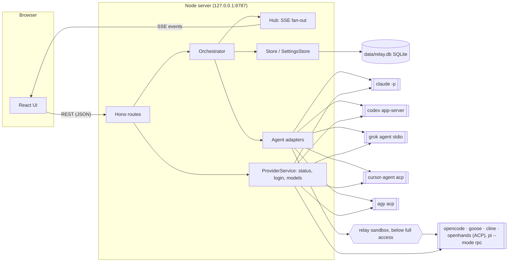
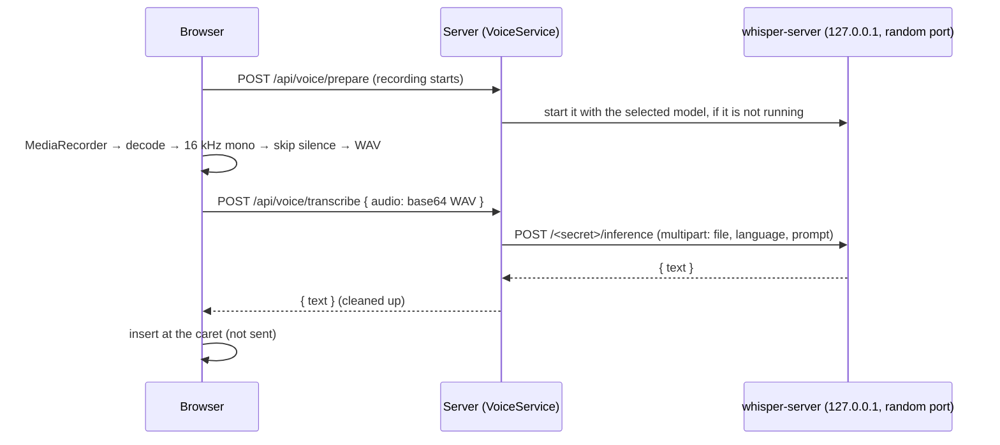

**English** | [繁體中文](architecture.zh-TW.md)

# Architecture

Harness Relay is a local web app with two halves:

- a **Node.js server** (Hono, TypeScript) that owns conversations, decides which agent speaks next, spawns the agent CLIs, and persists everything in SQLite;
- a **React client** (Vite) that renders the chat and receives live updates over Server-Sent Events (SSE).

The server never calls model APIs directly. Every agent turn is one run of a real CLI (`claude`, `codex`, `grok`, `cursor-agent`, `agy`, or one of the five open-source agents: `opencode`, `goose`, `cline`, `openhands`, `pi`) in headless mode, so each agent keeps its own tools, permissions and session history, and Claude Code, Codex, Grok, Cursor and Antigravity their own login. The open agents run on the model backends the user sets up, in homes of Harness Relay's own, and below full access inside Harness Relay's own sandbox ([Open agents](open-agents.md)).



## Components

| Module | Responsibility |
| --- | --- |
| `src/server/app.ts` | HTTP routes, security middleware, SSE endpoint (`createApp`, testable with `app.request()`) |
| `src/server/index.ts` | Wiring, static file serving, startup and shutdown |
| `src/server/web.ts` | Serves the built UI: files under `assets/` (named by content hash) cached for good, `index.html` checked on every load; finds it in `dist/web` or `RELAY_WEB_DIR` |
| `src/server/parent.ts` | The desktop app that started the server, if any: tells it the server listens (or cannot), hears it ask for a shutdown |
| `desktop/` | The desktop app (Electron, a package of its own): runs the server in a utility process with the login shell's environment, shows the chat in a window of its own, a tray menu, open at login, sharing with the tailnet, updates; see [Desktop app](#desktop-app) |
| `src/server/orchestrator.ts` | Runs a "team turn": picks speakers by mode, builds each agent's prompt, runs the CLI, streams results; in auto-team conversations, has the lead agent design the team for each new question first |
| `src/server/planner.ts` | Auto team: the lead agent's prompt (the question, the conversation so far, the current team, the templates), parsing its JSON reply, turning it into a runnable team, the fallback |
| `src/server/grouping.ts` | Sidebar groups: the lead agent sorts a new conversation into one of the user's groups by its first message, in the background (`AutoGrouper`) |
| `src/server/prompt.ts` | Role briefing (system prompt), per-turn prompt, `@mention` parsing, `[PASS]` detection |
| `src/server/approvals.ts` | Rule keys for "always allow in this conversation" and matching them |
| `src/server/commands.ts` | Reads a shell command line into the programs it runs (chains, substitutions, `sh -c` / `eval`, `env` / `sudo`, reserved words and compound commands such as `if` / `while` / `for`, git's global options): approval keys, the publish check of Grok and the open agents |
| `src/server/agents/*` | One adapter per CLI: builds arguments, parses the CLI's JSON event stream into common events (`acp.ts`: the JSON-RPC peer for ACP and Codex, and the ACP prompt, MCP server and permission-answer helpers; `acpTurn.ts`: the open agents' generic ACP turn; `open.ts`: what the open agents share around their process; see [Open agents](open-agents.md)) |
| `src/server/backends.ts` | The open agents' model backends: API keys for OpenAI, Anthropic and xAI and the user's OpenAI-compatible endpoints (keys in the OS credential store), and what one run gets (`backendRun()`); whether a run of Claude Code, Codex or Grok is on one of the endpoints, and the refusal of one on a deleted endpoint (`endpointRunModel()`, the deleted ids in `deleted_endpoints`) |
| `src/server/relaySandbox.ts`, `relaySandboxHost.ts` | Harness Relay's own sandbox around the open agents below full access (`@anthropic-ai/sandbox-runtime`, one host process per run; see [OS sandboxes by platform](sandboxing.md#harness-relays-own-sandbox)); `sandboxProcs.ts` finds a run's leftover processes on macOS by their sandbox |
| `src/server/i18n.ts` | Server messages in both languages; the language of each request and run (AsyncLocalStorage) |
| `src/server/process.ts` | Spawns processes in their own process group, streams stdout lines, keeps output as raw bytes, handles abort/timeout (SIGTERM, then SIGKILL to the whole group) |
| `src/server/winLaunch.ts` | On Windows, what to start for a CLI found as a `.cmd`: the program or Node script an npm shim names, or Cursor's newest version (see [CLI adapters](#cli-adapters)) |
| `src/server/providers.ts` | CLI status (installed, version, signed in), login sessions, logout, model catalog cache |
| `src/server/models.ts` | Discovers models and reasoning-effort levels from each CLI |
| `src/server/workspace.ts` | Git plumbing: automatic `git init`, working-tree snapshots, per-agent worktrees, diffs, applying results |
| `src/server/store.ts` | SQLite persistence for conversations, messages, agent sessions and presets |
| `src/server/settings.ts` | Provider settings (binary path), each account's API key, default model/effort and what its runs leave out, default working directory, lead agent, child-process environment |
| `src/server/attachments.ts` | Files attached to user messages: saving them under `data/attachments`, safe file names, which ones go to the agents as images |
| `src/server/media.ts` | Images and videos a reply embeds, and files it links to: which directories they may come from, resolving a path safely (real path inside one of them, never in `.git`; media types only for media), byte ranges |
| `src/server/voice.ts` | Voice input: installs the whisper.cpp engine and models (pinned, SHA-256 checked) in the background, runs `whisper-server` on demand, transcribes recordings |
| `src/server/secrets.ts` | The OS credential store for API keys (`@napi-rs/keyring`), or none when the system has no usable one |
| `src/server/db.ts` | Opens SQLite, applies schema migrations, transaction helper |
| `src/server/hub.ts` | Per-conversation event fan-out to connected SSE clients |
| `src/server/share.ts` | Sharing a conversation: the page the UI made goes up to GitHub as a secret gist through the user's own `gh` (`gh gist create`, read on gistpreview.github.io), the files its replies link to, of any kind, in a second secret gist (made with `gh api`, the files pushed into it with git, signed in by `gh`), and both come down with `gh gist delete` |
| `src/shared/types.ts` | Types shared by server and client |
| `src/shared/media.ts` | Which image and video types can be shown, and which image and link URLs in a reply are local files (relative or absolute paths, `file:` URLs, `file:line`) rather than other sites |
| `src/shared/share.ts` | A shared page's links to the files that go along with it: the placeholders the UI writes (`relay-share-file:<n>`, only as the href of a real `<a>` tag) and the server replaces with the files' addresses on GitHub; sizes as the share limits count them |
| `src/shared/search.ts` | Searching conversations: the words of a search, where they match (ignoring case), the excerpt around the first match, highlighting |
| `src/shared/mentions.ts` | The `@mention` rule used by both the server (who is addressed) and the UI (which mentions are highlighted): the message is read as Markdown (GFM) and only prose counts, not code or link text |
| `src/shared/links.ts` | Where a bare URL ends: GFM ends one only at a space, so Chinese written right after it would be part of the link. `endBareUrls()` also ends it at CJK or full-width punctuation, and at a CJK character that follows neither another one nor `/ ? # & = . - _ + (` (so `/wiki/臺灣` and `?q=中文` stay links), then leaves out trailing punctuation as GFM does; the prose after it may hold more URLs. Used by the UI's renderer and by the `@mention` rule, so both read a message alike |
| `src/web/*` | React UI: sidebar, team designer, chat view, settings page, guided tour; `i18n.tsx` + `locales/` hold the UI strings; `chat.ts` holds the chat view's pure logic (reconnecting, Apply availability, team-drawer draft, grouping a message's tool calls and thinking into activity rows); `sidebar.ts` the sidebar's (conversations in their groups, moves not yet confirmed, a collapsed group's state); `recorder.ts` records the microphone and `voice.ts` holds voice input's pure logic (WAV encoding, silence, inserting the transcript) |

## Conversation model

A **conversation** has a team (`agents`), settings (`mode`, `rounds`, `maxHops`, `permission`, `cwd`, `extraCwds` when it has more working directories than one (see [Several working directories](#several-working-directories)), and with [auto team](#auto-team) `autoTeam`, plus `autoConfirm` when the lead agent's team is used without asking) and an ordered list of **messages**. A message is authored by the user, an agent, or the system, and consists of **parts**: text blocks and tool calls (`Read`, `Edit`, `Shell`…) in the order they happened; a failed or refused tool call keeps its reason. A system message may carry a **plan** — the lead agent's team design.

For every agent the conversation also keeps **agent state**:

- `sessionId` — the CLI's own session/thread id, used to resume the agent's context next turn;
- `seen` — ids of chat messages that have already been delivered to this agent.

### Branching a conversation

**Branch conversation** (the branch icon under an agent's reply, `POST /api/conversations/:id/messages/:messageId/branch`, `Orchestrator.branch()`) makes a new conversation that goes on from that reply on its own:

- It holds a copy of every message up to and including the reply, each with a new id (message ids are rows of their own), written with the conversation in one transaction (`Store.create()`). The team, the settings, the "always allow" answers (`allowRules`) are copied as they are now, not as they were at that reply: a member who left since cannot be retried there, and later "always allow" answers carry over. It goes into its family's sidebar group (`Store.placeBranch()`, with `group_source = 'user'`, so the lead agent does not sort it; see [Sidebar groups and search](#sidebar-groups-and-search)). Its title is **Branch · <title>** (`t().branchTitle`) until the first user message posted there names it, as a new chat is named after its first question (`nameAfter()`: only while the title is still that, in either language, `isBranchTitle()`, so a name the user gave it stays). An edit that leaves no copied message ends the branch; still called that, it is called "New chat" again (`truncateFrom()`), so the edited message names it. The schedule and the queue are not copied.
- A question the reply asked stays open in the branch (`branchPause()`), whatever the user answered in the original since, so it can be answered another way. Branched where the original waits now, the branch copies its `pause`; otherwise the agent that asked (in parallel mode, with the round's other askers up to it) answers first, followed in roundtable mode by the members after it in the round, and in later rounds by the members the question was for. As in the original, the answer is no new question: the lead agent designs no team for it.
- Attached files are copied into its own `data/attachments/<conversation>/` (a copy-on-write clone where the filesystem can make one; a file already gone is skipped), and the commits behind the copied replies' file changes are kept under its own `refs/harness-relay/<conversation>/`, so their files and diffs outlive the original. Isolated (parallel-mode) results cannot be applied there, and the images and files those replies link to are read from the worktree they were made in (`replyWorktree()`: the one holding the turn's branch, in the conversation the reply was written in: any its copied messages came from, and further up for a branch of a branch), never from the branch's own worktree for that agent; once the original is deleted, with its worktrees, they are not found.
- It is a branch of the conversation the reply was written in (`branchOrigin()`). That is the original for a reply written there; but up to a branch's branch point, its messages were copied, so branching from a reply there (the branch point included) makes a branch of the conversation the reply was copied from, or of one further up for a branch of a branch, as if it had been branched there: it is listed under that one in the sidebar, says **Continued from** that one, and is called **Branch · <its title>**, by its title now (`Store.titleOf()`; for one deleted since, the title the sidebar shows for it). The branch is worked out again once the attached files are copied, in the same step as it is saved (unless the original's messages up to the reply changed meanwhile): deleting waits only for branches made from the conversation itself, so one it comes from that was deleted meanwhile is known as deleted, with its `via`. So after B is branched from A, a branch from a reply B copied from A is A's branch, not B's.
- `conversation.branch` (`ConversationBranch`: the id of the conversation it was branched from, its title then, and `afterId`, the last copied message here; `earlier`: where the copied messages before those were written, when they were copied from further up, as parts of their own, nearest first, each with its conversation, title and last message here) is stored as JSON in `conversations.branch`. Branching from a reply in one of the `earlier` parts makes a branch of the conversation that part names; only the parts before the reply come along. A part whose last message is not in the conversation cannot be placed and is left out. ChatView shows **Continued from <title>** after the chat's title in the header (each takes the room it needs; when both need more, each gets half, and one needing less leaves the rest to the other, both ending in …) and as a line after `afterId`, linking to the original while the conversation list has it (with its title now), and its title then once it is deleted. The line is an element between messages, which a shared page skips (`messageElements()`, as it takes one element per message); shared pages leave both out. Retrying or editing a copied message moves `afterId` back to the last copied message left (`branchAfterCut()`), and a part that loses all its messages goes: with nothing left of the conversation it was branched from, it is a branch of the one further up, by that one's title now (and while still called **Branch · <title>**, called after that one). Once no copied message is left, `branch` is removed.
- The agents start with no session and nothing `seen`, so their first turn gets the copied history (their own replies included), as a fresh session does. Their briefing says the chat was branched and that the original may have changed files since; the working directory is shared and nothing in it is rewound.
- The original is not touched and may go on replying meanwhile; only the turns up to the reply must be over (409 while a reply is still streaming, as a parallel peer's can be, or its turn still records the files it changed: `Run.turns`). Deleting the original, and shutdown (`settled()`), wait for a branch being made, which is still copying its files. Only an agent's reply can be branched from (400 for others).

## How agents share context

Each agent has its own long-lived CLI session, so the server does **not** resend the whole chat every turn. Instead:

1. Before an agent speaks, the orchestrator collects every finished message that is not in the agent's `seen` set (user messages, other agents' replies, and — when starting fresh — the agent's own earlier replies).
2. Those messages are rendered as tagged blocks and sent as the prompt:

   ```text
   New chat messages since your last turn:
   <chat>
   <message from="user">…</message>
   <message from="@Builder" via="Codex">
   Implemented step 2.
   <actions>
   Edit update src/api.ts
   Shell npm test
   </actions>
   </message>
   </chat>

   Roundtable round 2/3: it's your turn, @Reviewer. Reply with [PASS] if you have nothing new to add.
   ```

   The `<actions>` block summarizes file edits and commands the speaker ran, so teammates know what changed without seeing the raw tool output.

   A user message with attached files also gets an `<attachments>` block listing each file's name, type, size and absolute path, which the agent opens with its own tools. Images (PNG, JPEG, GIF, WebP) in the delivered messages are passed natively as well: to Claude Code as base64 image blocks in its stream-json user message (plus `--add-dir` for the attachments folder so its Read tool may open the files), to Codex as `localImage` inputs on `turn/start`, and to Grok, Cursor and Antigravity as ACP image blocks (all three advertise `promptCapabilities.image`). Images over about 3.75 MB are only listed, to stay under the 5 MB per-image API limit.
3. The CLI is resumed with its stored session id, so it remembers everything it saw before.
4. When the turn succeeds, the delivered ids (and the agent's own reply) are added to `seen`. If the turn fails, the delivery is rolled back so the messages are offered again next time.

If resuming fails before the agent produced any output (for example the session was removed, or the working directory changed and Claude Code keeps sessions per directory), the orchestrator retries once with a **fresh** session and the full chat history. If the fresh session fails too before any output, the problem was not the session (a rate limit, sign-in, network…), so the old session is kept for the next turn.

Messages are forwarded once they are final: finished replies, and replies that failed or were stopped but said something or changed files (marked `status="failed"` / `status="stopped"`). A `[PASS]` reply is forwarded as `[PASS]` plus its `<changed_files>`.

### Role briefing

Each agent's role is injected through the CLI's system-prompt mechanism (Cursor has none, so its briefing goes in the prompt; Antigravity's is appended to its system prompt, again only when it changed) and **rebuilt on every turn**, so edits to roles or the team take effect on the next turn:

| CLI | Mechanism |
| --- | --- |
| Claude Code | `--append-system-prompt <briefing>` with `--system-prompt-snapshot off` (otherwise a resumed session keeps the prompt of its first request) |
| Codex | `developerInstructions` on `thread/start` / `thread/resume` |
| Grok | `_meta.rules` on ACP `session/new` / `session/resume` |
| Cursor | none over ACP: the briefing goes at the top of the prompt, inside `<harness-relay-briefing>…</harness-relay-briefing>`, in a new session, and in a resumed one only when it changed since it was last sent (remembered in memory per session, so after a server restart it is sent once more) |
| Antigravity | `_meta.antigravity.systemPrompt.append` on ACP `session/new` / `session/resume` (agy advertises it), inside `<harness-relay-briefing>…</harness-relay-briefing>`, which says it replaces any earlier one. agy adds each one sent to the session's system prompt, so, as for Cursor, a resumed session gets it again only when it changed since it was last sent (a hash per session, in memory). An agy that does not advertise it gets the briefing at the top of the prompt instead. Antigravity's briefing also says that a refused tool call ends its turn, and to ask the user Harness Relay's way, not with its `ask_question` tool |

The briefing contains the agent's role, the team roster (with each teammate's role summary), the rules of the current mode, the `[PASS]` convention, the shared working directory and the permission level. In parallel mode it also names the agent's worktree and branch, and each teammate's branch with the snapshot that teammate's worktree started from. With the [tool library](#tool-library), it also holds the agent's memory and a list of its skills.

## Turn scheduling (modes)

When the user sends a message (or presses **Continue**, which sends nothing), the orchestrator starts a run:

- **`@mentions` in the user message** restrict who takes part: only mentioned agents speak (in relay mode they start the relay).
- **Roundtable** — for each round `1…rounds`, participants speak one after another in team order. Each sees what earlier speakers said. If everyone in a round passes (or fails), the run ends early.
- **Parallel** — for each round, all participants run concurrently. Messages still streaming are not delivered, so agents don't see each other's answers until the next round.
- **Relay** — a queue starts with the mentioned agents, or the first team member (the "lead"). After each reply, every teammate `@mentioned` in the reply's prose (not in code or link text, see `src/shared/mentions.ts`) is appended to the queue. The run ends when the queue is empty or after `maxHops` turns (a system note tells the user, who can press **Continue**).

A reply that is exactly `[PASS]` (or empty with no tool calls) is marked as *passed* and rendered dimmed.

Only one run per conversation can be active at a time; different conversations can run concurrently. **Stop** aborts the run and kills the active CLI processes (process group `SIGTERM`, then `SIGKILL` after 3 s). Each agent turn also has a safety timeout: 45 minutes, or as many as `RELAY_TURN_TIMEOUT_MIN` says.

**Messages sent while the team replies** (`Orchestrator.send()`) do not start a second run. While a run is under way or being set up, or the lead agent's team design waits for confirmation, a message goes into the conversation's queue (`conversation.queue`, saved in `conversations.queue`, at most 20) instead, and the browser shows it above the message box (`queue` event). `deliverQueued()` posts waiting messages, oldest first, before the next turn of an agent they are for: in roundtable before each speaker, in relay before each hop, in parallel at the start of each round (so the whole round sees the same messages). A message that @mentions only other agents waits for one of them, and the ones behind it wait too, so the chat keeps the order they were sent in. Delivered messages are ordinary user messages marked `queued` (shown as *Added mid-reply*); each agent receives them through its unseen-message delta like anything else, so the agent that was speaking sees them on its next turn. When a run ends with messages still waiting and was not stopped, `startQueued()` starts another run for them, its participants chosen by their @mentions (all of them mention someone: those agents; otherwise everyone). After **Stop** they keep waiting for the user (`DELETE /api/conversations/:id/queue/:messageId` withdraws one); the next send or Continue posts them ahead of the new message. Sending with `interrupt: true` stops the run, waits for it to wind down, and then sends the waiting messages and the new one as a new run. A message is saved as a message before it leaves the saved queue, so one in both after a crash counts as delivered.

**Questions to the user.** The briefing tells agents to ask instead of guessing when a good answer depends on something only the user knows, and to end such a reply with `[ASK_USER]` on its own line (`src/shared/ask.ts`; the UI hides the marker while the reply streams). When a turn ends, `takeAsk()` removes the marker from the message and marks it `asked`, and the run stops there: `pauseFor()` saves where (`conversation.pause`, a `RunPause` in `conversations.pause`, sent to the browser with the `conversation` event). Roundtable stops at once and keeps the rest of the round; parallel lets the round finish, then keeps the agents that asked; relay keeps the rest of the queue and the handoffs left. While the team waits, messages in the queue do not start a run. The next run (`takePause()`) picks up from there: the agents that asked speak first, told on that turn that the user replied (`TurnInfo.answered`), then the rest of the round (or relay queue) and the remaining rounds. Continue with nothing to post skips the agents that asked. A reply that @mentions anyone else, an edit or retry (`truncateFrom()` clears the pause), a team design or a changed mode starts afresh instead. The user's reply is an answer, not a new question, so [auto team](#auto-team) designs no team for it. The conversation list reports `asking` for the sidebar.

**Retrying an agent's reply** (`Orchestrator.retry()`) works the same way: the reply and everything after it are deleted, then that agent answers again — followed, outside relay mode, by the agents of the same round whose replies were dropped with it — for one round.

**Editing a user message** (`Orchestrator.resend()`) deletes that message and everything after it, resets every agent's session (CLI sessions cannot be rewound, so each agent starts fresh with the remaining history), marks parallel worktrees for reset, and sends the edited text as a new run. The truncation happens only after the workspace is prepared and locked, so a failed start leaves the history intact. Files the dropped turns changed are not restored.

## Auto team

Every conversation the app starts has `settings.autoTeam`: before the team answers a new question, the **lead agent** designs the team for it (`designTeam()` in the orchestrator, `src/server/planner.ts`). The user designs teams as **templates** (on the New chat page: built-in ones to copy, their own to add, change and delete; `POST /api/presets`), and the lead agent picks, adapts or replaces them per question. A new conversation has no members until its first question.

**Which runs design.** `Orchestrator.designs()` decides when a run starts: the lead designs when the conversation has no team yet; for a question of the user's own (a message sent while nothing runs, or an edited message), unless it answers an agent's question (`conversation.pause`) or @mentions members of the current team, who then answer it; and on Continue when a design was stopped since the team last spoke (`designOwed()`). A retry, a scheduled message, a run for the messages that waited in the queue and the run that follows a confirmation keep the current team (`StartOptions.keepTeam`). A conversation without `autoTeam` (created through the API with a team) never designs.

**The design run** does nothing but design the team:

1. A system message with `plan.status = "planning"` appears in the chat.
2. The lead agent (Settings: provider, optional model and effort) runs once, read-only, in the conversation's working directory, with `PLANNER_BRIEFING` as its system prompt. The prompt (`buildPlannerPrompt()`) contains the **question** — everything the user said since the team last spoke or a team was designed (`questionStart()`), so a stopped design's question still counts — the **conversation so far** before it (`historyForLead()`: the user's messages and the agents' replies, oldest first, without tool calls, system notes, plans, passes or failed replies; each at most 1,500 characters, all of them at most 12,000, the latest kept), the **current team** (mode, rounds or hops, each member's CLI, model, effort and complete role), the signed-in CLIs (`agentsForLead()`), each with every model it offers (its name, the efforts it takes and its default effort) and the defaults Harness Relay runs it with, both as the account its new members get runs it (`catalogFor(ctx.catalog, p, ctx.accounts[p][0])`), what it loads by itself in the conversation's working directory (`ctx.native`: built-in tools, skills, MCP servers with their tools, subagents and plugins, without what its runs leave out; asked through `NativeSetupService.recent()`, which calls no model, in the home of the account its new members get, `ctx.accounts[p][0]`; the last answer for that CLI, folder and home is used at once, however old, while what its runs leave out is the same, and is asked again in the background after a minute; with none yet the design waits up to `NATIVE_WAIT_MS`, 20 s, and a CLI that answered nothing by then is listed as unknown, with why; one that refused a question, left a part unanswered or ran out of time after some answers keeps the lists it answered, marked as maybe incomplete (`probeCompleteness()`; a refused question is marked `refused`, so a CLI that answered its lists empty, with nothing of its own, is not taken for one that could not be asked)) and the tool library items its new members get, then the tool library itself (`ctx.library`: each MCP server, usable skill and memory part, and whose members get it), with how to staff members by these, the three modes, the user's permission and working directory (which it cannot change), whether the user reviews the team or it answers at once, for a schedule's message, the names it @mentions that no current member has (`unknownMentions()` in `src/shared/mentions.ts`; if they name the people or roles it is for, the lead is to name the members so, adapting a template to rename them, since only members a message @mentions answer it — not for an ordinary question, whose @-words are as often code), and every template (built-in and saved) in full, as JSON. It must reply with one JSON object: `{"choice": "keep", "reason"}` to keep the current team (offered only when there is one; preferred for a follow-up on the same work, since its members keep what they learned); `{"choice": "template", "templateId", "reason"}` to use a template as it is; `{"choice": "adapted", "baseTemplateId", …team, "reason"}` to change one for the question; or `{"choice": "custom", …team, "reason"}` for a team designed from scratch, where the team is `"name", "description", "mode", "rounds", "maxHops", "agents": [{name, provider, role, model?, effort?}]`. The lead reads the tools but does not change them: the current team and the templates list, as `fromToolLibrary`, the library items each member actually gets (its CLI's defaults with its exceptions, `memberLibraryTools()`, as `ToolLibrary.forAgent` gives them); new members get their CLI's defaults, and members who stay keep their exceptions. `plannerContext()` in `planner.ts` gathers all this (the server's `PlannerSource.context(cwd)`). The reason is for the user.
3. `parsePlanReply()` takes the JSON from a fenced block (or the outermost braces); `decidePlan()` turns it into a team. A kept team is the current team as it is (ids too). Custom members go through the same validation as a hand-made team (`validateAgents`), names have spaces replaced, at most 5 members (fewer when `RELAY_MAX_TEAM_AGENTS` is lower), rounds 1–5, hops 1–30. Templates with more members than the team limit (one saved before the limit was lowered) are not offered to the lead agent, nor taken when it names one, and the fallback template is cut to the limit. A team saved before the limit was lowered can still be handed to the lead agent to change; its answer is cut to the limit. `fitAgents()` moves members whose CLI is not signed in to the lead's CLI, drops models or efforts that CLI does not offer, and gives members whose account is not usable one of their CLI's usable accounts (see [Accounts](#accounts)). A template used as it is gets a default reason if the lead gave none. An adapted team records its base template in `plan.basedOn` (id and name), and its members who are one of the template's (same name, ignoring case, and CLI) keep that member's tools and account (`fromTemplate()`); one whose base id is unknown is kept as a custom team. An adapted or custom team that is identical to a template (`sameTeam()`: same members, CLIs, roles, models, efforts, mode and rounds or hops) is recorded as that template.
4. If the lead fails or its reply is unusable, `fallbackPlan()` keeps the current team, or uses the General-question template when there is none, and the card explains why (`source: "fallback"`, with `presetId` only for the template). If the user stops the run, the message is marked aborted; the next question, or Continue, designs again.
5. Members who stay on (same name, ignoring case, and same CLI as a current member, `keepMemberIds()`) keep their ids, and with them their CLI sessions and worktrees, and their accounts and tools as the user set them (whatever the new team's member had); the others start fresh and read the conversation through their unseen-message delta, like any new member. The plan card becomes `ready` (with the lead's cost and tokens) and holds the team (`plan.agents`, `plan.settings`). The run ends there.
6. **Confirmation.** By default the plan waits (`awaitingConfirmation`) and the conversation keeps its current team, so a retry or an edit of an earlier message (which drops the waiting plan with what follows) still has that team. Until the user answers, Continue is refused (409) and messages wait in the queue (as do messages sent while the lead designs). The user can confirm it (`POST /api/conversations/:id/messages/:messageId/confirm-plan`: the plan's team and mode become the conversation's, `plan.confirmedAt`), decline it (`…/decline-plan`: the current team stays, `plan.declinedAt`; not for a first question, which has no team to keep), or set the team by hand (`PATCH … { agents }`, which settles it with the team as sent: the team drawer edits the waiting design and says that saving uses it). Both buttons are refused (409) while something else holds the conversation. Either way the team then answers (`startConfirmed()`): a run with the team now set, which posts the waiting messages first and sees the question in the history. With `settings.autoConfirm` the plan's team is used at once (`confirmedAt`, `autoConfirmed`) and the team's run starts when the design run ends (`Run.answerNext`); if it cannot start (another conversation writes in the folder), a note says why and Continue lets the team answer without a new design. Plan messages are system messages, so they are never forwarded to agents.

A run that designs the team writes nothing (the lead is read-only and nobody else speaks), so it locks no directory; the team's own runs lock by the confirmed mode as usual. `POST /api/conversations/:id/messages/:messageId/save-plan` saves a team the lead designed or adapted (`planSavable()`) as a user template (with the conversation's permission) and records `plan.savedPresetId`; a template used as it is, or the current team kept, is not new, so the card does not offer to save it. Editing a question drops its plan with it and designs again for the edited question, with what came before it as history. A team set by hand, and the settings, never switch auto team on or off (`PATCH` keeps `autoTeam` as it was); `autoConfirm` can be changed in the team settings. Schema version 13 (`conversations.auto_confirm`) turned auto team on for every conversation saved before it.

**Changing a team at the user's request.** The team drawer can ask the lead to change the team it shows (the conversation's team, or the design waiting for confirmation, with the user's edits so far). `POST /api/conversations/:id/revise-team` with `{ request, agents, settings }` (`settings`: how the members take turns, and the drawer's permission and working directory, saved or not, which the lead only reads: `draftPlace()`) runs the lead read-only in the saved working directory with `REVISER_BRIEFING` and `buildRevisePrompt()`: the request, the team, the conversation so far, whether the team is a design waiting for confirmation (for the latest question, or for the schedule's message, or for a schedule deleted since), the schedule's message when the schedule is on or the waiting design is for it (saying when it is off), the folder the lead itself works in when the drawer names another one, the CLIs it can use and the templates. It replies with the whole team as JSON, giving a role only for a new member or one it rewrites, which `decideRevision()` makes runnable. A member stays the same member when the lead names it as `was` (renamed, or moved to another CLI), or keeps its name (ignoring case) and CLI, or keeps its name on another CLI, or, when exactly one listed member and one drawer member are left over and the listed one has no role or the same one, is that one (renamed without saying so). Every `was` is settled before any name, so a new member named like one renamed away does not take its place, and swaps and chains of renames keep each member. A `was` naming a member the lead also lists unchanged under that name (no role, not itself renamed) is ignored: it was misused for a new member based on that one, which then starts from its role and is never taken for a member being removed. It keeps its id (and with it its session; on another CLI the session starts afresh, as for a change by hand), its tools, and the role, model and effort the lead left out (or gave as `null`, or a blank role; a model or effort does not carry over to another CLI); a role the lead copied without its surrounding space stays as the user wrote it; a member who keeps its CLI keeps it even when that one is signed out, since the user chose it. New and moved members, and changed models and efforts, are fitted as for a design. A reply without members (the lead declined, saying why) keeps the members. The answer is a `TeamRevision` (members, how they take turns, the lead's reason, and the run's time and cost). Nothing in the conversation changes: the drawer shows the team, lists what changed (`teamChanges()` in `src/web/chat.ts`, which ignores an empty model and space around a role) and offers Undo, until the user saves it with `PATCH` as usual (which settles a waiting design). The drawer ignores an answer when its team was loaded again meanwhile, or can no longer be saved (`revisionOutcome()`). A new request stops the one before (409), and so do closing the request (the drawer closed, or Stop), deleting the conversation and shutting down; a stopped one is still waited for, on delete and shutdown, until its lead process has ended. The lead's session is linked to the conversation in AgentsView.

## Schedules

A conversation can have one **schedule** (`conversation.schedule`, a `ConversationSchedule`, in the `schedules` table): a message the team is sent at set times, in the same conversation or (`newChat`) in a new one each time, as if the user had sent it. It is the first step of the [triggers proposal](proposals/triggers.md), with one schedule per conversation, and the option of a new conversation each time from its third.

- **When.** `repeat` is once (a moment), every day at `HH:MM`, on chosen days of the week at `HH:MM`, or every 1–168 hours from when its times were last set (saving a new message or other choices keeps the cadence). Times of day are wall-clock times in the schedule's time zone (the browser's when it was saved; the server's when none is given). `nextRun()` (`src/shared/schedule.ts`) works out the next time: a time the clocks skip moves forward by the jump, one they repeat is the first. The browser uses the same function to show the next three times before saving, and shows a schedule's times in its own time zone (with a button to switch to the device's).
- **Saving** (`PUT /api/conversations/:id/schedule`, checked by `validateSchedule()`) replaces the schedule, works out `nextRunAt` (none while it is off), records the UI language for the notes it writes, and keeps how it went last time. A schedule that is on needs a team: not while the lead agent still has to design the first one or the user to confirm one (409). Scheduled messages go to the current team: in an [auto-team](#auto-team) conversation the lead agent designs no team for them, since nobody may be there to confirm it.
- **New schedule** (the sidebar's **New schedule**, `POST /api/schedules`) creates a conversation with auto team and its schedule in one step — the schedule on, the title from the message's first line unless one is given — leaves a note, sorts it into the user's groups by the message, and has the lead agent design the team for the schedule's message at once, while the user is there to confirm it (`Orchestrator.designForSchedule()`; `POST …/schedule/design` asks again, e.g. after a design was stopped). That design run's question is the message itself (`Run.designFor`), and nothing is posted; the planner prompt says the team gets it on a schedule (here, or in a new conversation each time) with nobody watching. Its plan is marked `forSchedule`: once it is confirmed — on the card, by setting the team by hand, or at once with `autoConfirm` — the team answers nothing now (`startConfirmed()` only starts what the user wrote while the design waited); it gets the message when the schedule sends it. A time that comes due while that first team is designed or waits for confirmation is `busy`: tried again for up to 30 minutes, then skipped (no confirmed team). The plan card and the schedule drawer word this design for the schedule (`planWording()` in `src/web/copy.ts`). A name the scheduled message @mentions that is not on the team reaches nobody (the members it does @mention answer, or with none, the whole team): the schedule form warns as the message is typed (and, with no team yet, says the lead agent names the members after the mentions), the team editor warns when a member it @mentions is renamed or removed, and in a chat with a schedule the card of any team design warns before it is confirmed, or when it was used at once (`mentionWarning()` and `planChecksMentions()` in `src/web/copy.ts`, on `unknownMentions()`; a name followed by `/` or `(` is code, such as `@types/node` or `@Component(…)`).
- **Sending.** `Scheduler` (`src/server/scheduler.ts`, started once the server listens and stopped first on shutdown) looks every 15 seconds — an unref'd interval compared with the wall clock, so a computer that slept sends on waking — for schedules that are on and due (`Store.dueSchedules()`), the most overdue first, one at a time, inside `withLang(schedule.lang)`. `Orchestrator.sendScheduled()` then:
  - holds the message back (`skipped`, with the reason) while the team cannot take it: no confirmed team; an agent's question waiting for the user's answer, with no run carrying the answer being set up (the message would be taken for the answer); an earlier scheduled message still in the queue of a team that is replying (they do not pile up); a full queue;
  - puts it in the queue while the team replies or its run is being set up (`queued`), like any message sent mid-reply;
  - otherwise starts a run with it (`sent`), the messages already waiting first. An earlier scheduled message left waiting while nothing runs (the team was stopped, or the server restarted) goes out now instead, without a second copy.

  A scheduled message is never taken for the user's answer. When the user replies or presses **Continue**, a scheduled message waiting in the queue stays there (`start()` leaves it out of what goes first, while what the user wrote behind it still goes, in the order written): the team picks up where it stopped, and the message reaches the next turn of an agent it is for, or a run of its own afterwards (`startQueued()`). `takePause()` also looks only at what the user wrote.

  The message is an ordinary user message with `scheduled: true` (`messages.scheduled`), so mentions, modes and delivery work as usual. Agents see it as `<message from="user" via="schedule">`, and the briefing of a conversation with a schedule, or with a scheduled message, tells them the user may not be watching: do the task with stated assumptions, and ask (`[ASK_USER]`) only when no reasonable answer is possible without the user.
- **A new conversation each time** (`newChat`). `sendScheduled()` then leaves the schedule's own conversation alone — its run, its question waiting for an answer, its queue — and `sendInNewChat()`:
  - holds it back while there is no confirmed team, like any schedule, and answers `busy` while another conversation (the schedule's own included) holds a lock on the folder, checked before anything is created;
  - creates a conversation with a copy of the team, the settings and the "always allow" answers (`allowRules`), in the sidebar group the schedule's conversation shows in (its family's: `Store.familyGroupOf()`, set as the user's choice, so the lead agent does not sort it), titled after the schedule's conversation and the time it came due, with a system note saying which schedule opened it;
  - starts a run there with the message (`scheduled`, the current team, approvals as the schedule says), with new agent sessions; a conversation whose run could not start is removed again (`failed`, or `busy` when the folder was taken meanwhile), so none is left empty.

  A schedule's conversation still titled "New chat", or a branch still titled "Branch · <title>", names them after the first line of the message instead. The scheduler records the conversation it opened (`lastChatId`; cleared by a time that opened none, and when that conversation is deleted), which the schedule drawer links to; **Run now** answers with it (`chatId`). The new conversation has no schedule of its own: its briefing explains `via="schedule"` because it has a scheduled message, and says actions outside the permission are refused only while its run refuses them (`buildBriefing(…, unattended)`). The schedule's own conversation, where such a schedule sends nothing, is not told about scheduled runs.
- **Approvals.** A run that only scheduled messages start (`Run.refuseApprovals`: from the scheduler, or a follow-up run for them, `startQueued()`) refuses approval requests automatically unless the schedule's `approvals` is `ask`: what the conversation always allows (`allowRules`) still goes through, and anything else is shown as a declined approval card with the reason (the agent is told in English). Once a message the user wrote reaches the run (it is delivered before a turn, or the run starts with it), they are here, and the run asks as usual. A conversation that refuses them anyway keeps refusing, and full access asks nothing. With a schedule on, the team drawer says what scheduled runs do and warns about full access.
- **Afterwards.** The scheduler records `lastRunAt` (the time it came due), `lastResult` and `lastError`, and the next time after now; a one-time schedule switches itself off. A `busy` answer — a settings change or an apply holds the conversation, another conversation is writing in the same folder, or the server is stopping — leaves it due: it is tried again at each look for up to 30 minutes from the first try (`BUSY_RETRY_MS`; not counted as missed meanwhile), then skipped with the reason. Another conversation's lock on the folder is checked before the run is set up, so a message the user sends meanwhile is not left in a queue nobody runs. Nothing is recorded once shutdown has begun, so that time is handled when the server is back. A stored schedule that cannot be read is dropped. A time that was not sent (`missed`, `skipped`, `failed`) leaves a system note in the chat. If the schedule was replaced while its message was being sent, the new one keeps its own times.
- **Missed times.** A time more than 10 minutes past (`MISSED_AFTER_MS`: Harness Relay was not running, or the computer slept) is skipped with a note (`missed: 'skip'`, the default) or sent late (`'run'`) — once, however many times were missed.
- **Run now** (`POST /api/conversations/:id/schedule/run`) sends the saved message the same way, without changing the schedule's times or what it recorded.
- The `conversation` event carries the schedule, so an open chat updates its header badge; the conversation list carries `schedule` (on, next time, last result) for the sidebar's clock, which turns amber when the last time was not sent.

## Sidebar groups and search

The user makes groups in the sidebar (`conversation_groups`: id, name, position) and puts conversations in them (`conversations.group_id`). A conversation in no group is in the default group, **Other**: it always exists, is not stored, and no group may take its name in either language (`validGroupName()`). Deleting a group sets its conversations' `group_id` to NULL (the foreign key's `ON DELETE SET NULL`), so they go back to Other. The conversation list carries each conversation's `groupId`; the client loads the groups with it.

**Families of branches.** A conversation, the ones [branched](#branching-a-conversation) from it, theirs and so on are one family (`src/shared/family.ts`, used by the server and the client alike). Its top is the conversation none of them was branched from, or, once that is deleted, the deleted conversation's id (`branch.fromId`), so the branches made from it stay together; a loop, which branching cannot make, is cut where it is found. A conversation deleted in the middle of a family keeps its place: `Store.delete()` writes, into the branch of each conversation whose line up ends in it, where it had come from (`ConversationBranch.via`: the deleted ones above `fromId`, nearest first, each with its title then; the last may still exist; the same for `earlier` parts written in it), in the same transaction as the delete and in memory too. So after A → B → C and deleting B, C is still in A's family, under B's place. A family is in one group, its oldest conversation's: `Store.moveToGroup()` moves every member in one transaction, a new branch takes its family's group (`placeBranch()`), and `sortIntoGroup()` takes members along (keeping their `group_source`), for a branch made while its original was still being sorted. The conversation list carries each conversation's `createdAt` and `branchFrom` (the original's id and its title then; what is in memory counts, as a retry or edit can end a branch). The client (`groupSections()` in `src/web/sidebar.ts`) places each family by its oldest conversation's group (with moves the server has not reported yet, which it makes for the whole family), in the order of its latest activity, as a tree: each conversation under the one it was branched from, oldest first; a deleted one is a row of its own, by its title (`deletedTitles()`: the one it had when deleted where `via` has it, else its title when the newest branch of it was made), placed by the oldest conversation below it. Opening a conversation that hidden branches hold shows them (`revealIn()`, once per conversation, when it is listed), and hidden branches of nodes no longer there are forgotten when the user hides or shows any (`foldedNow()`). Branches are indented three levels at most (`MAX_INDENT`). Hidden branches are remembered in `localStorage` (`relay:collapsedBranches`), as collapsed groups are (`relay:collapsedGroups`).

Moving a conversation (`PUT /api/conversations/:id/group`, by dragging it onto a group or from the folder menu) records `group_source = 'user'`. When a conversation's first user message is posted (`postUserMessage()`) and the user has groups, the orchestrator's `AutoGrouper` runs the **lead agent** once, read-only, in the background next to the team's run, with `GROUPER_BRIEFING` as its system prompt. The prompt (`buildGroupPrompt()`) holds the message (at most 4,000 characters, with the names of attached files), and the groups numbered with up to five recent titles each as examples. The lead replies `{"group": <number>}`, 0 for none; `parseGroupReply()` also accepts a group's name. `Store.sortIntoGroup()` then sets the group with `group_source = 'auto'` only if `group_source` is still NULL and the group still exists, so the user's own move — even one made while the lead was deciding — always wins, and a conversation is sorted only once (picking none counts too). A failed or unusable reply leaves it in Other, unsorted; editing the first message tries again. While it runs the conversation list reports `sorting`. Deleting the conversation stops the sort and waits for it; shutdown stops every sort.

Search (`GET /api/search?q=`) splits the query on whitespace (at most 8 words) and finds conversations where every word occurs in the title or in a text part of a user or agent message (not system notes, thinking or tool output). SQLite's `LIKE` (with `%` and `_` escaped) narrows the parts down; the words are then checked again in JavaScript, ignoring case also beyond ASCII. Matching any part of the text means Chinese works without word breaks. Pending message writes are flushed first, so replies still streaming are found. Each result carries the excerpt around the first match in the part with the most words (`snippetAround()`), how many messages match, and for a branch the title of the conversation it was branched from (its title now, or then once deleted); title matches come first, then the most recent, at most 50. The client searches 200 ms after typing stops, shows only the latest search's answer, and highlights the words (`highlightParts()`).

## Notifications

Besides the sidebar, a browser can be told when a conversation's team finishes its reply (`done`, or `error`) or needs the user (`approval`, `confirm`, `answer`), with a system notification and a sound (**Settings → Notifications and sound**, kept per browser in `localStorage`, `relay:alerts`). What counts is one rule, `AlertTracker` in `src/shared/notify.ts`, which the page and the server both apply to the conversation lists one after another: something the conversation needs that it did not before; else, when a run ended with an agent reply the conversation did not have when the run began, how that reply ended (a stopped one is no news). The tracker remembers the latest reply when it sees a run begin (`lastReplyId` in the summary), so a run that ended without a reply of its own (the lead agent designing a team, a run stopped before anyone answered) tells of nothing, and a run that began and ended between two looks counts by the new reply it left. The first list is where it starts: nothing before is news. `alertDetail()` names the agent and what it said (its reply's start, the command an approval waits on, the question asked), as one short line.

- **The page** (`src/web/alerts.ts`, `PageAlerts`, fed the list the sidebar polls every 3 seconds; list answers older than the one shown are dropped) does nothing for the conversation it shows with its window focused; in front, it plays the sound (Web Audio, two notes for a reply, three for a need; the browser plays it only once the user did something on the page since it loaded) and shows a notification when its window is not focused; in the background, it shows the notification and plays the sound only when its browser gets no push notifications, 3.5 seconds later. One tab of a browser handles each alert (`claimAlert()`, in `localStorage`, by the conversation, the kind and the reply): a tab in front claims every alert, also one it says nothing of, so a tab in the background, which waits, does not repeat it. Its notifications go through the service worker where there is one (Chrome on Android shows no other kind), else `new Notification()` (the desktop app's window, whose permission handler allows notifications for the server's pages).
- **Push** (`src/server/push.ts`, `src/server/alerts.ts`) reaches a phone, or a browser with no page open. Turning notifications on registers the service worker (`src/web/public/sw.js`, written by hand and copied into the build) and subscribes with the browser's push service under this server's VAPID key (`GET /api/push`), right in the tap that turned them on (Safari wants one); the page gives the server its subscription and choices (`PUT /api/push/subscription`, again at each load, change, return to the front and every 10 minutes, so a subscription the server dropped comes back). Subscriptions (`push_subscriptions`: the push service's address, the browser's P-256 key and auth secret, its choices and language) belong to a signed-in browser's session and are removed with it (`ON DELETE CASCADE`); another signed-in browser cannot take one over (409). While some browser has subscribed, `AlertWatcher` checks every 1.5 seconds, reading the conversations only when a conversation event came (`Hub.subscribeAll()`) or agents are at work (`Orchestrator.busy()`), and sends each subscriber the alerts it wants: the payload (title, body, tag, the chat's URL, whether silent) encrypted for that browser (RFC 8291, `aes128gcm`), signed with the server's key (RFC 8292, ES256), with `Urgency` (high for a need), `TTL` (a day for a need, six hours for a reply) and a `Topic` per conversation, all with `node:crypto`; sends do not hold up the next check. A subscription its push service says is gone (404, 410) or no longer takes the key (401, 403) is removed, and refused when the page gives it again (`code: "push-gone"`), so the page subscribes anew. The service worker shows every push it gets (Safari takes away a subscription whose pushes show nothing), opens the chat on a click, and subscribes again with the same key when the push service replaces a subscription (`pushsubscriptionchange`; the page gives the server the new one when it is next opened).
- **No double news.** A page in front says so with its polls (`GET /api/conversations?visible=1&page=<its id>`): the server holds that browser's alerts instead of pushing them, and drops them at a later poll of a page that was in front before them (it had them). Each page counts on its own: the page going to the background (`visibilitychange`, `pagehide`: `POST /api/push/presence` with `keepalive`), or no visible poll from it for 7 seconds, sends what was held once no page of the browser is in front, except needs the user already met. A page that comes back to the front with push on starts again from its next list, which it asks for without saying it is in front, so what was pushed while it was away is not told again.
- **Keys.** The VAPID key pair is made the first time `GET /api/push` is asked and kept in the database (`app_settings`, `push_vapid`: owner-only, and kept from agents below full access like the rest of it). Not in the OS credential store: a locked one asks to be unlocked, which a server running as a service cannot show and a dismissed prompt leaves unanswered, and push would stop; the key only signs this server's own notifications. A pair whose private key is missing or does not go with its public key (an earlier build kept it in the credential store) is made anew, and the subscriptions made with the old one are removed (browsers subscribe again when opened).

## Languages

The UI comes in Traditional Chinese and English (`src/web/locales/zh-TW.ts`, `en.ts`; the English dictionary is typed against the Chinese one, and a test checks that both have the same shape).

- **Client** — on the first visit the language is taken from `navigator.languages` (any `zh*` → zh-TW, otherwise English) and saved in `localStorage` (`relay:lang`); Settings can change it. `<html lang>` follows.
- **Server** — every API request carries `X-Relay-Lang` (falling back to `Accept-Language`, then zh-TW). The `/api/*` middleware runs the request inside `withLang()` (AsyncLocalStorage), so `t()` returns the right messages anywhere below it — validation errors, adapter errors, system notes, and the whole team run the request starts, which keeps going after the response is sent.
- **Built-in templates** exist in both languages (`builtinPresets(lang)`); the lead agent sees them in the UI language and writes custom roles in the language of the user's question.
- Prompts to agents (briefings, turn prompts, the planner prompt) stay in English; agents answer in the user's language.

## CLI adapters

Every adapter turns one CLI turn into a stream of common events — `session`, `text`, `text_end`, `thinking`, `plan`, `tool_start` (with what kind of call it is, `kind`, when the CLI says or its adapter can tell; only AgentsView's recorded sessions use it), `tool_end` (with the call's output or failure reason, and what the call was about when the CLI only says so at the end, like a web search's query) — and, when the CLI asks to do something the permission does not cover, calls `requestApproval` (see [Approvals](#approvals)).

| | Claude Code | Codex | Grok | Cursor | Antigravity |
| --- | --- | --- | --- | --- | --- |
| Command | `claude -p --input-format stream-json --output-format stream-json --verbose --include-partial-messages` | `codex app-server` (JSON-RPC over stdin/stdout, the protocol of Codex's IDE extensions) | `grok agent --no-leader stdio` (ACP: JSON-RPC over stdin/stdout) | `cursor-agent --disable-project-configs acp` (ACP), with `--force` before `acp` in full access | `agy acp --cli_dir_name harness-relay-<12 hex>` (ACP), with `--gemini-dir <home>/.gemini` for an account in a home of Harness Relay's and `--dangerously-skip-permissions` in full access |
| Prompt via | a `user` message on stdin | `turn/start` | `session/prompt` | `session/prompt`, the briefing at its top (see [Role briefing](#role-briefing)) | `session/prompt` |
| New / resume session | `--session-id <uuid>` / `--resume <id>` | `thread/start` / `thread/resume` | `session/new` / `session/resume` | `session/new` / `session/load` (it has no `session/resume`) | `session/new` / `session/resume` (it does not replay the history) |
| Model | `--model` | `model` on the thread | `session/set_config_option` (`model`) | `session/set_config_option` (`model`: base names such as `claude-opus-5-5`; `default` is Auto) | `session/set_config_option` (`model`: base ids such as `gemini-3.8-flash`), on a resumed session too, which starts on the account's default model again |
| Reasoning effort | `--effort` | `config.model_reasoning_effort` on the thread | `session/set_config_option` (`reasoning_effort`) | `session/set_config_option` with the model's own option of category `thought_level` (`effort`, `reasoning_effort`, `reasoning`… per model), only when the model offers that value | `session/set_config_option` (`thought_level`), only a level the model's option offers |
| Text streaming | `stream_event` text deltas | `item/agentMessage/delta` | `agent_message_chunk` | `agent_message_chunk` | `agent_message_chunk` |
| Thinking | `thinking_delta` (with `--thinking-display summarized`) | `item/reasoning/summaryTextDelta` (`model_reasoning_summary="auto"`) | `agent_thought_chunk` | `agent_thought_chunk` | `agent_thought_chunk` |
| Plan / to-do | the `TodoWrite` tool | `turn/plan/updated` | `plan` updates (its `todo_write` calls are not shown as tool rows) | `plan` updates | `plan` updates |
| Tool events | `tool_use` / `tool_result` blocks | `commandExecution`, `fileChange`, `mcpToolCall`, `webSearch` items | `tool_call` / `tool_call_update` | `tool_call` / `tool_call_update` (a command's output and exit code from `rawOutput`) | `tool_call` / `tool_call_update` (agy's own tool name, a kind and the input; a command's output from `rawOutput.output`, its exit code from `rawOutput.exit_code`) |
| Asks for approval | `can_use_tool` control request (`--permission-prompt-tool stdio`) | `item/commandExecution/requestApproval`, `item/fileChange/requestApproval`, `item/permissions/requestApproval` | `session/request_permission` | `session/request_permission` (its request leaves the command out; the adapter takes it from the matching `tool_call`) | `session/request_permission` (with the whole tool call, its input too; allow-once and deny-once only) |

One process runs per turn. Claude Code's `--thinking-display` flag is not in its `--help`, and `--system-prompt-snapshot` is recent; if a version rejects either, the adapter remembers that and runs without it.

Cursor's adapter (`src/server/agents/cursor.ts`) starts `cursor-agent` in the working directory, where it reads its instruction files. It sends `initialize` with `clientCapabilities._meta.parameterizedModelPicker: true` (a model and its effort as two settings, not one entry per combination), then `authenticate` (`cursor_login`), except with an API key: `CURSOR_API_KEY` or `CURSOR_AUTH_TOKEN` signs it in already, and `authenticate` would drop the stored key. `session/load` replays the session's history as `session/update` notifications before it answers; they are ignored, since they are not this turn's. A session that cannot be loaded fails the turn before it says anything, so the orchestrator retries with a fresh session and the full history. A session in another mode is put back in Cursor's `agent` mode (`session/set_config_option` `mode`). A model with no effort option (Auto, say), or with only a thinking on/off switch, runs at its own effort; a model Cursor rejects fails the turn. Tool rows are named by kind (Shell, Edit, Delete, Read, Search, Fetch…), an MCP tool by its title (`<server>: <tool>`); a command with a non-zero exit code shows as failed, and an edit's file, known only after the call starts, comes with `tool_end.detail`. Errors from Cursor's service come as reply text, on a text block of their own (`"\n\nError: …"`, "Please sign in to continue", "Upgrade your plan to continue", "Add a payment method to continue", "Check your settings to continue"): they are kept out of the reply, and the turn fails with them. An error of another kind Cursor sends as its bare message, which cannot be told from a reply, so that turn ends as an ordinary reply. Cursor reports no usage or cost (its result has only `stopReason`).

Antigravity's adapter (`src/server/agents/antigravity.ts`) starts `agy acp` in the working directory: agy reads its rules (`GEMINI.md`, `AGENTS.md`, `.agents/`) from there up to the repository root. agy has no variable for its home: an account whose home is one of Harness Relay's (`HARNESS_RELAY_ANTIGRAVITY_HOME`, see [Accounts](#accounts)) gets `--gemini-dir <home>/.gemini`, which moves agy's whole `.gemini` folder (its settings, conversations, logs, and `config/` with its hooks, MCP servers, plugins and skills); without one, agy uses `~/.gemini`. Each turn also runs on settings of its own: `--cli_dir_name harness-relay-<12 hex>` names a new folder in the account's `.gemini/antigravity-cli/` (agy takes only a name relative to that folder, not a path), where agy reads `settings.json` for that run and writes its log and cache, while its conversations stay in `antigravity-cli/conversations`, so sessions still resume. Harness Relay writes there only the account's model and service from its own `settings.json` (`model`, `modelProvider`, `gcp` and `customModelsConfig`, when set), with `toolPermission: "request-review"` (in full access `"always-proceed"`), `agentMode: ""` (the default mode), below full access `allowNonWorkspaceAccess: false`, and `modelProvider: "gemini"` when `GEMINI_API_KEY` is set or the account is one besides the default (agy uses the key only then); with `--cli_dir_name` agy reads the run's settings only, not the account's (checked). See [Permission mapping](#permission-mapping) for why. The folder is owner-only (`0700`), the file `0600`, and both are removed after the turn; a folder left by a server stopped during a turn is removed by a later turn of that account once it is older than a turn may last (plus a minute), since another Harness Relay using the same home may be running one. The account's own `settings.json` is never changed. Below full access, a project's own MCP servers, hooks and plugins are asked about before agy starts (see [Permission mapping](#permission-mapping)). The turn sends `initialize`, then `session/new`, or `session/resume` with the stored session id (agy advertises `sessionCapabilities.resume`, which does not replay the history), with the tool library's MCP servers (`mcpServers`), the other working directories (`additionalDirectories`) and the briefing (see [Role briefing](#role-briefing)); then `session/set_config_option` for `mode` (put back to `default` when a resumed session is in another mode), `model` and `thought_level`, then `session/prompt` (text and images), and `session/cancel` when the user stops it. agy runs each command in a session (process group) of its own and leaves one it moved to the background (`WaitMsBeforeAsync`, `IsDaemon`) running when it exits, so on macOS and Linux the adapter notes, with `ps`, the process groups of agy's commands while they run and just before agy exits, and once agy is gone ends what is still running in them that started during the turn (SIGTERM, then SIGKILL); an older process that happens to have such a group number is left alone. A command the agent moved to the background, or one running when the user stops the turn, thus ends with the turn: a server the agent starts in the background does not outlive it. On Windows the commands agy started end with it by themselves (checked with agy 1.5.6 on Windows 11, backgrounded and stopped). A session that cannot be resumed fails before the turn says anything ("Failed to read session …"), so the orchestrator retries with a fresh session and the full history. Tool rows are named by kind (Shell, Edit, Read, Search, Fetch…), else by agy's own tool name (`run_command`, `write_file`, `invoke_subagent`…); a command's output comes from `rawOutput.output` without the lines agy puts first (`Created At`, `Completed At`, `Command exited with code N.`, `Command output:`, "No output from the command."), a non-zero `rawOutput.exit_code` shows the row as failed ("exit code N"), and a call agy reports only once it is over still gets its row. `session_info_update` (its own title for the session), `user_message_chunk`, `available_commands_update` and `usage_update` are ignored. An error about authentication when the session opens ("Authentication required") fails the turn saying to sign in under Antigravity in Settings or to set a Gemini API key; any other JSON-RPC error fails it with agy's message, and a `stopReason` of `cancelled` the user did not ask for fails it with "Antigravity ended the turn by itself". The prompt's result reports `inputTokens` and `outputTokens`, but no cost. Its `ask_question` tool does not come as a permission request: agy prints the question as reply text and ends its turn, so Harness Relay does not know it asked, and the briefing tells it to ask Harness Relay's way (`[ASK_USER]`) instead. All this was checked with agy 1.5.6 on macOS, on a Gemini API key against a stand-in for the Gemini API, not with a real Google sign-in or real Gemini models, nor on Linux or Windows.

**Starting a CLI on Windows.** Every CLI is started directly, never through a shell, and Windows starts only real programs that way (`.exe`, `.com`), not a `.cmd` or `.bat` script. A CLI installed with npm is such a script on the PATH (npm's cmd-shim: `claude.cmd`, `codex.cmd`, `opencode.cmd`, `cline.cmd`, `pi.cmd`), and so is Cursor's (`cursor-agent.cmd`, which runs PowerShell). So on Windows `process.ts` asks `src/server/winLaunch.ts` what to start (`launchOf()`, for runs, probes and sign-ins): the CLI is looked up as a shell finds it (the PATH as Node passes it, each folder in PATHEXT's order, programs and `.cmd`/`.bat` scripts only); a program is started as it is; an npm shim, a script every line of which is one npm's cmd-shim writes (`npmShimTarget()`; a script of the user's own that sets a variable first is not one), is read for what it runs, the program it names (`"%dp0%\node_modules\…\claude.exe" %*`), or Node with the script it names (`"%_prog%" "%dp0%\…\cli.js" %*`, `_prog` Node only: the `node.exe` beside it, else the PATH's, else the Node that runs Harness Relay, but not in the desktop app, which is no Node), the script first among the arguments; Cursor's launcher (it sets `CURSOR_INVOKED_AS` and runs `cursor-agent.ps1`) is started as that script does, the newest whole version folder's `node.exe` with its `index.js` (`versions\<YYYY.M.D[-HH-MM-SS]-commit>`, by date and build time), with `CURSOR_INVOKED_AS` set to the script's name and `NODE_COMPILE_CACHE` as that script sets it. Promoting an update Cursor staged, the launcher's first step, is left to Cursor's next start from a shell. Any other script is not started: the run fails saying so, and that the path to the program it runs can be set in Settings; nor a shim whose program or script is not there (install the CLI again), or a Node script with no Node. A CLI that is not found at all fails as not found, rather than being started bare, which would have Windows look for it in the working directory, the agent's project, first. Tried on Windows 11 on Arm with Claude Code, Codex, OpenCode, Cline and Pi installed with npm and with Cursor's own installer.

**Open agents.** Five open-source CLIs run beside these five: OpenCode (`opencode acp`), Goose (`goose acp`), Cline (`cline --acp`) and OpenHands (`openhands acp`) over ACP, through one generic ACP turn (`src/server/agents/acpTurn.ts`, from the Grok adapter's logic, with a hook per CLI), and Pi over its JSONL RPC (`pi --mode rpc`). One process runs per turn, as for the other five, and their events are the same common events. They use the model backends in Settings instead of a sign-in, run in homes of Harness Relay's own whose config it writes before each run, and below full access run inside Harness Relay's own sandbox. See [Open agents](open-agents.md): model backends, agent homes, the generic ACP turn, their permission mapping and the relay sandbox.

### Permission mapping

The permission decides what runs **without asking**; anything else goes to the user when the conversation asks (the default), or is refused automatically when it is set to refuse (`settings.approvals = "deny"`).

| Relay permission | Claude Code | Codex | Grok (ACP) | Cursor (ACP) | Antigravity (ACP) |
| --- | --- | --- | --- | --- | --- |
| Read-only | `--permission-mode manual` (refuse: `dontAsk`), `--allowedTools WebFetch WebSearch`, `--disallowedTools Edit MultiEdit Write NotebookEdit`: reading and web run, file edits are not available, anything else asks; its sandbox (below) | permission profile `harness-relay-…` (a new name each run) from `:read-only` (on Windows, or where Codex cannot load a profile of its own, as Codex 0.167 on Linux: sandbox `read-only`), approval policy `on-request` (refuse: `never`) | ask mode (`_meta.yoloMode: false`) inside `GROK_SANDBOX=harness-relay`: web fetch runs, anything else asks | no OS sandbox; a private config folder with no allow rules, `approvalMode: "allowlist"`, and deny rules for the protected paths and `Write(**)`: reads, web fetch and web search run (a subagent's too); its write tool may neither write nor delete (`Write(**)`, which Cursor checks before it would ask; both show as not made); every command (but a Cursor team's allowlist, below) and MCP tool call asks | no sandbox; settings of the run's own with `toolPermission: "request-review"`, in agy's `default` mode: reads (but of the protected paths, which are refused) and web searches and fetches run; every write, command, MCP tool call, subagent and anything else asks (a write the user allows is made) |
| Edit | `--permission-mode acceptEdits`, plus web and common build / test / lint commands (`CLAUDE_EDIT_COMMANDS`): other commands ask; its sandbox (below) | permission profile `harness-relay-…` from `:workspace`, without network (on Windows, or where Codex cannot load a profile of its own: sandbox `workspace-write` with `sandbox_workspace_write.network_access = false`); either way whatever `~/.codex/config.toml` says; approval policy `on-request` (refuse: `never`) | ask mode inside `GROK_SANDBOX=harness-relay`: everything runs except pushing and publishing (`git push`, `npm publish`, `gh release`…, read by `commands.ts`), and a shell or interpreter running what it reads on standard input (`… \| sh`), which ask | no OS sandbox; the same config without `Write(**)`: its own edits inside the working directory run (Cursor does not ask about them, except for its protected files, below), and so does a delete there (Cursor asks about every delete); every command (tests and builds too; but a Cursor team's allowlist, below), MCP tool call and write it asks about, inside the working directory too, asks | the same, and writes and edits in the working directories run, except in what decides how agents run (`.agents`, `.gemini`, `.claude`, `.git/hooks`…, below), which asks, as do writes outside them; every command (tests and builds too) and MCP tool call asks |
| Full access | `--permission-mode bypassPermissions` | sandbox `danger-full-access`, policy `never` | always-approve (`_meta.yoloMode: true`) | `--force` (Cursor's Run Everything), `approvalMode: "unrestricted"`, no deny rules | `--dangerously-skip-permissions`, `toolPermission: "always-proceed"` |

- **Claude Code** sends each request as a `can_use_tool` control request and waits for our control response (allow, or deny with a message the model sees). When the conversation refuses, no prompt tool is given and Claude Code denies such calls itself. Claude Code's own `permissions.allow` rules (user settings, or a project's once it is trusted) still apply; read-only removes the file-editing tools so such rules cannot let them run.
  - Below full access, `--settings` turns on its sandbox (`claudeSandboxSettings()`): its Bash commands, and what they start, may write only in the working directories, the attachments folder and the temp folder, and every host they reach is asked about. `failIfUnavailable` makes a turn fail, with how to fix it, rather than run commands without the sandbox; `autoAllowBashIfSandboxed: false` leaves what runs without asking to the permission; and the ask rule `Bash(dangerouslyDisableSandbox:true)` sends every command the model runs outside the sandbox to the user, also those the edit commands' allow rules cover. Its sandbox may neither read nor write the protected paths (`denyRead`, `denyWrite`), and `Read` deny rules keep its own file tools, outside the sandbox, from them too ([OS sandboxes by platform](sandboxing.md#what-agents-may-not-read-or-write)); `filesystem.disabled: false` wins over a user setting, and a run does not start when the user's own or managed `allowRead` / `allowWrite` reach a protected path (`claudeReopening()`). Claude Code has no sandbox on native Windows, so there it runs without one.
  - A host a sandboxed command reaches comes as a `SandboxNetworkAccess` request: a fetch approval for that host, whose "always allow" also covers WebFetch to it. A command Claude Code asks about because of a path (`blocked_path`) the sandbox cannot write would fail there even once allowed, so allowing it runs it outside the sandbox (`dangerouslyDisableSandbox` in the allowed input, `claudeOutsideSandbox()`), and the card says so; a path in the folders it may write (a file in the working directory, asked about in read-only mode) runs in the sandbox. When the conversation refuses, these are refused too.
- **Codex** always runs commands in its OS sandbox. With `on-request` the model asks to go beyond the sandbox (writing outside the working directory, network…) when it needs to; whether it asks is the model's decision — otherwise the sandbox just blocks the call and the model sees the error.
- **Grok** runs over ACP because headless `grok -p` cannot ask: a call that would prompt is reported as "User cancelled" and the **whole turn ends**. Over ACP the request comes to the adapter. A refusal (the user's, or automatic) is sent as `reject_once` with `_meta.followup_message`, which Grok passes to the model as feedback instead of cancelling the turn.
  - The session mode is always set explicitly, so a user-level `[ui] permission_mode = "always-approve"` in `~/.grok/config.toml` cannot widen read-only or edit.
  - Grok still runs its built-in read-only tools and commands without asking, including bare `mkdir` / `touch`.
  - Both run in Grok's custom profile `harness-relay` (`workspace` plus the protected paths, see [OS sandboxes by platform](sandboxing.md#what-agents-may-not-read-or-write)), which Harness Relay writes into `sandbox.toml` in Grok's home before each run; it also denies Grok's own program (on Linux, where Grok runs it again through bubblewrap, the program is checked and put back instead), and Grok's settings are put back after a turn that changed them. Read-only does not use Grok's `read-only` profile: that refuses to start on some machines (for example when `/var/run/docker.sock` is a symlink), and a profile cannot be lifted once applied, so a write the user allowed would fail under it. With one profile for both, a session also resumes after the permission goes down from edit to read-only (Grok refuses to resume a session under a different profile; a turn whose resume fails starts a fresh session); when it goes up, every CLI starts a fresh session (below). So in read-only mode the project's files are kept by asking, as before, and the sandbox keeps everything outside the working directory, `~/.grok` and the temp folders; on macOS it cannot block the network.
  - When Grok refuses to start because of its sandbox, the turn fails with Grok's reason; Grok's docs say that a built-in profile it cannot apply may instead only warn and run without one (see [OS sandboxes by platform](sandboxing.md#when-the-sandbox-cannot-start)).
- **Cursor** runs over ACP too, and has **no OS sandbox** there: its ACP mode never applies one (its `--sandbox` flag and `sandbox.mode` are ignored), on any platform. So below full access no command runs without asking (but those on a Cursor team's auto-run allowlist, below), tests and builds included ("always allow" in the conversation covers one next time), and a command the user allows runs with the user's full rights, network included. Requests are answered with allow-once or reject-once, never "allow always", which Cursor would write into its settings as a rule.
  - Each turn gets a private config folder (`CURSOR_CONFIG_DIR`: a new owner-only folder in Harness Relay's own `data/tmp`, deleted after the turn): a copy of the account's `cli-config.json` (its model and network settings) with no allow rules (`permissions.allow: []`, so the user's own, such as `Shell(ls)`, do not apply), the user's deny rules plus Harness Relay's, the `approvalMode` above, and a link `acp-sessions` to the account's sessions folder, so sessions are kept and resume. The model choices Cursor writes into its settings, and any rule, stay out of the account's own `cli-config.json`.
  - `--disable-project-configs`: a project's own `.cursor/cli.json`, which Cursor would merge over its settings (to allow commands, say), is not read.
  - Below full access its read and write tools may not reach the protected paths: deny rules `Read(<path>)`, `Read(<path>/**)`, `Write(<path>)` and `Write(<path>/**)` for each (see [OS sandboxes by platform](sandboxing.md#what-agents-may-not-read-or-write)). They bind Cursor's own tools, not shell commands, which are kept from those paths only by asking. And they hold only as far as Cursor matches them: against the path as written, case-sensitively and without resolving links. So another spelling of a protected path (other letter case, on macOS's usual case-insensitive disk) or a link inside the project that leads to one is not denied, and its read tool reads it without asking. A protected path with `*`, `?` or `[` in its name refuses the run, as for Grok.
  - Cursor writes inside the workspace without asking, except its protected files (`.git/hooks/**`, `.git/config`, `.vscode/**`, `.claude/*.json`, `.cursor/*.json`, `*.code-workspace`…), which it asks about. It writes in a temporary folder such as `/tmp` without asking too (seen with cursor-agent 2026.11.11 on macOS), also when that folder is another of the conversation's working directories. Every write it asks about goes to the user (or is refused), inside the working directory too, since such a write could make code run later, outside any sandbox. The card says why Cursor asked: a write outside the working directory, one in another of the conversation's working directories (Cursor runs in the first, `addDirs` are the others), or, inside the first, one of its protected files. Edit mode approves only a delete inside one of the working directories (Cursor asks about every delete; a link on the way is taken for what it leads to, and a path `~/…` for one in the home folder). Web searches and fetches run below full access, a subagent's too (it asks "Allow web search?" / "Allow web fetch?").
  - Commands on a Cursor team's auto-run allowlist (set by a team admin in Cursor's dashboard, read from Cursor's servers) may run without asking. Harness Relay cannot clear it.
  - A refusal reaches the model only as Cursor's own "Rejected: User rejected": Cursor takes no message with it (it has nothing like Grok's `followup_message`), so a declining note is shown in the chat but not passed to the agent. The turn carries on.
  - The model's own questions (Cursor's AskQuestion tool) come as permission requests with a skip option. They are skipped, since agents ask the user through Harness Relay (`[ASK_USER]`).
  - Cursor's own hooks (`~/.cursor/hooks.json`, an organisation's), and Claude Code's in `~/.claude/settings.json`, which Cursor loads too (always that file: it does not follow `CLAUDE_CONFIG_DIR`), still run on its tool calls in Harness Relay's runs, whatever is left out of Claude Code's own runs; there is no switch that turns them off for one run.
- **Antigravity** runs over ACP too, in agy's `default` mode, where it asks (`session/request_permission`, with allow-once and deny-once only) before every shell command, every write or edit and every read outside the workspace; reads inside the workspace and web searches run without asking. Harness Relay uses **no sandbox** for it: agy has a terminal sandbox (`--sandbox`, `enableTerminalSandbox`; on macOS it also blocks the network), but over ACP (agy 1.5.6) it lets sandboxed commands write nowhere in the working directory, only in the temporary folder, in every mode and with `--add-dir` or `additionalDirectories` too, so it is not turned on. So, as with Cursor, below full access every command asks, tests and builds included ("always allow" in the conversation covers one next time), and the card says that a command, once allowed, runs outside any sandbox with the user's full rights, network included.
  - Over ACP agy ignores its own permission rules (`permissions.allow` and `permissions.deny` in its `settings.json`: tried, neither applied), but its `toolPermission` setting applies: `proceed-in-sandbox` or `always-proceed` would run commands without asking. So each turn runs on settings of its own (`--cli_dir_name`, see [CLI adapters](#cli-adapters)) with `toolPermission: "request-review"`, whatever the account's own say, and the session is put in the `default` mode. They keep only the account's model and service (`model`, `modelProvider`, `gcp`, `customModelsConfig`): some of its other settings decide what runs without asking (`allowNonWorkspaceAccess`, `permissions`, `trustedWorkspaces`, `agentMode`), so none of the others reaches Harness Relay's runs, a user's own `enableTerminalSandbox: true` neither. Below full access they also set `allowNonWorkspaceAccess: false`, so that a read outside the workspace asks, whatever the account says.
  - Edit mode also approves writes and edits in the conversation's working directories (a link on the way is taken for where it leads, a path `~/…` for one in the home folder), except where a write could change how agents run later, outside any sandbox: `.agents`, `.agent`, `_agents`, `_agent`, `.gemini`, `.claude`, `.codex`, `.grok`, `.cursor`, `.opencode`, `.goose`, `.cline`, `.clinerules`, `.openhands`, `.pi`, `.vscode`, `.idea`, `.mcp.json`, `.gitmodules`, `.gitconfig` and `.envrc` at any depth, `.git/hooks` and `.git/config`, and a submodule's `.git/modules/<name>/hooks` and `…/config`, all compared without letter case (macOS's usual disk and Windows ignore it, so `.Claude` is `.claude`) and, as Windows does, without trailing dots and spaces. Those go to the user, as do writes outside the working directories, and the card says why agy asked. A move, or any call that names several paths, is decided on all of them: it runs in edit mode only when every one is in the working directories and none is agents' config. In read-only every write goes to the user, and one the user allows is made.
  - Below full access a read or write of a protected path (see [OS sandboxes by platform](sandboxing.md#what-agents-may-not-read-or-write)) is refused without asking, and so is a call any of whose paths is one. agy asks about a read through a link that leads out of the workspace (it resolves the link; checked with agy 1.5.6), so Harness Relay refuses one that leads to a protected path; a read whose path the adapter cannot tell asks instead of running. What Harness Relay cannot see are the reads agy does without asking, inside the workspace; and a command the user allows can read anything.
  - **A refusal ends the turn.** After any refused call (the user's, an automatic one, or a protected path) agy stops the turn at once (`stopReason: "end_turn"`) and tells the model nothing: no message passes with a refusal, whatever the answer's `_meta` says. The chat shows the refused call with "(Antigravity ends its turn after a refusal)", and a declining note there only. The briefing tells the model so, and to say what it is about to do before a call that may need approval.
  - **A project's own setup is asked about before agy starts.** agy starts a project's MCP servers, hooks and plugins (`mcp_config.json`, `hooks.json`, `plugins/` and `plugins.json` in `.agents`, `.agent`, `_agents` or `_agent`, from each of the chat's working directories up to its repository's root) as soon as its session opens, outside any sandbox and without a permission request, in read-only too (checked with agy 1.5.6); there is no switch to leave them out of one run. Other agents in edit mode can write those files (Claude Code, Codex, Grok and Cursor all write the working directory; only the open agents' relay sandbox keeps `.agents` and its other spellings read-only), and so can whoever made the repository. So below full access, when the working directories hold any of them, Harness Relay asks the user before agy starts: an approval of kind `other`, tool `Antigravity project setup <8 hex>`, whose card lists the files. The 8 hex digits are a fingerprint of their contents, so "always allow" holds while those stay the same. Refused, or when the chat refuses approvals automatically, the turn does not start and says why (remove the files, allow them, or use full access). Full access asks nothing. The hooks and MCP servers in the account's `.gemini/config/` load in every run too, outside any sandbox, without being asked about.

**Open agents.** Each adapter sets its CLI up to ask (most ask about little by default), and Harness Relay decides every request the same way: in read-only, calls that read, search, think or fetch run and the rest go to the user; in edit everything runs but pushing and publishing and a shell or interpreter running what it reads on standard input; full access is the agent's own always-allow mode. Pi has no prompts of its own, so a gate extension of Harness Relay's asks before each of its tool calls. Below full access the relay sandbox is the boundary whatever the agent's own setup does: in read-only an edit or a command the user allows still cannot write the working directory. Requests are answered with the agent's "once" options only, never an "always" one; one still waiting when the turn is stopped is answered "cancelled", and a stop before the prompt has gone out ends the turn there. How a refusal's reason reaches the model depends on the CLI: OpenCode (through its own server), Goose (a message into the running turn) and Pi (the blocked call's result) pass on the user's note; Cline and OpenHands pass only their own fixed words, and their briefing says what a refused call means. See [Open agents → Permissions](open-agents.md#permissions) and each agent's section.

A refused or failed call keeps its reason (`tool_end.error`, stored in `message_parts.tool_error`) and the turn carries on (except Antigravity's, which a refusal ends, above).

**A permission that went up starts afresh.** When a member's latest run in the conversation had a lower permission than this turn (read-only → edit → full), its session is not resumed: the turn starts a fresh one with the whole history from Harness Relay's own record, as after a failed resume, so nothing a run with less permission could write into its session (Grok's sandbox lets its commands write `~/.grok`, say) is read with more. An open agent's state folder in that CLI's home is emptied by the orchestrator before the run, and a turn whose folder cannot be emptied does not run ([Open agents → Each member's own state](open-agents.md#each-members-own-state)). The permission of each member's latest run is kept in the database per CLI (`agent_sessions.by_cli`, with an open agent's home that run was in, since a turn in another home starts afresh too, and a flag while its folder still has to be emptied; `permission` holds the latest run's of any CLI), recorded before the run starts, never in a file an agent can write; a session from before it was recorded counts as read-only. When the permission goes down, the session resumes.

**Edit does not keep Grok's, Cursor's or Antigravity's project code off the network.** "Pushing and publishing ask" stops an agent from running those commands directly. But the commands edit mode runs without asking (tests, builds, `npm run` scripts, `make`) execute code the agent may have just edited, so with Grok a determined agent can still reach the network that way, except on Linux, where its sandbox could block it but Harness Relay does not ask it to. Cursor and Antigravity run no command without asking below full access (Cursor but those on its team's auto-run allowlist), since neither runs in a sandbox; but a command the user allows either of them, and whatever it starts, runs outside any sandbox with the user's full rights, network included. Codex's sandbox keeps everything off the network, and Claude Code's asks about every host (on native Windows, where Claude Code has no sandbox, only Codex's does). For code or instructions you do not trust, use read-only, or set **Actions beyond the permission** to refuse. [OS sandboxes by platform](sandboxing.md) lists the platforms each CLI's sandbox works on and what it needs there.

## Approvals

When an adapter receives a request, the orchestrator (`requestApproval` in `turn()`, `src/server/approvals.ts`):

1. Builds an **approval part** in the agent's message: kind (`command` / `edit` / `fetch` / `other`), the command, file or URL, the agent's stated reason, and rule keys for "always allow". Command keys are one per command the line runs — chains, pipes, background jobs, `$( )` and backtick substitutions, `sh -c '…'`, `eval` and a heredoc given to a shell (`bash <<'EOF'`) included, and the commands inside `if` / `while` / `until` / `for` / `case`, `{ }` / `( )` groups and function bodies, past the shell's reserved words and `!` in front of them (`src/server/commands.ts`) — each the program, plus its subcommand for tools that have them (`npm install`, `git push`, past git's global options such as `-C`); `env` / `sudo` prefixes and `VAR=value` assignments are skipped. So allowing `npm test` never lets `npm test && rm …` or `npm test $(rm …)` through, and allowing `if` never lets `if … git push …` through. `sudo` / `doas` stay in the key (also for what `sudo sh -c '…'` runs); a command whose program is only known when it runs (`$(which x) …`, `$TOOL`, what `eval "$(…)"` runs) or a git command with settings that can run programs (`-c`, `GIT_*` variables, also when set on a `sh -c` around it) is keyed by the exact text of the line. The reader has two readings and the keys of both are included: one reads each command literally (so `if git push` is keyed `if`), the other also reads the shell's syntax. With the keys of the first, simpler reading (whitespace words of each `&&` / `;` / `|` part) as well, a line one reading gets wrong can never be approved more readily than before. A line nested too deeply to read (`sh -c` inside `sh -c`, more than three deep) also gets its exact text as a key, and so does one with a shell or interpreter running what it reads on standard input (`curl … | bash`, `… | python3`, `xargs sh -c …`, `bash <(curl …)`), whose commands cannot be read; the publish check treats both as publishing. A heredoc whose delimiter is unquoted runs its `$( )` and backticks, so those are read too. Settings that decide what runs or how (`PATH`, `LD_*`, `DYLD_*`, `BASH_ENV`, `ENV`, `ZDOTDIR`, `PYTHONPATH`, `PYTHONSTARTUP`, `NODE_OPTIONS`, `PERL5OPT`, `RUBYOPT`, `GIT_*`, `npm_config_*`, `PROMPT_COMMAND`, …) key the whole line by its exact text wherever the line sets them (`PATH=… ls`, `export PATH=…; ls`), so allowing `ls` never allows `LD_PRELOAD=x ls`; other `VAR=value` settings are skipped. A line with any context where the shell evaluates an array subscript or arithmetic — a subscript `${v[…]}` or `a[i]=`, indirection `${!v}` / `${v@P}`, an offset `${v:n}`, `$[…]`, `(( … ))` / `$(( … ))`, `let`, `[[ … -eq|-v … ]]`, `declare`/`typeset`/`local` with `-i`/`-n`, `PS4=`, `trap`, `mapfile -C`, `source` / `.` from stdin, `find -exec` — is keyed by its exact text only, so an allowed single program (`echo`, `declare`) never carries the evaluation in. Such a line counts as publishing only where the hidden form can run something the readings do not see: a command substitution reached by the evaluation (`declare 'a[$(…)]=1'`, `x='a[$(…)]'; echo "${b[x]}"`, `y='[$(…)]'; declare "a$y=1"`), a run callback (`trap`, `PS4`, `mapfile -C`), `source` from stdin, or a `find -exec` that publishes; pure evaluation with nothing to run (`for ((i=0; i<${#a[@]}; i++))`, `[[ ${#a[@]} -eq 0 ]]`, `export PS1='…'`) is keyed but not published. `/usr/bin/git push` reads as `git push`. **Best effort:** what a program does on its own is not read, so its keys and the publish check see only the program: a script it runs (`bash deploy.sh`, `source` / `.` a file), `npm run` scripts and `make` targets, git and shell aliases, a variable used as a command (`$cmd`), `ssh host …`, and code given inline to another language (`python -c`, `node -e`). Keys are computed from the command exactly as the CLI runs it (Codex's quoted form, not the tidied-up one shown on the card). Edits use one key for all edits, fetches the host, with its port when it is not the scheme's own (`192.168.1.5:8000`, so allowing a model server's port allows no other port of that host; `example.com` for 443 and 80), other tools their name. A request that says nothing of what it is about (`noRule`: no title, tool, command, file, URL or input) gets no keys, so it can be allowed once only. A request that comes after its turn's cleanup started (one a sandbox queued behind another) is refused without a part, and an approval answered for a run that has ended takes no directory lock.
2. If every key is already allowed in this conversation (`conversation.allowRules`), it answers yes at once and shows the part as allowed automatically.
3. Otherwise the part is `pending`, the request waits in `orchestrator.approvals`, and the conversation reports `waiting` (the sidebar and the tab title show it). `POST /api/conversations/:id/approvals/:approvalId` with `{ allow, always?, note? }` resolves it; "always" adds the keys to `allowRules`. A declining note is passed to the agent, except to Cursor, Antigravity, Cline and OpenHands, which take no message with a refusal: there the note is shown in the chat only (and Antigravity ends its turn after any refusal).
4. Stopping the run, or the agent's CLI ending its turn (a crash, the timeout), resolves its pending requests as `expired` (refused); a late answer gets 404. When the server itself stopped during a run, the next start marks the approvals its unfinished replies waited on as `expired` too, so no card still offers to answer them.
5. An action allowed in a run that holds no directory lock (read-only) first takes the lock on the working directory for the rest of the run; if another conversation is writing there, the action is declined and the agent is told why.

The agent's CLI waits the whole time; the turn's safety timeout (45 minutes unless `RELAY_TURN_TIMEOUT_MIN` says otherwise) still applies. The open agents' requests go through the same steps, and so do the hosts their sandbox asks about (an approval of kind `fetch`, tied to the run it came from).

## Agent activity

Besides reply text and tool rows, a message can show what the agent thinks and plans: a `thinking` part (streamed; in the UI, thinking and tool calls that follow each other with no reply text between them share one collapsed row, which shows the latest line of thinking while it streams), a `plan` part (the agent's to-do list, updated in place), and each tool's `output` (the end of what it returned, up to 4,000 characters, shown when the tool row is expanded). Thinking is never forwarded to other agents.

## Tool library

MCP servers, skills and memory that Harness Relay gives its agents, the same way for every CLI and in addition to each CLI's own configuration (`src/server/tools.ts`, `ToolLibrary`, reached as `settings.tools`). The library is stored as JSON under the `tool_library` key of `app_settings`.

- **Scope.** Each MCP server and skill lists the CLIs whose agents get it by default (`providers`; empty = no one). The memory has a part for everyone (`all`) and one per CLI. An agent's exceptions live in `AgentConfig.tools`, keyed `mcp:<id>` (a server's id, which stays when it is renamed), `skill:<folder>`, `memory` or `memory:<provider>`: `true` gives an item the defaults leave out, `false` takes one away. Only exceptions are stored (column `tools` of `conversation_agents` and `preset_agents`, schema version 9).
- **Every turn** the orchestrator asks `tools.forAgent(agent)` for the agent's items, so library changes and team edits take effect at the next turn. Memory and skills go into the briefing; MCP servers and the skill folders go to the adapter (`RunOptions.mcpServers`, `RunOptions.readDirs`).
- **Skills** are folders with a `SKILL.md`; their name and description come from its YAML front matter (`parseFrontMatter`). The briefing lists them with the path of `SKILL.md`, and agents read the file when a task matches, so every CLI uses them the same way. Before adding a folder, the UI lists the skills under it (`scanSkills`: the folder itself and skill folders up to two levels down, not inside a skill, hidden folders or `node_modules`) for the user to tick. Library skills come in addition to the skills each CLI loads by itself, which the library cannot take away. A skill whose file is gone, or whose name an earlier skill has, is marked in the UI and not given.
- **Secrets.** The values of a server's environment variables (stdio) and headers (HTTP) go to the OS credential store, one entry `mcp-<id>` per server (JSON, named after the server's id, which a rename keeps), and are read into memory at startup; without a credential store they stay in the database, also by id. The UI only gets masked values; an edit that leaves a value out keeps it, and a rename does not touch the credential store at all (so a store whose names ignore letter case, like Windows Credential Manager, cannot lose them over `github` → `GitHub`). Values that could not be moved to the credential store stay in the database until a later start moves them, and a server whose values could not be read (a locked store) cannot be saved without typing them again, so they are never overwritten with empty ones; agents do not get it until its values can be read (tried again at each turn).

| | Claude Code | Codex | Grok | Cursor | Antigravity |
| --- | --- | --- | --- | --- | --- |
| MCP servers | `--mcp-config <file>`: a `0600` file in a new private folder in `data/tmp` (not the system's temporary folder, which sandboxed commands can write in), deleted after the turn (tokens never appear on the command line) | one config override per server on `thread/start` / `thread/resume`, `mcp_servers.<name>` (`command`, `args`, `env` or `url`, `http_headers`), so `config.toml`'s servers stay | `mcpServers` on ACP `session/new` / `session/resume` (`env` and `headers` as name/value lists; HTTP servers only when Grok advertises them) | `mcpServers` on ACP `session/new` / `session/load`, in the same form (HTTP servers only when Cursor advertises them, as 2026.11.11 does) | `mcpServers` on ACP `session/new` / `session/resume`, in the same form (HTTP servers only when agy advertises them, which 1.5.6 does not: they are left out with a warning in the server log) |
| Reading skills | a `Read(//<folder>/**)` rule per skill folder below full access (read only: `--add-dir` would also allow edits) | the sandbox lets it read anywhere | it reads anywhere | it has no sandbox: it reads anywhere (its read tool all but the protected paths) | it has no sandbox: it reads anywhere (a read outside the workspace comes to Harness Relay and runs, but of the protected paths) |
| MCP tool calls | `can_use_tool` like any tool: asked or refused per the permission | Codex asks with an MCP elicitation marked as a tool-call approval (`_meta.codex_approval_kind: "mcp_tool_call"`), shown and answered like any approval; other elicitations are declined. With the policy `never` Codex refuses MCP calls, so in full access the library's servers get `default_tools_approval_mode = "approve"` | `session/request_permission` like any tool | `session/request_permission` like any tool: asked (or refused) below full access | `session/request_permission` like any tool: asked (or refused, which ends its turn) below full access |

The open agents get the library too: MCP servers in ACP's `mcpServers` or in the config their adapter writes (Pi through its MCP extension), skills and memory in the briefing, as for every agent; each agent's section in [Open agents](open-agents.md) says how.

## What each CLI loads by itself

Each account of each CLI in Settings can list what the CLI loads by itself in that account's home for the default working directory — its own skills, MCP servers and their tools, built-in tools, hooks, subagents, plugins, instruction and memory files — separate from the tool library (`src/server/native.ts`, `POST /api/providers/:provider/native[?account=<id>]`). Every account has a home of its own (see [Accounts](#accounts)), so each one loads its own and is asked on its own. The CLI is asked the way an IDE would ask it, without a prompt, so no model is called. Cursor has no such question over ACP, so its lists come from the files it is known to read (`probeCursor`): no CLI is started and nothing is spent, and every Cursor account lists the same, since they are read from the home folder, which its config folder does not move. Antigravity is asked with commands it answers in print mode without a model, a conversation or quota (`agy -p /skills`, `/hooks` and `/agents` with `--output-format json`, and `agy plugin list --json`), in the account's home (given as `HOME`); signed out they fail with one note. Its MCP servers and instruction files come from the files it reads:

| | Claude Code | Codex | Grok | Cursor (from its files) | Antigravity |
| --- | --- | --- | --- | --- | --- |
| Skills | `initialize` control request over stream-json: its commands that are not built in (skills, plugin and custom commands; names and descriptions only) | `skills/list` over `codex app-server` | `grok inspect --json` | the `skills` folders of `.cursor`, `.claude`, `.codex`, `.grok` and `.agents` in the folder (project) and in the home folder (user), and its built-in ones in `~/.cursor/skills-cursor`: each folder with a `SKILL.md` (links left out; the first of a name wins) | `agy -p /skills`: built-in, user, project or plugin, by path |
| MCP servers and their tools | `mcp_status` control request (name, status, scope), with the servers and tools of the `/usage` turn's `system/init` message (below) | `config/read` (the configured servers), then `mcpServerStatus/list` for each one that is on, one server at a time (its tools; this starts it) | `grok inspect --json` (no tools) | `~/.cursor/mcp.json` (names only, no tools), and a project's `.cursor/mcp.json` (the repository root's and the folder's), marked as needing approval: Cursor loads those only once approved in Cursor, which its ACP mode never asks, so they do not load in Harness Relay's runs | from its files: `<.gemini>/config/mcp_config.json` and the project's `mcp_config.json` in `.agents` (or `.agent`, `_agents`, `_agent`) in the folder and every folder above it up to the repository root, the project's first (names, transport, off when `disabled`; no tools) |
| Built-in tools | the `/usage` turn's `system/init` message: its tools not named `mcp__…` | no list | no list | no list | no list |
| Hooks | `get_hooks_listing` control request (event, matcher, source) | `hooks/list` (event, matcher, source, file) | `grok inspect --json` (a file hook's file) | `~/.cursor/hooks.json` and the organisation's (`/Library/Application Support/Cursor/hooks.json` on macOS, `/etc/cursor/hooks.json` on Linux, `%ProgramData%\Cursor\hooks.json` on Windows), and Claude Code's in `~/.claude/settings.json`, which Cursor loads too (source "Claude Code"; always that file, not `CLAUDE_CONFIG_DIR`'s): event and matcher, never their commands | `agy -p /hooks` (event, matcher, hook name and file, never their commands) |
| Subagents | `initialize` (names and descriptions), with `get_settings` for those its permission rules deny. It does not say where a subagent comes from, so the built-in ones are asked separately (below) | no list | `grok inspect --json` | the Markdown files in the folder's `.cursor/agents` and `.claude/agents` | `agy -p /agents` (its custom agents) |
| Plugins | `claude plugin list --json` (id, scope, on or off), with `get_settings` for those its settings turn off | `plugin/installed` (the installed ones) | `grok inspect --json` | none: it loads no plugins in ACP mode | `agy plugin list --json` |
| Memory and instructions | no list: the files it is documented to read that exist (`CLAUDE.md` and `rules/` in its config folder, `CLAUDE.md` / `CLAUDE.local.md` / `.claude/CLAUDE.md` / `.claude/rules/` up from the folder, its auto memory under `projects/<folder>/memory/`), honouring `CLAUDE_CONFIG_DIR` | no list: `AGENTS.override.md` or `AGENTS.md` in `CODEX_HOME` and in each folder from the repository root down, and its `memories/` | `grok inspect --json` (instruction files) | `AGENTS.md`, `CLAUDE.md`, `CLAUDE.local.md` and `.cursor/rules/*.mdc` / `*.md` in the folder and every folder above it (rules set on the Cursor account are not files, and not listed); no memory files | from its files: `GEMINI.md`, `AGENTS.md` and `.agents/rules/*.md` (or those of `.agent`, `_agents`, `_agent`) in the folder and every folder above it up to the repository root; no memory files are listed |

Claude Code lists its tools only in the `system/init` message that starts a turn, so after the control requests it is sent `/usage`, a command it answers by itself (no model is called, nothing is spent), with `--no-session-persistence` so no session is saved, and stopped as soon as that message comes. It is sent only when the `initialize` answer lists `usage` as a built-in command and no skill or command of that name, since anything else would go to the model; then, and with a Claude Code that rejects `--no-session-persistence` (it is asked again without the turn), the built-in tools are not listed and an error says so. The init message is also where the claude.ai connectors and other servers that connect late appear, with their later status.

Asking starts the CLI for a moment: Claude Code runs the user's SessionStart hooks and connects its MCP servers, and Codex starts the user's MCP servers to list their tools (Cursor's lists start nothing; Antigravity's print-mode commands start no agent turn). So the UI asks only when the user clicks **Ask**, not when the section is opened: someone may open it to turn off an MCP server because starting that server does harm. It is a POST, and the folder is always the default working directory, so another site cannot start a CLI anywhere. Answers are kept for a minute per CLI, executable, folder and account home, while what that account's runs leave out (below) stays the same (`refresh: true` asks again); what a CLI did not report is listed, in the language of each request. The reported instruction and memory files, and skills' `SKILL.md`, can be opened in the UI (`POST /api/providers/:provider/native/file[?account=<id>]`): only a path in that account's latest answer is read, so no other file on the computer can be. Only names, descriptions, paths and states are returned; MCP server configs and hook commands, which can hold tokens, are not.

The open agents are asked through their adapters' `native` hook (`OpenAgentDefinition.native`): OpenCode with `opencode debug skill` and `opencode agent list`, Goose with `_goose/unstable/sources/list`, Cline with `cline config <kind> --json`, OpenHands and Pi by reading the files they read; their homes are Harness Relay's, so only the project's files and what they find by themselves are listed. See each agent's section in [Open agents](open-agents.md).

### Leaving them out of Harness Relay's runs

Per account of each CLI, the user can leave the CLI's own skills, MCP servers, built-in tools, instruction files, memory, hooks, subagents or plugins out of every run Harness Relay starts as that account, all of a kind (`ProviderAccountView.nativeOff`; column `native_off` of `provider_settings` for the default account, of `provider_accounts` for the others) or single items (`nativeItems`, below); a new account leaves nothing out. `RunOptions.nativeOff` and `RunOptions.nativeItems` are the account's (`SettingsStore.nativeOff(p, account)`): passed by the orchestrator for members (their `AgentConfig.account`) and the lead agent (`LeadAgentSettings.account`), and by the group sorter (the lead's). An account that is gone is the default account, as for its home. Each adapter turns them off for that run only, never in the CLI's own settings files. `NATIVE_OFF_SUPPORT` in `src/shared/types.ts` lists what each CLI can leave out all at once, and `NATIVE_ITEM_SUPPORT` which kinds of single items; the server drops the rest. Cursor can leave nothing out (both lists are empty for it): no flag or variable turns any of these off for one run, and its skills, MCP servers and hooks are read from the home folder, which the run's config folder does not move. Nor can Antigravity (both lists are empty for it too): `agy acp` takes no flag or setting for any of them. So the tables below have no Cursor or Antigravity column. Each mechanism was checked against the real CLI (Claude Code 2.1.319, Codex 0.167.0, Grok 1.0.77) without calling a model, except Grok's hooks (see below):

| | Claude Code | Codex (thread `config`) | Grok (environment) |
| --- | --- | --- | --- |
| Skills | `--disable-slash-commands` (plugin and custom commands too) | `skills.include_instructions = false` | `GROK_CLAUDE_SKILLS_ENABLED` / `GROK_CURSOR_SKILLS_ENABLED=false`: only what it takes from Claude Code (its plugins' skills too) and Cursor |
| Built-in tools | `--tools ""`: its MCP tools stay | no list | no list |
| MCP servers | `--strict-mcp-config`: only the tool library's `--mcp-config` stays | `enabled = false` for each configured server (read with `config/read` before the thread starts; a tool library server of the same name replaces it instead), in the one `mcp_servers` table that also carries the tool library's servers; and `features.apps = false` | `GROK_CLAUDE_MCPS_ENABLED` / `GROK_CURSOR_MCPS_ENABLED=false`: likewise |
| Instruction files | `CLAUDE_CODE_DISABLE_CLAUDE_MDS=1` | `project_doc_max_bytes = 0`: the project's `AGENTS.md` files; no setting reaches `~/.codex/AGENTS.md` | none (its rules and agents switches leave `CLAUDE.md` loaded) |
| Memory | `CLAUDE_CODE_DISABLE_AUTO_MEMORY=1` | `features.memories = false` | `GROK_MEMORY=0` |
| Hooks | `--settings '{"disableAllHooks":true}'`: the hooks in settings files and plugins | `features.hooks = false` (plugins' hooks too); also given to the run's app-server, and checked (below) | `GROK_CLAUDE_HOOKS_ENABLED` / `GROK_CURSOR_HOOKS_ENABLED=false`: only those it takes from Claude Code's and Cursor's settings files |
| Subagents | denied once it has started (below) | none: its agent roles have no switch, and `features.multi_agent = false` would take away the built-in subagents too | none: `subagents.enabled` (also `GROK_SUBAGENTS=0` or `--no-subagents` for one run) turns off the built-in subagents too |
| Plugins | `--settings '{"enabledPlugins":{"<id>":false,…}}'` with every plugin `claude plugin list --json` lists (it has no switch for all plugins); their skills, commands, subagents, hooks and MCP servers go with them | `features.plugins = false` (their skills, MCP servers and hooks too); also given to the run's app-server, and checked (below) | none (`plugins.disabled`, in `config.toml` only) |

Single items (`ProviderAccountView.nativeItems`, column `native_items` of the same tables, JSON: kind → ids) are named by the id the CLI's answer gives each item (`NativeItem.id`), so the UI offers a box only on items the CLI can leave out alone:

| | Claude Code (`--settings`) | Codex (thread `config`, and `-c` for its app-server) |
| --- | --- | --- |
| Skills | `skillOverrides: { "<name>": "off" }` (hidden from the model and from `/name`) | `skills.config = [{ path, enabled = false }]` by `SKILL.md` path (Codex still applies the user's own entries) |
| MCP servers | a deny rule `mcp__<server>` takes away all its tools; the server still starts (its name as Claude Code writes it: every character but letters, digits, `_` and `-` becomes `_`) | `enabled = false` in the `mcp_servers` table, only for servers in the user's config |
| MCP tools | a deny rule `mcp__<server>__<tool>` | `disabled_tools`, with the tools the user's config already turns off (a list in an override replaces theirs) |
| Built-in tools | a deny rule with the tool's name | no list |
| Instruction files | `claudeMdExcludes` with the file's path, the characters a glob gives a meaning to in brackets (not escaped with `\`, which Claude Code turns into `/`) | none |
| Hooks | none: hooks have no ids | `hooks.state."<key>".enabled = false` |
| Subagents | a deny rule `Agent(<name>)`, built-in ones too | no list |
| Plugins | `enabledPlugins: { "<id>": false }` | `plugins."<id>".enabled = false` |

Items of a part left out whole are left to that part's switch, except Claude Code's subagents (the switch keeps the built-in ones) and plugins. A rule for a single Claude Code server or tool would also reach a tool library server of the same name (which replaces the user's own anyway), so none is added for one the run gets from the library, nor any when all its MCP servers are left out. A run writes these settings to a private temporary file for `--settings` rather than onto the command line, which many ids would not fit; Codex's go into the thread's config, and as `-c` arguments.

An agent's briefing lists the tool library's skills to be read from their `SKILL.md`; a Claude Code agent left with no tool that reads a file (all built-in tools left out, or both `Read` and `Bash`) is not told about them (`canReadFiles`).

Claude Code's `--settings` is its flag layer, above the user's and the project's settings files, which stay as they are. If `claude plugin list --json` fails, the run fails with a message saying that the plugins could not be left out, rather than quietly loading them.

Claude Code has no switch that leaves out only its own subagents (`--safe-mode` also drops the tool library's `--mcp-config` servers, `--bare` reads no OAuth login, and `--setting-sources` drops whole settings files). So when they are left out, the run holds the prompt back (`claudeAgentsGate`): once Claude Code answers `initialize` with the subagents it loaded, each one that is not built in gets a permission rule `Agent(<name>)` through an `apply_flag_settings` control request (merged into the flag layer for the session), and only then is the prompt sent. Claude Code takes a denied subagent off the Agent tool's list and refuses to start it; with a real turn, the model then names only the built-in subagent types. The built-in ones are those Claude Code reports when started with no settings sources (`--setting-sources ''`, `--strict-mcp-config`, hooks off) in an empty temporary folder, asked once per executable, version and config folder (`claudeBuiltinAgents`); subagents an organisation's managed settings add count as built-in. A subagent counts as built-in only with a built-in one's name and description: a user's or project's subagent of the same name replaces the built-in one, so it is denied, and that name has no subagent in the run. If a step fails (an older Claude Code without `apply_flag_settings`, or an `initialize` answer that does not list the subagents), the run fails with a message instead of running them.

Codex ignores a config key it does not know, so a switch could be dropped without a word (an older Codex, a renamed key). The run therefore also gives its app-server the overrides above as `-c` arguments (they hold no secrets; the MCP servers stay in the thread's config), and once the thread has started it asks `hooks/list` and `plugin/installed`, and `skills/list` when single skills are left out: if hooks, installed plugins or skills that are left out (all of them, or the single ones) are still on, the run fails with a message, before the turn starts. A Codex without these methods (it answers that the method is unknown) is older than these features and goes on; any other failure to answer fails the run, which could not be checked.

Codex merges the `mcp_servers` table into the user's config, so their other servers and settings stay. It is one table rather than a dotted key per server because Codex splits a dotted key at every `.`, with or without quotes, so a server named `a.b` could not be reached. Single servers and tools are read the same way, with `config/read` before the thread starts, so that a server not in the user's config gets no entry (it would be a server without a command). If `config/read` fails (an older `codex`, say), the run fails with a message saying that the servers could not be left out, rather than quietly running them.

Codex writes its skills list (plugins' skills among them), the project's `AGENTS.md` and its memories into a thread when the thread starts, and `thread/resume` replays them. So for Codex those switches take effect in new chats, and its card says so. The MCP servers and their tools, apps, hooks and plugins are set on every start and resume; changes to MCP servers, their tools and hooks take effect at the next turn. Claude Code builds its instructions anew on every run.

When an agent's CLI leaves out its own skills, the briefing's tool library skills section no longer says that the CLI's own skills work as usual.

Grok's own skills, MCP servers and hooks, and its plugins, can only be turned off in `~/.grok/config.toml` (`skills.disabled`, `mcp_servers.<name>.enabled`, `plugins.disabled`), Grok's global settings that also apply when it is used in a terminal, which Harness Relay does not edit, and its subagents only all together, built-in ones included (`subagents.enabled`, `GROK_SUBAGENTS=0`); `GROK_CONFIG`, the overlay an ACP client can pass, only takes `models`, `features`, `toolset` and `shell_environment_policy`. So its skills switch leaves out only what it takes from Claude Code and Cursor (a project's `.claude/skills` among them): the skills it finds by itself (`~/.agents/skills`, `~/.grok/skills`, a project's `.grok/skills` and `.agents/skills`, its built-in ones) still load, and the card says so. `grok inspect` shows that Grok took the hooks variables (its `externalCompat` cells, from `env`) but does not list the hooks it takes from Claude Code's settings files, so the hooks themselves could not be checked; the switch follows Grok's own documentation (`compat.claude.hooks`, also `GROK_CLAUDE_HOOKS_ENABLED`). Plugins' hooks are not among them and still run.

Cursor, unlike Grok, has no switch for any of them, not even for what it takes from other CLIs' folders (`.claude/skills` and the like): everything it loads by itself loads in Harness Relay's runs, its hooks included (Claude Code's in `~/.claude/settings.json` too), and its card says so for each part. The same goes for Antigravity: its skills, MCP servers, hooks, custom agents, plugins and instruction files all load in Harness Relay's runs, a project's hooks, MCP servers and plugins in `.agents` included, which run outside any sandbox (below full access only once the user allowed them: see [Permission mapping](#permission-mapping)), and its card says so for each part.

### Checking what the runs leave out

When something is left out, asking the CLI (above) asks it a second time the way Harness Relay starts it: Claude Code with the run's flags, settings and variables, its subagents denied as a run denies them, and the `/usage` turn again when it was sent the first time and `/usage` is still its own command (with all its skills left out it lists no commands, built-in ones included, but answers `/usage` by itself all the same, and no skill can take the name) (it is not started again when only its instruction files or memory are left out: those follow its variables and `claudeMdExcludes`); `codex app-server` with a thread's overrides as `-c` arguments (Codex merges an inline table into the user's config as it does a thread's; checked with 0.167); Grok with the run's variables. An item the CLI loads by itself but not then — missing from the second answer, or reported off in it — is marked `leftOut`; what the CLI turned off by itself is not. An MCP server whose tools are all gone the second time is marked too (Claude Code still starts it); one that stays gets its tools marked. A tool can go with another: denying Claude Code's `Bash` also takes its `Monitor` tool, and the mark shows it. An item ticked to be left out that the second answer still loads is marked `stillLoaded`, only in the lists that answer gave (a Claude Code server only when it had tools to judge by), and the UI shows it as **still loaded**. Codex's MCP tools are marked from what `mcpServerStatus/list` lists, not from the `disabled_tools` its config echoes, so a Codex that ignored the key shows them still there. If the second answer runs out of time after the CLI started answering, what it answered is still marked, an error says the rest is not, and the lists it lacked are named. Ticked items an answer does not list (gone, or a project's file or skill in another folder) are counted under the list with a button that clears them. Claude Code and Codex give no list of their instruction and memory files, so for those the second answer is the files they read with the run's variables (Claude Code) or the config Codex reports. The answer records what was left out when it was asked (`nativeOff`, `nativeItems`) and whether the second answer came (`asRun`); if it did not, an error says so and nothing is marked, and a list the second answer lacks is named in an error and left unmarked. When what is left out changes after an answer, the UI says to ask again, and the next ask does not reuse the old answer.

## Workspaces and file changes

With **read-only** permission agents simply run in the working directory (`cwd`). With **edit** or **full access**, Harness Relay uses git to keep agents from overwriting each other and to record what each one changed (`src/server/workspace.ts`):

- **Automatic repository** — if `cwd` is not inside a git repository, Harness Relay runs `git init` there and adds common generated folders (`node_modules/`, `.venv/`, `target/`…) to `.git/info/exclude`. It refuses to do this in the home directory, a filesystem or volume root (`/Volumes/<name>`) or a folder above the home directory, and it refuses an existing repository rooted at the home directory or a filesystem root (for example a dotfiles repository), since every turn would snapshot all of it. Nothing is ever committed to the user's branch.
- **Snapshots** — a snapshot is a commit of the current working tree (tracked and untracked files, honouring `.gitignore`) built with a temporary index (`git add -A`, `write-tree`, `commit-tree`). Every git command Harness Relay runs (`git()` in `workspace.ts`) runs nothing a repository's own config names, which an agent may have written: hooks and fsmonitor off, the filter, diff and merge drivers of the repository and of those at its submodules emptied, no external diff or textconv, no missing object fetched, and a `core.worktree` naming another folder refused (`repoDriverGuards()`; see [OS sandboxes by platform](sandboxing.md#what-the-sandboxes-do-not-cover)). None of them converts line endings either (`core.autocrlf=false`, which Git for Windows turns on by default): a file comes back to the folder with the bytes an agent wrote. It does not move `HEAD`, touch the index or change any file. The commits a chat message links to (its `base` and `head`) are kept reachable under `refs/harness-relay/<conversation>/`, so `git gc` does not prune them; deleting the conversation removes those refs.

| Mode | Where agents write | How changes are recorded |
| --- | --- | --- |
| Roundtable / Relay | The real working directory. Agents take turns, so only one writes at a time. | Snapshot before and after each turn; if the tree changed, the message records the diff. |
| Parallel | Each agent's own **git worktree** (`data/worktrees/<conversation>/<agent>`, branch `relay/<conversation>/<name>`), created from one snapshot of the working directory. | Everything the agent changed is committed to its branch after each turn. |

**Parallel mode.** Before the first round of a run every participant gets a worktree (kept across runs until it needs a reset). The briefing tells each agent its worktree, branch and starting snapshot, and each teammate's branch with the snapshot it started from (worktrees created at different times start from different snapshots), so later rounds can read each other's work with `git diff <teammate's snapshot> <branch>`. If an agent commits in its worktree itself, its commits are the turn's result. The user reviews each agent's diff in the chat and clicks **Apply** on the result they want: Harness Relay takes `base..branch` for that agent and applies it to the real working directory with `git apply`, after `git apply --check`, so a conflicting patch changes nothing. The patch is handled as bytes, so CRLF line endings and files in other encodings are applied unchanged. Nothing is committed; the changes are left for the user to review. All worktrees of the conversation are then marked for reset, so the next parallel run starts from the new state of the directory. Deleting the conversation removes its worktrees and branches.

**Directory lock.** A run that writes to the real working directory (edit / full access, not parallel) locks the repository root. Another conversation trying to write to the same repository at the same time gets an error until the first run ends; applying a worktree result takes the same lock. Read-only runs and parallel runs (which only write to their worktrees) are not blocked, unless a read-only run is allowed an action (see [Approvals](#approvals)). Locks also conflict when one repository is nested inside the other. A run that only designs the team (auto team) locks nothing.

**One thing at a time per conversation.** Starting a run, applying a result and changing the team or settings each reserve the conversation from their check until they take effect (`Orchestrator.exclusive()`), including while the workspace is prepared, so another of these requests gets "busy" instead of slipping in between (a message sent while a run is set up waits in the queue instead). Renaming is always allowed. Deleting a conversation lets a settings change or apply in progress finish (a run still being set up gives up), stops its run and waits until the run has written its final state before the rows, worktrees, branches and kept refs are removed; writes that still arrive for a deleted conversation are dropped. Once shutdown has begun, nothing new starts (503).

**Recorded changes.** An agent message with changes stores `root`, `base` and `head` (two commits) plus the changed files (A/M/D, lines added/deleted). The UI shows them as a card with a diff viewer (`git diff base head`) and, on each agent's latest worktree result, the **Apply** button. Teammates see the list in a `<changed_files>` block of the forwarded message. The list comes from `git diff -z`, so it is complete however long it is, and file names keep quotes, tabs and non-ASCII characters.

### Several working directories

A conversation may have up to eight working directories (`MAX_CWDS`): `cwd`, where every CLI starts, and `extraCwds`, the others (`cwdsOf()`; validated by `validDirectories()`: each must be a folder, none twice, also spelled another way, through a link or in another letter case where the filesystem ignores it; a missing one is a 404 `cwd-missing` that names all of them in `paths`, and with `createCwd` all are created). The default working directories in Settings are the same (`defaultCwd`, `defaultExtraCwds`), and a conversation started without a `cwd` gets them all. Each folder is the agents' as `cwd` is:

- **Given to every CLI with the same access** (`addDirs` in the run's options): Claude Code gets each with `--add-dir`, so its permission mode and its sandbox's writes cover it; Codex in edit mode gets a `write` entry for each in its permission profile (a protected path in one is still denied), or `sandbox_workspace_write.writable_roots` where its legacy sandbox runs; Grok gets a profile of the run's own, `harness-relay-<12 hex>` named after the folders (sorted, each also by its real path), which is `harness-relay` plus `read_write` for them. That profile has its own block in `sandbox.toml`, beside the main one, written before the run like it; the blocks of runs' own folders past the latest 32 go, but never one a turn now running uses (`holdGrokProfile()`). Runs of other conversations write theirs while a turn runs: Harness Relay's own write reaches the snapshot the turns running share (`guardGrokSettings()`), so it is not taken for a command's change, while anything else written in any block still is, and is put back. Grok refuses to resume a session under another profile, so changing a conversation's folders starts its Grok members' sessions afresh. The open agents' relay sandbox writes every one in edit mode as it writes the first (`RelaySandboxSpec.extraCwds`), each one's project agent config read-only. Cursor, which has no sandbox, runs in the first: edit mode approves a delete in any of them, and a write it asks about in another one goes to the user (`cursorOtherCwdWrite`), as one outside the working directory does. Antigravity runs in the first and gets the others as `additionalDirectories` on `session/new` / `session/resume`; edit mode approves its writes in any of them as in the first (but in what decides how agents run). The briefing names every folder (and that the agent starts in the first).
- **A git repository of its own** (edit / full access), made as above, the outermost folder first, so that one inside another joins its repository rather than becoming an empty one inside it, which git could not snapshot around; two folders in the same repository share it. `RunWorkspace.folders` pairs each folder with its repository's root.
- **Snapshotted around each turn**, each repository on its own (one that cannot be snapshotted does not keep the others' changes from being recorded): a turn's changes are one `MessageChanges` per repository it changed, in the order of the folders (`ChatMessage.changes` is a list; the first is stored as before, the others as JSON in `messages.more_changes`). Teammates get a `<changed_files>` block for each, which names its repository (`repository="…"`) when the turn changed more than one. The diff of a turn or of an agent's worktrees is one text: with several repositories, each one's paths start with its folder's name (`a/docs/guide.md`, `git diff --src-prefix/--dst-prefix`; two of the same name get ` (2)`).
- **Locked while agents write**: a run takes the lock on every repository at once, or on none (409 when another conversation holds one of them or one inside or around it); so does an action allowed in a read-only run, and applying a result.
- **A worktree of its own in parallel mode**: each agent gets one per repository (`Conversation.worktrees[agent]` is a list; `agent_worktrees` is keyed by repository too), at `data/worktrees/<conversation>/<agent>-<8 hex of the root>` (one made before keeps its path), on the same branch name in each. The agent runs in its worktree of the first folder and gets those of the others as `addDirs`; the briefing lists each worktree with the folder it is a copy of and its snapshot, and each teammate's snapshots by folder. A worktree of a repository no folder is in any more is removed at the next parallel run; until then it is neither applied nor diffed. **Apply** applies all of an agent's worktrees of the folders it has now: every patch is checked first (`checkPatch()`), so a conflict in one applies nothing anywhere, then each is applied (`applyPatch()`; should one fail after another was applied, a file having changed in between, the worktrees are still marked for reset); a result can be applied while each repository it changed still has the worktree it was made in, and all of the agent's worktrees are marked for reset after.
- **Browsed and linked to**: the file browser lists each folder (`cwd`, `cwd:1`…) and each agent's worktree of each (`<agent>`, `<agent>:1`…: of the innermost repository, for a folder inside another), and a reply's images and file links are looked for in every folder and, for a parallel turn, in each worktree of the agent's that holds one.
- **Checked like `cwd`**: edit mode is refused in any of them that holds Harness Relay itself or what decides how the agents run (`relayFolderRefusal()`).

The lead agent is told every folder, and reads what each CLI loads by itself in the first, where the CLIs start, Claude Code given the others with `--add-dir` as runs give them (it loads their skills too; so does **Settings**' list for the default working directories); Grok's trust is decided for the first too.

## Browsing files

**Files** in the chat header opens a browser for the conversation's working directories, and in parallel mode for each agent's worktrees (`src/server/files.ts`; `GET /api/conversations/:id/files`, `…/files/preview`, `…/files/raw`, `…/files/download`). A path is resolved against the chosen folder's real path and followed through symlinks; anything that ends up outside it, or inside a `.git` folder (compared without letter case: on macOS and Windows `.GIT/config` opens `.git/config`), is a 404, and links that lead outside are left out of listings. A folder lists at most 2,000 entries (the first ones in display order). A folder reached through a link inside the root keeps the path it was asked for. A preview returns text as JSON (the first 512 KB of a long file); images and videos are only marked, and the browser loads them from `…/files/raw`, which serves those media types only, with the media endpoint's `nosniff` and sandboxing `Content-Security-Policy` headers. **Download** saves any file from `…/files/download`, served like a file a reply links to (see [Security](#security)). A folder (the root too) downloads as a ZIP file from `…/files/zip`: `zipPlan()` takes the same entries the browser lists — no `.git`, links only to what is inside the root, each folder once, so a link that loops back is left out — inside a folder of its name, and `zipStream()` (`src/server/zip.ts`, no dependency) deflates each file as it is read and sends the archive as it goes, with UTF-8 names, data descriptors and each file's permission bits, closing the open file however the download ends. Names are made safe for any unzip tool (`safeName()`: `/` is the only separator, so a `\` in a name, `..`, a drive's `:` or a control character becomes `_`). A folder is at most 10,000 files and folders together and 1 GB before compression (`FILE_LIMITS`; the walk, which reads the disk without blocking the server, stops as soon as it is more), which keeps it under ZIP's 4 GB and 65,535 entries without ZIP64. An agent's worktree root is named after the working directory and the agent. The UI first asks `…/files/zip/check`: a folder too large in full, when in a git repository, is offered with only what git does not ignore (`git ls-files --cached --others --exclude-standard`, `unignored=1`; repositories inside it and submodules are listed the same way), so a project with `node_modules` still downloads; otherwise it says the folder is too large (413 from the download itself). The UI highlights code with highlight.js (whose output is escaped text in `<span>`s) and renders Markdown with the chat's renderer, so a previewed file cannot run scripts or load remote content either.

## Live updates (SSE)

A page of the chat keeps its code until it reloads, so after an update it would read what the new version sends with the old one's code. It asks `GET /api/update` once a minute and when its window comes back, outside React (`watchVersion()` in `src/web/update.ts`, started in `main.tsx`), and reloads once the server's version (`current`) is not the one it was loaded from.

The client opens `GET /api/conversations/:id/events` and receives JSON events:

| Event | Payload | When |
| --- | --- | --- |
| `snapshot` | full conversation, running flag, active agents | on connect, and after a user message was edited (the history was cut) |
| `message` | a whole message (upsert by id) | message created, tool started/finished, turn finished |
| `delta` | `messageId`, `partIndex`, `text` | each streamed text chunk |
| `status` | running flag, active agent ids | an agent starts/stops, run starts/ends |
| `queue` | the messages waiting to be delivered | a message is queued, delivered or withdrawn |
| `conversation` | title, team, settings, where the team waits for an answer, the schedule | title, team or schedule changed |

The conversation list (`GET /api/conversations`) carries each conversation's state for the sidebar — `running`, `waiting` (an approval is pending), `lastStatus` (how the latest agent reply ended), its `groupId`, `sorting` (the lead agent is putting it in a group) and `schedule` (whether its schedule is on, when it sends next and how the last time went); the client polls it every 3 s and remembers in `localStorage` what the user has seen, to mark replies that finished while they were elsewhere. Runs never depend on a browser being connected.

The server subscribes and serializes the snapshot in the same synchronous step, so every event after it is new to the client; events that arrive while the snapshot is still being written are queued and sent after it, in order, deltas included. A `ping` comment is sent every 15 s. Snapshots and `GET /api/conversations/:id` leave out the agents' session bookkeeping (`agentState`).

When the stream drops, the browser keeps retrying (and shows "reconnecting") unless the conversation is gone (404). If the server answers with an error status, which ends EventSource's own retries, the client opens a new stream itself after a few seconds.

## Persistence

Everything except API keys and attached files lives in one SQLite database, `data/relay.db` (WAL mode, foreign keys on, `secure_delete` on so removed rows are overwritten, file mode `0600`). Attached files are stored as `data/attachments/<conversation>/<attachment id>/<file name>` (mode `0600`) and referenced by `attachment` parts in `message_parts.data`; they are removed with their conversation, or when a resend or retry drops the messages they belonged to.

| Table | Contents |
| --- | --- |
| `conversations` | id, title, timestamps, mode, rounds, max hops, permission, cwd, `extra_cwds` (the working directories after it, as JSON; NULL: none), `auto_team` (the lead agent designs the team for each new question), `auto_confirm` (its team is used without asking), `approvals` (`deny` to refuse automatically), `allow_rules` (JSON), `group_id` (its sidebar group; NULL = Other), `group_source` (`user` or `auto`; NULL = not sorted yet) and `branch` (JSON: the conversation it was branched from and its last copied message; schema version 17) |
| `conversation_groups` | the user's sidebar groups (name, position) |
| `conversation_agents` | team members per conversation, in order (name, provider, role, model, effort, `tools`: the agent's tool library exceptions as JSON, `account`: the CLI account it runs as, NULL = the default one; schema version 19) |
| `messages` | one row per chat message (author, status, passed, error, round, duration, cost, tokens, the turn's change commits, the team design as JSON in `plan`, and whether it waited in the queue, asked the user, or was sent by the schedule: `queued`, `asked`, `scheduled`), ordered by `seq` |
| `schedules` | one per conversation, deleted with it: the message, `repeat` (JSON), time zone, language, on or off, its approvals and missed-time choices, whether it opens a new conversation each time (`new_chat`), the next time, and how the last time went (with the conversation it opened, `last_chat_id`) |
| `message_changes` | files changed per message in the first repository it changed (path, A/M/D, lines added/deleted); a turn's changes in the other repositories, files included, are JSON in `messages.more_changes` |
| `agent_worktrees` | per-agent worktree in parallel mode, one for each repository of the working directories (repository root, path, branch, base snapshot, needs reset) |
| `message_parts` | the parts of each message in order (`idx`): text, thinking, plan and approval parts (their data as JSON in `data`), and tool calls with `tool_error` (why a call failed or was refused) and `tool_output` |
| `agent_sessions` | CLI session id, provider and account (NULL = the default one) per agent per conversation, the permission of the agent's latest run (`permission`, schema version 23), and per CLI that run's permission and whether an open agent's state folder still has to be emptied (`by_cli`, JSON, schema version 24: a higher permission than the CLI's latest starts a fresh session, its folder emptied first), and for Claude Code, Codex and Grok the backend the session was made on (`backend`: an endpoint's id, NULL for the CLI's own service; schema version 26: a turn on another one starts a fresh session) |
| `agent_seen` | which messages each agent has been shown |
| `presets`, `preset_agents` | user-saved team templates (built-in templates live in code); `preset_agents.tools` and `account` as above |
| `provider_settings` | per CLI: binary path; its default account's name (`account_label`), default model and effort and what its runs leave out (`native_off`, `native_items`); whether OpenHands may use a terminal in the relay sandbox on macOS (`sandbox_terminal`, schema version 25); the default account's API key only when there is no system credential store |
| `provider_accounts` | each CLI's accounts besides its default one, in order (id, provider, name); each one's own default model and effort and what its runs leave out (schema version 20: the accounts there were got their CLI's values); an account's API key only when there is no system credential store (schema version 19). The open agents have none |
| `model_backends` | the open agents' model backends: the user's OpenAI-compatible endpoints (id, name, base URL, models), and an API backend's key (`openai`, `anthropic`, `xai`) or an endpoint's only when there is no system credential store (schema version 22; see [Open agents](open-agents.md#model-backends)) |
| `deleted_endpoints` | the ids of the endpoints deleted in Settings, until one of the same id is added again or the id is forgotten (**Forget**, `DELETE /api/backends/deleted-endpoints/:id`): a Claude Code, Codex or Grok member still naming a model of one fails its turn instead of reaching the CLI's own service with it (schema version 26) |
| `app_settings` | key/value app settings (default working directory and those after it, lead agent, voice input, the tool library, the CLIs' own folder and every one the open agents' homes have been in (`open_agent_roots`), AgentsView's address, and the key pair push notifications are signed with: `push_vapid`) |
| `push_subscriptions` | each browser's push subscription (the push service's address, the browser's P-256 key and auth secret, which alerts it wants and in which language), belonging to a signed-in browser's session and removed with it (schema version 27; see [Notifications](#notifications)) |
| `shares` | conversations shared as secret gists (the page gist's id, the conversation, its title then, the reply it ends with, the page and gist links, how many files went along and the id of their gist, whether only that files gist went up); no foreign key, since the gists outlive a deleted conversation (schema version 15; the files, version 16) |

Conversations in use are kept in memory, because the orchestrator mutates them while streaming. Writes are explicit: user messages, new agent messages, finished turns and session ids are written immediately; streaming changes are batched and written at most once per second, only for messages that changed. Messages left `streaming` by a crashed server are marked `aborted` at startup; the approvals they waited on expire, and their tool calls still shown running end without a result, as a stopped run's do.

Schema changes are applied by ordered migrations tracked in `PRAGMA user_version` (see `src/server/db.ts`).

**Shutdown** (SIGINT / SIGTERM): stop accepting connections, stop the scheduler, stop every run, every group sort and every team change the lead agent is making, wait up to 5 s for them to end and for the runs to write their final state, send SIGTERM and then SIGKILL to every agent process group (subprocesses included), then flush and close the database. Unhandled promise rejections are logged instead of ending the process.

## Providers: status, login and models

- **Status** — `<cli> --version` plus an auth check: `claude auth status` (JSON), `codex login status`, `grok models`, `cursor-agent status --format json` (`isAuthenticated` and the account's email; `status: "unauthenticated"` is signed out), `agy models` in the account's home ("Please sign in to view available models" when signed out). A Cursor account with a key (`CURSOR_API_KEY` / `CURSOR_AUTH_TOKEN`, Harness Relay's or the server's) runs no `status`: Cursor signs in with the key for each run only (in its in-memory store), which `status` cannot see, so the account is shown signed in by "API key". An Antigravity account with a `GEMINI_API_KEY` runs no check either and is shown signed in by "API key", since its runs use the key; one besides the default one without a key of its own is shown signed out, and agy is not asked (it would answer with the default account's Google sign-in). Cached for 20 s, but a status asked before an account, a sign-in or a setting changed (`invalidate()`) is not kept, so it never hides the change; each status says when its check began (`checkedAt`, later for each check even if the clock is set back; a cached answer keeps its check's), and the chat keeps, for each CLI, the one checked last (`newerStatuses()` in `src/web/refresh.ts`), so an older answer coming in last, or a cached one coming in after a forced check, cannot either. The model catalog, which has no such time, is taken in the order it was asked for, a plain load during a forced one asked only once that one has landed (`latestLoader()`). An open agent has no sign-in: it is ready once its CLI is installed, its adapter is done and a model backend is set up ([Open agents → Model backends](open-agents.md#model-backends)); its login routes answer 400.
- **Login** — the server runs the CLI's own login command in the background and exposes its output: URLs and device codes are extracted for the UI, and text typed in the UI is written to the process's stdin (Claude Code's paste-code flow). Sessions time out after 15 minutes.

  | CLI | Methods |
  | --- | --- |
  | Claude Code | `claude auth login --claudeai` (subscription) / `--console` |
  | Codex | `codex login --device-auth` / `codex login` (browser, localhost callback) |
  | Grok | `grok login --device-auth` / `grok login --oauth` |
  | Cursor | `cursor-agent login` with `NO_OPEN_BROWSER=1`: it prints the sign-in link instead of opening a browser on the server, so it can be opened on any device; the default account only (see [Accounts](#accounts)). Every Cursor run sets `NO_OPEN_BROWSER=1` too, so a signed-out Cursor never opens a browser on the server: its turn fails with "Cursor is not signed in (…)", without Cursor's sign-in link (it would lead nowhere once the turn's process ends), and the user signs in from Settings. `cursor-agent logout` signs out |
  | Antigravity | `agy acp --login` (Google account), in the account's home (given as `HOME`): it prints Google's sign-in link, then reads the code the page shows (on `antigravity.google/oauth-callback`) or that page's whole address, typed in the UI's box. agy opens a browser on this computer unless it finds itself in an SSH session, so the sign-in gets `SSH_CONNECTION` (as do the other commands that only ask agy something) and prints the link instead, to open on any device. The default account only (see [Accounts](#accounts)). Signing out uses agy's ACP `logout` method (`agy acp`, `initialize`, then `logout`) |

- **API keys** — Claude Code, Grok, Cursor and Antigravity keys are injected as `ANTHROPIC_API_KEY` / `XAI_API_KEY` / `CURSOR_API_KEY` / `GEMINI_API_KEY` into those CLIs' environment only (Cursor then keeps the key to the one run, see [Accounts](#accounts); Antigravity's run then gets `modelProvider: "gemini"` in its own settings, without which agy does not use the key, so it runs on the Gemini API, billed by use, instead of the Google sign-in, and the user's own settings file is not changed). Codex keys are piped to `codex login --with-api-key` and stored by Codex itself. The open agents' keys are the model backends' (`backend-<id>-api-key`, `endpoint-<id>-api-key`, kept by the same rules: [Open agents → Model backends](open-agents.md#model-backends)); a run of theirs gets only those, never one the server inherited. A run of Claude Code, Codex or Grok on one of the user's own endpoints gets that endpoint's key alone, in a variable (`ANTHROPIC_AUTH_TOKEN` for Claude Code, `HARNESS_RELAY_ENDPOINT_API_KEY` for the others), and none of its CLI's sign-in or API key reaches the endpoint ([Open agents → Claude Code, Codex and Grok on the endpoints](open-agents.md#claude-code-codex-and-grok-on-the-endpoints)). Cursor and Antigravity run only on their own services, and get no model backend's key or endpoint.
  - *Where they are kept*: the OS credential store through [`@napi-rs/keyring`](https://github.com/Brooooooklyn/keyring-node) (prebuilt native binaries), service `harness-relay`, account `<provider>-api-key`: the macOS Keychain, Windows Credential Manager, or the Secret Service on Linux. Linux is pinned to the Secret Service because the library's other store, the kernel keyring, forgets everything on reboot. `SettingsStore` reads the keys into memory at startup.
  - *Fallback*: `openSystemKeyring()` checks availability with a read at startup. Without a usable store (no binary for the platform, no D-Bus session, or `RELAY_KEYRING=off`) keys stay in the `provider_settings.api_key` column and Settings says so. If the store exists but refuses a save, the request fails with that error; it never falls back to the database silently.
  - *Migration*: a key found in the database while a credential store is available (saved by an earlier version, or while there was none) is copied into the store, read back, cleared from the column, and the WAL is checkpointed so the plaintext does not linger in `relay.db-wal`. If moving it fails it stays in the database and Settings shows that.
- **Models** — Codex: `codex debug models` (catalog with per-model effort levels and defaults; defaults from `~/.codex/config.toml`). Grok: `grok models`. Claude Code has no list command, so the UI offers its aliases (`fable`, `opus`, `sonnet`, `haiku`) and reads the default from `settings.json` in `CLAUDE_CONFIG_DIR` (or `~/.claude`). Cursor is asked over ACP without a session or a prompt (`initialize` with the parameterized model picker, `authenticate` unless it has an API key, then `cursor/list_available_models`, within 30 s): each model by its base name, with the efforts of its option of category `thought_level` and that option's default (a thinking on/off switch is not an effort); `default` is Auto. No default model is read from Cursor: a session starts on the model in the account's settings (Auto unless the user chose another). Antigravity: `agy models` in the account's home (lines `<id>\t<name>`, such as `gemini-4-argon-high\tGemini 4 Argon (High)`), one model per base id (`gemini-4-argon`, `gemini-3.8-flash`, …), with the thinking levels its ids end in as its efforts (low, medium, high; `gemini-3.1-pro` low and high); the default model and level come from the `model` in the account's `settings.json` when it names one of them. An open agent: its CLI's own catalog when it has one (`opencode models --verbose`, Goose's `_goose/unstable/providers/list`, a `session/new` per API backend for Cline, LiteLLM's list in the OpenHands install, Pi's `get_available_models`), as `<backend>/<model>` and only for configured backends, then each endpoint's typed models; no model API is called. Cached for 10 minutes.

### Accounts

A CLI can be signed in to more than one account (up to 10, the default one included, or as many as `RELAY_MAX_ACCOUNTS` says). An account is a home of its own for the CLI, where it keeps its sign-in, settings and sessions, plus an API key of its own:

- **The default account** (id `''`, `default` in URLs) is what there was before accounts: the CLI's usual home or `<agentHome>/<cli>`, and the key in `provider_settings` (or the keyring's `<provider>-api-key`), else whatever key the server's environment has. Its name is `provider_settings.account_label`.
- **Every other account** (`provider_accounts`; an 8-hex-digit id from `SettingsStore.addAccount()`) has its home at `<accountsDir>/<cli>-<id>`, where `accountsDir` is the CLIs' own folder (`agentHome`) when set, else `data/accounts` (`ACCOUNTS_DIR`). Its key is filed in the keyring as `<provider>-api-key-<id>` (moved there from the database at startup like the default one's), and `env(p, id)` removes every credential variable the CLI reads ahead of the sign-in in its home (`CREDENTIAL_ENV`: Claude Code's `ANTHROPIC_API_KEY`, `ANTHROPIC_AUTH_TOKEN` and `CLAUDE_CODE_OAUTH_TOKEN`, Codex's `CODEX_API_KEY` and `OPENAI_API_KEY`, Grok's `XAI_API_KEY`, Cursor's `CURSOR_API_KEY` and `CURSOR_AUTH_TOKEN`, Antigravity's `GEMINI_API_KEY` and `AGY_ADC_AUTH`) inherited from the server's environment before adding its own key, so an account never runs as another's sign-in, and its agents' commands do not see those variables either. A Codex key signs that account in (`codex login --with-api-key` in its home).
- **Every CLI start names its account.** `SettingsStore.env(p, account)` sets the home variable and key of the account (an id the CLI does not have, such as one removed since, is the default account: `resolveAccount()`). An agent's turn uses `AgentConfig.account`, the lead agent's runs (design, revising a team, sorting into groups) `LeadAgentSettings.account`. Status checks run the auth check once per account (`ProviderStatus.accounts`, the default first; the top-level `auth` stays the default account's), and sign-in sessions are kept per account (`?account=<id>` on the login and logout routes). Models are asked in each account's home (`ProviderService.models(p, refresh, account)`, cached per account), so each has the CLI's own defaults from its own config; `GET /api/models` lists every account of every CLI (`ProviderModels.account`, absent for the default account, which comes first), and `catalogFor()` picks out the one a member, the lead agent or Settings runs as (an account that is gone: the default account's).
- **Each account runs its own way.** Its default model and effort, and what its runs leave out of what the CLI loads by itself in its home (see [What each CLI loads by itself](#what-each-cli-loads-by-itself)), are its own (`AccountRunSettings`, in `ProviderAccountView`; changed with `PUT /api/settings/providers/:provider/accounts/:account`): the default account's in `provider_settings`, the others' in `provider_accounts`. A new account starts with the CLI's own defaults and leaves nothing out, since its home starts empty; schema version 20 gave the accounts there were the values their CLI had, so they run as before. Each start takes them from its account (`SettingsStore.defaultModel(p, account)`, `defaultEffort`, `nativeOff`, `nativeItems`): an agent's turn from `AgentConfig.account` (a model or effort the member names comes first), the lead agent's runs and the group sorter from `LeadAgentSettings.account`. Settings shows them, with the sign-in and the API key, in each account's block; only the executable is the CLI's, for all its accounts (`PUT /api/settings/providers/:provider`, which refuses the account fields).
- **Sessions follow the account.** A session lives in the home it was made in, so `agent_sessions` records the account, and a turn whose agent now runs as another account (or another CLI) starts a fresh session with the full history, as after any resume failure.
- **Choosing accounts.** Members name their account in the team editor (`AccountPicker`, shown once a CLI has more than one), whose model picker then shows that account's models and defaults; members added there, and the members of a blank template, get the default account when it is usable, else the first usable one (`readyAccount()`). The lead agent never sees account ids: `keepMemberIds()` and `decideRevision()` keep a staying member's account while it stays on the same CLI, and `fitAgents()` gives any other member one of its CLI's usable accounts (`PlannerContext.accounts`, from the status: signed in, unknown, or with a key) when its own is not one, the default account first, then checks the member's model and effort against that account's models. A member who stays on keeps its account (given `current`, `fitAgents()` matches members as `keepMemberIds()` does), so its model is checked against the account it keeps. A CLI counts as available to the lead when any of its accounts is usable; the lead reads its models, defaults and own tools as the account its new members get runs it.
- **Removing an account** (`DELETE /api/settings/providers/:provider/accounts/:account`, 409 while any conversation runs) stops its sign-in and forgets it with its key at once, right after that check (and, if the lead agent ran as it, sets the lead back to the default account): agents that named it run as the default account from then on, so a turn that starts meanwhile never runs in its home. Then it signs it out as far as the CLI can within 15 seconds, with the environment taken before it was forgotten (on macOS Claude Code keeps its credentials in the Keychain, under a name derived from the home), and deletes its home.
- **Grok's folder trust** is recorded in every Grok account's home, all or none (`trustGrokFolderAll()`: when one cannot be written, those written are put back), and put back in all of them when Grok does not take it. A Grok account added later gets a copy of the default account's trust store (`copyGrokTrust()`), since Settings asks the default account which folders are trusted.
- **Cursor's one sign-in.** Cursor keeps its sign-in once per computer user, under fixed names (on macOS in the login keychain, on Linux and Windows in an `auth.json` that its config folder does not move), and saves an API key it is given there too, over that sign-in. So `CURSOR_CONFIG_DIR`, its home variable (`AGENT_HOME_ENV.cursor`), moves its settings and sessions only. `env(p, account)` sets `AGENT_CLI_CREDENTIAL_STORE=memory` (`CURSOR_SHARED_SIGN_IN` in `settings.ts`), which keeps what Cursor signs in with to the one run, whenever Cursor runs with a key (`CURSOR_API_KEY` or `CURSOR_AUTH_TOKEN`, Harness Relay's or the server's own), and always for an account besides the default one; so a key never replaces the user's own Cursor sign-in. The default account uses Cursor's own sign-in. Every other Cursor account signs in with its API key only (`keyOnlyAccount()` in `src/shared/types.ts`): Settings shows a note instead of the sign-in buttons and opens its API key box, `POST /api/providers/cursor/login?account=<id>` answers 400, and signing it out (or removing it) runs no CLI, since it kept nothing. Signing the default account out runs `cursor-agent logout` without the key and without the in-memory store (in the credential store the server was started with, `AGENT_CLI_CREDENTIAL_STORE`, if it names one), so it signs out of Cursor's own sign-in.
- **Antigravity's home and sign-in.** agy has no variable for its home, so `AGENT_HOME_ENV.antigravity` is Harness Relay's own, `HARNESS_RELAY_ANTIGRAVITY_HOME`, set for an account besides the default one, and for the default one when **Settings → Agent sessions** names a folder for the CLIs. It names the folder agy's `.gemini` is in: `agy acp` gets `--gemini-dir <folder>/.gemini`, and the commands that only ask agy something (`agy models`, `agy -p /skills` and the like, `agy plugin list --json`, `agy acp --login`) get the folder as `HOME` (`USERPROFILE` on Windows), since only `agy acp` takes `--gemini-dir`. With a Gemini API key, and always for an account besides the default one, `agy models` and the `-p` listings also get `--settings '{"modelProvider":"gemini"}'` (settings for that one command, never saved; before the subcommand for `models`): without it agy does not use the key and answers as if signed out. The agent's own commands keep the user's `HOME`, and the variable itself is not passed on to agy; without it, agy uses `~/.gemini`. agy keeps its Google sign-in in the system keyring (the macOS Keychain, the Secret Service on Linux, Windows Credential Manager), and Harness Relay could not check that another folder keeps another sign-in apart, so, as with Cursor, every Antigravity account besides the default one signs in with a Gemini API key only (`keyOnlyAccount()`): Settings offers it no Google sign-in, `POST /api/providers/antigravity/login?account=<id>` answers 400, and signing it out (or removing it) runs nothing. Such an account runs on its own key and nothing else: neither `GEMINI_API_KEY` nor `AGY_ADC_AUTH` reaches it from the server's environment (`CREDENTIAL_ENV`), and its runs and questions always get `modelProvider: "gemini"` (`HARNESS_RELAY_ANTIGRAVITY_KEY_ONLY`, set by `SettingsStore.env()` and not passed on to agy), so it never falls back to the Google sign-in agy keeps in the system keyring, the default account's; without a key of its own it is shown signed out. A `GEMINI_API_KEY` in the server's environment is the default account's.
- **Edit mode** is refused in a working directory that holds or is inside `accountsDir`, like the other CLI homes (`agentFolders()`; for Antigravity `~/.gemini` and an account's `.gemini`), and snapshots leave every account's home out.

## Agent homes and AgentsView

Both are optional settings in `app_settings` (`agent_home`, `agentsview_url`, and `agentsview_link` for the address the UI's link opens), edited under **Settings → Agent sessions** and sent with `PUT /api/settings`. Neither needs an environment variable, so `npm start` and `npm run dev` stay the same on every platform.

**Agent homes.** With a folder set, `SettingsStore.env(p)` points each CLI's home variable into it: `CLAUDE_CONFIG_DIR=<folder>/claude`, `CODEX_HOME=<folder>/codex`, `GROK_HOME=<folder>/grok`, `CURSOR_CONFIG_DIR=<folder>/cursor`, `HARNESS_RELAY_ANTIGRAVITY_HOME=<folder>/antigravity` (agy's `.gemini` folder goes inside it, see [Accounts](#accounts)), and the homes of the other [accounts](#accounts) go in it too (`<folder>/<cli>-<id>`). So changing the folder gives every account a new, empty home; the old ones stay where they were (removing an account deletes only its current home). The value replaces any the server inherited (a shell that sets `CLAUDE_CONFIG_DIR` for the user's own Claude Code, for example), and the folder is created on first use, since Codex refuses a `CODEX_HOME` that does not exist. Every CLI start goes through `env(p)`: runs, status checks, logins started from Settings, model discovery, the probes of what a CLI loads by itself (their cache is keyed by the home too) and Grok's folder trust. So a CLI signed in from Settings is signed in in Relay's home, and its session transcripts land there (`claude/projects/`, `codex/sessions/`, `grok/sessions/`, `cursor/acp-sessions/`, `antigravity/.gemini/antigravity-cli/conversations/`). Cursor is the exception for the sign-in: its folder holds its settings and sessions, while its sign-in stays the computer user's (see [Accounts](#accounts)), so it is not signed in again. Antigravity's `.gemini` folder moves (its settings, skills, MCP servers, hooks and conversations), while agy keeps its Google sign-in in the system keyring; whether agy keeps that sign-in apart per folder was not checked. The open agents always run in a home of Harness Relay's own, in this folder or else in `data/agent-homes/` ([Open agents → Agent homes](open-agents.md#agent-homes)), with each conversation member's sessions, logs and caches in a folder of its own, `<home>/private/<key>` ([Each member's own state](open-agents.md#each-members-own-state)); they have no sign-in, so no other accounts. Changing the folder clears the provider status and model caches and cancels sign-ins in progress (they would finish in the old home); it is refused (409) while any conversation runs, is being set up, is being sorted into a group or has its team changed by the lead agent (before the folder is created), since a turn would start in a home where its CLI is signed out. Sessions saved before the change cannot be resumed from the new home; the turn then starts a fresh session with the full history, as after any resume failure. The folder is validated (`validAgentHome`): an absolute or `~` path (`~/` and `~\`), not the home folder itself or a filesystem root, and not inside Harness Relay's folder or the default working directory, whose snapshots (`git add -A` into a temporary index) would take in the CLIs' sign-ins and transcripts. Paths compare ignoring case on macOS and Windows. The folder is created owner-only (`0700`), only once nothing refuses the request. That check is an early warning; snapshots themselves leave the folder out wherever it lies in the repository (`snapshot(root, exclude)` adds a `:(exclude,literal)` pathspec, links resolved), so a later default directory, another conversation's directory or a repository root above the working directory cannot take it in either.

**AgentsView.** [AgentsView](https://www.agentsview.io) indexes the CLIs' transcripts, one session per agent with nothing tying a conversation's sessions together. `src/server/agentsview.ts` adds that tie:

1. After every turn and at the end of every run, the orchestrator calls `TraceSink.schedule(conv)` (never for a conversation being deleted, and a failing sink cannot break the run); renaming a conversation does too. `AgentsViewSync` runs one update at a time per conversation; changes made meanwhile are sent once when it finishes. Deleting a conversation drops an update still waiting (`forget`), and leaves what was sent in AgentsView.
2. `threadTranscript(conv)` writes the conversation as a Claude Code transcript (the only format AgentsView's upload takes): the user's messages as user turns, each agent's reply as an assistant turn starting with the agent's name and CLI, then a `custom-title` record with the conversation's title. System notes and replies still streaming are left out. Records reuse the messages' ids and the session id is the conversation's, so each upload replaces the same session (`allow_shorter=true`, since a retry or an edit removes messages).
3. The thread is uploaded with `POST /api/v1/sessions/upload`, in the project and machine AgentsView gave the first agent session it knows (`GET /api/v1/sessions/{id}`), else the working directory's name and `local`.
4. Each agent's current session is linked to it with `PUT /api/v1/sessions/{id}/parent`, named as AgentsView names that CLI's sessions (`AGENTSVIEW_SESSIONS`, a `Record<Provider, …>`): Claude Code's by its id, the others with a prefix (`codex:<id>`, `grok:<id>`, and `antigravity-cli:<id>` for agy's conversations, `antigravity-cli/conversations/<id>.db`, which AgentsView reads as "Antigravity CLI"; agy 1.5.6 names that file after its ACP session id, also when it resumes a session, and AgentsView 0.46.1 gives it that id, both tried for real), and so are the lead agent's and the group sorter's sessions for that conversation (`TraceSink.link`, kept in memory until the server stops; the conversation is sent again when one of them ends, since the sorter often ends after the run). AgentsView then nests them under the thread and adds their costs to it; a link to a session it has not read yet waits until it has.
5. **Recorded sessions.** AgentsView cannot read the sessions of the other CLIs where they are (`recorded` in `AGENTSVIEW_SESSIONS`, and `agentsViewSessionId()` gives none). Cursor keeps its ACP sessions in a database alone (`acp-sessions/<id>/store.db`), while AgentsView reads Cursor's sessions only from the transcripts in `projects/<project>/agent-transcripts/`, with such a database beside one at most. The open agents keep each member's sessions in a folder of its own (`<home>/private/<key>`, [Open agents → Each member's own state](open-agents.md#each-members-own-state)), while AgentsView reads only the folders its own settings list (and syncs a given path, `POST /api/v1/sessions/sync`, only inside them), OpenCode's, Goose's, Cline's and OpenHands' sessions at a fixed place below each, so it would take a setting per member. So for each member with a reply on one of these CLIs, `memberTranscript(conv, agentId)` writes the member's session from Harness Relay's own record, as a Claude Code transcript: before each such reply a user turn with what was said since its last one (the user's messages and the other agents' replies, as the thread shows them); the reply as assistant messages (its thinking, its text, its tool calls as `tool_use` blocks, as described below, approvals and its plan as text), each group of tool calls followed by a user message with their `tool_result`s (the end of their output as the chat keeps it, or their error); a `[PASS]` or a failure at the end; the reply's tokens on its last assistant message (`message.usage`: `input_tokens`, `output_tokens`), which AgentsView counts and adds to the thread's, and prices when its catalog knows the model (the member's model while it is on that CLI, else the CLI's name, which no catalog prices); then a `cost-state` record, Claude Code's session total, with the cost the CLI reported for those replies by model (`hasUnknownModelCost` when a reply has tokens but no cost), which AgentsView keeps apart from its own figures, never adding it to them or to the thread's, and shows only in `agentsview session usage` ("Agent total") and its API, not on its web page; with no cost reported, the record claims none (no `totalCostUSD`, no model's `costUSD`), since AgentsView would take a 0 as a cost; and a `custom-title` (`<member> · <CLI> — <conversation>`). A tool call whose kind is known (the tool part's `kind`: ACP's for Cursor and the ACP open agents, Goose's from its tools, since its own is always `other`, and Pi's built-in tools') is written as Claude Code's tool for it, with the call's detail under that tool's key and the CLI's own name as `tool` (`toolUse()`: `Bash` with `command`, `Read` and `Edit` with `file_path`, `Grep` with `pattern`, `WebSearch` with `query` for a search of the web, `WebFetch` with `url`), so that AgentsView shows the command or the file and counts the call as it does Claude Code's; any other call is under the CLI's name, with its detail as `detail`. Its session id and its records' ids are derived from the conversation's and the member's ids (`memberSessionId()`; never the messages' ids, which the thread uses), so it is one session per member, whatever CLI sessions the member went through, and sending it again replaces it. A member's replies on a CLI AgentsView reads are what it heard, in its own session there. The recorded sessions are uploaded after the thread, in the same project and machine, one at a time with the server's other work let in between (a long conversation's are large), then linked under it like the others (`recordedMembers(conv)`, in the order the members first replied); one that has not changed since it was last sent to that address, project and machine (a member who did not reply) is not sent again (a hash of each, in memory, dropped with `forget`); once the conversation is being deleted, nothing more is sent or kept. A thread that cannot be sent stops the update; past it, a session that fails keeps none of the others from being sent and linked, and the first failure is the one Settings shows. A recorded session AgentsView refuses with 409 was deleted there (moved to its trash, or deleted for good, after which AgentsView refuses it from then on): that is the user's choice, not a failure, so it is neither linked nor sent again until it changes. A lead agent's or group sorter's session on these CLIs is not linked: Harness Relay keeps no record of what it did.

AgentsView refuses writes without its own `Origin`, so every write carries it, and redirects are never followed (`redirect: 'error'`), so a conversation cannot be sent on to another host. A failure is logged and kept with the address it happened at (`AgentsViewSync.error`) for `GET /api/settings` (`agentsViewError`) until an update to that address works; another address does not show it. It never reaches the chat. On shutdown the server waits up to three seconds for updates in flight.

The UI's **Open AgentsView** link goes to `agentsViewLink` when set (any http(s) address, such as the one `tailscale serve` gives AgentsView, for other devices), else to `agentsViewUrl`. Nothing is sent to `agentsViewLink`.

## Voice input

Optional speech-to-text for the message box, done on this computer by [whisper.cpp](https://github.com/ggml-org/whisper.cpp) (`src/server/voice.ts`). Nothing is installed until the user asks for it, from the microphone in the message box or from Settings → Voice input. Recognition never leaves the computer; the only network access is downloading the engine and the model when the user installs them, so the server still calls no model API.



- **Install** — `POST /api/voice/install` starts a background job with the steps that are missing, and the UI polls `GET /api/voice` for its progress (bytes, speed, the installer's output). Only one runs at a time; it can be cancelled, and its error is rendered in the language of whoever looks.

  | Step | macOS | Linux (x64, arm64) | Windows (x64, arm64) |
  | --- | --- | --- | --- |
  | Engine | `brew install whisper-cpp` (Metal GPU; needs Homebrew) | official prebuilt build of the pinned release (CPU), unpacked with `tar` into `data/voice/engine/<tag>/` | the same (`tar` reads the `.zip` on Windows 10 and later) |
  | Model | `ggml-<model>.bin` from Hugging Face, pinned to one commit, into `data/voice/models/` | same | same |
  | Check | `whisper-server --help`, then start it with the model | same | same |

  `RELAY_VOICE_MODEL_BASE_URL` and `RELAY_VOICE_ENGINE_BASE_URL` name other http(s) folders to download the models and the engine from (a mirror, or a server in the office), and `RELAY_VOICE_DIR` another folder than `data/voice/` to keep them in. Every download is checked against its pinned size and SHA-256 while it streams into a `.part` file, which is renamed only when both match and deleted otherwise, so a mirror can serve the files but not change them. The disk is checked for room first. Removing voice input deletes `data/voice/` whole, but from a folder `RELAY_VOICE_DIR` names only the files Harness Relay downloads, by their names (the models, this version's engine), and the folders it made once they are empty. The engine there runs outside any sandbox, so that folder may not be in a temp folder (the server refuses to start), and edit mode is refused in a working directory that holds voice input's folder or is inside it, `data/voice/` included. With `RELAY_VOICE_DIR` the engine's empty static folder (`--public`) is `data/voice-public/`, not a `public` of the user's. An engine already on the computer is used instead (the path set in Settings, the one Harness Relay downloaded, or `whisper-server` on PATH or in Homebrew's directories).
- **Models** — Base, Small, Large v3 Turbo (quantized q5_0), Large v3 Turbo, Large v3 (q5_0). Apple silicon is offered Large v3 Turbo q5_0; other computers, which run the engine on the CPU, are offered Small. Switching to a downloaded model is a setting; another one is installed first.
- **Engine process** — `whisper-server`, spawned through `process.ts`, listens on `127.0.0.1` on a free port under a random 128-bit path prefix (`--request-path`), with `--public` pointed at an empty folder. whisper-server answers any origin (`Access-Control-Allow-Origin: *`), so the secret prefix is what keeps other web pages from using it. It starts on first use (or as soon as recording starts), restarts when the model or the engine path changes, and stops after 10 idle minutes and on shutdown.
- **Language** — `follow` (the UI language), `auto`, `zh` or `en`. For Chinese a short Traditional-Chinese prompt steers Whisper to Traditional characters. The transcript is cleaned up: markers such as `[BLANK_AUDIO]` are dropped and no spaces are left between CJK segments. The browser does not send recordings that are too short or never louder than background noise, because Whisper invents text for silence.
- **Settings** — the model, language and engine path are kept as JSON under the `voice` key of `app_settings`.

## Sharing a conversation

**Share** (in the header, or under an agent's reply for everything up to it) makes one HTML page in the browser (`src/web/sharePage.tsx`, its DOM-free parts in `src/web/share.ts`): a copy of the chat on screen (the header, and each message, which `MessageItem` renders as one element, in order) without tool calls and thinking (`SHARE_DROP`: activity rows, to-do lists, approvals, changed files) and without the app's buttons, inputs and links into the app, or the header's badges (mode and rounds, file permission, schedule) and full-access warning. The page runs no script, so nothing there can tell whether a role in a team design (`RoleText`) overflows its lines at the viewer's width: each role is shown whole (`shareRoleFolds()`), except one too long for its lines even on a wide screen: when the page is made, the messages with roles are laid out with the app's styles, in the page's language, in an off-screen iframe `SHARE_WIDEST` (1600 px) wide, where the chat's column is at its widest and none of the narrow layouts' media queries apply, whatever the size of the sharing window. That one keeps **Show more**, folded or open as on screen: its button becomes a `<details>` (`shareFold()`) whose `<summary>` unfolds the role with CSS alone. Those styles (`SHARE_CSS`) go into every page as written, not through the sharing browser's copy of the app's styles, which leaves out rules it cannot read; they fold the text only while the toggle is shut and only where `:has()` works, and elsewhere hide the toggle and show the role whole. Another browser, or other fonts, may wrap a role right at its limit differently: there it shows whole a line longer than the app would fold it, or with a **Show more** that opens nothing more; never cut with nothing to open it. The app's stylesheets go in as one `<style>`. Images of this computer are drawn into data URLs (WebP, or JPEG), smaller step by step, and the largest left out until the page fits in `SHARE_MAX_BYTES` (1 MB: gistpreview.github.io reads the gist through GitHub's API, which cuts a file's content off at 1 MB); Mermaid diagrams already are data URLs. A bar at the foot carries Harness Relay's name and logo, its tagline, and when the page was shared with a link icon beside it; the logo and the icon link to Harness Relay's website (the address itself is not shown). The page's own `Content-Security-Policy` (`default-src 'none'`, inline styles and `data:` images only) means it runs no script and loads nothing, also when gistpreview writes it into its own page.

**Files the replies link to.** A reply's link to a file on this computer is a download from the server (`FileLink`), so on a shared page it would point nowhere; by default it becomes plain text (the link's own text stays). The share dialog collects each such link of the shared messages from the chat on screen (`linkedFiles()`, which hands each link to the pure `linkedFileRefs()`: `a.file-link` outside what the page leaves out, read back to the reply and the path by `fileRefOf()`) and asks `POST /api/conversations/:id/share/files` about them. The server (`findShareFiles()` in `src/server/share.ts`) looks each one up exactly as the reply's download link would (`resolveDownload` with `mediaRoots`: the working directory, the agent's worktree or the attachments, after following symlinks, never `.git`, nothing looked up outside them), only for replies in the shared range (none when `upTo` names no message), and answers each file once (links to the same real file, by another path, from another reply or through a symlink, are one) with its size, or why it cannot go along: `missing` (or a folder), `outside` the chat's folders or in `.git` (`downloadProblem()`), or `too-large`. Any kind of file can go along, binary or empty too (a gist made through GitHub's API holds text only, so the files are pushed into theirs with git, below). It only measures the files (`measureShareFile()`), reading none of them, and nothing of what they hold goes to the client. The dialog lists them with checkboxes and says that anyone with the link can download those it takes along. At first it checks each file that can go along within the limits, except one whose name says it may hold secrets (a dotfile such as `.env` or `.npmrc`, `*.pem`, `*.key`, `id_rsa…`, or a name with secret, credential, password, token or API key in it: `looksSecret()`), which is noted on its row and left for the user to choose. The files are checked again when the shared replies change or a share is refused for one, and each file seen before keeps the user's choice (`nextFileSelection()`, keyed by path). The limits are `SHARE_FILE_MAX_BYTES` (50 MB a file: the largest GitHub recommends for a repository, well under the 100 MB it refuses), `SHARE_FILES_MAX_BYTES` (100 MB in all: they are read into memory to go up) and `SHARE_FILES_MAX` (20 files). On the page (`anchorPlan()` decides each link), a link to a file that goes along gets a placeholder (`href="relay-share-file:<n>"`, `src/shared/share.ts`, matched only as the href of a real `<a>` tag, never in the chat's text) and loses `download`, and each leaves `SHARE_FILE_URL_MAX` (512 bytes) of room for its address on GitHub, so the page still fits in 1 MB; links to the others become plain text.

`POST /api/conversations/:id/share` checks the size again and runs `gh gist create --filename index.html --desc … -` with the page on stdin (`src/server/share.ts`): a secret gist on the user's own GitHub account. With files (`files`: the links the placeholders name), it first measures them again, as above, and refuses the share (409, `share-file-refused`, and the dialog checks the files again) when one can no longer go along, or when they are more than the limits allow (413); only then does it read them (`readShareFiles()`, in order: at most `SHARE_FILE_MAX_BYTES` + 1 bytes of each and `SHARE_FILES_MAX_BYTES` + 1 in all, so files that grew after they were measured are refused as above; opened without following a link put in a file's place (on Windows, which cannot open a file that way, the file opened is checked to be the one at that path, not a link to it) and only as a regular file, never waiting on a named pipe); it never takes a path from the client further than the download link would. The files then go into a secret gist of their own, the page into another. They are kept apart because GitHub's API, which gistpreview reads, gives a gist's files only so much content in all (about 900 KB in a real test), in file-name order: in that test, with one gist, a 950 KB file named before `index.html` used it up and the page's content came back empty, so gistpreview showed a blank page. First `gh api gists --method POST` makes the files gist from a JSON body on stdin, holding only a placeholder `harness-relay.txt` (GitHub makes no gist without a file, and no shared file takes that name; `--jq` prints only the id and the gist's address); its description holds a token of the share (`relay-<16 hex>`). Then git pushes the files into it (`pushToGist()`), since a gist made through the API holds text only: a bare clone of `https://gist.github.com/<id>.git` in a folder of its own under `data/tmp` (`shareTmpRoot()`; never the system's temporary folder, which a sandboxed agent may write to, as Codex's `workspace-write` does: one that changed the clone's configuration while the files go up could have git run a command of its choosing outside the sandbox) with `--template=`, one blob for each file from its bytes as read (`hash-object -w --no-filters --stdin`), a tree of those alone (`mktree -z`: nothing is written under the files' names, so any name a gist can have works, and the placeholder goes), a commit on top of the placeholder's (`commit-tree`), pushed to the gist's branch at the gist's own address (`push --no-verify`); the folder is removed again, and any such folder a stopped server left behind is removed when it starts (`clearShareTmp()`). Every git command runs with `credential.helper` reset to `gh auth git-credential` alone (the helper `gh auth setup-git` sets up), `core.hooksPath=/dev/null`, `commit.gpgsign=false` and `push.gpgSign=false`, with `GIT_TERMINAL_PROMPT=0` and an empty `GIT_ASKPASS` so it never asks for a password, `GIT_ALLOW_PROTOCOL=https` so that no configuration that names or rewrites the remote can make it reach one any other way (`ssh` and its command, `file`, `ext`), and without the server's own `GIT_DIR` and the like. The files gist is recorded as an unfinished share as soon as it is made (`onFilesGist`), but left out of `GET /api/shares`, and refused by `DELETE` (409), while its share is being made; so Settings lists it, to be removed, only when the server stopped before the share was done. The record is replaced by the share in one step once the page is up (`replaceShare()`), and forgotten when the gist was deleted again. Then `gh api gists/<id>` reads each file's `raw_url` back (made well-formed if GitHub left a space in it; asked up to three times, one and then two seconds apart, while GitHub does not list every file yet). Then the page gist is made exactly as a share without files, its placeholders replaced by the files' `raw_url`s on `gist.githubusercontent.com` (where GitHub serves each file as it is: text as plain text, images as images, anything else as `application/octet-stream`, which the browser downloads; never as a page that runs). Each file is in its gist once, under its own name, made unique ignoring letter case (`report.md`, `report-2.md`, the stem cut short for the suffix when the name is long) never like GitHub's own `gistfile1.txt`, never the placeholder's, and never a name git keeps for itself (`.git`, `.gitmodules`, `.gitattributes`, `.gitignore`…, in the spellings git looks for: any case, with characters macOS ignores, or Windows' short names; GitHub could refuse them on a push: these get a `_` in front) (`gistFileNames()`; `pushToGist()` takes no other names). gistpreview.github.io shows the page gist's only file, `index.html` (its `main.js` takes `index.html` when there is one, else the first file, and reads `files[name].content` from the API). If the files or the page cannot go up, the files gist is deleted again and the user is told; if that fails too, the error says the files are still on GitHub (shown as it is, not replaced by the help for a signed-out `gh`), and the files gist is recorded as an unfinished share, by the address GitHub gave for it, so Settings lists it to be removed. When `gh` times out making the files gist, or prints nothing to go on, the server looks for it by its token among the user's latest gists (`gh api 'gists?per_page=100'`) and deletes it (or lists it, as above, when that fails); when it cannot even look, the error names the token. The server keeps only a record of each share (`shares`: the page gist's id, the conversation, its title then, the reply it ends with, the links, how many files went along and their gist's id, whether it is unfinished), which **Settings → Shared conversations** lists, with a link to the files gist too; `DELETE /api/shares/:id` runs `gh gist delete <id> --yes` for the files gist, then for the page gist, and forgets the share only once both are gone: when one could not be deleted, the share stays listed with the error, to be removed again (a gist already gone then counts as deleted). gh says the same "not found or not owned by you" for a gist of another account (gh signed in to another one since), which is still online, so the record is only forgotten when `gh api gists/<id>` cannot find the gist either; otherwise the user is told to switch back. `gh` is looked for on the `PATH` and in Homebrew's folders. A link is not made while a reply in the range is still streaming, while a message in it is being edited, or once the reply it was opened from is gone (never the whole conversation instead). A missing `gh`, or one not signed in, is reported in the user's language with an error `code` (`gh-missing`, `gh-signed-out`) that the UI turns into the steps to fix it, with links (`GhHelp`), and nothing is recorded.

## Reporting a problem

**Report a problem** (the icon at the right of **Settings & sign-in**, at the foot of the sidebar) opens a dialog (`ReportDialog`, its logic in `src/web/report.ts`) for a problem, an idea or anything else, sent to the developer by email. The server sends nothing. The browser makes a `mailto:` link of the report, and the user's own mail app opens with it filled in (in the desktop app, through the window's link handler, which hands mail links to the system), or **Send with Gmail** opens Gmail's page for writing a mail in a new tab. Either way the user sends it. A link cannot carry attachments, so screenshots are dragged into the mail, or added in the dialog (pasted, dropped or chosen; up to 5 PNG, JPEG or WebP images of 10 MB each, the usual kinds for screenshots and photos: not GIF, nor a JPEG saved as `.jfif`) and uploaded with **Upload screenshots**: the server checks each one is an image by its bytes, names them by their place (`screenshot-1.png`…, never their own names, which could say more than the image) and for the same reason keeps of each only what showing it needs (`withoutMetadata()`, an allow-list: a JPEG's frames, tables, scans, JFIF header (without its thumbnail), ICC profile and Adobe segment up to its end marker, with a minimal EXIF of its orientation alone; a PNG's critical, colour, transparency, animation and HDR chunks up to IEND, with the same minimal EXIF; a WebP's image, alpha, animation (each frame's image alone) and ICC chunks within its RIFF size). A photo's location, its camera and time, XMP, IPTC, comments, thumbnails, plain text, content credentials, a motion photo's video after the image: all go. A JPEG or PNG cut short after its image data began is ended there (an end marker, or IEND after its last whole chunk), as browsers show what there is of it; a WebP cut short is refused, and one that cannot be read through is refused (400), never uploaded as it is. Then the server puts them on GitHub as one secret gist through the user's own `gh` (`POST /api/report/screenshots`, `src/server/screenshots.ts`), pushed with git as a shared conversation's files are (`filesToGist()` in `share.ts`); the mail then links to the gist's page instead of saying where to drag them, and the send buttons wait until screenshots added are uploaded or removed. **Remove upload** deletes the gist again (`DELETE /api/report/screenshots/:id`, only for one uploaded since the server started). Nothing goes up until the user presses Upload. An upload made after the report went, which no sent mail links to, is pointed out in the dialog (send again to link it) and deleted again when the dialog closes. A link longer than `MAILTO_MAX` (2,000 characters, which every mail app takes; some cut a longer one short without a word) or `GMAIL_MAX` (8,000) carries only a note to paste the report, which goes on the clipboard instead; **Copy report** copies it whole, with the address, for any other mail; copied, it counts as sent, as Send and Gmail do. Send waits until these details are known (at most 10 s: then the mail says the server did not answer). The mail always names this Harness Relay's version and how it runs, the computer's system and Node (`GET /api/about`, `src/server/about.ts`: the version the desktop app was built as, `__RELAY_VERSION__` in its server bundle, else the checkout's commit), the browser, each CLI's version and the UI's language, every line shown in the dialog under **Version and system details are included**: never a path, an account or anything else the user wrote. What was typed stays while the page is open, and is forgotten once the report was sent and the dialog closed. The dialog is rendered on the page's body, as the sidebar it is opened from is moved with a transform on a phone.

## Desktop app

The desktop app (`desktop/`) is another way to start the same server, for people who don't want a terminal. It shows the chat in a window of its own, the same web app as in a browser; closing the window leaves the server running, so a phone reaches the same server through `tailscale serve` as before.

- **Process.** The Electron main process shows the chat's window and the tray menu, and starts the server, bundled into one file, in an Electron utility process. Electron 45's Node 24 has `node:sqlite`, so Node.js need not be installed. The two talk over the utility process's port: the server says when it listens or why it cannot (`src/server/parent.ts`), and the app asks it to shut down, which runs the server's usual shutdown (stop the runs, kill the agents' process groups, close the database). The app waits for that before it quits, and kills the server after 20 seconds. A quit while the server still starts (waiting for the keychain, say) kills it at once: it has not listened, so it runs no agent.
- **Signing in.** Each time the app opens the chat (its window, or the browser with *Open in browser*) it asks the server, over the same port, for a sign-in link: a new one-time code, one minute. It loads that link, which signs the window (or browser) in, replacing its session if it had one. The server also tells the sign-in page it was started by the app (`desktop` in `GET /api/auth`), so a page that is not signed in points at the app's menu rather than a terminal: at **Open Harness Relay** in the app's window, which then loads a new link into a window that shows the sign-in page, and at **Open in browser** in a browser. A server the app started prints no code, since its output goes to the app's log, which agents may read. Phones sign in as with `npm start`, from a signed-in browser.
- **Environment.** An app opened from the Finder or a launcher does not get the user's shell environment, so the CLIs would not be found. On macOS and Linux the app reads it from the login shell (`$SHELL -i -l -c`, `/usr/bin/env -0` between marks) at launch and again on **Restart server…** and **Start server**, falling back to PATH plus the usual install folders. On Windows the app has the system's environment at launch, and reads PATH and the user's variables again with PowerShell on a restart or a start. It sets the data folder (the app's user-data folder, unless `RELAY_DATA_DIR` is set), the credential store's name (`harness-relay-desktop` with its own data folder, so keys follow their database rather than mixing with `npm start`'s), the default working directory (home), the UI's folder, the window's browser folder (`RELAY_APP_BROWSER_DIR`), `HOST=127.0.0.1`, its own port (from `desktop.json`, never a `PORT` a profile exports), and adds this computer's tailnet name to `RELAY_ALLOWED_HOSTS` when Tailscale is connected.
- **Tailnet.** *Share with your phone* runs `tailscale serve --bg <port>` (the Mac app's own binary when the command is missing), on HTTPS 443 unless another service or Funnel uses that port (then 8443 or 10000, never taking one over), reads the shared address from `tailscale serve status --json` (and shares nothing when that cannot be read, rather than risk taking over a port), opens Tailscale's page when Serve or HTTPS must be turned on, and restarts the server (when the user agrees) if the tailnet name is not yet allowed.
- **Window.** A sandboxed `BrowserWindow` without Node shows only the server's pages: links to other web pages go to the default browser, the server's own (files, attachments) open in windows of the app, `file:` and `javascript:` go nowhere (`linkAction()`). Its pages may use the microphone (audio only), write to the clipboard, go full screen and show notifications ([Notifications](#notifications)), nothing else (`permissionAllowed()`). Its browser data, its sign-in included, is in a folder of its own (`browser/` in the app's user-data folder), which the agents' sandboxes may not read. Closing it leaves the app in the tray; opening the app again shows it.
- **Login.** Open at login uses Electron's login items on macOS and Windows, and an XDG autostart entry on Linux. A start at login does not open the window.
- **Updates.** A packaged app asks GitHub for its releases (an app that is a release candidate or a build of your own asks for `releases?per_page=20`, as `releases/latest` leaves out pre-releases; a release asks for `releases/latest`, found however many release candidates came out since) about 30 seconds after it starts and every hour (one of the 60 requests an hour GitHub allows each address without signing in), and at most every five minutes when the chat asks again, unless `RELAY_UPDATES=off`, and takes the newest version of ours (drafts left out): a release candidate too when the app is one, or a build of your own, and releases only when the app is a release. A newer one with an installer for this system (on Windows and Linux, for the running app's processor: x64 or Arm64) is offered in the tray menu, and in the chat: the app tells its server what it knows of updates each time that changes (an `update` message over its port; `src/server/updates.ts`), the chat reads it (`GET /api/update`, asked every minute, every 2 seconds while a check, a download or an install goes on and for a minute after Update, not while an update waits for the conversations) and shows it in Settings' **Version** card, the first one, and once per version in a dialog in the app's own window (not in another browser, such as a phone's; it waits while another dialog or the tour is open, or while the user types into a text field or records their voice, so it takes no keys meant for them; *Later* is remembered by that browser, and Escape or × close it only until the page is opened again). Settings' **Check again** has the app ask GitHub now (`POST /api/update/check`, an `update-check` message), and **Update** in the card or the dialog has it update as from its menu (`POST /api/update/install`, an `update-install` message): the app asks first, in its own dialog on the computer it runs on. Choosing it (after asking) downloads the installer (its copy for updates, `…-update.dmg` and so on, which the Release workflow publishes under the same tag in a public repository of their own, `Agentic-System-Lab/harness-relay-updates`, so that GitHub's download counts tell updates from new installs and the release page lists the installers alone; the installer itself when GitHub has no copy there) and checks its SHA-256 against the `digest` GitHub publishes for the installer (the copy is the same file) (a download that goes a minute without a byte is given up on). It comes in parts on up to six connections at once, as on some networks GitHub's CDN sends each connection only so fast: GitHub's address is asked once where it leads, so that the download is counted once, and the parts are fetched from there. It then waits until the server says no conversation has agents at work (`busy` over the app's port: runs, changes being applied, team changes, sorting, branches; a team waiting for the user's answer counts as idle, its pause being saved; a server starting or stopping, or an app that is quitting, never counts as idle), or until the user chooses to switch at once, which stops the replies (after asking). The running app is untouched until then. On macOS the app is copied out of the `.dmg` next to the running one and checked (`codesign --verify --deep --strict`, its bundle id and version must be this app's and the release's) before that wait, and after it the two are swapped by renaming before the server stops, so a failed swap leaves the app as it was; a small shell then waits for the app to exit and opens the new one. On Windows the installer runs silently once the app has quit, and starts the new version. On Linux the new AppImage takes the running one's place. A copy that cannot replace itself (run from the source or the `.dmg`, in a folder it may not write in, or an installer without a checksum) gets the release's page instead. The update rests on GitHub over HTTPS: the installers are not signed for distribution, so the checksum proves the file is the one published, not who built it.
- **Its own check.** `--smoke-test` makes the packaged app check itself in Electron as it ships (the server in a utility process, a team of the end-to-end tests' fake claude, codex and grok answering a question, a sandboxed window signed in) and exit; `desktop/scripts/check-package.ts` runs it, with the fuses and the resources, in CI (Linux and Windows) and before every release.

## Security

The server can start coding agents with write access, so it is locked down to the local UI:

- binds to `127.0.0.1` by default;
- rejects requests whose `Host` is not localhost or a name listed in `RELAY_ALLOWED_HOSTS` (DNS-rebinding protection) and whose `Origin` is another site;
- requires the media type `application/json` on every write (a `Content-Type` that merely contains the text is refused), so a cross-site form post cannot trigger a turn;
- validates settings input (types, existing directories, effort names) and never lets a saved template take a built-in template's id;
- shows images in agent replies as links instead of loading them, so a reply cannot make the browser contact another site. The exception is images and videos on this computer (``, an absolute path or a `file:` URL), which the UI loads from `GET /api/conversations/:id/messages/:messageId/media?path=…`. That endpoint serves only image and video types (PNG, JPEG, GIF, WebP, AVIF, SVG, MP4, WebM, MOV), and only when the file's real path (after following symlinks, and again checked for a media type) lies inside the working directory, the replying agent's worktree or the conversation's attachments. It answers with `nosniff` and a sandboxing `Content-Security-Policy`, so an SVG opened on its own cannot run scripts. It supports byte ranges for video and revalidates with an ETag, because agents may rewrite a file. The agents' briefing tells them to embed media this way;
- turns a link in an agent reply to a file on this computer (`[Slides](out/deck.pptx)`, an absolute path or a `file:` URL, which a browser would not open from a web page, and no other device could) into a download from `GET /api/conversations/:id/messages/:messageId/download?path=…`. It takes any file from the same folders as the media endpoint, after following symlinks, but never from `.git`, and always as a download: `application/octet-stream` with `Content-Disposition: attachment`, `nosniff` and the sandboxing `Content-Security-Policy`, so an HTML page or SVG an agent wrote can never run in the app's origin. No path outside those folders is looked up at all (on Windows, even resolving `\\host\share\…` would connect to that computer), and such links are not turned into downloads. A download's ranges honour `If-Range` against `Last-Modified`, so a resumed download of a rewritten file starts over (video seeking is left as it was), and HEAD answers without opening the file: the chat checks each link that way and, for a missing file, keeps the link with **⚠ Cannot download …** after it instead of a download that fails; a click checks again and downloads once the file is there. Because the link is a path on this server, it works the same on this computer and on a phone through `tailscale serve`. The agents' briefing tells them to save such files in their working directory and link them with a relative path;
- draws ```` ```mermaid ```` blocks by showing Mermaid's SVG (rendered with `securityLevel: 'strict'`) as an ``, in which the browser runs no scripts and loads nothing, so a diagram cannot contact another site either;
- an open agent's run (below full access) can neither read nor write another conversation's or another member's state, and gets only the key of the model backend it uses; a member whose permission went up starts a fresh session ([Open agents](open-agents.md#each-members-own-state));
- API keys are kept in the OS credential store, not the database (see above); the SQLite file (and its WAL files) are readable by the owner only, and deleted rows are overwritten;
- attached files are served with `X-Content-Type-Options: nosniff` and a sandboxing `Content-Security-Policy`; only PNG, JPEG, GIF and WebP are shown inline, and anything else is a download, so an attached HTML or SVG file can never run in the app's origin. File names are stripped of directories and control characters before they touch the disk;
- environment variables that Claude Code sets for its own children are removed before spawning `claude`, so the app also works when started from inside a Claude Code session;
- the values of MCP servers' variables and headers are secrets like API keys: kept in the credential store, sent to the UI masked, and handed to Claude Code in a private temporary file rather than on its command line;
- Grok's trust in a folder is only recorded after the user confirms it in the UI, through a JSON POST (no other site can send it);
- each Cursor turn runs with a private config folder in `data/tmp` that has no allow rules, and a project's `.cursor/cli.json` is not read (`--disable-project-configs`), so neither the user's own Cursor allow rules nor a project's settings let a command run without asking (a Cursor team's auto-run allowlist, from Cursor's servers, still can: see [Known limitations](#known-limitations)); Cursor's requests are never answered "allow always", and what a run decides (a model, a rule) is not written into the user's own Cursor settings;
- each Antigravity turn runs on settings of its own (`--cli_dir_name`: only the account's model and service, with `toolPermission: "request-review"` and, below full access, `allowNonWorkspaceAccess: false`; owner-only, removed after the turn), since agy ignores its own permission rules over ACP but would follow a `toolPermission` or `allowNonWorkspaceAccess` that runs calls without asking; below full access it runs no command without asking (Harness Relay uses no sandbox for it), a project's own MCP servers, hooks and plugins, which agy would start without asking, are asked about before agy starts, its reads and writes of the protected paths are refused as far as agy asks about them (see [Known limitations](#known-limitations)), its requests are answered allow-once or deny-once only, the commands it leaves running end with the turn, and the account's own `settings.json` is never changed;
- the working directory box's folder dialog (`src/server/folderPicker.ts`, `POST /api/cwds/pick`, a JSON POST like any write) opens only for a request by a loopback name, so never for a phone through `tailscale serve`, where nobody would see it; one at a time, closed with its request or after ten minutes. Its script is fixed text: AppleScript gets the title and the folder as its run handler's arguments, Windows PowerShell in its environment, zenity and kdialog as arguments, never through a shell. zenity and kdialog get a UTF-8 character set (`LC_CTYPE=C.UTF-8`, or `LC_ALL` when that names another) when the server has none, as one a service started may not: zenity 3.44 and 4.0 refuse a title they cannot read as text (the Chinese one) without it. It only answers the paths the user chose, which the box then holds like typed ones;
- browsing files (and downloading a folder as a ZIP file) only reads inside the working directory or an agent's worktree (after following symlinks), never `.git` (in any letter case, since `.GIT` opens `.git` on a case-insensitive filesystem, nor with a trailing dot or space, nor by a Windows short name such as `GIT~1`, checked against the system's own real path there), serves images and videos like the media endpoint, and any other file only as a download (see [Browsing files](#browsing-files));
- conversations are sent to AgentsView only at an address on this computer: `validAgentsViewUrl` accepts `http(s)` to `localhost`, `127.0.0.1` or `[::1]` without credentials, and saves the origin alone; redirects are not followed. The address the UI's link opens (`agentsViewLink`) may be any http(s) address, since nothing is sent there;
- below full access the open agents, and everything they start, run in Harness Relay's own sandbox ([OS sandboxes by platform](sandboxing.md#harness-relays-own-sandbox)): writes only where the permission allows, the protected paths neither readable nor writable, their own config read-only, and the network limited to the run's model backend (other hosts asked about, except this computer's own and link-local addresses, quietly denied hosts and any past the 30th in a run, which are refused; Harness Relay's own ports (`PORT`, or the one the server got when it is 0, 8787, 8789 and 5173: `npm start`'s and the desktop app's, and `npm run dev`'s API and Vite) never). It fails closed, and on native Windows they run only with full access, as OpenCode does on Linux. Their model keys reach them in environment variables only, never in a config file;
- push notifications go only to browsers' push services (`PUSH_HOSTS`: Google's, Mozilla's, Apple's and Microsoft's, over HTTPS on their usual port, without credentials in the address, redirects not followed), so a subscription cannot make the server send requests elsewhere; each is encrypted for its browser alone and signed with this server's key, kept in the database like the subscriptions (never in the credential store, whose unlock prompt a service cannot answer), and a subscription is the signed-in browser's own (removed when it signs out; only it can test or remove it);
- voice input keeps recordings on the computer: the speech engine listens on `127.0.0.1` behind a random path prefix, and the engine and models it downloads are pinned to a release or commit and checked by SHA-256 (see [Voice input](#voice-input)).
- the desktop app's window shows only the server's own pages (sandboxed, no Node; other links go to the default browser, `file:` and `javascript:` nowhere), and its pages may use only the microphone, the clipboard, full screen and notifications. Its browser data (cookie, localStorage: its sign-in) is in its own folder, named to the server as `RELAY_APP_BROWSER_DIR`, which `protectedReads()` keeps agents below full access from reading, like the browsers' folders. The app gets sign-in links from its server over their private port, never through a log. A link it opens in the browser (*Open in browser*) is on the browser's command line for a moment on Windows and Linux, where other programs could read it, so these links work for one minute. Besides the server's address, the app opens in the browser only the web pages the chat links to, Tailscale's pages (`login.tailscale.com`, `tailscale.com`), the Tailscale download page and the release's page on GitHub (only under `github.com/Agentic-System-Lab/harness-relay/releases`). It downloads updates only from that repository's release downloads (`isInstallerUrl()`), and installs them only once their SHA-256 matches. The packaged app turns off Electron's run-as-Node mode, `NODE_OPTIONS` and `--inspect` (fuses), so no other program can run code as the app and use the privacy permissions macOS gave it; it loads its code only from its archive and checks the archive (macOS, Windows), and `file:` pages get no extra privileges. Cookie encryption stays off: the window's folder is already kept from the agents, the key in localStorage would not be encrypted anyway, and macOS would ask for the keychain after every update of an app signed ad hoc. Its server always binds `127.0.0.1`;
- Harness Relay itself publishes a conversation only when the user creates a link in the share dialog (the CLIs send each turn to their model providers as always), which first says where it goes (a secret gist on their GitHub account); the page leaves out tool calls and thinking, holds its own images, and runs no script under its own `Content-Security-Policy`. The files its replies link to go along only when the user leaves them checked in the dialog (which says that anyone with the link can download them, and leaves files that look like secrets unchecked at first), and only those the reply's download link would serve, read again by the server when the link is made; they go into a secret gist of their own, pushed by git from a clone in Harness Relay's own data folder (never the system's temporary folder, where a sandboxed agent may write) and only over HTTPS, and are served from `gist.githubusercontent.com` as plain text, images or downloads (`application/octet-stream`), never as a page that runs. Removing a share hands `gh` nothing but hex gist ids, and deletes both of its gists.

It is a single-user tool, and only browsers the user signed in may use the API: other programs on this computer that reach localhost, code an agent runs in its sandbox included, are refused (401, `code: "signed-out"`). See [Signing in](#signing-in).

### Signing in

- A browser signs in with a one-time code (`src/server/auth.ts`; 8 characters of Crockford base 32): from the link the server prints when it starts (`#code=…`, for an hour), from `npm run login` (`scripts/login.ts`, ten minutes, written to the same database whether the server runs or not), or from a signed-in browser (**Settings → Signed-in browsers → Sign in another device**, ten minutes, for a phone). The newest five codes work at once. The UI takes the code out of the address before it signs in, also when only the fragment of an open page changed, and uses it up also in a browser signed in already (its new session replaces the old one), so it does not keep working in the browser's history. An answer "signed out" signs the page out only for the key the request was sent with, decided once the answer has been read and after the sign-ins on their way in that tab: a request still on its way with the session the link replaced is sent again with the new key instead (`signedOutAnswer()` in `src/web/auth.ts`). The key itself stays where it is: the tabs of a browser share it and the cookie, and a tab's copy of the storage may not show yet the newer key another tab just kept (a sign-in link opened in a new tab). Only signing out on purpose removes it. A tab follows another's sign-in: when another tab keeps a new key, every other tab asks the server, and one showing the sign-in page, or still on its first check, shows the app when this browser is signed in. A tab answered "signed out" just before may show the sign-in page for that moment. A sign-in is given up after 30 seconds without an answer, so nothing waits for it for good. After ten wrong codes in a minute, the rest of that minute is refused (429); the limit is checked right before each code is tried, so requests sent together cannot all get past it.
- Signing in gives the browser two secrets, and a request needs both: a cookie (`relay_session`, `HttpOnly`, `SameSite=Strict`, `Path=/api`, 400 days), and a key the UI keeps in localStorage and sends as `X-Relay-Key`. A cookie goes to every port of its host, so a page an agent serves on another port of this computer, if the user opens it, would get it; localStorage belongs to the UI's own origin. What the browser loads by itself (images and videos in replies, downloads, attachments, a folder's files and ZIP: `BROWSER_LOADS` in `app.ts`) takes the cookie alone: those routes only read the conversation's folders, which its agents can read anyway. The live updates (EventSource, which sends no headers) carry the key in the query.
- The database keeps only hashes (`auth_codes`, `auth_sessions`): SHA-256 of the cookies' secrets and the keys (256 bits each), and scrypt of the codes, each with its own salt, since a code is short enough to type: a fast hash of its 40 bits could be undone in minutes to hours by trying every code. So a program that reads the database, as the sandboxes let agents do, cannot sign in with them. The server also holds to the 400 days. **Settings → Signed-in browsers** lists the browsers (named by their User-Agent) and signs any of them out.
- Below full access, the agents' sandboxes can neither read the browsers' folders (the desktop app's window's included) nor read or write the database ([OS sandboxes by platform → What agents may not read or write](sandboxing.md#what-agents-may-not-read-or-write)); Cursor, which has no sandbox, is kept from them by deny rules on its own read and write tools, as far as those go (Cursor matches them against the path as written, so another spelling of a path or a link to it gets past them), and by asking before every command (but those on its team's auto-run allowlist); Antigravity, which runs without one, by refusing its reads and writes of them when agy asks (it reads inside the workspace without asking, so a link there to one gets past), and by asking before every command. Edit mode is refused in a working directory that holds Harness Relay itself (voice input's folder included, `data/voice` or where `RELAY_VOICE_DIR` puts it), the home folder or a CLI's own folder or program; Grok's sandbox cannot change its own program, and a change to its settings is put back. What it does not stop: a program outside those sandboxes that can read the browser's profile finds the key there, and the cookie too where the browser keeps cookies unencrypted (Firefox does; Chrome and Edge on macOS encrypt them with a key in the Keychain); one that can write `data/relay.db` can add a session. That is an agent with full access, a command the user allowed to run outside the sandbox, what a CLI runs outside its sandbox (Claude Code's hooks and local MCP servers), any command the user allowed Cursor or its team's allowlist lets run, Cursor's read tool given another spelling of a protected path or a link to one, and Cursor's hooks and MCP servers (Cursor has no sandbox), any command the user allowed Antigravity, its reads through a link inside the workspace, and its hooks and MCP servers (it runs without a sandbox), a browser whose folder the list misses, the plugin folders Grok keeps up in its home, or native Windows, where Claude Code and Grok have no sandbox (and the open agents run only with full access). A program that keeps sending wrong codes keeps new browsers from signing in while it does (browsers signed in already go on working).

To use it from a phone, the server stays on `127.0.0.1` and `tailscale serve` on the same computer passes it the requests from the user's tailnet, over HTTPS; the tailnet name goes in `RELAY_ALLOWED_HOSTS`, since Tailscale keeps the original `Host` header. Every device in that tailnet can then reach it, and use it once signed in. Binding to `0.0.0.0` instead would let anyone on the local network reach it over plain HTTP, where codes, cookies and keys can be read off the network. See [Use it from your phone](remote-access.md).

## Known limitations

- Worktrees contain only what is in the snapshot: ignored files such as `node_modules/` or build output are not there, so an agent that wants to run tests in parallel mode may need to install dependencies in its worktree first.
- In roundtable / relay mode, the before/after snapshot attributes every change made in the directory during a turn to that agent, including edits you make in your editor at the same time.
- The directory lock lives in the server process; other tools (or a second Harness Relay server) can still edit the same files.
- Nested repositories and submodules: worktrees contain them as empty folders, and changes inside them are not recorded (the snapshot only records which commit they point to). Working directories of one conversation inside each other share one repository when Harness Relay makes them (it makes the outermost first); a repository the user made inside another, still without a commit, keeps git from snapshotting the outer one (its changes are then not recorded, the others' still are).
- Project code that Grok runs can still reach the network, and on native Windows Claude Code and Grok have no sandbox at all (see [Permission mapping](#permission-mapping) and [OS sandboxes by platform](sandboxing.md)); detecting pushing and publishing commands is best effort: a shell or interpreter running what a pipe gives it asks, but what scripts and programs do on their own (`source` / `.`, script files, `npm run`, `make`, git aliases, `find -exec`, `ssh`) is not read (see [Approvals](#approvals)).
- Cursor has no OS sandbox in Harness Relay's runs, on any platform (its ACP mode applies none): below full access every command it runs asks, tests and builds included, and one the user allows runs with the user's full rights, network included. Commands on a Cursor team's auto-run allowlist (set by a team admin in Cursor's dashboard, read from Cursor's servers) may run without asking, and Harness Relay cannot clear it. Its deny rules keep only its own read and write tools from the protected paths, only on macOS and Linux (on Windows Harness Relay keeps no protected paths), and only as Cursor matches them: against the path as written, case-sensitively and without resolving links, so another spelling of a protected path (other letter case, on macOS's usual case-insensitive disk) or a link inside the project that leads to one is not denied, and its read tool reads it without asking. Its hooks (`~/.cursor/hooks.json`, an organisation's, and Claude Code's in `~/.claude/settings.json`) run in every run, and nothing it loads by itself can be left out of one.
- Cursor has no system prompt over ACP, so its briefing goes at the top of the prompt, where the model reads it as part of the user's message; a resumed session gets it again only when it changed (after a server restart, once more). A declining note is shown in the chat but not passed to a Cursor agent, which only learns that the call was rejected. Cursor reports no usage or cost, so its turns show no tokens or cost. An error from Cursor's service that it sends as its bare message, not as one of the errors it marks, cannot be told from a reply, so that turn ends as an ordinary reply.
- Antigravity runs without a sandbox in Harness Relay's runs, on any platform: agy's terminal sandbox, over ACP (1.5.6), lets commands write nowhere in the working directory, so Harness Relay does not turn it on (and a user's own `enableTerminalSandbox: true` does not reach the run's settings). Below full access every command it runs asks, tests and builds included, and one the user allows runs with the user's full rights, network included. Its reads inside the workspace never come to Harness Relay (a read through a link that leads out of it does, and is refused when it leads to a protected path). Its hooks and MCP servers run outside any sandbox, and nothing it loads by itself can be left out of one run: the account's (`.gemini/config/`) in every run, a project's (in `.agents` and its other spellings) below full access only once the user allowed them, before agy starts. A command it moved to the background, such as a server, ends with the turn.
- Antigravity ends its turn after any refused call and tells the model nothing, so a declining note is shown in the chat only, and the agent cannot try another way in the same turn; its briefing asks it to say what it is about to do before a call that may need approval. Its own `ask_question` tool ends the turn without Harness Relay knowing it asked. It reports tokens but no cost. It was checked with agy 1.5.6 on macOS, Linux (aarch64) and Windows (arm64), on a Gemini API key against a stand-in for the Gemini API: not with a real Google sign-in or real Gemini models, and no end-to-end or live test covers it yet.
- Grok's sandbox lets commands reach localhost. Harness Relay's API refuses them unless they show a signed-in browser's cookie and key, which the sandboxes keep them from reading; a program outside them that can read the browser's profile or write `data/relay.db` could still sign in (see [Signing in](#signing-in)).
- Claude Code's sandbox covers its Bash commands, not its own file tools, hooks or MCP servers (the tool library's included); Grok's covers everything Grok runs. A command Claude Code's sandbox would block is asked about, and runs outside the sandbox once allowed; one Grok's sandbox blocks cannot be allowed at all.
- Claude Code's own `permissions.allow` rules (in your user settings, or a trusted project's) still let commands run without asking.
- With read-only and **Ask me**, Claude Code cannot ask to edit a file (its editing tools are removed), and Cursor's write tool may neither write nor delete (`Write(**)`, which Cursor checks before it would ask: both show as not made); Codex, Grok and Antigravity can.
- Kept snapshot refs (`refs/harness-relay/…`) show up in tools that list every ref (`git log --all`, some git GUIs) and are copied by `git push --mirror`. Editing a message drops the refs of the turns it removes; deleting the conversation drops the rest.
- Starting a new Codex login signs out the current Codex account first.
- Claude Code has no model-list command; the model menu shows aliases plus a custom field.
- Long conversations grow the per-turn prompt only by new messages, but a fresh session (after a resume failure, a provider change, a model moved to another backend, a raised permission, or an edited message) receives the full history.
- Server text is written in the language active when it was produced: system notes stay in that language, and provider status details stay in it until the 20-second status cache expires.
- The lead agent's choice is only as good as its reply; an unusable reply keeps the current team, or falls back to the General-question template when there is none. It reads the conversation in short (the latest 12,000 characters of what was said), not the files the team changed. Each design is a run of the lead agent's CLI, so every new question costs one more run (and, by default, a click to confirm). A member the lead replaces starts fresh: retrying a reply of a member who is no longer on the team is refused.
- Codex asks only when its model decides to request more than the sandbox allows; a blocked call it does not ask about just fails.
- Claude Code's thinking text needs the undocumented `--thinking-display summarized` flag; Claude Code's to-do list appears only when its `TodoWrite` tool is available.
- Raising a conversation's permission makes each agent start a fresh CLI session with the whole history at its next turn (a session that ran with less permission is not resumed with more), which costs a longer prompt once; an open agent's state folder for that member is emptied too, so what its CLI kept there (caches included) is rebuilt.
- Retrying or editing makes every agent start a fresh CLI session with the remaining history; so do the agents of a branched conversation, with the copied history. A branch shares the working directory, which is not rewound to the reply it was branched from.
- Grok reads a project's own `AGENTS.md` / `CLAUDE.md`, skills, MCP servers and hooks only in a folder the user trusted, and `grok agent stdio` cannot be told to trust one. Harness Relay shows when a folder is not trusted (in the Grok card, under the working directory of a team with a Grok member, and on a team design with a Grok member that waits for confirmation, or the latest one used without asking), and, after the user confirms, records the trust the way `grok --trust` does (`src/server/grokTrust.ts`: a `[folders."<path>"]` entry in `$GROK_HOME/trusted_folders.toml`, `0600`, then checked with `grok inspect`). Grok keys trust on the project root, not on the working directory as typed: the repository root it reports as `projectRoot` (links resolved), else the working directory's real path. That folder is the one recorded and shown in the confirmation, which says when it is a repository root above the working directory (the whole repository is then trusted); if Grok names another folder by the time the user confirms, the request is refused, and if Grok still reports the folder untrusted afterwards, the file is put back as it was. The library's items do not depend on it. In parallel mode Grok works in a worktree under `data/worktrees/`, a different folder, which the working directory's trust may not cover. Codex asks before each MCP tool call too: below full access the request is shown in the chat, and in a conversation that refuses automatically the call fails; in full access only the library's servers run without asking (the user's own servers in `config.toml` follow their own settings). Other Codex MCP elicitations are declined. Grok gets the library's HTTP MCP servers only when it advertises `mcpCapabilities.http`; otherwise they are left out with a warning in the server log. Cursor's and Antigravity's are handled the same way (agy 1.5.6 does not advertise them, so Antigravity gets stdio servers only). Claude Code asks before each MCP tool call below full access (no MCP tool is pre-approved), and so do Cursor and Antigravity, so in a conversation that refuses automatically they cannot use them.
- Accounts: the lead agent reads each CLI's models, defaults and own tools as the account its new members get runs it, so a member already on another account may have other models, defaults, skills and MCP servers than it read. A CLI's executable is one for all its accounts. The lead agent cannot choose accounts for a team it designs (new members get the first usable account; the team editor changes them). Removing an account deletes its session transcripts with its home. A CLI that keeps credentials outside its home (Claude Code in the macOS Keychain) keeps them there if signing out fails. Cursor keeps one sign-in per computer user, so its accounts besides the default one can sign in with an API key only; so can Antigravity's, since agy keeps its Google sign-in in the system keyring and Harness Relay could not check that two folders keep two sign-ins apart.
- Agent homes: the CLIs no longer read the user's own settings, MCP servers, skills, memory and plugins, and each must be signed in again in its new home (not Cursor: only its settings and sessions move, while its sign-in, and the skills, MCP servers and hooks in the home folder, stay as they were, and it still loads Claude Code's hooks from `~/.claude/settings.json`; and Antigravity's `.gemini` folder moves, while its Google sign-in stays in the system keyring, and whether agy then needs signing in again was not checked). AgentsView: Cursor's and the open agents' sessions are Harness Relay's record of them, not the CLIs' own (AgentsView cannot read those where they are): a tool call's output is only its end, as the chat keeps it, what the agent was sent is what was said since its last reply rather than the CLI's own prompt, and a lead agent or group sorter on these CLIs has no session there; their cost is the one AgentsView prices from the tokens, when its catalog knows the model (by its name after the last `/`, so a model on one of your endpoints named like a hosted one gets that one's price), while the cost the CLI reported is not added to the thread's and not on AgentsView's web page; a reply keeps no model of its own, so all of a member's replies on a CLI are named and priced after the member's model now; a tool call shows as Claude Code's tool only when its kind is known, with the detail the chat shows (a long command or path shortened); a member whose replies a retry or an edit removed keeps its last recorded session there, linked; a recorded session deleted in AgentsView stays deleted (AgentsView refuses it from then on), and is not linked; its upload takes only Claude Code transcripts, so the thread and the recorded sessions are listed as Claude Code sessions, the thread's replies all assistant turns; it hides sessions with a single user message by default (until the conversation has a second one, or **Include single-turn** is on); an AgentsView that requires a token (`require_auth`) is not supported; a session an agent left (after a fresh start) stays linked to the thread, while only the current ones are linked again; the lead agent's and the group sorter's sessions are linked only while the server that ran them is up; and deleting a conversation leaves its thread in AgentsView.
- Voice input: the prebuilt Linux and Windows engines run on the CPU (no CUDA or Vulkan), so large models are slow there; the Linux build needs glibc 2.34 or later (Ubuntu 22.04, Debian 12 and newer, not musl); on macOS it needs Homebrew, which also installs whisper.cpp's dependencies. Text appears after you stop speaking, not while you speak. Whisper can still write Simplified characters, or make up a phrase from noise.
- Desktop app: the installers are not signed for distribution or notarized (the Mac app is signed ad hoc, so macOS asks again for its keychain items after an update), and each installer is built on the system and processor it is for (the Arm64 ones on GitHub's Arm runners). Updates rest on GitHub's checksums, not on a signature, and only a Mac app in a folder it may write in, the Windows installer's app and an AppImage update themselves; macOS may keep an app from replacing itself (App Management), and the `.dmg` then opens to install by hand. On native Windows, Claude Code and Grok have no sandbox, so nothing keeps them from the window's browser folder; Cursor and Antigravity run without one anywhere, so a command the user allows either of them can read that folder on every system. Force-quitting the app can leave a replying agent running, as `kill -9` on `npm start` would. An AppImage may need `--no-sandbox` where unprivileged user namespaces are restricted (Ubuntu 24.04). It reads the login shell's environment (on Windows, PATH and the user's variables) when it starts the server (at launch, **Restart server…** and **Start server**), not while the server runs. On Linux desktops that hide tray icons (GNOME without the AppIndicator extension), the tray menu cannot be reached: opening the app again shows the window, whose own menu has only **Open in browser** and **Quit** besides editing, zoom and the window.
- Schedules send only while Harness Relay is running (there is no system scheduler behind them); a time missed meanwhile is skipped or sent once late. One schedule per conversation, intervals in whole hours, and no event (webhook) triggers yet: see the [proposal](proposals/triggers.md). Each scheduled run in the same conversation continues the same agent sessions, so a long-lived scheduled conversation keeps growing; a schedule that opens a new conversation each time starts clean, but its agents remember nothing of earlier runs unless they keep it in files, and its conversations pile up in the sidebar — in parallel mode each with its own worktrees and `relay/*` branches, removed only when that conversation is deleted.
- Open agents: their limits differ by CLI and are listed in each agent's section of [Open agents](open-agents.md). The ones users meet most: a declined note reaches Cline's and OpenHands' models only as those CLIs' fixed words; OpenCode's own server can be driven by anything that learns its password (a command can read OpenCode's start-up environment on macOS), so Harness Relay watches its events and ends a run on any approval, session or permission change it did not make, after the fact, and when the watch itself fails; some project files load with no switch (Goose's skills, Cline's rules and hooks, OpenHands' instructions, skills and hooks); Cline and Pi show no plan or to-do list; an endpoint's models report no cost. The relay sandbox stops what a run left running, also after a server crash (at the next start), except, on macOS, a fully daemonized process that closes every inherited file; with full access a detached process is outside the turn's process tree, as with the other CLIs. It does not limit reading (only the protected paths), a model backend it allows is reachable in full, and on macOS Goose's certificate checks open the trust daemon, a possible way to carry a little data out. On Linux it needs bubblewrap, socat and ripgrep (and AppArmor's profile on Ubuntu 23.10 or later), and cannot allow a single Unix socket, so OpenHands runs without tmux there. Each agent's section says what was checked with the real CLI, and where (Cline and OpenHands not yet on Linux; HTTP MCP servers not with OpenHands or Pi).
- A folder downloads as a ZIP file of at most 10,000 files and folders and 1 GB before compression (no ZIP64); a larger one in a git repository can come without what git ignores, otherwise only its subfolders can.
