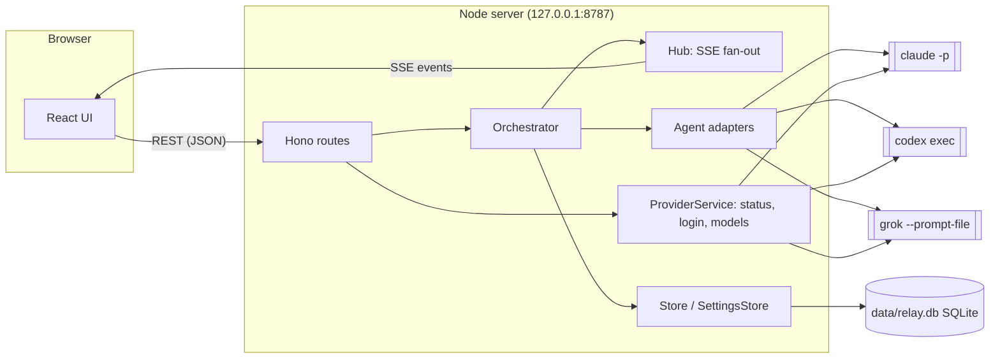

**English** | [繁體中文](architecture.zh-TW.md)

# Architecture

Harness Relay is a local web app with two halves:

- a **Node.js server** (Hono, TypeScript) that owns conversations, decides which agent speaks next, spawns the agent CLIs, and persists everything in SQLite;
- a **React client** (Vite) that renders the chat and receives live updates over Server-Sent Events (SSE).

The server never calls model APIs directly. Every agent turn is one run of a real CLI (`claude`, `codex`, `grok`) in headless mode, so each agent keeps its own tools, permissions, login and session history.



## Components

| Module | Responsibility |
| --- | --- |
| `src/server/index.ts` | HTTP routes, security middleware, SSE endpoint, static file serving, startup/shutdown |
| `src/server/orchestrator.ts` | Runs a "team turn": picks speakers by mode, builds each agent's prompt, runs the CLI, streams results |
| `src/server/prompt.ts` | Role briefing (system prompt), per-turn prompt, `@mention` parsing, `[PASS]` detection |
| `src/server/agents/*` | One adapter per CLI: builds arguments, parses the CLI's JSON event stream into common events |
| `src/server/process.ts` | Spawns processes in their own process group, streams stdout lines, handles abort/timeout |
| `src/server/providers.ts` | CLI status (installed, version, signed in), login sessions, logout, model catalog cache |
| `src/server/models.ts` | Discovers models and reasoning-effort levels from each CLI |
| `src/server/workspace.ts` | Git plumbing: automatic `git init`, working-tree snapshots, per-agent worktrees, diffs, applying results |
| `src/server/store.ts` | SQLite persistence for conversations, messages, agent sessions and presets |
| `src/server/settings.ts` | Provider settings (binary path, API key, default model/effort), default working directory, child-process environment |
| `src/server/db.ts` | Opens SQLite, applies schema migrations, transaction helper |
| `src/server/hub.ts` | Per-conversation event fan-out to connected SSE clients |
| `src/shared/types.ts` | Types shared by server and client |
| `src/web/*` | React UI: sidebar, team designer, chat view, settings page |

## Conversation model

A **conversation** has a team (`agents`), settings (`mode`, `rounds`, `maxHops`, `permission`, `cwd`) and an ordered list of **messages**. A message is authored by the user, an agent, or the system, and consists of **parts**: text blocks and tool calls (`Read`, `Edit`, `Shell`…) in the order they happened.

For every agent the conversation also keeps **agent state**:

- `sessionId` — the CLI's own session/thread id, used to resume the agent's context next turn;
- `seen` — ids of chat messages that have already been delivered to this agent.

## How agents share context

Each agent has its own long-lived CLI session, so the server does **not** resend the whole chat every turn. Instead:

1. Before an agent speaks, the orchestrator collects every finished message that is not in the agent's `seen` set (user messages, other agents' replies, and — when starting fresh — the agent's own earlier replies).
2. Those messages are rendered as tagged blocks and sent as the prompt:

   ```text
   New chat messages since your last turn:
   <chat>
   <message from="user">…</message>
   <message from="@Builder" via="Codex">
   Implemented step 2.
   <actions>
   Edit update src/api.ts
   Shell npm test
   </actions>
   </message>
   </chat>

   Roundtable round 2/3: it's your turn, @Reviewer. Reply with [PASS] if you have nothing new to add.
   ```

   The `<actions>` block summarizes file edits and commands the speaker ran, so teammates know what changed without seeing the raw tool output.
3. The CLI is resumed with its stored session id, so it remembers everything it saw before.
4. When the turn succeeds, the delivered ids (and the agent's own reply) are added to `seen`. If the turn fails, the delivery is rolled back so the messages are offered again next time.

If resuming fails before the agent produced any output (for example the session was removed, or the working directory changed and Claude Code keeps sessions per directory), the orchestrator retries once with a **fresh** session and the full chat history.

### Role briefing

Each agent's role is injected through the CLI's system-prompt mechanism and **rebuilt on every turn**, so edits to roles or the team take effect on the next turn:

| CLI | Mechanism |
| --- | --- |
| Claude Code | `--append-system-prompt <briefing>` |
| Codex | `-c developer_instructions="<briefing>"` |
| Grok | `--rules <briefing>` |

The briefing contains the agent's role, the team roster (with each teammate's role summary), the rules of the current mode, the `[PASS]` convention, the shared working directory and the permission level.

## Turn scheduling (modes)

When the user sends a message (or presses **Continue**, which sends nothing), the orchestrator starts a run:

- **`@mentions` in the user message** restrict who takes part: only mentioned agents speak (in relay mode they start the relay).
- **Roundtable** — for each round `1…rounds`, participants speak one after another in team order. Each sees what earlier speakers said. If everyone in a round passes (or fails), the run ends early.
- **Parallel** — for each round, all participants run concurrently. Messages still streaming are not delivered, so agents don't see each other's answers until the next round.
- **Relay** — a queue starts with the mentioned agents, or the first team member (the "lead"). After each reply, every teammate `@mentioned` outside code blocks is appended to the queue. The run ends when the queue is empty or after `maxHops` turns (a system note tells the user, who can press **Continue**).

A reply that is exactly `[PASS]` (or empty with no tool calls) is marked as *passed* and rendered dimmed.

Only one run per conversation can be active at a time; different conversations can run concurrently. **Stop** aborts the run and kills the active CLI processes (process group `SIGTERM`, then `SIGKILL` after 3 s). Each agent turn also has a 45-minute safety timeout.

## CLI adapters

Every adapter turns one CLI invocation into a stream of common events: `session`, `text`, `text_end`, `tool_start`, `tool_end`.

| | Claude Code | Codex | Grok |
| --- | --- | --- | --- |
| Command | `claude -p --output-format stream-json --verbose --include-partial-messages` | `codex exec --json --skip-git-repo-check` (`exec resume <id>` to continue) | `grok --prompt-file <file> --verbatim --output-format streaming-json` |
| Prompt via | stdin | stdin (`-`) | temp file |
| New / resume session | `--session-id <uuid>` / `--resume <id>` | thread id from `thread.started` / `exec resume <id>` | `--session-id <uuid>` / `--resume <id>` |
| Model | `--model` | `-m` | `--model` |
| Reasoning effort | `--effort` | `-c model_reasoning_effort=…` | `--reasoning-effort` |
| Text streaming | `stream_event` text deltas | whole `agent_message` items | `text` chunks |
| Tool events | `tool_use` / `tool_result` blocks | `command_execution`, `file_change`, `mcp_tool_call`, `web_search` items | `tool_call` / `tool_call_update` |

### Permission mapping

| Relay permission | Claude Code | Codex | Grok |
| --- | --- | --- | --- |
| Read-only | `--permission-mode dontAsk` | `sandbox_mode="read-only"`, `approval_policy="never"` | `--permission-mode dontAsk --allow WebFetch` |
| Edit | `--permission-mode acceptEdits` | `sandbox_mode="workspace-write"`, `approval_policy="never"` | `--permission-mode acceptEdits --allow WebFetch` + common project commands (below) |
| Full access | `--permission-mode bypassPermissions` | `--dangerously-bypass-approvals-and-sandbox` | `--permission-mode bypassPermissions` |

Headless Grok cannot ask for approval: a tool call its mode would prompt for is reported as "User cancelled" and the **whole turn ends** (`end.stopReason: "cancelled"`) instead of the denial going back to the model. So the adapter pre-approves what each level should allow anyway (`grokPermissionArgs` in `src/server/agents/grok.ts`):

- `web_fetch` is not on Grok's built-in read-only list, so read-only and edit both get `--allow WebFetch` (the relay permission is about the file system, not the network).
- Edit mode also gets `--allow 'Bash(<prefix>)'` for common build / test / lint / format commands (`npm test`, `npm run `, `pytest`, `cargo test`, `go test`, `make`, `tsc`, `eslint`, `cd `, `mkdir `… — see `GROK_EDIT_COMMANDS`). Rules are plain prefixes matched against every segment of a chained command, so `cd app && npm test` is approved only because `cd ` is listed too. Installs, git writes and deletes are deliberately left out.

Anything else that would prompt still ends the turn; the adapter turns `stopReason: "cancelled"` into a visible error naming the tool and Grok's reason.

## Workspaces and file changes

With **read-only** permission agents simply run in the working directory (`cwd`). With **edit** or **full access**, Harness Relay uses git to keep agents from overwriting each other and to record what each one changed (`src/server/workspace.ts`):

- **Automatic repository** — if `cwd` is not inside a git repository, Harness Relay runs `git init` there and adds common generated folders (`node_modules/`, `.venv/`, `target/`…) to `.git/info/exclude`. It refuses to do this in the home directory or the filesystem root. Nothing is ever committed to the user's branch.
- **Snapshots** — a snapshot is a commit of the current working tree (tracked and untracked files, honouring `.gitignore`) built with a temporary index (`git add -A`, `write-tree`, `commit-tree`). It does not move `HEAD`, touch the index or change any file.

| Mode | Where agents write | How changes are recorded |
| --- | --- | --- |
| Roundtable / Relay | The real working directory. Agents take turns, so only one writes at a time. | Snapshot before and after each turn; if the tree changed, the message records the diff. |
| Parallel | Each agent's own **git worktree** (`data/worktrees/<conversation>/<agent>`, branch `relay/<conversation>/<name>`), created from one snapshot of the working directory. | Everything the agent changed is committed to its branch after each turn. |

**Parallel mode.** Before the first round of a run every participant gets a worktree (kept across runs until it needs a reset). The briefing tells each agent its worktree, branch, the shared starting snapshot and its teammates' branches, so later rounds can read each other's work with `git diff <base> <branch>`. The user reviews each agent's diff in the chat and clicks **Apply** on the result they want: Harness Relay takes `base..branch` for that agent and applies it to the real working directory with `git apply`, after `git apply --check`, so a conflicting patch changes nothing. Nothing is committed; the changes are left for the user to review. All worktrees of the conversation are then marked for reset, so the next parallel run starts from the new state of the directory. Deleting the conversation removes its worktrees and branches.

**Directory lock.** A run that writes to the real working directory (edit / full access, not parallel) locks the repository root. Another conversation trying to write to the same repository at the same time gets an error until the first run ends; applying a worktree result takes the same lock. Read-only runs and parallel runs (which only write to their worktrees) are not blocked.

**Recorded changes.** An agent message with changes stores `root`, `base` and `head` (two commits) plus the changed files (A/M/D, lines added/deleted). The UI shows them as a card with a diff viewer (`git diff base head`) and, on each agent's latest worktree result, the **Apply** button. Teammates see the list in a `<changed_files>` block of the forwarded message.

## Live updates (SSE)

The client opens `GET /api/conversations/:id/events` and receives JSON events:

| Event | Payload | When |
| --- | --- | --- |
| `snapshot` | full conversation, running flag, active agents | on connect |
| `message` | a whole message (upsert by id) | message created, tool started/finished, turn finished |
| `delta` | `messageId`, `partIndex`, `text` | each streamed text chunk |
| `status` | running flag, active agent ids | an agent starts/stops, run starts/ends |
| `conversation` | title, team, settings | title or team changed |

The server subscribes before sending the snapshot and replays queued whole-message events afterwards (deltas are skipped, since the snapshot already contains them), so nothing is lost while connecting. A `ping` comment is sent every 15 s.

## Persistence

Everything lives in one SQLite database, `data/relay.db` (WAL mode, foreign keys on, file mode `0600` because it may contain API keys).

| Table | Contents |
| --- | --- |
| `conversations` | id, title, timestamps, mode, rounds, max hops, permission, cwd |
| `conversation_agents` | team members per conversation, in order (name, provider, role, model, effort) |
| `messages` | one row per chat message (author, status, passed, error, round, duration, cost, tokens, and the turn's change commits), ordered by `seq` |
| `message_changes` | files changed per message (path, A/M/D, lines added/deleted) |
| `agent_worktrees` | per-agent worktree in parallel mode (repository root, path, branch, base snapshot, needs reset) |
| `message_parts` | text blocks and tool calls of each message, ordered by `idx` |
| `agent_sessions` | CLI session id and provider per agent per conversation |
| `agent_seen` | which messages each agent has been shown |
| `presets`, `preset_agents` | user-saved team templates (built-in templates live in code) |
| `provider_settings` | per CLI: binary path, API key, default model, default effort |
| `app_settings` | key/value app settings (default working directory) |

Conversations in use are kept in memory, because the orchestrator mutates them while streaming. Writes are explicit: user messages, new agent messages, finished turns and session ids are written immediately; streaming changes are batched and written at most once per second, only for messages that changed. Messages left `streaming` by a crashed server are marked `aborted` at startup.

Schema changes are applied by ordered migrations tracked in `PRAGMA user_version` (see `src/server/db.ts`).

## Providers: status, login and models

- **Status** — `<cli> --version` plus an auth check: `claude auth status` (JSON), `codex login status`, `grok models`. Cached for 20 s.
- **Login** — the server runs the CLI's own login command in the background and exposes its output: URLs and device codes are extracted for the UI, and text typed in the UI is written to the process's stdin (Claude Code's paste-code flow). Sessions time out after 15 minutes.

  | CLI | Methods |
  | --- | --- |
  | Claude Code | `claude auth login --claudeai` (subscription) / `--console` |
  | Codex | `codex login --device-auth` / `codex login` (browser, localhost callback) |
  | Grok | `grok login --device-auth` / `grok login --oauth` |

- **API keys** — Claude Code and Grok keys are stored in SQLite and injected as `ANTHROPIC_API_KEY` / `XAI_API_KEY` into those CLIs' environment only. Codex keys are piped to `codex login --with-api-key` and stored by Codex itself.
- **Models** — Codex: `codex debug models` (catalog with per-model effort levels and defaults; defaults from `~/.codex/config.toml`). Grok: `grok models`. Claude Code has no list command, so the UI offers its aliases (`fable`, `opus`, `sonnet`, `haiku`) and reads the default from `settings.json` in `CLAUDE_CONFIG_DIR` (or `~/.claude`). Cached for 10 minutes.

## Security

The server can start coding agents with write access, so it is locked down to the local UI:

- binds to `127.0.0.1` by default;
- rejects requests whose `Host` is not localhost (DNS-rebinding protection) and whose `Origin` is another site;
- requires `Content-Type: application/json` on every write, so a cross-site form post cannot trigger a turn;
- the SQLite file (and its WAL files) are readable by the owner only;
- environment variables that Claude Code sets for its own children are removed before spawning `claude`, so the app also works when started from inside a Claude Code session.

It is a single-user tool: there is no authentication, and any process that can reach your localhost can use it.

## Known limitations

- Worktrees contain only what is in the snapshot: ignored files such as `node_modules/` or build output are not there, so an agent that wants to run tests in parallel mode may need to install dependencies in its worktree first.
- In roundtable / relay mode, the before/after snapshot attributes every change made in the directory during a turn to that agent, including edits you make in your editor at the same time.
- The directory lock lives in the server process; other tools (or a second Harness Relay server) can still edit the same files.
- Starting a new Codex login signs out the current Codex account first.
- Claude Code has no model-list command; the model menu shows aliases plus a custom field.
- Long conversations grow the per-turn prompt only by new messages, but a fresh session (after a resume failure or a provider change) receives the full history.
