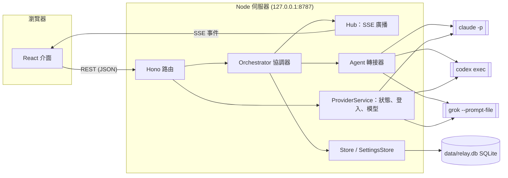

[English](architecture.md) | **繁體中文**

# 架構

Harness Relay 是一個在本機執行的網頁應用程式，分成兩半：

- **Node.js 伺服器**（Hono、TypeScript）：管理對話、決定下一個發言的 agent、啟動各個 agent CLI，並把所有資料存進 SQLite；
- **React 前端**（Vite）：顯示聊天畫面，並透過 Server-Sent Events（SSE）接收即時更新。

伺服器從不直接呼叫模型 API。每一次 agent 發言都是一次真正的 CLI（`claude`、`codex`、`grok`）無頭模式執行，所以每個 agent 都保有自己的工具、權限、登入狀態與 session 歷史。



## 元件

| 模組 | 職責 |
| --- | --- |
| `src/server/index.ts` | HTTP 路由、安全性中介層、SSE 端點、靜態檔案、啟動與關閉 |
| `src/server/orchestrator.ts` | 執行一次「團隊回合」：依模式決定發言者、組出每個 agent 的 prompt、執行 CLI、串流結果 |
| `src/server/prompt.ts` | 角色簡報（system prompt）、每回合的 prompt、`@` 解析、`[PASS]` 判斷 |
| `src/server/agents/*` | 每個 CLI 一個轉接器：組參數、把 CLI 的 JSON 事件串流轉成共通事件 |
| `src/server/process.ts` | 以獨立 process group 啟動程序、逐行讀 stdout、處理中止與逾時 |
| `src/server/providers.ts` | CLI 狀態（是否安裝、版本、是否登入）、登入流程、登出、模型清單快取 |
| `src/server/models.ts` | 從各 CLI 取得可用模型與推理強度 |
| `src/server/workspace.ts` | git 相關操作：自動 `git init`、工作目錄快照、每個 agent 的 worktree、diff、套用結果 |
| `src/server/store.ts` | 用 SQLite 保存對話、訊息、agent session 與範本 |
| `src/server/settings.ts` | 各 CLI 設定（執行檔路徑、API key、預設模型與推理強度）、預設工作目錄、子程序環境變數 |
| `src/server/db.ts` | 開啟 SQLite、套用 schema 遷移、交易輔助函式 |
| `src/server/hub.ts` | 把每個對話的事件廣播給連線中的 SSE 用戶端 |
| `src/shared/types.ts` | 伺服器與前端共用的型別 |
| `src/web/*` | React 介面：側邊欄、團隊設計、聊天畫面、設定頁 |

## 對話模型

一個**對話**包含團隊（`agents`）、設定（`mode`、`rounds`、`maxHops`、`permission`、`cwd`）以及有順序的**訊息**。訊息的作者可能是使用者、agent 或系統，由多個 **part** 組成：依發生順序排列的文字區塊與工具呼叫（`Read`、`Edit`、`Shell`……）。

對話也會為每個 agent 保存 **agent 狀態**：

- `sessionId`：CLI 自己的 session / thread id，用來在下一回合接續 agent 的上下文；
- `seen`：已經交給這個 agent 看過的訊息 id。

## agent 之間如何共享上下文

每個 agent 都有自己長期存在的 CLI session，所以伺服器**不會**每回合重送整段對話，而是：

1. agent 發言前，協調器收集所有已完成、但不在該 agent `seen` 集合裡的訊息（使用者訊息、其他 agent 的回覆，以及在全新 session 時連同該 agent 自己先前的回覆）。
2. 把這些訊息轉成帶標籤的區塊作為 prompt：

   ```text
   New chat messages since your last turn:
   <chat>
   <message from="user">…</message>
   <message from="@Builder" via="Codex">
   Implemented step 2.
   <actions>
   Edit update src/api.ts
   Shell npm test
   </actions>
   </message>
   </chat>

   Roundtable round 2/3: it's your turn, @Reviewer. Reply with [PASS] if you have nothing new to add.
   ```

   `<actions>` 區塊摘要發言者改了哪些檔案、跑了哪些指令，讓隊友不用看原始工具輸出也知道變更了什麼。
3. 用保存的 session id 接續 CLI，所以它記得之前看過的所有內容。
4. 回合成功後，把這次交付的訊息 id（以及 agent 自己的回覆）加進 `seen`。若回合失敗，交付會被撤回，下一回合重新提供這些訊息。

如果接續 session 失敗且 agent 還沒有任何輸出（例如 session 被刪除，或是工作目錄改了，而 Claude Code 是依目錄保存 session），協調器會用**全新** session 加上完整對話紀錄重試一次。

### 角色簡報

每個 agent 的角色透過 CLI 的 system prompt 機制注入，並且**每回合重新產生**，所以修改角色或團隊會在下一回合生效：

| CLI | 機制 |
| --- | --- |
| Claude Code | `--append-system-prompt <簡報>` |
| Codex | `-c developer_instructions="<簡報>"` |
| Grok | `--rules <簡報>` |

簡報內容包括 agent 的角色、團隊名單（含每位隊友的角色摘要）、目前模式的規則、`[PASS]` 約定、共用的工作目錄與權限等級。

## 發言排程（模式）

使用者送出訊息（或按下「**繼續**」，等於送出空訊息）時，協調器開始一次執行：

- **使用者訊息中的 `@`** 會限制參與者：只有被 @ 的 agent 發言（接力模式下則由他們開始接力）。
- **圓桌**：每一輪（`1…rounds`）參與者依團隊順序逐一發言，每個人都看得到前面的人說了什麼。若某一輪所有人都 pass（或失敗），提前結束。
- **平行**：每一輪所有參與者同時執行。還在串流中的訊息不會被交付，所以要到下一輪才看得到彼此的答案。
- **接力**：佇列從被 @ 的 agent 開始，沒有 @ 時從團隊第一位（「隊長」）開始。每次回覆後，程式碼區塊以外被 @ 到的隊友會加進佇列。佇列清空或達到 `maxHops` 次時結束（系統訊息會告知使用者，可按「繼續」）。

回覆內容恰好是 `[PASS]`（或沒有工具呼叫的空回覆）會被標記為 *pass*，並以淡色顯示。

同一個對話一次只能有一個執行；不同對話可以同時執行。「**停止**」會中止執行並結束正在跑的 CLI 程序（對 process group 送 `SIGTERM`，3 秒後 `SIGKILL`）。每個 agent 回合另有 45 分鐘的安全逾時。

## CLI 轉接器

每個轉接器把一次 CLI 執行轉成共通事件串流：`session`、`text`、`text_end`、`tool_start`、`tool_end`。

| | Claude Code | Codex | Grok |
| --- | --- | --- | --- |
| 指令 | `claude -p --output-format stream-json --verbose --include-partial-messages` | `codex exec --json --skip-git-repo-check`（接續用 `exec resume <id>`） | `grok --prompt-file <檔案> --verbatim --output-format streaming-json` |
| prompt 傳入方式 | stdin | stdin（`-`） | 暫存檔 |
| 新建 / 接續 session | `--session-id <uuid>` / `--resume <id>` | 從 `thread.started` 取得 thread id / `exec resume <id>` | `--session-id <uuid>` / `--resume <id>` |
| 模型 | `--model` | `-m` | `--model` |
| 推理強度 | `--effort` | `-c model_reasoning_effort=…` | `--reasoning-effort` |
| 文字串流 | `stream_event` 文字 delta | 整段 `agent_message` 項目 | `text` 片段 |
| 工具事件 | `tool_use` / `tool_result` 區塊 | `command_execution`、`file_change`、`mcp_tool_call`、`web_search` 項目 | `tool_call` / `tool_call_update` |

### 權限對應

| Relay 權限 | Claude Code | Codex | Grok |
| --- | --- | --- | --- |
| 唯讀 | `--permission-mode dontAsk` | `sandbox_mode="read-only"`、`approval_policy="never"` | `--permission-mode dontAsk` |
| 可編輯 | `--permission-mode acceptEdits` | `sandbox_mode="workspace-write"`、`approval_policy="never"` | `--permission-mode acceptEdits` |
| 完全存取 | `--permission-mode bypassPermissions` | `--dangerously-bypass-approvals-and-sandbox` | `--permission-mode bypassPermissions` |

## 工作區與檔案修改

**唯讀**權限時，agent 直接在工作目錄（`cwd`）執行，不做其他處理。**可編輯**或**完全存取**時，Harness Relay 用 git 避免 agent 互相覆蓋，並記錄每個人改了什麼（`src/server/workspace.ts`）：

- **自動建立 repository**：若 `cwd` 不在任何 git repository 中，Harness Relay 會在該處執行 `git init`，並把常見的產生物資料夾（`node_modules/`、`.venv/`、`target/`……）加進 `.git/info/exclude`。在家目錄或檔案系統根目錄則會拒絕這麼做。絕不會 commit 到使用者的分支。
- **快照**：快照是把目前工作目錄（已追蹤與未追蹤的檔案，遵守 `.gitignore`）做成的一個 commit，透過暫時的 index 建立（`git add -A`、`write-tree`、`commit-tree`）。不會移動 `HEAD`、不會動到 index，也不會修改任何檔案。

| 模式 | agent 寫在哪裡 | 如何記錄修改 |
| --- | --- | --- |
| 圓桌 / 接力 | 真正的工作目錄。agent 輪流發言，同一時間只有一個在寫。 | 每回合前後各做一次快照；若內容不同，就把 diff 記在該則訊息上。 |
| 平行 | 每個 agent 自己的 **git worktree**（`data/worktrees/<對話>/<agent>`，分支 `relay/<對話>/<名稱>`），從同一份工作目錄快照建立。 | 每回合結束後，把 agent 改的所有內容 commit 到它的分支。 |

**平行模式。**每次執行的第一輪前，每位參與者都會拿到一個 worktree（跨執行沿用，直到需要重設）。簡報會告訴每個 agent 它的 worktree、分支、共同的起始快照，以及隊友的分支，所以後面的輪次可以用 `git diff <base> <branch>` 看彼此的成果。使用者在聊天中檢視每個 agent 的 diff，對想要的結果按 **套用**：Harness Relay 取出該 agent 的 `base..branch`，先 `git apply --check` 再用 `git apply` 套用到真正的工作目錄，所以有衝突時不會改動任何檔案。不會自動 commit，修改留給使用者檢查。之後該對話所有的 worktree 都會被標記為需要重設，下一次平行執行會從工作目錄的新狀態開始。刪除對話時會一併移除它的 worktree 與分支。

**目錄鎖。**會寫入真正工作目錄的執行（可編輯 / 完全存取，且不是平行模式）會鎖住該 repository。其他對話若同時要寫入同一個 repository，會收到錯誤，直到第一個執行結束；套用 worktree 結果也會取得同一把鎖。唯讀執行與平行執行（只寫入自己的 worktree）不受影響。

**修改紀錄。**有修改的 agent 訊息會保存 `root`、`base`、`head`（兩個 commit）以及修改的檔案（A/M/D、增刪行數）。介面會以卡片顯示，附 diff 檢視（`git diff base head`），並在每個 agent 最新的 worktree 結果上提供 **套用** 按鈕。隊友會在轉交訊息的 `<changed_files>` 區塊看到檔案清單。

## 即時更新（SSE）

前端開啟 `GET /api/conversations/:id/events`，接收 JSON 事件：

| 事件 | 內容 | 時機 |
| --- | --- | --- |
| `snapshot` | 完整對話、是否執行中、正在發言的 agent | 連線時 |
| `message` | 整則訊息（依 id 新增或取代） | 建立訊息、工具開始/結束、回合結束 |
| `delta` | `messageId`、`partIndex`、`text` | 每個串流文字片段 |
| `status` | 是否執行中、正在發言的 agent id | agent 開始/結束、執行開始/結束 |
| `conversation` | 標題、團隊、設定 | 標題或團隊變更 |

伺服器會先訂閱事件再送出 snapshot，之後補送排隊中的整則訊息事件（delta 會略過，因為 snapshot 已包含），所以連線過程中不會遺漏任何內容。每 15 秒送一次 `ping`。

## 資料保存

所有資料存在單一 SQLite 資料庫 `data/relay.db`（WAL 模式、開啟外鍵；因為可能含有 API key，檔案權限為 `0600`）。

| 資料表 | 內容 |
| --- | --- |
| `conversations` | id、標題、時間、模式、輪數、接力上限、權限、工作目錄 |
| `conversation_agents` | 每個對話的團隊成員與順序（名稱、provider、角色、模型、推理強度） |
| `messages` | 每則訊息一列（作者、狀態、是否 pass、錯誤、輪次、耗時、費用、token，以及該回合修改的 commit），依 `seq` 排序 |
| `message_changes` | 每則訊息修改的檔案（路徑、A/M/D、增刪行數） |
| `agent_worktrees` | 平行模式中每個 agent 的 worktree（repository 根目錄、路徑、分支、起始快照、是否需要重設） |
| `message_parts` | 每則訊息的文字區塊與工具呼叫，依 `idx` 排序 |
| `agent_sessions` | 每個對話中每個 agent 的 CLI session id 與 provider |
| `agent_seen` | 每個 agent 已看過哪些訊息 |
| `presets`、`preset_agents` | 使用者儲存的團隊範本（內建範本寫在程式碼裡） |
| `provider_settings` | 每個 CLI 的執行檔路徑、API key、預設模型、預設推理強度 |
| `app_settings` | key/value 形式的應用程式設定（預設工作目錄） |

使用中的對話會保留在記憶體中，因為協調器在串流時會直接修改它們。寫入是明確觸發的：使用者訊息、新的 agent 訊息、結束的回合與 session id 會立即寫入；串流中的變動則批次處理，每秒最多寫一次，而且只寫有變動的訊息。伺服器當機時留下的 `streaming` 訊息，會在下次啟動時標為 `aborted`。

Schema 變更以依序執行的遷移套用，版本記錄在 `PRAGMA user_version`（見 `src/server/db.ts`）。

## Provider：狀態、登入與模型

- **狀態**：`<cli> --version` 加上登入檢查：`claude auth status`（JSON）、`codex login status`、`grok models`。快取 20 秒。
- **登入**：伺服器在背景執行 CLI 自己的登入指令並公開其輸出：從中擷取 URL 與裝置碼給介面顯示，介面中輸入的文字則寫進程序的 stdin（Claude Code 的貼上授權碼流程）。登入流程 15 分鐘後逾時。

  | CLI | 方式 |
  | --- | --- |
  | Claude Code | `claude auth login --claudeai`（訂閱帳號）/ `--console` |
  | Codex | `codex login --device-auth` / `codex login`（瀏覽器，localhost 回呼） |
  | Grok | `grok login --device-auth` / `grok login --oauth` |

- **API key**：Claude Code 與 Grok 的金鑰存在 SQLite，只會以 `ANTHROPIC_API_KEY` / `XAI_API_KEY` 注入到對應 CLI 的環境變數。Codex 的金鑰則透過 `codex login --with-api-key` 交給 Codex 自己保存。
- **模型**：Codex 用 `codex debug models`（含每個模型支援的推理強度與預設值；預設模型讀 `~/.codex/config.toml`）。Grok 用 `grok models`。Claude Code 沒有列出模型的指令，所以介面提供它的別名（`fable`、`opus`、`sonnet`、`haiku`），預設值從 `CLAUDE_CONFIG_DIR`（或 `~/.claude`）的 `settings.json` 讀取。快取 10 分鐘。

## 安全性

這個伺服器可以啟動有寫入權限的 coding agent，因此只允許本機介面使用：

- 預設只綁定 `127.0.0.1`；
- 拒絕 `Host` 不是 localhost 的請求（防 DNS rebinding），以及 `Origin` 來自其他網站的請求；
- 所有寫入請求都必須是 `Content-Type: application/json`，所以跨站表單送出無法觸發回合；
- SQLite 檔案（及其 WAL 檔）只有擁有者可讀寫；
- 啟動 `claude` 前會移除 Claude Code 替自己子程序設定的環境變數，所以即使從 Claude Code session 裡啟動本程式也能正常運作。

這是單人使用的工具：沒有帳號驗證，任何能連到你 localhost 的程序都能使用它。

## 已知限制

- worktree 只包含快照中的檔案：被忽略的檔案（例如 `node_modules/` 或建置產物）不在裡面，所以平行模式中想跑測試的 agent 可能要先在自己的 worktree 安裝相依套件。
- 圓桌 / 接力模式中，回合前後的快照會把該回合期間目錄裡的所有變更都算在該 agent 頭上，包括你同時在編輯器做的修改。
- 目錄鎖存在伺服器程序中；其他工具（或第二個 Harness Relay 伺服器）仍然可以修改同樣的檔案。
- 開始新的 Codex 登入時，會先登出目前的 Codex 帳號。
- Claude Code 沒有列出模型的指令；模型選單只提供別名與自訂欄位。
- 長對話每回合只會傳送新訊息，但全新的 session（接續失敗或更換 provider 之後）會收到完整的對話紀錄。
