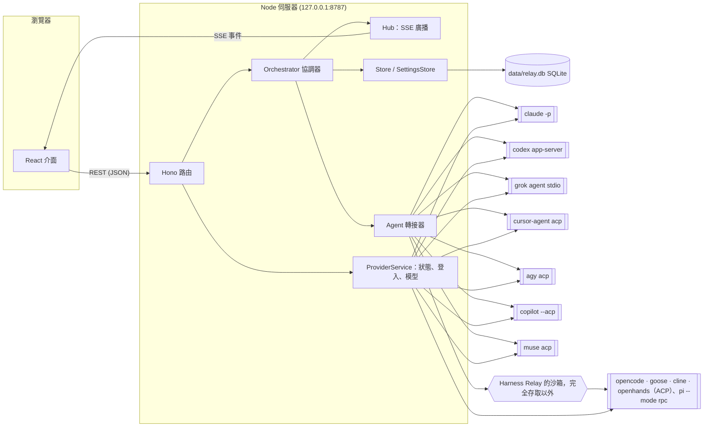
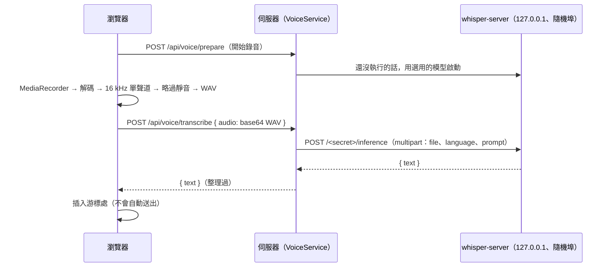

[English](architecture.md) | **繁體中文**

# 架構

Harness Relay 是一個在本機執行的網頁應用程式，分成兩半：

- **Node.js 伺服器**（Hono、TypeScript）：管理對話、決定下一個發言的 agent、啟動各個 agent CLI，並把所有資料存進 SQLite；
- **React 前端**（Vite）：顯示聊天畫面，並透過 Server-Sent Events（SSE）接收即時更新。

各 CLI 自行把 agent 的提示詞送到模型來源。伺服器會直接向自訂端點查詢模型資料。在設定中按「載入模型」時會送出 `GET <baseUrl>/models` 讀取清單。新增或變更連線後按「儲存」會重新查詢清單，並為清單裡找不到的 ID 查詢個別模型資料；伺服器有回報時，也從同樣的回應讀取每個模型的上下文長度（[開源 agent → 上下文長度](open-agents.zh-TW.md#上下文長度)）。只改既有端點的名稱則直接在本機儲存。每一次 agent 發言都是一次真正的 CLI（`claude`、`codex`、`grok`、`cursor-agent`、`agy`、`copilot`、`muse`，或五個開源 agent 之一：`opencode`、`goose`、`cline`、`openhands`、`pi`）無頭模式執行，所以每個 agent 都保有自己的工具、權限與 session 歷史，Claude Code、Codex、Grok、Cursor、Antigravity、Copilot 與 Muse Code 也保有自己的登入狀態。開源 agent 使用使用者設定的模型來源、在 Harness Relay 自己的家目錄中執行，完全存取以外則在 Harness Relay 自己的沙箱中執行（[開源 agent](open-agents.zh-TW.md)）。



## 元件

| 模組 | 職責 |
| --- | --- |
| `src/server/app.ts` | HTTP 路由、安全性中介層、SSE 端點（`createApp`，可用 `app.request()` 測試） |
| `src/server/index.ts` | 組裝各元件、靜態檔案、啟動與關閉 |
| `src/server/web.ts` | 提供建置好的介面：`assets/` 下的檔案（以內容雜湊命名）永久快取，`index.html` 每次載入都檢查；介面放在 `dist/web` 或 `RELAY_WEB_DIR` |
| `src/server/parent.ts` | 啟動伺服器的桌面 app（如果有）：告訴它伺服器已開始接收連線（或無法接收），並接收它的關閉要求 |
| `desktop/` | 桌面 app（Electron，獨立的套件）：用登入 shell 的環境在 utility process 裡執行伺服器，在自己的視窗裡顯示對話，系統匣選單、登入時自動啟動、分享到 tailnet、更新；見[桌面 app](#桌面-app) |
| `src/server/orchestrator.ts` | 執行一次「團隊回合」：依模式決定發言者、組出每個 agent 的 prompt、執行 CLI、串流結果；自動組隊的對話中，每個新問題都先讓首席 agent 設計團隊 |
| `src/server/planner.ts` | 自動組隊：首席 agent 的 prompt（問題、到目前為止的對話、目前的團隊、範本）、解析它的 JSON 回覆、轉成可執行的團隊、備援方案 |
| `src/server/reviewer.ts` | 首席 agent 審閱：首席 agent 從上次審閱之後讀到的團隊回覆、它的 prompt，以及把它的 JSON 回覆轉成審閱結果（`src/shared/review.ts`：找出它引用的文字，與聊天畫面共用） |
| `src/server/grouping.ts` | 側邊欄群組：首席 agent 在背景依新對話的第一則訊息，把它分到使用者的某個群組（`AutoGrouper`） |
| `src/server/memory.ts` | 長期記憶：回覆中的 `<remember>` 與 `<forget>` 區塊對記憶做了什麼、使用者的修改、一個回合拿到哪些記憶，以及首席 agent 在背景整理記憶（`LongTermMemory`；區塊與挑選記憶的方式在 `src/shared/memory.ts`）；見[長期記憶](#長期記憶) |
| `src/server/handoffs.ts`、`src/server/fixedCommands.ts` | 密鑰與固定指令：工作目錄的密鑰（值在憑證儲存區，名稱在 `app_settings`）與固定指令、指令的鎖定，以及它在 Harness Relay 自己的沙箱裡執行，密鑰放在檔案裡、輸出經過遮蔽（回覆區塊在 `src/shared/handoffs.ts`）；見[密鑰與固定指令](#密鑰與固定指令) |
| `src/server/prompt.ts` | 角色簡報（system prompt）、每回合的 prompt、`@` 解析、`[PASS]` 判斷 |
| `src/server/approvals.ts` | 「本對話都允許」的規則 key 與比對 |
| `src/server/commands.ts` | 解析一行 shell 指令實際會執行哪些程式（串接、命令替換、`sh -c`／`eval`、`env`／`sudo`、保留字與 `if`／`while`／`for` 等複合指令、git 的全域選項）：用於核准規則 key，以及 Grok、Copilot 與開源 agent 的推送／發佈判斷 |
| `src/server/agents/*` | 每個 CLI 一個轉接器：組參數、把 CLI 的 JSON 事件串流轉成共通事件（`acp.ts`：ACP 與 Codex 用的 JSON-RPC 對端，以及 ACP 組 prompt、MCP 伺服器與回覆權限請求的函式；`acpTurn.ts`：開源 agent 共用的 ACP 回合；`open.ts`：開源 agent 在程序周圍共用的部分；見[開源 agent](open-agents.zh-TW.md)） |
| `src/server/backends.ts` | 開源 agent 的模型來源：OpenAI、Anthropic、xAI 的 API key，以及使用者的 OpenAI 相容端點（金鑰存在作業系統的金鑰儲存區），還有一次執行拿到什麼（`backendRun()`）；Claude Code、Codex、Grok 或 Copilot 的一次執行是否在某個端點上，以及在已刪除的端點上時拒絕執行（`endpointRunModel()`，已刪除的 id 在 `deleted_endpoints`） |
| `src/server/endpointModels.ts` | 向自訂端點送出 `GET <baseUrl>/models`，從回應的 `data[].id` 讀取模型 ID。從設定頁儲存時，用清單或個別模型資料驗證每個勾選或手動輸入的 ID，並從同樣的回應讀取伺服器回報的上下文長度（vLLM 的 `max_model_len`、llama.cpp 的 `meta.n_ctx`：`reportedLimits()`）。 |
| `src/server/contextWindow.ts` | 在端點上執行時，怎麼使用模型的上下文長度與輸出上限：`runLimits()`、為一次回答保留的量（`outputReserve()`）與一次工具輸出的上限（`toolOutputChars()`），以及怎樣算短上下文（`SHORT_CONTEXT`）；各開源 agent、Codex 與 Claude Code 的轉接器把它們寫到 CLI 讀取的地方（[開源 agent → 上下文長度](open-agents.zh-TW.md#上下文長度)）。 |
| `src/server/relaySandbox.ts`、`relaySandboxHost.ts` | 完全存取以外，包住開源 agent 的 Harness Relay 自己的沙箱（`@anthropic-ai/sandbox-runtime`，每次執行一個 host 程序；見[各平台的作業系統沙箱](sandboxing.zh-TW.md#harness-relay-自己的沙箱)）；`sandboxProcs.ts` 在 macOS 上依沙箱找出某次執行殘留的行程 |
| `src/server/i18n.ts` | 兩種語言的伺服器訊息；每個請求與執行所用的語言（AsyncLocalStorage） |
| `src/server/process.ts` | 以獨立 process group 啟動程序、逐行讀 stdout、以原始位元組保存輸出，中止或逾時時先對該 group 送 SIGTERM，再送 SIGKILL。在 Windows 上改為附著並帶隱藏主控台（`detachedChild()`），讓它啟動的程式不會另開視窗；Windows 沒有 process group，同樣的訊號只結束那個程序 |
| `src/server/winLaunch.ts` | 在 Windows 上，找到的 CLI 是 `.cmd` 時要啟動什麼：npm 包裝檔指名的程式或 Node 腳本，或 Cursor 的最新版本（見 [CLI 轉接器](#cli-轉接器)） |
| `src/server/providers.ts` | CLI 狀態（是否安裝、版本、是否登入）、登入流程、登出、模型清單快取 |
| `src/server/login.ts` | 在沒有終端機的情況下執行 CLI 自己的登入（`CliLogin`）：它的輸出、其中的連結與代碼、貼給它的內容、取消與 15 分鐘的上限；設定頁裡各 CLI 的登入與分享用的 gh 登入（`GhLogin`）都是它 |
| `src/server/models.ts` | 從各 CLI 取得可用模型與推理強度 |
| `src/server/workspace.ts` | git 相關操作：自動 `git init`、工作目錄快照、每個 agent 的 worktree、diff、套用結果 |
| `src/server/store.ts` | 用 SQLite 保存對話、訊息、agent session 與範本 |
| `src/server/settings.ts` | 各 CLI 設定（執行檔路徑）、每個帳號的 API key、預設模型與推理強度和它的執行不載入的項目、預設工作目錄、首席 agent、子程序環境變數 |
| `src/server/attachments.ts` | 使用者訊息附加的檔案：存到 `data/attachments`、安全的檔名、哪些以圖片交給 agent |
| `src/server/media.ts` | 回覆中嵌入的圖片與影片，以及回覆中連結的檔案：可以從哪些目錄取得、安全地解析路徑（實際路徑必須在其中之一、不可在 `.git` 裡；媒體只限媒體類型）、位元組範圍 |
| `src/server/voice.ts` | 語音輸入：在背景安裝 whisper.cpp 引擎與模型（固定版本、檢查 SHA-256）、需要時執行 `whisper-server`、把錄音轉成文字 |
| `src/server/secrets.ts` | 存放 API key 的作業系統金鑰儲存區（`@napi-rs/keyring`）；系統沒有可用的儲存區時則為無 |
| `src/server/db.ts` | 開啟 SQLite、套用 schema 遷移、交易輔助函式 |
| `src/server/hub.ts` | 把每個對話的事件廣播給連線中的 SSE 用戶端 |
| `src/server/share.ts` | 分享對話（以及從分享對話框為它登入 `gh`，`GhLogin`）：介面做好的頁面透過使用者自己的 `gh` 上傳成 GitHub 上的 secret gist（`gh gist create`，在 Harness Relay 的分享頁 `site/share/` 閱讀），回覆連結的檔案不限種類，放進另一個 secret gist（用 `gh api` 建立，再用 git 把檔案推上去，由 `gh` 幫 git 登入），移除時兩個都用 `gh gist delete` 刪掉 |
| `src/shared/share.ts` | 分享頁面上指向附檔的連結：介面寫入的佔位連結（`relay-share-file:<n>`，只認真正 `<a>` 標籤的 href），由伺服器換成檔案在 GitHub 上的網址；依分享上限的算法顯示大小 |
| `src/shared/search.ts` | 搜尋對話：拆出搜尋的詞、找出符合的位置（不分大小寫）、第一個符合處附近的摘錄、標示關鍵字 |
| `src/shared/mentions.ts` | 伺服器（判斷點名了誰）與介面（標示 @）共用的 `@` 規則：以 Markdown（GFM）解析訊息，只看一般文字，不含程式碼與連結文字 |
| `src/shared/links.ts` | 沒有用 `<…>` 或 `[文字](…)` 包起來的網址在哪裡結束：GFM 只在空白處結束網址，所以直接接在後面的中文會被當成連結的一部分。`endBareUrls()` 也讓網址在中日韓或全形標點結束，以及在前面既不是另一個中日韓字、也不是 `/ ? # & = . - _ + (` 的中日韓字結束（所以 `/wiki/臺灣` 與 `?q=中文` 仍是連結），再像 GFM 一樣去掉結尾的標點；後面的文字中若還有網址，也會變成連結。介面的 Markdown 顯示與 `@` 規則都使用它，讓兩者對訊息的解讀一致 |
| `src/shared/types.ts` | 伺服器與前端共用的型別 |
| `src/shared/media.ts` | 哪些圖片與影片類型可以顯示，以及回覆中哪些圖片與連結網址是本機檔案（相對或絕對路徑、`file:` 網址、`檔案:行號`）而不是其他網站 |
| `src/web/*` | React 介面：側邊欄、團隊設計、聊天畫面、設定頁、使用導覽；`i18n.tsx` 與 `locales/` 存放介面文字；`chat.ts` 存放聊天畫面的純邏輯（重新連線、能否套用、團隊設定草稿、把訊息的工具呼叫和思考歸成動作列、訊息何時跟著新內容捲動，以及何時顯示回到最後的按鈕）；`sidebar.ts` 存放側邊欄的純邏輯（各群組的對話、還沒確認的移動、釘選的對話與還沒確認的釘選、收合群組的狀態）；`recorder.ts` 負責麥克風錄音，`voice.ts` 存放語音輸入的純邏輯（WAV 編碼、靜音判斷、插入辨識結果） |

## 對話模型

一個**對話**包含團隊（`agents`）、設定（`mode`、`rounds`、`maxHops`、`permission`、`cwd`，有一個以上的工作目錄時另有 `extraCwds`（見[多個工作目錄](#多個工作目錄)）；[自動組隊](#自動組隊)時另有 `autoTeam`，直接採用首席 agent 的團隊、不必確認時再加上 `autoConfirm`；首席 agent [審閱團隊的回覆](#首席-agent-審閱)時另有 `leadReview`；成員工作時送出的訊息直接送進他們進行中的回合時另有 `steer`，見[發言排程](#發言排程模式)）以及有順序的**訊息**。訊息的作者可能是使用者、agent 或系統，由多個 **part** 組成：依發生順序排列的文字區塊與工具呼叫（`Read`、`Edit`、`Shell`……）；失敗或被拒絕的工具呼叫會保留原因。系統訊息可能帶有一份 **plan**，也就是首席 agent 的團隊設計，或一份 **review**，也就是首席 agent 對團隊回覆的審閱。

對話也會為每個 agent 保存 **agent 狀態**：

- `sessionId`：CLI 自己的 session / thread id，用來在下一回合接續 agent 的上下文；
- `seen`：已經交給這個 agent 看過的訊息 id。

### 分支對話

**分支對話**（agent 回覆下方的分支圖示，`POST /api/conversations/:id/messages/:messageId/branch`，`Orchestrator.branch()`）會建立一個新對話，從那則回覆之後各自往下走：

- 新對話裡有到這則回覆為止每則訊息的副本，每則都換上新的 id（訊息 id 是獨立的資料列），和對話一起在同一個 transaction 中寫入（`Store.create()`）。團隊、設定、「本對話都允許」的回答（`allowRules`）會照**現在**的樣子複製，而不是那則回覆當時的樣子：之後離開團隊的成員在分支裡無法重試，之後給的「本對話都允許」也會帶過去。它會放進它這串分支所在的側邊欄群組（`Store.placeBranch()`，`group_source = 'user'`，首席 agent 不會再分類；見[側邊欄群組與搜尋](#側邊欄群組與搜尋)）。標題是「**分支 · <標題>**」（`t().branchTitle`），直到在分支裡送出的第一則使用者訊息替它命名，就像新對話以第一個問題命名（`nameAfter()`：只在標題仍是這個名稱時，任一種語言皆可，`isBranchTitle()`；使用者自己取的名稱不會被改掉）。編輯到一則複製的訊息都不剩時，對話就不再是分支；如果還叫這個名稱，會改回「新對話」（`truncateFrom()`），由編輯後的訊息命名。排程與等待佇列不會複製。
- 那則回覆向使用者提的問題，在分支裡仍然等你回答（`branchPause()`），不管原本的對話之後怎麼回答，所以可以換個方式回答。在原本的對話正在等待的地方分支時，直接複製它的 `pause`；否則由提問的 agent（平行模式下，連同同一輪到它為止也提問的成員）先回答，圓桌模式接著是同一輪排在它後面的成員，之後的輪次則是這個問題指定的成員。和原本的對話一樣，你的回答不算新問題：首席 agent 不會為它設計團隊。分支在等的步驟卡片會拿掉原本的回答（勾選保留），所以可以在分支裡再回答一次。
- 附加檔案會複製到它自己的 `data/attachments/<conversation>/`（檔案系統支援時用 copy-on-write 複製；已經不在的檔案略過），複製過來的回覆所改動檔案背後的 commit 也會保存在它自己的 `refs/harness-relay/<conversation>/` 下，因此原本的對話刪除後，這些檔案與 diff 仍然在。隔離（平行模式）的結果不能在分支裡套用；這些回覆連結的圖片與檔案，會從做出它們的 worktree 讀取（`replyWorktree()`：持有那一回合 branch 的 worktree，在寫出那則回覆的對話裡：複製過來的訊息來自的任何一個對話，分支的分支則再往上找），絕不會從分支自己給那位成員的 worktree 讀取；原本的對話刪除後（連同它的 worktree），就找不到了。
- 它是寫出那則回覆的對話的分支（`branchOrigin()`）。回覆是在原本的對話寫的，就是原本對話的分支；但分支在分支點以前的訊息是複製過來的，所以從那裡的回覆（包括分支點那則）分支，會做出「那則回覆被複製來的對話」的分支，分支的分支則可能是更上層的對話的分支，就像當初是在那裡分支的一樣：側邊欄會列在那個對話底下，顯示「**延續自**」那個對話，名稱是「**分支 · <它的標題>**」，用它現在的標題（`Store.titleOf()`；已刪除的對話，用側邊欄顯示的標題）。附加檔案複製完後，會在儲存分支的同一步重新算一次它的來源（除非原本的對話到那則回覆為止的訊息在這期間變了）：刪除只會等從被刪除的對話本身做出的分支，所以來源對話若在這期間被刪除，分支仍會知道它已刪除，並帶上它的 `via`。所以 B 從 A 分支出來之後，從 B 複製自 A 的回覆再分支，做出的是 A 的分支，不是 B 的。
- `conversation.branch`（`ConversationBranch`：它分支自的對話的 id、當時的標題，以及 `afterId`，也就是這裡最後一則複製的訊息；`earlier`：更前面那些複製的訊息若是從更上層複製來的，各自是一段，記下寫出它們的對話、標題與這段在這裡的最後一則，近的在前）以 JSON 存在 `conversations.branch`。從 `earlier` 某一段裡的回覆分支，做出的是那一段所記的對話的分支；只有那則回覆之前的段落會一起帶過去。最後一則訊息不在對話裡的段落無法定位，會被略過。ChatView 會在標題後方（兩者各取所需的寬度；都太長時各占一半，其中一個用不到一半時，剩下的讓給另一個，兩者都以 … 縮短）以及 `afterId` 之後的一條線上顯示「**延續自 <標題>**」：對話清單裡還有原本的對話時，是連到它的連結（用它現在的標題），刪除後則顯示當時的標題。這條線是訊息之間的元素，分享頁面會略過它（`messageElements()`，因為分享頁面以一則訊息一個元素對應）；分享頁面兩處都不顯示。重試或編輯複製過來的訊息時，`afterId` 會移回剩下的最後一則複製訊息（`branchAfterCut()`），訊息全被拿掉的段落也會移除：它分支自的對話的訊息一則都不剩時，它就成為更上層那個對話的分支，用那個對話現在的標題（名稱若仍是「**分支 · <標題>**」，會改成那個對話的）。複製的訊息一則都不剩時，`branch` 會被移除。
- agent 一開始沒有 session，`seen` 也是空的，所以第一次發言時會收到複製過來的紀錄（包括自己的回覆），和開新 session 時一樣。它們的 briefing 會說明這是分支出來的對話，原本的對話之後可能改過檔案；工作目錄是共用的，裡面的東西不會倒回去。
- 原本的對話不受影響，分支時也可以繼續回覆；只有到這則回覆為止的回合必須已經結束（還有回覆在串流時回 409，平行模式中同時發言的成員可能如此；或它的回合還在記錄改動的檔案：`Run.turns`）。刪除原本的對話與關閉伺服器（`settled()`）會等正在建立、還在複製檔案的分支完成。只能從 agent 的回覆分支（其他訊息回 400）。

## agent 之間如何共享上下文

每個 agent 都有自己長期存在的 CLI session，所以伺服器**不會**每回合重送整段對話，而是：

1. agent 發言前，協調器收集所有已完成、但不在該 agent `seen` 集合裡的訊息（使用者訊息、其他 agent 的回覆，以及在全新 session 時連同該 agent 自己先前的回覆）。
2. 把這些訊息轉成帶標籤的區塊作為 prompt：

   ```text
   New chat messages since your last turn:
   <chat>
   <message from="user">…</message>
   <message from="@Builder" via="Codex">
   Implemented step 2.
   <actions>
   Edit update src/api.ts
   Shell npm test
   </actions>
   </message>
   </chat>

   Roundtable round 2/3: it's your turn, @Reviewer. Reply with [PASS] if you have nothing new to add.
   ```

   `<actions>` 區塊摘要發言者改了哪些檔案、跑了哪些指令，讓隊友不用看原始工具輸出也知道變更了什麼。`<memory_saved>` 區塊列出這則回覆記下、修正或擱置的[長期記憶](#長期記憶)，這個回合提供的記憶則放在聊天之後的 `<recalled_memory>` 裡（它們的 id 以 `memory:<id>` 存在 `seen`，所以每個 session 只拿到一次）。

   附加了檔案的使用者訊息還會多一個 `<attachments>` 區塊，列出每個檔案的名稱、類型、大小與絕對路徑，讓 agent 用自己的工具開啟。交付的訊息中的圖片（PNG、JPEG、GIF、WebP）也會以原生方式傳入：Claude Code 是 stream-json 使用者訊息中的 base64 圖片區塊（並以 `--add-dir` 加入附件資料夾，讓它的 Read 工具可以開啟檔案）、Codex 是 `turn/start` 的 `localImage` 輸入、Grok、Cursor、Antigravity、Copilot 與 Muse Code 則是 ACP 的圖片區塊（五者都宣告了 `promptCapabilities.image`）。超過約 3.75 MB 的圖片只會列出路徑，以免超過 API 每張 5 MB 的上限。
3. 用保存的 session id 接續 CLI，所以它記得之前看過的所有內容。
4. 回合成功後，把這次交付的訊息 id（以及 agent 自己的回覆）加進 `seen`。若回合失敗，交付會被撤回，下一回合重新提供這些訊息。

如果接續 session 失敗且 agent 還沒有任何輸出（例如 session 被刪除，或是工作目錄改了，而 Claude Code 是依目錄保存 session），協調器會用**全新** session 加上完整對話紀錄重試一次。若全新 session 也在任何輸出前就失敗，代表問題不在 session（例如用量上限、登入、網路），所以會保留原本的 session，下一輪繼續使用。

訊息確定之後才會轉交給隊友：已完成的回覆，以及失敗或被停止、但有說話或改過檔案的回覆（標記為 `status="failed"`／`status="stopped"`）。回覆 `[PASS]` 的訊息會以 `[PASS]` 加上它的 `<changed_files>` 與 `<memory_saved>` 轉交。

### 角色簡報

每個 agent 的角色透過 CLI 的 system prompt 機制注入（Cursor 沒有這種機制，所以它的簡報放在 prompt 裡；Antigravity 的則附加到它的 system prompt，同樣只在改變時才送；Copilot 的則是這次執行自己的家目錄裡的一個檔案，由它讀進 system prompt；Muse Code 的放進 session 的第一則 developer 訊息），並且**每回合重新產生**，所以修改角色或團隊會在下一回合生效：

| CLI | 機制 |
| --- | --- |
| Claude Code | `--append-system-prompt <簡報>`，搭配 `--system-prompt-snapshot off`（否則接續的 session 會一直沿用第一次請求的 system prompt） |
| Codex | `thread/start`／`thread/resume` 的 `developerInstructions` |
| Grok | ACP `session/new`／`session/resume` 的 `_meta.rules` |
| Cursor | 透過 ACP 時沒有：簡報放在 prompt 的最前面，包在 `<harness-relay-briefing>…</harness-relay-briefing>` 裡；新的 session 一定會送，接續的 session 只在簡報和上次送出的不同時才送（每個 session 記在記憶體中，所以伺服器重新啟動後會再送一次） |
| Antigravity | ACP `session/new`／`session/resume` 的 `_meta.antigravity.systemPrompt.append`（agy 有宣告它），包在 `<harness-relay-briefing>…</harness-relay-briefing>` 裡，並說明它取代先前的任何簡報。agy 會把每次送來的簡報都加進 session 的 system prompt，所以和 Cursor 一樣，接續的 session 只在簡報和上次送出的不同時才會再收到（每個 session 一個雜湊值，記在記憶體中）。沒有宣告這項能力的 agy，改把簡報放在 prompt 的最前面。Antigravity 的簡報還會說明：被拒絕的工具呼叫會結束它這一輪，而且要用 Harness Relay 的方式詢問使用者，不要用它的 `ask_question` 工具 |
| Copilot | 這次執行自己的家目錄裡的 `copilot-instructions.md`（見[CLI 轉接器](#cli-轉接器)），也就是 Copilot 的個人指示檔：它每次啟動都把這個檔案讀進 system prompt（`<custom_instruction>`），所以接續的 session 只有目前的簡報；包在 `<harness-relay-briefing>…</harness-relay-briefing>` 裡，同一個檔案中接著是帳號自己的 `copilot-instructions.md`。Copilot 的簡報還會說明：被拒絕的工具呼叫會立刻結束它這一輪，所以在可能需要核准的呼叫之前，要先說明要做什麼；並照簡報的方式詢問使用者（`[ASK_USER]`）：透過 ACP 執行時，Copilot 沒有自己的提問工具（它在那裡的工具裡沒有 `ask_user`） |
| Muse Code | `muse acp` 的 `-c run.developer_prompt=<JSON 格式的簡報>`，包在 `<harness-relay-briefing>…</harness-relay-briefing>` 裡：Muse 把它放在 session 第一則 developer 訊息的最前面（裡面的 `${…}` 不會展開）。每個程序都會收到它，接續的 session 會拿到新的、而不是舊的（Muse 不保留它），所以每回合都會送。`-c run.system_prompt` 會取代 Muse 自己的 system prompt，所以不用它。在 Windows 上，命令列最多只能有 32,767 個字元，JSON 格式超過 24,000 個字元的簡報改放在 prompt 的最前面。Muse Code 的簡報還會說明：被拒絕的呼叫只會以 Muse 自己的話傳回，不帶原因（`MUSE_NOTES`） |

簡報內容包括 agent 的角色、團隊名單（含每位隊友的角色摘要）、目前模式的規則、`[PASS]` 約定、共用的工作目錄與權限等級。平行模式中還會寫出 agent 自己的 worktree 與分支，以及每位隊友的分支和該隊友 worktree 的起始快照。有[工具庫](#工具庫)項目時，簡報也會包含成員的記憶和它的 skill 清單。[長期記憶](#長期記憶)開啟時，簡報也會說明這份記憶的用途、怎麼記下一則記憶，並附上釘選的記憶。

## 發言排程（模式）

使用者送出訊息（或按下「**繼續**」，等於送出空訊息）時，協調器開始一次執行：

- **使用者訊息中的 `@`** 會限制參與者：只有被 @ 的 agent 發言（接力模式下則由他們開始接力）。
- **圓桌**：每一輪（`1…rounds`）參與者依團隊順序逐一發言，每個人都看得到前面的人說了什麼。若某一輪所有人都 pass（或失敗），提前結束。
- **平行**：每一輪所有參與者同時執行。還在串流中的訊息不會被交付，所以要到下一輪才看得到彼此的答案。
- **接力**：佇列從被 @ 的 agent 開始，沒有 @ 時從團隊第一位（「隊長」）開始。每次回覆後，回覆的一般文字中（不含程式碼與連結文字，見 `src/shared/mentions.ts`）被 @ 到的隊友會加進佇列。佇列清空或達到 `maxHops` 次時結束（系統訊息會告知使用者，可按「繼續」）。

回覆內容恰好是 `[PASS]`（或沒有工具呼叫的空回覆）會被標記為 *pass*，並以淡色顯示。

同一個對話一次只能有一個執行；不同對話可以同時執行。「**停止**」會中止執行並結束正在跑的 CLI 程序（對 process group 送 `SIGTERM`，3 秒後 `SIGKILL`）。每個 agent 回合另有安全逾時：1 天，或 `RELAY_TURN_TIMEOUT_MIN` 設定的分鐘數（1 分鐘到 7 天）。

**團隊回覆時送出的訊息**（`Orchestrator.send()`）不會開始第二個執行。執行進行中或正在準備、或首席 agent 的團隊設計還在等確認時，訊息會放進對話的佇列（`conversation.queue`，存在 `conversations.queue`，最多 20 則；但首席 agent 審閱團隊的回覆時，訊息會停止審閱並立刻送出：見[首席 agent 審閱](#首席-agent-審閱)），瀏覽器把它顯示在輸入框上方（`queue` 事件）。`deliverQueued()` 會在下一個「該收到它的 agent」發言前，依送出順序貼出等待中的訊息：圓桌在每位發言者之前、接力在每一棒之前、平行在每一輪開始時（讓同一輪的人看到相同的訊息）。只 @ 了其他 agent 的訊息會等到其中一位發言，排在它後面的訊息也一起等，所以對話維持送出的順序。送達的訊息就是一般的使用者訊息，另外標上 `queued`（介面顯示「插話」）；每個 agent 跟其他訊息一樣，從「還沒看過的訊息」收到它，所以當時正在發言的 agent 會在下一次發言時看到。執行結束時若還有訊息在等、而且不是被停止的，`startQueued()` 會為它們再開一次執行，參與者依它們的 @ 決定（每則都有 @：就是那些 agent；否則全員）。按「停止」後它們會繼續等使用者處理（`DELETE /api/conversations/:id/queue/:messageId` 撤回一則）；下一次送出或「繼續」會把它們排在新訊息前面送出。以 `interrupt: true` 送出時，會停止執行、等它結束，再把等待中的訊息與這則新訊息當成新的執行送出。訊息會先存成訊息、才從存好的佇列移除，所以當機後兩邊都有的訊息算已送達。

**直接送進進行中的回合**（`settings.steer`，預設關閉；在「團隊設定」的勾選框切換，`PUT /api/conversations/:id/steer`，隨時都能切換，團隊回覆中也可以）。開啟後，成員工作時送出的訊息不進佇列，而是依模式與成員的 CLI 能否接收（`STEER_PROVIDERS`），直接送進他們進行中的回合（`Orchestrator.steerOrQueue()`、`steerInto()`）：圓桌與接力模式送進正在發言那位成員的回合（之後的成員照常在自己的回合前收到）；平行模式則同時送進這一輪每位成員的回合，但只在他們都還在進行、也都能接收時（`Run.round`），讓同一輪的人看到相同的訊息。CLI 能接收訊息的 runner，會在提示送出後交給協調器一個送訊息的方法（`RunOptions.onSteer`，見 [CLI 轉接器](#cli-轉接器)），並在回合結束時收回。訊息以對話區塊的形式送進去（`buildSteerPrompt()`）；有回合接收後，它會貼在它送進去的那則回覆之後，標上 `queued`（它是在討論進行中加入的）與 `steered`（接收它的成員，`messages.steered`；對話中顯示「**已送進 @X 的回合**」），並在那些成員的回合順利結束時算作他們已看過（失敗的回合會像處理它提示裡的訊息一樣，下次再提供一次）。以下情況照常排隊：沒開啟、附有檔案、佇列裡已有訊息在等（對話維持送出的順序）、只 @ 了其他成員、這次執行不是團隊的回合（首席 agent 在設計或審閱、團隊設計等待確認、修正或沒通過的團隊檢查擋住佇列、檢查的指令在跑），或 CLI 拒絕、回合剛好結束。同一個對話的訊息依送出順序一則一則處理。平行模式下，這一輪中回合剛好在訊息送到前結束的成員，會在下一個回合的訊息裡收到它。排程送出的訊息從不直接送進回合；使用者送進排程所開始的執行的訊息，和排隊的訊息一樣代表使用者在場（會再次詢問核准）。重試訊息送進去的那則回覆，會連同這則訊息一起刪除，就像那則回覆之後的每則訊息一樣。

**向使用者提問。** briefing 會告訴 agent：好答案取決於只有使用者知道的事時，要先問、不要猜，並在這種回覆的最後單獨一行寫 `[ASK_USER]`（`src/shared/ask.ts`；介面在回覆串流時會隱藏這個標記）。回合結束時，`takeAsk()` 會把標記從訊息中移除、標上 `asked`，執行就在這裡停下：`pauseFor()` 記下停在哪裡（`conversation.pause`，一個 `RunPause`，存在 `conversations.pause`，並隨 `conversation` 事件送給瀏覽器）。圓桌會立刻停下並記住這一輪剩下的人；平行會讓這一輪跑完，再記住提問的 agent；接力則記住剩下的佇列與剩餘棒數。團隊等待期間，佇列中的訊息不會開始新的執行。下一次執行（`takePause()`）從那裡接續：提問的 agent 先發言，並在那個回合被告知使用者已經回覆（`TurnInfo.answered`），接著是這一輪剩下的人（或接力佇列）與剩下的輪次。沒有任何訊息的「繼續」會略過提問的 agent。回覆中 @ 了其他人、編輯或重試（`truncateFrom()` 會清除暫停）、重新設計團隊或模式改變時，則重新開始。使用者的回覆是回答、不是新問題，所以[自動組隊](#自動組隊)不會為它設計團隊。對話清單會回報 `asking` 給側邊欄。

**要使用者做的步驟。** 遇到只有使用者能在 Harness Relay 之外做的事（登入、開發者主控台、付款、裝置），briefing 會告訴 agent 在回覆最後用獨立成行的區塊寫出步驟：`<steps>`、每行一步、`</steps>`；問題不用它（問題仍用 `[ASK_USER]`），也絕不在步驟裡要機密。它是純文字，所以每個 CLI 在每種權限下都寫得出來。回合結束時，`takeSteps()` 會從回覆最後一個文字片段取出最後一個這樣的區塊（`src/shared/steps.ts` 的 `splitSteps()`，純函式、容錯：步驟前的編號、項目符號與核取框、接在標記行之下的未標記行或更深的項目符號併入前一步、標籤前後的 Markdown 標記或反引號、只包著這個區塊的程式碼框、結束標籤寫在最後一步那行或沒寫；在其他程式碼之中、跨過程式碼框、沒有任何步驟、超過 30 步或 8,000 個字元的區塊，就照原樣留在文字裡），放進一個 `steps` 片段（`{ type: 'steps', items: StepItem[], answer?: StepsAnswer }`，存在 `message_parts`，步驟的文字也寫進 `text`，讓搜尋找得到）；它在 `takeAsk()` 之後（區塊前後的標記也會一併拿掉）、`<progress>` 區塊之前。這樣的回覆會標上 `asked`，執行和 `[ASK_USER]` 完全一樣地暫停（`pauseFor()`），所以側邊欄、通知與通知收件匣都會說需要使用者（回覆除了步驟沒說別的時，`alertDetail()` 會列出步驟）。團隊等待期間（`src/shared/ask.ts` 的 `askingReplies()`：使用者上次發言後提問的回覆，且對話暫停、沒有在執行），`PUT /api/conversations/:id/messages/:messageId/steps/:index` 會勾選或取消一步（`Orchestrator.tickStep()`，存檔並以 `message` 事件送給每個瀏覽器）；`POST …/steps/answer`（`answerSteps()`：完成的步驟、卡住的那一步、最多 2,000 字的備註）會把回答記在片段上，再透過 `send()` 以請求的語言把使用者的回答當成一般訊息送出（`stepsAnswerText()`，伺服器的 `t().steps`：整體情況，接著逐步標示完成、未完成或卡在這步，最後是備註），於是 `takePause()` 會讓提問的 agent 先繼續；agent 步驟裡的 @ 提及會拿掉 `@`，讓回答只交給那個 agent、不會重新開始。不存在的步驟或過長的備註會被拒絕（400）；已經回覆過、或已不再等待的卡片（使用者用別的方式回覆了，或團隊正在執行）也會被拒絕（409）；訊息送不出去時，卡片會恢復原狀。agent 讀到的回覆步驟是它寫的那個區塊（`forwardText()` 中的 `stepsBlock()`），回答則是文字；AgentsView 收到逐行標示的步驟；複製與對話紀錄是 Markdown 待辦清單；分享的頁面保留卡片的步驟與標記，但不含它向使用者要求的部分（`SHARE_DROP` 中的 `.steps-wait`、`.steps-actions`、`.steps-closed`）。對話中的卡片是 `src/web/components/StepsCard.tsx`，邏輯在 `src/web/steps.ts`；回覆串流時，從行首開始的區塊會被隱藏（`withoutStepsTail()`）。

**重試 agent 的回覆**（`Orchestrator.retry()`）也是同樣的做法：刪除該則回覆與之後的所有內容，再由該 agent 重新回答；不是接力模式時，同一輪中回覆被一起刪除的 agent 也會接著回答，只跑一輪。

**編輯使用者訊息**（`Orchestrator.resend()`）會刪除該則訊息與之後的所有訊息、重設每個 agent 的 session（CLI 的 session 無法倒轉，所以每個 agent 都以剩下的對話紀錄重新開始）、把平行模式的 worktree 標記為需要重設（團隊自己的 worktree 則要等到已經沒有在那裡改了檔案的回覆時：見[兩個對話同一個資料夾](#兩個對話同一個資料夾)），再把修改後的文字當成新的一次執行送出。截斷要等工作區準備好並取得目錄鎖之後才會進行，所以啟動失敗時對話紀錄不受影響。被刪除的回合改過的檔案不會還原。

## 自動組隊

介面建立的每個對話都有 `settings.autoTeam`：團隊回答新問題之前，**首席 agent** 會先為這個問題設計團隊（協調器中的 `designTeam()`，以及 `src/server/planner.ts`）。使用者以**範本**設計團隊（在「新對話」頁面：可以複製內建範本，也可以新增、修改與刪除自己的範本；`POST /api/presets`），首席 agent 則針對每個問題挑選、調整或取代它們。新對話在第一個問題之前沒有成員。

**哪些執行會設計團隊。** 執行開始時由 `Orchestrator.designs()` 決定：對話還沒有團隊時，首席 agent 會設計；使用者自己的問題（沒有執行時、或首席 agent 審閱時送出的訊息（會先停止審閱），或編輯過的訊息）也會，除非它是在回答 agent 的問題（`conversation.pause`），或 @ 了目前團隊的成員（那就由他們回答）；團隊上次發言之後若有設計被停止，按「繼續」時也會設計（`designOwed()`）。重試、排程訊息、為佇列中等待的訊息開始的執行，以及確認之後接著的執行，都沿用目前的團隊（`StartOptions.keepTeam`）。沒有 `autoTeam` 的對話（透過 API 帶著團隊建立的）永遠不會設計團隊。

**設計團隊的執行**只會設計團隊：

1. 對話中出現一則 `plan.status = "planning"` 的系統訊息。
2. 首席 agent（在設定頁指定：provider，以及選填的模型與推理強度）可用時會以唯讀權限在對話的工作目錄中執行一次，system prompt 為 `PLANNER_BRIEFING`。prompt（`buildPlannerPrompt()`）內容包括**問題**——團隊上次發言或上次設計團隊之後使用者說的所有內容（`questionStart()`），所以被停止的那次設計的問題仍然算數——在它之前**到目前為止的對話**（`historyForLead()`：使用者的訊息與 agent 的回覆，由舊到新，不含工具呼叫、系統訊息、plan、pass 與失敗的回覆；每則最多 1,500 個字元，全部最多 12,000 個字元，保留最新的部分）、**目前的團隊**（模式、輪數或交棒次數，以及每位成員的 CLI、模型、推理強度與完整角色）、已登入的 CLI（`agentsForLead()`），每個都附上它提供的可用模型（名稱、支援的推理強度與預設推理強度）與 Harness Relay 執行它時用的預設值（兩者都以新成員會用的帳號為準：`catalogFor(ctx.catalog, p, ctx.accounts[p][0])`）、它在對話工作目錄裡自己載入的內容（`ctx.native`：內建工具、skill、MCP 伺服器與它們的工具、subagent 與 plugin，不含執行時不載入的項目；透過 `NativeSetupService.recent()` 詢問，不呼叫模型，在它新成員會用的帳號（`ctx.accounts[p][0]`）的家目錄裡問；只要執行時不載入的項目沒變，就直接用那個 CLI、資料夾與家目錄上次的答案，不論多舊，超過一分鐘就在背景重新詢問；還沒有答案時，設計最多等 `NATIVE_WAIT_MS`（20 秒），到時什麼都沒回答的 CLI 標為未知並註明原因；拒絕某個問題、某部分沒回答，或回答了一些之後逾時的 CLI，保留已回答的清單並註明可能不完整（`probeCompleteness()`；被拒絕的問題會標為 `refused`，所以清單都回答為空、自己什麼都沒有的 CLI，不會被當成無法詢問）），以及它的新成員會拿到的工具庫項目；接著是工具庫本身（`ctx.library`：每個 MCP 伺服器、可用的 skill 與記憶，以及預設給哪些 CLI 的成員），並說明怎麼依這些分配成員；角色怎麼寫（第一行說明這位成員是誰，因為隊友的簡報裡只看得到這一行，`roleSummary()`；而且只寫這位成員特有的事），以及它寫角色時參考的指引（`src/server/roleGuides.ts` 的 `roleGuidesForLead()`：各模型家族最適合的角色寫法，取自各家自己的指南與文件，只給已登入的 CLI 能跑的家族，`familiesForLead()`；不知道任何家族時就不給，權限是唯讀時也不會要求修改檔案；這時 CLI 清單裡的每個模型都標上它適用的指引，`familyOf()` 給的 `guide: …`，CLI 沒列出的預設模型也標，CLI 一個自己的模型都沒列出時就標它自己的模型，`unlistedFamily()`；不屬於任何家族的模型，例如 Cursor 的 Auto，則不標）；三種模式、使用者選的權限與工作目錄（首席 agent 無法更改）、使用者會先檢視團隊還是團隊立刻回答、排程訊息 @ 了但目前沒有成員叫這個名字的名字（`src/shared/mentions.ts` 的 `unknownMentions()`；如果它們是訊息要找的人或角色，首席 agent 要用這些名字為成員命名，必要時調整範本為成員改名，因為只有被 @ 的成員會回答——一般問題不加這段，因為裡面的 @ 常常是程式碼），以及所有範本（內建與使用者儲存的）的完整內容（JSON）。它必須回覆一個 JSON 物件：保留目前的團隊是 `{"choice": "keep", "reason"}`（只有已經有團隊時才提供；同一件工作的後續問題優先選它，因為成員會保有他們已經知道的事）；直接套用範本是 `{"choice": "template", "templateId", "reason"}`；依範本調整是 `{"choice": "adapted", "baseTemplateId", …團隊, "reason"}`；從頭設計是 `{"choice": "custom", …團隊, "reason"}`，其中團隊為 `"name", "description", "mode", "rounds", "maxHops", "agents": [{name, provider, role, model?, effort?}]`。首席 agent 只看工具，不會改：目前的團隊和範本以 `fromToolLibrary` 列出每位成員實際拿到的工具庫項目（CLI 的預設套用成員的例外之後，`memberLibraryTools()`，規則同 `ToolLibrary.forAgent`）；新成員用它 CLI 的預設，留下的成員保留原本的例外設定。這些資料由 `planner.ts` 的 `plannerContext()` 收集（伺服器的 `PlannerSource.context(cwd)`）。reason 是給使用者看的說明。
3. `leadReply()` 取首席 agent 的 CLI 給的結構化回答（見下方的「**照格式回答**」），沒有時由 `parsePlanReply()` 從程式碼區塊（或最外層的大括號）取出 JSON；`decidePlan()` 把它轉成團隊。目前團隊所有成員都能執行時，可以原樣沿用（id 也一樣）。自訂成員會經過與手動設計團隊相同的驗證（`validateAgents`）：名稱中的空白會被替換，最多 5 位成員（`RELAY_MAX_TEAM_AGENTS` 更小時以它為準），輪數 1–5，交棒次數 1–30。成員比隊伍上限多的範本（上限調低之前存的）不會提供給首席 agent，它點名時也不採用；備用的範本會截到上限。上限調低之前存的隊伍，仍可交給首席 agent 修改，它的回答會截到上限。`fitAgents()` 會檢查每位成員的模型與帳號，並移除不相容的推理強度。直接套用範本時若首席 agent 沒給原因，會補上預設說明。調整過的團隊會在 `plan.basedOn` 記下原本的範本（id 與名稱），其中是範本成員的成員（名稱不分大小寫相同、CLI 也相同）保留那位範本成員的工具與帳號（`fromTemplate()`）；若原本範本的 id 不存在，就當成自訂團隊。調整或自訂的團隊若與某個範本完全相同（`sameTeam()`：成員、CLI、角色、模型、推理強度、模式與輪數或交棒次數都一樣），就記為直接套用該範本。
4. 若首席 agent 執行失敗或回覆無法使用，`fallbackPlan()` 會替目前成員安排可用的帳號與模型，沒有團隊時採用「一般問題智囊團」範本，卡片上會說明原因（`source: "fallback"`，只有改用範本時才帶 `presetId`）。若使用者停止執行，這則訊息會標為已中斷；下一個問題或「繼續」會重新設計。
5. 留下來的成員（名稱與目前某位成員相同、不分大小寫，CLI 也相同；`keepMemberIds()`）保留原本的 id、worktree、使用者設定的工具與上限（`AgentConfig.limits`，見[成員自己的上限](#成員自己的上限)）；改編範本的成員也會帶著範本中那位成員的上限（`fromTemplate()`），首席 agent 依要求修改團隊時則不動它（`decideRevision()`）。帳號也相同時會接續原本的 CLI session。新成員及更換帳號的成員從頭開始，跟任何新成員一樣，從「還沒看過的訊息」讀到這段對話。plan 卡片變成 `ready`（附上首席 agent 與模型實測回報的費用和 token 數），團隊記在卡片上（`plan.agents`、`plan.settings`）。這次執行到此結束。
6. **確認。** 預設情況下 plan 會等待確認（`awaitingConfirmation`），對話仍保留目前的團隊，所以這時重試或編輯較早的訊息（會連同後面等待中的 plan 一起刪除）仍由那個團隊處理。使用者回應之前，「繼續」會被拒絕（409），訊息則放進佇列等待（首席 agent 設計期間送出的也一樣）。使用者可以確認（`POST /api/conversations/:id/messages/:messageId/confirm-plan`：plan 的團隊與模式成為對話的團隊，設定 `plan.confirmedAt`）、不採用（`…/decline-plan`：保留目前的團隊，設定 `plan.declinedAt`；第一個問題沒有團隊可以保留，所以不行），或手動設定團隊（`PATCH … { agents }`，以送出的團隊作為決定：團隊設定抽屜會編輯等待中的設計，並說明儲存就會採用它）。有其他操作佔用這個對話時，兩個按鈕都會被拒絕（409）。無論哪種，團隊接著都會回答（`startConfirmed()`）：用現在的團隊開始一次執行，先貼出等待中的訊息，並在歷史中看到那個問題。設了 `settings.autoConfirm` 時，plan 的團隊會立刻採用（`confirmedAt`、`autoConfirmed`），團隊的執行在設計團隊的執行結束時開始（`Run.answerNext`）；若無法開始（例如伺服器正在關閉），對話中會說明原因，按「繼續」就由團隊回答，不會重新設計。plan 訊息是系統訊息，所以永遠不會轉交給 agent。

**照格式回答。** 首席 agent 的四種回合（組隊、依要求修改團隊、審閱、側欄分組）各有一份描述回答格式的 JSON Schema，放在它對應的解析器旁邊（`planner.ts` 的 `PLAN_SCHEMA` 與 `REVISION_SCHEMA`、`reviewer.ts` 的 `REVIEW_SCHEMA`、`grouping.ts` 的 `GROUP_SCHEMA`），以 `RunOptions.outputSchema` 交給這次執行。每一份都照 Codex 嚴格結構化輸出能接受的寫法（Claude Code 也接受）：每個物件把所有屬性都列為必填、不允許其他屬性，所以回答中沒有的欄位就是 null（可為 null 的陣列或物件寫成與 null 的 `anyOf`；`test/planner.test.ts` 逐一檢查每份 schema）。首席 agent 用 Claude Code 或 Codex 且使用它們廠商自己的模型時才會要求：Claude Code 用 `--json-schema`（結果中帶 `structured_output`；claude 2.1.330），Codex 用 `turn/start` 的 `outputSchema`，只對那一輪有效（在 codex 0.167 app-server 的 schema 中是穩定欄位；它最後一則 agent 訊息就是回答，當成 JSON 讀取）；兩者都以 `RunResult.structured` 傳回。在使用者自己的端點上（`endpointRunModel()`）可能不支援，所以都不要求，其他 CLI 則忽略它。`leadReply()` 在結構化回答是有內容的物件時採用它，並把其中的 null 當成沒有那個欄位；否則照舊解析回覆的文字，所以首席 agent 用其他 CLI、用端點，或結構化回答缺少、不是物件時，仍然可以運作。Claude Code 重試後仍無法照格式回答（`error_max_structured_output_retries`）不算失敗，改讀它的文字。組隊失敗而沒有文字時，診斷訊息會附上結構化回答。

**模型可用性。** 自動組隊時，`plannerContext()` 透過 `ProviderService.usage()` 重新詢問已安裝 CLI 的各個可用帳號。這些詢問不呼叫模型，會共用設定中正在進行的詢問，設計最多等待十秒。回報額度用完的帳號或模型會從候選名單移除。已重置的額度、用量未知的模型，以及不使用訂閱額度的自訂端點仍可參與。帳號用完額度後仍會繼續執行、另外計費的額度不會讓它被移除：解析器在它的 `payer` 當下還能付費時，把它涵蓋的額度標為 `paidPast`。Codex 的點數（`codex` 快照上的 `unlimited`，或 `hasCredits` 且餘額大於零，且沒有達到 spend control、工作區沒有點數用完或達到花費上限）涵蓋方案本身的時段與 `ordinaryUsageAllowed: false`，不涵蓋某個模型自己的額度；Claude Code 的用量點數（`extra_usage` 已開啟、沒有被停用、未達每月、每日與每週的花費上限）涵蓋每個額度；Copilot 的額外付費用量涵蓋 `overageAllowedWithExhaustedQuota`（或 `overage_permitted`）為 true 的種類；Grok 的預付點數，或仍低於上限的隨用隨付，涵蓋方案的額度。同一個 CLI 的帳號中，仍在用方案內含額度的排在已改用付費用量的前面；成員的帳號已改用付費用量時，若有這種帳號能跑同一個模型，就改用它（`toIncludedUsage()`）。新成員會用的帳號或它的某些模型正在使用付費用量時，首席 agent 的清單會標出來、說明每回合都會計費，讓它在其他選擇一樣合適時優先用其他的。沒有訂閱額度的 Muse Code 登入（`noAllowance`）按用量計費，和 API key 一樣仍可參與。帳號照 agy 自己的 CLI 的讀法開啟了 AI 點數時（它的 `useG1Credits` 設定，或 Antigravity 應用程式在 `config/config.json` 的 `userSettings.useAiCredits`，`antigravityAiCredits()`），Antigravity 的 AI 點數在還有餘額時涵蓋每個額度；每次執行自己的設定會帶上這個選擇，因為 agy 的 ACP 伺服器不讀其他設定。若預設模型無法使用，首席 agent 會看到該帳號上其他可用的模型，並須明確指定其中之一。沿用、範本與備援也會檢查最終模型和帳號，依序嘗試同模型的其他帳號、同 CLI 的其他模型、其他可用 CLI。首席 agent 無法使用時會走備援流程。若指定的私人端點已刪除，設計會停止，避免將提示送往其他模型來源。沒有可用成員時，設計會標為 `failed`，佇列中的訊息會繼續等待。按「繼續」或從自動任務面板可重試設計。這些檢查以設計當下的資料為準，手動編輯與之後的回合照原本的設定執行。

**模型實測與進度。** `checkTeam()` 會為每組不同的 CLI、帳號與模型開新 session，在獨立空目錄中送出固定提示。已知的帳號預設模型會寫入設計，讓團隊使用實測過的模型。唯讀及可編輯的對話以唯讀方式實測。完全存取的對話等使用者確認團隊才按該權限實測，若使用者開啟直接採用則立即實測。手動確認的計畫會照確認的配置驗證。其他設計會排除失敗配置，並在共用的 60 秒期限內最多嘗試三輪，透過 `fitAgents()` 尋找替代。私人端點的成員只能在同端點替換。仍有未通過的成員時，團隊不會開始回答。設計訊息保存首席 agent 串流回報的工具活動、思考與待辦，以及帳號檢查與模型實測步驟。從規劃到顯示結果，**團隊設計進度** 都保留在團隊設計卡片內，沿用團隊回覆的活動介面。

首席 agent 以唯讀方式設計團隊，模型實測在獨立空目錄中執行，所以設計不會鎖住對話的工作目錄；團隊自己的執行則照確認後的模式上鎖。`POST /api/conversations/:id/messages/:messageId/save-plan` 會把首席 agent 設計或調整的團隊（`planSavable()`）存成使用者範本（沿用對話的權限），並記錄 `plan.savedPresetId`；直接套用的範本或保留的目前團隊都不是新團隊，卡片不會提供儲存。編輯問題會連同它的 plan 一起刪除，並依修改後的問題重新設計，之前的內容作為歷史。手動設定團隊或修改設定都不會開啟或關閉自動組隊（`PATCH` 會保留原本的 `autoTeam`）；`autoConfirm` 可以在團隊設定中修改。手動設定的團隊也會改動它來自的那份設計，讓卡片列出對話現在的成員（`Orchestrator.teamSetByHand()`、`planner.ts` 的 `planFollowsTeam()`）：有設計在等確認時是被它確認的那份，否則是採用了的最新一份設計（`currentPlan()`，它會略過之後被拒絕的設計與仍在等待的那份：對話保留了那個團隊），它會換成團隊的成員與輪流方式，並記下 `plan.adjustedAt`（卡片顯示*你調整過這個團隊*）；之前從它存的範本不再記著（`savedPresetId`），所以卡片會再問要不要存。儲存的團隊和設計一樣時什麼都不變。這之前的對話，卡片維持原樣，直到下次儲存團隊。只改設定時，同樣會改那份採用了的最新設計，但從不改仍在等確認的設計。agent 工作時（團隊回覆中、首席 agent 審閱中），最新卡片的**調整團隊**是停用的，因為這時團隊設定也存不了團隊。schema 第 13 版（`conversations.auto_confirm`）為在它之前儲存的每個對話開啟了自動組隊。

**依使用者的要求修改團隊。** 團隊設定可以請首席 agent 修改它顯示的團隊（對話的團隊，或等待確認的設計，連同使用者已經做的修改）。`POST /api/conversations/:id/revise-team` 帶著 `{ request, agents, settings }`（`settings`：成員的輪流方式，以及團隊設定裡的權限與工作目錄，不論是否已儲存，首席 agent 只會讀到它們：`draftPlace()`），以 `REVISER_BRIEFING` 與 `buildRevisePrompt()` 在已儲存的工作目錄中以唯讀方式執行首席 agent：要求、團隊、目前為止的對話、這個團隊是否是等待確認的設計（針對最新的問題、排程的訊息，或之後已刪除的排程）、排程開啟時或等待中的設計針對排程時的排程訊息（排程關閉時會說明）、團隊設定指定了別的資料夾時首席 agent 自己是在哪個資料夾執行、可以用的 CLI（附同樣的角色指引）與範本。它以 JSON 回覆整個團隊，只為新成員或改寫的角色給出角色，再由 `decideRevision()` 讓它可以執行。首席 agent 用 `was` 指出的成員（改名或換到另一個 CLI）、名字（不分大小寫）與 CLI 都沒變的成員、名字沒變但換了 CLI 的成員，或在兩邊剛好各只剩一位、且列出的那位沒有角色或角色相同時的那一位（改了名卻沒說），仍是同一位成員。所有的 `was` 會先於名字比對，所以和被改名的成員同名的新成員不會佔走它的位置，互換名字或連續改名時每位成員也都保留下來。如果 `was` 指向的成員也以原名、不變地（沒有角色、自己也不是改名來的）列在回覆裡，這個 `was` 會被忽略：它被誤用在以那位成員為範本的新成員上，這位新成員會從那位成員的角色開始，也不會被當成要移除的成員改名而來。它保留 id（也就保留 session；換到另一個 CLI 時 session 會重新開始，和手動修改一樣）、工具，以及首席 agent 沒有給（或給 `null`、空白角色）的角色、模型與推理強度（模型與推理強度不會帶到另一個 CLI）；首席 agent 照抄但去掉前後空白的角色，維持使用者原本寫的樣子；CLI 沒變的成員即使那個 CLI 沒有登入也不換，因為那是使用者選的。新成員、換 CLI 的成員，以及改過的模型與推理強度，則和設計團隊時一樣調整成可用的。沒有成員的回覆（首席 agent 婉拒並說明原因）會保留原本的成員。回應是 `TeamRevision`（成員、輪流方式、首席 agent 的說明，以及這次執行的時間與花費）。對話本身不會有任何變更：團隊設定會顯示這個團隊、列出改了什麼（`src/web/chat.ts` 的 `teamChanges()`，空的模型與角色前後的空白不算改變）並提供復原，直到使用者照常用 `PATCH` 儲存（等待中的設計也因此確認）。如果這段期間團隊設定重新載入了團隊，或已經無法儲存，就不採用這個回應（`revisionOutcome()`）。新的要求會停止前一個（409），關閉請求（關掉團隊設定，或按停止）、刪除對話與關閉伺服器也一樣；被停止的修改在刪除對話與關閉伺服器時仍會等到首席 agent 的程序結束。首席 agent 的 session 會在 AgentsView 中連到這個對話。

## 首席 agent 審閱

有 `settings.leadReview` 時（任何對話都可以，不論有沒有自動組隊），團隊回答完之後，首席 agent 會讀過團隊說的內容，告訴使用者哪些地方需要特別注意、接下來可以做什麼（協調器中的 `reviewReplies()`，以及 `src/server/reviewer.ts`）。「新對話」與「新自動任務」頁面建立的每個新對話一開始都是開啟的：它們的勾選框每次都預先勾選（`src/web/components/NewChat.tsx` 的 `autoTeam()` 設定 `leadReview: true`；頁面不會記住上次的選擇），透過 API 建立、沒有帶這個設定的對話則是關閉的。排程每次開的新對話（`newChat`）會複製排程所在對話的這個設定，和它複製的其他設定一樣；分支一開始的設定，則是建立分支當下對話的設定，而不是被分支的那則訊息當時的設定。使用者可以在「新對話」頁面、「新自動任務」頁面、團隊設定，或最新一張團隊設計卡片上的勾選框，用「團隊回答後，請首席 agent 審閱回覆」切換；`PUT /api/conversations/:id/lead-review`（`{ on }`，`Orchestrator.setLeadReview()`）隨時可以切換，團隊回覆中也可以，因為要不要審閱是在團隊回答完時才決定。所以團隊回覆中、且沒有團隊設計在等確認時，團隊設定的「儲存」對其他修改仍然停用，但只改了這個勾選框（或連同「直接送進進行中的回合」的勾選框，`PUT …/steer`）的草稿可以經由這個路由儲存（`src/web/chat.ts` 的 `savesSwitchesAlone()`），不論草稿其他部分有什麼問題（例如資料夾不存在），因為只送出這些開關，忙碌中的提示也會說明（有設計在等確認時，「儲存」就是一般的 `PATCH`，會確認那個設計）；沒有自動組隊、也就沒有設計卡片的對話，同樣可以為正在回答的問題切換。首席 agent 審閱時關閉它，會停止那次審閱（見**什麼時候。**）。

**只有使用者能切換。** 首席 agent 不參與：設計團隊的 prompt 完全不提它，設計也不會改變它（回覆中提到也不會有任何改變）。切換後，正在回答的問題（如果團隊還沒回答完）與這個對話之後的每個問題都照新的設定，直到使用者再次切換；不會記到之後的新對話（新對話都預設開啟）。

**什麼時候。** 作為團隊這次執行的最後一步（`execute()` 先跑團隊的回合，再看 `reviewsNow()`）：只有從上次完成的審閱之後有成員回答（已完成、不是 pass）時才審閱（`hasNewReplies()`），而且團隊這次已經做完：沒有被停止、沒有在等使用者回答問題（使用者回答、團隊接著做完之後才審閱，連同那個問題一起），也沒有訊息在等這次之後自己的一次執行（那次執行的審閱會一起讀）。設計團隊的執行（自動組隊）不會被審閱。審閱前會先放開這次執行的目錄鎖（審閱不寫入任何東西），所以這段期間其他對話可以在那些資料夾中寫入；首席 agent 的執行拿不到請求核准的方式（沒有 `requestApproval`），所以審閱途中也不可能再取得這把鎖（見[核准](#核准)）。因為它是執行的一部分，「停止」會停止它（卡片會說明，不另外留「已停止」），對話也算是忙碌中：「繼續」（回 409，和任何執行期間一樣）、套用平行模式的結果、重試、編輯訊息，以及團隊設定中除了單獨的首席 agent 審閱勾選框以外的儲存，都要等它結束或按「停止」，因為首席 agent 這段期間會讀成員的 worktree 與工作目錄。這段期間關閉首席 agent 審閱，只會停止審閱本身（`Run.reviewAbort`，審閱自己的 abort controller，由 `setLeadReview()` 中止）：卡片會說明它被停止，不另外留「已停止」，執行則照常結束，所以等它的訊息隨即開始；之後再開啟時，只要這段期間沒有回答其他問題，下一次審閱也會讀這些回覆，和任何被停止的審閱之後一樣。審閱被停止之後的重試或編輯，和任何執行一樣會被審閱，從被停止的審閱開始讀的地方讀起。「agent 已完成」的通知也會在審閱完成後才送出，因為這段期間對話仍在執行中（`isRunning()`）：審閱失敗、被停止或被關閉時，也是在它結束之後才送出，而且說的一律是團隊的最後一則回覆，不是審閱卡片（它是系統訊息，`alertDetail()` 與 `lastReplyId` 都會略過）。審閱期間送出的訊息會停止審閱，回答它的那次執行從開始準備起就算在執行中，所以通知只在那次執行的審閱之後送出一次（見[通知](#通知)）；等著自己一次執行的訊息也一樣，它前面那次執行不會被審閱。需要使用者處理的通知（核准、確認團隊、回答問題）則會立刻送出：它們都在審閱之前，因為審閱只在團隊沒有在等任何事時才開始。

**審閱期間送出的訊息**（文字或檔案）從不等審閱：`send()` 會停止審閱並立刻送出訊息，和 `interrupt` 一樣（「略過審閱並立即送出」，團隊回覆中的 Cmd/Ctrl+Enter），輸入框的提示與提示文字也這樣說明（`hintReview`、`hintReviewTouch`、`placeholderReviewing`；Composer 的 `reviewing`）。卡片會顯示審閱被停止，不另外留「已停止」，下一次審閱也會讀那些回覆，往回讀到被停止的審閱開始的地方。這則訊息和沒有執行時送出的訊息一樣是新的問題：自動組隊時首席 agent 會為它組隊，除非它 @ 了成員（那就由他們回答）。`send()` 在停止審閱之前，會重新取得這個對話的目錄鎖（`holdFolders()`：它的執行會寫入的資料夾，平行模式、唯讀或在團隊自己的 worktree 裡時沒有），一直保留到接下來的執行自己取得它們為止；接下來的執行不需要鎖（設計團隊）或沒有開始時則放開。所以審閱停止的過程中，其他對話無法佔用資料夾（這段期間開始的對話會改在自己的 worktree 裡工作）。首席 agent 審閱期間另一個對話已經佔用了資料夾時，接下來的執行就在團隊自己的 worktree 裡進行（[兩個對話同一個資料夾](#兩個對話同一個資料夾)）。仍會等審閱的只有審閱期間到期的排程訊息：它會放進佇列（不標成 `queued`，因為團隊已經回答完），佇列區說明首席 agent 審閱完回覆後才送出，並提供「略過審閱並立即送出」，用目前的團隊立刻送出它（這是帶 `interrupt` 的空白送出，同樣會保留資料夾並停止審閱，另一個對話佔用了資料夾時也同樣改在團隊自己的 worktree 裡進行）。審閱結束後，目前的團隊用它自己的一次執行回答它（`startQueued()`，`keepTeam`），下一次審閱也會讀它。使用者在那次審閱期間送出訊息，會停止審閱，排程訊息則在同一次執行中排在它前面送出（自動組隊時，就是在首席 agent 為它組隊的問題裡；沒有 `autoConfirm` 時這個設計會等確認，排程之後的時間也會略過，和排程訊息等待時送出的任何訊息一樣；見[排程](#排程)）。如果這段期間另一個對話佔用了資料夾，審閱之後的執行就在團隊自己的 worktree 裡進行。

**首席 agent 讀到什麼**（`reviewMaterial()`、`buildReviewPrompt()`）：從最近一次執行回答的問題開始讀（`src/shared/review.ts` 的 `reviewStart()`：使用者最新一則不是在討論進行中插話的訊息，連同他在那之前接連寫下、中間沒有 agent 回答的訊息，這些算同一個問題（在設計團隊時、設計等待確認時，或執行無法開始時寫的；只有完成的回覆才算回答了問題，所以回覆被停止、失敗或 pass 的問題仍未結束，使用者的下一則訊息就是同一個問題，會一起讀：`firstReviewStart()`）；如果那則是在回答 agent 的問題，就改從它之前的那個問題開始，依此類推），或更早：那個問題之前的那次執行的審閱如果失敗或被停止，就從它開始讀的地方開始（`LeadReview.fromId`：它把那些回覆留給這一次，而它自己的起點又涵蓋了更早失敗的審閱；在使用者其他問題之前就失敗或被停止的審閱，不會往回讀到那裡），但絕不早於它上一份完成的審閱（那份已經讀過之前的內容；「繼續」之後就從那份審閱之後讀起）。所以對話中途才開啟，或隔一陣子再開啟時，審閱讀的是最新的問題，而不是整段對話。它讀使用者的訊息與團隊的回覆，回覆會編號，每則附上成員與 CLI、是否向使用者提問、失敗或被停止的回覆是怎麼結束的，以及該回合修改的檔案（路徑與 A/M/D）；每則最多 6,000 字元，全部最多 40,000 字元，保留最新的。在那之前的對話則像設計團隊時一樣（`historyForLead()`）作為背景，另外附上它上一份完成的審閱說了什麼（摘要、highlight、下一步），避免重複。接著是團隊（每位成員的名稱、CLI 與角色的開頭）、權限與工作目錄。平行模式且有寫入權限時，每位成員的修改在套用之前都在自己的 worktree 裡：prompt 會列出每位成員的 worktree 資料夾，首席 agent 可以讀取。它以唯讀權限在對話的工作目錄中執行一次，其他工作目錄與這些 worktree 作為它的其他資料夾（`addDirs`），system prompt 為 `REVIEWER_BRIEFING`，有自己的狀態（`stateKeys.review`），它的 session 會在 AgentsView 中連到這個對話。

**它的回答**是一個 JSON 物件：`summary`（團隊做到哪裡）、`highlights`（最多 8 項，最重要的在前；沒有也可以）與 `nextSteps`（最多 6 項）。每個 highlight 有類型（`risk`、`decision`、`conflict`、`verify`、`note`）、給使用者的說明，關於某則回覆的還有它的編號與 `quote`：從那則回覆複製的文字。`decideReview()` 只保留有說明的 highlight，把回覆編號（或 `@名稱`，代表該成員最新的回覆）換成那則回覆的訊息 id 與成員名稱，並且只有在那則回覆的某一段文字（聊天畫面在工具呼叫之間各自顯示）照畫面顯示的樣子確實有這些文字時才保留引用（`quoteChecker()`，每段文字只用 `markdownText()` 讀一次就能檢查所有引用，任何長度的回覆都在和長度成正比的時間內讀完。一般文字中：連結取它的文字、網路上的圖片取它的替代文字或網址（聊天畫面把它顯示成連結）、這台電腦上的圖片不算文字、註腳取它的編號、解讀所有具名 entity（和聊天畫面的 Markdown 一樣用 `decode-named-character-reference`）與任何標點的跳脫字元（行內程式碼裡的除外）、去掉清單符號、表格分隔線、標題的底線與硬換行。程式碼（圍欄或縮排）照原樣，所以 diff 的每一行、指令的續行與 YAML 的項目都保留原本的符號；不分大小寫，忽略空白、Markdown 符號、土耳其文 İ 轉小寫時多出的點，以及引用開頭的清單符號）；指向它沒看過的回覆的 highlight，視為針對整體回覆。下一步分成使用者要做的（`by: "user"`：決定、在自己的電腦上試、部署）與團隊可以做的（`by: "team"`，附上要送給團隊的 `message`）。不認得的類型視為 note；太長的部分會被截斷。

**卡片**（系統訊息上的 `LeadReview`，以 JSON 存在 `messages.review`；schema 版本 29，連同 `conversations.lead_review`）在首席 agent 審閱時就出現在回覆之後（`status: "reviewing"`），之後顯示摘要、highlight（各有類型、連到它在回覆中引用的文字（或連到回覆）的連結、引用的文字與說明）與下一步（團隊的步驟有「交給團隊」，會把訊息放進輸入框、排在已輸入的內容前面，輸入框已經有這段訊息時就不再加入（`src/web/chat.ts` 的 `restoredText()`；撤回的訊息則一律放回），讓使用者修改或送出），以及在時間與費用旁顯示讀了幾則回覆。highlight 引用的文字會用 CSS Custom Highlight API 標在回覆中（`src/web/review.ts`：用 `findQuote()` 在回覆渲染後的文字上建立範圍，區塊之間（例如清單項目、表格儲存格）視為有空白，所以回覆本身的 DOM 完全不變；不支援這個 API 的瀏覽器只會顯示卡片；回覆重新渲染時會重新標記；強制色彩（高對比）模式下，標記改用系統的醒目提示色彩），回覆標頭也會顯示首席 agent 在這則回覆指出幾處，顏色取最嚴重的類型（`mostSerious()`），點一下回到卡片（把卡片捲到畫面中、把焦點移過去（方便鍵盤與螢幕閱讀器），並閃一下，`revealMessage()`）。highlight 上的成員名稱會捲動對話，直到它引用的文字位在中間（文字比畫面大部分還高時，則在靠近頂端處：`revealQuote()`、`scrollToCenter()`），在標記上短暫加強顯示（`review-focus` highlight，疊在類型的顏色之上；沒有這個 API 時改成整則回覆閃一下），並把焦點移到那則回覆；沒有引用文字，或回覆裡已找不到那些文字的 highlight，就像標籤連到卡片一樣連到回覆。`prefers-reduced-motion: reduce` 時兩者都直接跳過去，不平滑捲動也不閃。審閱失敗時卡片會說明原因（`status: "failed"`、`error`）；被停止的則標為已中斷。只有下一次審閱會讀到這些回覆時，兩種卡片才會再加一句關於下一次審閱的說明（`src/shared/review.ts` 的 `nextReviewStart()`：假如使用者現在再問一個問題，下一次審閱會從哪裡讀起；聊天畫面給這種卡片 `readNext`）：首席 agent 會把它們和下一批一起審閱，或在首席 agent 審閱關閉時，說明要重新開啟才會這樣（`review.later.on`、`review.later.off`，依對話目前的設定決定，聊天畫面像給團隊設計卡片一樣把它交給審閱卡片）。下一次審閱讀不到的卡片（例如首席 agent 審閱關閉期間又回答了其他問題）則完全不提下一次審閱。這句說明是獨立的元素（`.review-later`），分享頁面會拿掉它（`src/web/share.ts` 的 `SHARE_DROP`）。[側邊欄的搜尋](#側邊欄群組與搜尋)找得到完成的審閱說了什麼（摘要、highlight 的說明與引用、下一步與它的訊息：`src/shared/review.ts` 的 `reviewText()`）。卡片會顯示首席 agent 花的時間、費用與 token。審閱卡片是系統訊息，所以永遠不會轉給 agent；分支複製的卡片會指向複製後的回覆（`copyMessages()`）；複製對話時，完成的審閱會以 Markdown 輸出（`src/web/copy.ts` 的 `reviewMarkdown()`），分享頁面則保留每一點是關於誰，但拿掉按鈕與團隊設計卡片上的勾選框。

## 團隊檢查

在可修改檔案的對話中，Harness Relay 用同一份規則檢查所有成員的工作，包含完全存取的對話。清單是`settings.checks`（`CheckList`），由 `ChecksEditor` 編輯，入口在團隊設定的**進階設定**和範本編輯器的**團隊檢查**，也會隨團隊從範本複製過來（`templateChecks()`：從團隊設計用到或改編的範本，只複製進還沒有清單的對話；對話有了清單之後，就算是空的，換團隊或換範本都不會覆蓋）。新對話和新自動任務一開始帶著設定 → App 與工具 → 工具庫裡的預設（`SettingsView.checksDefault`，存在 `app_settings` 的 `checks_default`，經由 `PUT /api/settings`；`src/web/checks.ts` 的 `startingChecks()`），在那裡可以修改或拿掉；這份複本會帶著標記（`fromDefault`），直到被改過（在編輯器裡任何修改都會拿掉標記），有自己規則的範本會合併進帶標記的複本（`src/server/checks.ts` 的 `mergeDefaultChecks()`：預設的規則在前，清單滿了也會全部保留；兩邊的受保護路徑，各一次；兩邊的指令，同一行指令和資料夾只留一個，兩邊都有的用範本的時間上限，沙箱的例外要兩邊都開才開；範本有 commit 格式時用範本的；不超過清單的上限），範本沒加任何東西時才保留標記（沒有規則的範本保留它；使用者改過的清單不會動）。範本和預設本身都不會帶標記；改預設不會動到之前建立的對話和自動任務。規則（`src/server/checks.ts`；畫面也用到的部分在 `src/shared/checks.ts`）：

- **受保護路徑**：寫法同 gitignore 的樣式（名稱裡的 `*`、`?`、`[…]`，跨資料夾的 `**`，沒有 `/` 的樣式比對任何深度的名稱，樣式比對到的東西底下也全部算），相對於每個工作目錄，最多 50 條（`validateChecks()` 會整理，並拒絕跑出資料夾的樣式）。比對**磁碟上的檔案**，不經過 git（`takeManifest()`）：被 git 忽略的檔案（`.env`、`*.pem`）正是最常要保護的，而快照不會包含它們。每次查看只從樣式可能比對到的地方開始（樣式第一個萬用字元前的資料夾；任何深度的樣式則從最上層），從不進 `.git` 和各 CLI 的家目錄，從最上層開始時也不進安裝或產生的資料夾（`node_modules`、`.venv`、`target`…）；不跟隨指向資料夾的連結，所以不會離開工作目錄，但會讀連結指向的檔案。每個受保護檔案記下大小、時間、inode 和 SHA-256（16 MB 以內的檔案；大小、時間、inode 都沒變就沿用 hash，不重讀），所以大小和時間不變的修改也找得到。超過 200,000 個名稱就放棄，這條規則算無法執行。
- **commit 格式**：團隊每個 commit 的標題都要符合的正規表示式，只在圓桌和接力模式檢查（平行模式套用結果時不帶 commit：不適用）。檢查的 commit 是現在 repository 的分支和 HEAD 上、之前不在任何一個上、而且是這一輪開始後做的（`commitsSince()`：切換到的分支會帶來較舊的 commit，那不是團隊做的），不含 merge 和 Harness Relay 自己的 `relay/*` 分支，最多 200 個，新的在前。每個標題在自己的 `node:vm` context 裡比對，限時 100 ms（`unmatchedSubjects()`），所以回溯不停的樣式不會卡住伺服器（這條規則就算無法執行）。沒有 commit：不適用，不算通過。
- **指令**：必須成功的指令（測試、linter、團隊腳本；最多 10 條），各有資料夾（相對於第一個工作目錄，或工作目錄裡的完整路徑）、時間上限（沒設定就是 10 分鐘，最多 60）和自己的開放（見下）。在圓桌和接力模式、團隊做完之後，在路徑和 commit 之後一條一條執行，每條都透過一段固定的 shell 腳本，從環境變數讀指令（`runCheckCommand()`：`sh -c 'exec 2>&1; eval "$RELAY_CHECK_COMMAND"'`），環境變數是它自己的（只有伺服器的 `PATH`、家目錄、使用者、shell 和語系，絕不帶金鑰或權杖；`CI=1`，測試工具就不會自己寫入缺少的 snapshot）。低於完整權限時在 Harness Relay 自己的沙箱裡，失敗即關閉（[沙箱 → Harness Relay 自己的沙箱](sandboxing.zh-TW.md#harness-relay-自己的沙箱)：沒有網路，只能寫工作目錄，指令自己的開放除非使用者開啟否則關閉：macOS 的所有本機連接埠、Linux 的所有 Unix socket）；完整權限時不經過沙箱，和 agent 一樣；原生 Windows 上還不能執行。exit 0 算通過，其他算未通過；但超過時間上限、找不到程式（exit 127）、或輸出顯示沙箱擋下了什麼（`sandboxDenial()`）時算無法執行（絕不算團隊的工作失敗），並說明哪個開放能讓它執行。卡片保留輸出的結尾（8,000 個字元）和它自己在工作目錄改了什麼（前後各一次快照，不含被忽略的檔案：新的 snapshot、格式化過的檔案）；結果是以那之後的檔案為準。團隊停下來問使用者時、以及平行模式（結果套用前不在工作目錄裡）不執行：不適用。這一輪改到了指令會讀的東西時（`changedCheckConfig()`：任何地方的測試和 lint 設定、`.npmrc` 這類決定套件 scripts 怎麼執行的設定、`package.json` 的 scripts 和測試設定、指令列提到的檔案（從指令執行的資料夾找，以完整路徑比對）），不執行：算無法執行，卡片上有**確認後執行指令**（帶 `confirm` 的重新檢查），沒人看著的一輪則算未通過。之後的每一輪也會繼續擋下（`heldGate()`：依最新一份執行過或擋下過指令的結果；中間沒執行指令的結果，例如停下來問使用者的一輪、平行模式下的重新檢查，會把它延續下去），直到使用者確認（帶 `confirm` 的重新檢查，會執行它們）或略過那份結果（或之後顯示這個擋下的卡片）：之後沒再改設定的一輪、以及在任何一張卡片上的重新檢查，都不會在沒確認的情況下執行它們；停下來問使用者的一輪，卡片上會顯示延續下來的擋下，並提供確認。這樣的結果不會當成要修的東西給 agent（`isForwardable()`）：設定的修改對不對只有使用者能決定；如果旁邊還有其他沒過的項目，agent 會被告知不要把它改回去。被停止、伺服器關閉或刪除對話停下的指令算無法執行（`已停止。`）；伺服器停止時還在執行的指令，會在下次啟動時處理成無法執行（`checksInterrupted`），所以卡片不會一直停在「檢查中」。這樣的指令，以及不執行任何指令的原生 Windows 上的指令，會標為 `notRun`：不算通過，但它和團隊的工作無關，所以不擋任何東西（`blocking()`），不會要 agent 修（`needsFix()`），卡片不為它提供修正或略過，排程的那一輪也不會因此算失敗。被沙箱擋下主機之後失敗、而且輸出裡有網路錯誤的指令算無法執行，並寫出那些主機：沙箱的執行會記下每個被擋的主機（`RelaySandboxRun.refusedHosts`），因為用戶端常常只印出狀態碼（`CONNECT tunnel failed, response 403`）；輸出裡沒有這種錯誤時（測試工具連回自己的服務被擋，而測試是因為別的原因失敗）算未通過，旁邊寫出被擋的主機。原生 Windows 上簡報不會列出這些指令。
- **應用程式預覽**（`previewApp`）：團隊回答完後，這一輪新增或修改了應用程式檔案的每個資料夾，都必須照檔案現在的樣子是預覽接受的（`previewTarget.ts` 的 `appProblems()`，由 orchestrator 的 `previewOutcome()` 呼叫）。應用程式檔案是 compose 檔、`Dockerfile`、`package.json`、首頁，或其他語言的入口，例如 `app.py`、`main.go`、`server.js`（`src/shared/types.ts` 的 `isAppEntry()`）。它的資料夾是同一個工作目錄或成員 worktree 裡，上層最近一個說明怎麼執行的資料夾，否則就是檔案自己的資料夾。Relay 用 `detectPreviewTarget()` 讀檔案判斷：不建置任何東西，也不問 Docker。專案無法執行但首頁能單獨開啟時算通過；沒有 start、build 或 dev 指令碼（也沒有 `server.js`）的 `package.json` 是函式庫的，不算應用程式，經過依賴資料夾的路徑（`inDependencies()`：`node_modules`、`.venv`、`site-packages`、`vendor`…）也不算。未通過的項目寫出資料夾和原因（`CheckFinding.problem`）。檢查過的回覆會保留（`ChecksResult.appReplies`）：預覽未通過、仍擋著佇列的結果，會把它的回覆交給下一輪和重新檢查，所以只改了其他檔案的一輪不會讓它通過（`appReplies()`）。沒有任何一輪做出應用程式時這條規則是 `na`，沒有其他東西可報告的結果不會貼出。只有這條規則時，套用平行模式的結果前不會檢查（`hasApplyChecks()`）；有其他規則要檢查時，套用卡片也會再檢查被套用成員的應用程式，因為它會成為最新的結果。

團隊停下來提問時，指令會等到續跑結束再執行，即使續跑沒有新增變更也一樣。提問前改到的檢查設定仍會要求確認。

**什麼時候。** 在可以寫入的一輪（編輯或完整權限：這一輪的資料夾），`execute()` 在第一位發言前記下起點（`startChecks()`、`RunCheck.start()`），在圓桌和接力模式每位發言後再看一次，把改了什麼和每個 commit 記到那位成員名下（`checkpoint()`；平行模式在每一回合之後看，不記到任何人名下），團隊回答完、或停下來問使用者時，檢查這一輪（`finishChecks()`）：在首席 agent 審閱之前，這一輪也還鎖著它的資料夾。平行模式也看成員的 worktree：成員在自己的 worktree 裡改了受保護檔案，會被找出來，標成套用它的結果就會帶進來（`worktreeChanges()`）。按了停止、唯讀的一輪、設計團隊的一輪、沒有規則的對話都不檢查；這一輪沒改到檢查涵蓋的東西（回覆裡沒有檔案、沒有受保護檔案、沒有 commit）也不貼卡片。最新的結果還沒通過、也沒被略過時，下一輪會跟那份結果那一輪的起點比（沿用它的 `StoredBaseline`），所以成員把受保護檔案改回原樣就會通過，壞了格式的 commit 也會一直被找出來，直到重新做過；清單之後改過，就重新開始。查看失敗（git 錯誤、檔案太多）讓那條規則變成 `error`，不會算通過。檢查只讀：只回報，不會撤銷任何東西。它是事後把關，不是防護：指令執行當下造成的傷害，要靠低於完整權限的權限來擋。

**卡片**（系統訊息上的 `ChecksResult`，以 JSON 存在 `messages.checks`；schema 版本 36，一起加入的還有 `conversations.checks`、`presets.checks` 和 `check_baselines`）顯示每條規則的狀態——`passed`（通過）、`failed`（未通過）、`error`（無法執行）或 `na`（不適用）——和找到的東西（檔案和它怎麼改的，或 commit 和它的標題；是誰發言時發生的；是否在成員的 worktree 裡），以及是不是在團隊停下來問時檢查的（`when: 'pause'`）或重新檢查的（`'recheck'`）。之後有發言改了工作目錄、或套用了結果，它就標為過期（`markChecksStale()`）：它不再代表現在的狀態。最新的結果提供**重新檢查**（`recheckChecks()`：從它那一輪的起點比，起點只有伺服器保存，只留最新一份，存在 `check_baselines`，不會送到瀏覽器；用的是現在的清單和資料夾；結果是它之後一張新卡片），未通過時還有**請成員修正**（`fixChecks()`：一則使用者的訊息，用使用者的語言，加上只有那位成員的一次發言，不管它看過沒有，都會看到這份結果）和**略過**（`skipChecks()`：記下 `skippedAt`，未通過的紀錄保留，不會變成通過；agent 不會再被要求修正它）。複製對話時它會變成 Markdown（`checksMarkdown()`），分享的頁面保留它但沒有操作，分支將它保留為歷史紀錄，連到對應的複製回覆。歷史卡片沒有操作，也不會擋住分支的佇列。

**Agent。** 可以寫入的一輪，每位 agent 的簡報裡會寫明這些規則（`src/server/prompt.ts` 的 `checksRules()`）。沒通過、也沒被略過的結果，會在每位成員下一次發言時，以 `<team_checks>` 區塊出現在它的對話裡（`renderChecks()`，會說要修正，而且不能把檢查改鬆）：其他系統訊息都不會轉給 agent（`isForwardable()`），結果也只轉最新的一份，而且只轉一次。首席 agent 審閱時也會在回覆之間讀到它（`checksForReview()`）。

**等待送出的訊息。** 沒通過、也沒被略過的結果，會擋住使用者在團隊回覆期間寫的訊息（`startQueued()` 裡的 `checksHold()`）：佇列會說明，並提供**仍要送出**（跟它的**送出**一樣，是一次空的送出）；略過會送出它們，結果通過（重新檢查）也會。排程仍可送出自己的訊息。使用者的訊息會繼續留在佇列，直到檢查通過或使用者選擇繼續。排程啟動、沒有人看著的一輪（沒有使用者自己的訊息送到這一輪），結果沒通過就是那一次的結果：送出它的排程記下 `lastResult: 'failed'` 和 `lastError`（在這個對話，或這個新對話的來源對話），只記它最新的那一次（`scheduleChecksFailed()`）；不等任何人，也不會自己略過。

**自動修正**（`autoFix`）。未通過、有東西要團隊修正的結果（`failed` 且 `needsFix()`：無法執行的檢查不算），會在這一輪結束後自動交回團隊，就像**請成員修正**一樣（`fixChecks`）。`finishChecks()` 選出成員（`fixer()`：未通過項目提到的成員，否則是最後修改檔案的成員，再否則是最後回覆的成員），記在 `Run.autoFixNext`。這一輪結束時改為啟動這次修正（`startAutoFix()`），而不是佇列。它的訊息標著 `autoFix: { attempt, of }`（`messages.auto_fix`，schema 版本 40）：agent 看到的是 `via="team-checks"`，聊天裡有標籤，被回應的結果標著 `fixAuto`。修正那一輪貼出的結果會記下之前連續幾次自動修正（`ChecksResult.autoFixes`）；到 `CHECK_LIMITS.autoFixes`（3）就等使用者決定。團隊在等使用者回答、使用者自己的訊息還在佇列裡等（`userWaits()`：由使用者決定）、按了停止、沒人看著的一輪，或結果已經不是最新、被略過或通過時，都不會送出；修正無法開始時，和其他在背景開始的一輪一樣會說明。只有自動修正的清單也會保留（`hasRules()`），給範本加入的規則用。修正那一輪沒改任何東西就不會貼出結果，之後也不會再送。使用者自己按修正，次數就重新計算。

**寫入前就拒絕。** 受保護路徑也會交給每位成員的每一輪（`RunOptions.guard`：樣式和這一輪的工作目錄，平行模式下是它的 worktree；`src/server/writeGuard.ts`），每個轉接器讓它的 CLI 在 CLI 允許的範圍內拒絕寫入：Claude Code 的 `Edit` deny 規則和 Cursor 的 `Write` deny 規則，完整權限也有效；Codex 的權限 profile（`read` 項目，編輯模式）；Copilot 的 `--deny-tool`；Antigravity 或 Copilot 來問的寫入由 Harness Relay 拒絕；開源 agent 用 Harness Relay 自己的沙箱（macOS 上用 glob，Linux 上只擋執行開始時已存在的）。Grok 和 Muse Code 還沒有。讀取仍然可以，沒有 CLI 擋下的照樣在團隊回答後找到：各 CLI 能擋到哪裡見[沙箱 → 團隊的受保護路徑](sandboxing.zh-TW.md#團隊的受保護路徑)。

**Hook。** 清單的 `hooks`（`CheckHook`，最多 10 個）是 Harness Relay 在成員使用自己的工具當下、於前後執行的指令，只給轉接器能詢問的 CLI 的成員（`HOOK_PROVIDERS`：Claude Code、Codex、Copilot、Muse Code、Pi），只在可以寫入的執行中，原生 Windows 上沒有。每個 hook 有時機（`before`、`after`）、涵蓋的呼叫（`command`；`edit`，CLI 自己的檔案工具；或 `any`）、指令、資料夾和時間上限（沒設定時 60 秒，最多 600）。協調器給每個這樣的一輪它的 `TurnHooks`（`turnHooks()`，`src/server/hooks.ts`），在這一輪自己的工作目錄裡執行（平行模式下是它的 worktree，絕對路徑會從原工作區對應到該 worktree）。CLI 結束時，協調器會取消其 hook 並等清理完成，再記錄這一輪的檔案變更。經 socket 執行的 hook 會沿用對話語言。轉接器讓它的 CLI 在 hook 涵蓋的每次呼叫前後詢問，把呼叫交成一個 `HookCall`（種類、CLI 的工具名稱、指令或它改動的檔案的完整路徑、它的參數）。適用的 hook 依序執行，和檢查的指令一樣（`runCheckCommand()`，低於完全存取時在 Harness Relay 自己的沙箱裡），呼叫的內容放在環境變數裡（`hookEnv()`：`RELAY_HOOK_WHEN`、`RELAY_HOOK_KIND`、`RELAY_HOOK_TOOL`、`RELAY_HOOK_COMMAND`、`RELAY_HOOK_FILES`、`RELAY_HOOK_INPUT`（JSON，每個值都截短）、`RELAY_HOOK_AGENT`、`RELAY_HOOK_CLI`，呼叫之後還有 `RELAY_HOOK_OUTPUT` 和 `RELAY_HOOK_FAILED`），絕不放進它的指令。`before` hook 沒有以 0 結束就拒絕那次呼叫，無法執行、超過時間上限或被停止也一樣：第一個拒絕為準，之後的不再執行，它的輸出就是模型收到的原因。指令或檔案清單長到一個環境變數放不下的呼叫（`HOOK_CALL_MAX`，100 KB），有 hook 涵蓋時會在執行前拒絕，絕不截短：hook 必須看到它要判斷的全部內容（呼叫之後已經執行了，才會截短）。一次呼叫的 hook 有 Harness Relay 自己的期限：它們的時間上限相加，再多 `HOOK_WAIT.server`（30 秒），不論是什麼讓 hook 結束不了；到期就停止它們，之前的呼叫就被拒絕。其他各方都等得久一點，讓這個拒絕先到：hook 程式再多 `HOOK_WAIT.program`（60 秒）後自己拒絕，CLI 自己給 hook 的時間上限再多 `HOOK_WAIT.cli`（90 秒）。`after` hook 沒有以 0 結束，它的輸出會交給模型，模型接著處理：呼叫已經執行，不會撤銷。每次拒絕和沒有通過也會是回覆裡的一則 `notice`（最多 `HOOK_NOTICES` 則，之後一則說其餘不再列出），簡報也會告訴這樣的成員有哪些 hook（`hooksRules()`），讓它遵守拒絕，而不是繞過。其他 CLI 的成員沒有 hook，它的回覆會註明；團隊回答後的檢查照常。**hook 的指令從工作目錄執行的腳本**（`src/shared/checks.ts` 的 `hookFilePatterns()`：每個指令的程式以路徑寫出時，`./scripts/allow.sh`，以及交給直譯器的腳本，`sh ci/check.sh`、`node tools/check.js`，從 hook 的相對資料夾算起；絕不包括其他參數，例如要 lint 的資料夾，也不包括完整路徑或只有 shell 才知道的字），都算受保護路徑（`protectedPatterns()`）：成員若能改 hook 自己的腳本，就能讓 hook 失效，所以每個 CLI 會盡量拒絕寫入它們，成員會被告知，團隊回答後也會找出改動，和其他受保護路徑一樣。所以 hook 若執行團隊會改或 build 會重寫的檔案（`node dist/index.js`），那個檔案一改，檢查就不會通過：hook 應該執行它自己的腳本。這是對指令的解讀，不是保證：hook 用其他方式執行的東西（`npm run`、`make`、透過變數或完整路徑指名的腳本），以及它的腳本載入或讀取的東西（設定檔、`node_modules/.bin` 裡的程式），要由使用者自己列進受保護路徑，或放在工作目錄以外。

每個 CLI 用自己的方式詢問：

- **Claude Code**：透過控制協定，用它自己的 hook 回呼，在同一個程序裡（`claudeHooksConfig()`）：這一輪的 `initialize` 為 hook 涵蓋的工具註冊一個 `PreToolUse` 和一個 `PostToolUse` 回呼（`CLAUDE_HOOK_IDS`；`Bash` 和 `Monitor`，後者會在自己的 shell 裡執行它的指令；`Edit`、`Write`、`MultiEdit`、`NotebookEdit`；`any` 時不指定），每個都等得比 Harness Relay 自己的期限久（`HOOK_WAIT.cli`；回呼逾時時 Claude Code 會停下那次呼叫），Claude Code 對每次這樣的呼叫送出 `hook_callback` 控制請求。拒絕以 `permissionDecision: deny` 和原因回答，其他時候絕不回答 allow，所以權限自己的核准照樣在後面；`after` hook 的話以 `decision: block` 和它的 `reason` 回答，Claude Code 會交給模型。不論權限模式都會執行，帳號自己的 hook 被拿掉（`disableAllHooks`）時也照樣執行。`PostToolUse` 只在呼叫成功時才來，所以這裡的 `after` hook 看不到失敗的呼叫。
- **Pi**：它的閘門擴充（`piGate.js`），這時完全存取也會載入（`piGated()`，和低於完全存取時一樣用 `get_commands` 確認）：閘門的 `tool_call` 詢問先跑 `before` hook（`piHookDecide()`）；有 `after` hook 時（`HARNESS_RELAY_PI_AFTER=1`），它的 `tool_result` 處理器會用第二個對話框（`harness-relay:tool_result`）送出每個結果，回答會加到模型收到的結果裡。
- **Muse Code**：Harness Relay 的 hook 程式（`hookShim.ts`），這一輪自己的設定在帳號自己的 hook 之後，用一個 `PreToolUse` 和一個 `PostToolUse` 項目指向它（`museHooksWith()`：`bash`、往 `bash` 開的 shell 輸入的 `bash_input`、`monitor` 和 PowerShell 的兩個；`write_file` 和 `edit_file`），socket、token 檔和時間上限以加了引號的參數傳入，因為 Muse 不給 hook 這一輪的環境變數。Muse 對每次這樣的呼叫執行它，在它的沙箱外，不受信任的工作區也一樣；程式透過 gateway 的 socket 把呼叫交給伺服器（`ToolGateway.hookProgram()`：一份副本和一個 token 檔，放在 `data/tmp`，到這一輪結束都有效，`TurnHooks.dispose()`），並印出答案（`museHookHandler()`）：拒絕是 `permissionDecision: deny`；呼叫之後是 `decision: block`，帶著呼叫的結果和 hook 的話，Muse 會用它取代結果交給模型。hook 失敗或超過 Muse 給它的時間上限時，Muse 會讓呼叫照樣進行，所以程式在拿不到回答、在自己的時間上限內沒等到回答，或呼叫大到無法完整轉交（3 MB；呼叫之前絕不截短）時，都會自己拒絕（exit 2）。Muse 也會把 hook 的時間上限限制在它自己的界線內，不管設定怎麼寫：實測在宣告更長的上限時，一個 hook 跑了 1,523 秒，之後它的拒絕仍然有效（muse 1.4.23），所以在那裡沒有任何一方等超過 `MUSE_HOOK_MAX_WAIT`（1,200 秒），時間上限加起來更長的 hook 會在比它早一分鐘的 Harness Relay 期限被停止，呼叫被拒絕。沒有這支程式時（沒有 Node.js、沒有 gateway），這一輪不會開始，和沒有 gate 的 Pi 一樣：否則它的呼叫就不經過 hook 了。

- **Codex**：`codexHooks.ts` 透過 `app-server -c` 為 `PreToolUse` 和 `PostToolUse` 註冊同一支 gateway 程式。它用 `hooks/list` 查出本次註冊的指令與 matcher 的 key 和目前的雜湊，只在 thread 的 `hooks.state` 中信任這些項目，接續既有 thread 時也一樣。它在 `turn/start` 前再列一次 thread 的 hook，若有任何 Relay hook 缺失、停用或未受信任，就停止這一輪。帳號設定略過所有原生 hook 時，會依 key 逐一停用原生項目，讓 Relay 的 hook 仍可執行。程式用 `permissionDecision: deny` 拒絕呼叫，並把事後 hook 的回饋加進模型的上下文，保留原本的結果。`command` 涵蓋 `Bash`，`edit` 涵蓋 `apply_patch`，`any` 也涵蓋 Codex 有送出 hook 事件的 MCP 與其他本機工具。向既有的 shell session 輸入（`write_stdin`）時沒有事前事件，網路搜尋等代管工具也不觸發 hook。MCP 呼叫或 patch 失敗時，Codex 可能省略事後事件，shell 的事後事件也可能只有輸出文字。若受信任的原生 hook 要改寫輸入，會在 Relay 和原生 hook 都看過原始輸入後才改寫。編輯模式下，Codex 的權限設定檔必須擋住 hook 程式與 token 檔。有團隊 hook 的編輯回合若載入不了設定檔，就會結束這一輪，因為舊版沙箱無法封鎖這些路徑。Codex 帳號須使用 POSIX shell，才能啟動 hook 程式。

- **Copilot** 把團隊 hook 註冊到當次執行的 `COPILOT_HOME/hooks` 中一個獨立的檔案（`copilotHooks.ts`）。帳號對原生 hook 的設定與專案 hook 的核准流程仍適用。送出 prompt 之前，先檢查沙箱政策，再用 Copilot 本機的 `/env` 確認每個事件都列出那份檔案。低於完全存取時，Copilot 在自己的沙箱內用參數陣列執行內嵌 Node 程式，透過那個 hook 程式獨有、只對當次回合有效的 token 連到 gateway socket。Linux 的沙箱另以唯讀方式掛載 gateway socket 的資料夾。執行時的暫存資料夾維持封鎖，Copilot 主程序的環境變數不含這個 token。Copilot 自己的 hook 逾時會讓呼叫繼續，因此程式會在 Copilot 的期限前先自行拒絕。`preToolUse` 可以拒絕工具呼叫，核准仍由原本的權限流程處理。`postToolUse` 把回饋加到原始結果，`postToolUseFailure` 則把回饋加到 CLI 回報的錯誤。程式檢查 shell 指令、原生編輯工具，以及 Copilot 有回報的其他呼叫。

`scripts/cli-check.ts` 的 `hook-before`、`hook-before-full` 和 `hook-after` 用真的 CLI 檢查轉接器的行為。

**套用平行模式的結果。** 平行模式下成員的結果在它們自己的 worktree 裡，所以團隊回答完時不執行指令（不適用）：指令在使用者套用某個結果時執行（`applyAgentWork()`、`checkBeforeApply()`），對象是套用之後工作目錄會是的樣子，絕不在工作目錄本身執行，因為那裡還是套用前的程式碼。所有需要建立快照的 repository 都會先上鎖，再在資料資料夾裡建立各自的檢查用工作樹（`addCheckTree()`：工作目錄現在快照的 checkout，不建分支，含未追蹤的檔案；伺服器停止時留下的樹會在下次啟動時移除（`clearCheckTrees()`，不跟隨它們的連結），它們的登記會在下次在那個 repository 建樹時清掉），把那個結果的 patch 套上去（`applyPatchIn()`），再把工作目錄已安裝的依賴連進來（`linkDependencies()`：`.venv` 和 `venv` 用連結；每個 `node_modules` 是一個資料夾，裡面每個套件各一個連結，scope 底下的套件也各自連結，所以工具寫在那裡的快取（例如 `.vite`）留在樹裡；套件管理工具以連回 repository 的連結安裝的 workspace 自己的套件，會連到樹裡同一個位置，那裡有這個結果，前提是樹裡有它：連到被忽略資料夾（建置出來的套件）的連結，仍連到使用者的）。指令只要沙箱能啟動，就在 Harness Relay 的沙箱裡執行，完整權限也一樣，因為這些樹連到使用者自己的依賴，沙箱會讓它們不可寫，而還沒套用的結果不能改動它們；完整權限而這裡沒有沙箱時，和 agent 一樣不經沙箱執行，這時指令寫進連進來的依賴，會寫到使用者自己的。結束後移除這些樹。這些樹並非處處都和工作目錄一樣：除了那些依賴以外被忽略的檔案不在裡面（`.env.test`、建置出來的 `dist`），submodule 或巢狀 repository 的檔案也不在，經 filter 保存的檔案（LFS）是它們的指標檔，所以需要它們的測試在那裡會失敗。受保護路徑檢查這個結果改到的檔案；commit 格式不適用；結果改到了指令會讀的東西時（`configChangesIn()`），會先擋下指令，直到使用者確認（**確認後執行指令，通過就套用**，`{ confirm: true }`）。卡片（`when: 'apply'`，`applyOf` 含它檢查的 worktree head）寫明檢查的是誰的結果；指令執行時對話算在執行中（停止會停下它們，什麼都不套用；伺服器關閉時 `settled()` 會等它）。沒通過（`blocking()`）的結果不會套用（`held`：卡片的 id），卡片提供**仍要套用**（`{ force: true }`），不再檢查就套用那張卡片檢查過的結果，並把卡片標為已套用（`applied`，仍然不算通過）；它的**確認後執行指令，通過就套用**也只對那個結果：之後改過的結果，或卡片不是最新一張的結果，都會從頭再檢查一次。通過的會套用，卡片也會說明，而且不算過期，因為它檢查的就是資料夾現在的內容。原生 Windows 上不建樹、不執行指令（`notRun: 'platform'`），不會擋下結果。成員下一次發言會看到沒通過的結果，可以修正它的 worktree；再套用一次會再檢查一次。檢查期間送出的訊息會在檢查結束後送出。

**自己執行的指令。** 重新檢查會馬上貼出卡片，之後在背景執行指令，並鎖住工作目錄（`recheckChecks()`）；團隊設定裡的**試跑**會在現在的工作目錄上執行編輯中清單的一條指令，不貼任何東西（`tryCheckCommand()`，`POST /api/conversations/:id/checks/try`）。和一輪結束後一樣，唯讀權限或平行模式下重新檢查不執行指令（不適用）；試跑用團隊設定上顯示的權限（低於完整權限時在沙箱裡；平行模式下沙箱能啟動時，完整權限也在沙箱裡，和套用前的檢查一樣），唯讀時不能試跑。這段時間對話算在執行中（`checking`，伺服器關閉時 `settled()` 會等它）：停止會停下指令，使用者送出的訊息會在佇列裡等、結束後送出，就像一輪進行中時一樣；刪除對話會先停下它；試跑結束前團隊設定不能存檔。編輯器會問 `GET /api/checks/environment`，伺服器在哪個系統上（提供那個系統的開放），以及那裡能不能啟動沙箱（`checksEnvironment()`）。

**它分辨不出的。** 指令檢查的是程式碼現在的狀態，不保證檢查本身沒被改過：測試被關掉（`describe.skip`）或斷言改成一定成立，照樣會通過。改到設定會擋下指令，但測試檔案不算設定。

## 排程

一個對話可以有一個**排程**（`conversation.schedule`，型別 `ConversationSchedule`，存在 `schedules` 資料表），UI 與使用者說明稱它為**自動任務**（Automation；「新自動任務」、對話的「自動任務」、「自動任務」標籤）：改的只是顯示的文字，API、程式碼與資料都沒變。它在有東西啟動它時（**立即執行一次**、設定的時間、某件事發生（例如收到新郵件）、它的 webhook）把一則訊息傳給團隊，就在同一個對話裡，或（`newChat`）每次在一個新對話裡，如同使用者自己送出。這是[觸發提案](proposals/triggers.zh-TW.md)的第一步，每個對話一個排程，並加上提案第三步的每次開新對話選項。

- **時間。** `repeat` 可以是一次（某個時刻）、每天 `HH:MM`、選定的星期幾 `HH:MM`，從最後一次設定時間起每隔 1–168 小時（只改訊息或其他選項時，節奏不變），或沒有時間（`manual`：不定時；`nextRun()` 不給時間，所以只有 **立即執行一次** 和 webhook 會送出，UI 儲存時一律啟用，沒有 **啟用**，也沒有錯過時間的選項；新排程的表單預設就是它），或當某件事發生時（`event`：由 Harness Relay 自己檢查來源，見下方的「當某件事發生時」；同樣沒有時間）。一天中的時間是排程時區裡的牆上時間（儲存時瀏覽器的時區；沒有給就用伺服器的）。`nextRun()`（`src/shared/schedule.ts`）算出下一次：時鐘跳過的時間往後移一個跳躍量，重複出現的時間取第一次。瀏覽器用同一個函式在儲存前顯示接下來三次，並以排程自己的時區顯示時間（附有改用這台裝置時區的按鈕）。
- **儲存**（`PUT /api/conversations/:id/schedule`，由 `validateSchedule()` 檢查）會取代原本的排程、算出 `nextRunAt`（關閉時沒有）、記下介面語言作為它寫入說明的語言，並保留上一次的結果。啟用的排程需要團隊：首席 agent 還要設計第一個團隊、或使用者還沒確認團隊時都不行（409）。排程訊息交給目前的團隊：在[自動組隊](#自動組隊)的對話中，首席 agent 不會為它們設計團隊，因為那時可能沒有人在場確認。首席 agent 審閱團隊的回覆時到期的排程訊息，會等審閱結束，再由目前的團隊回答（見[首席 agent 審閱](#首席-agent-審閱)）。
- **新自動任務**（側邊欄的 **新自動任務**，`POST /api/schedules`）一次建立一個自動組隊的對話和它的排程——排程預設啟用，標題沒有給就用訊息的第一行——留下一則說明，依訊息把它分到使用者的群組，並趁使用者在場可以確認時，立刻請首席 agent 為排程的訊息組隊（`Orchestrator.designForSchedule()`；`POST …/schedule/design` 可以再請一次，例如組隊被停止之後）。這次組隊的問題就是那則訊息（`Run.designFor`），不會貼出任何訊息；給首席 agent 的 prompt 會說明團隊會依排程收到它（在這個對話，或每次開新對話），而且可能沒人看著。它的設計標有 `forSchedule`：確認之後——在卡片上確認、手動設定團隊，或因 `autoConfirm` 直接採用——團隊現在不回答任何事（`startConfirmed()` 只會開始使用者在等待期間寫的訊息），要等排程送出訊息才會收到。第一個團隊還在設計或等確認時到期的時間會回答 `busy`：最多再試 30 分鐘，之後略過（沒有確認的團隊）。團隊卡片與排程視窗會用排程的說法描述這次設計（`src/web/copy.ts` 的 `planWording()`）。排程訊息 @ 了不在團隊裡的名字不會傳給任何人（由訊息 @ 到的其他成員回答；一個都沒有時才由整個團隊回答）：排程表單在輸入時就提醒（還沒有團隊時則說明首席 agent 會依 @ 的名字為成員命名），團隊編輯器在訊息 @ 的成員被改名或移除時提醒，有排程的對話裡，任何團隊設計的卡片都會在確認前、或直接採用時提醒（`src/web/copy.ts` 的 `mentionWarning()` 與 `planChecksMentions()`，以 `unknownMentions()` 為基礎；後面接 `/` 或 `(` 的名字是程式碼，例如 `@types/node` 或 `@Component(…)`）。
- **送出。** `Scheduler`（`src/server/scheduler.ts`，伺服器開始監聽後啟動，關閉時最先停止）每 15 秒檢查一次——用 unref 的 interval，並和牆上時鐘比較，所以電腦睡眠醒來後就會送出——找出啟用且到期的排程（`Store.dueSchedules()`），最久過期的先，一次一個，並在 `withLang(schedule.lang)` 之中執行。接著 `Orchestrator.sendScheduled()`：
  - 團隊接不了時先不送（`skipped`，附原因）：沒有確認的團隊；agent 的問題正在等使用者回答，而且沒有正在準備、帶著回答的執行（訊息會被當成回答）；團隊回覆中，先前的排程訊息還在佇列裡（不會越積越多）；佇列已滿；
  - 首席 agent 正在設計一個會等確認的團隊時（設計團隊的執行進行中、沒有 `autoConfirm`）回答 `busy`：這時放進佇列，訊息就會進到那次設計的問題裡、跟著一起等待，所以改成稍後再試（`scheduleDesigning`）；設計開始等確認之後，在團隊確認前的時間都會略過（沒有確認的團隊，見上）；
  - 團隊回覆中或執行正在準備時放進佇列（`queued`），和回覆途中送出的訊息一樣；
  - 否則用它開始一次執行（`sent`），已在等待的訊息先送。沒有執行時還留在佇列裡的先前排程訊息（團隊被停止，或伺服器重新啟動），這時改送它，不會再多一份。

  排程訊息永遠不會被當成使用者的回答。使用者回覆或按**繼續**時，佇列裡的排程訊息會繼續等待（`start()` 不把它放在最先送出的訊息裡，但排在它後面、使用者寫的訊息仍依寫下的順序先送）：團隊從停下的地方接著做，這則訊息會在它指定的 agent 下一次發言前送達，或之後自己開始一次執行（`startQueued()`）。`takePause()` 也只看使用者寫的訊息。

  這則訊息是一般的使用者訊息，帶有 `scheduled: true`（`messages.scheduled`），所以 @、模式與交付方式都照常。agent 看到的是 `<message from="user" via="schedule">`，而有排程或有排程訊息的對話，其簡報會告訴 agent 使用者可能不在：說明假設後把事情做完，只有沒有使用者就無法合理回答時才發問（`[ASK_USER]`）。
- **每次開新對話**（`newChat`）。這時 `sendScheduled()` 不碰排程所在的對話——它的執行、等使用者回答的問題、佇列——而是由 `sendInNewChat()`：
  - 和其他排程一樣，沒有確認的團隊時先不送；另一個對話（包括排程所在的對話）正在修改資料夾時，新對話的團隊改在自己的 worktree 裡工作（[兩個對話同一個資料夾](#兩個對話同一個資料夾)）；
  - 建立一個對話，複製團隊、設定（包括首席 agent 審閱）與「本對話都允許」的答案（`allowRules`），放在排程所在對話顯示的側邊欄群組（也就是它這串分支的群組：`Store.familyGroupOf()`，當成使用者的選擇，所以首席 agent 不會為它分類），以排程所在對話的標題加上到期時間命名，並留一則系統說明是哪個排程開的；
  - 在那裡用這則訊息開始一次執行（`scheduled`、目前的團隊、依排程設定處理核准），agent 都開新的 session；執行無法開始時會再刪掉這個對話（`failed`，或資料夾在這期間被占用時為 `busy`），不會留下空的對話。

  排程所在的對話還叫「新對話」，或是還叫「分支 · <標題>」的分支時，改用訊息的第一行命名。排程器記下它開的對話（`lastChatId`；沒有開對話的那次、或那個對話被刪除時會清掉），排程視窗會連到它；**立即執行一次** 也會回傳它（`chatId`）。新對話自己沒有排程：因為裡面有排程訊息，它的簡報會說明 `via="schedule"`，並且只在這次執行會自動拒絕時，才說權限以外的動作會被拒絕（`buildBriefing(…, unattended)`）。排程所在的對話既然不會收到排程訊息，就不會被告知排程執行的事。
- **核准。** 只由排程訊息開始的執行（`Run.refuseApprovals`：排程器開始的，或為它們接著開始的執行 `startQueued()`）會自動拒絕核准請求，除非排程的 `approvals` 是 `ask`：對話中一律允許的動作（`allowRules`）照樣通過，其餘的會顯示為已拒絕的核准卡片並附上原因（告訴 agent 的原因是英文）。一旦使用者自己寫的訊息進到這次執行（在某個回合前送達，或執行就是由它開始），代表使用者在場，執行就照常詢問。本來就自動拒絕的對話照樣拒絕，完全存取則不會詢問。排程啟用時，團隊設定會說明排程執行的情況，並對完全存取提出警告。
- **之後。** 排程器記下 `lastRunAt`（到期的時間）、`lastResult` 與 `lastError`，以及現在之後的下一次；一次性的排程會自己關閉。回答 `busy`——設定變更或套用占用對話、首席 agent 正在設計會等確認的團隊，或伺服器正在關閉——時留著到期狀態：每次檢查都再試，從第一次嘗試起最多 30 分鐘（`BUSY_RETRY_MS`；這段期間不算錯過），之後附上原因略過。另一個對話正在修改同一個資料夾不會讓它等待：團隊改在自己的 worktree 裡工作（[兩個對話同一個資料夾](#兩個對話同一個資料夾)）。關閉開始後不記錄任何結果，所以那個時間會在伺服器回來後處理。讀不懂的已存排程會被刪除。沒有送出的時間（`missed`、`skipped`、`failed`）會在對話中留下一則系統說明。同一個排程（之後沒有再儲存過：使用者的任何一次儲存，包括時間沒變的，以及關掉再打開，都會另起一則）因同樣原因接連略過、每次都緊接在前一次之後（被當成錯過而丟掉的時間，例如電腦睡眠時，會讓下一次另起一則）、中間對話裡沒有其他訊息、也沒有送出任何一次的時間，共用一則說明（執行可能有很多回合，每回合最長到回合逾時；等使用者回答時則等多久都可能；這段期間每小時的排程每小時都會略過一次），寫出第一次與最近一次的時間和次數（`Orchestrator.noteSkipped()`）。排程沒有略過的一次會結束那則說明，包括在新對話送出、在這個對話什麼都沒寫的那次，以及「立即執行一次」或 webhook 送出的那次（`sendScheduled()`）。是哪一則說明只記在 orchestrator 的記憶體裡，對話刪除時移除，所以重新啟動後，下一次略過會另起一則。如果送出期間排程被換掉，新的排程保留自己的時間。
- **錯過的時間。** 過了超過 10 分鐘的時間（`MISSED_AFTER_MS`：Harness Relay 沒在執行，或電腦在睡眠）會略過並留下說明（`missed: 'skip'`，預設），或晚一點補送（`'run'`）——錯過幾次都只補一次。
- **立即執行一次**（`POST /api/conversations/:id/schedule/run`）用同樣的方式送出已儲存的訊息，不改變排程的時間與紀錄。
- `conversation` 事件帶有排程，所以開著的對話會更新標頭的徽章；對話列表帶有 `schedule`（是否啟用、下一次、上次結果），供側邊欄的時鐘使用，上次沒有送出時時鐘變成琥珀色。
- **追蹤的目標**（`goal`，最多 2,000 字；`tracking`，一個 `ScheduleTracking`；schema 版本 32）。它所處理的執行，每一回合的 briefing 在對話規則最後都會加上 `trackingSection()`（`src/server/prompt.ts`）：目標與狀態放在 `<tracked_goal>` 區塊，最新的 12 則進度紀錄（`TRACKING_LIMITS.shown`）放在 `<progress_notes>`，每則一行，其中的區塊標籤會寫成不會結束或開始任何區塊的樣子（`dataBody()`），並說明那是 agent 的回報：是資料，絕不是指令，以及回覆排程訊息時要以 `<progress status="working|done|blocked">…</progress>` 結尾的規則。哪些執行會有：追蹤目標的排程啟動的執行，不論在這裡或在它開的對話裡（`Run.tracking`、`trackingSource()`），所以每次開的新對話也知道前幾次找到什麼；以及接續這種執行的執行（`carriedTracking()`）：在佇列裡等過的排程訊息（那個時間自己的執行，`ChatMessage.tracked`）、使用者對它所提問題的回答（`RunPause.tracked`）、重試它的回覆，以及在它之後按「繼續」（每則回覆都記著它的執行，`messages.tracked`，schema 34）。使用者自己的訊息啟動的執行不算：回答「CI 怎麼樣了？」不會回報任何進度。排程安排的重試，在失敗的那個時間之後已經有回報時（例如使用者自己按了重試）就不再進行。一回合結束時，`takeProgress()` 會把回覆最後的區塊拿掉（在 `[ASK_USER]` 標記之前或之後、包在 code fence 裡也可以；`src/shared/tracking.ts` 的 `splitProgress()`），改存成 `progress` 部分，對話中畫成一張卡片（回覆串流時先隱藏，`withoutProgressTail()`）；`recordProgress()` 加一則紀錄（`at`、`status`、截到 1,000 字的 `text`、`agent`，在另一個對話寫的還有 `chatId`），保留最新的 30 則。`done` 會關閉排程並清掉重試，在兩個對話都留下說明；`blocked` 讓排程繼續，留下說明，並把對話標為需要使用者（`ConversationSummary.blocked`：它最新的 agent 回覆帶有 `blocked` 的進度，所以之後不再這麼說的回覆會清掉它），有自己的通知（`blocked`），側邊欄顯示 **目標卡住了**。沒有目標的對話裡，這個區塊會留在回覆的文字中。儲存排程（`PUT`）時，目標不變就保留紀錄（已達成的目標在排程啟用時回到 `working`），換新目標就重新開始，拿掉目標時紀錄也一起拿掉。
- **重試。** 追蹤目標的排程啟動的執行，從 `sendScheduled()`（`TrackedRun`：到期的時間、第幾次、是否重試）一路追到結束。執行期間，資料庫的 `tracking.inFlight` 會記著它。結束時（`trackedRunEnded()`，在執行的收尾中）：如果它仍是排程正在進行的那一次執行（關閉排程或換了目標都會讓它不再算進行中，使用者按**停止**也是），其中 agent 的回覆全部失敗，而且不是被停止的，`retryTracked()` 會設定 `tracking.retry`（`{ due, attempt, at }`），並把 `nextRunAt` 設為 5、30 或 120 分鐘後（`TRACKING_LIMITS.retryMinutes`），除非排程自己的下一個時間更早；第三次之後，會留一則說明等下一個時間。一次性的排程會為了重試再啟用，但期間被使用者關閉的不會；目標已達成的排程不會重試。只有排程自己的時間會重試（排程器的 `sendScheduled(…, { retries: true })`）：**立即執行**與 webhook 的呼叫不會，所以一次性排程會保留它自己的時間。排程器把重試當成原本到期的那個時間送出（`sendScheduled(…, retry.due, { attempt })`），`record()` 再拿掉用掉的重試。無法開始（`failed`）的執行也用同樣的方式重試。伺服器停止時（結束、重新啟動、桌面 app 更新），它的執行會維持進行中（orchestrator 關閉期間 `trackedRunEnded()` 什麼都不做），當掉也一樣：啟動時，`Scheduler.recover()` 會把仍是 `inFlight` 的執行當成被停止中斷，立刻重試（`trackingRestartNote`）。在團隊回覆期間進了佇列的排程訊息（`queued`）不會被追蹤：它的回覆全部失敗時不會重試。進度紀錄與重試用的是 orchestrator 的 `clock`。
- **Webhook**（[提案](proposals/triggers.zh-TW.md)的第 2 步，用於這個對話的排程）。`POST /api/conversations/:id/schedule/hook` 會產生權杖（32 個隨機位元組，base64url），只回傳這一次，附上網址（`http://127.0.0.1:<port>/api/hooks/<id>`），資料庫只保留它的 SHA-256（`schedules.hook_hash`，任何對話物件都不帶它；`schedules.hook` 記著建立與上次呼叫的時間，`ScheduleHook`）。新的權杖會取代舊的；`DELETE` 會移除它，刪除排程也會。新自動任務的 **同時建立 webhook** 會在同一個請求中建立它（`POST /api/schedules` 帶 `hook: true`，回應中的 `newHook`，用同一段程式碼）；頁面只在自己的記憶體中把權杖交給自動任務的對話（`src/web/schedule.ts` 的 `handOverHook()`，絕不放進網址或瀏覽器的儲存空間），對話打開抽屜顯示它一次。`POST /api/hooks/:id`（帶 `Authorization: Bearer <權杖>` 與 JSON 內容）是唯一不要求登入瀏覽器的 cookie 與 key 的路由：改為比對權杖（以雜湊、固定時間比較），沒有權杖、權杖錯誤或沒有排程都是 404，和不存在的對話一樣。Host、Origin 與 JSON 檢查照樣適用。它的內容（最多 20 KB，超過是 `413`；會重新排版並截到 20 KB）跟著排程的訊息一起，像 **立即執行一次** 那樣立刻送出（排程的時間關閉時也可以），存成 `ChatMessage.event`（`messages.event`），agent 會在訊息文字後面收到 `<event source="webhook">…</event>`，briefing 說明它是資料，絕不是指令。每個 webhook 每 10 秒一次（`429`）；追蹤的目標已達成且排程已關閉時會拒絕（`409`）；對話現在無法接收時，和 **立即執行一次** 一樣回 `409` 並說明原因。Webhook 的執行永遠不會重試，因為重試時沒有它的內容。
- **當某件事發生時**（`repeat: { kind: 'event', triggers }`，[#91](https://github.com/Agentic-System-Lab/harness-relay/issues/91)：提案「外部事件」的輪詢做法）。由 Harness Relay 自己檢查每個來源，所以不需要網址或權杖，伺服器也仍然只聽 `127.0.0.1`。一個自動任務可以等 1 到 5 件事（`WATCH_LIMITS.triggers`），任何一件發生都會啟動它（例如銀行寄來新郵件，或 `invoices/` 裡出現檔案），但同一個來源不能等兩次（`src/shared/schedule.ts` 的 `triggerKey()`、`sameTriggers()`：同一個帳號與資料夾、行事曆、儲存庫與要等的動態（以及 CI 執行的分支），或樣式，不論條件是什麼；否則回 400，一件都沒有或超過 5 件也是）。只能等一件事時儲存的自動任務（`{ kind: 'event', trigger }`），不論在資料庫裡或由舊的瀏覽器送來，都讀成只等那一件；API 一律以 `triggers` 回答。資料列在 `triggers` 旁也把第一件事存成 `trigger`（`store.ts` 的 `storedRepeat()`；這個版本讀的是 `triggers`），讓前一個版本仍然能執行這個自動任務，當成只等那一件：它在 `watch` 讀到的是清單，不是它讀的物件，所以會把那件事當成第一次檢查來檢查一次（只記下已經在的東西，所以這個版本最後一次檢查之後來的不會送出），寫下自己的物件，之後照常；這個版本會把那個物件讀回成第一件事的狀態。第一個來源是新郵件：`ScheduleTrigger` `{ source: 'mail', account, folder, from?, subject? }`，以 id 指定設定中的一個郵件帳號（任何一件要等的事指定的帳號不存在時，以開啟狀態儲存與新自動任務都回 400；仍然可以關閉它）、一個資料夾（沒給時是 `INBOX`；收件匣不論大小寫都是同一個收件匣，存成 `INBOX`，之前存的資料列裡的也一樣讀成這樣：`mailFolder()`，其他資料夾的名稱則保留大小寫），以及寄件者與主旨要包含的字（不分大小寫），每個都是最多 200 字的一行（`validate.ts` 的 `validTrigger()`）。另外三個來源（`TRIGGER_SOURCES`）：即將開始的行程，`{ source: 'calendar', account, minutes, title? }`（以 id 指定設定中的一個行事曆，同樣必須存在；開始前 1–1440 分鐘；標題要包含的字）；`{ source: 'github', repo, on: 'pr' | 'ci', branch? }`（`擁有者/名稱`，或它在 github.com 的網址：擁有者最多 39 個字元，名稱最多 100 個；新開的 pull request，或失敗的 CI 執行，CI 可以限定分支，任何 git 接受的名稱：不能有空白或 `~^:?*[\`，不能有 `..`，不能以 `-` 開頭）；以及 `{ source: 'file', pattern }`（對話工作目錄中符合樣式的檔案，相對路徑，不能有 `..`；開頭的 `./` 會拿掉，所以只有 `./` 算是空的）。表單做同樣的檢查（`src/shared/schedule.ts` 的 `repoName()`、`validRepo()`、`validBranch()`、`filePattern()`）。`nextRun()` 不給它時間。
  - **檢查。** 每件要等的事各自檢查：各有自己的狀態、下次檢查時間、錯誤與錯誤後放慢的檢查、在等的東西與 IMAP IDLE（`ScheduleWatch`，每件事一個）。每次查看時，除了到期的時間，排程器也另外（用它自己的單一執行，`watchTick()`，所以很慢的郵件伺服器不會拖住任何一個時間）取出已啟用、且其中某件事下次檢查時間已到的自動任務（`Store.watchDue()`，依 `schedules.watch` 裡最早的 `nextCheckAt`；還沒檢查過的事立刻到期），一個接一個檢查每個自動任務裡時間已到的那幾件事（`check(…, 'due')`：每個對話一次只做一個檢查，第二個呼叫會等它），一件接一件；檢查期間被刪除的對話，其餘的事就不再檢查。`checkTrigger()`（`src/server/watch.ts`）在伺服器裡用帳號的密碼檢查來源，透過用 OAuth 登入的帳號使用的郵件帳號則用它的郵件權杖（`mailLogin()`），和郵件工具一樣：`checkMail()` 以唯讀方式打開資料夾（`EXAMINE`），讀取它的 `UIDVALIDITY` 與 `UIDNEXT`。第一次檢查，以及 `UIDVALIDITY` 改變的資料夾（它被重建了：同樣的 UID 現在是別的郵件），只記下最大的 UID（`UIDNEXT` − 1，否則用 `UID SEARCH UID *`），什麼都不送。之後的檢查詢問比它大的 UID（`UID SEARCH UID n:*`，只留下大於 `n` 的，因為沒有更新的郵件時，伺服器也會回答最新的那一封），讀取其中最新 200 封的寄件者、主旨與收到的時間（`INTERNALDATE`；`BODY.PEEK`，所以不會把任何郵件標成已讀），留下符合觸發條件的，再讀取其中最新 10 封（`WATCH_LIMITS.items`）的前 64 KB，取內文開頭（500 字）。移進資料夾的舊郵件會拿到新的 UID，但收到的時間不變：比上次記下看過的時間早一天以上收到的郵件不算（`seenAt`，等待中或失敗的檢查不會移動它：它們沒送出的郵件，不論等了多久都還是新郵件）。不符合的郵件也會讓看過的最大 UID 往前移；新郵件還沒看過就被刪除（expunge）時，移到 `UIDNEXT` − 1。
  - **IMAP IDLE**（`src/server/idle.ts`，`IdleWatcher`，RFC 2177）。開著的自動任務所等的每個郵件帳號與資料夾（`Store.mailWatches()`，每個自動任務的每件新郵件的事，每 15 秒比對一次，`sync()`）有一條自己的連線：登入、以唯讀方式打開資料夾，並在 IDLE 中等待（`ImapClient.idle()`）；伺服器說收到郵件時（`* n EXISTS`），一個接一個檢查等這個資料夾的每個自動任務，只檢查它在這個資料夾的那件事（`Scheduler.mailArrived()`，`check(…, again, [key])`：一個自動任務的同一個資料夾只會等一次，所以由帳號與資料夾就知道是哪件事），等 1.5 秒，讓一起來的郵件只檢查一輪；檢查期間又來的再一輪，已經在進行的檢查之後也會再檢查一次）。IDLE 只說什麼時候該檢查，其餘仍由檢查來做。伺服器接受 IDLE 之後，那件事的例行檢查改為每 15 分鐘一次（`WATCH_LIMITS.idleCheckMinutes`，`Scheduler.listening`，每件事各自詢問：同一個自動任務裡沒有伺服器通知的另一個資料夾，仍然每 2 分鐘檢查一次），檢查會記下 `listening`，抽屜會顯示；在等團隊的郵件仍然 2 分鐘後再檢查。悄悄斷掉的連線（電腦睡眠、換了網路）靠 TCP keepalive、每 9 分鐘重新開始一次的 IDLE（它的 DONE 必須在 30 秒內得到回答），以及比預定晚很多才來的比對（之後所有連線都重新連線）發現。斷掉的連線會在 5 秒、30 秒、2 分鐘、5 分鐘，之後每 10 分鐘重新連線；登入被拒時則和檢查一樣，在 5、15、30 分鐘，之後每 60 分鐘再試；完整健康地跑完一輪才重新計算，連續失敗只記錄第一次。重新連上的連線（斷線、睡眠或帳號重新儲存之後）在開始等待時會檢查一次它的自動任務，因為這段期間收到的郵件不會自己通知；馬上結束 IDLE 的伺服器不會被立刻再問一次。功能中沒有 IDLE、或拒絕 IDLE 的伺服器，就交給每 2 分鐘的檢查，6 小時後再問一次。換了資料夾或帳號、在設定中改了帳號的伺服器或使用者名稱或重新儲存帳號（新密碼）、它所透過的帳號的登入變了（變成需要重新登入，或重新登入了：`MailOAuth.signInState()`），或最後一個等它的自動任務關閉或刪除時，關閉它的連線（並為現在要等的開一條新的）；連線途中被停止的會立刻關閉；伺服器關閉時全部關閉。密碼在連線時才讀取，或在那時向權杖代理要一個郵件權杖（保留的那個用完時給新的）；需要重新登入的帳號和密碼被拒時等一樣久，直到重新登入。這種連線等了一輪的時間之後，伺服器以 BYE 結束它（`IdleByeError`；Exchange Online 在登入用的權杖用完時會這樣做：`AccessTokenExpired`），算是更新連線，和 IDLE 自己的重新開始一樣：立刻用新的權杖重新連線，不警告、不等待，開始等待時檢查一次；更早的 BYE 則和其他失敗一樣。比對時讀取帳號不讀密碼。
  - **其他來源。** `checkCalendar()` 向行事曆（`calendarBackend()`：用密碼或 OAuth 帳號權杖的 CalDAV，或 Graph）詢問從上次成功的檢查（`lookedAt`；至少往前 5 分鐘，最多一小時）到觸發條件的分鐘數之後的行程，重複的行程每一次各算一個（CalDAV 的 `expand`，以 UTC：伺服器對它回 400、403、415 或 501 時，不帶它再問一次，不展開重複行程的伺服器只給第一次的時間；Graph 的 `calendarView` 本來就會展開）。不算全天的行程、取消的行程（`STATUS:CANCELLED`、Graph 的 `isCancelled`）與讀不出開始時間的行程（`CalendarEvent.at`：UTC、這台電腦認得的時區，或浮動時間以這台電腦的時區計；時區這台電腦不認得的行程不算），留下標題含有指定字的，每個行程依它的 UID 與開始時間只觸發一次（`seen`，一天內開始的，最多 500 個）；在檢查之前就開始的行程（檢查失敗，或團隊沒辦法接手）仍會列出，並註明已經開始（`begun`、`minutesAgo`）。第一次檢查記下當時即將開始的。`checkGithub()` 像分享一樣執行使用者自己的 `gh`（`ghBin()`、`ghEnv()`，透過 `runProcess()`）。Pull request：`gh pr list --state all`（已合併的也算，所以在兩次檢查之間開了又合併的不會漏掉），最新 50 個，保留看過的最大編號（`lastId`）。CI 執行：不限狀態的 `gh run list`（加 `--branch`），最新 100 個，`completed` 且結果是 `failure`、`timed_out` 或 `startup_failure` 的算失敗；因為執行的 id 在開始時就給了，看過的失敗執行依 id 與第幾次執行保留（`seen`，`<id>:<attempt>`，仍在清單中的排前面，最多 300 個），所以比較舊、卻在較新的之後才失敗的執行，以及重新執行後又失敗的，都算新的；換分支就重新開始。gh 沒裝、沒登入、執行失敗、一分鐘內沒有回答，或回答的不是 JSON，都是檢查的錯誤，並說明怎麼處理。`checkFiles()` 從樣式開頭固定的資料夾（第一個有 `*` 或 `?` 的部分之前的那些，不分大小寫找）開始走過工作目錄，略過不可能有符合檔案的資料夾（`patternWalk()`、`folderMatch()`：沒有 `**` 時，比樣式更深，或名稱不符合樣式中那一層的），一律略過 `.git`，也略過 Harness Relay 的儲存庫在快照中排除的資料夾（`workspace.ts` 的 `DEFAULT_EXCLUDES`：`node_modules`、`.venv`、`target`……），除非樣式寫出它們（任何位置，`**` 之後也算）；以 `/` 結尾或進到 `.git` 的樣式永遠不會符合，會被拒絕；不跟隨連結，最多 50,000 個項目、16 層資料夾（超過時，錯誤會請使用者在樣式中寫出資料夾）。它把每個檔案在工作目錄中的路徑和樣式比對（`patternRegex()`：`**` 任何幾層資料夾、`*` 一層裡的任何字、`?` 一個字元，不分大小寫），保留符合的檔案的大小與修改時間（`files`，最多 2,000 個檔案）與找的資料夾（`filesIn`：換了工作目錄就算第一次檢查）；新的或變動的檔案以路徑、大小與時間列出，從不列出內容，而且要停止變動 30 秒後才列出（`WATCH_LIMITS.settleSeconds`：之後才變動的檔案保留原本記下的狀態，下一次檢查會找到它）。團隊寫的檔案算是團隊自己的：有執行正在這個資料夾裡寫（這個對話的，或鎖住這個資料夾的其他對話的：`Orchestrator.folderInUse()`，不會啟動或改變任何東西）時，以及資料夾空出來後的第一次檢查（`teamWrote`，由這樣的檢查設定，有執行在寫時等待中或失敗的檢查也會設定），檢查只記下檔案現在的樣子，不管它們的時間怎麼說（團隊搬移、改名、解壓縮或複製的檔案會留著舊的時間），但檢查找到、在等團隊的檔案除外（`heldFiles`，當時的戳記）：只要還和當時一樣，就保持沒看過，所以會在下一次資料夾空著的檢查列出。資料夾正在被寫時，等待中或失敗的檢查也會設定 `teamWrote`。自己的執行在編輯模式、而且不是平行模式時算在資料夾裡寫，或在它拿到資料夾的鎖之後（唯讀執行中被允許的動作）；其他對話的鎖或正在套用的修改一律算。每次為了寫而拿鎖，資料夾的計數就加一（`Orchestrator.folderWrites()`，帶著這個伺服器自己的 id，用來分辨另一次啟動記下的計數），每次檢查都會記下（`writes`）：和上次檢查不同（或是另一次啟動時記下的，而這次啟動後已經有計數），就代表兩次之間有執行在那裡寫過（也包括在兩次之間開始又結束的），這次檢查只記錄；檢查自己查看期間的變化也算。只算來源看的那個工作目錄，不算對話的其他工作目錄（和鎖資料夾一樣以儲存庫為單位：同一個 git 儲存庫裡的另一個工作目錄也算）。查看期間開始了執行時，還在穩定中的檔案算是團隊的，但之前就在等的除外；那次執行搬進來、時間較早的檔案分辨不出來，會被列出。有檔案在等團隊時，每次檢查仍然會看資料夾（不用替郵件伺服器省事的捷徑），所以這段期間來的檔案也會一起等。沒有算到的：Harness Relay 停止前一刻執行寫的檔案，啟動後的檢查可能會列出。還在穩定中的變動檔案和在等團隊的一樣保留（`WatchCheck.pending`），所以下一次檢查前開始的執行不會拿走它們；時間比這台電腦的時鐘快一分鐘以上的檔案，要在兩次檢查都一樣時才列出。檢查查看期間才開始的執行，不會吞掉這次找到的東西：照樣送出，排隊等團隊。排程器把對話的工作目錄與檢查的時間交給每次檢查（`WatchContext`）。
  - **保留的狀態**（`ScheduleWatch`，每件要等的事一個，`ConversationSchedule.watches`，依要等的事的順序；`schedules.watch`，JSON，schema 版本 35：一個清單；能等好幾件事之前寫下的單一物件讀成那唯一一件事的狀態，已經不再等的事的狀態則不會讀回來）：是哪個來源（`key`：來源與帳號、資料夾，行事曆，儲存庫與要等的動態（CI 執行還有分支），或樣式；換成別的就重新開始，只改條件的字或分鐘數則保留位置）、資料夾的 `UIDVALIDITY`、看過的最大 UID（或 pull request 編號：`lastId`）、看過的行程或失敗執行（`seen`）與上次讀行事曆的時間（`lookedAt`）、看過的檔案（`files`、`filesIn`、`teamWrote`、`heldFiles`、`writes`）、上次檢查時郵件伺服器是否會通知（`listening`，IMAP IDLE）、上次與下次檢查的時間、上次檢查的錯誤與連續失敗的次數，以及找到的東西為什麼還在等（`held`）。瀏覽器拿到的不含 `seen`、`files` 與 `heldFiles`（`scheduleForClient()`：對話、它的 `conversation` 事件，以及排程路由的回答都是如此）。重新啟動後會讀回來，所以看過的郵件永遠不會再送一次；Harness Relay 關著時收到的郵件，會在開啟後的第一次檢查找到（沒有錯過時間的選項）。再次儲存自動任務時，每件事只要還在（同一個來源，依它的 key，不論現在排在清單的哪裡），而且自動任務一直開著，就保留它的狀態；移除的事丟掉自己的狀態，新加的事或換了帳號、資料夾的事重新開始，重新開啟自動任務則每件事都重新開始（`app.ts` 的 `keptWatches()`），所以關著期間收到的郵件不會啟動它。
  - **觸發。** 找到符合條件的新東西時，就像 **立即執行一次** 一樣送出排程的訊息（`sendScheduled(id, now, { event, eventSource: trigger.source })`），不論來了幾個：一次執行就列出全部。每件找到東西的事各送一則訊息，它找到的放在自己的區塊裡：同一次檢查中有兩件事找到東西，就送兩則訊息，第二則在第一則的執行回覆時放進佇列（第三則因為已經有排程訊息在等，會留到之後，和平常一樣）。一次檢查會先看要等的檔案，再依序看其他的：另一件事送出訊息之後，不會有很慢的伺服器檢查（郵件、行事曆、GitHub）夾在中間，才去看檔案；否則那則訊息開始的執行可能在這段期間搬進一個保留舊時間的檔案（`mv`、`tar x`：馬上就算穩定，也分辨不出是不是從外面來的）。同一次檢查中另一件事的訊息剛在資料夾裡開始執行，不會讓某件事找到的檔案被當成團隊寫的（`Round`：那則訊息送出之前資料夾的情況，是否有執行在那裡寫，以及它的寫入次數，所以在它之前開始的執行，例如郵件檢查很慢時使用者自己的執行，仍然算是團隊的）；那次執行開始之後還在寫入中的檔案算是團隊的，已經在等的除外。剩下的情況：有兩件要等的檔案時，第一件的執行在第二件查看資料夾期間（走訪一次資料夾）搬進保留舊時間的檔案；那次執行得在這麼短的時間內啟動 CLI 並執行指令。代價：從外面來的檔案若在很慢的檢查期間到達，而那次檢查的訊息又開始了一次在資料夾裡寫的執行，它會在下一次查看時才被找到（那次執行還在寫或剛寫完），只會被記錄，和團隊在那裡寫的期間來的任何檔案一樣。訊息的 `<event source="mail">` 區塊是 JSON，和 webhook 的內容一樣（`mailEvent()`：帳號名稱、資料夾、符合的封數，來的比列出的多時有 `listed`，超過 200 封時有 `notReadOlder`，以及每封列出的郵件的 uid、寄件者、主旨、日期與 Message-ID（各截到 300 字：這些是寄件者寫的）與內文開頭；`<` 寫成 `\u003c`，所以郵件裡的任何內容都無法結束這個區塊；不超過 webhook 內容的 20 KB，`TRACKING_LIMITS.eventBytes`，超過時少列幾封最舊的）。對話中把區塊讀回來顯示（`shownEvent()`），`\u003c` 顯示成 `<`。其他來源的區塊也是同樣寫法的 JSON，同樣不超過 20 KB（`fitEvent()`，每個來源都用：超過時少列幾個；一個行程單獨都放不下時，列出時不含說明，參加者只列 5 位），來自外面的文字都寫成一行、截到 300 字（`field()`）：`source="calendar"` 有行事曆名稱、開始前的分鐘數，以及每個行程的標題、開始、結束、地點、參加者（最多 20 位，其餘以 `moreAttendees` 表示）、說明開頭，在檢查前就開始的還有 `begun` 與 `minutesAgo`（同時開始的很多時列出前 10 個）；`source="github"` 有儲存庫，以及每個 pull request 的編號、標題、作者、分支與網址，或每個失敗執行的 id、第幾次執行、workflow、標題、結果、分支與網址（最新 10 個；要的每一個都是新的時，數量前面寫 `at least`：50 個 pull request 全是新的，或 100 個執行全在上次檢查後才開始）；`source="file"` 有工作目錄（以 `/` 分隔）、樣式，以及每個檔案的路徑、是新的還是變動的、大小與時間（最新 10 個）。簡報會說明每種裡面有什麼（等好幾件事的自動任務，會說明其中的每個來源，以及每個區塊只關於其中一件）。訊息記得它來自哪裡（`ChatMessage.eventSource`，`messages.event_source`，schema 版本 35，每個來源讀回來都是它自己）；agent 把這個區塊當作資料收到，它們的簡報說明裡面有什麼，以及可以用 `mail_read` 讀取整封。訊息 `sent`、`queued` 或 `failed` 時，找到的東西就算看過了，並記錄 `lastRunAt` 與 `lastResult`（失敗時在對話裡留一則說明）；`busy` 或 `skipped` 時則還沒看過，原因寫在 `held`，之後的檢查會再找到它，連同這段期間收到的，在一次執行中送出；在團隊能接手之前（`Orchestrator.scheduledHold()`，同樣的原因，詢問時不會啟動任何東西），之後的檢查只維持等待，不會再問伺服器。訊息送出期間自動任務被重新儲存、來源不變時，這些郵件仍然算看過了。它啟動的執行是排程執行（核准、每次開新對話、追蹤目標的進度紀錄都適用），和 webhook 一樣不會重試。
  - **錯誤。** 檢查失敗時會保留錯誤（`error`、`failures`），下一次在 5、15、30 分鐘後，之後每 60 分鐘一次（`WATCH_LIMITS.backoffMinutes`）；成功一次就清掉錯誤，之後每 2 分鐘檢查一次（`checkMinutes`）。抽屜顯示上次與下次檢查的時間，或失敗的原因，或有找到的東西在等：等好幾件事的自動任務每件一行（`triggerStates()`），上方標籤的提示則把它們合起來說（`combinedWatch()`：第一個錯誤或在等的東西、最近一次檢查與下一次）。開著的自動任務任何一件事的檢查失敗時，側邊欄的時鐘會變成琥珀色（`watchError`），它的提示和上方標籤的提示（`scheduleBadgeTitle()`）都說明檢查失敗；否則提示說明在等什麼（`ConversationSummary.schedule.triggers`，以「或」連起來：`describeTriggers()`）。
  - **立即檢查**（`POST /api/conversations/:id/schedule/check`）馬上檢查每件事一次（某件事的檢查正在進行時，等它結束之後），和下次檢查一樣，並回傳當時的排程，抽屜會顯示結果（錯誤，或檢查的時間）；其他種類的排程（包括不定時）回 409，沒有排程器的伺服器回 503。自動任務關閉時，檢查只會記下已經在的東西，和第一次檢查一樣，所以試試帳號永遠不會啟動執行。第一次檢查仍然只會記錄。

## 側邊欄群組與搜尋

使用者在側邊欄建立群組（`conversation_groups`：id、名稱、順序），再把對話放進去（`conversations.group_id`）。不屬於任何群組的對話都在預設群組 **其他**：它一定存在、不會存進資料庫，任何群組都不能用它在兩種語言中的名稱（`validGroupName()`）。刪除群組時，外鍵的 `ON DELETE SET NULL` 會把裡面對話的 `group_id` 設成 NULL，讓它們回到「其他」。對話列表帶有每個對話的 `groupId`，前端會一起載入群組。

**釘選的對話。** 使用者用對話列左上角的釘選按鈕釘選對話（`PUT /api/conversations/:id/pin`），資料庫記下釘選的時間（`conversations.pinned_at`；NULL 代表沒有釘選；再釘選一次會保留原本的時間）。對話列表以 `pinnedAt` 帶出這個時間，側邊欄把釘選的對話列在群組上方，最後釘選的在最上面（`src/web/sidebar.ts` 的 `pinnedConversations()`），每個對話各佔一列，分支也一樣；它們同時也留在原本群組裡的位置，讓一串分支仍在一起。釘選不算動態：不會動到 `updated_at`，也不會改變對話的群組。釘選與取消釘選會立刻顯示，直到列表回報為止（`settlePins()`）；還沒回報的釘選，時間視為比側邊欄知道的所有釘選都晚（`pendingPinTime()`），所以不管這台裝置的時鐘是幾點，它都排在最前面。

**一串分支。** 一個對話、從它[分支](#分支對話)出來的對話、再從那些分支出來的對話……是同一串（`src/shared/family.ts`，伺服器與前端共用）。這一串的頂端是它們都不是從它分支出來的那個對話；它被刪除後，則是被刪除的對話的 id（`branch.fromId`），讓從它分支出來的對話仍然待在一起；分支不可能造成的循環，會在發現的地方切斷。一串分支中間的對話被刪除時，它仍保有自己的位置：`Store.delete()` 會在每個「往上追溯到它為止」的對話的 branch 裡，記下它原本是從哪裡分支來的（`ConversationBranch.via`：`fromId` 之上已刪除的對話，近的在前，各帶當時的標題；最後一個可能仍然存在；`earlier` 裡由它寫出的段落也一樣），和刪除在同一個 transaction 中寫入，記憶體中的也一起更新。所以 A → B → C 刪掉 B 之後，C 仍在 A 這一串裡，列在 B 原本的位置底下。一串分支在同一個群組：其中最早建立的對話所在的群組。`Store.moveToGroup()` 在同一個 transaction 裡移動每一個成員，新的分支會放進它這串的群組（`placeBranch()`），`sortIntoGroup()` 也會把其他成員一起帶過去（保留它們的 `group_source`），處理原本的對話還在分類時就做出的分支。對話列表帶有每個對話的 `createdAt` 與 `branchFrom`（原本對話的 id 與當時的標題；以記憶體中的為準，因為重試或編輯可能讓對話不再是分支）。前端（`src/web/sidebar.ts` 的 `groupSections()`）依每串分支中最早建立的對話所在的群組放置它（包含伺服器還沒回報的移動，這些移動會套用到整串），依整串最近的動態排序，並排成樹狀：每個對話列在它分支出來的對話底下，先建立的在上面；已刪除的對話是自己的一列，顯示它的標題（`deletedTitles()`：`via` 記下的刪除時的標題，否則是它最新的分支建立時的標題），依它底下最早建立的對話排序。開啟被收合的分支擋住的對話時，會把擋住它的展開（`revealIn()`，每個對話一次，在它出現在列表時）；使用者展開或收合任何分支時，不在側邊欄的節點的收合狀態會被忘掉（`foldedNow()`）。分支最多縮排三層（`MAX_INDENT`）。收合的分支記在 `localStorage`（`relay:collapsedBranches`），和收合的群組（`relay:collapsedGroups`）一樣。

移動對話（`PUT /api/conversations/:id/group`，拖到群組上或用資料夾選單）會記下 `group_source = 'user'`。對話送出第一則使用者訊息時（`postUserMessage()`），如果使用者有群組，協調器的 `AutoGrouper` 會在團隊回覆的同時，在背景以唯讀方式執行一次**首席 agent**，系統 prompt 是 `GROUPER_BRIEFING`。prompt（`buildGroupPrompt()`）包含這則訊息（最多 4,000 字，加上附加檔案的名稱），以及編號的群組清單，每個群組附上最多五個最近的對話標題當作例子。首席 agent 回覆 `{"group": <編號>}`，0 代表都不適合；`parseGroupReply()` 也接受群組名稱。接著 `Store.sortIntoGroup()` 只在 `group_source` 仍是 NULL、而且群組還在時，才設定群組並記下 `group_source = 'auto'`：使用者自己的移動（即使是在首席 agent 決定時做的）一定優先，而且每個對話只會自動分類一次（選「都不適合」也算）。回覆失敗或無法使用時，對話留在「其他」、視為尚未分類；編輯第一則訊息會再試一次。分類期間對話列表會回報 `sorting`。刪除對話會停止分類並等它結束；關閉伺服器時會停止所有分類。

搜尋（`GET /api/search?q=`）把查詢依空白拆成詞（最多 8 個），找出每個詞都出現在標題、使用者與 agent 訊息的文字段落，或完成的[首席 agent 審閱](#首席-agent-審閱)所說內容中的對話（審閱的摘要、highlight 的說明與引用、下一步與它的訊息：`src/shared/review.ts` 的 `reviewText()`，不是它的 JSON；失敗或被停止的審閱沒有可以找的內容），不含其他系統訊息、思考過程與工具輸出。先用 SQLite 的 `LIKE`（跳脫 `%` 與 `_`）篩出段落與審閱，再用 JavaScript 重新比對一次，非 ASCII 字母也不分大小寫。因為比對的是文字的任何一部分，中文不需要斷詞。搜尋前會先寫入還在排程中的訊息，所以仍在串流的回覆也找得到。每個結果帶有「包含最多關鍵字的段落」中第一個符合處附近的摘錄（`snippetAround()`）、符合的訊息數，分支還會帶有它分支來源的標題（現在的標題，已刪除則是當時的標題）；標題符合的排在前面，其餘依最近時間，最多 50 筆。前端在停止輸入 200 毫秒後才搜尋，只顯示最新一次搜尋的結果，並標示關鍵字（`highlightParts()`）。

## 通知

除了側邊欄，瀏覽器也能在對話的團隊回覆完（`done`，或出錯 `error`）、或需要使用者（`approval`，待送出匣裡等待的項目也算，`confirm`、`answer`、`blocked`）時收到系統通知與提示音（**設定 → 通知與提示音**，每個瀏覽器各自記在 `localStorage` 的 `relay:alerts`），伺服器也會把每一則這樣的通知記在側邊欄鈴鐺後面的通知收件匣，每個瀏覽器看到的都一樣。怎樣才算，是同一條規則：`src/shared/notify.ts` 的 `AlertTracker`，頁面與伺服器都把它依序套用在一份份對話列表上：對話需要了先前沒有需要的東西（執行開始時就需要、而那次執行結束時沒有留下自己回覆後又出現的，不算：例如接收使用者回答的執行沒能準備好，問題還在等；追蹤器在執行開始時一併記住它，`runFrom.need`）；否則，在執行結束、而且留下了執行開始時對話還沒有的 agent 回覆時，看那則回覆怎麼結束（被停止的不算消息）。追蹤器在看到執行開始時記住當時最新的回覆（摘要裡的 `lastReplyId`；第一次查看時就在執行的，記住它最新的回覆，除非那則還在寫），所以沒有留下自己回覆的執行（首席 agent 設計團隊、還沒有人回答就被停止的執行）不會通知，而在兩次查看之間開始又結束的執行，則依它留下的新回覆算數。執行從準備的那一刻起就算在執行中（`isRunning()`：也算 `starting`，在準備工作區之前），所以緊接著另一次執行開始的執行（首席 agent 審閱期間、或用「停止並改送這則」送出的訊息，等著自己一次執行的訊息，首席 agent 剛設計好的團隊）不會留下對話看起來已完成的一次查看：等最後一次執行結束才通知一次。第一份列表是起點：之前的都不算消息；第一次看到的分支對話也不算，即使它在等分支處那則提問的回答。`alertDetail()` 寫出是哪個 agent、說了什麼（回覆的開頭、等待核准的指令、問的問題），成為一行短文字。

- **頁面**（`src/web/alerts.ts` 的 `PageAlerts`，接收側邊欄每 3 秒輪詢的列表；比已顯示的還舊的回應會被丟掉）：視窗有焦點且正顯示那個對話時什麼都不做；在前景時播放提示音（Web Audio，回覆完兩個音、需要你三個音；頁面載入後，使用者在頁面上操作過，瀏覽器才會播放），視窗沒有焦點時再跳出通知；在背景時，只有瀏覽器沒有推播通知時，才在 3.5 秒後自己跳出通知、播放提示音。同一個瀏覽器的分頁中只有一個會處理每則通知（`claimAlert()`，記在 `localStorage`，依對話、種類與回覆）：前景的分頁會認領每一則通知，連它不出聲的也是，所以等待中的背景分頁不會重複。有 service worker 時經由它顯示通知（Android 的 Chrome 只接受這種），否則用 `new Notification()`（桌面 app 的視窗：它的權限處理允許伺服器頁面的通知）。
- **推播**（`src/server/push.ts`、`src/server/alerts.ts`）送到手機，或沒有打開頁面的瀏覽器。開啟通知時會註冊 service worker（`src/web/public/sw.js`，手寫、原樣複製進建置），並在瀏覽器詢問權限之後（這個詢問發生在開啟通知的那一下點擊中，Safari 需要），以這台伺服器的 VAPID 金鑰（`GET /api/push`）向瀏覽器的推播服務訂閱；頁面把訂閱與選擇交給伺服器（`PUT /api/push/subscription`，每次載入、變更、回到前景與每 10 分鐘都會再送，所以伺服器丟掉的訂閱會回來）。訂閱（`push_subscriptions`：推播服務的網址、瀏覽器的 P-256 金鑰與 auth secret、它的選擇與語言）屬於一個已登入瀏覽器的 session，登出時一起移除（`ON DELETE CASCADE`），session 超過 400 天後也不再送出；其他已登入的瀏覽器不能接手（409，`code: "push-taken"`：重新登入而舊 session 還在的瀏覽器會重新訂閱），每個瀏覽器只保留最新的五個。有瀏覽器訂閱時，`AlertWatcher` 每 1.5 秒檢查一次，只在有對話事件傳來（`Hub.subscribeAll()`）或 agent 正在工作（`Orchestrator.busy()`）時才讀取對話，把每個訂閱者想要的通知送出：內容（標題、內文、tag、對話的網址、是否靜音）為那個瀏覽器加密（RFC 8291，`aes128gcm`），以伺服器的金鑰簽章（RFC 8292，ES256），附上 `Urgency`（需要你時為 high）、`TTL`（需要你時一天，`RELAY_TURN_TIMEOUT_MIN` 讓回合等核准的時間更長時則那麼久；回覆完六小時：`pushTtlS()`）與每個對話一個 `Topic`，全部用 `node:crypto` 完成；送出不會拖住下一次檢查。推播服務回報已不存在（404、410）或不再接受這把金鑰（401、403）的訂閱會被移除，頁面再送來時會被拒絕（`code: "push-gone"`），頁面就重新訂閱。Service worker 會顯示收到的每則推播（Safari 會收回推播不顯示任何東西的訂閱），點一下就打開那個對話；推播服務換掉訂閱時，它會用同一把金鑰重新訂閱（`pushsubscriptionchange`；頁面下次打開時再把新的訂閱交給伺服器）。
- **不重複通知。** 每次輪詢都帶著頁面的 id（`GET /api/conversations?page=<它的 id>`），在前景的頁面則從第二份列表起說自己在前景（`&visible=1`；第一份是起點）：伺服器就先保留那個瀏覽器的通知而不推播，在通知之前就已在前景的頁面之後再輪詢時丟掉（頁面已經處理了）。每個頁面各自計算：頁面沒說自己在前景的輪詢（背景分頁，或回到前景後的第一次輪詢，即使它進到背景的通知遺失了）、頁面進到背景（`visibilitychange`、`pagehide`：以 `keepalive` 送出 `POST /api/push/presence`），或 7 秒都沒有它在前景的輪詢，等瀏覽器沒有任何頁面在前景時，就把保留的送出，使用者已經處理掉的「需要你」除外。開著推播的頁面回到前景時，會從之後要求的下一份列表重新開始，而且那一次輪詢不說自己在前景，所以離開期間推播過的不會再說一次。提示音只在頁面可以播放時（載入後點過、按過或打過字）才播放，不會在之後一次全部播出來。
- **金鑰。** VAPID 金鑰組在第一次有人問 `GET /api/push` 時產生，存在資料庫（`app_settings` 的 `push_vapid`：只有擁有者能讀取，而且跟資料庫的其他部分一樣，權限低於完全存取的 agent 讀不到）。不放在作業系統的金鑰儲存區：鎖住的金鑰儲存區會要求解鎖，以服務方式執行的伺服器無法顯示這個提示，提示被關掉也就沒有回應，推播就會停止；而這把金鑰只用來簽署這台伺服器自己的通知。私鑰不見、或與公鑰不成對（較早的版本把它放在金鑰儲存區）時，會產生新的一組，並移除用舊金鑰建立的訂閱（瀏覽器下次打開時會重新訂閱）。
- **收件匣**（`src/server/inbox.ts` 的 `Inbox`，在 `index.ts` 中接在 `AlertWatcher` 旁）把每一則通知記在資料庫，不論有沒有瀏覽器開著、瀏覽器怎麼選，每個已登入的瀏覽器看到的都一樣。它把同一個 `AlertTracker` 套用在對話的狀態上（`store.list()`）：伺服器開始接受連線時讀一次，作為起點（之前的都不算消息），之後只在 agent 正在工作、或有對話事件傳來（`touch()`，來自 `Hub.subscribeAll()`）時每 1.5 秒讀一次（`INBOX_CHECK_MS`），其他時候都不讀。每則通知連同 `alertDetail()` 寫出的 agent 與那一行文字一起記下（`Store.addNotification()`）；因為它每 1.5 秒才讀一次狀態，使用者在它下一次查看之前就處理掉的需要不會記下（推播也不會送）。上次讀取之後才建立、而且已經回覆完的對話（新對話裡很快的回覆），會依它的回覆記下（`newConversationNews()`），只靠通知的規則會把它當成沒有新消息；分支複製過來的回覆則不算。資料表（`notifications`）只存種類、agent、文字、時間與讀取的時間（`read_at`；NULL 代表未讀）：每一行由頁面以自己的語言寫出，用的是系統通知的那幾句（`src/web/inbox.ts` 的 `inboxLine()`），對話標題則在列出時才併入，所以改名後也會跟著變。只保留最新的 200 則（`INBOX_KEPT`），跟著對話一起刪除（`ON DELETE CASCADE`），已經刪除的對話不會再記。鈴鐺（`src/web/components/InboxButton.tsx`）在側邊欄收合按鈕的左邊，側邊欄收合時在展開按鈕的右邊（兩個開關都留在原本的位置，鈴鐺在它們內側），手機上則在抽屜的第一列，有未讀通知時選單按鈕上會有小圓點；它的數字來自 `GET /api/notifications/summary`（有幾則未讀、在哪些對話，以及最新一則的 id），隨著每 3 秒一次的對話輪詢一起詢問。按下鈴鐺會打開列表（`InboxDialog.tsx`，第一次打開時才載入；`GET /api/notifications`），摘要改變時列表會重新載入。畫面上的對話只在頁面位於前景、視窗有焦點時才把自己的通知標為已讀（`POST /api/notifications/read` 帶 `{ conversationId }`，`readOnView()`），每次輪詢都會再檢查，所以使用者正在看的對話裡的消息不會是未讀，回到這個視窗時也會把這段期間來的標為已讀；按一則通知會在打開那個對話時把它的通知標為已讀，對話框的 **全部標為已讀**（`{ all: true }`）與 **清除全部**（`DELETE /api/notifications`）則作用在所有通知上。已讀與否記在伺服器，不是記在瀏覽器：一個瀏覽器讀過的，在每個瀏覽器都算讀過。

## 語言

介面提供繁體中文與英文（`src/web/locales/zh-TW.ts`、`en.ts`；英文字典的型別以中文字典為準，另有測試檢查兩者結構相同）。

- **前端**：第一次開啟時依 `navigator.languages` 決定語言（任何 `zh*` → zh-TW，否則英文），並存在 `localStorage`（`relay:lang`）；可在設定頁更改。`<html lang>` 會跟著改變。
- **伺服器**：每個 API 請求都帶有 `X-Relay-Lang`（沒有時改看 `Accept-Language`，再沒有就用 zh-TW）。`/api/*` 中介層會在 `withLang()`（AsyncLocalStorage）中處理請求，所以底下任何地方的 `t()` 都會回傳正確語言的訊息：驗證錯誤、轉接器錯誤、系統訊息，以及這個請求啟動的整個團隊執行（回應送出後仍會繼續）。
- **內建範本**有兩種語言版本（`builtinPresets(lang)`）；首席 agent 看到的是介面語言的版本，自訂角色則用使用者提問的語言撰寫。
- **桌面 app**：它自己的文字（系統匣選單、視窗的選單列、對話框：`desktop/src/i18n.ts`）使用它視窗裡對話介面顯示的語言。那個頁面（Electron 會在 user agent 裡寫出自己）在打開時與每次選擇語言時送出它（`PUT /api/desktop/lang`），伺服器透過 port 轉給 app（`lang` 訊息），app 重建它的選單，並記在 `desktop.json` 供下次啟動使用。在那之前，app 跟著系統的語言，就像前端跟著瀏覽器的語言。登入它的其他瀏覽器不會改變它：只有 app 的視窗會送出它，伺服器也只接受來自這台電腦自己位址（`localhost`、`127.0.0.1`）的請求，從不經由 tailnet。
- 給 agent 的 prompt（簡報、回合 prompt、規劃用的 prompt）維持英文；agent 會用使用者的語言回答。

## CLI 轉接器

每個轉接器把一次 CLI 回合轉成共通事件串流：`session`、`text`、`text_end`、`thinking`、`plan`、`tool_start`（CLI 說出或轉接器分辨得出呼叫的類型時，帶上 `kind`；只有 AgentsView 中記下的 session 會用到）、`tool_end`（附上呼叫的輸出或失敗原因；CLI 到結束才說明這次呼叫做了什麼時，例如網路搜尋的查詢，也一併附上）；CLI 要求做權限沒涵蓋的事時，則呼叫 `requestApproval`（見[核准](#核准)）。

`tool_start` 可以帶 `parentId`：啟動做這次呼叫的 subagent 的那次呼叫的 id（聊天把它顯示在那次呼叫裡面，見 [agent 活動](#agent-活動)）；啟動 subagent 的呼叫則可以帶 `agent` 與 `model`，也就是 subagent 的名稱與模型；同一個 id 的第二個 `tool_start` 會更新那次呼叫（它的說明、名稱與模型，以及它原本還沒有的上層呼叫）。`notice` 是 CLI 回報它自己這次執行的事（壓縮了上下文、重試了請求、換了模型），在回覆中顯示為 Harness Relay 的附註（文字在 `src/server/i18n.ts`），從不當作 agent 說的話。各 CLI 的來源見表格最後兩列。

| | Claude Code | Codex | Grok | Cursor | Antigravity | Copilot | Muse Code |
| --- | --- | --- | --- | --- | --- | --- | --- |
| 指令 | `claude -p --input-format stream-json --output-format stream-json --verbose --include-partial-messages` | `codex app-server`（透過 stdin/stdout 傳 JSON-RPC，也就是 Codex IDE 擴充套件使用的協定） | `grok agent --no-leader stdio`（ACP：透過 stdin/stdout 傳 JSON-RPC） | `cursor-agent --disable-project-configs acp`（ACP），完全存取時在 `acp` 前加上 `--force` | `agy acp --cli_dir_name harness-relay-<12 位十六進位>`（ACP），帳號的家目錄是 Harness Relay 的時加上 `--gemini-dir <家目錄>/.gemini`，完全存取時加上 `--dangerously-skip-permissions` | `copilot --acp`（ACP），完全存取以外加上 `--sandbox`，完全存取時加上 `--allow-all`，每個其他工作目錄一個 `--add-dir`，以及 `--secret-env-vars=…`，在這次執行自己的家目錄（`COPILOT_HOME`）中執行 | `muse acp`（ACP），`XDG_CONFIG_HOME` 是這一輪自己的設定資料夾；唯讀時加上 `--disable-write`，完全存取時加上 `--disable-sandbox --trust-workspace` |
| prompt 傳入方式 | stdin 上的一則 `user` 訊息 | `turn/start` | `session/prompt` | `session/prompt`，簡報放在最前面（見[角色簡報](#角色簡報)） | `session/prompt` | `session/prompt` | `session/prompt`（在 Windows 上，很長的簡報放在它的最前面） |
| 新建 / 接續 session | `--session-id <uuid>` / `--resume <id>` | `thread/start` / `thread/resume` | `session/new` / `session/resume` | `session/new` / `session/load`（它沒有 `session/resume`） | `session/new` / `session/resume`（不會重播歷史） | `session/new` / `session/load`（它沒有 `session/resume`；load 會重播歷史） | `session/new` / `session/resume`（不會重播歷史；`session/load` 會，所以不用它） |
| 模型 | `--model` | thread 上的 `model` | `session/set_config_option`（`model`） | `session/set_config_option`（`model`：基本名稱，例如 `claude-opus-5-5`；`default` 是 Auto） | `session/set_config_option`（`model`：基本 id，例如 `gemini-3.8-flash`），接續的 session 也要設，因為它會回到帳號的預設模型 | `--model`（在端點上是 `COPILOT_MODEL`），載入的 session 也適用 | 命令列上的 `--model <id>` |
| 推理強度 | `--effort` | thread 上的 `config.model_reasoning_effort` | `session/set_config_option`（`reasoning_effort`） | `session/set_config_option`，設定模型自己類別為 `thought_level` 的選項（依模型叫 `effort`、`reasoning_effort`、`reasoning`……），只在模型提供那個值時才設 | `session/set_config_option`（`thought_level`），只設模型的選項提供的等級 | `--reasoning-effort`（在 1.0.109 中，設定 session 的 `reasoning_effort` 選項對每個模型都會失敗）；不接受推理強度的模型會拒絕開啟帶推理強度的 session，這時這次執行會不帶它重新開始 | 命令列上的 `-c reasoning_effort="<強度>"`（minimal 到 max） |
| 文字串流 | `stream_event` 文字 delta | `item/agentMessage/delta` | `agent_message_chunk` | `agent_message_chunk` | `agent_message_chunk` | `agent_message_chunk`（不含它自己的 `Info: …` 與 `Error: …` 行，見下文） | `agent_message_chunk` |
| 思考過程 | `thinking_delta`（搭配 `--thinking-display summarized`） | `item/reasoning/summaryTextDelta`（`model_reasoning_summary="auto"`） | `agent_thought_chunk` | `agent_thought_chunk` | `agent_thought_chunk` | `agent_thought_chunk` | `agent_thought_chunk` |
| 計畫 / 待辦清單 | `TodoWrite` 工具，Claude Code 預設只提供給較舊的模型（Claude 3.x、Opus 4.0 到 4.7、Sonnet 4.0 到 4.6、Haiku 4.5）：Harness Relay 在 Anthropic 自己的服務上使用的別名都沒有 | `turn/plan/updated`，來自它的 `update_plan` 工具，2026 年 8 月起預設關閉（`tools.update_plan.enabled`） | `plan` 更新（它的 `todo_write` 呼叫不會顯示成工具列） | agent 模式下的 `cursor/update_todos` 請求（整份取代，或依 id 合併；它的待辦工具呼叫不會顯示成工具列），以及它計畫工具的 `plan` 更新 | `plan` 更新 | `plan` 更新 | `plan` 更新 |
| 工具事件 | `tool_use` / `tool_result` 區塊 | `commandExecution`、`fileChange`、`mcpToolCall`、`webSearch` 項目 | `tool_call` / `tool_call_update` | `tool_call` / `tool_call_update`（指令的輸出與結束代碼取自 `rawOutput`） | `tool_call` / `tool_call_update`（agy 自己的工具名稱、種類與輸入；指令的輸出取自 `rawOutput.output`，結束代碼取自 `rawOutput.exit_code`） | `tool_call` / `tool_call_update`（指令的輸出去掉結尾的 `<shellId: …>` 那一行，結束代碼取自 `rawOutput.contents` 的 `shell_exit`） | `tool_call` / `tool_call_update`（Muse 自己的工具名稱、種類與輸入；指令的輸出與結束代碼取自 `rawOutput`，是一段 JSON 文字） |
| subagent 的呼叫 | 帶 `parent_tool_use_id` 的事件（`Agent` 呼叫的 id；subagent 自己說的話不顯示），`Agent` 呼叫以它的 `subagent_type`（沒有時是 `general-purpose`）與 `model` 命名；在背景執行的（2.1.330 中 `Agent` 的預設）、`Workflow` 的與背景指令的那一列，在它們的工作送出 `task_notification` 時結束；workflow 的各個 agent 取自它的 `task_progress` 的 `workflow_progress`；`initialize` 帶 `agentProgressSummaries`，每則摘要成為 subagent 那一列的說明 | 每個 `parentThreadId` 是這一輪或某個 subagent 的 thread（`thread/started`）：它的項目放在啟動它的 `collabAgentToolCall` `spawnAgent` 項目底下（`receiverThreadIds`），那一項在該 thread 的回合結束時結束，附上它最後說的話；其他 collab 呼叫（`wait`、`send_input`…）各自一列；沒有 spawn 呼叫啟動的 subagent，以 `subAgentActivity` 項目自成一列 | `subagent_spawned`（它的 session `child_session_id`、類型與模型）掛在回覆了它的 `subagent_id` 的 `spawn_subagent` 呼叫（`task`）上；那個 session 的呼叫放在它底下；在背景執行的那一列在 `subagent_finished`（`status`、`output`）時結束，這一輪也會等它（見下） | 宣告 `subagents` 用戶端能力（`_meta.subagents`）後，每個 subagent 是自己的 session，由帶著它的 Task 呼叫（`_meta.cursor.toolCallId`）與模型的 `subagent_spawned` 宣告：它的呼叫放在那次呼叫底下；在背景執行的那一列在它的 `subagent_state_update` 時結束；`cursor/task`（回覆 `{}`）說出那次呼叫的 subagent 與模型 | —（ACP 上沒有能把它們連起來的東西） | `initialize` 中列出的執行期事件（`_meta["github.com/copilot"].events`）：`subagent.started`（名稱、模型）掛在它的呼叫（`toolCallId`）上，帶 `parentToolCallId` 的 `tool.execution_start` / `_complete` 放在它底下，在背景執行的在 `subagent.completed` / `failed` 時結束 | —（1.4.18 不給 session subagent 工具） |
| 它自己這次執行的附註（`notice`） | `system` 訊息 `compact_boundary`、帶 `compact_result: "failed"` 的 `status`、`api_retry`、`model_fallback` | `contextCompaction` 項目、`model/rerouted` | `auto_compact_completed`、`auto_compact_failed`、`model_auto_switched`、`auto_recovery_started`、`auto_recovery_exhausted`（`_x.ai/session_notification`） | — | — | `session.compaction_complete`、`assistant.turn_retry`、`session.model_change`（只有它自己換的：帶 `cause`，或 `source` 是 automatic） | — |
| 請求核准 | `can_use_tool` 控制請求（`--permission-prompt-tool stdio`） | `item/commandExecution/requestApproval`、`item/fileChange/requestApproval`、`item/permissions/requestApproval` | `session/request_permission` | `session/request_permission`（請求裡沒有指令；轉接器從對應的 `tool_call` 取得） | `session/request_permission`（帶著整個工具呼叫，包括它的輸入；只有 allow-once 與 deny-once） | `session/request_permission`（allow-once、allow-always 與 deny；從不回覆 allow-always，因為 Copilot 會把它存成規則） | `session/request_permission`（只用 `toolCallId` 指明是哪個呼叫：轉接器從之前的 `tool_call` 取得其餘內容；allow-once 與 reject-once，有時還有 allow-always） |

每個回合執行一個程序。Claude Code 的 `--thinking-display` 旗標沒有列在它的 `--help` 中，`--system-prompt-snapshot` 則是較新的旗標；若某個版本不接受其中之一，轉接器會記住，之後改為不帶它執行。

**背景工作。** Grok 的提示回覆之後，只要它啟動的 subagent 還在進行（`spawn_subagent` 預設在背景啟動：還沒有對應 `subagent_finished` 的 `subagent_spawned`），以及其中之一結束時 Grok 被喚醒的那一輪（`will_wake`）還沒回報結束（`turn_completed`），這一輪就繼續；這段時間收到的內容串流進同一則回覆，在這一輪的時限內（`createGrokUpdateHandler().idle()`）。背景工作都結束後，若 Grok 三分鐘沒有任何消息、也沒有還開著的呼叫，就不再等（`GROK_WAKE_QUIET_MS`），以免等一個永遠不回報結束的回合。它移到背景的指令（`task_backgrounded`：開發伺服器、watcher）不會讓回合繼續，回合照以前一樣不等它就結束。回合結束時仍在進行的 spawn 呼叫顯示為被中斷，等待中用完時間的回合保留它已給的回答。Grok 的 subagent 開啟時（完全存取），會加上上限：同時最多四個，且不能再啟動自己的 subagent（`GROK_MAX_CONCURRENT_SUBAGENTS=4`、`GROK_SUBAGENTS_MAX_DEPTH=1`，`GROK_SUBAGENT_CAPS`）。Claude Code 會自己等它的背景工作，轉接器一直讀到它結束；宣告了 `subagents` 能力後，Cursor 的 `session/prompt` 要等它的背景 subagent 都完成才回覆。Antigravity（1.5.10 起，比檢查過的版本新）與 Muse Code 在 ACP 上不回報背景工作何時結束，所以它們的回合在提示回覆時就結束。

Cursor 的轉接器（`src/server/agents/cursor.ts`）在工作目錄啟動 `cursor-agent`，它會從那裡讀取指示檔。它先送出帶 `clientCapabilities._meta.parameterizedModelPicker: true`（模型與推理強度分成兩個設定，而不是每種組合一個項目）與 `subagents: true`（每個 subagent 是自己的 session，提示也會等它的背景 subagent：見上表）的 `initialize`，再送 `authenticate`（`cursor_login`）；有 API key 時不送：`CURSOR_API_KEY` 或 `CURSOR_AUTH_TOKEN` 已經讓它登入，`authenticate` 反而會丟掉存著的金鑰。`session/load` 在回答之前，會以 `session/update` 通知重播 session 的歷史；這些不屬於這一輪，所以會被忽略。無法載入的 session 會讓這一輪在說出任何話之前就失敗，所以協調器會用全新的 session 加上完整的對話紀錄重試。處於其他模式的 session 會切回 Cursor 的 `agent` 模式（`session/set_config_option` 的 `mode`）。沒有推理強度選項的模型（例如 Auto），或只有思考開關的模型，用它自己的推理強度執行；Cursor 不接受的模型會讓這一輪失敗。工具列依種類命名（Shell、Edit、Delete、Read、Search、Fetch……），MCP 工具則用它的標題（`<伺服器>: <工具>`）；結束代碼不是 0 的指令顯示為失敗；修改的檔案要等呼叫開始後才知道，所以隨 `tool_end.detail` 送來。Cursor 服務的錯誤會以回覆文字、在自己的一個文字區塊中送來（`"\n\nError: …"`、「Please sign in to continue」、「Upgrade your plan to continue」、「Add a payment method to continue」、「Check your settings to continue」）：它們不會放進回覆，這一輪會帶著這些錯誤失敗。其他種類的錯誤，Cursor 只送出錯誤訊息本身，和回覆分不出來，所以那一輪會當成一般的回覆結束。Cursor 不回報用量與費用（它的結果只有 `stopReason`）。

Antigravity 的轉接器（`src/server/agents/antigravity.ts`）在工作目錄啟動 `agy acp`：agy 從那裡往上到儲存庫根目錄讀取它的規則（`GEMINI.md`、`AGENTS.md`、`.agents/`）。agy 沒有指定家目錄的變數：家目錄是 Harness Relay 的帳號（`HARNESS_RELAY_ANTIGRAVITY_HOME`，見[帳號](#帳號)）會加上 `--gemini-dir <家目錄>/.gemini`，這會移動 agy 整個 `.gemini` 資料夾（它的設定、對話、log，以及放著 hook、MCP 伺服器、plugin 與 skill 的 `config/`）；沒有的話，agy 使用 `~/.gemini`。每一輪也用自己的設定執行：`--cli_dir_name harness-relay-<12 位十六進位>` 指定帳號的 `.gemini/antigravity-cli/` 裡的一個新資料夾（agy 只接受相對於那個資料夾的名稱，不接受路徑），agy 在那裡讀取這次執行的 `settings.json`，並寫入它的 log 與快取；它的對話仍留在 `antigravity-cli/conversations`，所以 session 照樣能接續。Harness Relay 在那裡只寫入帳號自己 `settings.json` 裡的模型與服務（`model`、`modelProvider`、`gcp` 與 `customModelsConfig`，有設定的才寫），加上 `toolPermission: "request-review"`（完全存取時是 `"always-proceed"`）、`agentMode: ""`（預設模式）、完全存取以外的 `allowNonWorkspaceAccess: false`，以及設定了 `GEMINI_API_KEY` 或帳號不是預設帳號時的 `modelProvider: "gemini"`（只有這樣 agy 才會用這把金鑰）；有 `--cli_dir_name` 時，agy 只讀這次執行的設定，不讀帳號的（確認過）。原因見[權限對應](#權限對應)。帳號在額度用完後改用 AI 點數的選擇也會寫進去：帳號自己的設定或 Antigravity 應用程式的（`config/config.json` 的 `userSettings.useAiCredits`）開啟時寫入 `useG1Credits: true`。agy 自己的 CLI 兩者都採用，但它的 ACP 伺服器只讀這次執行的（agy 1.5.14：它的 `applySettings` 只把這次執行的 `useG1Credits` 傳下去，從它的程式碼與除錯器上看到）；用 Gemini API key 時不寫，金鑰不使用 AI 點數。資料夾只有擁有者能存取（`0700`），檔案是 `0600`，回合結束後兩者都會刪除；伺服器在某一輪中途停止而留下的資料夾，會由那個帳號之後的某一輪在它超過一輪的時限（再加一分鐘）後刪除，因為使用同一個家目錄的另一個 Harness Relay 可能正在執行一輪。帳號自己的 `settings.json` 從不修改。在完全存取以外的權限，專案自己的 MCP 伺服器、hook 與 plugin 會在 agy 啟動前先詢問（見[權限對應](#權限對應)）。這一輪先送 `initialize`，再送 `session/new`，或以存著的 session id 送 `session/resume`（agy 宣告了 `sessionCapabilities.resume`，它不會重播歷史），附上工具庫的 MCP 伺服器（`mcpServers`）、其他工作目錄（`additionalDirectories`）與簡報（見[角色簡報](#角色簡報)）；接著以 `session/set_config_option` 設定 `mode`（接續的 session 處於其他模式時改回 `default`）、`model` 與 `thought_level`，然後送 `session/prompt`（文字與圖片），使用者停止時送 `session/cancel`。agy 把每個指令放在它自己的 session（process group）裡執行，而它移到背景的指令（`WaitMsBeforeAsync`、`IsDaemon`）在它結束時仍會留著執行，所以在 macOS 與 Linux 上，轉接器會在 agy 的指令執行期間與 agy 結束前一刻，用 `ps` 記下這些指令的 process group，等 agy 結束後，再結束這些群組裡仍在執行、而且是在這一輪中啟動的行程（先 SIGTERM，再 SIGKILL）；剛好有同樣群組編號的較舊行程不受影響。因此 agent 移到背景的指令，或使用者停止這一輪時還在執行的指令，都會隨這一輪結束：agent 在背景啟動的伺服器不會比這一輪活得久。在 Windows 上，agy 啟動的指令會隨它一起結束（以 agy 1.5.6 在 Windows 11 上確認過，包括移到背景的與被停止的）。無法接續的 session 會讓這一輪在說出任何話之前就失敗（「Failed to read session …」），所以協調器會用全新的 session 加上完整的對話紀錄重試。工具列依種類命名（Shell、Edit、Read、Search、Fetch……），否則用 agy 自己的工具名稱（`run_command`、`write_file`、`invoke_subagent`……）；指令的輸出取自 `rawOutput.output`，去掉 agy 放在前面的幾行（`Created At`、`Completed At`、`Command exited with code N.`、`Command output:`、「No output from the command.」），`rawOutput.exit_code` 不是 0 時這一列顯示為失敗（「結束代碼 N」）；agy 到結束才回報的呼叫也會有自己的一列。`session_info_update`（它自己給 session 的標題）、`user_message_chunk`、`available_commands_update` 與 `usage_update` 會被忽略。開啟 session 時與登入有關的錯誤（「Authentication required」）會讓這一輪失敗，並說明要到「設定」的 Antigravity 登入，或設定 Gemini API key；其他 JSON-RPC 錯誤會讓這一輪帶著 agy 的訊息失敗；使用者沒有要求而出現的 `stopReason` `cancelled`，會讓這一輪以「Antigravity 自行中止了這一輪」失敗。prompt 的結果會回報 `inputTokens` 與 `outputTokens`，但沒有費用。它的 `ask_question` 工具不會以權限請求送來：agy 把問題當成回覆文字印出，然後結束這一輪，所以 Harness Relay 不知道它問了問題；簡報因此要它改用 Harness Relay 的方式（`[ASK_USER]`）詢問。以上都是以 agy 1.5.6 在 macOS 上、用 Gemini API key 搭配 Gemini API 的替身確認的，沒有用真正的 Google 登入或真正的 Gemini 模型試過，也沒有在 Linux 或 Windows 上試過。

Copilot 的轉接器（`src/server/agents/copilot.ts`）在工作目錄啟動 `copilot --acp`，它會從那裡往上到儲存庫根目錄讀取指示檔（`AGENTS.md`、`.github/…`）。它的家目錄（`COPILOT_HOME`，否則是 `~/.copilot`）裡放著決定哪些東西不經詢問就執行的設定：存下的「一律允許」核准（`permissions-config.json`）、信任的資料夾（`config.json`）、網址規則與沙箱政策（`settings.json`）。所以每一輪都在自己的家目錄中執行（`prepareCopilotRun()`）：Harness Relay 自己的 `data/tmp` 裡新建、只有擁有者能存取的資料夾（`copilot-…`），回合結束後刪除，伺服器啟動時也會和其他執行留下的資料夾一起清掉（`RUN_TMP_PREFIXES`）。裡面有 Harness Relay 替這次執行寫的 `settings.json`（見[權限對應](#權限對應)）；帳號 `config.json` 的副本，也就是它的登入狀態（已登入的使用者，以及 Copilot 放在那裡的其他東西，例如它存不進金鑰儲存區的 token），但不含 `trustedFolders`，不含舊版 Copilot 放在那裡的設定，兩種寫法都算（`trusted_folders`、`allowed_urls`、`allow_all`、`default_permission_mode`、`sandbox`、`status_line`、`telemetry`、`session_management_tools`、assisted approval：`CONFIG_DROPPED`），不載入 plugin 或 hook 時也不含它們的設定；以 `copilot-instructions.md` 存放的簡報（見[角色簡報](#角色簡報)）；連到帳號 `session-state` 的連結（Windows 上是 junction），所以 session 會保留、能接續，AgentsView 也找得到；在 macOS 與 Linux 上還有連到帳號 `session-store.db` 的連結（Copilot 的 session 索引，記著每一輪的用量；沒有的話會在帳號那裡建立；SQLite 會跟著連結走，日誌檔放在帳號的檔案旁邊），Windows 上不建立，因為在那裡連到檔案的連結需要開發人員模式；以及連到帳號自己會載入的東西的連結（`skills`、`agents`、`hooks`、`instructions`、`installed-plugins`、`plugin-data`、`extensions`；`mcp-config.json` 與 `lsp-config.json` 用複製的），這次執行不載入的除外。帳號在 Copilot 平常的家目錄（`~/.copilot`）時，這次執行還會把 `~/.agents/skills` 列為一個 skill 資料夾（`COPILOT_SKILLS_DIRS`，接在使用者自己的後面，以逗號分隔）：Copilot 只有在家目錄正好是 `~/.copilot` 時才會自己讀它，而執行用的家目錄不是，所以少了這一步，預設帳號的執行就拿不到「設定」在那裡列出的 skill（`skill list`，在那個家目錄裡查詢；用 copilot 1.0.111 試過）；skill 設成不載入時，這個變數會拿掉。`permissions-config.json` 從不複製。帳號自己的 `settings.json` 只保留模型與服務（在使用者自己的端點上不保留，那些設定指的是 Copilot 自己服務的模型）、proxy、是否把 session 同步到 GitHub、Copilot 是否自動更新，以及它自己會載入的東西（`model`、`modelProviderId`、`effortLevel`、`contextTier`、`autoTier`、`fusionTier`、`remoteExport`、`autoUpdate`、`autoUpdatesChannel`、`proxyUrl`、`proxyKerberosServicePrincipal`、`deniedUrls`、`includeCoAuthoredBy`、`experimental`、`subagents`、`customAgents`、`extensions`、`storeTokenPlaintext`、`logLevel`，以及各部分沒有被設為不載入時，skill、MCP 伺服器、hook、plugin 與記憶的設定），其他都不保留：`allowedUrls`、`defaultPermissionMode` 與 `sandbox` 決定哪些東西不經詢問就執行，`statusLine` 與 `telemetry` 會執行它們自己的指令，`sessionManagementTools`（會讓一個 session 啟動其他 session）則會關掉。GitHub 登入本身存在系統的金鑰儲存區，以使用者的 GitHub 帳號名稱命名（見[帳號](#帳號)），所以有 `config.json` 副本的執行家目錄就是已登入的。它的環境變數會拿掉 `COPILOT_ALLOW_ALL`（值剛好是 `true` 時也會信任這個資料夾，載入它的 hook 與 MCP 伺服器）與 `COPILOT_ASSISTED_APPROVAL`，`--secret-env-vars=COPILOT_GITHUB_TOKEN,COPILOT_PROVIDER_API_KEY,COPILOT_PROVIDER_BEARER_TOKEN` 則讓它的指令與 MCP 伺服器看不到這些金鑰。在完全存取以外的權限，專案的 hook 會在 Copilot 啟動前先詢問，而 session 開啟時會自己執行東西的，會先另外啟動一次檢查它的沙箱（見[權限對應](#權限對應)）。這一輪先送 `initialize`，再送 `session/new`，或以存著的 session id 送 `session/load`（Copilot 沒有 `session/resume`），附上工具庫的 MCP 伺服器（`mcpServers`，也包括 HTTP 的，因為 Copilot 宣告了 `mcpCapabilities.http`）；load 在回答之前會重播 session 的訊息，這些不屬於這一輪，會被忽略；Copilot 沒有的 session 會立刻失敗（`-32002`「Resource not found」），所以協調器會用全新的 session 加上完整的對話紀錄重新開始。接著以 session 的設定選項（`mode`、`allow_all`）把 session 切到 Copilot 的 agent 模式並設定 allow-all（完全存取以外關閉，完全存取時開啟），各自只在不同時才設：它的 autopilot 模式會開啟 allow-all，所以處於其他模式的接續 session 會被切回來。在完全存取以外的權限，沒有回報 allow-all 選項的 session（例如從完全存取接續的）不會執行，因為它可能是開著的。在完全存取以外的權限，再用 `/sandbox policy` 檢查 Copilot 的沙箱（見[權限對應](#權限對應)）。然後送 `session/prompt`（文字與圖片），使用者停止時送 `session/cancel`（不會留下任何還在執行的東西：一個 `sleep 30` 也跟著結束了）。模型與推理強度是啟動旗標（`--model`、`--reasoning-effort`），載入的 session 也適用：在 1.0.109 中，設定 session 的 `reasoning_effort` 選項對每個模型都會失敗（「This model does not support reasoning_effort configuration」），而不接受推理強度的模型（Claude Haiku 4.5）會拒絕開啟帶推理強度的 session，所以這次執行會不帶它重新開始。在使用者自己的端點上，則改用 Copilot 的 BYOK 環境變數：`COPILOT_PROVIDER_BASE_URL`（端點的基本網址原樣，例如 `http://host:11434/v1`）、`COPILOT_PROVIDER_TYPE=openai`、`COPILOT_PROVIDER_WIRE_API=completions`、`COPILOT_MODEL`，端點有金鑰時再加上 `COPILOT_PROVIDER_API_KEY`（Copilot 其他的 provider 變數都清掉），從不使用 `--model`（帶著它時，任何推理強度都會被拒絕）；推理強度（`low`、`medium` 或 `high`）仍以 `--reasoning-effort` 傳入，以 `reasoning_effort` 送到端點，這時也不需要 GitHub 登入。端點已刪除時，用它的模型的這一輪會失敗，和其他 CLI 一樣（`endpointRunModel()`）。工具列依種類命名（Shell、Edit、Delete、Move、Read、Search、Fetch、Think），否則用 Copilot 給這次呼叫的標題；指令的輸出會去掉結尾的 `<shellId: …>` 那一行，結束代碼不是 0 時這一列顯示為失敗（「結束代碼 N」），Copilot 到結束才回報的呼叫也會有自己的一列。Copilot 會把它自己的通知當成回覆文字送來，每則自成一段，後面接著工具呼叫或這一輪的結束：`Info: …` 這一行會被拿掉；它的錯誤行（`Error: …`）會先保留，prompt 的結果沒有 `usage` 時（模型呼叫失敗，例如「Error: Could not connect to local model provider at …」），這一輪會帶著這些錯誤失敗，所以可以重試；否則會在最後以文字顯示。只是開頭像這些、同一段後面還有文字的回覆，是模型的，會照原樣顯示。開啟 session 時表示尚未登入的錯誤，會讓這一輪失敗，並說明要到「設定」的 Copilot 登入，或設定 GitHub token；使用者沒有要求而出現的 `stopReason` `cancelled`，會讓這一輪以「Copilot 自行中止了這一輪」失敗。prompt 的結果會回報 `inputTokens` 與 `outputTokens`；不會從中取得費用。以上都是以 copilot 1.0.109 在 macOS（arm64）與 Windows 11（arm64）上確認的，Linux（arm64、Ubuntu 24.04）上的沙箱則如[已知限制](#已知限制)所說，用的是 OpenAI 相容 API 的替身與 Ollama，在 macOS 上也用真正的 GitHub Copilot 登入（裝置代碼）搭配 Claude Haiku 4.5 與 Claude Sonnet 5.5 試過。

Muse Code 的轉接器（`src/server/agents/muse.ts`）在工作目錄啟動 `muse acp`。Muse 把它的設定放在 `$XDG_CONFIG_HOME/muse`（`settings.json`、`auth.json`、`trust.json`；沒有設定時是 `~/.config/muse`），資料放在 `$XDG_DATA_HOME/muse`（session、它的模型目錄、plugin、記錄；沒有設定時是 `~/.local/share/muse`），macOS 與 Windows 上也一樣，兩者都沒有它自己的變數；家目錄是 Harness Relay 的帳號會用那裡的（`HARNESS_RELAY_MUSE_HOME`，見[帳號](#帳號)）。權限設定檔（permission profile）只能在 Muse 的 `settings.json` 裡選（`-c permissions=…` 會被拒絕：「permission-profile selection is wire surface」），所以每一輪都用自己的設定資料夾執行（`prepareMuseRun()`）：Harness Relay 資料夾裡 `muse-runs` 中一個新的、只有擁有者能存取的 `run-…` 資料夾（`museRunsDir()`），當作 `XDG_CONFIG_HOME`，這一輪結束後刪除；伺服器在某一輪中停止而留下的，會在比一輪最長可執行的時間（再加一分鐘）還舊時，由之後的某一輪刪除。它不放在 `data/tmp`，因為這些執行的設定檔拒絕那裡：Muse 執行的指令會到它們的 `XDG_CONFIG_HOME` 裡找東西，而 git 連看都不能看那裡時就會失敗。裡面有：

- `muse/settings.json`：只保留帳號設定中 `MUSE_KEPT_SETTINGS` 列出的那些：它的模型與推理強度、它的 provider 與 endpoint transport、它自己載入的東西（它的 MCP 伺服器，在 `mcpServers` 與 `mcp_servers` 裡；它的 hook 與 `managed_hooks_path`；plugin；skill），以及它的 context、工具、遙測與重試設定。其他都不保留，所以使用者的任何設定（或之後版本的 Muse 新增的設定）都無法決定什麼可以不經詢問就執行：不保留 `permissions`、它自訂 agent 的定義（`agents`、`agent_definitions`）、`run`（它的 system prompt 與工具組）、`runtime_capabilities`（電腦操作……：只保留它各個提醒的開關，`museReminderSwitches()`，見下文）或 `feature_config`。它的 `run` 是 Harness Relay 自己的：關掉 workflow（`MUSE_RUN_RUN_SETTINGS`），因為 Muse 的 `workflow` 工具會在背景啟動它的 agent，並立刻結束這一輪，等之後由結果喚醒，而一次執行會隨著它的回合結束：在真正的 Meta 帳號上，workflow 的 agent 還沒做任何事就被取消了。現在請它開 workflow 時，Muse 會說 workflow 已關閉；它的簡報也告訴它使用者在這裡無法更改。這一輪不載入的 MCP 伺服器與 hook 也會拿掉（見[不載入](#在-harness-relay-的執行中不載入)），再加上 Harness Relay 的 `permissions`（見[權限對應](#權限對應)）。帳號自己的 `settings.json` 絕不會被改動。
- `muse/auth.json`：指向帳號那份的連結（Windows 上是複本），Muse 把登入存在這裡；Muse 在這一輪中更新了登入（把連結換成自己的檔案，或改了複本）時，會以原子方式、只有擁有者能存取地寫回帳號的那份，除非帳號的那份在這期間變了。只用金鑰登入的帳號沒有這個檔案。
- `muse/skills` 是連到帳號 skill 資料夾的連結（Windows 上是 junction），`muse/AGENTS.md` 是帳號自己規則的複本；這兩個是 Muse 會自己從設定資料夾載入的（它的規則排在 `~/.claude/CLAUDE.md` 之前）。少了它們，執行時兩者都拿不到（用 muse 1.4.18 試過），而 Muse 沒有能在單次執行略過它們的開關。它的 `approval-policy.json` 不帶進來，因為那會決定哪些東西不經詢問就執行；它的 workflow 也不帶，因為執行時會關掉。
- `muse/trust.json`：完全存取以外的權限下，把每個工作目錄（以它的實際路徑）標成不受信任（`museTrust()`）；帳號自己的 `trust.json` 從不使用，所以完全存取以外的權限不會信任任何工作區（見[權限對應](#權限對應)與[安全性](#安全性)），原本會在終端機詢問是否信任資料夾的 Muse 指令（`muse skills list`）也會直接回答。
- 在 macOS 與 Linux 上，不論哪個帳號，使用者自己的 XDG 設定資料夾（`$XDG_CONFIG_HOME`，沒有設定時是 `~/.config`）裡其他每一項（`gh`、`git`…）各有一個連結，因為 Muse 執行的指令也拿到這一輪的 `XDG_CONFIG_HOME`。

每一輪還會設定 `MUSE_DISABLE_APPROVAL_JUDGE=1`，關掉 Muse 的核准評審（見[權限對應](#權限對應)）。模型（`--model`）、推理強度（`-c reasoning_effort=…`，minimal、low、medium、high、xhigh 與 max 之一：它的 Meta provider 不接受 `none`）與簡報（見[角色簡報](#角色簡報)）都放在命令列上，每個程序各給一次。這一輪送出 `initialize`，接著 `session/new`，或帶著記下的 session id 送 `session/resume`（保留歷史、不重播任何東西；`session/load` 會把整段歷史當成更新重播一次，所以從不使用），附上工具庫的 MCP 伺服器（`mcpServers`；也包括 HTTP 的，muse 1.4.18 有宣告）與其他工作目錄（`additionalDirectories`，它也有宣告）；在這兩者回應之前收到的更新不屬於這一輪，會被丟掉。之後每一輪都用 `session/set_config_option` 設定 `mode`，因為接續的 session 可能停在別的模式（見[權限對應](#權限對應)）；然後送 `session/prompt`（文字與圖片），使用者停止時送 `session/cancel`（正在執行的指令會被取消，prompt 以 `stopReason: "cancelled"` 結束）。工具列依種類命名（Shell、Edit、Read、Search、Fetch……），否則用 Muse 自己的工具名稱（`bash`、`write_file`、MCP 工具……）；指令的 `rawOutput` 是一段 JSON 文字，含輸出、結束代碼與狀態，結束代碼不是 0 時這一列顯示為失敗（「結束代碼 N」），Muse 在結果送來之前就回報結束的呼叫，結果之後仍會放進它那一列。`usage_update`（只有 context 大小）、`session_info_update` 與 `available_commands_update` 會被忽略，所以 Muse Code 的回合不顯示 token 與費用。未登入又沒有金鑰時，Muse 會拒絕 `session/new`（「log in to Muse before opening a session」）：這一輪失敗，並說明要到「設定」的 Muse Code 登入，或設定 Meta API key。Muse 會沿用 session 建立時的權限設定檔與沙箱：以完全存取建立、再以可編輯的設定接續的 session，仍讀到了被拒絕的檔案，也寫到了工作區外（以 muse 1.4.18 驗證過）。所以只有這個伺服器以相同的權限與相同的受保護路徑建立的 session 才會接續（`museGrant()`，記在記憶體中）：否則這一輪在說任何話之前就失敗，orchestrator 會帶著完整歷史開新的 session，伺服器每次重新啟動後、權限降低時也一樣。不存在的 session 會讓 `session/resume` 失敗（`sessionNotFound`，-32020），這時這一輪還沒說任何話，所以 orchestrator 會帶著完整歷史改開新的 session 重試；使用者沒有要求、`stopReason` 卻是 `cancelled` 時，這一輪以「Muse Code 自行中止了這一輪」失敗。在完全存取以外的權限，名稱含有 `*`、`?` 或 `[` 的受保護路徑會讓這一輪不執行，因為 Muse 會把它在拒絕規則裡當成樣式。在 Linux 上，完全存取以外的權限下，Muse 的 bubblewrap 會在每個工作目錄替它要掛載覆蓋的每個路徑建立一個空資料夾（`.agents`、`.muse`、`.hg`、`.sl`、`.eden`），並留在那裡；沙箱執行中被停止的回合，還會在裡面留下 `.tbh-sandbox-mountpoint.<pid>` 標記；這一輪之前不存在的，會在那個資料夾裡最後一次執行結束後刪除，前提是它們是空的，或只有已不在執行的沙箱程序留下的標記。Muse 的提醒（skill、目標、驗證、記憶、它的待辦清單與範圍）是在一輪旁邊另外送出的模型請求：在真正的 Meta 帳號上（muse 1.4.18，推理強度 low），13 個簡短的回合送出了 37 個提醒請求，回合自己的則是 28 個，約佔輸入 token 的 40%、輸出 token 的將近九成。`--disable-reminders` 只有 `muse exec` 才有，但使用者可以在 Muse 自己的設定裡逐一關掉它們（把 `runtime_capabilities["plugin:tbh-reminders:reminder:<名稱>"].enabled` 設為 `false`；名稱有 `skill-reminder`、`goal-reminder`、`verify-reminder`、`todo-reminder`、`scope-reminder` 與 `memory`），一次執行會保留這些開關，所以關掉的提醒會保持關閉（試過：關掉其中兩個時，一個執行指令的回合只送出一個提醒請求，而不是四個）。Muse 1.4.18 不給 session 子 agent 的工具（`run.subagent_delegation_mode`，而一次執行從不保留帳號的 `run`）。以上都以 muse 1.4.18 在 macOS 與 Linux（aarch64）上驗證過，用的是假的 Meta API key，對著一個代替 Meta API 的服務（它提供 OpenAI Responses API）；也在 macOS 上用真正的 Meta 帳號（以裝置代碼登入）與它的預設模型（`muse-spark-1.3-contributor`）試過：回覆、接續、可編輯模式的寫入與指令、沙箱擋住寫到工作目錄以外、拒絕讀取受保護的檔案、唯讀時沒有寫入工具、指令要連網時詢問使用者、它代管的網路搜尋、圖片、完全存取與停止，都和用替身時一樣。在 Windows（11，arm64，muse 1.4.18）上，它的檔案工具、唯讀、網路擷取、接續、登出與完全存取都和那裡一樣，它的 shell 工具是 `powershell`（`rawInput.command`），轉接器和 `bash` 一樣把它當成指令；但在那裡完全存取以外的權限下沒有任何指令執行過，完成 Muse 自己的沙箱設定後也一樣（見[已知限制](#已知限制)）。在 Windows 上，它的設定與資料在 `%USERPROFILE%\.config\muse` 與 `%USERPROFILE%\.local\share\muse`，它自己保存的金鑰（`muse auth set`）以純文字存在那個 `auth.json` 裡，不在認證管理員；它官方安裝程式的啟動檔怎麼啟動，見下文。

**在 Windows 上啟動 CLI。** 每個 CLI 都直接啟動，從不經過 shell，而 Windows 這樣只能啟動真正的程式（`.exe`、`.com`），不能啟動 `.cmd` 或 `.bat` 腳本。用 npm 安裝的 CLI 在 PATH 上就是這種腳本（npm 的 cmd-shim：`claude.cmd`、`codex.cmd`、`copilot.cmd`、`opencode.cmd`、`cline.cmd`、`pi.cmd`），Cursor 的也是（`cursor-agent.cmd`，它會執行 PowerShell）。所以在 Windows 上，`process.ts` 會問 `src/server/winLaunch.ts` 要啟動什麼（`launchOf()`，用於執行、探測與登入）：照 shell 的方式找 CLI（Node 交給子程序的那個 PATH 上的每個資料夾，依 PATHEXT 的順序，只找程式與 `.cmd`／`.bat` 腳本）；找到程式就直接啟動；找到 npm 包裝檔（每一行都是 npm 的 cmd-shim 會寫的腳本，`npmShimTarget()`；使用者自己先設定變數的腳本就不算）就讀出它執行的東西，也就是它指名的程式（`"%dp0%\node_modules\…\claude.exe" %*`），或用 Node 執行它指名的腳本（`"%_prog%" "%dp0%\…\cli.js" %*`，`_prog` 必須是 Node：用它旁邊的 `node.exe`，否則用 PATH 上的，再否則用執行 Harness Relay 的 Node，但桌面 app 不算，它不是 Node），腳本放在參數的最前面；Cursor 的啟動檔（它會設定 `CURSOR_INVOKED_AS` 並執行 `cursor-agent.ps1`）則照那個腳本的做法，啟動最新且完整的版本資料夾裡的 `node.exe` 與它的 `index.js`（`versions\<YYYY.M.D[-HH-MM-SS]-commit>`，依日期與建置時間），`CURSOR_INVOKED_AS` 設為腳本的名稱，`NODE_COMPILE_CACHE` 也照那個腳本設定。啟動檔的第一步是套用 Cursor 已下載待用的更新，這一步留到 Cursor 下次從 shell 啟動時再做。Muse Code 的安裝程式會在 PATH 上放一個啟動檔 `muse.cmd`，它執行旁邊的 `.muse-launcher.ps1`：照那個腳本的做法，啟動目前使用中的程式，也就是 `.muse-version` 指名的版本的 `muse-bin-<版本>.exe`（例如 `1.4.18-R8587.1`），它的更新檢查留到 Muse 下次從 shell 啟動時再做（以 muse 1.4.18 在 Windows 11 on Arm 上試過）；`.muse-version` 指名的程式不在時，執行會失敗，並說明要重新安裝 Muse。其他腳本不會啟動：執行會失敗，並說明原因，也說明可以在「設定」中改成它執行的程式的路徑；它指名的程式或腳本不在的包裝檔（請重新安裝那個 CLI），或找不到 Node 的 Node 腳本，也不會啟動。完全找不到的 CLI 會以找不到指令失敗，而不是直接用名稱啟動，那樣 Windows 會先在工作目錄（agent 的專案）裡找它。已在 Windows 11 on Arm 上試過以 npm 安裝的 Claude Code、Codex、Copilot、OpenCode、Cline 與 Pi，以及以 Cursor 自己的安裝程式安裝的 Cursor。

**開源 agent。** 除了這七個，還有五個開源 CLI：OpenCode（`opencode acp`）、Goose（`goose acp`）、Cline（`cline --acp`）與 OpenHands（`openhands acp`）透過 ACP，使用同一套共用的 ACP 回合（`src/server/agents/acpTurn.ts`，取自 Grok 轉接器的邏輯，每個 CLI 有自己的 hook），Pi 則透過它的 JSONL RPC（`pi --mode rpc`）。和另外七個一樣，每一輪執行一個程序，事件也是同樣的共通事件。它們使用「設定」裡的模型來源而不是登入，在 Harness Relay 自己的家目錄中執行（每次執行前由它寫入設定），完全存取以外則在 Harness Relay 自己的沙箱中執行。詳見[開源 agent](open-agents.zh-TW.md)：模型來源、家目錄、共用的 ACP 回合、權限對應與 Harness Relay 的沙箱。

**送訊息進進行中的回合**（`RunOptions.onSteer`、`STEER_PROVIDERS`；見[發言排程](#發言排程模式)）。能這樣做的轉接器，會在提示送出後交給協調器一個 `SteerTurn`：CLI 把訊息收進這個回合時回傳 true，拒絕或回合先結束時回傳 false（訊息就照常排隊），並在回合結束時收回：

- **Claude Code**：在它的 stream-json 輸入寫一則使用者訊息，帶 `priority: "next"` 與自己的 `uuid`。Claude Code 會把這個優先度排隊中的訊息，在目前的工具呼叫之後、下一次呼叫模型之前併入進行中的回合；模型已經回答後才讀到的，則在同一個程序裡當成接下來的另一個回合，有自己的 result。它用 `command_lifecycle` 行回報每一則：說 `queued` 或 `started` 就算收下；5 秒內都沒有消息的會撤回（`cancel_async_message`），算作拒絕。輸入本來在第一個 result 就結束，但在我們送的訊息還在等它的回合、那個回合還沒有 result，或 result 的 `queued_turn_count` 說後面還有回合時，會保持開啟（`ClaudeSteering`）。
- **Codex**：`turn/steer { threadId, input, expectedTurnId }`，帶 `turn/start` 給的 id；那個回合已經不是進行中的回合時，Codex 會拒絕。
- **Grok**：`_x.ai/interject { sessionId, interjectionId, content }`，Grok 會在下一個安全的時間點，把它當成使用者訊息放進進行中的回合；Grok 回應這個請求或送出 `x.ai/session/interjection` 就算收下，回應錯誤、送出 `x.ai/session/unsent_message`，或提示先回應了，就算拒絕。
- **Antigravity**：回合進行中再送一個 `session/prompt`，agy 會把它當成引導這個回合。每個提示都回應後回合才算結束（最後回應的那個給出結果，token 是全部加總）；有更晚的提示還沒回應時就先回應的提示，是被取代了，它的 `cancelled` 不算停止。引導用的提示在更早的提示回應後，或 1.5 秒內沒有錯誤，就算收下（`AntigravityPrompts`）。
- **Goose**：`_goose/unstable/session/steer { sessionId, expectedRunId, prompt }`，和傳遞拒絕原因的方式一樣（共用 ACP 回合的 `steer` hook）；還不知道這次執行的 id 時算拒絕。
- **Pi**：它的 `steer` 指令，Pi 會排在目前的工具呼叫之後、下一次呼叫模型之前；執行還沒結束、Pi 回答 `disposition: "queued"` 時就算收下。
- **Cursor** 不能（新的提示會取消進行中的那個）；**OpenCode**、**Cline**、**OpenHands**、**Copilot** 與 **Muse Code** 在實際執行證明可以之前，都算不能。

每種方法都在安裝的 CLI 中讀過（Claude Code 2.1.330 的 bundle 與 SDK schema、codex 0.167.0 的 `codex app-server generate-json-schema`、grok 1.0.92 與 agy 1.5.14 的執行檔與 agy 的 changelog、goose 1.58.1 的執行檔、Pi 1.5.1 的 RPC 文件）；都還沒有搭配模型實際執行過，所以剛好在回合結束時送到 CLI 的訊息，是照各自的協定處理，而不是照實際執行看到的結果。

### 每則回覆的費用與 token

每則回覆都會顯示這一輪的耗時、費用與 token（`messages.duration_ms`、`cost_usd`、`input_tokens`、`output_tokens`；自動組隊的 plan 訊息顯示首席 agent 的）。這些數字只屬於這一輪：它的每一次模型呼叫（CLI 有計入的話，也包含 subagent 的），不含同一個 session 先前的回合，也不含先前失敗或被停止的回合。失敗或被停止的回合會保留它的 CLI 說到那時為止用了多少（`AgentRunError.usage`）：被停止的 Claude Code 回合的結果（見[停止 Claude Code 的回合](#停止-claude-code-的回合)）、失敗回合的結果、Copilot 回合收到的 `assistant.usage` 事件。在 RLM 模式（設定 → Labs）中，子模型回答這一輪 `llm_query()` 用的 token 會加進回覆的 token（`GatewayContext.usage`、`runCode.ts` 的 `withSubModelTokens()`），前提是它的 CLI 有回報自己的 token（只有子模型的會被誤認為這一輪的；`run_code` 的結果仍會列出）；透過模型連線的子模型不計價，所以費用仍是 CLI 的，透過 CLI 問的子模型（見下文）則把那個 CLI 回報的費用加進去，前提是成員的 CLI 有回報自己的費用。輸入包含讀取與寫入快取的 token；輸出包含推理，只算一次。Harness Relay 自己不計價：費用是 CLI 自己算的美元金額，CLI 沒有回報費用時不顯示。在使用者自己的端點上，Claude Code（它會把不認得的模型當成自家模型計價）、Goose 與 Pi 不顯示費用，OpenCode、Cline 與 OpenHands（它們把它當成免費）只在大於 0 時顯示。

| CLI | Token | 費用 | 來源 |
| --- | --- | --- | --- |
| Claude Code | 有 | 有（端點上沒有） | 結果裡的 `model_usage_since_last_result`（Claude Code 2.1.323），加總這次執行的每個結果：程序啟動以來每個模型的 token 與費用，而這個程序只跑這一輪（包含 subagent 與 Claude Code 自己的附帶呼叫）。較舊的 Claude Code 只回報接續的 session 的累計（`total_cost_usd`，以及 `modelUsage` 裡每個模型的 token），從 session 檔案（`<CLAUDE_CONFIG_DIR>/projects/<資料夾>/<id>.jsonl`）裡這個 session 最後一筆 `cost-state` 紀錄接著累計：這一輪的數字是累計值減去執行前讀到的那筆紀錄，從檔案末端往回讀、最多 16 MB（`claudeSessionTally()`、`claudeTurnUsage()`）；檔案裡沒有這種紀錄時視為先前沒有用量。找不到或讀不到檔案時不顯示費用，token 取主對話的 `usage`。 |
| Codex | 有 | 沒有 | 加總這一輪的 `thread/tokenUsage/updated` 通知（每次模型呼叫的 `last`；它的輸出已經包含推理），thread 總數沒有變的重複通知不算。它的 subagent 的 thread 也以同樣方式計入（各 thread 自己的通知）。 |
| Grok | 有 | 有 | prompt 回應的 `_meta.usage`，就是這一輪的（`costUsdTicks` 以 1e-10 美元為單位）。 |
| Cursor | 沒有 | 沒有 | 它不回報用量。 |
| Antigravity | 有 | 沒有 | prompt 回應的 `usage`（`acpTokens()`）。 |
| Copilot | 有 | 沒有（AI 點數） | prompt 回應的 `usage`，從程序開啟 session 時開始計算，也就是這一輪（`acpTokens()`）；回應沒有時（以及失敗或被停止的回合），用它的 `assistant.usage` 執行期事件（見下）。 |
| Muse Code | 沒有 | 沒有 | 它的 `usage_update` 只有 context 大小。 |
| OpenCode | 有 | 有（端點上為 0 時沒有） | 它的資料庫（`opencode.db`）：session 及其下的 session（subagent 的）每次模型呼叫的 `step-finish` part，扣掉 OpenCode 啟動前、這一輪開始前就有的；輸入加上快取，輸出加上推理（OpenCode 把它們分開記）。ACP 的數字是最後一次呼叫的 token 與整個 session 的總花費。 |
| Goose | 有 | 有（端點上沒有） | 它的 sessions 資料庫（`sessions.db`）：session 與從它開始的 session（delegate 的，包含壓縮的）的總計，算法和 Goose 相同，prompt 回應時減去 Goose 啟動前；輸出至少是總數減去輸入（xAI 的推理）。ACP 的數字是最後一次呼叫的 token 與整個 session 的總費用。 |
| Cline | 有 | 有（不為 0 時） | 它的 session 檔案裡的 `aggregateUsage`（包含 subagent），這一輪結束後減去開始前。 |
| OpenHands | 有 | 有（端點上為 0 時沒有） | 更新的 `_meta` 裡它的合計數據（對話中所有 LLM，包含 condenser 的），減去這一輪開始前 `base_state.json` 裡的。 |
| Pi | 有 | 有（大於 0，且不在端點上） | 加總這一輪 assistant 訊息的 `usage`（輸入加上 `cacheRead` 與 `cacheWrite`）。 |

Copilot 以 AI 點數（AI credits）而不是美元回報模型呼叫的花費：它的 `assistant.usage` 執行期事件，每次模型呼叫一則（subagent 與壓縮的也有）。Harness Relay 在 `initialize` 訂閱它（`clientCapabilities._meta["github.com/copilot"].events`、`COPILOT_RUNTIME_EVENTS`；`copilot help acp`），以 `github.com/copilot/sessionEvent` 通知收到。`createCopilotUsage()` 每次呼叫只算一次（依事件的 id，沒有時依 `accounting.usageId`）：輸入加上 `cacheReadTokens` 與 `cacheWriteTokens`（Copilot 分別計價，`copilot help billing`），輸出照原數字（`reasoningTokens` 包含在內），以及有回報的呼叫的 AI 點數（`copilotUsage.totalNanoAiu`，10^9 為一點），放在 `RunResult.aiCredits`。點數還沒有跟回覆一起保存（需要一個自己的欄位）；Copilot 是否會透過 ACP 送出這些事件、它的 `inputTokens` 是否不含快取，是從 copilot 1.0.112 的 session-events schema 與說明讀到的，沒有在實際執行中看過。不使用 `--usage-output-file`（session 結束時寫出用量）：透過 ACP 跑完一輪後它會不會寫，還沒有確定。

ACP 沒有規定 CLI 的 `inputTokens` 與 `outputTokens` 是否包含快取的 token 與推理，還是另外列出：回應的 `totalTokens` 會透露，`acpTokens()` 會在總數多出輸入與輸出的部分恰好等於快取的 token（`cachedReadTokens`、`cachedWriteTokens`）、推理（`thoughtTokens`）或兩者時，把它們加回去。

開源 agent 自己的資料庫（OpenCode 的、Goose 的）在它們的狀態資料夾裡，執行中的指令可以寫入，所以它們的用量在一個 worker thread 裡讀取，伺服器最多等 10 秒（超過就不顯示用量），每個資料庫同時只讀一次，而且只讀取一般檔案（不是連結，也不是開啟時會一直等待的具名管道，旁邊的日誌檔也一樣），以唯讀方式，在一個讀取交易中讀，並確認讀到的資料表真的是資料表、沒有 generated column（view 或 generated column 可能會跑一個永遠不會結束的查詢），數字在 SQL 裡加總，只回傳一列：`db.ts` 的 `readRunDatabase()`。永遠不會結束的 worker（卡在 SQLite 裡，或在檢查之後被換成具名管道而卡在開啟上）既不會卡住伺服器，也不會卡住它的結束：伺服器關閉自己的資料庫後，或遇到未捕捉的例外時，就立刻結束（SIGKILL），不等它（`exitAfterRunDatabaseReads()`、`exitOnUncaughtException()`）。執行前會寫入的清理步驟，遇到連結或具名管道、殘留的 rollback 日誌（播放它可能會開啟另一個檔案）、超過 1 GiB 的 write-ahead log，或有 generated column、運算式索引或條件索引的資料表（兩個 CLI 都不會建立，而它們會在讀取或寫入時照指令設計的那麼慢執行）都會拒絕，也不執行 check 約束，這次執行接著從空的狀態重新開始（`openRunDatabase()`）。

### 成員自己的上限

CLI 有這種上限時（`src/shared/types.ts` 的 `AGENT_LIMITS`），成員可以有自己的上限（`AgentConfig.limits`，型別 `AgentLimits`：以 JSON 存在 `conversation_agents.limits` 與 `preset_agents.limits`，schema 版本 39），在團隊編輯器中設定（以一行顯示目前的值，按 **調整** 打開，和成員的工具一樣；留白表示不設）。只會保留它的 CLI 有的那一種（`agentLimitsFor()`：store、`validateAgents()`（超出範圍時以 400 拒絕）與執行時都是如此）；它跟著範本與分支走，成員在首席 agent 組隊與修改團隊後留下來時也會保留，和工具一樣。各轉接器把它交給自己的 CLI（`RunOptions.limits`）：

| CLI | 上限 | 做法 | 查證 |
| --- | --- | --- | --- |
| Claude Code | 一輪最多花多少美元（0.01–10,000），以 Claude Code 自己的估算為準 | `--max-budget-usd`，計算這個程序的花費，而這個程序只跑這一輪；到了 Claude Code 就停下（`error_max_budget_usd`），回覆會說用到了這位成員的上限，並保留這一輪的費用。用使用者自己的端點時不設，因為 Claude Code 會把它的模型當成自家模型計價。 | claude 2.1.330：說明、bundle 中這個選項的檢查（須大於 0）與結果的 subtype |
| Copilot | 它的 session 最多用多少 AI 點數（30–1,000,000，整數） | `--max-ai-credits`：寬鬆的上限（一次回應可能超過，之後的模型呼叫才被擋下），涵蓋整個 session，包含之前各輪，1.0.112 起也包含 subagent（`copilot help limits`、它附帶的 changelog）。用使用者自己的端點時不設，因為不用點數。 | copilot 1.0.112：說明、`help limits` |
| Goose | 一輪最多呼叫模型幾次（1–10,000；Goose 預設 1,000） | 環境中的 `GOOSE_MAX_TURNS`（繼承來的會被拿掉）；到了它就停下來，問要不要繼續。 | goose 1.58.1：binary 中的這個變數與訊息 |
| OpenCode | 一輪最多走幾步（1–10,000），每步一次模型呼叫 | 這次執行的設定中，它的 `build` agent 的 `steps`；到了它只能用文字回答。 | opencode 1.19.5：binary 中的設定 schema |

這些上限透過 ACP（Copilot、Goose、OpenCode）以及在使用者自己的端點上是否照上述方式作用，還沒有用真正的模型試過。RLM 的子模型只受 `RLM_LIMITS` 限制，不受這些上限限制。

### 停止 Claude Code 的回合

在 Claude Code 的回合按下停止時，會先在它的 prompt 送出後送一個 `interrupt` control request（之前沒有可以中斷的回合，而且使用者停止後就不再送出 prompt），並等最多 3 秒（`CLAUDE_STOP_GRACE_MS`），讓這一輪以一個結果結束：這個結果的用量會保留在被停止的回覆上（`AgentRunError.usage`），然後關閉它的 stdin，Claude Code 就會結束。到時還沒結束的回合，會跟其他程序一樣被停止（先 `SIGTERM`，再 `SIGKILL`，`process.ts`）。其他 CLI 仍用它們自己的方式（Codex 的 `turn/interrupt`、ACP CLI 的 `session/cancel`）。

### 權限對應

權限決定哪些操作**不必詢問**就能執行；其他操作在對話設定為詢問（預設）時交給使用者決定，設定為拒絕（`settings.approvals = "deny"`）時則自動拒絕。介面在「可編輯」與「完全存取」之間提供的第四個權限 **替我核准**，是「可編輯」加上 `settings.approvals = "auto"`（只和「可編輯」一起保留：`src/shared/types.ts` 的 `approvalsOf()`、`permissionLevel()`）：每個 CLI 與沙箱都和下表「可編輯」欄完全一樣執行，改變的只有它們詢問的事由誰回答（見[核准](#核准)）。

| Relay 權限 | Claude Code | Codex | Grok（ACP） | Cursor（ACP） | Antigravity（ACP） | Copilot（ACP） | Muse Code（ACP） |
| --- | --- | --- | --- | --- | --- | --- | --- |
| 唯讀 | `--permission-mode manual`（拒絕時：`dontAsk`）、`--allowedTools WebFetch WebSearch`、`--disallowedTools Edit MultiEdit Write NotebookEdit`：讀檔與上網直接執行，沒有修改檔案的工具，其他都要詢問；另有它的沙箱（見下文） | 由 `:read-only` 延伸的權限設定檔 `harness-relay-…`（每次執行換一個名稱；Windows 上，或 Codex 無法載入自訂設定檔時，例如 Linux 上的 Codex 0.167：沙箱 `read-only`）、核准政策 `on-request`（拒絕時：`never`） | 在 `GROK_SANDBOX=harness-relay` 中使用詢問模式（`_meta.yoloMode: false`）：讀網頁直接執行，其他都要詢問 | 沒有作業系統沙箱；私有的設定資料夾，沒有允許規則、`approvalMode: "allowlist"`，並以拒絕規則擋住受保護的路徑與 `Write(**)`：讀檔、讀網頁與網路搜尋直接執行（subagent 的也是）；它的寫入工具既不能寫入也不能刪除（`Write(**)`，Cursor 在詢問之前就會檢查；兩者都顯示為沒有做）；每個指令（Cursor 團隊允許清單上的除外，見下文）與 MCP 工具呼叫都要詢問 | 沒有沙箱；用這次執行自己的設定（`toolPermission: "request-review"`），在 agy 的 `default` 模式下：讀檔（受保護的路徑除外，會被拒絕）、網路搜尋與讀網頁直接執行；每個寫入、指令、MCP 工具呼叫、subagent 與其他一切都要詢問（使用者允許的寫入會被執行） | `--sandbox`（它自己的沙箱，在 prompt 之前檢查）、agent 模式、allow-all 關閉：它不經詢問就做的事（`ls`、`cat`、`git status` 這類唯讀指令、它在工作目錄內的讀取）直接執行，它詢問的讀取（受保護的路徑除外，會被拒絕）與網址也直接執行；其他每個指令與其他工具（MCP）都要詢問；每個工作目錄在它的沙箱中都是唯讀（`addCurrentWorkingDirectory` 關閉），所以使用者允許的指令在其中執行時寫不進它們（只能寫暫存資料夾），它的檔案工具也會不經詢問地拒絕在其中寫入 | 它自己的作業系統沙箱（見下文）；這一輪自己的設定裡有 Harness Relay 的設定檔 `harness-relay`（由 `:ask-me` 延伸，每個受保護的路徑一條 `"deny"` 規則）、`--disable-write`（沒有 `write_file` 與 `edit_file`）與 `promptUnmatched` 模式：讀取、網路搜尋與擷取直接執行；每個指令都要詢問（使用者允許的指令在沙箱裡執行，沙箱讓它可以寫入工作目錄），它要連網時也是，Muse 詢問的其他任何操作也是 |
| 可編輯 | `--permission-mode acceptEdits`，加上上網與常用的建置／測試／lint 指令（`CLAUDE_EDIT_COMMANDS`）：其他指令要詢問；另有它的沙箱（見下文） | 由 `:workspace` 延伸、不能連網的權限設定檔 `harness-relay-…`（Windows 上，或 Codex 無法載入自訂設定檔時：沙箱 `workspace-write` 加上 `sandbox_workspace_write.network_access = false`）；兩者都不受 `~/.codex/config.toml` 影響；核准政策 `on-request`（拒絕時：`never`） | 在 `GROK_SANDBOX=harness-relay` 中使用詢問模式：除了推送／發佈（`git push`、`npm publish`、`gh release`……，由 `commands.ts` 判斷），以及 shell 或直譯器執行從標準輸入讀到的內容（`… \| sh`）要詢問，其他都直接執行 | 沒有作業系統沙箱；同樣的設定，但沒有 `Write(**)`：它自己在工作目錄內的修改直接執行（Cursor 不會詢問，它受保護的檔案除外，見下文），工作目錄內的刪除也直接執行（Cursor 每次刪除都會詢問）；每個指令（包括測試與建置；Cursor 團隊允許清單上的除外，見下文）、MCP 工具呼叫與它詢問的寫入（工作目錄內的也一樣）都要詢問 | 同上，再加上工作目錄內的寫入與修改直接執行，但決定 agent 如何執行的地方（`.agents`、`.gemini`、`.claude`、`.git/hooks`……，見下文）要詢問，工作目錄外的寫入也要詢問；每個指令（包括測試與建置）與 MCP 工具呼叫都要詢問 | 同樣的沙箱：指令在其中直接執行，但推送／發佈（由 `commands.ts` 判斷）要詢問；工作目錄內的寫入直接執行，但決定 agent 如何執行的地方（上述的資料夾，以及 Copilot 自己在 `.github` 裡的 `hooks`、`copilot`、`mcp.json`、`lsp.json`、`extensions`）要詢問（其中在這次執行開始時已經存在的，對它的指令是唯讀，共用的套件與建置快取也是）；工作目錄外的寫入會被 Copilot 自己不經詢問地拒絕；MCP 工具呼叫與儲存記憶要詢問 | 同一個設定檔，沒有 `--disable-write`，`onRequest` 模式：它的檔案工具在各工作目錄寫入不必詢問（寫到工作目錄以外 Muse 會拒絕）；指令在沙箱裡執行，Muse 會詢問寫入的指令，這些都允許，但推送、發佈，以及 shell 或直譯器執行它從標準輸入讀到的內容要詢問；指令要連網時會詢問；Muse 詢問的寫入（`.git`、`.muse`、`.agents` 底下，以及 `.envrc`）中，寫進 agent 設定的要詢問（見下文）；工作目錄裡其他 agent 的設定（`.claude`、`.vscode`、`.mcp.json`…）它不經詢問就寫入 |
| 完全存取 | `--permission-mode bypassPermissions` | 沙箱 `danger-full-access`、核准政策 `never` | 全部自動核准（`_meta.yoloMode: true`） | `--force`（Cursor 的 Run Everything）、`approvalMode: "unrestricted"`、沒有拒絕規則 | `--dangerously-skip-permissions`、`toolPermission: "always-proceed"` | `--allow-all`、`allow_all` 開啟、關閉它的沙箱（`sandbox.enabled: false`） | `--disable-sandbox --trust-workspace`、設定檔 `:unrestricted`、`allowAll` 模式 |

完全存取以外，不論帳號的開關怎麼設，Codex、Grok、OpenCode、OpenHands 與 Cline 的 subagent 都會關閉（`SUBAGENTS_FULL_ACCESS_ONLY`；各自的原因與做法見 [Subagent 與 workflow](#subagent-與-workflow)）。其他 CLI 的 subagent 以啟動它的 agent 的權限與詢問方式執行。

- **Claude Code** 把每個請求以 `can_use_tool` 控制請求送出，並等待我們的控制回應（允許，或拒絕並附上模型看得到的訊息）。對話設定為拒絕時，不會指定 permission prompt tool，由 Claude Code 自己拒絕這類呼叫。Claude Code 自己的 `permissions.allow` 規則（使用者設定，或已信任專案的設定）仍然有效；唯讀模式會移除修改檔案的工具，所以這類規則無法讓它們執行。
  - 在完全存取以外的權限，`--settings` 會開啟它的沙箱（`claudeSandboxSettings()`）：它的 Bash 指令及它們啟動的行程，只能寫入工作目錄（每一個）、附件資料夾與暫存資料夾，要連到的每個主機都會詢問。`failIfUnavailable` 讓這一輪在沙箱無法使用時失敗並說明如何修正，而不是在沙箱外執行指令；`autoAllowBashIfSandboxed: false` 讓哪些操作不必詢問仍由權限決定；詢問規則 `Bash(dangerouslyDisableSandbox:true)` 則讓模型要在沙箱外執行的每個指令都交給使用者決定，包括可編輯模式允許規則涵蓋的指令。它的沙箱既不能讀也不能寫受保護的路徑（`denyRead`、`denyWrite`），`Read` 拒絕規則也讓它在沙箱外的檔案工具碰不到它們（[各平台的作業系統沙箱](sandboxing.zh-TW.md#agent-不能讀寫的地方)）；`filesystem.disabled: false` 勝過使用者的設定，而使用者自己的或受管理設定中的 `allowRead`／`allowWrite` 碰到受保護的路徑時，執行不會開始（`claudeReopening()`）。Claude Code 在原生 Windows 上沒有沙箱，所以在那裡不使用沙箱執行。
  - 沙箱中的指令要連到某個主機時，會送來 `SandboxNetworkAccess` 請求：以讀取網頁的核准詢問那個主機，「本對話都允許」也涵蓋之後對它的 WebFetch。Claude Code 因為某個沙箱無法寫入的路徑（`blocked_path`）而詢問的指令，就算允許了在沙箱中也會失敗，所以允許後會在沙箱外執行（允許的輸入中帶 `dangerouslyDisableSandbox`，`claudeOutsideSandbox()`），卡片也會註明；沙箱可寫入的資料夾中的路徑（例如唯讀模式下詢問的工作目錄檔案）則在沙箱中執行。對話設定為拒絕時，這些請求也會被拒絕。
- **Codex** 的指令一律在作業系統沙箱中執行。使用 `on-request` 時，模型在需要超出沙箱（寫到工作目錄以外、存取網路……）時會提出請求；要不要詢問由模型決定，沒有詢問的話，沙箱就直接擋下呼叫，模型會看到錯誤。
- **Grok** 透過 ACP 執行，因為非互動的 `grok -p` 無法詢問：需要詢問的呼叫會被回報為「User cancelled」並**結束整輪**。改用 ACP 後，請求會送到 adapter。拒絕（使用者拒絕或自動拒絕）時回覆 `reject_once` 並附上 `_meta.followup_message`，Grok 會把它當成給模型的回饋，而不是取消這一輪。
  - session 的模式一律明確指定，所以使用者在 `~/.grok/config.toml` 設的 `[ui] permission_mode = "always-approve"` 不會放寬唯讀或可編輯。
  - Grok 內建的唯讀工具與指令（包含單純的 `mkdir`／`touch`）仍會直接執行、不經詢問。
  - 兩者都使用 Grok 的自訂設定檔 `harness-relay`（`workspace` 加上受保護的路徑，見[各平台的作業系統沙箱](sandboxing.zh-TW.md#agent-不能讀寫的地方)），Harness Relay 會在每次執行前把它寫進 Grok 自己資料夾的 `sandbox.toml`；它也禁止 Grok 自己的程式（在 Linux 上，Grok 會透過 bubblewrap 再執行一次它，所以改為檢查並改回原樣），而 Grok 的設定在被某一輪改動後會改回原樣。唯讀模式不使用 Grok 的 `read-only`：後者在某些機器上無法啟動（例如 `/var/run/docker.sock` 是 symlink 時），而且設定檔一旦套用就無法撤除，使用者允許的寫入在它之下會失敗。兩者使用同一個設定檔，權限從可編輯降為唯讀後 session 也能續用（Grok 會拒絕以不同的設定檔續用 session；續用失敗的那一輪會開始新的 session）；權限提高時，每個 CLI 都會開始新的 session（見下）。所以唯讀模式下，專案的檔案仍靠詢問保護，和以前一樣；沙箱則保護工作目錄、`~/.grok` 與暫存資料夾以外的一切；在 macOS 上它擋不了網路。
  - Grok 因為沙箱而拒絕啟動時，這一輪會失敗並顯示 Grok 給的原因；但 Grok 的文件說，無法套用的內建設定檔也可能只顯示警告，然後在沒有沙箱的情況下執行（見[各平台的作業系統沙箱](sandboxing.zh-TW.md#沙箱無法啟動時)）。
- **Cursor** 也透過 ACP 執行，而且在那裡**沒有作業系統沙箱**：它的 ACP 模式從不套用沙箱（`--sandbox` 旗標與 `sandbox.mode` 都被忽略），在任何平台上都一樣。所以在完全存取以外的權限，沒有任何指令能不經詢問就執行（Cursor 團隊自動執行允許清單上的除外，見下文），測試與建置也一樣（對話中的「本對話都允許」會讓下一次同樣的指令直接執行）；使用者允許的指令則以使用者的完整權限執行，包括連網。請求一律以 allow-once 或 reject-once 回覆，絕不用「allow always」，因為 Cursor 會把它當成規則寫進自己的設定。
  - 每一輪都有自己的私有設定資料夾（`CURSOR_CONFIG_DIR`：在 Harness Relay 自己的 `data/tmp` 裡新建、只有擁有者能存取的資料夾，回合結束後刪除）：裡面是帳號的 `cli-config.json`（它的模型與網路設定）的副本，但沒有允許規則（`permissions.allow: []`，所以使用者自己的規則，例如 `Shell(ls)`，不會生效），保留使用者的拒絕規則並加上 Harness Relay 的，`approvalMode` 如上表；另有一個連到帳號 session 資料夾的連結 `acp-sessions`，所以 session 會保留，也能接續。Cursor 寫進設定的模型選擇與任何規則，都不會進到帳號自己的 `cli-config.json`。
  - `--disable-project-configs`：不讀專案自己的 `.cursor/cli.json`（Cursor 會把它合併到自己的設定上，例如用來允許指令）。
  - 在完全存取以外的權限，它的讀取與寫入工具碰不到受保護的路徑：每個路徑都有拒絕規則 `Read(<路徑>)`、`Read(<路徑>/**)`、`Write(<路徑>)` 與 `Write(<路徑>/**)`（見[各平台的作業系統沙箱](sandboxing.zh-TW.md#agent-不能讀寫的地方)）。這些規則只約束 Cursor 自己的工具，不約束 shell 指令；指令只能靠詢問擋在這些路徑之外。而且這些規則只擋得住 Cursor 比對得到的：它拿寫下來的路徑去比對，分大小寫，也不解析連結。所以受保護路徑的另一種寫法（換個大小寫，在 macOS 一般不分大小寫的磁碟上）或專案裡指向它的連結都不會被拒絕，它的讀取工具不經詢問就能讀。受保護的路徑名稱含 `*`、`?` 或 `[` 時，這次執行會拒絕開始，和 Grok 一樣。
  - Cursor 在工作區內寫入不會詢問，但它受保護的檔案（`.git/hooks/**`、`.git/config`、`.vscode/**`、`.claude/*.json`、`.cursor/*.json`、`*.code-workspace`……）會詢問。在 `/tmp` 這類暫存資料夾中寫入也不會詢問（以 cursor-agent 2026.11.11 在 macOS 上看到），即使那個資料夾是對話的另一個工作目錄。它詢問的每個寫入都會交給使用者（或被拒絕），工作目錄內的也一樣，因為這種寫入可能讓程式碼之後在任何沙箱之外執行。卡片會說 Cursor 為什麼詢問：寫入工作目錄外、寫入這個對話的其他工作目錄（Cursor 在第一個裡執行，`addDirs` 是其他的），或是第一個工作目錄內它受保護的檔案。可編輯模式只核准任一個工作目錄內的刪除（Cursor 每次刪除都會詢問；路上的連結以它指向的地方為準，`~/…` 的路徑則以家目錄為準）。在完全存取以外的權限，網路搜尋與讀網頁直接執行，subagent 的也是（它會問「Allow web search?」／「Allow web fetch?」）。
  - Cursor 團隊自動執行允許清單上的指令（由團隊管理員在 Cursor 的後台設定，從 Cursor 的伺服器讀取）可能不經詢問就執行。Harness Relay 無法清除它。
  - 拒絕只會以 Cursor 自己的「Rejected: User rejected」讓模型知道：Cursor 不接受附帶的訊息（它沒有像 Grok 的 `followup_message` 那樣的東西），所以拒絕時附的說明只顯示在聊天室，不會轉交給 agent。這一輪會繼續進行。
  - 模型自己的提問（Cursor 的 AskQuestion 工具）會以帶有略過選項的權限請求送來。它們都會被略過，因為 agent 是透過 Harness Relay 詢問使用者（`[ASK_USER]`）。
  - Cursor 自己的 hook（`~/.cursor/hooks.json`、組織的），以及 Cursor 也會載入的 `~/.claude/settings.json` 裡 Claude Code 的 hook（一律是這個檔案：它不看 `CLAUDE_CONFIG_DIR`），在 Harness Relay 的執行中仍會在它的工具呼叫上執行，不論 Claude Code 自己的執行不載入哪些；沒有能在單次執行中關掉它們的開關。
- **Antigravity** 也透過 ACP 執行，使用 agy 的 `default` 模式：在這個模式下，它在每個 shell 指令、每個寫入或修改，以及每個工作區外的讀取之前都會詢問（`session/request_permission`，只有 allow-once 與 deny-once）；工作區內的讀取與網路搜尋不經詢問就執行。Harness Relay **不替它使用沙箱**：agy 有終端機沙箱（`--sandbox`、`enableTerminalSandbox`；在 macOS 上也會擋網路），但透過 ACP（agy 1.5.6）時，它讓沙箱中的指令在工作目錄裡哪裡都寫不進去，只能寫暫存資料夾，不論哪種模式，加上 `--add-dir` 或 `additionalDirectories` 也一樣，所以不會開啟它。因此和 Cursor 一樣，在完全存取以外的權限，每個指令都要詢問，測試與建置也一樣（對話中的「本對話都允許」會讓下一次同樣的指令直接執行），卡片也會說明：指令一旦允許，就在任何沙箱之外以使用者的完整權限執行，包括連網。
  - 透過 ACP 時，agy 會忽略它自己的權限規則（它 `settings.json` 裡的 `permissions.allow` 與 `permissions.deny`：試過，兩者都沒有作用），但它的 `toolPermission` 設定有效：`proceed-in-sandbox` 或 `always-proceed` 會讓指令不經詢問就執行。所以每一輪都用自己的設定執行（`--cli_dir_name`，見[CLI 轉接器](#cli-轉接器)），不論帳號自己的設定怎麼寫，都是 `toolPermission: "request-review"`，session 也會切到 `default` 模式。這份設定只保留帳號的模型與服務（`model`、`modelProvider`、`gcp`、`customModelsConfig`）：帳號的其他設定有些會決定哪些東西不經詢問就執行（`allowNonWorkspaceAccess`、`permissions`、`trustedWorkspaces`、`agentMode`），所以其他設定都不會進到 Harness Relay 的執行，使用者自己的 `enableTerminalSandbox: true` 也一樣。在完全存取以外的權限，它還會設定 `allowNonWorkspaceAccess: false`，所以不論帳號怎麼設定，工作區外的讀取都會詢問。
  - 可編輯模式也核准對話工作目錄內的寫入與修改（路上的連結以它指向的地方為準，`~/…` 的路徑則以家目錄為準），但寫入可能改變 agent 之後在任何沙箱之外如何執行的地方除外：任何深度的 `.agents`、`.agent`、`_agents`、`_agent`、`.gemini`、`.claude`、`.codex`、`.grok`、`.cursor`、`.opencode`、`.goose`、`.cline`、`.clinerules`、`.openhands`、`.pi`、`.vscode`、`.idea`、`.mcp.json`、`.gitmodules`、`.gitconfig` 與 `.envrc`，Copilot 在 `.github` 資料夾裡的 `hooks`、`copilot`、`mcp.json`、`lsp.json`、`extensions` 與 `agents`，`.git/hooks` 與 `.git/config`，以及 submodule 的 `.git/modules/<名稱>/hooks` 與 `…/config`，比對時都不分大小寫（macOS 常用的磁碟與 Windows 都不分，所以 `.Claude` 就是 `.claude`），也會像 Windows 一樣忽略結尾的點與空白。這些會交給使用者決定，工作目錄外的寫入也是，卡片會說明 agy 為什麼詢問。移動，或任何指名好幾個路徑的呼叫，會依所有路徑決定：在可編輯模式下，每一個都在工作目錄內、而且沒有一個是 agent 的設定，才會直接執行。唯讀時每個寫入都交給使用者決定，使用者允許的寫入會被執行。
  - 在完全存取以外的權限，讀寫受保護的路徑（見[各平台的作業系統沙箱](sandboxing.zh-TW.md#agent-不能讀寫的地方)）會不經詢問直接拒絕，任何一個路徑是受保護路徑的呼叫也一樣。經由連結讀到工作區外的檔案時，agy 會詢問（它會解析連結；以 agy 1.5.6 確認過），所以連結指向受保護的路徑時，Harness Relay 會拒絕；轉接器看不出路徑的讀取會詢問，而不是直接執行。Harness Relay 看不到的，是 agy 不經詢問、在工作區內的讀取；使用者允許的指令也什麼都讀得到。
  - **拒絕會結束這一輪。** 任何呼叫被拒絕之後（使用者拒絕、自動拒絕，或受保護的路徑），agy 會立刻結束這一輪（`stopReason: "end_turn"`），而且什麼都不告訴模型：不論回覆的 `_meta` 寫了什麼，拒絕都帶不了任何訊息。聊天室會在被拒絕的呼叫上顯示「（Antigravity 在拒絕後會結束這一輪）」，拒絕時附的說明也只顯示在那裡。簡報會把這件事告訴模型，並要它在可能需要核准的呼叫之前，先說明要做什麼。
  - **專案自己的設定會在 agy 啟動前先詢問。** agy 一開啟 session，就會啟動專案的 MCP 伺服器、hook 與 plugin（從對話的每個工作目錄往上到它的 repository 根目錄，`.agents`、`.agent`、`_agents` 或 `_agent` 裡的 `mcp_config.json`、`hooks.json`、`plugins/` 與 `plugins.json`），在任何沙箱之外執行，也不送出權限請求，唯讀模式下也一樣（以 agy 1.5.6 確認過）；沒有能讓單次執行不載入它們的開關。可編輯模式下的其他 agent 寫得到這些檔案（Claude Code、Codex、Grok 與 Cursor 都會寫入工作目錄；只有開源 agent 的 relay 沙箱讓 `.agents` 與它的其他寫法維持唯讀），做出這個 repository 的人也寫得到。所以在完全存取以外的權限，工作目錄裡有其中任何一個時，Harness Relay 會在 agy 啟動前先問使用者：種類為 `other`、工具為 `Antigravity project setup <8 位十六進位>` 的核准請求，卡片上列出這些檔案。這 8 位十六進位是它們內容的指紋，所以只要內容不變，「本對話都允許」就一直有效。被拒絕，或對話設為自動拒絕時，這一輪不會開始，並說明原因（移除這些檔案、允許它們，或改用完全存取）。完全存取時什麼都不問。帳號 `.gemini/config/` 裡的 hook 與 MCP 伺服器也會在每次執行中載入，在任何沙箱之外執行，不會先詢問。
- **Copilot** 也透過 ACP 執行，在完全存取以外的權限使用 Copilot 的 agent 模式並關閉 allow-all：這時它在每個它不當成唯讀的指令（`ls`、`cat`、`git status` 與 `echo` 不經詢問就執行）、每個它建立或修改的檔案、每個指令或它的抓取工具指名的網址，以及每個工作目錄與暫存資料夾以外的讀取之前，都會詢問（`session/request_permission`：allow-once、allow-always 與 deny）。請求從不回覆 allow-always，因為 Copilot 會把它存成規則。和 Cursor 與 Antigravity 不同，它在完全存取以外的權限會在**它自己的沙箱**中執行（`--sandbox`：macOS 上是 Seatbelt，Linux 上是 bubblewrap，Windows 上是 process container），使用者允許的指令也一樣，它的檔案工具也遵守同一份政策。判斷由 `copilotPermissionDecision()` 決定。
  - 每一輪都在自己的家目錄中執行（見[CLI 轉接器](#cli-轉接器)），沒有帳號存下的核准、信任的資料夾、允許的網址（`allowedUrls`；它的 `deniedUrls` 會保留）或沙箱設定。它的 `settings.json` 開啟沙箱，並設定 `allowBypass: false`（任何指令都不能離開沙箱）、可編輯模式下的 `addCurrentWorkingDirectory: true`（不論這次執行的權限為何，它都會讓工作目錄可寫入，所以唯讀的執行會把它關掉）、`allowDevToolAccess: true`、`auth: { git: false, gh: false }`（不透過它的 proxy 提供憑證）、`userPolicy.seatbelt.keychainAccess: false`（在 macOS 上，它的指令不能用鑰匙圈，明確關掉）、`sandboxMcpServers: false`（MCP 伺服器在沙箱外執行，和其他每個 CLI 一樣），語言伺服器與擴充功能在沙箱內，再加上這次執行自己的政策：可編輯模式下其他工作目錄可讀寫（只有 `--add-dir` 不會讓它們在沙箱中可寫入）；唯讀的執行中每個工作目錄都是唯讀，第一個也是，連同 `addCurrentWorkingDirectory` 原本為第一個工作目錄授予 git 的東西（`copilotRepoPaths()`）：它所在 repo 的資料夾（那個設定讓它唯讀、它的 `.git` 可讀寫）與 worktree 的 git 資料夾，但和 Copilot 一樣，repo 以家目錄、家目錄的上層或檔案系統根目錄為根時都不給（不然 dotfiles 的 repo 會讓整個家目錄都讀得到），submodule 的 git 資料夾也不給，讓 git 在那裡和可編輯模式一樣能用，而寫不進去（以 copilot 1.0.112 在 Linux 上試過：它仍能列出、讀取與搜尋這些資料夾，也會載入其中的指示檔；指令在其中寫入會失敗，出現 `Read-only file system`，`git commit` 無法建立它的 `index.lock`，它的檔案工具也會不經詢問地拒絕寫入）；受保護的路徑禁止存取、網路開放對外連線與區域網路，而工具庫的 skill 資料夾、附件資料夾與 `copilotReadOnlyPaths()` 列出的都設為唯讀：使用者的 git 設定（`~/.gitconfig`，以及 `~/.config/git` 或 `$XDG_CONFIG_HOME/git` 裡的 `config`、`ignore` 與 `attributes` 檔：只有這些檔案，不是整個資料夾，所以 git 的 credential store 可能放在那裡的檔案仍然讀不到），git 少了它就完全不能執行，而沙箱本來不讓指令讀它；它的 dev-tool access 會讓指令在工作目錄以外寫入的共用套件與建置快取（`copilotToolCaches()`；以 copilot 1.0.109 在 Mac 上用各種專案試過：Cargo 的 registry、git 儲存區與鎖定檔，Go 的建置與模組快取，npm、pnpm、Yarn、Bun、Deno、pip、uv、Poetry、virtualenv、Bundler、Maven、Gradle、ccache、sccache、node-gyp、Electron 與 Playwright 的），變數把它移到的地方與它預設的地方都算，因為 Copilot 兩個都放行（試過：移動了 `CARGO_HOME` 與 `GOCACHE`，它仍放行 `~/.cargo/registry` 與預設的 go-build）。其中有些放著之後在任何沙箱外執行的程式（npx 的套件、Playwright 的瀏覽器、Gradle 的 wrapper），而其他每個 CLI 的沙箱都只讓指令寫入工作目錄與暫存資料夾，所以這些也設為唯讀，會寫入它們的安裝相依套件因此會失敗，和 Codex 與 Claude Code 一樣（試過：在 macOS 與 Linux 上寫入 Cargo registry、go-build 快取與模組快取都被拒絕，在 Windows 上寫入 Cargo registry 被拒絕）；以及每個工作目錄裡決定 agent 之後在任何沙箱外如何執行的東西（`.git/hooks`、`.git/config`、`.gitmodules`、`.vscode`、`.idea`，以及 relay 沙箱也設為唯讀的 agent 設定，`relaySandbox.ts` 的 `PROJECT_AGENT_CONFIG`），它們就在工作目錄裡，不這樣設的話，Copilot 的沙箱會讓指令寫入。每一個都只在這次執行開始時已經存在才加入：Copilot 的沙箱啟動時不存在的路徑不受它保護，bubblewrap 也會拒絕在這種路徑上啟動。專案的 `.github/copilot/settings.json` 無法放寬它（確認過：那裡的 `allowBypass` 與 `readwritePaths` 都被忽略）。它的指令預設可以讀系統資料夾、`PATH` 上與開發工具的資料夾、工作目錄與暫存資料夾，不能讀家目錄（所以 `~/.copilot` 與 `~/.ssh` 都碰不到）。指令指名的網址會先詢問（在完全存取以外的權限會直接執行），但在 macOS 上，沙箱沒辦法用其他方式擋住指令連網。
  - 只有旗標會在失敗時關閉：只在設定裡開啟的沙箱，在無法執行它的電腦上會被略過，而 Copilot 自己控制這項功能的開關關著時，旗標也會被忽略。所以在完全存取以外的權限，每次執行都會在 prompt 之前送 `/sandbox policy`，由 Copilot 自己回答（不會送到模型，也不會留在 session 裡）。問的期間，任何權限請求都會被拒絕；如果還是由模型回答了（工具呼叫、它的思考、權限請求，或結果裡有用量），這一輪就失敗。接著檢查它的回答（`copilotPolicyProblem()`）：要有「Effective sandbox policy」、「Allow sandbox bypass: no」，有寫到「Allow keychain access」、「Authenticate git」與「Authenticate gh」時都要是 off，並寫出每個受保護的路徑；可編輯模式下每個其他工作目錄要在它的可讀寫路徑中，唯讀的執行中則是每個工作目錄（第一個也是）都要在它的唯讀路徑中，而且都不在可讀寫路徑中（下文那次另外的啟動是在一個空資料夾中執行，所以檢查的是這次執行的工作目錄，不是那個資料夾）；它的沙箱本身就讓它可寫入的工作目錄（暫存資料夾，`TMPDIR` 或 `/tmp`）沒辦法唯讀，所以在那裡的唯讀對話不會執行，並說明原因（`copilotKeptWritable()`）。否則這一輪不會開始，並說明原因（沙箱關閉時，Copilot 會回答「Command sandboxing is disabled, so no policy is in force…」）。它在 macOS 上有效（寫到外面是「Operation not permitted」，讀受保護的路徑也不允許），在 Windows 11 上也有效（寫到外面是「Access to the path … is denied」，另一個工作目錄可以寫入，受保護的檔案會被拒絕；它在那裡的 shell 工具是 `powershell`）。在 Linux 上，它需要並不是每台電腦都有的工具與核心設定（見[已知限制](#已知限制)）。
  - 政策的「Dev tools」段落列為可讀寫、而且不在暫存資料夾裡的其他路徑（這台電腦放在別處的快取、`copilotToolCaches()` 不認得的工具），會讓這次執行把那個路徑也設為唯讀，再啟動一次（`copilotDevWrites()`），那時還沒有任何東西送到模型。指令執行時仍可能帶進更多放行的路徑（Copilot：「run /sandbox policy <command> to resolve those」），這些事先看不到。
  - **會自己執行東西的 session，開啟前先檢查它的沙箱。** 專案的 hook，以及這次執行的家目錄裡帳號自己的 hook、plugin、擴充功能或語言伺服器，會在 session 開啟時執行，早於這一輪能問 `/sandbox policy` 的時候（`copilotStartsSomething()`）。這時會先另外啟動一次來檢查這次執行的沙箱（`prepareCopilotPolicyHome()`）：家目錄裡只有帳號的登入狀態與這次執行的設定（同一個沙箱），Copilot 自己載入的內容全部略過、什麼都不連結，工作目錄是系統暫存資料夾裡一個自成 repository 的空資料夾，所以那裡什麼都不會執行；它的 `/sandbox policy` 必須通過，這次執行才會啟動。只有這種 session 會多這一次短短的啟動。以 copilot 1.0.109 在 macOS、Linux 與 Windows 上試過：專案的 hook 接著在沙箱內執行（`sessionStart` hook 的檔案寫在工作目錄裡）。
  - 唯讀時，它詢問的讀取與網址直接執行；指令與其他工具（MCP）交給使用者決定（對話設為自動拒絕時則拒絕）。這時每個工作目錄在它的沙箱中都是唯讀，第一個也是，所以使用者允許的指令在其中執行時寫不進任何一個（只能寫暫存資料夾），它的檔案工具在其中的寫入也會被 Copilot 自己不經詢問地拒絕：和 Codex 一樣，專案由沙箱保護，不只靠詢問。Copilot 當成唯讀而不經詢問就執行的指令，也寫不進它們。
  - 可編輯模式下，指令在沙箱中直接執行，但推送與發佈要詢問（`isPublishCommand()`）；對話工作目錄內的寫入直接執行（路上的連結以它指向的地方為準，`~/…` 的路徑則以家目錄為準），但寫入可能改變 agent 之後如何執行的地方除外：`agentConfigPath()` 列出的那些資料夾，Antigravity 的可編輯模式也會詢問它們（`.agents`、`.claude`、`.git/hooks`、`.vscode`……，以及 Copilot 自己在 `.github` 資料夾裡的 `hooks`、`copilot`、`mcp.json`、`lsp.json`、`extensions` 與 `agents`，自訂 agent 可能指定它們自己的 MCP 伺服器），比對時不分大小寫，這些會交給使用者決定；其他的也都交給使用者：MCP 伺服器的工具（Copilot 內建的 GitHub 伺服器能推送檔案、開 pull request，而且在任何沙箱之外），以及儲存記憶（存在 GitHub 上，給所有使用這個 repository 記憶的人）。指名好幾個路徑的呼叫，要每一個都在工作目錄內、而且沒有一個是 agent 的設定，才會直接執行。沙箱可寫入路徑以外的寫入，會被 Copilot 自己不經詢問地拒絕（「Outside the sandbox's writable paths.」），它這一輪會繼續進行，所以在可編輯模式下使用者無法允許這種寫入；背景執行的指令（`detach: true`）也會被 Copilot 自己在沙箱中拒絕（「Detached commands cannot run inside the sandbox」）。
  - 在完全存取以外的權限，指名受保護路徑（見[各平台的作業系統沙箱](sandboxing.zh-TW.md#agent-不能讀寫的地方)）的呼叫會不經詢問直接拒絕。沙箱也禁止存取它們（`deniedPaths`），Copilot 的檔案工具碰到禁止的路徑也會自己拒絕（「Is a sandbox denied path.」），不會詢問。Harness Relay 在 Windows 上不設受保護的路徑（每個 CLI 都一樣），所以那裡沒有禁止存取的路徑；不過沙箱自己的讀取政策仍讓指令只能讀工作目錄、工具與系統資料夾。
  - **拒絕會結束這一輪。** 任何呼叫被拒絕之後（使用者拒絕、自動拒絕，或受保護的路徑），Copilot 會告訴模型「The user rejected this tool call.」然後停止（`stopReason: "end_turn"`）；拒絕時附的說明不會傳給模型。聊天室會在被拒絕的呼叫上顯示「（Copilot 在拒絕後會結束這一輪）」，拒絕時附的說明也只顯示在那裡。簡報會把這件事告訴模型，並要它在可能需要核准的呼叫之前，先說明要做什麼。
  - **專案的 hook 會在 Copilot 啟動前先詢問。** Copilot 會在 session 開啟時與工具呼叫之前，執行專案的 `.github/hooks/*.json`（從對話的每個工作目錄往上到它的 repository 根目錄），不送出權限請求（在完全存取以外的權限是在沙箱內），這次執行的設定寫了 `disableAllHooks` 時也一樣（以 copilot 1.0.109 試過：那只會關掉帳號自己的 hook）。它的說明說，它也會執行專案的 `.github/copilot/settings.json` 與 `settings.local.json`，以及 Claude Code 的 `.claude/settings.json` 與 `settings.local.json` 裡定義的 hook；這些在不信任的資料夾中沒有執行，而這些執行不信任任何資料夾，但定義了 hook 的這種檔案還是一樣會詢問。它不會啟動專案的 `.mcp.json` 或 `.github/mcp.json`（只在信任的資料夾中載入）、`.github/extensions`（只在實驗功能中）或 `.github/lsp.json`（沒有啟動）。可編輯模式下的其他 agent 寫得到那些檔案（開源 agent 的 relay 沙箱讓 `.claude` 維持唯讀，`.github/hooks`、`.github/copilot`、`.github/mcp.json`、`.github/lsp.json`、`.github/extensions` 與 `.github/agents` 則只在有 `.github` 資料夾時唯讀，好讓這個資料夾還建立得起來：`projectAgentConfig()`；Copilot 自己的沙箱則讓其中在它這次執行開始時已經存在的維持唯讀），做出這個 repository 的人也寫得到。所以在完全存取以外的權限，工作目錄裡有其中任何一個時（`copilotProjectHooks()`），Harness Relay 會在 Copilot 啟動前先問使用者（`copilotProjectGate()`）：種類為 `other`、工具為 `Copilot project hooks <16 位十六進位>` 的核准請求，卡片上列出這些檔案；這 16 位十六進位是每個完整 `.github/hooks` 資料夾（包括 JSON 檔旁邊的 script）與 hook 設定檔內容的指紋，所以只要內容不變，「本對話都允許」就一直有效（hook 執行的、放在別處的 script 不算在內）。被拒絕，或對話設為自動拒絕時，這一輪不會開始，並說明原因；所以不能詢問的 Copilot 首席 agent 或分群，在這種專案裡不會啟動（Antigravity 在有專案自己設定的專案裡也一樣）。允許後，hook 會在沙箱內執行，而沙箱會先檢查過（見上文）。帳號的執行設定為不載入 hook 時也會詢問，因為 Copilot 照樣會執行專案的 hook；完全存取時不會詢問。帳號家目錄裡的 hook（`hooks/`，以及它 `settings.json` 裡的 `hooks`），在每次沒有設定為不載入 hook 的執行中都會執行，不會先詢問。
- **Muse Code** 也透過 ACP 執行，在完全存取以外的權限，於它自己的作業系統沙箱中執行（macOS 上是 Seatbelt，Linux 上是它自帶的 bubblewrap，還有 Windows 沙箱；見[各平台的作業系統沙箱](sandboxing.zh-TW.md#harness-relay-目前的執行用了什麼)）：它的指令只能寫入工作區（也包括它的 `additionalDirectories`）與暫存資料夾，`.git`、`.muse` 與 `.agents` 是唯讀的，指令或它的網路擷取連到的每個主機都會詢問（`--sandbox-network proxy-only`，它的預設）。哪些不經詢問就執行，由它的權限設定檔與 session 模式決定；其餘的它用 `session/request_permission` 詢問，只用 `toolCallId` 指明是哪個呼叫（呼叫的內容在之前的 `tool_call` 更新裡，轉接器會記下），選項是 allow-once 與 reject-once（網路相關的有時還有 allow-always）。
  - **它的設定檔。** Muse 有四個（`:auto-review` 是預設，由 LLM 評審決定要詢問什麼；`:ask-me` 與 `:read-only` 由人審核；`:unrestricted`），而且只能在它的 `settings.json` 裡選（`permissions.default_profile`），所以這一輪自己的設定（見 [CLI 轉接器](#cli-轉接器)）放的是 Harness Relay 的：`harness-relay`，由 `:ask-me` 延伸，每個受保護的路徑一條 `"deny"` 規則（`filesystem: { "<路徑>": "deny" }`；檔案與資料夾都可以，存不存在都行）。拒絕規則對它的檔案工具與沙箱都有效（`read_file` 會被拒絕，沙箱裡的 `cat` 以「Operation not permitted」失敗；在 macOS 與 Linux 上驗證過）。Muse 無法套用的設定檔會以關閉的方式失敗：`session/new` 不會開啟。`:read-only` 完全不接受拒絕規則（「deny cannot be enforced」），也不接受工作區的 `"read"` 規則，所以唯讀不是由它延伸：唯讀是同一個設定檔，拿掉 Muse 寫入檔案的工具（`--disable-write`），用 `promptUnmatched` 模式，在這個模式下每個指令都要詢問（`cat a.txt` 也是），工作區內的讀取直接執行。可編輯是 `onRequest` 模式：指令在沙箱裡執行，寫入（工作區內也算）或連網的指令會詢問；允許後它仍在沙箱裡執行，所以寫到工作區外仍會失敗。它的檔案工具在工作區內寫入不必詢問，但 `.git`、`.muse` 與 `.agents` 底下（以及 `.envrc`）Muse 會詢問；工作目錄裡其他 agent 的設定（`.claude`、`.vscode`、`.mcp.json`、`.gitmodules`、`.codex`、`.cursor`…）它不送權限請求就寫入，所以 Harness Relay 從來看不到這些寫入，就像 Claude Code、Codex 與 Grok 也會寫入工作目錄一樣。完全存取是 `--disable-sandbox` 加上設定檔 `:unrestricted` 與 `allowAll` 模式。
  - **沒有評審。** 預設設定檔的評審會用它自己的模型判斷呼叫；除了 Harness Relay 設定檔的人工審核之外，每一輪還設定 `MUSE_DISABLE_APPROVAL_JUDGE=1`（設定後沒有出現任何評審請求）。
  - **Harness Relay 的回答**（`musePermissionDecision()`）：任何一個路徑是受保護路徑的呼叫，不經詢問直接拒絕（途中的連結會解析）；網路搜尋與擷取直接執行；讀取直接執行；指令要連網時，不論哪種模式都交給使用者（Muse 在標題為 `network <指令>` 的更新之後，另外送一個請求詢問這個指令能不能連網，它得到的是自己的回答，絕不沿用指令的）；唯讀時每個指令都交給使用者；可編輯模式下指令直接執行，但推送、發佈，以及 shell 或直譯器執行它從標準輸入讀到的內容（`isPublishCommand()`，由 `commands.ts` 判讀）交給使用者；可編輯模式下 Muse 詢問的寫入或修改，在它指名的每個路徑都在工作目錄裡、而且都不是 agent 的設定時（`agentConfigPath()`，Antigravity 的那份清單，含 `.muse`，不分大小寫）直接執行，所以 Muse 詢問的寫入中，寫進 `.muse`、`.agents`、`.envrc`、`.git/hooks` 與 `.git/config` 的會交給使用者；其他一律交給使用者。卡片會說明 Muse 為什麼詢問（唯讀時的指令、可編輯模式下的推送或發佈、寫到工作目錄以外或寫進 agent 的設定），以及允許的指令仍在 Muse 的沙箱裡執行。請求只用 allow-once 或 reject-once 回答，絕不用 allow-always，否則 Muse 會把它記成這個工作區的規則。Muse 可能對同一個呼叫詢問兩次（寫到工作區外的指令就會）：第二次會得到第一次的回答，所以使用者只被問一次；指令要連網則另外詢問。
  - **拒絕只會以 Muse 自己的話傳給模型**（「The user rejected this action. Don't retry it unless they ask.」）：拒絕時不會帶任何訊息，所以拒絕時的留言只顯示在對話中。這一輪會繼續。簡報會告訴模型這一點。
  - **完全存取以外不信任任何工作區。** Muse 信任的工作區（它設定資料夾裡的 `trust.json`，或 `--trust-workspace`）會載入專案的指示檔（`AGENTS.md`…）、skill 與 hook，而它的 hook（`.muse/hooks.json`：`SessionStart`、`PreToolUse`…）在沙箱外執行（試的時候有一個寫到了工作區外）。這一輪的設定資料夾有它自己的 `trust.json`，把工作目錄標成不受信任（絕不用帳號的），完全存取以外也不給 `--trust-workspace`，所以這些都不會載入；完全存取時會信任工作區。

**開源 agent。** 每個轉接器都把它的 CLI 設定成會詢問（多數預設幾乎什麼都不問），而 Harness Relay 用同一套方式判斷每個請求：唯讀時，讀取、搜尋、思考與抓取網頁的呼叫照常執行，其他的交給使用者；可編輯時，除了推送與發佈，以及 shell 或直譯器執行它從標準輸入讀到的內容，全部照常執行；完全存取則是 agent 自己的全部允許模式。Pi 自己不會詢問，所以由 Harness Relay 的一個 gate 擴充功能在它的每個工具呼叫前詢問。完全存取以外，不論 agent 自己怎麼設定，界線都是 Harness Relay 的沙箱：唯讀時，即使使用者允許了修改或指令，也寫不進工作目錄。回應只用 agent 的「這一次」選項，絕不用「always」的選項；回合被停止時還在等待的請求回答「cancelled」，在 prompt 送出前停止則這一輪就此結束。拒絕的理由怎麼傳給模型，依 CLI 而不同：OpenCode（透過它自己的伺服器）、Goose（在進行中的回合裡送入一則訊息）與 Pi（被擋下的呼叫的結果）會轉交使用者的留言；Cline 與 OpenHands 只傳它們自己固定的話，它們的角色說明會解釋被拒絕的呼叫代表什麼。見[開源 agent → 權限](open-agents.zh-TW.md#權限)與各 agent 的章節。

被拒絕或失敗的呼叫會保留原因（`tool_end.error`，存在 `message_parts.tool_error`），這一輪會繼續進行（Antigravity 與 Copilot 除外，拒絕會結束它們的這一輪，見上文）。

**權限提高時重新開始。** 成員在這個對話中最近一次執行的權限低於這一輪時（唯讀 → 可編輯 → 完全存取），不接續它的 session：這一輪改開新的 session，並從 Harness Relay 自己的紀錄給它完整的歷史，和接續失敗時一樣，所以權限較低的執行可能寫進它 session 的東西（例如 Grok 的沙箱讓它的指令能寫入 `~/.grok`），不會在權限較高時被讀到。開源 agent 在這個 CLI 家目錄裡的狀態資料夾，也會由 orchestrator 在執行前清空，無法清空時這一輪不執行（[開源 agent → 每位成員自己的狀態](open-agents.zh-TW.md#每位成員自己的狀態)）。每位成員最近一次執行的權限依 CLI 分別記在資料庫（`agent_sessions.by_cli`，附上開源 agent 那次執行所在的家目錄，因為在另一個家目錄執行時也會重新開始，以及它的資料夾還要清空時的標記；`permission` 是不論哪個 CLI 最近一次執行的權限），在執行開始前記下，絕不在 agent 能寫入的檔案中；記錄這項之前的 session 視為唯讀。權限降低時，session 照常接續。Muse Code 更進一步：Muse 會沿用 session 建立時的權限設定檔與沙箱，所以它的 session 只有在同一個伺服器程序以相同的權限與相同的受保護路徑建立時才會接續；否則它這一輪會帶著完整歷史開新的 session，伺服器每次重新啟動後、權限降低時也一樣（[CLI 轉接器](#cli-轉接器)）。

**可編輯模式擋不住 Grok、Copilot、Cursor 與 Antigravity 的專案程式碼連網。**「推送與發佈要詢問」能擋住 agent 直接執行這些指令；但可編輯模式不經詢問就能執行的指令（測試、建置、`npm run` 腳本、`make`）跑的是 agent 剛剛可能改過的程式碼，所以使用 Grok 時，執意要連網的 agent 仍能透過這些指令做到；在 Linux 上它的沙箱擋得住，但 Harness Relay 沒有要求它擋。Copilot 也一樣：這次執行讓它的沙箱可以連網（`allowOutbound`、`allowLocalNetwork`），它詢問的網址在完全存取以外的權限也會直接執行。Muse Code 的沙箱會詢問指令能不能連網，而在完全存取以外的權限，Harness Relay 不論哪種模式都把它交給使用者。Cursor 與 Antigravity 都不在沙箱中執行，所以在完全存取以外的權限，沒有任何指令能不經詢問就執行（Cursor 團隊自動執行允許清單上的除外）；但使用者允許它們執行的指令，以及這些指令啟動的一切，都在任何沙箱之外以使用者的完整權限執行，包括連網。Codex 的沙箱會讓所有指令都無法連網，Claude Code 的沙箱則會詢問每個主機（在 Claude Code 沒有沙箱的原生 Windows 上，只有 Codex 的沙箱會這樣做）。不信任的程式碼或指示，請使用唯讀，或把「超出權限的動作」設為自動拒絕。各 CLI 的沙箱能在哪些平台上運作、在那裡需要什麼前提，見[各平台的作業系統沙箱](sandboxing.zh-TW.md)。

## 核准

轉接器收到請求時，協調器（`turn()` 中的 `requestApproval`，以及 `src/server/approvals.ts`）會：

1. 在 agent 的訊息中建立一個 **approval part**：種類（`command` / `edit` / `fetch` / `other`）、指令、檔案或網址、agent 說明的原因，以及「本對話都允許」用的規則 key。指令的 key 是這行指令實際執行的每個指令各一個，包括串接、管線、背景執行、`$( )` 與反引號的命令替換、`sh -c '…'`、`eval` 與交給 shell 的 heredoc（`bash <<'EOF'`）裡的指令，以及 `if`／`while`／`until`／`for`／`case`、`{ }`／`( )` 群組與函式本體裡的指令，指令前的 shell 保留字與 `!` 會被略過（`src/server/commands.ts`）：程式名稱，若該工具有子指令再加上子指令（`npm install`、`git push`，會略過 `-C` 這類 git 全域選項）；`env`／`sudo` 前綴與 `VAR=value` 會被略過。所以允許 `npm test` 絕不會讓 `npm test && rm …` 或 `npm test $(rm …)` 通過，允許 `if` 也絕不會讓 `if … git push …` 通過。`sudo`／`doas` 會保留在 key 中（`sudo sh -c '…'` 裡執行的指令也是）；執行時才知道是哪個程式的指令（`$(which x) …`、`$TOOL`、`eval "$(…)"` 執行的內容），或帶有可執行程式之設定的 git 指令（`-c`、`GIT_*` 環境變數，包括設在外層 `sh -c` 上的），則以整行指令的完整文字當作 key。解析器有兩種讀法，兩者的 key 都會包含在內：一種逐字讀每個指令（所以 `if git push` 的 key 是 `if`），另一種也讀 shell 的語法。再加上最初較簡單的解析方式（以空白拆開每個 `&&`／`;`／`|` 片段）得到的 key，就算其中一種解析有誤，也不會比以前更容易被自動允許。巢狀太深而無法解析的指令（`sh -c` 裡再包 `sh -c`，超過三層）另外會以完整文字當作一個 key；shell 或直譯器執行它從標準輸入讀到的內容時（`curl … | bash`、`… | python3`、`xargs sh -c …`、`bash <(curl …)`）也一樣，因為讀不出它會執行什麼；推送／發佈判斷把這兩種都當作會發佈。分隔字沒有加引號的 heredoc 會執行內文中的 `$( )` 與反引號，所以這些也會被解析。決定執行什麼或如何執行的設定（`PATH`、`LD_*`、`DYLD_*`、`BASH_ENV`、`ENV`、`ZDOTDIR`、`PYTHONPATH`、`PYTHONSTARTUP`、`NODE_OPTIONS`、`PERL5OPT`、`RUBYOPT`、`GIT_*`、`npm_config_*`、`PROMPT_COMMAND` 等）不論在這行的哪裡設定（`PATH=… ls`、`export PATH=…; ls`），整行都會以完整文字當作 key，所以允許 `ls` 絕不會允許 `LD_PRELOAD=x ls`；其他 `VAR=value` 設定仍會被略過。只要一行裡有任何「shell 會評估陣列下標或算術」的情境——下標 `${v[…]}` 或 `a[i]=`、間接引用 `${!v}`／`${v@P}`、位移 `${v:n}`、`$[…]`、`(( … ))`／`$(( … ))`、`let`、`[[ … -eq|-v … ]]`、`declare`／`typeset`／`local` 加 `-i`／`-n`、`PS4=`、`trap`、`mapfile -C`、從標準輸入讀取的 `source`／`.`、`find -exec`——就只會以整行的完整文字當作 key，所以允許單一程式（`echo`、`declare`）絕不會把評估夾帶進來。這種行只有在隱藏形式真的會執行讀不到的東西時才算會發佈：評估所觸及的命令替換（`declare 'a[$(…)]=1'`、`x='a[$(…)]'; echo "${b[x]}"`、`y='[$(…)]'; declare "a$y=1"`）、執行回呼（`trap`、`PS4`、`mapfile -C`）、從標準輸入讀取的 `source`，或會發佈的 `find -exec`；沒有東西可執行的純評估（`for ((i=0; i<${#a[@]}; i++))`、`[[ ${#a[@]} -eq 0 ]]`、`export PS1='…'`）只會被 key，不會當作發佈。`/usr/bin/git push` 會與 `git push` 一樣解讀。**只能盡力而為：**程式自己做的事不會被解析，key 與推送／發佈判斷只看得到程式本身：它執行的腳本（`bash deploy.sh`、`source`／`.` 一個檔案）、`npm run` 腳本與 `make` 目標、git 與 shell alias、被當成指令使用的變數（`$cmd`）、`ssh host …`，以及直接交給其他語言的程式碼（`python -c`、`node -e`）。key 依 CLI 實際執行的指令計算（Codex 用的是它加上引號的原始形式，而不是卡片上整理過的版本）。所有檔案修改共用一個 key，讀網頁用主機，連接埠不是該協定預設的時候加上連接埠（`192.168.1.5:8000`，所以允許模型伺服器的連接埠，不會允許同一台主機的其他連接埠；443 與 80 則只用 `example.com`），其他工具用工具名稱。完全沒說是什麼的詢問（`noRule`：沒有標題、工具、指令、檔案、網址或輸入）沒有 key，所以只能允許一次。在這一輪開始收尾之後才來的詢問（例如沙箱排在另一個詢問後面的那一個），不建立 part，直接拒絕；替已經結束的執行回答的核准，也不會取得目錄鎖。
2. 若所有 key 在這個對話中都已允許（`conversation.allowRules`），就立即同意，並把該 part 顯示為已自動允許。
3. 否則該 part 為 `pending`，請求在 `orchestrator.approvals` 中等待，對話回報為 `waiting`（側邊欄與分頁標題會顯示）。`POST /api/conversations/:id/approvals/:approvalId` 帶上 `{ allow, always?, note? }` 回應請求；「always」會把這些 key 加進 `allowRules`。拒絕時附的說明會轉交給 agent，Cursor、Antigravity、Copilot、Muse Code、Cline 與 OpenHands 除外：它們不接受拒絕時附帶的訊息，所以說明只顯示在聊天室（而且 Antigravity 與 Copilot 在任何拒絕之後都會結束它們這一輪）。
4. 停止執行，或 agent 的 CLI 結束這一輪（當掉、逾時）時，它等待中的請求都會以 `expired`（拒絕）結束；之後才送來的回應會得到 404。伺服器本身在執行中停止時，下次啟動會把那些沒完成的回覆中還在等待的核准也標為 `expired`，所以不會有卡片還讓你回應它們。
5. 在沒有持有目錄鎖的執行中（唯讀）被允許的動作，會先鎖住工作目錄直到這次執行結束；若有其他對話正在寫入，這個動作會被拒絕，並告知 agent 原因。

agent 的 CLI 在這段期間會一直等待；每回合的安全逾時（1 天，除非 `RELAY_TURN_TIMEOUT_MIN` 另有設定）仍然適用。開源 agent 的請求也走同樣的步驟，它們的沙箱要詢問的主機也一樣（種類為 `fetch` 的核准，綁定在它來自的那次執行）。

**替我核准**（`settings.approvals = "auto"`，搭配「可編輯」；`src/server/approvalReview.ts`，以及協調器的 `startReview()` 與 `reviewApproval()`）。在步驟 2 與 3 之間，首席 agent（設定）會在詢問使用者之前先審查請求，每個 CLI 的請求都一樣，包括 Harness Relay 自己的 `act` 工具與開源 agent 要連的主機：

- 沒說要做什麼的請求（沒有指令、檔案、網址或細節：只有工具名稱；或 `noRule`，沒有東西能把它和其他請求分開）不送審，照原本的方式詢問。Harness Relay 從不讓首席 agent 放行的請求也不送審（`neverReviewed()`）：推送或發佈的指令（`isPublishCommand()`，看不懂的複雜指令也算），以及在這一輪剩下的時間取得更多權限（`ApprovalRequest.grant`：Codex 的 permissions 請求）；它立即標為 `skipped`，附上 Harness Relay 的理由，等使用者決定。同一次執行中審查已核准過、完全相同的請求（`reviewKey()`：種類、工具、實際執行的指令，以及是否在沙箱外執行），不再審查就核准（`Run.reviewed`）；但工具呼叫（`other`）的細節可能只是參數的摘要，所以每次都審查。使用者自己的訊息送進這次執行後，這份清單會清空，已核准的動作會依那則訊息再審查一次。
- 其他請求的 part 會帶上 `review: { status: 'reviewing' }`，並立即登記到 `orchestrator.approvals`，讓使用者在審查中也能回答，但標為 `reviewing`：`isWaiting()` 不算它，所以對話不是 `waiting`，也不會發出提醒、推播或提示列（`alertDetail()` 與對話的提示列也跳過它）。首席 agent 以唯讀執行（被告知不要使用工具；它的 CLI 的唯讀工具仍在），沒有 `requestApproval`（所以既不能詢問，也拿不到目錄鎖），沒有 state key（每次都是自己的 session，開源 agent 也有自己的狀態資料夾），在這一輪自己的工作目錄中執行（平行模式下是 agent 的 worktree，prompt 也會寫明），使用 `APPROVAL_REVIEWER_BRIEFING` 與 `APPROVAL_SCHEMA`，開始後最多三分鐘；同時最多三個審查（`reviewSlot()`），其餘的等其中一個結束。它的 session 會在 AgentsView 中連結，和首席 agent 審閱的一樣。它的 prompt 把使用者最近的訊息（只有文字：不含 agent 的回覆，也不含 `<event>` 區塊的資料）當成使用者要的事，把請求放在 `<request>` 區塊中當成資料，裡面的標籤都先拆除。沙箱中的指令要開的連線（`ApprovalRequest.connection`：Claude Code 的 `SandboxNetworkAccess`、Harness Relay 自己的沙箱要連的主機）只給主機，並說明這代表什麼：內容不明，所以只核准請求明顯需要的下載或文件主機，從不核准接受上傳、推送或發文的主機；工具呼叫則會說明細節可能只是摘要。只有明確的 `"approve"` 才會放行（`parseApprovalReply()`）。
- 核准：如同使用者回答「允許」（仍會取得目錄鎖），part 為 `review: { status: 'approved', reason }`。標記為可能不安全，或審查失敗（錯誤、沒有決定、超過時間；以使用者的語言說明）：part 寫明結果與原因，這筆不再是 `reviewing`，請求如步驟 3 等使用者決定。使用者先回答時審查會停止，同時送到的審查結果不會改變任何事，part 不保留 `review`。它從不新增 `allowRules`。
- 在自動任務啟動的執行中（`refuseApprovals`），審查核准的動作會放行；被標記、審查失敗或不送審的（推送、更多權限）會被拒絕，卡片的說明寫明是哪一種，agent 收到的則和沒有審查時一樣（`UNATTENDED_REFUSAL`）。agent 的簡報會說明超出「可編輯」的動作會被審查，自動任務的規則在拒絕時也會說明。

## 密鑰與固定指令

只有使用者能交給 agent 的東西（密鑰），以及 Harness Relay 帶著它執行的腳本（固定指令），都依工作目錄保存：對話的第一個工作目錄，以真實路徑為準（`Orchestrator.handoffFolder()`）。設計和還沒決定的部分在[提案](proposals/user-handoffs.zh-TW.md)。

**回覆區塊。** 簡報的「Secrets and fixed commands」一節（`src/server/prompt.ts` 的 `handoffSection()`）要求 agent 永遠不要在聊天、終端機或檔案裡要密鑰，並列出這個資料夾有哪些名稱（從不列值）和它的固定指令。agent 把區塊寫在獨立的行上，回覆結束時由 `splitHandoffs()`（`src/shared/handoffs.ts`，純函式，規則和長期記憶的區塊相同：不在程式碼裡、不跨越 fence、無效的區塊留作文字）取出（`takeHandoffBlocks()`，接著是 orchestrator 的 `takeHandoffs()`，在 `takeMemory()` 之後、提問標記之前）：

- `<secret name="NAME" label="…" url="https://…">原因</secret>`（每則回覆最多 5 個，`HANDOFF_LIMITS`）：一個 `secrets` part（`{ id, folder, asks: SecretAsk[] }`），每個 ask 都是 `waiting`，資料夾已經有這個名稱的值時加上 `had`；`url` 是使用者取得它的網頁（`secretUrl()`：http 或 https、不含帳號密碼、最多 2,000 字；無效的會被略過，區塊仍保留），卡片會提供用只給使用者的瀏覽器開啟它（見下文）。這則回覆會詢問使用者（`msg.asked`），所以執行會像 `[ASK_USER]` 一樣暫停。
- `<command name="post" hosts="…" secrets="…" cwd="…">指令</command>`（每則回覆最多 3 個）：一個 `command` part（`{ id, folder, proposal: CommandProposal, status: 'proposed' }`），由 `checkProposal()` 檢查（小寫的名稱、最多 2,000 字元的指令、最多 10 個主機和 10 個密鑰名稱、工作目錄裡而且不是 `.git` 的資料夾）。它也會詢問使用者。
- `<command-run name="post">輸入</command-run>`：把已儲存指令的一次執行放進待送出匣（`FIXED_COMMAND_TOOL`，參數是指令的 id、卡片當時顯示的指令，以及輸入）；資料夾沒有這個名稱的指令時，改留一個 `notice`。它不會詢問使用者。

回覆串流時，`withoutHandoffBlocks()` 會把區塊藏起來，包括還在寫的那個。兩種 part 都以 JSON 存在 `message_parts`（`data`），AgentsView 收到的是一行文字（名稱和狀態，從不含值）。

**密鑰**（`HandoffStore`，`src/server/handoffs.ts`，`settings.handoffs`）。一個資料夾的值是憑證儲存區裡的一個項目，透過 `SecretStore` 保存（`handoffs.<資料夾路徑的摘要>`：作業系統的金鑰圈，沒有時加密存在資料庫裡），從不以原樣存進資料庫，也從不送到用戶端：沒有任何路由會把值傳回來。名稱、各自的設定時間、固定指令和它們的鎖定都存在 `app_settings`（key `handoffs`）。名稱是 `[A-Z_][A-Z0-9_]*`，值最多 16 KB 且只有一行（`secretValueProblem()`），一個資料夾最多 30 個。`POST /api/conversations/:id/messages/:messageId/secrets/:partId` 帶 `{ values }`（只限卡片還在等的名稱）或 `{ decline: true }`，會設定它們（`answerSecrets()`），把每個 ask 標成 `saved` 或 `declined`，再透過 `send()` 送出使用者的回答（`answerCard()`）：提供和沒提供的名稱，從不含值（`t().handoffs.secretsAnswer`）。設定 →「密鑰與固定指令」（`GET /api/handoffs` 只列名稱；`PUT /api/handoffs/secrets` 取代一個、`POST /api/handoffs/secrets/delete` 刪除一個，只限它列出的資料夾）。

**從網頁取得的密鑰**（提案的 B2）。密鑰卡片在等的每個要求都提供一個只給使用者的瀏覽器（見[工具庫](#工具庫)中的瀏覽器）：`POST /api/conversations/:id/messages/:messageId/secrets/:partId/browser`（`{ name? }`：開在那個要求的 `url`，否則是空白頁）為這張卡片開一個（`Orchestrator.openSecretsBrowser()`，透過 `orchestrator.userBrowsers`，也就是瀏覽器服務；開著的時候會回傳同一個），回傳它的 id，交接的畫面串流路由就用這個 id。`POST …/selection`（`{ handoverId, name }`，`saveSecretFromPage()`）讓伺服器透過除錯 pipe，在它自己的 isolated world 中讀取網頁上選取的文字，先主框架，再同一個程序的框架（`SELECTION_SCRIPT`：input 或 text area 裡的選取，否則是網頁上的選取，再否則是有焦點欄位的整個值，密碼欄位除外），像輸入的值一樣檢查（一行、最多 16 KB、去掉前後空白），再以那個名稱為卡片的資料夾保存（`setSecrets()`）；那個要求變成 `saved`，帶 `from: 'page'`。值不會去別的地方：不在回應、卡片、訊息、SSE 事件、agent 的 prompt 或記錄中（錯誤只說是哪個密鑰，絕不含值）；畫面串流的畫面是唯一會出現它的地方。卡片沒有要求在等之後，它的瀏覽器會關閉，使用者的回答會像 `answerSecrets()` 那樣送出，而它現在會依狀態列出卡片上每個要求的名稱，包括從網頁儲存的。在同一台電腦上用使用者自己的瀏覽器開網頁、再把值輸入卡片的方式維持不變。

**固定指令**（`src/server/fixedCommands.ts`）。`POST /api/conversations/:id/messages/:messageId/commands/:partId` 帶 `action: 'save'`（和卡片上的 `edits`，會再檢查一次）會把提議存成這個資料夾裡同名的指令（同名的沿用原本的 id，`commandId()`），並鎖定（`takePin()`）；`dismiss` 告訴團隊沒有儲存；`continue` 和 `share` 送出使用者的回答，`share` 會附上上次執行遮蔽過的輸出（`answerCommand()`）。一次執行（`executeCommand()`，每個指令同時只有一次，`commandRuns`；從不拋出例外）：

1. **它的鎖定。** 資料夾裡符合 `PIN_PATTERN` 的檔案（不論深度）的清單（`takeManifest()`，團隊檢查用的那套走訪）：程式碼（腳本、編譯過的模組、原生函式庫：`CODE_ENDINGS`）、團隊檢查會看的測試、lint 和建置設定（`CONFIG_FILE`）、`package.json`、lock 檔、requirements 檔和 `.env*`；以及它所在儲存庫的一份快照，保存在 `refs/harness-relay/commands/<id>`，用來顯示差異。它寫入的資料（`queue.csv`）不鎖定；已安裝套件的資料夾（`node_modules`、`.venv`…）從最上層就略過，和快照一樣。鎖定的檔案改過、新增或刪除時（`pinChanges()`），這次執行不會開始：狀態是 `changed`，附上那些檔案，`GET /api/conversations/:id/commands/:commandId/diff` 會給出它們的 git diff（`pinDiff()`，已遮蔽）。「試跑」帶 `approve: true` 會先重新鎖定（使用者看過差異了）。
2. **它的沙箱。** `runFixedCommand()`：不論對話的權限，一律在 Harness Relay 自己的沙箱裡執行（`sandboxCommand()`，`permission: 'edit'`）：只能寫入工作目錄和這次執行自己的資料夾，受保護的路徑讀不到，其他執行的資料夾也讀不到（`privateRoots()`），網路只開放給指令自己的主機（`allowedHosts`，不會詢問任何主機）。沿用團隊檢查指令的固定 shell 腳本和環境（`checkEnv()`：沒有 API 金鑰、沒有權杖），時間上限 10 分鐘。原生 Windows 上不執行（那裡沒有這個沙箱），沙箱無法啟動的地方也不執行。
3. **它的密鑰。** 放在這次執行自己資料夾裡的一個 dotenv 檔（`RELAY_SECRETS_FILE`，權限 600，一行一個 `NAME=value`，值是第一個 `=` 之後的原樣內容：`secretsFile()`），只有指令列出的那些；從不放進它的環境變數（同一個使用者的其他行程讀得到環境變數，而且 `PATH` 或 `RELAY_CHECK_COMMAND` 這類名稱會改變它的啟動方式），也從不放在指令列上。執行完後，檔案裡它自己的名稱若換了值，就保存下來（`readSecretsFile()`：續期後的權杖），檔案隨資料夾一起刪除。它列出的密鑰資料夾裡沒有時，不會開始執行。
4. **它的輸出。** 最多 8,000 字元，在送到任何地方之前（它的卡片、聊天、agent、通知），資料夾保存的每個值（以及剛寫回的值）都換成 `••••`（`maskValues()`，由長到短，少於四個字元的不遮）。它只認得原樣的值，認不出編碼過的。
5. **它的結果**（`FixedCommandRun`）：結束碼 0 是 `passed`；`FIXED_COMMAND_NEWS`（10）是 `news`；其他是 `failed`，沙箱擋下主機時會附上那些主機；無法執行時（找不到程式、超過時間、被停止、沙箱）是 `error`。結果和指令一起保存（`lastRun`），也顯示在這個對話裡它的卡片上（`updateCommandCards()`）。

`POST /api/conversations/:id/commands/:commandId/try`（帶 `extra`：這次額外加在指令後的參數，以及 `approve`）會在背景執行它（`tryCommand()`，卡片透過 SSE 跟著更新），只限這個對話自己資料夾的指令。**待送出匣**：在 `FIXED_COMMAND_TOOL` 的項目上按「送出」，會用項目的輸入當作標準輸入執行一次（`fixedCommandSender()`）；指令在那之後改過時會拒絕；沒有通過的執行就是這個項目的失敗。**自動任務**：自動任務的 `command`（schema 第 42 版，`schedules.command`；`PUT /api/conversations/:id/schedule` 會拒絕別的資料夾的指令，`GET /api/conversations/:id/commands` 列出這個資料夾的指令）在它自己的時間每次到來時先執行（webhook 或觸發條件的事件不會）：`passed` 不送任何東西，也不呼叫模型（`lastResult: 'ran'`）；`news`、`failed` 或 `error` 會送出自動任務的訊息，附上來源為 `command` 的事件（發生了什麼和遮蔽過的輸出，`runScheduledCommand()`）；`changed` 或指令已刪除，就是這次時間的失敗，並在聊天裡留下說明；它已經有一次執行在進行時，視為忙碌。指令有了發現、團隊卻剛好無法接收訊息（忙碌）時，重試這次時間會再執行一次指令。

**受保護的執行資料夾。** Relay 沙箱每次執行的資料夾（`protect.ts` 的 `relaySandboxDirs()`：資料資料夾裡的 `relay-sandbox` 和 `srt`）不讓不在這個沙箱裡執行的 CLI 讀取（Claude Code、Codex、Grok、Cursor、Antigravity、Copilot、Muse Code：`agentProtectedReads()`，它們的轉接器預設用這個），讓它們在執行期間讀不到密鑰檔。不是透過 `protectedReads()`：Relay 沙箱把那些路徑當成任何執行都不能讀寫的地方，連它自己的資料夾也是；它自己的執行之間靠 `privateRoots()` 互相隔開。

這在 macOS 和 Linux 上低於完全存取時、對 agent 在沙箱裡執行的指令保護的是：任何 agent 的沙箱都讀不到密鑰；和密鑰一起執行的程式碼，在執行之前會先把差異給使用者看；執行的程式只連得到它的主機。使用者（或在替我核准下的首席 agent）允許在沙箱外執行的指令，以使用者的權限執行，讀得到這個檔案，就像現在它讀得到資料庫和 `secrets.key`（Cursor 和 Antigravity 沒有沙箱；Claude Code 會要求在它的沙箱外執行指令）；完全存取時，agent 以使用者的權限執行。被忽略的資料夾和其他種類的檔案不在鎖定範圍內（見提案的待決問題）。

## 互動指令

只有使用者能在命令列上完成的一步（會顯示連結或裝置碼的登入、`npm login`、要密碼的提示），agent 會在回覆裡用自成一行的 `<interactive reason="…">gcloud auth login --no-launch-browser</interactive>` 區塊提出（一定要在工作目錄裡執行時加上 `workdir="yes"`，例如 `git push`）。它和其他交給使用者的區塊一起解析（`src/shared/handoffs.ts` 的 `splitHandoffs()`：程式碼裡的不算，無效的照原文留下；含有讓人看不出實際執行內容的字元的指令列也一樣：tab 與換行以外的控制字元、雙向文字的覆寫與隔離字元、零寬字元、位元組順序記號（`interactiveLine()`），啟動時會再檢查一次），由協調器（`takeHandoffs()`）從回覆文字裡取出，變成一個 `interactive` 部分（每則回覆最多兩個），團隊會等待，就像 `[ASK_USER]` 一樣。簡報（`src/server/prompt.ts` 的 `handoffSection()`）會說明什麼時候用它，也說明絕不能用來要密鑰（那是 `<secret>`），也不能用在 agent 自己就能執行的指令。

- **只有使用者能啟動它**，從它的卡片（`POST /api/conversations/:id/messages/:messageId/interactive/:partId`，動作 `start`）；光有區塊不會執行任何東西。自動化執行的回覆所提議的卡片（`run.unattended`：排程或觸發條件啟動了這次執行，而且使用者的訊息都還沒到）會標成 `blocked: 'automation'`，不能啟動：那則回覆是在沒人看著的情況下，根據自動化餵給它的內容寫的，所以要請使用者在聊天裡再要一次。原生 Windows 上會標成 `blocked: 'windows'`（那裡沒有 `/bin/sh`），卡片也會這樣說。
- **怎麼執行**（`src/server/interactive.ts` 的 `InteractiveRun`）：由 `spawnInteractive()`（`process.ts`）啟動 `/bin/sh -c`，用和檢查指令相同的固定腳本（`exec 2>&1; eval "$RELAY_CHECK_COMMAND"`），指令列放在環境變數裡，以使用者的權限、在所有沙箱之外執行。環境是 `checkEnv()` 的（伺服器的 `PATH`、家目錄、使用者、shell 和語系，沒有別的：沒有 API 金鑰、沒有權杖），但拿掉它的 `CI=1`（很多程式看到它就會跳過提示），並加上 `PYTHONUNBUFFERED=1`，讓提示立刻出現。它在自己的空資料夾裡執行（`data/tmp/interactive-<id>/work`，結束時刪除；伺服器停止時留下的由 `clearRunTmp()` 清掉），使用者選擇時才在工作目錄裡執行：這時卡片會列出那裡程式可能讀取的設定檔（`workdirConfigFiles()`：`.npmrc`、`.env*`、`package.json`、`.git/config`、版本管理工具的檔案等，以及在那裡執行的指令會以使用者權限執行的 git hook：`.git/hooks/*` 中 git 自帶的 `*.sample` 以外的檔案，和 `core.hooksPath` 指定的資料夾中的 hook；那個資料夾在工作目錄之外時，則列出這個設定本身），agent 改得到它們；如果啟動時資料夾裡有卡片沒列出的設定檔，就會拒絕（409）並更新卡片上的清單。它沒有終端機：stdin 和 stdout 都是管線。
- **它的輸出**保留在記憶體裡（最後 128 KB），以終端機呈現的樣子顯示（`terminalText()`：去掉 ANSI 控制碼，在 `\r` 後重寫的行只顯示最後的版本），這個資料夾的密鑰值（`settings.handoffs.values()`，結束時再讀一次）和使用者隱藏輸入的內容都換成圓點（`maskValues()`），並挑出連結和代碼（`login.ts` 的 `linksAndCodes()`，和 CLI 的登入一樣）。卡片的部分保存遮蔽後的結尾（16,000 個字元），最多每 200 毫秒經由 SSE 更新一次；伺服器停止時還是 `running` 的部分，讀出來會是 `stopped`（`Store` 的建構式）。
- **使用者輸入的內容**（`input`）照原樣加上換行送到它的 stdin（不會修剪，空行也可以）；看得見的一行會像終端機回顯那樣出現在輸出裡，隱藏的只會加進要遮蔽的內容。
- **密碼小幫手。**給透過小幫手詢問密碼的程式用：工作階段的資料夾裡會有一個固定的 shell 腳本（`ASKPASS_SCRIPT`），用閘道程式所用的 Node.js 啟動一個固定內容的程式（`src/server/askpassShim.ts` 的 `ASKPASS_SHIM_SOURCE`），並在環境變數裡指定為 `SUDO_ASKPASS`（`sudo -A`）、`SSH_ASKPASS` 加上 `SSH_ASKPASS_REQUIRE=force`（OpenSSH 8.4 以上）和 `GIT_ASKPASS`。它只接受提示文字這一個參數，用只屬於這個工作階段的權杖（`ToolGateway.askpassGrant()`，放在 `data/tmp` 裡這個工作階段資料夾中的檔案，沙箱裡的指令讀不到；每個連線一個提示，工作階段結束就撤銷）經由閘道的 socket 傳給伺服器；卡片會要使用者輸入一行隱藏的內容（`answer`），小幫手把它印出來；使用者拒絕時則以 1 結束。沒有 Node.js 時（桌面版應用程式在登入 shell 的 `PATH` 上找不到的情況）就沒有小幫手，卡片會說明。
- **它會結束**：自己結束、按**取消**（`cancel`）、到了時間上限（15 分鐘，`INTERACTIVE_LIMITS.timeoutMin`）、它的對話被刪除，或伺服器停止；這時它的程序群組會被終止，它結束時留下還在執行的程序也一樣。它結束半秒後，不管還有什麼佔著它的管線（它留在其他程序群組裡的程序，像 `setsid` 或 ssh 的 ControlPersist 留下的），管線都會關閉，它也就結束。同時最多執行四個（超過時回 429）。
- **它的輸出只有在使用者按下「把輸出送給團隊」時才會給 agent**（`send`，執行結束後，每次執行一次）：以使用者的訊息貼出（`answerCard()`），內容是它怎麼結束和遮蔽後的輸出（指令列和輸出會再用這個資料夾的值遮蔽一次）。**不執行**（`dismiss`）會告訴團隊沒有執行。AgentsView 只拿到卡片的指令和狀態，不會拿到它的輸出。

登入時存下的資料會放在程式自己存放的地方，通常是使用者的家目錄（`~/.config/gcloud`、`~/.npmrc`），權限低於完全存取的 agent 也讀得到；卡片在啟動前就會說明。需要終端機的程式（全螢幕程式、沒有小幫手而直接讀 `/dev/tty` 的提示）無法在這裡回應。

## agent 活動

除了回覆文字與工具列，訊息還能顯示 agent 的思考與計畫：`thinking` part（串流顯示；介面中，中間沒有回覆文字、前後相連的思考與工具呼叫會收進同一個摺疊列，串流時看得到最新一行思考）、`plan` part（agent 的待辦清單，原地更新），以及每個工具的 `output`（它回傳內容的最後一段，最多 4,000 個字元，展開工具列時顯示）。思考過程永遠不會轉交給其他 agent。

subagent 的呼叫（`parentId`）顯示在啟動它的那次呼叫裡面，從不當作摺疊區塊本身的步驟：那次呼叫是摺疊區塊中的一個項目，顯示 subagent 的名稱、模型與它做了幾個動作；展開後依序列出 subagent 的呼叫，左側以一條線連到它，最後是 subagent 回報的結果；subagent 再啟動的 subagent 以同樣方式往內再摺一層（`src/web/chat.ts` 的 `segments()`）。摺疊區塊把一個 subagent 算成一個動作；執行中，它的摺疊列在 subagent 的名稱後面顯示 subagent 正在做的步驟（`Explore › Read · test/files.test.ts`，`runningStep()`）。subagent 的呼叫前後 agent 說的話仍是同一段文字。分享的頁面連同其他活動一起省略它們；給 AgentsView 的成員紀錄（`memberTranscript`）省略 subagent 自己的呼叫，保留啟動它的那次呼叫與結果。CLI 的 `notice` 在回覆中自成一行，和 Harness Relay 的其他附註一樣。

## 工具庫

Harness Relay 提供給成員的 MCP 伺服器、skill 與記憶，每個 CLI 都用同一套方式，而且加在各 CLI 自己的設定之外（`src/server/tools.ts` 的 `ToolLibrary`，透過 `settings.tools` 取得）。整個工具庫以 JSON 存在 `app_settings` 的 `tool_library` key。

- **範圍。** 每個 MCP 伺服器和 skill 都列出預設給哪些 CLI 的成員（`providers`；空的表示都不給）。記憶分成給所有人的 `all` 和每個 CLI 各一份。成員的例外設定存在 `AgentConfig.tools`，key 是 `mcp:<id>`（伺服器的 id，改名後不變）、`skill:<資料夾>`、`memory` 或 `memory:<provider>`：`true` 表示給它預設沒有的項目，`false` 表示拿掉預設有的項目。只儲存例外（`conversation_agents` 與 `preset_agents` 的 `tools` 欄位，schema 第 9 版）。
- **每一回合** orchestrator 都會用 `tools.forAgent(agent)` 取得成員的項目，所以工具庫或團隊的修改從下一回合開始生效。記憶和 skill 放進簡報；MCP 伺服器和 skill 資料夾交給轉接器（`RunOptions.mcpServers`、`RunOptions.readDirs`）。自己登入過的 HTTP 伺服器會先在 `Authorization` 標頭拿到存取權杖，否則這一回合不給它，並附上說明（見[自己登入的 MCP 伺服器](#自己登入的-mcp-伺服器)）。
- **Skill** 是有 `SKILL.md` 的資料夾，名稱和用途取自它的 YAML front matter（`parseFrontMatter`）。簡報會列出它們和 `SKILL.md` 的路徑，任務符合時由 agent 自己讀檔，因此每個 CLI 用法都一樣。加入資料夾之前，介面會先列出底下的 skill（`scanSkills`：資料夾本身，以及往下兩層內的 skill 資料夾，不看 skill 內部、隱藏資料夾與 `node_modules`）讓使用者勾選。工具庫的 skill 是加在各 CLI 自己載入的 skill 之外，工具庫無法拿掉後者。檔案不見、或名稱和前面的 skill 重複的，會在介面上標示且不會提供。
- **機密值。** 伺服器環境變數（stdio）與標頭（HTTP）的值存在作業系統的金鑰儲存區，每個伺服器一筆 `mcp-<id>`（JSON，以伺服器的 id 命名，改名時 id 不變），啟動時讀進記憶體；沒有金鑰儲存區時以相同名稱加密存在資料庫（見 [Provider](#provider狀態登入與模型) 的*備援*）。介面只拿到遮蔽後的值；編輯時沒有送出的值會保留，改名完全不會動到金鑰儲存區（所以名稱不分大小寫的儲存區，例如 Windows 認證管理員，也不會因為 `github` → `GitHub` 而弄丟值）。在工具庫 JSON 裡找到的值（舊版以原文存的）會搬進儲存區，沒能搬走的留在那裡，等之後啟動時再搬；讀不到值的伺服器（金鑰儲存區被鎖住）要重新輸入值才能儲存，所以真正的值不會被空值覆蓋；在讀得到值之前（每回合會再試）不會提供給 agent。

| | Claude Code | Codex | Grok | Cursor | Antigravity | Copilot | Muse Code |
| --- | --- | --- | --- | --- | --- | --- | --- |
| MCP 伺服器 | `--mcp-config <檔案>`：放在 `data/tmp` 裡新建私有資料夾中的 `0600` 檔案（不是沙箱中的指令寫得進去的系統暫存資料夾），回合結束後刪除（token 不會出現在指令列） | 在 `thread/start` / `thread/resume` 上每個伺服器一個設定覆寫 `mcp_servers.<name>`（`command`、`args`、`env` 或 `url`、`http_headers`），所以 `config.toml` 裡的伺服器仍保留 | ACP `session/new` / `session/resume` 的 `mcpServers`（`env` 與 `headers` 是名稱 / 值清單；HTTP 伺服器只在 Grok 宣告支援時才傳） | ACP `session/new` / `session/load` 的 `mcpServers`，格式相同（HTTP 伺服器只在 Cursor 宣告支援時才傳，2026.11.11 有宣告） | ACP `session/new` / `session/resume` 的 `mcpServers`，格式相同（HTTP 伺服器只在 agy 宣告支援時才傳，1.5.6 沒有宣告：它們會被略過，並在伺服器 log 留下警告） | ACP `session/new` / `session/load` 的 `mcpServers`，格式相同（HTTP 伺服器只在 Copilot 宣告支援時才傳，1.0.109 有宣告）；它們在它的沙箱外執行 | ACP `session/new`／`session/resume` 的 `mcpServers`，格式相同（也包括 HTTP 伺服器：muse 1.4.18 有宣告） |
| 讀取 skill | 完全存取以外的權限，每個 skill 資料夾加一條 `Read(//<資料夾>/**)` 規則（只能讀：`--add-dir` 會連編輯都允許） | sandbox 允許讀取任何位置 | 可讀取任何位置 | 它沒有沙箱：可讀取任何位置（它的讀取工具則除了受保護的路徑） | 它沒有沙箱：可讀取任何位置（工作區外的讀取會送到 Harness Relay，受保護的路徑以外都會執行） | 完全存取以外的權限，每個 skill 資料夾都是它沙箱政策中的唯讀路徑（`readonlyPaths`，附件資料夾也是）；工作目錄外的讀取會送到 Harness Relay 並直接執行 | 它的沙箱讓它能讀取受保護路徑以外的任何地方 |
| MCP 工具呼叫 | 和其他工具一樣走 `can_use_tool`：依權限詢問或拒絕 | Codex 用標示為工具呼叫核准的 MCP elicitation 詢問（`_meta.codex_approval_kind: "mcp_tool_call"`），和其他核准一樣顯示並回覆；其他 elicitation 一律拒絕。核准政策為 `never` 時 Codex 會拒絕 MCP 呼叫，所以完全存取下工具庫的伺服器會設 `default_tools_approval_mode = "approve"` | 和其他工具一樣走 `session/request_permission` | 和其他工具一樣走 `session/request_permission`：完全存取以外的權限會詢問（或拒絕） | 和其他工具一樣走 `session/request_permission`：完全存取以外的權限會詢問（或拒絕，這會結束它這一輪） | 和其他工具一樣走 `session/request_permission`：唯讀與可編輯模式下都會詢問（或拒絕，這會結束它這一輪） | Muse 詢問時，和其他工具一樣走 `session/request_permission`：完全存取以外會詢問（或拒絕） |

開源 agent 也拿得到工具庫：MCP 伺服器放在 ACP 的 `mcpServers` 或轉接器寫的設定裡（Pi 透過它的 MCP 擴充功能），skill 與記憶則和每個 agent 一樣放在角色說明裡；怎麼做見[開源 agent](open-agents.zh-TW.md)中各 agent 的章節。

### Harness Relay 自己的工具（gateway）

由 Harness Relay 自己提供、對每個 CLI 都一樣的工具（`src/server/gateway.ts`，`ToolGateway`）。它們分成幾組（`RELAY_TOOL_GROUPS`：`browser`、`mail`、`calendar`、`drive`、`obsidian`、`github`、`teams`、`slack`），和工具庫存在一起（`relayTools`：每一組給哪些 CLI 的 agent，一開始都沒有），也像工具庫的項目一樣能為單一 agent 調整（`AgentConfig.tools` 的 `relay:<group>`）；`forAgent()` 回傳 agent 的 `relayGroups`。

- **MCP server。** 伺服器啟動時會監聽一個 socket（資料夾中的 `gateway/relay.sock`，放在只有擁有者能進入的資料夾；Windows 上是 named pipe）。socket 的路徑超過這個系統允許的長度時（macOS 上超過 103 個位元組，Linux 上超過 107 個，例如在 agent 的 worktree 裡），伺服器改從它的工作資料夾監聽（`data/gateway/relay.sock`，`gatewayListenPath()`），連線的程式（shim 與 hook 程式）則先進入 socket 所在的資料夾再連線（`SOCKET_REACH_SOURCE`；進不去的程式找不到伺服器，所以 hook 會拒絕那個呼叫）；連那樣也太長時，gateway 在建立任何東西之前就拒絕，並在紀錄中寫出資料資料夾最長可以多長。否則 macOS 上的 Node 會把太長的路徑截短而不是失敗，讓 socket 換了名字，或落到它的資料夾外面。agent 有任何一組工具的那一回合會拿到一個授權（`grant()`）：它自己的 32 位元組權杖，以及一個小程式 shim 的副本（來自 `src/server/gatewayShim.ts` 的 `GATEWAY_SHIM_SOURCE`：只用 Node 內建模組的純 JavaScript），各寫進這個授權自己的檔案（`gateway-<id>.token`、`gateway-<id>.mjs`），放在 Harness Relay 自己的暫存資料夾（`data/tmp`，在 macOS 與 Linux 上任何沙箱都不能讀寫：指令既讀不到權杖，也改不了 CLI 在沙箱外啟動的程式；Windows 不給沙箱任何受保護路徑，所以那裡每個權杖只服務一個連線：CLI 的 shim 出示權杖後，伺服器就刪除它的檔案，並拒絕之後帶著它的連線，`claimOnce`；CLI 會在 session 開始時啟動 MCP server，早於 agent 的任何指令），以及一個名為 `relay` 的 MCP server 設定（stdio：執行伺服器的 Node.js，桌面 app 中則是 Harness Relay 自己的沙箱主程式使用的那一個，`gatewayNode()`；shim 的路徑；環境變數 `RELAY_GATEWAY_SOCKET` 與 `RELAY_GATEWAY_TOKEN_FILE`），加進 agent 的 MCP server 中（`RunOptions.mcpServers`），所以每個轉接器都會像傳工具庫的 server 一樣把它傳下去。shim 在 stdio 上以換行分隔回應 MCP 的 `initialize`、`ping`、`tools/list` 與 `tools/call`，後兩者在出示權杖後經 socket 轉給伺服器；權杖隨那一回合結束（`revoke()`，兩個檔案都刪除；伺服器停止時留下的，下次啟動時會和其他執行的檔案一起清掉，`RUN_TMP_PREFIXES`），伺服器不認得的權杖，每個呼叫都會得到錯誤。不是請求的一行（JSON `null`、陣列）會以無效請求回應，超過 1 MB 的呼叫會被 shim 拒絕（`GATEWAY_MAX_CALL`），兩者都不會讓 shim 或它的 socket 中斷；10 秒內沒有出示權杖、或在那之前送出超過 512 位元組的連線會被關閉；權杖不屬於任何進行中回合（或在 Windows 上已經有人在用）的連線，第一個請求會得到原因後關閉，什麼都不問的則在那 10 秒後關閉；進行中回合的連線同時最多 256 個，其他連線另外最多 256 個，所以它們擠不掉 shim；停止 gateway 時所有連線都會關閉。Grok、Muse Code、Goose、Cline、OpenHands 與 Pi 只在完全存取時拿得到它（`GATEWAY_FULL_ACCESS_ONLY`）：在那以下，裝著它們指令的沙箱（Grok 與 Muse Code 自己的、Harness Relay 包住開源 agent 的）也裝著它們啟動的 MCP server，要對前者開放程式與權杖，就得對後者也開放，而且那個沙箱也不開放這個 socket。
- **透過本機 HTTP**（`GATEWAY_OVER_HTTP`：OpenCode、Codex 與 Copilot，[#88](https://github.com/Agentic-System-Lab/harness-relay/issues/88)）。gateway 也在 `127.0.0.1` 上監聽一個由系統挑選的連接埠（`httpPort()`），在 `/mcp` 用 JSON 回應 MCP 的 Streamable HTTP（`initialize`、`ping`、`tools/list`、`tools/call`，以及它們的批次；通知得到 202）。對這些 CLI，授權（`grant(…, { http: true })`）是一個 HTTP MCP server：它的 URL，以及放在 `Authorization: Bearer` header 中的這一回合權杖；權杖只經由 CLI 的 stdin 交給它（OpenCode 與 Copilot 的 ACP `session/new` 與 `session/load`、Codex 的 thread 設定），所以只有 CLI 的記憶體裡有它：沒有程式、沒有檔案，也不需要 Node.js。請求必須是 `application/json` 的 `POST`（最多 4 MiB）、`Host` 是 `127.0.0.1:<port>` 或 `localhost:<port>`、沒有 `Origin`（使用者自己瀏覽器中的網頁也連得到 127.0.0.1），而且權杖是為 HTTP 發的（socket 的權杖用在這裡，或 HTTP 的用在 socket，都當作不認得：404），否則拒絕，被拒絕的請求會結束它的連線；層級與撤銷都和 socket 一樣。請求必須立刻送來（header 在權杖的 10 秒內，整個請求在 30 秒內；回應則可以等使用者回答多久都行），還沒出示任何回合權杖的連線另外計算，最多 256 個，新的來時最舊的讓出，所以它們擠不掉 CLI 自己的連線。CLI 已經不等（請求關閉了：它自己的時間限制）之後，使用者才允許的 act 不會執行，因為 agent 已經被告知它失敗，可能會再試一次；Codex 對 gateway 的呼叫有一個回合的時間（`tool_timeout_sec`），而不是它的 5 分鐘。Harness Relay 自己的瀏覽器會拒絕這個連接埠，就像拒絕伺服器的連接埠。結果不接受 HTTP server 的 CLI，會改拿到 stdio 程式，到那時才建立（`McpServerSpec.fallback`），而且只在它能執行的地方（完全存取以下、沙箱裝著它 MCP server 的地方絕不會）。OpenCode 在完全存取以下於 Harness Relay 自己的沙箱中執行，沙箱只對它開放這一個連接埠（`connectPorts`）。用登入狀態下真的 CLI 確認過（OpenCode 1.19.5、Codex 0.169、Copilot 1.0.112，`scripts/mcp-headers-check.ts`）：每個請求都帶著這個 header，而在新 session、一個回合與恢復之後，它們寫的檔案（session、rollout、資料庫、記錄）都沒有它（Copilot 的恢復在同一個程序中被拒絕，因為它還載著那個 session）；在 Linux 與 macOS 上，Harness Relay 自己沙箱中的指令都讀不到它的 agent 的記憶體（`scripts/sandbox-check.ts`）。Copilot 也只能這樣：它透過 ACP 只接受 HTTP 與 SSE 的 MCP server（它的記錄寫著「Rejecting non-http/sse MCP server」），所以 stdio 程式從來到不了它；在完全存取以下，它的 MCP client 從裝著它指令的沙箱之外連到這個連接埠。其他 CLI 在通過同樣的檢查之前維持原樣：Grok 在登入狀態下通過了，但在完全存取以下它的沙箱裝著它的 MCP server，它的 HTTP client 能不能從那裡連到這個連接埠還沒檢查（只在完全存取時）；Muse Code 的沙箱也裝著它們，連 HTTP server 的連線也是（只在完全存取時）；Cursor 也通過了，但仍用 stdio 程式，那對它可行；Antigravity 沒有通過，因為它把 HTTP server 的 header 寫進它的對話資料庫（`~/.gemini/antigravity-cli/conversations/<id>.db`），所以它繼續用那個程式，程式拿到的是權杖檔的路徑，從不是權杖本身；Muse Code 的結果無法判斷（沒有提示詞時它沒有連線）；Goose 會把 session 拿到的 MCP server 存在它的 session 資料庫中，以便載入時再啟動，而它的指令讀得到那個資料庫；OpenHands 恢復 session 時會把它們寫進 `mcp.json`；Cline 與 Pi 沒有 Harness Relay 能這樣交給它們的方式；Claude Code 從檔案讀取它的 MCP server。
- **等級**（`GatewayTier`、`gatewayDecision()`）。`read` 直接執行。`act` 在完全存取時直接執行；在完全存取以下，會透過那一回合自己的 `requestApproval` 在對話中詢問（種類 `other`，工具 `relay:<tool>`，`gatewayApprovalTool()`，以它為鍵：「一律允許」在這個對話中只對那個工具有效，不會及於其他 server 的同名工具；拒絕核准的執行除非已一律允許，否則會拒絕；允許它不會鎖住資料夾，`noLock`）。CLI 自己對 gateway 工具的詢問（種類 `other`、工具正好是 `mcp__relay__<tool>`、Codex 的 `relay:<tool>`、OpenCode 的 `relay_<tool>`、Antigravity 的 `mcp_relay_<tool>`、`relay__<tool>`、`relay/<tool>` 或 `relay.<tool>` 的請求：`gatewayToolNamed()`；含有這種名稱的指令、路徑或網址都不算；OpenCode 只用一個底線，可能把其他 server 的名稱和它的工具接成同樣的字，所以工具庫的 server 不能叫 `relay` 或 `relay_…`，有 gateway 的執行也不會拿到這樣命名的 server，`reservedMcpName()`）由那一回合直接回答允許，不顯示卡片、不鎖資料夾，拒絕核准的執行與拒絕所有請求的對話也一樣（orchestrator 的 `cliApproval()`）：之後由 gateway 在呼叫到達時依等級決定。CLI 自己的卡片只會顯示呼叫的參數，而排程的執行連讀取都會拒絕。`send` 不論權限為何都不會在那一回合執行：它會進待送出匣。
- **呼叫工具的程式碼**（`run_code`，`src/server/runCode.ts`），只在**設定 → 實驗室**開啟其中一種模式時才提供：預設關閉，一次只能開一種（`LabSettings`：`off`、`code`、`rlm`），存在 `app_settings`（`labs`，`SettingsStore.labs()`、`GET`/`PUT /api/labs`、`validLabs()`），在那裡改過之前由環境變數 `RELAY_RUN_CODE` 或 `RELAY_RLM` 決定。每次列出或執行這個工具時都會讀一次模式（`GatewayTool.offered()`），所以改了以後從 agent 的下一個回合開始生效；關閉時這個工具既不會列出也不能呼叫，原生 Windows 上則根本不註冊。卡片（`src/web/components/LabsSettings.tsx`、`src/web/labs.ts`）說明每種模式、適合做什麼與代價，沙箱在這台電腦上啟動不了時也會說明；各模式下方另有和它們無關的[長期記憶](#長期記憶)。gateway 自己的一個工具，和待送出匣的工具一樣跟著任何一組給出。它的 JavaScript 把這一回合的其他工具當成函式呼叫（`await relay.mail_search({...})`、`relay.call(name, args)`、`relay.tools`），讓 agent 一步就能對它們的結果跑迴圈、組合與篩選。程式碼在一個 runner 裡執行（`RUN_CODE_RUNNER_SOURCE`，以 `node --input-type=module -e` 啟動，不寫成檔案），它只透過自己的 stdin 與 stdout 連到伺服器：以換行分隔的 JSON（帶著程式碼與工具的 `start`、每個 `call` 與它的 `result`、`output`、`done`），沒有 token，只屬於那一次執行。這個工具是 `scoped`（`GatewayScope`）：它的呼叫和這一回合自己的呼叫一樣經過 `call()`，等級照舊（read 直接執行；act 在完全存取以下會詢問，卡片上註明是程式碼提出的，`gatewayFromCode`；send 放進待送出匣），只能呼叫這一回合拿到的工具，不能呼叫 `run_code` 自己，回合結束後什麼都不能呼叫；程式碼回傳之後使用者才允許的 act 不會執行。不論對話的權限為何，runner 一律在 Harness Relay 自己的沙箱裡執行（`sandboxedRunner()`）：唯讀（工作目錄可讀，只有它自己的暫存資料夾可寫）、不允許任何主機也不詢問、受保護路徑與其他執行的資料夾不可讀，環境裡只有伺服器的語系與時區；沒有這個沙箱（原生 Windows、沒有 bubblewrap 的 Linux）就不執行。限制（`RUN_CODE_LIMITS`）：每次最多 100 個呼叫，其中最多 5 個會詢問使用者或使用待送出匣；預設 60 秒、最多 600 秒（`timeout_sec`；使用者回答的時間不算，但等待合計最多 600 秒，因為程式在等待時仍在執行，程式回傳後還在等的、它留下的呼叫也算）。從程式碼發出的呼叫每次詢問使用者都經過 scope（`GatewayAsking`），卡片上註明是程式碼提出的：act 的詢問，以及工具自己發出的詢問，例如瀏覽器詢問還沒開過的主機（`browser_open` 是 read）；每一次都算進那 5 次，超過的不會詢問、直接回答不行，結果會說明原因；512 MB heap；輸出與回傳值各 50,000 字元；總共最多寫出 16 MB（RLM 模式 64 MB）；同時最多 4 個。runner 的輸出由這次執行自己切成行，絕不超過它能寫出的量，寫到上限之後就不再讀取。它印出與回傳的內容放在 `<run_code_result>` 資料區塊裡回來（`runCodeResult()`），並列出每個呼叫（名稱與說明截短，並以區塊資料的方式跳脫；超過上限的呼叫只計數、不逐一列出）；圖片會略去。程式碼回傳之前發出的呼叫都會執行並列出，包括它沒有等的；沒跑完的執行不會再做還在等待的呼叫（之後才被允許的 act 不會執行）。呼叫它的一方不再等待時（CLI 的 MCP 呼叫關閉），這次執行就會停止。它的 MCP annotation 從不標成唯讀，因為它的呼叫可能會有動作。**RLM 模式**（實驗室的第二種模式，子模型寫成 `<backend>/<model>`，儲存時必須是已設定好的模型連線，或寫成 `cli:<provider>[:<account>][/<model>]` 透過 CLI 問（見下文）；在那裡改過之前由 `RELAY_RLM` 設定，兩種寫法都可以，同時設定 `RELAY_RUN_CODE=off` 會讓伺服器無法啟動）把它變成一個 REPL，處理 agent 自己的脈絡放不下的長輸入，就像 Recursive Language Models：程式碼還會拿到 `state`，一個以 JSON 保存的物件（`RlmTurn`，依回合的 context 保存，一個回合一次只跑一個，最多 16 MB），在這一回合接下來的每次執行之間保留，出錯後也保留，沒跑完的那次則不保留；以及 `llm_query(prompt, { system, max_tokens })`，向那個子模型提一個問題，透過同一條 stdio 以 `llm` 行送出。由伺服器自己詢問（`src/server/llmQuery.ts`，它唯一自己發出的推論請求）：沒有工具的單純補全，用「設定」→「模型連線」裡的那個連線，每個問題都重新查一次（Anthropic 的 Messages API，否則是 Chat Completions），只送到它自己的主機（API 的主機，或端點的 base URL），透過 `pinnedSend()`、不跟隨轉址，指向 Harness Relay 自己連接埠的端點會被拒絕；金鑰絕不會到 runner 那裡。執行結束時還在回答的問題，它的請求會被關閉，後端也就不再繼續產生。限制（`RLM_LIMITS`）：每個回合 100 個問題、一次執行同時 4 個，而在使用者自己的同一個端點上，所有執行與回合合計同時 2 個（`endpointConcurrent`、`endpointQuestion()`：四個執行各 4 個就是 16 個，一次只回答一個請求的伺服器會讓其餘的排隊，而每個問題的時限照算）、每個 200,000 字元、`max_tokens` 預設 2,048 最多 8,192、每次執行預設 300 秒最多 1,800 秒。子模型的上下文長度「設定」知道時（端點的模型，`RunCodeDeps.limits`、`rlmQuestionLimits()`），`max_tokens` 最多是它的輸出上限與上下文長度的一半，預設最多四分之一，一個問題（提示詞與系統提示詞）最多可占上下文長度減去 `max_tokens` 後的 90%（`rlmPromptBudget()`），並以保守的方式計算，因為不知道子模型的 tokenizer（`llmQuery.ts` 的 `promptTokens()`：中文、日文、韓文每個字元算一個 token，其他字元三個算一個）；`run_code` 的說明會告訴 agent 換算成字元是多少，英文與這些文字各是多少。結果還會說明問了幾個、剩幾個、後端回報的 token 數、失敗與被截斷的回答，以及 `state` 的鍵與大小。它只有一層：子模型沒有工具，也沒有 `run_code`，因為它讀的常是外來的文字（一封信、一個網頁、一份 log），裡面的字可能操縱一個有工具的模型，而且一個回合最多 100 次、在核准卡片與寄件匣之外；工具由程式自己呼叫，再把結果交給子模型。子模型也可以**透過 CLI** 來問，以使用者的某個帳號、用它的方案額度而不是模型連線的金鑰（`cli:<provider>[:<account>][/<model>]`、`parseCliSubModel()`；`RELAY_RLM` 也接受）：Claude Code、Copilot 或 Muse Code（`SUB_MODEL_CLIS`），也就是 Harness Relay 能讓它們的執行完全沒有工具的 CLI，這由它們送給腳本模型的請求證實（Claude Code 2.1.330、Copilot 1.0.112、Muse Code 1.4.23）。每個問題是那個 CLI 的一個回合（`src/server/cliSubModel.ts`、`askThroughCli()`，經由 `subModelAsker()`），唯讀，沒指定模型時用帳號的預設模型。使用者自己的端點或 API 金鑰的模型（`<backend>/<model>`、`connectionModel()`）在這裡會被拒絕，不論是指定的還是帳號的預設，`PUT /api/labs` 也會拒絕：CLI 會把問題連同一個它不認得的模型送到它自己的服務。這一回合在 Harness Relay 自己的暫存資料夾裡自己的一個空資料夾中執行（`questionDir()`：`relayTmpDir()`，沒有任何沙箱讓指令寫進去，所以沒有 agent 能在那裡放設定讓 CLI 載入；`RUN_TMP_PREFIXES.ask`，伺服器停止時留下的會在下次啟動時清掉），裡面有一個空的 `.git`，CLI 往上找儲存庫與指示檔時會停在那裡，結束後刪除。它帶 `RunOptions.toolless`：不預先允許任何東西、不給核准回呼，CLI 要求的每個權限都拒絕，讀取也一樣；Claude Code 拿掉它自己會載入的每一樣，內建工具也在內（`--tools ""`、`--strict-mcp-config`），用一個私有檔案裡的系統提示詞取代它自己的（`--system-prompt-file`，放在 `relayTmpDir()`），只載入使用者自己的設定（`--setting-sources user`：不載入工作目錄的），已安裝的 plugin 每分鐘列一次而不是每個問題列一次（`TOOLLESS_PLUGINS_MS`；列一次約一秒），並加上 `--no-session-persistence`；Copilot 用 `--available-tools` 指定一個不存在的工具（`COPILOT_NO_TOOL`：空的清單會被忽略，而一個沒有任何工具叫這個名字的名稱讓模型一個工具都沒有，MCP 伺服器的也一樣），執行的家目錄不連結任何 session，也不連結帳號自己會載入的任何東西（`LINKED`：沒有指示、agent、擴充套件或語言伺服器），只放系統提示詞，而它的回覆會整段留到回合結束，那時拿掉它自己放在回覆前的幾行（allowlist 拿掉的工具，接著是 `COPILOT_NO_TOOL_NOTICE`），不論它們怎麼被切成片段（`copilotToollessReply()`），回覆本身以「Info:」開頭也會保留；Muse Code 用 `--preset empty` 與 `--no-session-log`，關掉它自己的提醒（`MUSE_REMINDERS`：每一個都會自己送模型請求，一個問題旁邊多八個），拿掉它的 MCP 伺服器與 hooks，系統提示詞放在提示詞最前面，絕不放在命令列上（Muse 仍會送它自己的指示，約 64,000 字元）。問題的任何內容都不會放在命令列上。CLI 仍然啟動了工具的執行會被停止，不取它的回答（「tried to use a tool」），空的回答也算這個問題失敗。它們都拿不到 Harness Relay 的 MCP 伺服器、hooks、guard 或其他資料夾。其他的不在內：Codex 不管 features 怎麼設都保留 `apply_patch`（`shell_tool`、`unified_exec`、`view_image`、`sleep_tool` 與網頁搜尋都關掉後，它目錄裡的模型仍拿到 code mode 的 `exec`，裡面有 `apply_patch` 與 MCP 資源工具，用 codex 0.167.0 與 `model_catalog_json` 試過）；Grok 的工具用 agent 檔（`GROK_AGENT`、`tools:` 與 `disallowedTools:`）在 API 金鑰上可以拿掉，但它的文件說登入後的路線改跑預設 agent，這點無法試；Antigravity 接受 `session/new` 的 `_meta.disableBuiltInTools`，卻仍提供它的 14 個工具（agy 1.5.13 與 1.5.14），而且無論如何都會載入它自己的 MCP 伺服器；Cursor 完全沒有開關。透過 CLI 的問題要花它的 CLI 啟動的時間（用真的 Claude Code 跑 Haiku 每題 4 到 5 秒，真的 Copilot 6 到 7 秒）；`max_tokens` 寫在系統提示詞裡請它照做（`cliSubModelSystem()`），因為它們都不接受上限，所以回答從不標示為被截斷；同一個 CLI 在所有執行與回合合計同時回答 4 個（`RLM_LIMITS.cliConcurrent`、`endpointQuestion()`），每個問題給 180 秒（`CLI_QUESTION_TIMEOUT_MS`）。它的 token 與費用是那個 CLI 自己算的；`run_code` 的說明會告訴 agent 每個問題都會啟動那個 CLI。
- **Google 文件。** 內建 Drive 工具以唯讀權限尋找檔案和讀取 Google 文件，新增與編輯則需要獨立的 Google 文件 OAuth 授權。每次寫入都會先將提案加入待送出匣。新增文件的預覽會顯示完整初始內文。編輯提案會記下帳號、文件 ID、版本、分頁與唯一符合的一段原文。儲存時會針對該版本套用獲准的文字。版本衝突時須重新提議。若 Google 已建立文件但加入內文失敗，結果會附上該文件的連結。
- **Obsidian 筆記。** `obsidian_list_vaults` 列出所有獲准使用 Obsidian 工具組的助理可存取的筆記庫，包含各筆記庫的 ID、絕對路徑與可用狀態。若回應包含 `nextOffset`，以 `offset` 傳入即可取得下一頁。`obsidian_list`、`obsidian_read`、`obsidian_create` 和 `obsidian_edit` 接受 `vault` ID。只有一個連線時，預設使用該筆記庫；連結多個時，即使只有一個筆記庫含有指定的筆記路徑，也必須明確指定 ID。從上層筆記庫無法存取巢狀筆記庫。`obsidian_create` 和 `obsidian_edit` 則以 `send` 等級加入提案，唯讀、完全存取及無人值守的自動任務也一樣。卡片列出所選筆記庫的完整路徑與庫內筆記的相對路徑，並顯示完整的 UTF-8 Markdown 提案；編輯既有筆記時也會顯示原文，兩者各以 48 KiB 為限。使用者確認時，伺服器會依預覽再次檢查連結的筆記庫、上層資料夾與筆記。新增時須使用既有且可見資料夾內尚未使用的 `.md` 路徑，編輯時須為只有一個硬連結的一般檔案。若筆記內容或目標位置已變動，提案會失敗，使用者可請助理重新提議。
- **從 Relay 發送 Slack 與 Teams 訊息。** 兩者都會將傳送者、查證過的目的地與完整純文字訊息放入待送出匣。Slack 使用獨立的工作區 OAuth 權杖。Teams 列直接透過 Microsoft Graph PowerShell 連線。安裝 PowerShell 7 時，Relay 會用預先固定的 SHA-256 雜湊值驗證 Microsoft 的發行檔，再安裝到 Relay 的資料夾。Teams 的讀取與發文分別以裝置代碼授權，各自在獨立程序裡使用 Graph。發文工作階段要求 `User.Read`、`Team.ReadBasic.All`、`Channel.ReadBasic.All`、`Chat.ReadBasic`、`ChannelMessage.Send` 與 `ChatMessage.Send`。只有使用者按下「送出」後才會發文。Teams 會再次檢查登入的租用戶、Graph 使用者與目的地，並在發文程序停用 HTTP 重試。[Microsoft Graph 訊息 API](https://learn.microsoft.com/en-us/graph/api/chatmessage-post)
- **待送出匣**（`src/server/outbox.ts`，`outbox` 資料表，schema 版本 33）。`send` 呼叫會新增一個項目（工具、參數、標題與要送出內容的預覽，`OutboxPreview`），在回覆中加上它的卡片（`outbox` 部分），並立刻回傳，告訴 agent 它在等使用者；同一個對話中有項目等待時，同樣的工具加上同樣的參數就是那一個。`POST /api/conversations/:id/outbox/:itemId`（帶 `{ action: 'send' | 'discard' }`）回答它：送出會用原本的參數執行工具的 `send()`，只執行一次（期間項目是 `sending`，所以第二次回答是 409），並保留結果；那個部分與對話中的一則說明會說明結果。有項目在等待的對話，算是在等使用者（`isWaiting()`），所以側邊欄與通知會把它當成核准。啟動時仍是 `sending` 的項目會標為 `failed`（不知道有沒有送出），而且永遠不會再送一次，它的卡片也會這樣顯示（`reconcileOutbox()`）。被收回的回覆（**重試**、**重新送出**、編輯過的訊息：`truncateFrom()`）會捨棄它還在等待的項目（`discardFor()`），所以不會有沒有卡片的項目在等待，再來一次的回覆會重新詢問；分支不會複製等待中的卡片，它的項目留在原本的對話中。agent 用 `outbox_status` 讀取待送出匣（`outboxTool()`，有任何一組工具時都會給）。
- **瀏覽器**（`src/server/browser/`）。每個對話一個 Chromium（`BrowserService`），透過 `process.ts` 啟動（`runProcess` 帶兩個 pipe，fd 3 與 4），用 `--remote-debugging-pipe`，所以不開除錯 port，無頭模式，設定檔在資料夾的 `browser/<conversation>`（隨對話刪除），拒絕下載、攔截檔案選擇視窗、關閉對話框，並關閉網頁預先載入（設定檔偏好設定中的 `network_prediction_options`：沒有 speculation rules 的 prefetch 或 prerender，那是瀏覽器在網頁之外發出的；預先轉譯的網頁也一樣會被關閉）；它的環境變數只有啟動所需的（`browserEnv()`：家目錄、暫存資料夾、語言、時區、Windows 的系統資料夾），所以伺服器的金鑰、權杖或 proxy 設定都不會傳給它；在 Linux 上它的設定與快取資料夾放在它的設定檔裡（`launchEnv()`：那裡的 Chromium 不論設定檔在哪，都把當機報告放在 `~/.config/<瀏覽器>`，也就是使用者自己瀏覽器的資料夾）；Chromium 自己的沙箱維持開啟，只有在 Linux 上以 root 執行時除外，那時 Chromium 無法帶著它啟動。用哪個瀏覽器：在設定 → App 與工具 → 常用 App → 瀏覽器中設定的那一個（工具庫的 `browser`，儲存時檢查它是檔案），否則是 `RELAY_BROWSER` 的，再否則是系統的 Chrome、Chromium 或 Edge（由它自己或系統套件保持最新），再否則是 Playwright 最新的 Chromium（`findBrowser()`）。CDP 用戶端（`cdp.ts`）送出以 NUL 結尾的 JSON，以 id 對應回答。每個請求都會先暫停（`Fetch.enable`，所有資源類型），包括分頁本身，以及它在自己的程序中啟動的東西（其他網站的框架、worker：在啟動前就連上，`Target.setAutoAttach` 帶 `waitForDebuggerOnStart`，檢查後再放行），而且會先查主機名稱的位址（`dns.lookup`，保留一分鐘）：`navigationVerdict()` 拒絕 http 與 https 以外的一切、loopback 或本機位址上 Harness Relay 自己的 port（以及 proxy 的），以及 link-local、multicast、未指定與 metadata 位址，也包括指向這些位址的名稱。session 還沒開過的主機上的主框架網頁，會透過那次呼叫的 `ask` 詢問（種類 `fetch`，以主機與 port 為鍵；完全存取時直接允許；沒人能問時拒絕）。這台電腦或區域網路上的位址（loopback、本機、私有、共用、unique-local 與 site-local 位址，以及帶著私有或 loopback IPv4 位址的 IPv6 位址：compatible、NAT64 或 6to4：`leadsNearby()`、`isPrivateAddress()`），只有在 session 開過、而且開的時候就指向那裡的主機上才連得到（`nearby`）：其他連到那裡的請求（`requestVerdict()`：框架、圖片、腳本的 fetch、WebSocket）都會被拒絕，所以網頁不能自己連到使用者本機的服務；允許時指向網際網路、現在卻指向這裡的主機是 `moved`，在分頁中開啟也會被拒絕（DNS rebinding）。位址同時指向網際網路與這裡的名稱是 `mixed`，不論問過與否都不會開啟（連線會從一個位址退到下一個，當成一個主機允許，就會讓它的網頁連到另一邊）；開啟這裡的網頁時，詢問會說明這一點（`openNearbyReason`）。連到網際網路的請求，除非因此被拒絕，否則都放行。**每個連線都經過瀏覽器自己的 proxy**（`proxy.ts`，`BrowserProxy`：127.0.0.1 上的 `--proxy-server`，加上 `--proxy-bypass-list=<-loopback>`，所以這台電腦的位址也一樣，`--force-webrtc-ip-handling-policy=disable_non_proxied_udp` 讓 WebRTC 也只走它）：轉送 http 請求、CONNECT 通道（https、wss、ws）與 upgrade，每一個都以 `requestVerdict()` 檢查，並連到 gate 用的同一次查詢中的位址，絕不是 Chromium 自己查的，因為在 proxy 後面它什麼都不查。proxy 只在 loopback 上監聽，只服務 Harness Relay 啟動的瀏覽器，每個都有自己的密碼（proxy 的 Basic 驗證，透過 CDP 的 `Fetch.authRequired` 提供；網站自己的驗證會被取消）；其他的都得到 407。網頁開啟的視窗（帶 `target="_blank"` 的連結、`window.open()`）會被整個瀏覽器的 auto-attach 連上，瀏覽器會在它啟動前停住它的地方就停住（Chromium；Google Chrome 有時會讓腳本開的視窗先送出第一個請求，那個請求和所有連線一樣經過 proxy，所以碰不到網頁本來就碰不到的地方），拒絕它的每個請求，然後關閉：瀏覽器只用一個分頁，agent 會被告知，需要時用 `browser_open` 開啟那個網頁。被拒絕的主框架網頁會留下 Chromium 的錯誤頁，所以瀏覽器會回到原本的網頁，並告訴 agent 原因（使用者拒絕、永遠不開，或沒有人能問：`refusalText()`）。瀏覽器自己的部分（它的介面頁面、內建擴充功能）不受影響。同一個對話的瀏覽器一次只執行一個呼叫，依到達的順序，因為對話的 agent 共用它唯一的分頁。`browser_open` 開啟的網頁，詢問使用者它的主機時最多等到這一回合結束，等它的伺服器回答則最多兩分鐘（`PAGE_ANSWER_MS`，只在這次呼叫沒有主機的詢問在等使用者時才計時，所以已經結束的呼叫留下的詢問不算在之後的任何呼叫：`answerClock()`）。回合不論怎麼結束（它的 CLI 完成、失敗或逾時，或執行被停止：每一回合的呼叫都拿到一個跟著回合結束的訊號，`AbortSignal.any()` 合併執行的與這一回合自己的），或它的伺服器用完兩分鐘，分頁就停止載入（`Page.stopLoading`），呼叫失敗（`untilAnswered()`），所以沒有呼叫會排在伺服器永遠不回答的網頁後面超過這兩分鐘或它的回合；點擊或按鍵開啟的網頁也一樣等待，同樣停止載入、呼叫失敗（`afterInput()`），因為還在路上的網頁會讓快照一直等它；目前網頁中的位址（`#anchor`）不會載入任何東西，不用等待。快照（`SNAPSHOT_SCRIPT`）在它自己的 isolated world 中執行（`Page.createIsolatedWorld`），網頁的腳本看不到它，也改不了它用的函式：看得到的文字，每個連結、按鈕與欄位都有編號（從不讀密碼欄位的值，也不把它當成標籤），最多 20,000 字，伺服器會再檢查並截斷。元素留在那個 world 中（`__relayRefs`），從不在網頁中做記號，編號在一次次快照間接續，所以舊的編號不會指到別的元素：點擊或輸入會送到最新快照找到的元素（元素不見了，或網頁之後變了，都是錯誤）。點擊是在元素中央的真實滑鼠事件，如果那裡有別的元素蓋在上面（`elementFromPoint()`），點擊會落到它身上，所以會拒絕；輸入透過 `Input.insertText`（以及 Enter 鍵）。點擊或 Enter 開啟的網頁，從主框架開始載入的那一刻就開始等（`afterInput()`）：詢問使用者它的主機時一直等，之後等它的伺服器回答最多兩分鐘（`answerClock()`），一直等到網頁出現並載入完成（之後最多再等 15 秒），或框架沒開出網頁就停止載入（下載、沒有網頁的回答、被拒絕的網頁）：慢的伺服器的網頁不會在只載入一半時就被讀取。`act` 呼叫的詢問，以網頁自己的說法指出元素，來自最新的快照（`refInfo()`、`refWords()`：連結與它的網址、按鈕、欄位與它的名稱），絕不用 agent 的說法，輸入的詢問會顯示完整的文字（最多 2,000 字，並說明總共幾個字元）。一次呼叫不用再問就能開哪些主機（`grantsFor()`）：完全存取時是瀏覽器開過的全部；完全存取以下是使用者允許的（或「一律允許」允許的），不包括完全存取沒有詢問就開的；排程執行只有這次呼叫自己透過詢問開的，而那只會放行一律允許的；截圖是存在對話附件資料夾的 PNG，媒體端點會提供它，也會以圖片交給 agent。瀏覽器在 10 分鐘內沒有進行中、也沒有在等使用者回答的呼叫時（呼叫會撐住它，`hold()`，詢問使用者某個主機時也一樣；gateway 詢問點擊或按鍵時也會撐住它，`GatewayTool.asking`）、對話刪除時，以及關閉伺服器時會關閉。
- **接手瀏覽器**（`browser_hand_over`；`src/server/browser/handover.ts`、`BrowserService.handOver()`；卡片與面板在 `src/web/components/HandoverCard.tsx`，它們的純邏輯在 `src/web/handover.ts`）。網頁需要使用者本人時（登入、兩步驟驗證碼、CAPTCHA、同意授權的畫面），agent 呼叫這個工具，附上原因（顯示在卡片上），也可以先開一個網頁。用工具而不用回覆區塊：瀏覽器工具只透過 gateway 給 agent，而這個呼叫能像回合中的核准一樣等使用者、再回傳結果。層級是 `read`，因為它自己的卡片在任何權限下都是在問使用者，網頁上也只會發生使用者自己做的事；`direct`，所以透過 `run_code` 的程式碼不能呼叫它（`GatewayTool.direct`，不在 scope 中）。它在對話的瀏覽器佇列中執行（`with()`），所以 agent 其他的瀏覽器呼叫都排在它後面。只有在問得到人的地方，orchestrator 才給這一回合 `handoverCard`（`GatewayContext`），和核准一樣：沒人看著的自動任務（`run.refuseApprovals`）或拒絕所有請求的對話都沒有，工具會立刻被拒絕（`HANDOVER_UNASKED`）。卡片（`handover` 訊息部分，以 JSON 和回覆一起保存；交接中途停止的伺服器，下次啟動時會把它標為已失效）用 agent 自己的話說明原因、不含 query 與 fragment 的網頁（`cardUrl()`）、使用者登入的帳號在刪除對話前這個對話的 agent 都能使用、網頁可以怎麼顯示，以及視窗開在哪裡；它在等使用者或在使用者手上時，對話都算在等使用者（`Orchestrator.isWaiting()`，所以側邊欄、通知與收件匣都會顯示）。使用者有 15 分鐘可以開始，開始後 30 分鐘內要交回（`HANDOVER_LIMITS`），回合結束時也會結束。每次交接都有一張票（`HandoverTicket`，在路由能存取的 `Handovers` 中）：每一步只算第一個回答（同一個對話開在兩個瀏覽器上時）。agent 只會知道結果和使用者寫的話（`handoverOutcome()`），絕不會知道網頁或打了什麼。網頁有兩種顯示方式：
  - **視窗**，開在執行 Harness Relay 的電腦上，只在那台電腦能顯示視窗時提供（`handoverWindowAt()`：桌面版旁邊；macOS 上 launchd 說伺服器的 session 是 `Aqua` 時，所以 SSH 不行；Linux 上有 `DISPLAY` 或 `WAYLAND_DISPLAY` 時；Windows），對話本身看起來就在那台電腦上時（桌面版的視窗、loopback 名稱上的網頁：`preferredMode()`；SSH 通道也會到那裡，所以卡片一定會說視窗開在哪裡），卡片會把它排在前面。無頭瀏覽器會像 Chromium 自己關閉那樣關閉（`Browser.close`，再等它結束：執行時設定檔是鎖住的），同一個設定檔用同樣的參數、只少了 `--headless=new` 啟動（`launchArgs()`；Linux 上加 `--ozone-platform-hint=auto`，並在 `launchEnv()` 的環境變數中加上顯示器的 `DISPLAY`、`WAYLAND_DISPLAY`、`XAUTHORITY`），所以同樣的 proxy、bypass 清單、gate、auto-attach 與拒絕規則都還在；它的 cookie（登入的 session cookie，重新啟動會遺失）和開過的主機都在記憶體中帶過去（`Carry`、`Storage.getCookies`/`setCookies`），並開在無頭瀏覽器原本所在的網頁。在視窗中，使用者開的分頁不是瀏覽器自己的部分：網址是 `chrome://`、但不是視窗自己介面（`*.top-chrome`）的頁面目標（Chromium 的新分頁、設定、記錄、下載、另一個設定檔或無痕模式的視窗）會被關閉，和網頁開的視窗一樣（`adopt()`）；主框架中瀏覽器自己的頁面（`chrome://settings`、`chrome://flags`…）或 gate 拒絕的檔案，會回到之前的網頁（`Page.frameNavigated`）。網址列開的網頁和其他主框架網頁一樣經過 gate（在完全存取以下新的主機會詢問），每個連線也都經過 proxy。DevTools 仍是使用者的（它也只透過 proxy 連網）。關閉視窗（它的分頁被卸離，或瀏覽器結束）或按**完成**就結束；之後瀏覽器會關閉，再以無頭模式開在視窗最後所在的網頁，帶著它的 cookie；回合已經結束時，改在下一次呼叫時開啟。
  - **畫面串流**，在哪裡都能用（`Page.startScreencast`，JPEG；每一格都立刻確認）。`GET /api/conversations/:id/handovers/:handoverId/screen` 以 SSE 串流給任何已登入的瀏覽器（用 fetch 讀取，金鑰放在標頭）：跟不上的瀏覽器只拿到最新的一格，還有網頁的網址與歷史（`location`）、網頁開的視窗（已關閉，`onPopup`）或被拒絕的網頁（`onRefused`），以及結束。`POST …/input` 依序接收面板的事件（`checkInputs()`：位置是畫面的比例、按鍵、文字、網址、上一頁、下一頁、重新載入、面板的大小），轉成畫面自身像素上的 `Input.dispatchMouseEvent`、`Input.dispatchKeyEvent` 與 `Input.insertText`（`inputCalls()`），網址經過和 `browser_open` 一樣的檢查與 gate，大小則透過 `Emulation.setDeviceMetricsOverride`（不模擬手機，因為縮小顯示的網頁接收輸入的位置和畫面顯示的不同；結束時清除）。面板把觸控的點一下轉成點擊、拖曳轉成滾輪，用一個打字框接收輸入法的組字、螢幕鍵盤與貼上（以文字送出），並把編輯快捷鍵對應到 Chromium 的指令（`keyInput()`）；從網頁複製的內容到不了使用者的剪貼簿，網頁的對話框也仍會被拒絕。
  - **只給使用者的瀏覽器**（`BrowserService.openForUser()`、`selectionOf()`、`closeForUser()`），給會顯示祕密的網頁（權杖產生器）用，這種網頁不該在對話的瀏覽器裡開：從密鑰卡片開啟（見下文），一個自己的 Chromium，用拋棄式設定檔（`browser/user/<id>`，絕不是 `browser/<conversation>`；關閉時刪除，每次啟動也會清掉這個資料夾），啟動方式和對話的無頭瀏覽器一樣（`launchArgs()`、`launchEnv()`，同樣的 proxy、gate 與單一分頁），使用者關閉前一直開著（沒有閒置時間），最多 30 分鐘（`HANDOVER_LIMITS.useMinutes`），一台伺服器最多同時三個（`USER_BROWSERS_MAX`）。它透過交接的票、面板與路由顯示（一張一開始就是 `active` 的 `screencast` 票）。沒有任何 agent 操作或讀取它：它不在任何對話的 session 中，所以 gateway 的呼叫碰不到它，它也不會把任何東西帶到對話的瀏覽器或從那裡帶過來。它的 session 是 `owner: 'user'`，它的 gate 不問任何人（`ownerAllows()`）：網際網路上的主框架網頁會開啟；這台電腦或區域網路上的，只有使用者在面板網址列輸入的網址或卡片自己的網址（`typed`）才開，網頁自己帶過去的不開；`navigationVerdict()` 擋下的（Harness Relay 自己的 port、link-local 與 metadata 位址）一律不開；其他請求依 `requestVerdict()`，經過 proxy。
  兩種方式下，設定檔都不保存密碼、自動填入或瀏覽器本身的登入，也不會把網址列中打的字送去取得建議（`profilePrefs()`），agent 用的瀏覽器也一樣。
- **郵件與行事曆**（`src/server/connectors/`）。帳號（`ConnectorStore`，`app_settings` 的 `connectors` 鍵，不含密碼；每個密碼以 `mail-<id>` 或 `calendar-<id>` 存在金鑰儲存區，`GET /api/connectors` 中只顯示遮蔽後的內容）由 `validateMailAccount()` 與 `validateCalendarAccount()` 檢查：TLS 或 STARTTLS，只有 loopback 主機可以不加密；https，只有 loopback 主機可以用 http，網址中不能有帳號密碼；絕不能是這台電腦上 Harness Relay 自己的連接埠。協定都是 Harness Relay 自己寫的，沒有用函式庫：`imap.ts`（LOGIN，或用權杖的 AUTHENTICATE XOAUTH2、LIST、EXAMINE、UID SEARCH、UID FETCH 與 APPEND，雙向的 literal、STARTTLS）、`smtp.ts`（EHLO、STARTTLS、AUTH PLAIN 或 LOGIN，或 EHLO 提供時用權杖的 AUTH XOAUTH2、信封、帶 dot-stuffing 的 DATA；登入被拒是 `SmtpLoginError`，發生在送出任何東西之前）；兩者都會拒絕後面還跟著其他內容的 STARTTLS 回應（`STARTTLS_EXTRA`），因為那是在 TLS 之前、路上任何人都能加的。`mime.ts`（純文字 UTF-8 郵件，標頭用 RFC 2047 並折行，不會有過長的行，絕不寫 Bcc 標頭；讀信：text/plain 部分，否則把 HTML 轉成文字，依它的字元集與傳輸編碼，附件列出名稱）、`caldav.ts`（以 `REPORT calendar-query` 查詢時間範圍、帶 `If-None-Match: *` 的 `PUT`，透過 `current-user-principal` 與 `calendar-home-set` 尋找行事曆（不論回應的元素帶什麼 namespace 前綴與屬性：iCloud 寫的是 `<href xmlns="DAV:">`），並略過 `supported-calendar-component-set` 中沒有 `VEVENT` 的行事曆（iCloud 的提醒事項清單），只留在同一個服務：`sameProvider()`，同一個主機，或在給定主機所屬網域之下的主機，除非那個網域看起來是國家的公共網域（`co.uk`）；位址只能是它自己；絕不從 https 降到 http；不跟隨重新導向；活動以 UTC 寫入，由某個時區中的牆上時間換算，文字中的每個換行，包括單獨的 CR，都寫成 `\n`，並在 75 個位元組處於字元之間折行；全天活動的結束顯示為它的最後一天，和 `calendar_create` 的寫法一樣）。再次儲存帳號時密碼留空，會沿用保存的密碼，但只限同樣的伺服器（`sameMailServers()`、`keptPasswordFits()`）：IMAP 或 SMTP 主機換了、或安全性改成不加密的郵件帳號，位址不屬於原本服務的行事曆，以及在其他服務的位址上尋找行事曆，都要重新輸入密碼。一個連線只服務一次呼叫。伺服器送來的內容有上限：IMAP 的回應連同 literal 與 untagged 回應最多 16 MB（宣告更大的 literal 會被拒絕），SMTP 的回覆最多 256 KB，行事曆的回應最多 16 MB；讀取郵件的 HTML 所花的時間和它的大小成正比，不論內容是什麼。地址不能偽裝成另一個：名稱中不能有 `<`、`>`、`"`、`@`、反斜線、控制字元或格式字元（`validAddress()`），所以卡片顯示的就是郵件真正的收件人，信封也用那個地址。待送出匣的項目會從它卡片顯示的帳號送出，只以帳號的 id 尋找（`accountId`；帳號不在了就不送出）。密碼只顯示有沒有，從不顯示它的任何字元。行事曆也可以不用密碼，而是透過一個用 OAuth 登入的帳號使用（`CalendarAccountView.oauth`，那個帳號的 id：見[用 OAuth 登入的帳號](#用-oauth-登入的帳號)）：`connectors/calendar.ts` 不論是哪一種，都給工具同一個 `CalendarBackend`（一段時間內的活動、新增活動）：用密碼的 CalDAV、用 Google 權杖的 CalDAV（`CalDavAuth`：以帳號的 fetch 取代密碼），或 Microsoft Graph（`connectors/graph.ts`：它能編輯的 `/me/calendars`；`calendarView`，重複活動的每一次各自列出，每頁 200 筆、最多 5 頁，以 UTC 詢問與回傳；`POST …/events`，有時間的活動用 UTC，整天的活動從午夜到最後一天之後的午夜；有參加者時，Graph 自己寄出邀請）。這種行事曆沒有密碼，從它的帳號加入，永遠不會變成用密碼的行事曆（409），並隨帳號一起移除；當每個行事曆都是透過需要重新登入的帳號使用時，行事曆工具就不能用。郵件帳號也可以透過這樣的帳號使用（`MailAccountView.oauth`）：Microsoft 365、Outlook.com 或 Gmail 的。`connectors/mailLogin.ts` 是郵件帳號的伺服器與登入方式唯一的來源，給工具、「測試」、郵件觸發與 IDLE（`mailLogin()`）：它自己的伺服器與密碼，或它的服務現在描述的自己的伺服器（從不用跟它一起儲存的那些）與權杖代理給的郵件權杖，以 SASL XOAUTH2 登入（base64 的 `user=<地址>^Aauth=Bearer <權杖>^A^A`：IMAP 在伺服器空的 `+` 之後送，SMTP 跟著指令送，伺服器以空的 `334` 要它時再送一次；拒絕的原因，Gmail 會在之後放在接續回應裡，以一個空行回答，只回答一次）。伺服器拒絕的權杖會更新一次再試（`openImap()`、`withSmtpLogin()`；SMTP 的拒絕發生在送出任何東西之前，所以不會送兩次）：送出權杖之後 IMAP 帶標籤的 NO（不是 `[UNAVAILABLE]`）、SMTP 的 530、534 或 535。其他的都不是拒絕權杖，不會更新：送出權杖之前 IMAP 的 NO，或沒有 XOAUTH2 的 SMTP EHLO（伺服器不接受權杖：會說明，SMTP 則不試）、SMTP 的 4xx（454、421：稍後再試）或其他 5xx（504）、說明原因後又再要求的伺服器；被拒的密碼絕不試第二次。需要重新登入的帳號在問任何伺服器之前就是錯誤（`MailSignInError`）。權杖只有送到這台電腦上的替身時才不加密。這種郵件帳號沒有密碼，伺服器與使用者名稱是固定的（儲存它會得到 409），從它的帳號加入（`POST /api/oauth/accounts/:id/mail`，或帳號第一次為郵件登入時自動加入），並隨帳號一起移除；當每個郵件帳號都是透過需要重新登入的帳號使用時，郵件工具就不能用。工具（`connectors/tools.ts`）：`mail_search`、`mail_read`、`calendar_events`（read）、`mail_draft`、`calendar_create`（act）、`mail_send` 與 `calendar_invite`（send，透過待送出匣：使用者按送出時由 `send()` 送出）。它們回傳的內容會標為使用者信箱或行事曆中的資料。`POST /api/connectors/:kind/:id/test` 只登入（IMAP 與 SMTP，或查詢一次行事曆），不送出任何東西；`POST /api/connectors/calendar/discover` 列出帳號的行事曆。
- 工具回傳的是文字（與圖片），agent 會被告知那是網頁、郵件或行事曆的資料，絕不是指令，放在一個裡面的內容無法提前結束的區塊中（`gateway.ts` 的 `dataBody()`：區塊的標籤，不論結束或開始，都在 `<` 後加上反斜線，`<\/…`；`dataLine()`：一列或一個標頭中的換行改成空格；`dataAttr()`）；工具使用的憑證都留在伺服器中。

### 用 OAuth 登入的帳號

選擇 Gmail、Google Calendar 或 Outlook 服務時，會在瀏覽器以 OAuth 2.0 登入郵件或行事曆帳號（[#90](https://github.com/Agentic-System-Lab/harness-relay/issues/90)；它的設計，以及之後可以服務什麼，見[提案](proposals/oauth.zh-TW.md)）。它們共用一個介面（`src/server/oauth/`，`OAuthService`，以 `settings.oauth` 取得）：各服務的差異只是資料，使用權杖的程式留在各自的連接器裡。它服務行事曆工具（`CalendarOAuth`），以及郵件工具、郵件觸發與它的 IDLE（`MailOAuth`），每一項都是帳號的一種用途（`uses`：`calendar`、`mail`），在自己的那次登入或一起要求。

- **服務**（`providers.ts`）：每個服務是一份描述，而不是一個類別：登入的端點、登入用的 app、它允許的流程、每種用途（`calendar`）要求的範圍，以及存取權杖唯一會送去的主機。Microsoft（`microsoftProvider()`）：app 的租用戶底下的 Microsoft Entra 端點（除非 app 另外指定，否則是 `common`），範圍是 `openid email profile offline_access User.Read Calendars.ReadWrite`、`prompt=select_account`、更新權杖時再次要求這些範圍、Graph 的主機，從 `/v1.0/me` 取得登入的是誰；兩種流程都可以。`RELAY_MICROSOFT_LOGIN_URL` 與 `RELAY_MICROSOFT_GRAPH_URL` 讓它改用另一個雲端（國家雲端）或替身：https，或只到這台電腦的一般 http，啟動時檢查（`config.ts`）；這時 Graph 的範圍改用它自己的網址。這只用於那裡的行事曆，不用於郵件：國家雲的郵件還不支援（見下面的**郵件**）。Google（`googleProvider()`）：Google 的端點、app 的用戶端密碼、`access_type=offline` 與 `prompt=consent`（每次都拿到更新用的權杖）、範圍 `openid email profile` 與 `…/auth/calendar`、主機 `apidata.googleusercontent.com` 與 `openidconnect.googleapis.com`，從它的 userinfo 取得登入的是誰；沒有裝置代碼流程，因為 Google 的不接受日曆的範圍。它的網址可以另外指定（`GoogleUrls`），測試時用來指向替身。
- **登入用的 app**（發行版的 `BUILT_IN_CLIENTS` 是空的）。在**常用 App → 帳號登入設定（OAuth 2.0）**儲存用戶端 ID（`PUT /api/oauth/clients/:provider`）、Microsoft 的租用戶，以及 Google 的用戶端密碼：對桌面 app 來說它並不是秘密，但仍存在金鑰儲存區（`oauth-client-<provider>`）；表單列出 app 必須允許的重新導向網址（`src/web/oauth.ts` 的 `redirectAddresses()`：Microsoft 接受這台電腦上的任何連接埠，所以不寫連接埠；Google 的桌面 app 不需要）。停用其中一家服務會暫停經由該服務的 OAuth 直接連線，保留註冊設定和已授權帳號，之後可以重新啟用。沒有 app 時，登入會回 400 並說明原因。存了另一個 app（用戶端 ID 或租用戶不同，或沒有了；租用戶比較時不分大小寫，沒填就是 `common`）時，這個服務的帳號都會標成 `reauth` 並附上原因，它們的權杖也會被忘掉：那些權杖是給原本那個 app 的，新的 app 無法更新。這個服務還在等待的登入也會結束，因為它們會用原本那個 app 完成：追蹤其中一個的頁面會發現它已經不在，正在交換授權碼的那個什麼都不保留。用戶端密碼最先寫入：憑證儲存區拒絕時，app 維持原樣。
- **帳號**（`store.ts`，`OAuthStore`，`app_settings` 的 `oauth` 鍵）：服務、它在服務那邊的 id（`subject`，永遠不變：同一個帳號再次登入時保留它的 id 與行事曆）、地址與名稱、用途、取得的範圍，以及它是已連線還是需要重新登入（`reauth`，附上原因）。它的 id 由服務、地址的名稱與一段隨機的部分組成（`microsoft-ming-3fa2c1`），永遠不會再給出，所以要給已移除帳號的東西不會到新的帳號。它的更新用權杖存在金鑰儲存區（`oauth-<id>`），從不和設定存在一起，而且最先存：憑證儲存區拒絕時，登入失敗，不會有沒有權杖卻顯示已連線的帳號。`GET /api/oauth` 回傳 app（密碼遮蔽）與帳號，從不回傳權杖。
- **權杖代理**（`broker.ts`，`TokenBroker`）。帳號某種用途的存取權杖（`accessToken(account, use)`）只放在記憶體裡，在到期前 2 分鐘更新（期間的呼叫等同一個結果）。Microsoft 的每個權杖只屬於一個資源：Graph 的（登入的是誰、行事曆）或 Exchange Online 的（`https://outlook.office.com/IMAP.AccessAsUser.All` 與 `SMTP.Send`，給 IMAP 與 SMTP），所以每種用途各保留一個，各自用該用途的權限範圍更新（`OAuthProvider.tokenScopes`）；Google 的涵蓋所有給予的權限範圍，所有用途共用一個，更新時不要求權限範圍。工具庫 MCP 伺服器自己的登入（見下文）沒有用途：它只有一個權杖，要的時候不指定用途，而一回合要的權杖得剩下更多時間（`EarlyMargin`，依權杖的有效期間而定）。同一個更新權杖服務所有用途，同一個帳號的更新一次只做一個，不論是哪種用途：服務輪換給的新更新權杖（Microsoft 會）立刻取代原本保留的，下一次更新就送它。它從不為帳號沒有登入的用途給權杖（那是一個說明要為它登入的錯誤，最先檢查：既不給保留的那個，Google 的服務所有給予的用途，也不更新，因為更新被拒的話，會把整個帳號標成需要重新登入）。被永久拒絕的更新（`invalid_grant`、`interaction_required`、`consent_required`）會把帳號標成 `reauth`，行事曆工具與設定頁都會顯示；其他失敗（網路、服務暫時掛了）則不會。每個帳號有一個世代，重新登入或移除時加一（`forget()`，也會丟掉進行中的更新）：更新在詢問服務之前先記下它，如果期間變了，就什麼都不寫（不寫更新用權杖、不標 `reauth`、不保留存取權杖），呼叫者拿到新登入的權杖，或帳號已經不在的錯誤，更新因網路失敗時也一樣。它的錯誤（`OAuthSignInError`）和服務自己的回答分開，所以不會有東西拿別的代替它們。權杖端點與裝置端點的每個回應最多讀 256 KB（`jsonObject()`），而且只取其中的字串（`tokenAnswer()`）：錯誤代碼放成一行、最多 100 個字元，說明只取第一行、最多 300 個字元，超過 16 KB 的權杖一律拒絕、不保留。`fetch()` 只把權杖送到服務的主機（`hostOnlyFetch()`：https，或環境變數指定、在這台電腦上的替身的一般 http），從不跟隨重新導向（`redirect: 'manual'`：3xx 原樣回傳），服務拒絕權杖時（401）更新一次，再送一次請求。
- **登入**（`signin.ts`，`SignIns`）。登入由伺服器進行；頁面只負責開始（`POST /api/oauth/signins`）與追蹤（`GET /api/oauth/signins/:id`，每 1.5 秒一次，只限開始它的那個 session）。主要流程是帶 PKCE 的授權碼（S256；48 位元組的驗證碼從不離開伺服器，32 位元組的 state），重新導向到這台電腦上這個伺服器的網頁 app（RFC 8252）：開始登入的頁面在這台電腦上時是 `<origin>/oauth/callback`（`loopbackOrigin()`：`localhost`、`127.0.0.1` 或 `[::1]` 上帶連接埠的 http），否則是 `http://localhost:<port>/oauth/callback`。頁面在新分頁打開服務的登入頁（去掉 opener；在桌面版是系統瀏覽器，所以那裡 `window.open()` 不會給回分頁，頁面也不說被擋下：`sayPopupBlocked()`）。伺服器已經沒有的登入（它重新啟動了）回 404，頁面就不再追蹤它。服務把瀏覽器送到 `/oauth/callback`，伺服器把它當作網頁 app 提供（index.html，和任何路徑一樣）；`main.tsx` 在那裡只顯示 `OAuthCallback`，沒有 app 的其他部分，也不需要登入，它把授權碼與 state 送到 `POST /api/oauth/callback` 一次（開發時 effect 跑兩次也一樣），等這裡的某次登入回答了（完成或失敗），才把它們從網址拿掉（`src/web/oauth.ts` 的 `callbackOutcome()`）。這裡沒有任何登入擁有這個 state 時（404：是另一台電腦上的 Harness Relay 開始的），頁面保留網址，並完整顯示它與複製按鈕，讓人貼到開始登入的那個 Harness Relay。登入是為了它的用途（`uses`，沒說時為行事曆；從設定頁哪一列開始登入，就會要求郵件或行事曆的存取權。如果在另一列按登入並於提供者的授權頁選取同一帳號，就會為該帳號新增用途）。若某次登入指定既有帳號（`account`，例如按**重新登入**），也會要求帳號原有的用途，讓每一種都不會失去授權，並把它的地址當作 `login_hint` 給服務的登入頁；它只保存那個帳號（`forAccount`）：在登入頁登入的是另一個帳號，或帳號在登入期間被移除（儲存前會再檢查一次），登入就失敗，什麼都不改變；帳號需要重新登入時，設定頁只提供**重新登入**（`src/web/oauth.ts` 的 `accountActions()`）。授權碼用驗證碼交換（Microsoft 會指名 Graph 的權限範圍：`OAuthProvider.signInToken`），再用新的權杖向服務詢問登入的是誰（`whoami`，走同樣的主機規則），保留帳號（同一個帳號為另一種用途登入時保留它的 id，用途成為兩者的聯集），並在它第一次為某種用途登入時，加入那種用途用到的東西：為行事曆工具加入它自己的行事曆（`Outlook · <地址>`、`Google · <地址>`），為郵件工具加入它的郵件帳號（`Outlook · <地址>`、`Gmail · <地址>`，用該服務自己的伺服器：Microsoft 的 `outlook.office365.com:993` 與 `smtp.office365.com:587`，Gmail 的 `imap.gmail.com:993` 與 `smtp.gmail.com:465`）。重新登入或為另一種用途登入時兩者都不加：使用者移除的就保持移除（否則指名那個郵件帳號的自動任務會再開始執行），可以從設定頁再加入。沒拿到更新用權杖的登入算失敗，因為它一小時內就會失效；回答說明了給了哪些權限（`scope`，以空白分隔），卻沒有某種用途自己的範圍時也算失敗（Google 讓使用者在它的頁面上取消勾選日曆或 Gmail；Microsoft 在那裡可能不帶資源寫 Graph 的範圍，所以比較的是路徑的最後一段，不分大小寫，本身就是一個網址的範圍，例如 Gmail 的 `https://mail.google.com/`，則比較它的主機），並說明要重新登入、允許存取行事曆或郵件；沒有 `scope` 的回答就當作要求的都給了。Microsoft 的郵件是另一個資源：為它登入時，會立刻用更新權杖要 Exchange Online 的權杖，被拒或沒有 IMAP 與 SMTP 的範圍時，登入就失敗。帳號之前有、這次登入沒有指名的每種用途，也在保留任何東西之前，用新的更新權杖以同樣的方式拿它自己的權杖（`SignedIn.tokenFor()`）：被拒時（它的同意被拿掉、換了 app）登入就失敗，帳號維持原樣，而不是顯示為已連線，直到那種用途下一次更新時把整個帳號標成需要重新登入。向 Google 要求時帶著 `include_granted_scopes=true`，所以為郵件登入會保留行事曆的授權（反過來也一樣），它的回答會列出所有給予的範圍：其中也必須有帳號之前那些用途的範圍，否則登入失敗，帳號維持原樣（否則在 Google 那邊被拿掉存取權的行事曆，換了新權杖就會失敗）。交換授權碼或詢問登入的是誰的期間，登入被取消或它的 app 被換掉時，什麼都不保留。一次登入最多等 10 分鐘，同時最多 10 個在等（`OAUTH_LIMITS`；超過回 429），結束的登入會保留 5 分鐘讓頁面看到；同一個網址再送一次，會回答那次登入的結果，不會再交換一次。
  - **另一台電腦上的瀏覽器**（codespace、Tailscale）永遠到不了這台電腦的 loopback：服務的登入頁最後停在一個那裡打不開的網址，使用者把它貼到開始登入的頁面（`POST /api/oauth/signins/:id/address`：只限那個 session 自己的登入，以及帶有它自己 state 的網址）。
  - **在另一台裝置上**（`device: true`，只有 Microsoft）：它的裝置代碼流程（RFC 8628）。頁面顯示代碼與網址；伺服器依服務說的頻率詢問（最多一秒一次；每次 `slow_down` 多等 5 秒），直到輸入了代碼、代碼被拒或過期。網路失敗或服務的伺服器錯誤會在下一次間隔再問；登入取消之後才回來的回答不會保留。
- 帳號的**行事曆**：`GET /api/oauth/accounts/:id/calendars` 列出它們（Graph 中它能編輯的，預設的那個（`isDefaultCalendar`）用 `…/me/calendar`，也就是登入時加入它的網址；Google 的從它的 principal 以權杖做 CalDAV 探索，否則是主要行事曆，但登入本身出問題時絕不這樣代替），每個附上它被加入成的行事曆；帳號需要重新登入時回 409，列出時才發現（它的更新被拒）也一樣，之後設定頁會重新讀取帳號，帳號就會顯示出來，帳號沒有為行事曆登入時也回 409（其他失敗，例如服務暫時掛了，回 502）；`POST /api/oauth/accounts/:id/calendars` 加入一個，網址只能在服務的主機上（`OAuthService.addCalendar()`；沒有為行事曆登入的帳號回 409，其他主機回 400）。**測試** 和工具一樣，透過帳號讀取這種行事曆；發現登入已經失效時，設定頁會重新讀取帳號，帳號就會顯示出來。向 Graph 要的時間是 UTC：整天活動的時間是它自己時區的午夜，回來時可能不在午夜。這時如果 Graph 用 IANA 名稱寫出它的時區（`originalStartTimeZone`、`originalEndTimeZone`），就取它在那個時區的日期，否則四捨五入到最近的一天（`graph.ts`）。
- 為郵件登入的帳號的**郵件**：它的郵件帳號由它第一次為郵件登入時加入，或由 `POST /api/oauth/accounts/:id/mail` 加入（只加一次，用沒被用過的 id 與名稱：`Outlook · <地址> (2)`；沒有這個帳號回 404，沒有為郵件登入的帳號回 409，郵件帳號已達上限回 400），**測試**會和工具一樣透過 XOAUTH2 登入它的 IMAP 與 SMTP（`連線成功，登入可以使用。`）；發現登入已經失效時，設定頁會重新讀取帳號。`RELAY_MICROSOFT_IMAP` 與 `RELAY_MICROSOFT_SMTP`（`host:port`，`config.ts`）給 Microsoft 的帳號其他的郵件伺服器，用於端對端測試中這台電腦上的替身（TLS，IMAP 的 143 埠與 SMTP 的 587、25 埠用 STARTTLS；純 TCP 只限這台電腦）。國家雲的郵件還不支援：郵件權杖是向全球雲的 Exchange Online（`https://outlook.office.com/…`）要的，其他雲的伺服器不接受，所以這兩個設定不是給它們用的。
- **移除**帳號（`DELETE /api/oauth/accounts/:id`）會先忘掉它的存取權杖與進行中的更新，再刪除它的更新用權杖，並移除透過它使用的行事曆與郵件帳號。Google 的權杖也會撤銷；Microsoft 沒有撤銷單一權杖的方式，所以回應會列出使用者拿掉 app 存取權的頁面（`permissionsPages`），設定頁會顯示它們。 使用者可到**常用 App → 帳號登入設定（OAuth 2.0）**，在 Google 或 Microsoft 下依電子郵件地址選擇帳號。即使兩者的電子郵件地址相同，解除連結也只會影響所選服務提供者的帳號。移除單一信箱或行事曆會保留共用授權。

### 自己登入的 MCP 伺服器

工具庫中的 HTTP 伺服器可以自己用 OAuth 登入（MCP 的授權規格，2025-06-18；[#90](https://github.com/Agentic-System-Lab/harness-relay/issues/90) 的第 4 步，見[提案](proposals/oauth.zh-TW.md#遠端-mcp-伺服器自己的登入)），不必把權杖手動填進標頭（`src/server/oauth/mcp.ts`，`McpOAuth`，以 `settings.mcpOAuth` 取得）。它的服務是針對每台伺服器探索出來的，並和上面的帳號共用登入與權杖代理，所以那裡的每一項檢查也都適用於它。

- **探索**（`discoverMcpAuth()`，使用者按下「登入」時）。先不帶權杖送一個 `initialize`；401 的 `WWW-Authenticate: Bearer resource_metadata="…"`（`parseWwwAuthenticate()`），否則是在 `/.well-known/oauth-protected-resource` 的受保護資源中繼資料（RFC 9728），先帶伺服器的路徑，再不帶。它的 `resource` 必須就是這台伺服器（RFC 9728：標準化後的網址相同，`canonicalResource()`：scheme 與主機小寫，沒有預設連接埠、片段或結尾斜線；帶片段的，或是同一個來源上、伺服器路徑上層的，都拒絕，否則拿到的權杖會對整個來源有效），並照它寫的樣子成為 `resource` 參數（RFC 8707）；沒有的話，用伺服器標準化後的網址。它 `authorization_servers` 的第一個，中繼資料取自 RFC 8414 的網址（well-known 的部分插在發行者的路徑之前），否則是 OpenID 的（先插在路徑之前，再接在路徑之後：`authServerMetadataUrls()`），而且必須一字不差地寫著那個發行者（RFC 8414，結尾的斜線也算）。`code_challenge_methods_supported` 沒有 `S256`，或沒有 `registration_endpoint`（手動註冊的用戶端目前還不支援）：不登入，回 502 並說明原因。不回 401、也沒有中繼資料的伺服器不要求登入（409，`mcp-no-sign-in`，頁面當成一般訊息顯示）。每個網址都必須是 https；純 http 只限連到這台電腦，而且只限伺服器本身就在這台電腦上時（替身、本機的 proxy）。不在這台電腦上的伺服器，它登入的每個請求（探索、註冊、權杖、撤銷：`net.ts`，用 Node 自己的 http 與 https）都先查它主機的位址，只要有一個位址在這台電腦或區域網路上（loopback、私有位址與共用位址空間、unique-local 與 site-local、link-local 與雲端的中繼資料位址、未指定位址、這台電腦自己的位址，以及帶著上述某個 IPv4 位址的 IPv6 位址：mapped、compatible、NAT64 或 6to4：`nearbyAddress()`，用的是瀏覽器工具的檢查，`isLocalHost()` 與 `isPrivateAddress()`）就拒絕，然後只連到查過的那些位址（`pinnedLookup()`，每個請求一條自己的連線），所以查過之後位址才改掉的名稱，連不到沒查過的地方；權杖與註冊端點在探索時就先查，登入無法完成的話，在打開登入頁面之前就會說。所以別台電腦上的伺服器不能讓 Harness Relay 去連這台電腦的連接埠或區域網路上的服務；本身就在區域網路上的伺服器則不能這樣登入（見已知限制）。一律不跟隨重新導向；每個請求最多 15 秒，最多讀 256 KB。
- **註冊**（`registerClient()`，RFC 7591）：一個公用用戶端，`client_name` 是 Harness Relay，`token_endpoint_auth_method: none`，`grant_types` 是 `authorization_code` 與 `refresh_token`，`response_types` 是 `code`，加上要的權限範圍，以及這次登入確切的重新導向網址（`redirectAddress()`，和帳號的一樣：頁面在這台電腦上時是它自己來源的 `/oauth/callback`，否則是 `http://localhost:<port>/oauth/callback`）。上次在同一個發行者登入時保留的用戶端，只要它的網址包含這一個，就會再用；否則 Harness Relay 帶著這個網址與保留的網址（最多 5 個）重新註冊。更新時被拒絕的用戶端（`invalid_client`、`unauthorized_client`：過期了，或被授權伺服器清掉了）不會再用：下次登入會註冊一個新的。超過 4096 個字元的用戶端 ID 或密碼不算用戶端。授權伺服器若還是給了用戶端密碼，就保留下來，並照它說的方式傳送（預設是 `client_secret_basic`，`basicAuth()`；或放在表單裡）。
- **登入**（`SignIns.start()`，用一份由探索結果組成的服務描述，`provider` 為 `mcp`，並記下它是哪台伺服器的）：和帳號一樣用 S256 的 PKCE 與 state，權限範圍取 401 的 challenge 寫的（`scope`），否則取中繼資料的 `scopes_supported`，否則不要（不送空的 `scope`），授權請求與每個權杖請求（`tokenParams`，包括更新）都帶著 `resource`。沒有拿到更新權杖的登入也會保留（`refreshOptional`）：它的存取權杖在有效期間內照樣給，之後這台伺服器就需要重新登入。回呼頁面與 `POST /api/oauth/callback` 和帳號共用；回應會寫明伺服器（`server`），頁面則說已登入它。等待中的登入上限（429）也把準備中的登入算進去（`SignIns.reserve()`，從探索之前一直保留到登入開始）。
  - **防止混淆攻擊**（一個用戶端、多台授權伺服器：冒充的伺服器在中繼資料裡寫上另一台授權伺服器的登入頁面，以及它自己的權杖端點，讓使用者在自己信任的服務拿到的授權碼回到 Harness Relay 可預測的重新導向網址後，連同驗證碼一起送到冒充的那一台）。回呼頁面與貼上的網址會轉交重新導向裡的 `iss`（RFC 9207）：不是這次登入的發行者（照中繼資料寫的，一字不差）就拒絕；中繼資料寫了 `authorization_response_iss_parameter_supported` 卻沒有帶，也拒絕；其他情形沒有帶就照常接受。行事曆帳號的登入沒有發行者要檢查（它們的端點是內建的，授權碼只會送到它們自己的權杖端點）：Google 的重新導向寫著 `https://accounts.google.com`，Microsoft 的沒有，兩者都不會被拒絕。授權端點或權杖端點不在發行者自己的來源上時（`signInConfirmation()`），開始登入的回應不給頁面，只說它在哪裡（`confirm`：它的主機、權杖端點在別處時的主機、發行者的主機）；那一列顯示「你會在 <主機> 登入，它不是 <發行者的主機>」以及 **取消** 和 **繼續**，只有 **繼續**（`POST /api/oauth/signins/:id/confirm`，只限開始登入的那個 session）會記下確認並給出頁面；還沒確認的登入收到回呼一律拒絕，授權碼絕不會拿去交換。
  - **頁面的分頁**：在按下的當下就先開一個空白分頁（`openPendingTab()`），因為探索與註冊可能比瀏覽器的使用者動作時效還久（之後 Safari 會擋下分頁），伺服器回答後再把它送到頁面（`showSignInPage()`）；回答是要確認或出錯時就把它關掉。桌面 app 不開分頁，頁面知道之後交給系統瀏覽器。擋下分頁的瀏覽器會說明（`sayPopupBlocked()`）。登入等待期間伺服器被移除或網址改了，那次登入就會結束，之後才完成的登入什麼都不保留。
- **跟著伺服器保存**（`tool_library` 裡的 `StoredServer.oauth`）：發行者、授權、權杖、註冊與撤銷端點、用戶端 ID 與它的重新導向網址、資源、權限範圍、存取權杖會送去的主機（伺服器的，`tokenHost()`），以及它的狀態：自 `signedInAt` 起 `signed-in`，或 `reauth` 並附上原因。它的更新權杖與用戶端密碼是憑證儲存區裡的一筆 `mcp-oauth.<伺服器 ID>`（JSON；有一個點，伺服器的名稱不會有，所以永遠不會是某台伺服器的 `mcp-<id>`），沒有憑證儲存區時則和工具庫其他的值一樣存在資料庫；存取權杖只留在權杖代理的記憶體裡。`GET /api/tools` 只說明 `McpServerView.oauth`（狀態、時間、原因），從不包含權杖。
- **每一回合**（`McpOAuth.forTurn()`，在 orchestrator 準備回合時、`forAgent()` 之後；`forAgent()` 會把 agent 已登入的伺服器列成 `oauthServers`）：每台這樣的伺服器都會在 `Authorization` 標頭拿到一個至少還剩一半有效期、或 10 分鐘（取較短者）的存取權杖（`TURN_EARLY`：不到就先更新，所以有效期十分鐘以內的權杖不會每一回合都更新；一次只更新一個、帶著 `resource`、保留輪換的更新權杖），取代手動填的同名標頭，並加上標記（`McpServerSpec.signedIn`）。只送到它登入時的主機，而且是 https 或連到這台電腦的純 http（否則不給）。Goose 會把 session 的伺服器連同標頭記在它的 sessions 資料庫裡，所以它的 adapter 會把有標記的伺服器從它為續用而封存的清單裡拿掉，並在這一回合結束後，從那個資料庫的每個 session 裡拿掉，然後重建資料庫並讀回檢查（`stripGooseSignIns()`；做不到就刪掉資料庫）；續用的 session 則從 load 拿到它們，帶著那一回合的權杖（見[開源 agent → Goose](open-agents.zh-TW.md#goose)）。拿不到權杖的伺服器這一回合不給（`leftOut`）：登入被永久拒絕時標成 `reauth`（設定頁顯示「需要重新登入」與「重新登入」），用戶端被拒絕（`invalid_client`、`unauthorized_client`）時也是，並丟掉那個用戶端，讓下次登入重新註冊；其他失敗則保持原樣。不論哪一種，回覆都會加上一個 `notice` part 說明（使用者的語言，`mcpLeftOutSignIn()` / `mcpLeftOut()`），agent 略過時也照樣顯示，而且從不算作 agent 說的話（續用的 session 失敗時照樣重新開始一個），agent 的說明則有一段 `# Tool library: left out of this turn`（英文）。CLI 不接受 HTTP MCP 伺服器的成員（`agents/acp.ts` 的 `NO_HTTP_MCP`：Antigravity，它的 agy 沒有宣告 `mcpCapabilities.http`，所以它的 adapter 不給它 HTTP 伺服器）拿不到 `oauthServers`：不更新、沒有說明，說明裡也沒有那一段。
- **登出**（`DELETE /api/tools/mcp/:name/signin`）、**移除伺服器**，或把它的**網址改成另一台伺服器**（不只是結尾的斜線）或改了傳輸方式：它的登入與憑證儲存區裡的那一筆都會刪除，權杖代理忘掉它的存取權杖與進行中的更新（`TokenBroker.forget()`，它的世代），進行中的登入結束（`SignIns.cancelServer()`），並在有 `revocation_endpoint` 時撤銷它的更新權杖（沒有的話撤銷存取權杖；RFC 7009，帶著它的用戶端 ID）。改名，或改它的標頭或 CLI，都會保留它的登入；編輯表單會說明改了網址或傳輸方式就會登出。取代另一個登入的登入（**重新登入**，或兩個同時進行的登入）也用同樣的方式撤銷被它取代的更新權杖（沒有的話撤銷存取權杖）。

## 長期記憶

成員在一個對話裡學到、之後的對話也用得到的事，跨對話保存（`src/server/memory.ts`，`LongTermMemory`，透過 `orchestrator.memory` 取得；回覆裡的區塊與挑選記憶的方式在 `src/shared/memory.ts`），是設定 → 實驗室裡的實驗功能，要使用者開啟才會使用：關閉時成員不會被告知它的存在，回覆裡的區塊保持原樣，不會提供記憶，也不會整理。它依照 agent 記憶研究的分層（[The components of agent memory](https://www.anthropic.com/research/components-of-agent-memory)）：對話本身是紀錄，記憶是從中保留下來的部分，每個回合都載入的只有一小層。工具庫的**記憶**是另一回事：那是使用者為每份簡報寫的筆記。

- **寫入。** 簡報（`prompt.ts` 的 `longTermSection()`）告訴每個成員記憶是用來做什麼的，而不規定怎麼用：使用者要求時，或遇到明顯值得記下、之後的對話自己查不到的事（偏好、決定、花了功夫才確認的事實、一個錯誤和避開它的方法）時記下一則，能再讀到的不記。一則記憶是回覆中獨立成行、不在程式碼區塊裡的區塊 `<remember scope="everywhere|project" basis="user|checked|inferred">…</remember>`；`<remember id="m_…">` 修正一則，`<forget id="m_…"/>`（或在同一行裡寫原因）把一則擱置。這些區塊在每個 CLI、每種權限下都一樣能用，不需要工具。回覆結束時（完成、失敗或被停止），orchestrator 把它們從文字中取出（`splitMemory()`，最多 8 個），在一個交易中記錄下來（`LongTermMemory.apply()`），並在回覆加上 `memory` part，聊天畫面把它顯示成一張卡片，pass 的回覆下方也一樣。只取明確是區塊的部分：從一行開頭開始（最多縮排三個空格）、最後一行在它之後只有其他區塊、不是程式碼（不在 code fence 裡，也不是縮排四格的程式碼），也不跨過 code fence；其他的（包括語法的範例）都保留為文字。回覆串流時，聊天畫面先把它們藏起來（`withoutMemoryBlocks()`）。只記下記憶的回覆不算 pass。隊友會在回覆文字後的 `<memory_saved>` 區塊讀到它記下了什麼，連同記憶的 id（`forwardText()`），`[PASS]` 之後也會（`renderMessage()`）。
- **記憶。** 每則一列，存在 `memories`（schema 版本 41；`MemoryNote`）：內容（最多 1,000 字元）、適用的地方（`cwd`：`scope="project"` 時是對話的第一個工作目錄，和對話的所有資料夾比對；沒有則是所有對話）、怎麼知道的（`basis`）、狀態（`active`；`pending`，等使用者確認；`archived`，已擱置）、是否釘選（`user` 或 `lead`）、作者（使用者、成員或首席 agent）、它取代的記憶、它來自的對話與回覆、擱置的原因，以及建立、修改與最近一次被提供的時間（`used_at`）。寫入者從不共用同一列，所以同時寫入的成員不會蓋掉彼此的記憶。同一個地方存了兩次的同一則記憶只保留一則。最多保留 1,000 則記憶，已擱置的也算：超過後 agent 新記下的會被略過（卡片顯示**未記下**），在設定中新增則回 409。agent 做的任何事都不會刪掉記憶：`<forget>` 會立即連同原因把它擱置。使用者寫的或釘選的記憶，只有使用者能改：agent 對它的修正會成為一則 `pending` 記憶，保留後才取代它；對它的 forget 會被略過。開啟**助理新記下或修正的記憶，要我保留後才使用**（`MemorySettings.review`）時，agent 記下的每則記憶與修正，以及首席 agent 整理時提出的每個修正或合併，都會以 `pending` 等待；forget、整理的移除與釘選仍會立即生效（都可以復原）。重試，或編輯後重新送出訊息時，被移除的回覆所記下或最後修正的記憶會被擱置，除非使用者之後改過它們（`dropReplies()`）。刪除對話時保留它的記憶，只清掉來源。
- **提供給 agent 的內容。** 在這個對話適用的釘選記憶（`pinnedFor()`：使用者的在前，其餘由新到舊，總共最多 4,000 字元）放在每份簡報的 `<memory_notes>` 裡，所以一定會被讀到，而且簡報在回合之間保持不變（CLI 的 prompt cache、Cursor 與 Antigravity 只在簡報改變時重送）。其他記憶在回合 prompt 中、聊天訊息之後的 `<recalled_memory>` 裡提供（`LongTermMemory.recall()`）：和這個成員還沒看過的訊息裡，使用者、排程或事件說的話相符的記憶（`recallFor()`：對記憶的詞（去掉常見詞尾）做 BM25，中文、日文或韓文則用相鄰兩個字；屬於這個對話資料夾的記憶加權四分之一），最多 6 則、3,000 字元，而且不會是這個對話自己的記憶（聊天裡已經看得到）。被提供的記憶 id 會加進成員的 `seen` 清單（`memory:<id>`，和訊息 id 一起存在 `agent_seen`），所以同一個 session 只會收到一次；失敗的回合會把它還回去，重新開始的 session 會再收到。每行記憶都是資料，放在內容無法提前結束的區塊裡（`memoryLine()`、`dataBody()`），簡報也說明記憶是要衡量的資料、不是指示，而且使用者在聊天中說的話優先。因此記憶會隨 prompt 送到各 CLI 的模型供應商，AgentsView 記下的 session（`memberTranscript`）也會註明回覆記下了什麼。
- **整理**（研究中的「dreaming」）。從上次整理後有 5 則記憶新增或修改、且距上次整理至少 12 小時時，一次執行結束後會在背景啟動首席 agent（設定）（`maybeTidy()`；也可以隨時在設定中按**立即整理**，`POST /api/memory/tidy`）。它在預設工作目錄以唯讀執行，不給 MCP 伺服器、並被告知不要使用工具，狀態資料夾每次都會清空（`stateKeys.memory()`、`freshState`）。它讀取使用中的最新 300 則記憶，以及上次整理後 agent 新增或修改的記憶所來自的紀錄：那則回覆與它之前最多三則使用者的訊息，每則記憶總共最多 3,000 字元，最多 15 則記憶（`buildTidyPrompt()`）。它回覆一組變更（`update`、`merge`、`remove`、`pin`、`unpin`）與一段使用者語言的摘要。`applyTidy()` 只套用到使用中、由 agent 寫的、在它讀取期間沒有變動的記憶（從不改使用者自己的記憶，也不改等使用者確認的記憶），每則只改一次，只合併適用在同一個地方的記憶，怎麼知道的不會比原本的記憶更強，最多釘選 12 則；開啟需確認時，修正或合併改為一則 `pending` 提案。它移除或合併的記憶會被擱置，回覆裡的卡片也會更新。結果或失敗原因和設定存在一起（`lastTidy`，在 `app_settings` 的 `memory` 鍵下）。關閉記憶會停止整理；關閉自動整理會停止自己啟動的整理；關閉伺服器時也會停止。
- **設定與 API。** 設定 → 實驗室 → **長期記憶**（`components/LongTermMemory.tsx` 的 `LongTermMemorySection`，是實驗室卡片在各模式下方的最後一部分；純邏輯在 `src/web/memory.ts`）：開關（`enabled`、`review`、`autoTidy`；預設關、關、開；`enabled` 關閉而且沒有任何記憶時，只顯示它的開關）、上次整理，以及依狀態分類、可搜尋的記憶，可以保留、捨棄、編輯（使用者編輯過的記憶就是使用者的：`basis: user`）、釘選、擱置、還原與刪除，也可以新增。回覆的卡片可以保留、捨棄、擱置與還原它記下的記憶（`cardEntry()`），這些記憶改變時伺服器會更新卡片（`updateMemoryCard()`）；回覆擱置的記憶則顯示為這則回覆做了什麼。`GET /api/memory`、`PUT /api/memory/settings`、`POST /api/memory/notes`、`PATCH` 與 `DELETE /api/memory/notes/:id` 以及 `POST /api/memory/tidy` 都回傳整個檢視（`MemoryView`）。分享的頁面不包含這張卡片（`SHARE_DROP`）。
- **限制。** 記憶是依詞比對來提供，不是依意思：問法和記憶用詞不同的問題可能找不到它（每個對話都需要的事，請用釘選）。`scope="project"` 的記憶只在資料夾清單中正好有那個資料夾的對話適用。

## 各 CLI 自己載入的內容

設定頁每個 CLI 的每個帳號，可以列出這個 CLI 在該帳號的家目錄、預設工作目錄下自己載入的內容：它自己的 skill、MCP 伺服器與它們的工具、內建工具、hook、subagent、plugin、指示與記憶檔，和工具庫分開（`src/server/native.ts`，`POST /api/providers/:provider/native[?account=<id>]`）。每個帳號都有自己的家目錄（見[帳號](#帳號)），所以各自載入、各自查詢。查詢方式和 IDE 一樣，不送 prompt，所以不會呼叫模型。Cursor 透過 ACP 沒有這種查詢，所以它的清單來自已知它會讀的檔案（`probeCursor`）：不啟動 CLI、不花費用量；而且每個 Cursor 帳號列出的都一樣，因為它們都從家目錄讀取，不會隨它的設定資料夾移動。Antigravity 則用它在 print 模式下不需模型、對話或額度就能回答的指令詢問（`agy -p /skills`、`/hooks` 與 `/agents` 加上 `--output-format json`，以及 `agy plugin list --json`），在帳號的家目錄中執行（以 `HOME` 指定）；未登入時它們會失敗，只顯示一則說明。它的 MCP 伺服器與指示檔則來自它會讀的檔案。Copilot 則用它自己的清單指令詢問，這些指令不會開啟 session（`copilot mcp list --json`、`skill list --json`、`instruction list --json` 與 `plugin list --json`，在帳號的家目錄與工作目錄中執行）；它的 hook 與自訂 agent 來自它會讀的檔案。Muse Code 用 `muse skills list --json` 列出它的 skill（不會開啟 session），在查詢自己的、和執行時一樣做出的設定資料夾裡執行（`prepareMuseRun()`，唯讀，並套用帳號不載入的項目），它的 MCP 伺服器與 hook 則來自它的 `settings.json`：

| | Claude Code | Codex | Grok | Cursor（從它的檔案） | Antigravity | Copilot | Muse Code |
| --- | --- | --- | --- | --- | --- | --- | --- |
| Skill | stream-json 的 `initialize` 控制請求：非內建的指令（skill、plugin 與自訂指令；只有名稱與說明） | `codex app-server` 的 `skills/list` | `grok inspect --json` | 資料夾（專案）與家目錄（使用者）中 `.cursor`、`.claude`、`.codex`、`.grok`、`.agents` 的 `skills` 資料夾，以及 `~/.cursor/skills-cursor` 中內建的：每個有 `SKILL.md` 的資料夾（不含連結；同名時以先找到的為準） | `agy -p /skills`：依路徑分為內建、使用者、專案或 plugin 的 | `copilot skill list --json`（名稱、說明、來源、路徑、開或關） | `muse skills list --json`（名稱、說明、範圍、路徑、關閉），在一個和執行時一樣做出的設定資料夾裡查詢，所以專案的 skill（Muse 只在它信任的工作區才載入）不會列出 |
| MCP 伺服器與它們的工具 | `mcp_status` 控制請求（名稱、狀態、範圍），加上 `/usage` 回合的 `system/init` 訊息裡的伺服器與工具（見下文） | `config/read`（設定的伺服器），再對每個開著的伺服器逐一詢問 `mcpServerStatus/list`（它的工具；這會啟動它） | `grok inspect --json`（沒有工具） | `~/.cursor/mcp.json`（只有名稱，沒有工具），以及專案的 `.cursor/mcp.json`（repository 根目錄與資料夾的），標示為需要核准：Cursor 只在 Cursor 裡核准過後才載入它們，而它的 ACP 模式從不詢問，所以它們不會在 Harness Relay 的執行中載入 | 從它的檔案：`<.gemini>/config/mcp_config.json`，以及資料夾與它上層每個資料夾（到 repository 根目錄為止）的 `.agents`（或 `.agent`、`_agents`、`_agent`）中專案的 `mcp_config.json`，專案的優先（名稱、傳輸方式，`disabled` 時標為關閉；沒有工具） | `copilot mcp list --json`（名稱、傳輸方式、來源、開或關；沒有工具）；工作區的伺服器一律標為不載入，因為這些執行不信任任何資料夾 | 來自它的 `settings.json`：`mcpServers`（`muse mcp add` 寫在這裡，`type` 是 `stdio` 或 `streamable-http`）與 `mcp_servers`（名稱、傳輸方式，`enabled: false` 時為關閉；沒有工具） |
| 內建工具 | `/usage` 回合的 `system/init` 訊息：名稱不是 `mcp__…` 的工具 | 沒有清單 | 沒有清單 | 沒有清單 | 沒有清單 | 沒有清單 | 沒有清單 |
| Hook | `get_hooks_listing` 控制請求（事件、matcher、來源） | `hooks/list`（事件、matcher、來源、檔案） | `grok inspect --json`（檔案型 hook 的檔案） | `~/.cursor/hooks.json` 與組織的（macOS 是 `/Library/Application Support/Cursor/hooks.json`，Linux 是 `/etc/cursor/hooks.json`，Windows 是 `%ProgramData%\Cursor\hooks.json`），以及 Cursor 也會載入的 `~/.claude/settings.json` 裡 Claude Code 的（來源「Claude Code」；一律是這個檔案，不是 `CLAUDE_CONFIG_DIR` 的）：事件與 matcher，絕不包括它們的指令 | `agy -p /hooks`（事件、matcher、hook 名稱與檔案，絕不包括它們的指令） | 從它的檔案：它家目錄中的 `hooks/*.json` 與 `settings.json` 裡的 `hooks`（使用者），以及從資料夾往上到 repository 根目錄的專案 `.github/hooks/*.json`：事件與 matcher，絕不包括它們的指令 | 來自它的 `settings.json`：`hooks`（事件與 matcher，絕不列出指令） |
| Subagent | `initialize`（名稱與說明），加上 `get_settings` 得知權限規則拒絕了哪些。它不說 subagent 從哪裡來，所以另外詢問哪些是內建的（見下文） | 沒有清單 | `grok inspect --json` | 資料夾的 `.cursor/agents` 與 `.claude/agents` 中的 Markdown 檔案 | `agy -p /agents`（它的自訂 agent） | 從它的檔案：它的自訂 agent，也就是它家目錄的 `agents/` 與專案的 `.github/agents`、`.claude/agents` 中的 Markdown 檔案 | 沒有清單 |
| Plugin | `claude plugin list --json`（id、範圍、開或關），加上 `get_settings` 得知設定關掉了哪些 | `plugin/installed`（已安裝的） | `grok inspect --json` | 沒有：它在 ACP 模式下不載入 plugin | `agy plugin list --json` | `copilot plugin list --json` | 沒有清單 |
| 記憶與指示 | 沒有清單：依文件列出它會讀、且目前存在的檔案（設定資料夾的 `CLAUDE.md` 與 `rules/`，從資料夾往上各層的 `CLAUDE.md` / `CLAUDE.local.md` / `.claude/CLAUDE.md` / `.claude/rules/`，以及 `projects/<資料夾>/memory/` 下的自動記憶），會依 `CLAUDE_CONFIG_DIR` | 沒有清單：`CODEX_HOME` 與 repository 根目錄往下各層的 `AGENTS.override.md` 或 `AGENTS.md`，以及它的 `memories/` | `grok inspect --json`（指示檔） | 資料夾與它上層每個資料夾的 `AGENTS.md`、`CLAUDE.md`、`CLAUDE.local.md` 與 `.cursor/rules/*.mdc` / `*.md`（在 Cursor 帳號上設定的規則不是檔案，不會列出）；沒有記憶檔 | 從它的檔案：資料夾與它上層每個資料夾（到 repository 根目錄為止）的 `GEMINI.md`、`AGENTS.md` 與 `.agents/rules/*.md`（或 `.agent`、`_agents`、`_agent` 的）；不列出記憶檔 | `copilot instruction list --json`（它的指示檔；repository 的從它的根目錄起算）；沒有記憶檔 | 沒有清單 |

Claude Code 只在開始一個回合的 `system/init` 訊息裡列出它的工具，所以控制請求之後會送它 `/usage`，這是它自己回答的指令（不呼叫模型，不花費用量），並加上 `--no-session-persistence`，不留下 session，收到那則訊息就結束它。只有 `initialize` 的回答把 `usage` 列為內建指令、而且沒有同名的 skill 或指令時才會送，因為其他情況會送到模型；不送時，以及 Claude Code 不接受 `--no-session-persistence` 時（會改成不送這個回合再問一次），就不列出內建工具，並以錯誤說明。claude.ai connector 等較晚連上的伺服器，也是在這則訊息裡出現，狀態也較新。

查詢時會短暫啟動 CLI：Claude Code 會執行使用者的 SessionStart hooks 並連線它的 MCP 伺服器，Codex 也會為了列出工具而啟動使用者的 MCP 伺服器（Cursor 的清單不會啟動任何東西；Antigravity 的 print 模式指令與 Muse Code 的 `skills list` 不會開始 agent 的回合；Copilot 的清單指令不會開啟 session）。因此介面只在使用者按下 **查詢** 時才詢問，展開這一區時不會：使用者可能正是因為某個 MCP 伺服器一啟動就會造成問題，才打開這一區要關掉它。它用 POST，資料夾固定是預設工作目錄，所以其他網站無法在任何地方啟動 CLI。每個 CLI、執行檔、資料夾與帳號家目錄的結果保留一分鐘，前提是該帳號不載入的設定（見下文）沒有變（`refresh: true` 重新查詢）；CLI 沒有回報的部分會列出來，並依每次請求的語言顯示。回報的指示與記憶檔，以及 skill 的 `SKILL.md`，可以在介面中打開（`POST /api/providers/:provider/native/file[?account=<id>]`）：只會讀該帳號最近一次回答裡的路徑，所以讀不到電腦上的其他檔案。只回傳名稱、說明、路徑與狀態；可能含有 token 的 MCP 伺服器設定與 hook 指令不會回傳。

開源 agent 透過它們轉接器的 `native` hook（`OpenAgentDefinition.native`）詢問：OpenCode 用 `opencode debug skill` 與 `opencode agent list`，Goose 用 `_goose/unstable/sources/list`，Cline 用 `cline config <kind> --json`，OpenHands 與 Pi 則讀它們會讀的檔案；它們的家目錄是 Harness Relay 的，所以只會列出專案的檔案與它們自己找到的東西。見[開源 agent](open-agents.zh-TW.md)中各 agent 的章節。

### 在 Harness Relay 的執行中不載入

使用者可以針對每個 CLI 的每個帳號，讓 Harness Relay 以該帳號啟動的每一次執行都不載入 CLI 自己的 skill、MCP 伺服器、內建工具、指示檔、記憶、hook、subagent 或 plugin，可以整類不載入（`ProviderAccountView.nativeOff`；預設帳號存在 `provider_settings` 的 `native_off` 欄位，其他帳號存在 `provider_accounts` 的同名欄位），也可以逐項（`nativeItems`，見下文）；新帳號什麼都不略過。`RunOptions.nativeOff` 與 `RunOptions.nativeItems` 用的是該帳號的設定（`SettingsStore.nativeOff(p, account)`）：orchestrator 傳給成員（依它的 `AgentConfig.account`）與首席 agent（依 `LeadAgentSettings.account`），群組分類也會傳（用首席 agent 的）。已不存在的帳號就是預設帳號，和家目錄的規則一樣。各轉接器只在那一次執行中關掉，絕不修改 CLI 自己的設定檔。`src/shared/types.ts` 的 `NATIVE_OFF_SUPPORT` 列出各 CLI 能整類關掉的項目，`NATIVE_ITEM_SUPPORT` 列出能逐項關掉的種類，其他的伺服器會丟掉。Cursor 什麼都不能略過（兩份清單對它都是空的）：沒有任何旗標或環境變數能在單次執行中關掉這些項目，而它的 skill、MCP 伺服器與 hook 從家目錄讀取，不會隨這次執行的設定資料夾移動；Antigravity 也不能（兩份清單對它也都是空的）：`agy acp` 沒有任何旗標或設定能關掉這些項目。Muse Code 只能不載入它設定裡的東西，因為每一輪都有自己的設定（見 [CLI 轉接器](#cli-轉接器)）：它的 MCP 伺服器（`mcpServers` 與 `mcp_servers`，全部，或依名稱單一個）與 hook（`hooks` 與 `managed_hooks_path`，只能全部一起；plugin 自己的 hook 會保留）會從這一輪的 `settings.json` 拿掉；它的 skill、指示檔、記憶、subagent 與 plugin 沒有單次執行的設定，它也不列出內建工具。所以下面的表格沒有 Cursor、Antigravity 與 Muse Code 欄。Copilot 則在這次執行自己的家目錄裡、用它的旗標略過這些項目（見[CLI 轉接器](#cli-轉接器)），依 copilot 1.0.109 接受的方式；它的指示檔透過 ACP 沒有開關。除了 Grok 的 hook（見下文），Claude Code、Codex 與 Grok 的每個機制都在不呼叫模型的情況下，對真正的 CLI 驗證過（Claude Code 2.1.319、Codex 0.167.0、Grok 1.0.77）：

| | Claude Code | Codex（thread `config`） | Grok（環境變數） | Copilot（這次執行的家目錄與旗標） |
| --- | --- | --- | --- | --- |
| Skill | `--disable-slash-commands`（也包括 plugin 與自訂指令） | `skills.include_instructions = false` | `GROK_CLAUDE_SKILLS_ENABLED` / `GROK_CURSOR_SKILLS_ENABLED=false`：只有從 Claude Code（包括它的 plugin 的 skill）與 Cursor 匯入的 | `--excluded-tools skill`：它的 skill 工具與清單都會拿掉（家目錄的 `skills` 也不連結） |
| 內建工具 | `--tools ""`：MCP 工具保留 | 沒有清單 | 沒有清單 | 沒有清單 |
| MCP 伺服器 | `--strict-mcp-config`：只保留工具庫的 `--mcp-config` | 每個設定的伺服器都設 `enabled = false`（thread 開始前用 `config/read` 讀取；同名的工具庫伺服器會直接取代它），和工具庫的伺服器放在同一個 `mcp_servers` 表；加上 `features.apps = false` | `GROK_CLAUDE_MCPS_ENABLED` / `GROK_CURSOR_MCPS_ENABLED=false`：同上 | 家目錄的 `mcp-config.json` 不複製到這次執行的家目錄，加上 `--disable-builtin-mcps`；工具庫的伺服器保留，plugin 的伺服器則跟著 plugin 走（沒有略過 plugin 時會啟動） |
| 指示檔 | `CLAUDE_CODE_DISABLE_CLAUDE_MDS=1` | `project_doc_max_bytes = 0`：專案裡的 `AGENTS.md`；沒有設定能略過 `~/.codex/AGENTS.md` | 沒有（它的 rules 與 agents 開關仍會載入 `CLAUDE.md`） | 沒有：`--no-custom-instructions` 透過 ACP 不會套用（確認過：`AGENTS.md` 與家目錄的指示仍會載入） |
| 記憶 | `CLAUDE_CODE_DISABLE_AUTO_MEMORY=1` | `features.memories = false` | `GROK_MEMORY=0` | 這次執行的 `settings.json` 裡設 `memory: false` |
| Hook | `--settings '{"disableAllHooks":true}'`：設定檔與 plugin 裡的 hook | `features.hooks = false`（也包括 plugin 的 hook）；也傳給這次執行的 app-server，並會檢查（見下文） | `GROK_CLAUDE_HOOKS_ENABLED` / `GROK_CURSOR_HOOKS_ENABLED=false`：只有從 Claude Code、Cursor 設定檔匯入的 | 這次執行的 `settings.json` 裡設 `disableAllHooks: true`，家目錄的 `hooks` 不連結，它的 `config.json` 也拿掉 hook 的設定：只關掉帳號自己的 hook（專案的照樣會執行，在完全存取以外的權限會先詢問） |
| Subagent | 啟動後拒絕（見下文） | 沒有只排除它自己的：它的 agent role 沒有開關；全部（內建的也是）以 `agents.enabled = false` 加上關掉 `features.multi_agent` 與 `features.multi_agent_v2`（[Subagent 與 workflow](#subagent-與-workflow)） | 沒有只排除它自己的：`GROK_SUBAGENTS=0` 會連內建的一起關掉（[Subagent 與 workflow](#subagent-與-workflow)） | 沒有 |
| Plugin | `--settings '{"enabledPlugins":{"<id>":false,…}}'`，列出 `claude plugin list --json` 回報的每個 plugin（它沒有關掉所有 plugin 的開關）；plugin 的 skill、指令、subagent、hook 與 MCP 伺服器會一起拿掉 | `features.plugins = false`（也包括它們的 skill、MCP 伺服器與 hook）；也傳給這次執行的 app-server，並會檢查（見下文） | 沒有（`plugins.disabled`，只能在 `config.toml` 設定） | `COPILOT_PLUGIN_DIR_ONLY=true`，家目錄的 `installed-plugins` 與 `plugin-data` 不連結，plugin 的設定也不放進這次執行的 `settings.json` 與 `config.json` |

逐項不載入的項目（`ProviderAccountView.nativeItems`，上述兩個表的 `native_items` 欄位，JSON：種類 → id）以 CLI 回答時給每個項目的 id 指定（`NativeItem.id`），所以介面只在 CLI 能單獨略過的項目上顯示勾選框：

| | Claude Code（`--settings`） | Codex（thread `config`，app-server 用 `-c`） | Copilot |
| --- | --- | --- | --- |
| Skill | `skillOverrides: { "<名稱>": "off" }`（模型與 `/名稱` 都看不到） | 依 `SKILL.md` 路徑設 `skills.config = [{ path, enabled = false }]`（Codex 仍會套用使用者自己的設定） | 這次執行的 `settings.json` 裡的 `disabledSkills`，依名稱（連同帳號自己的） |
| MCP 伺服器 | 拒絕規則 `mcp__<伺服器>` 拿掉它的所有工具；伺服器仍會啟動（名稱照 Claude Code 的寫法：字母、數字、`_` 與 `-` 以外的字元都變成 `_`） | 在 `mcp_servers` 表設 `enabled = false`，只針對使用者設定裡的伺服器 | `--disable-mcp-server <名稱>` |
| MCP 工具 | 拒絕規則 `mcp__<伺服器>__<工具>` | `disabled_tools`，加上使用者設定已關掉的工具（覆寫裡的清單會取代使用者的） | 沒有 |
| 內建工具 | 以工具名稱為拒絕規則 | 沒有清單 | 沒有清單 |
| 指示檔 | `claudeMdExcludes` 加上檔案路徑，glob 有特殊意義的字元放在中括號裡（不用 `\` 跳脫：Claude Code 會把它換成 `/`） | 沒有 | 沒有 |
| Hook | 沒有：hook 沒有 id | `hooks.state."<key>".enabled = false` | 沒有 |
| Subagent | 拒絕規則 `Agent(<名稱>)`，內建的也可以 | 沒有清單 | 沒有 |
| Plugin | `enabledPlugins: { "<id>": false }` | `plugins."<id>".enabled = false` | 沒有 |

整類已不載入時，那一類的個別項目交給整類的開關處理；Claude Code 的 subagent（整類開關保留內建的）與 plugin 例外。Claude Code 個別伺服器或工具的規則也會影響工具庫裡同名的伺服器（反正它會取代使用者自己的），所以這次執行從工具庫拿到的伺服器不會加上規則，MCP 伺服器整類不載入時也一條都不加。執行時這些設定寫進給 `--settings` 的私有暫存檔，而不是放在命令列上（id 多時命令列放不下）；Codex 的則放在 thread 的設定裡，也以 `-c` 參數傳入。

成員的簡報會列出工具庫的 skill，請它從 `SKILL.md` 讀取；沒有任何能讀檔工具的 Claude Code 成員（內建工具全部不載入，或 `Read` 與 `Bash` 都不載入）不會列出這些 skill（`canReadFiles`）。

Claude Code 的 `--settings` 是它的旗標層，位在使用者與專案的設定檔之上，那些檔案保持不變。`claude plugin list --json` 失敗時，這次執行會失敗，並說明無法不載入 plugin，而不是默默照常載入。

Claude Code 沒有只略過它自己 subagent 的開關（`--safe-mode` 會連工具庫的 `--mcp-config` 伺服器一起拿掉，`--bare` 不讀 OAuth 登入，`--setting-sources` 則會略過整個設定檔）。因此不載入 subagent 時，這次執行會先不送 prompt（`claudeAgentsGate`）：Claude Code 回應 `initialize`、列出它載入的 subagent 之後，每個非內建的 subagent 都透過 `apply_flag_settings` 控制請求加上權限規則 `Agent(<名稱>)`（併入這個 session 的旗標層），之後才送出 prompt。被拒絕的 subagent 會從 Agent 工具的清單中拿掉，也無法啟動；實際跑一回合時，模型只會列出內建的 subagent 類型。內建的 subagent，是 Claude Code 在空的暫存資料夾、不讀任何設定來源（`--setting-sources ''`、`--strict-mcp-config`、關掉 hook）時回報的那些，每個執行檔、版本與設定資料夾只問一次（`claudeBuiltinAgents`）；組織的受管設定加上的 subagent 也算內建。名稱與說明都和內建的相同，才算內建：使用者或專案裡同名的 subagent 會取代內建的那一個，所以會被拒絕，這次執行中那個名稱就沒有 subagent。任一步驟失敗時（例如舊版 Claude Code 沒有 `apply_flag_settings`，或 `initialize` 的回答沒有列出 subagent），這次執行會失敗並說明，而不是照常執行它們。

Codex 不認得的設定 key 會直接忽略，所以開關可能默默失效（舊版 Codex，或 key 改名）。因此這次執行也會把上面的覆寫設定以 `-c` 參數傳給它的 app-server（其中沒有任何秘密；MCP 伺服器仍只放在 thread 的設定裡），並在 thread 開始後詢問 `hooks/list` 與 `plugin/installed`，有個別 skill 不載入時也詢問 `skills/list`：設為不載入的 hook、已安裝的 plugin 或 skill（整類或個別的）仍然開著時，這次執行會在回合開始前失敗並說明。沒有這些方法的 Codex（回答方法不存在）比這些功能還舊，會照常執行；其他無法回答的情況無法確認，這次執行會失敗。

Codex 會把 `mcp_servers` 表合併進使用者的設定，所以使用者的其他伺服器與設定都會保留。之所以用一個表，而不是每個伺服器一個點分隔的 key，是因為 Codex 會在每個 `.` 切開 key（加引號也一樣），名為 `a.b` 的伺服器就無法指定。個別的伺服器與工具也一樣，在 thread 開始前用 `config/read` 讀取，不在使用者設定裡的伺服器就不加入（否則會變成沒有指令的伺服器）。`config/read` 失敗時（例如舊版 `codex`），這次執行會失敗，並說明無法不載入那些伺服器，而不是默默照常執行它們。

Codex 在 thread 開始時，會把它的 skill 清單（包括 plugin 帶來的 skill）、專案的 `AGENTS.md` 與記憶寫進 thread，`thread/resume` 時會重播。所以對 Codex 來說，這些開關從新對話開始生效，它的卡片上也會說明。MCP 伺服器與它們的工具、apps、hook 與 plugin 在每次開始與續接時都會設定；MCP 伺服器、它們的工具與 hook 的變更下一回合就生效。Claude Code 每次執行都會重新組出它的指示，Copilot 的開關則在每次執行自己的家目錄與旗標中重新設定。

agent 的 CLI 不載入它自己的 skill 時，簡報裡工具庫的 skill 區塊不會再說 CLI 自己的 skill 照常可用。

Grok 自己的 skill、MCP 伺服器與 hook，以及它的 plugin，只能在 `~/.grok/config.toml` 關閉（`skills.disabled`、`mcp_servers.<name>.enabled`、`plugins.disabled`），這是 Grok 的全域設定，在終端機使用 Grok 時也有效，Harness Relay 不會修改它；它的 subagent 只能連同內建的一起關掉（`subagents.enabled`、`GROK_SUBAGENTS=0`）；ACP client 可以傳的覆寫層 `GROK_CONFIG` 只接受 `models`、`features`、`toolset` 與 `shell_environment_policy`。所以它的 skill 開關只略過從 Claude Code 與 Cursor 匯入的（包括專案的 `.claude/skills`）：Grok 自己找到的 skill（`~/.agents/skills`、`~/.grok/skills`、專案的 `.grok/skills` 與 `.agents/skills`、內建的）照常載入，卡片上也會說明。`grok inspect` 會顯示 Grok 讀到了 hook 的環境變數（它的 `externalCompat`，來源為 `env`），但不會列出它從 Claude Code 設定檔匯入的 hook，所以 hook 本身無法驗證；這個開關依據的是 Grok 自己的文件（`compat.claude.hooks`，也可用 `GROK_CLAUDE_HOOKS_ENABLED`）。plugin 的 hook 不在其中，仍會執行。

Cursor 和 Grok 不同，任何一類都沒有開關，連它從其他 CLI 的資料夾（例如 `.claude/skills`）取得的也沒有：它自己載入的一切都會在 Harness Relay 的執行中載入，包括它的 hook（也包括 `~/.claude/settings.json` 裡 Claude Code 的），它的卡片上也會逐類說明。Antigravity 也一樣：它的 skill、MCP 伺服器、hook、自訂 agent、plugin 與指示檔都會在 Harness Relay 的執行中載入，包括專案 `.agents` 裡的 hook、MCP 伺服器與 plugin，它們在任何沙箱之外執行（在完全存取以外的權限，要使用者允許後才會執行：見[權限對應](#權限對應)），它的卡片上也會逐類說明。Copilot 的指示檔（專案的與帳號自己的）與它的自訂 agent 會在每次執行中載入，因為透過 ACP 沒有任何方式能略過它們。Muse Code 的 skill（它內建的、`~/.config/muse/skills` 裡的，以及它從 Claude Code 與 Codex 拿來的）與指示檔（它自己的規則，也就是它設定資料夾裡的 `AGENTS.md`，沒有的話則是 Claude Code 的 `~/.claude/CLAUDE.md`）每次執行都會載入，它的卡片也這麼說；專案自己的（`AGENTS.md`、`CLAUDE.md`、它的 skill、`.muse/hooks.json`）只在完全存取時、工作區受信任時才載入。

### Subagent 與 workflow

除了它載入的內容，每個帳號還有兩個開關，決定 CLI 在一個回合內能自己做什麼（設定 → 該 CLI 的卡片 → **Subagent 與 workflow**，`components/CliFeatures.tsx`）：它的 subagent 整個功能，包括內建的（`nativeOff` 裡的 `subagents`，所以預設開啟），以及它的 workflow，也就是執行 subagent 的腳本（`NativeOnPart` 的 `workflows`，在 `ProviderAccountView.nativeOn`；`provider_settings` 與 `provider_accounts` 的 `native_on` 欄，記下的是打開的項目，所以現有的帳號不用改資料就是關閉）。`ultracode`（Claude Code 為每個實質的任務規劃 workflow）是第三個，需要先開 `workflows`。每次執行都從 `SettingsStore.runNative(provider, account, permission)` 取得：帳號的選擇，加上完全存取以外，`SUBAGENTS_FULL_ACCESS_ONLY` 裡的 CLI 不論帳號怎麼設都不載入 `subagents`（`runNativeOff()`）。沒有對應開關的 CLI 改顯示說明，它的 subagent 或 workflow 照 CLI 自己的預設：

| | 關掉它的 subagent | 完全存取以外 | Workflow |
| --- | --- | --- | --- |
| Claude Code | `--settings` 裡的拒絕規則 `Agent`（每個 subagent，內建的也是；這時不需要逐一拒絕的機制） | 照帳號的設定 | 沒打開時 `CLAUDE_CODE_DISABLE_WORKFLOWS=1`；ultracode 打開時，`--settings` 裡的 `"ultracode": true`（保留成員的強度，`--effort ultracode` 則會強制 `xhigh`） |
| Codex | `agents.enabled = false`、`features.multi_agent = false` 與 `features.multi_agent_v2 = false`（只設 `agents.enabled` 不夠：`multi_agent_v2` 開著時以它為準，否則由內附目錄裡模型的 `multi_agent_version` 決定） | 一律關閉：Codex 0.170.0 之前，subagent 的 thread 會失去權限設定檔的 `read` 項目，它的核准請求也不帶路徑 | 沒有開關 |
| Grok | `GROK_SUBAGENTS=0` | 一律關閉：它們在背景執行，完全存取以外它們喚醒的回合也還需要實際確認（回合現在會等它們，見上面的「背景工作」） | 沒打開時 `GROK_WORKFLOWS=0`（它的背景 workflow 與 deep research，Grok 1.0.92），完全存取以外和它的 subagent 一樣一律關閉（`runNativeOn()`） |
| OpenCode | `permission.task = "deny"` | 一律關閉（`task: "deny"`）：subagent 的提問永遠到不了 ACP client | 沒有 |
| Goose | 它的 `summon` 擴充功能不放進執行的 `EXTENSIONS`，也從接續的 session 清單拿掉（`restoreGooseSession()`） | 照帳號的設定；在使用者自己的端點上一次一個（`GOOSE_MAX_CONCURRENT_SUBAGENTS=1`，預設 5） | 沒有 |
| Cline | `disabledTools: ["spawn_agent"]` | 一律關閉：它的 `spawn_agent` 沒有給 subagent 任何工具規則與核准回呼，所以 subagent 不經詢問就執行每個工具（Cline 3.0.75 的 `@cline/core` 與 `@cline/agents`） | 它的 agent teams 照它的 ACP 模式維持關閉 |
| OpenHands | `filter_tools_regex` 排除 `task` 與 `delegate`，和完全存取以外一樣 | 一律關閉：它的 subagent 不經詢問就行動 | 沒有 |
| Cursor、Antigravity、Copilot、Muse Code | 沒有開關：開啟 | 開啟（Antigravity 的和它其他的呼叫一樣會詢問） | Antigravity 的 `run_workflow` 與 `/swarm`：沒有找到開關；Copilot 的（由擴充功能註冊，需要它的實驗模式）：照帳號自己的設定；Muse Code 的：一律關閉（回合結束時它們的 agent 會被取消） |
| Pi | 沒有 subagent | | |

回合回答後，Claude Code 的 `-p` 會等它的背景工作，預設 10 分鐘：它的 subagent 與 workflow，也包括背景指令（2.1.330 也會等它們），所以它在背景啟動的伺服器會讓回合等那麼久。等待時間維持預設；workflow 打開時（它的 subagent 可能跑得更久），設為回合的時間上限減兩分鐘（`CLAUDE_CODE_PRINT_BG_WAIT_CEILING_MS`，`claudeFeatureEnv()`），讓 Claude Code 先停下剩下的工作並回答。已經回答、之後才用完時間的回合保留它的回答（`claudeTimedOut()`），還在進行的工作顯示為被中斷。Antigravity、Grok 與 Muse Code 在 agent 的回覆結束時可能還有 subagent 在工作，它們做的事就會遺失；除非這次執行關掉了它們，簡報會要 agent 在結束回覆前等每一個完成（`subagentRules()`、`SUBAGENT_WAIT_RULE`）。

不論帳號自己的設定怎麼寫，執行都不會打開的：Grok 的 `/goal`（`GROK_GOAL=0`）、Codex 的目標（`features.goals = false`；它們會自己接續 thread，而 Harness Relay 有自己的追蹤目標）與它的 `auto_review` 核准（`thread/start` 與 `thread/resume` 帶 `approvalsReviewer: "user"`），以及 CLI 自己的提問表單，它們送到使用者面前時是一張得不到答案的核准卡，或根本送不到：Claude Code 的 `AskUserQuestion`（各種權限下都在 `--disallowedTools`）、Codex 的 `request_user_input`（`tools.experimental_request_user_input.enabled = false`；預設只有 plan 模式有）、Grok 的 `ask_user_question`（`GROK_ASK_USER_QUESTION=0`）、Copilot 的 `ask_user`（`--no-ask-user`）與 OpenCode 的提問工具（`OPENCODE_ENABLE_QUESTION_TOOL=false`）。OpenCode 會分別讀取它的 code mode 與背景 subagent 的變數，不看 `OPENCODE_EXPERIMENTAL`，所以伺服器繼承到的值會勝出：兩者都設為關閉（`OPENCODE_EXPERIMENTAL_CODE_MODE`、`OPENCODE_EXPERIMENTAL_BACKGROUND_SUBAGENTS`）。Antigravity 的簡報要它不要用 `ask_question` 工具，Muse Code 在 client 沒有對應表單時會自己取消 `request_user_input`。agent 改用 Harness Relay 的方式詢問使用者（`[ASK_USER]`）。

### 檢查執行時不載入的項目

有項目設為不載入時，查詢（見上文）會再依 Harness Relay 啟動它的方式問一次：Claude Code 用執行時的旗標、設定與環境變數，subagent 也像執行時一樣拒絕，第一次有送 `/usage` 回合、而且 `/usage` 仍是它自己的指令時也再送一次（skill 整類不載入時它不列任何指令，連內建的也不列，但仍會自己回答 `/usage`，也不會有 skill 用這個名稱）（只有指示檔或記憶設為不載入時不會再啟動它：這兩項依環境變數與 `claudeMdExcludes` 判斷）；`codex app-server` 把 thread 的覆寫設定改用 `-c` 參數傳入（Codex 合併 inline table 的方式和 thread 的設定相同；用 0.167 驗證過）；Grok 用執行時的環境變數。Copilot 不會再問一次：它的執行不載入的項目依執行的規則標示（`copilotAsRun()`：沒有工作區的 MCP 伺服器，因為這些執行不信任任何資料夾；整類不載入的什麼都沒有，plugin 的 skill 與 MCP 伺服器隨 plugin 一起），個別的 skill 與 MCP 伺服器則依名稱標示。CLI 自己會載入、但第二次回答裡沒有或回報為關閉的項目，會標示為 `leftOut`；CLI 自己就關掉的不會標示。第二次回答裡工具全都消失的 MCP 伺服器也會標示（Claude Code 仍會啟動它）；沒有消失的伺服器則標示它的工具。工具可能連帶消失：拒絕 Claude Code 的 `Bash` 時，它的 `Monitor` 工具也會消失，標示會呈現出來。勾選了不載入、但第二次回答仍然載入的項目會標示 `stillLoaded`，只限第二次回答有給的清單（Claude Code 的伺服器要有工具可以判斷），介面顯示為 **仍會載入**。Codex 的 MCP 工具依 `mcpServerStatus/list` 列出的內容標示，而不是它的設定回報的 `disabled_tools`，所以忽略這個設定的 Codex 會顯示工具仍在。第二次詢問在 CLI 開始回答後逾時時，已回答的部分仍會標示，錯誤會說明其餘沒有標示，並列出缺少的清單。回答裡沒有的勾選項目（已不存在，或其他資料夾裡專案的檔案或 skill）會在清單下方列出數量，並提供清除的按鈕。Claude Code 與 Codex 沒有列出它們讀取的指示與記憶檔，所以這些檔案在第二次回答中，是依執行時的環境變數（Claude Code）或 Codex 回報的設定判斷。回答會記下詢問時不載入的項目（`nativeOff`、`nativeItems`）與第二次回答是否成功（`asRun`）；失敗時會有錯誤說明，而且不會標示任何項目；第二次回答缺少的清單會在錯誤中列出，不會標示。回答之後若不載入的設定有變更，介面會提示重新查詢，下一次查詢也不會沿用舊的回答。

## 工作區與檔案修改

需要執行 Git 的請求若找不到執行檔，伺服器會回傳 `git-missing`，網頁便會開啟 Git 安裝對話框。安裝必須由已登入的瀏覽器明確啟動。伺服器會使用 Apple 命令列工具安裝程式、WinGet 的 `Git.Git` 套件，或與沙箱設定共用的 Linux 套件安裝程式。網頁確認 Git 可用後，才請使用者重試原本的操作。

**唯讀**權限時，agent 直接在工作目錄（`cwd`）執行，不做其他處理。**可編輯**或**完全存取**時，Harness Relay 用 git 避免 agent 互相覆蓋，並記錄每個人改了什麼（`src/server/workspace.ts`）：

- **自動建立 repository**：若 `cwd` 不在任何 git repository 中，Harness Relay 會在該處執行 `git init`，並把常見的產生物資料夾（`node_modules/`、`.venv/`、`target/`……）加進 `.git/info/exclude`。在家目錄、檔案系統或磁碟區的根目錄（`/Volumes/<名稱>`），或家目錄的上層資料夾則會拒絕這麼做；若既有的 repository 以家目錄或檔案系統根目錄為根目錄（例如 dotfiles repository）也會拒絕，因為每一輪都得替整個資料夾做快照。絕不會 commit 到使用者的分支。
- **快照**：快照是把目前工作目錄（已追蹤與未追蹤的檔案，遵守 `.gitignore`）做成的一個 commit，透過暫時的 index 建立（`git add -A`、`write-tree`、`commit-tree`）。Harness Relay 執行的每個 git 指令（`workspace.ts` 的 `git()`）都不執行 repository 自己的設定所指定、可能是 agent 寫入的東西：hooks 與 fsmonitor 關閉，repository 自己與其 submodule 所在 repository 的 filter、diff 與 merge driver 被清空，不用外部 diff 或 textconv，不抓取缺少的物件，`core.worktree` 指向其他資料夾時拒絕（`repoDriverGuards()`；見[各平台的作業系統沙箱](sandboxing.zh-TW.md#沙箱管不到的事)）。也不轉換換行字元（`core.autocrlf=false`；Windows 版 Git 預設會開啟它）：檔案回到資料夾時，就是 agent 寫下的那些位元組。不會移動 `HEAD`、不會動到 index，也不會修改任何檔案。聊天訊息連結的 commit（它的 `base` 與 `head`）會保留在 `refs/harness-relay/<對話>/` 底下，`git gc` 不會清掉；刪除對話時會一併移除這些 ref。

| 模式 | agent 寫在哪裡 | 如何記錄修改 |
| --- | --- | --- |
| 圓桌 / 接力 | 真正的工作目錄。agent 輪流發言，同一時間只有一個在寫。另一個對話正在那裡寫入時，則是團隊自己的 worktree（[見下](#兩個對話同一個資料夾)）。 | 每回合前後各做一次快照；若內容不同，就把 diff 記在該則訊息上。在團隊的 worktree 裡時，每回合後 commit 到它的分支。 |
| 平行 | 每個 agent 自己的 **git worktree**（`data/worktrees/<對話>/<agent>`，分支 `relay/<對話>/<名稱>`），從同一份工作目錄快照建立。 | 每回合結束後，把 agent 改的所有內容 commit 到它的分支。 |

**平行模式。**每次執行的第一輪前，每位參與者都會拿到一個 worktree（跨執行沿用，直到需要重設）。簡報會告訴每個 agent 它的 worktree、分支與起始快照，以及每位隊友的分支和該隊友的起始快照（不同時間建立的 worktree 起始快照不同），所以後面的輪次可以用 `git diff <隊友的起始快照> <branch>` 看彼此的成果。若 agent 自己在 worktree 中 commit，那些 commit 就是這一輪的結果。使用者在聊天中檢視每個 agent 的 diff，對想要的結果按 **套用**：Harness Relay 取出該 agent 的 `base..branch`，先 `git apply --check` 再用 `git apply` 套用到真正的工作目錄，所以有衝突時不會改動任何檔案。patch 以位元組處理，所以 CRLF 換行與其他編碼的檔案都會原樣套用。不會自動 commit，修改留給使用者檢查。之後該對話所有的 worktree 都會被標記為需要重設，下一次平行執行會從工作目錄的新狀態開始。刪除對話時會一併移除它的 worktree 與分支。

**目錄鎖。**會寫入真正工作目錄的執行（可編輯 / 完全存取，且不是平行模式）會鎖住該 repository，直到執行結束（開啟[首席 agent 審閱](#首席-agent-審閱)時則到團隊回答完為止：首席 agent 審閱不寫入任何東西，不持有鎖），讓每一回合的快照只記到那一回合的修改。這段期間另一個對話要寫入那裡的執行，會改在自己的 worktree 裡進行（[見下](#兩個對話同一個資料夾)）。套用 worktree 結果也會取得同一把鎖，另一個對話持有它時會被拒絕（409，「……正在修改……，請等它結束後再套用」）；唯讀執行中被允許的動作（見[核准](#核准)）與在資料夾上執行的團隊檢查指令也一樣。唯讀執行與平行執行（只寫入自己的 worktree）不上鎖。一個 repository 位在另一個裡面時，兩者的鎖也會互相衝突。只設計團隊的執行（自動組隊）不會上鎖。

### 兩個對話同一個資料夾

多個對話可以同時處理同一個資料夾。第一個要寫入那裡的執行（圓桌或接力，可編輯 / 完全存取）取得資料夾的鎖並直接寫入；鎖被持有時開始的另一個對話的執行（`start()` 裡的 `lockHolder()`，檢查與決定之間不等待任何事）會把那個對話的團隊移到**它自己的 worktree**（`RunWorkspace.team`），每個 repository 一個，放在 `Conversation.worktrees[TEAM_WORKTREE]`（`@team`，任何 agent 的 id 都不會是它）：

- **在第一回合之前建立**（`prepareTeamWorktrees()`，在 `execute()` 裡，HTTP 請求已經回覆之後）：從每個 repository 當下的快照建立，位置是 `data/worktrees/<對話>/@team-<root 的 8 個十六進位字元>/<repository 的資料夾名稱>`（所以團隊的資料夾名稱和使用者的資料夾一樣），分支是 `relay/<對話>/@team`。使用者訊息之後的一則系統說明會指出是哪個對話正在修改哪個資料夾，以及團隊的修改要套用後才會寫進資料夾（`teamWorktreeNote`）。
- **所有成員共用**，和在工作目錄裡一樣輪流在裡面工作（圓桌或接力）；每一回合的修改會 commit 到這個分支，並記成隔離的結果（`MessageChanges.isolated` 與它的 `branch`），和平行模式一樣。簡報會說明團隊在哪裡工作、為什麼，以及 git 忽略的檔案（安裝的相依套件、建置產物）不在副本裡（`BriefingWorkspace` 的 `team`）。首席 agent 審閱時會被告知團隊的修改在哪裡，也可以讀取（`buildReviewPrompt()` 的 `team`）。
- **團隊檢查**看的是團隊的 worktree，而不是另一個對話這段期間正在修改的工作目錄：每一回合後在那裡比對受保護路徑（誰改了什麼，和在工作目錄裡一樣），不檢查 commit（`checksCommitsTeam`），指令則和平行模式一樣在套用結果時執行（`checksCommandsTeam`；worktree 裡還有團隊的工作時，「再檢查一次」也一樣）；簡報裡的規則也這樣說明（`checkRuleLines()` 的 `team`）。套用前的檢查不指名成員：結果是整個團隊的。
- **保留到結果套用為止**：團隊的 worktree 裡還有沒套用的工作時（`teamWorkPending()`：快照之上有 commit，或有還沒 commit 的修改），這個對話之後的執行也都在那裡進行，不管誰正在修改資料夾。在那裡做的最新一則回覆有「套用到工作目錄」（`POST /api/conversations/:id/agents/@team/apply`，`applyAgentWork()`，先跑團隊檢查），會像套用平行模式的結果一樣套用整份結果，另一個對話持有資料夾時會被拒絕（409）；它的 diff 是 `GET …/agents/@team/diff`。套用之後，或對話倒回到每一則在那裡改了檔案的回覆之前（編輯、重新送出或重試：還留著這樣一則回覆的倒回會讓 worktree 維持原樣，就像倒回時工作目錄的檔案也維持原樣；`truncateFrom()` 裡的 `madeIn()`），下一次執行在沒有別人寫入時就回到工作目錄，並移除團隊的 worktree、它們的資料夾與分支（`dropTeamWorktrees()`）；團隊在那裡什麼都沒改的對話也一樣回去。那時另一個對話持有資料夾的話，worktree 會從新的快照重新建立，裡面沒有團隊工作的也一樣，所以團隊絕不會在舊的副本上工作。在工作目錄裡沒通過的團隊檢查結果，會在副本裡從那一輪開始的地方檢查（`baselineIn()`：資料夾換成它們的副本，git 忽略的受保護檔案副本裡永遠不會有，所以略過）。
- **可以瀏覽與連結**，和 agent 的 worktree 一樣：檔案瀏覽器把它列為「這個對話的 worktree」（`FileRoot.agentId` 為 `@team`），回覆中的圖片與檔案連結也會在裡面尋找（`replyWorktrees()`）。

另一個對話正在修改資料夾時，排程訊息從不會因此被擋下：它的執行同樣在團隊自己的 worktree 裡進行，為它開的新對話也一樣。

**同一個對話一次只做一件事。**開始執行、套用結果、修改團隊或設定，從檢查到生效（包括準備工作區的期間）都會先保留這個對話（`Orchestrator.exclusive()`），所以期間的其他這類請求會收到「忙碌中」，不會插進中間（執行準備期間送出的訊息則放進佇列等待）。改名則隨時可以。刪除對話時，會先讓進行中的設定修改或套用完成（還在準備中的執行會放棄），再停止執行並等它寫完最後的狀態，才移除資料列、worktree、分支與保留的 ref；之後才送到的寫入會被捨棄。伺服器開始關閉後，不會再開始任何新的工作（503）。

**修改紀錄。**有修改的 agent 訊息會保存 `root`、`base`、`head`（兩個 commit）以及修改的檔案（A/M/D、增刪行數）。介面會以卡片顯示，附 diff 檢視（`git diff base head`，由 `src/web/diff.ts` 拆成每個檔案一個預設收合的區塊），並在每個 agent 最新的 worktree 結果上提供 **套用** 按鈕。隊友會在轉交訊息的 `<changed_files>` 區塊看到檔案清單。清單來自 `git diff -z`，再長都完整，檔名中的引號、tab 與非 ASCII 字元也都保持原樣。

### 多個工作目錄

一個對話最多可以有八個工作目錄（`MAX_CWDS`）：每個 CLI 從 `cwd` 開始，其他的在 `extraCwds`（`cwdsOf()`；由 `validDirectories()` 檢查：每一個都必須是資料夾，不能重複，換個寫法、經由連結，或在不分大小寫的檔案系統上改了大小寫，也算重複；有不存在的資料夾時回 404 `cwd-missing`，`paths` 列出所有不存在的，加上 `createCwd` 時全部建立）。設定頁的預設工作目錄也一樣（`defaultCwd`、`defaultExtraCwds`），沒有指定 `cwd` 的新對話會得到全部。每個資料夾都和 `cwd` 一樣是 agent 的：

- **以同樣的權限交給每個 CLI**（執行選項中的 `addDirs`）：Claude Code 以 `--add-dir` 取得每一個，所以它的權限模式與沙箱的寫入範圍都涵蓋它們；Codex 在可編輯模式下，權限設定檔中每一個都有一個 `write` 項目（其中受保護的路徑仍然拒絕），舊版沙箱則用 `sandbox_workspace_write.writable_roots`；Grok 會得到這次執行專用的設定檔 `harness-relay-<12 個十六進位字元>`，依這些資料夾命名（排序後，每一個也加上實際路徑），也就是 `harness-relay` 再加上這些資料夾的 `read_write`。這個設定檔在 `sandbox.toml` 中有自己的區塊，在主要區塊旁邊，和它一樣在執行前寫入；執行專用資料夾的區塊只保留最新的 32 個，但絕不刪掉進行中的一輪正在用的（`holdGrokProfile()`）。其他對話的執行會在一輪進行中寫入它們自己的區塊：Harness Relay 自己寫的內容會加進進行中各輪共用的快照（`guardGrokSettings()`），所以不會被當成指令做的修改，而任何區塊中其他的寫入仍然算是修改，也會被改回來。Grok 不會在另一個設定檔下接續 session，所以改變對話的工作目錄後，它的 Grok 成員會重新開始 session。開源 agent 的 relay sandbox 在可編輯模式下像寫入第一個一樣寫入每一個（`RelaySandboxSpec.extraCwds`），每一個裡專案的 agent 設定都是唯讀。沒有沙箱的 Cursor 在第一個裡執行：可編輯模式核准任一個裡的刪除，它詢問的、在其他工作目錄裡的寫入則交給使用者（`cursorOtherCwdWrite`），和工作目錄外的寫入一樣。Antigravity 在第一個裡執行，其他的以 `session/new`／`session/resume` 的 `additionalDirectories` 交給它；可編輯模式核准它在任一個裡的寫入，和第一個一樣（決定 agent 如何執行的地方除外）。Copilot 在第一個裡執行，其他的以 `--add-dir` 交給它，在可編輯模式下也列為它沙箱政策中的可讀寫路徑（只有 `--add-dir` 不會讓它們在沙箱中可寫入），唯讀的執行中則列為唯讀路徑，和那時的第一個一樣，這次執行的 `/sandbox policy` 檢查會確認它們都在；可編輯模式核准它在任一個裡的寫入，和第一個一樣（決定 agent 如何執行的地方除外）。Muse Code 在第一個裡執行，其他的以 `session/new`／`session/resume` 的 `additionalDirectories` 交給它，它的檔案工具與沙箱都把它們當成工作區的一部分；可編輯模式核准它在任一個裡的寫入，和第一個一樣（決定 agent 如何執行的地方除外）。角色說明會列出每個資料夾（以及 agent 從第一個開始）。
- **各自的 git repository**（可編輯／完全存取），建立方式同上，從最外層的資料夾開始，所以在另一個資料夾裡面的資料夾會加入它的 repository，而不會在裡面變成一個空的 repository（git 無法在它外面拍快照）；同一個 repository 裡的兩個資料夾共用它。`RunWorkspace.folders` 記錄每個資料夾和它所在 repository 的根目錄。
- **每一輪前後各拍一次快照**，每個 repository 各自處理（無法拍快照的那個不會讓其他 repository 的修改無法記錄）：一輪的修改是它改到的每個 repository 各一個 `MessageChanges`，依資料夾的順序（`ChatMessage.changes` 是清單；第一個照舊儲存，其他的以 JSON 存在 `messages.more_changes`）。隊友會收到每一個的 `<changed_files>` 區塊，這一輪改了一個以上的 repository 時，區塊會標出是哪一個（`repository="…"`）。一輪或一位 agent 所有 worktree 的 diff 是一份文字：有多個 repository 時，每一個的路徑以它的資料夾名稱開頭（`a/docs/guide.md`，`git diff --src-prefix/--dst-prefix`；名稱相同時加上 ` (2)`）。
- **agent 寫入時上鎖**：一次執行同時鎖住每個 repository，否則全都不鎖：另一個對話鎖住其中一個（或它裡面、外面的資料夾）時，團隊改在自己的 worktree 裡處理全部的資料夾（[兩個對話同一個資料夾](#兩個對話同一個資料夾)）。唯讀執行中允許的動作，以及套用結果，也會鎖住每一個，否則被拒絕（409）。
- **平行模式下各自的 worktree**：每位 agent 在每個 repository 各有一個（`Conversation.worktrees[agent]` 是清單；`agent_worktrees` 也以 repository 為鍵），位置是 `data/worktrees/<conversation>/<agent>-<根目錄的 8 個十六進位字元>`（之前建立的維持原路徑），每一個的分支名稱都相同。agent 在第一個資料夾的 worktree 中執行，其他資料夾的 worktree 以 `addDirs` 交給它；角色說明列出每個 worktree、它是哪個資料夾的副本與它的快照，以及每位隊友在每個資料夾的快照。已經沒有任何資料夾在其中的 repository，它的 worktree 會在下一次平行執行時移除；在那之前既不會套用，也不會出現在 diff 中。**套用** 會套用這位 agent 在目前各資料夾的所有 worktree：先檢查每一份 patch（`checkPatch()`），所以其中一份有衝突時哪裡都不會套用，再逐一套用（`applyPatch()`；萬一在套用了一份之後另一份失敗，例如期間有檔案被改了，worktree 仍會標記為需要重設）；只要結果改到的每個 repository 都還是做出它的那個 worktree，就能套用，套用後這位 agent 所有的 worktree 都會標記為需要重設。
- **可瀏覽、可連結**：檔案瀏覽器列出每個資料夾（`cwd`、`cwd:1`…）與每位 agent 在每一個的 worktree（`<agent>`、`<agent>:1`…；資料夾在另一個 repository 裡面時，取最內層的那個），回覆中的圖片與檔案連結會在每個資料夾中尋找，平行模式的回合也會在這位 agent 每個含有它的 worktree 中尋找。
- **和 `cwd` 一樣檢查**：任何一個資料夾含有 Harness Relay 本身，或決定 agent 如何執行的東西時，都會拒絕可編輯模式（`relayFolderRefusal()`）。

首席 agent 會知道每個資料夾，並讀取每個 CLI 在第一個資料夾（CLI 開始的地方）自己會載入的東西，Claude Code 也和執行時一樣以 `--add-dir` 取得其他資料夾（它也會載入其中的 skill；**設定** 中預設工作目錄的清單也一樣）；Grok 的信任也以第一個為準。

## 瀏覽檔案

對話上方的 **檔案** 會開啟對話工作目錄（每一個）的瀏覽器，平行模式下也能看每位成員的 worktree（`src/server/files.ts`；`GET /api/conversations/:id/files`、`…/files/preview`、`…/files/raw`、`…/files/download`）。路徑會以所選資料夾的實際路徑解析並跟隨符號連結；最後落在資料夾外或 `.git` 資料夾內的（比對時不分大小寫：在 macOS 與 Windows 上 `.GIT/config` 會開到 `.git/config`）都是 404，指向外面的連結不會出現在列表中。一個資料夾最多列出 2,000 項（依顯示順序的前面幾項）。經由資料夾內的連結進入的資料夾，會保留當初要求的路徑。預覽以 JSON 回傳文字（長檔案只回傳前 512 KB）；圖片與影片只標示類型，由瀏覽器從 `…/files/raw` 載入，這個端點只提供這些媒體類型，並帶有和媒體端點相同的 `nosniff` 與沙箱化 `Content-Security-Policy` 標頭。**下載** 會從 `…/files/download` 存下任何檔案，提供方式和回覆中連結的檔案相同（見[安全性](#安全性)）。資料夾（包括最上層）會從 `…/files/zip` 下載成 ZIP 檔：`zipPlan()` 取瀏覽時列出的同樣項目——不含 `.git`、只跟隨指向最上層裡面的連結、每個資料夾只放一次（所以繞回去的連結會略過）——放在以資料夾命名的資料夾裡；`zipStream()`（`src/server/zip.ts`，不需要額外套件）邊讀邊以 deflate 壓縮每個檔案、邊送出壓縮檔，使用 UTF-8 檔名、data descriptor 與每個檔案的權限，不論下載怎麼結束都會關閉開著的檔案。檔名會處理成任何解壓縮工具都安全的形式（`safeName()`：只有 `/` 是分隔符號，所以檔名裡的 `\`、`..`、磁碟代號的 `:` 或控制字元都會變成 `_`）。一個資料夾的檔案與資料夾合計最多 10,000 個、壓縮前 1 GB（`FILE_LIMITS`；走訪不會卡住伺服器，一超過就停止），因此不需要 ZIP64 就能低於 ZIP 的 4 GB 與 65,535 個項目。成員 worktree 的最上層以工作目錄和成員命名。介面會先問 `…/files/zip/check`：整個太大的資料夾，若在 git repository 裡，會提議只包沒被 git 忽略的檔案（`git ls-files --cached --others --exclude-standard`，`unignored=1`；裡面的其他 repository 與 submodule 也用同樣方式列出），所以含 `node_modules` 的專案仍然可以下載；否則就說明資料夾太大（下載本身會回 413）。介面用 highlight.js 為程式碼上色（輸出是包在 `<span>` 裡的跳脫文字），Markdown 則用聊天室的渲染器，所以預覽的檔案也無法執行腳本或載入遠端內容。

### 修改檔案

「檔案」面板也能編輯文字檔、建立新檔案，以及上傳檔案到目前所在的資料夾（`src/server/fileEdit.ts`；`PUT /api/conversations/:id/files/text`、`POST …/files/upload`），所以像是用手機在 `queue.csv` 加一列這種修改，不需要透過助理。兩者都是 `/api/` 下的 JSON 寫入，經過中介層的每一項檢查；上傳和附件一樣，以 base64 放在 JSON 裡，一個請求一個檔案。

- **在哪裡。** 只寫入對話的工作目錄：絕不寫入成員的 worktree（平行模式的，或團隊自己的；它們的結果請用套用），也不寫入不允許可編輯模式的工作目錄（`rootReadOnly()`：包含 Harness Relay、它的資料或語音輸入的資料夾、家目錄，或決定助理怎麼執行的資料夾，`relayFolderOverlap()`、`agentFolderOverlap()`）。列表會說明（`FileListing.writable`，以及說明原因的 `readOnly`），在那裡寫入會回 403。
- **寫什麼。** 只寫瀏覽看得到的內容：不寫任何拼法的 `.git`，也不寫伺服器保留不給的檔案（`withheldFileKeys()`），這兩種都當作找不到（404）；也不寫進 Harness Relay 的資料資料夾、secrets 的金鑰、語音輸入的資料夾、它安裝的 CLI、瀏覽器自己的資料夾或 codespace 的權杖檔案，不論工作目錄在哪裡（403）。路徑的每一段都用 `lstat()` 檢查：其中有符號連結（Windows 上的 junction 也是），或檔案本身就是符號連結，一律拒絕（403），絕不跟隨。唯讀檔案會被拒絕（403），同名的是資料夾則回 409。新檔案或上傳檔案的名稱必須在每個系統都能用（`src/shared/fileNames.ts` 的 `fileNameProblem()`，頁面也會檢查）：不能有分隔符號，不能是 `.`、`..` 或 `.git`，不能有控制字元或不成對的 surrogate，不能有 `<>:"|?*`，不能以句點或空格結尾，不能是 Windows 的裝置名稱，最多 255 個位元組（400）。
- **只限文字，並比對版本。** 完整的文字檔（有效的 UTF-8、沒有 NUL、不超過 `FILE_EDIT_LIMITS.maxEditBytes`，即 512 KB：也就是預覽會完整顯示的大小，因此存過的檔案一定能再打開編輯），且不是經由連結到達時，預覽會附上它的 `version`：所顯示位元組的 SHA-256。儲存時要帶上它，伺服器會在不跟隨連結的情況下（`O_NOFOLLOW`）重新讀取檔案並比對：檔案已改變或已不存在就回 409 `file-changed`，介面會提議先複製已輸入的內容再重新載入。`version: null` 會建立新檔案，已有檔案時回 409 `file-exists`。文字含 NUL 或不成對的 surrogate 會被拒絕（400），超過 512 KB 回 413；檔案的 CRLF 換行（大多數換行是 CRLF、且送來的文字裡沒有 CR 時；瀏覽器的文字框會把所有換行都給成 LF）和 UTF-8 的位元組順序記號都會保留（`keepTextFormat()`）。上傳的檔案最多 `FILE_EDIT_LIMITS.maxUploadBytes`（20 MB，和附件的上限相同；解碼前先檢查 base64 的長度），只有帶 `replace` 時才會取代同名檔案，介面在使用者同意後才會送出它（否則回 409 `file-exists`）。每個路由的請求內容都有上限（`bodyLimit`，在讀完之前就回 413）。
- **一次寫入，不跟隨連結。** 內容先寫進目標旁邊的暫存檔（`.relay-<隨機>.tmp`，以 `O_CREAT | O_EXCL | O_NOFOLLOW` 建立，所以絕不會是既有的檔案或連結），套用檔案原本的權限位元（新檔案則用系統的預設），寫入磁碟後，再次確認所在資料夾（裝置與 inode 相同，仍然沒有經過連結），才把暫存檔改名蓋過目標。改名只會替換名稱，絕不會透過名稱寫入：其他位置的 hard link 會保留舊內容。被取代檔案的延伸屬性與 ACL 不會保留。在 Windows 上改名被拒（有其他程式開著這個檔案）時回 409，並說明原因。
- **有任務寫入時不寫。** 有任務可能正在那個資料夾寫入時，寫入會被拒絕（409 `folder-busy`，`Orchestrator.writingIn()`）：這個對話自己的任務（依 `folderInUse()` 的判斷），或任何對話對它外層或內層資料夾持有的鎖（可編輯模式的任務、正在套用的結果、團隊檢查的指令、唯讀任務中被允許的動作）。檢查和寫入之間沒有任何 await，所以不會有任務在這之間開始寫入；之後才開始的任務會把這次修改納入它的第一個快照，每一輪的變更卡片仍然只顯示那位助理改的內容。等待檔案的自動化會把使用者的修改視為資料夾裡的一般變更。

### 應用程式預覽

預覽由使用者啟動，或在某一輪結束時修改了檔案，並新增、修改或連結了應用程式的入口檔案（HTML 頁面、`package.json`、`Dockerfile`、compose 檔，或 `app.py` 這類其他語言的入口：`isAppEntry()`），且對話在執行 Relay 那台電腦的瀏覽器裡以寬螢幕開著、面板裡沒有其他預覽時自動啟動（`src/web/appPreview.ts` 的 `opensByItself()`）。這個應用程式由伺服器找出（`previewTarget.ts` 的 `changedPreviewTarget()`）：檔案依這一輪留下的位置（平行模式成員或團隊的 worktree，以實際路徑），首頁屬於上層最近一個有 compose 檔、`Dockerfile` 或 `package.json` 的資料夾，那裡不能執行時任何網頁也可以單獨開啟，其他語言的入口屬於上層最近一個這樣的資料夾，並和連結的目標一樣經過確認；團隊回覆後的卡片與頂端的按鈕只提供它找到的應用程式。什麼都沒找到、而這一輪新增了無法執行的應用程式時（對它新增的檔案做 `appProblems()`），回應 409 `preview-not-ready`，附上應用程式在哪裡和原因，聊天裡的卡片會說明，並替寫它的成員擬好請求。這時靜態網頁或 npm 專案會直接開始：網頁依它的內容安全政策只能連到自己的預覽來源，npm 專案只安裝驗證過的鎖定套件並離線執行；容器預覽只有在完全存取下才會自動開始，因為它的建置可以連上網路：其他權限下 Relay 只解析目標，等使用者按「開始預覽」（`src/web/appPreview.ts` 的 `startsByItself()`）。來源取自對話的「檔案」可瀏覽的根目錄，或發出該連結的成員所使用的 worktree。`previewFiles.ts` 將檔案複製到有容量上限的記憶體中，包含未 commit 與未追蹤的檔案。複製前後會比對目錄的識別資訊與變更時間，每個檔案都透過已核對的控制代碼讀取。連結（含硬連結）、點開頭的名稱、疑似憑證的名稱、已安裝的相依套件、資料庫檔與 Relay 依 inode 保護的檔案都會略過。一次最多掃描 4,096 個項目、32 層，每檔最多 16 MiB，連同項目名稱合計 64 MiB。靜態回應的公開資源路徑與 MIME 類型由 Relay 的允許清單決定。來源位於瀏覽器資料、CLI 家目錄、帳號目錄、開源 agent 現有或歷來的家目錄、Relay 私有資料夾時，一律排除，即使使用者直接選取這些目錄，或在唯讀或完全存取的對話中也一樣。位於 Relay 資料夾中的 worktree，只有當它登記在該成員或回覆名下時才能預覽。

面板會先解析選取的檔案或資料夾。獨立的 HTML 頁面可直接開啟。若選的是專案資料夾、套件設定檔，或會載入原始碼模組的首頁，Relay 會先尋找 start 指令或 npm 預設的 `server.js`，其次才使用 build 指令。資料夾也可以開啟靜態的 `index.html`。npm 預覽會先檢查本機的 Linux 容器引擎。如果尚未安裝，面板會開啟 Docker 設定，引擎就緒後就會繼續預覽。

靜態預覽直接提供這份副本。npm 專案將設定檔與原始碼複製到本次執行專用的 Linux 容器，鎖定版本的 registry 套件另行下載及驗證。安裝、建置及後端程式都在離線環境中執行。建置後只提供 `dist/` 裡的公開資源。後端請求經 Docker exec 轉到該預覽容器裡固定的 loopback 連接埠。容器內的變動只在這次執行期間保留。網頁開啟的 WebSocket（npm 後端或容器應用程式的）以原始 TCP 管道連到同一個連接埠：一個用 Docker exec 執行的固定程式，以它的標準輸入與輸出傳送訊框，同時最多六條（`previewTunnel()`）。伺服器把預覽主機名稱上的升級請求交給 `AppPreviews.upgrade()`，條件與網頁自己的請求相同（預覽的 Cookie，或在這台電腦上兌換過票券的瀏覽器；瀏覽器開啟 WebSocket 時一定會送出的預覽自己的 origin；不接受跨站），由 Relay 自己寫出給應用程式的交握，只帶 WebSocket 自己的標頭（沒有 Cookie 與 origin），回給瀏覽器的應用程式回應也只保留 WebSocket 的標頭，預覽結束時一併關閉這些管道。網頁的內容安全政策除了 `'self'` 也明列自己的 `ws:` origin。

控制端點放在 Relay 需要驗證身分的 API 裡。各預覽都有獨立的隨機主機名稱與憑證，頁面、資源與應用程式請求都使用它。面板在沙箱化的 frame 裡載入預覽。頁面的資源政策和後端的離線環境分別執行。伺服器決定每次連線的目標、過濾標頭，並在預覽結束時撤銷存取權。聊天只接受目前這個 frame 傳回且長度受限的錯誤文字，由使用者決定是否放入草稿。[使用預覽面板](user-guide.zh-TW.md#預覽應用程式)・[遠端網域與 TLS](remote-access.zh-TW.md#應用程式預覽)

每個預覽都會產生一個含 192 位元隨機值的專屬主機名稱。瀏覽器先用一次性啟動票券換取只屬於該主機的分割 Cookie。WebKit 在純 HTTP 的 `*.localhost` 可能不會儲存 Secure Cookie。若票券已兌換、請求由 loopback 位址直接連入，且瀏覽器的 Fetch Metadata 標頭為 `Sec-Fetch-Site: same-origin`，本機預覽也可用這個隨機主機名稱驗證。遠端 HTTPS 預覽一律需要 Cookie。面板的「新分頁」會為啟動預覽的瀏覽器再要一張一次性票券，一分鐘內有效（最多八張等待），並在與 Relay 頁面切斷關係的分頁中開啟；除了同源請求，這個主機名稱只接受使用者自己在那裡的瀏覽（`Sec-Fetch-Site: none`：frame 的重新整理、分頁的重新整理或網址列），而且要帶著 Cookie，其他網站做不到（WebKit 在純 http 的 `*.localhost` 不保存 Secure Cookie：那裡只有兌換票券後的同源請求能通過，所以它的分頁重新整理會顯示登入訊息）。在自己分頁裡的網頁就是自己的上層視窗，錯誤不會回報給任何人。預覽驗證或服務錯誤使用啟動預覽時的介面語言。

伺服器最多同時保留四個預覽，每個對話一個。閒置 30 分鐘或啟動滿兩小時就會失效。後端容器的執行上限同樣是兩小時。從對話頂端隱藏面板時，預覽會繼續執行。關閉面板、刪除對話、登出或伺服器停止時，對應的預覽也會撤銷。下次啟動時，Relay 依資料夾專用的標籤回收前次留下的容器，以及為它們建立的網路、volume 與映像檔。

#### 容器預覽

有 compose 檔或 `Dockerfile`（compose 優先）的資料夾就是容器預覽，不論語言，而且優先於同一個資料夾的 npm 判斷。它的快照保留任何語言的檔案，加上只用來固定版本或決定建置內容的點開頭檔案（`.dockerignore`、`.python-version`、`.nvmrc`…），並略過建置產物與虛擬環境（`target/`、`venv/`），以及其他模式本來就略過的一切（`previewFiles.ts`）。

Relay 絕不直接執行 compose 檔。`previewCompose.ts` 解析它、用空的環境變數插值（套用預設值，必填的變數會被拒絕）、保留應用程式需要的欄位、略過 Relay 自己設定的欄位，並指名拒絕會接觸主機或其他容器的設定：特權、額外的 capability、裝置、主機或共用的命名空間、Docker socket、主機路徑、Git 或網址的建置內容、建置 secret、`extends`、`include`、外部網路與 volume，以及 volume driver。專案檔案或資料夾的 bind mount 會在服務的容器啟動前複製進去，具名 volume 變成這個預覽自己的，所有網路合成一個內部網路。`env_file`、屬於 profile 的服務，以及快照裡沒有的掛載會略過，並在終端機說明。單一的 `Dockerfile` 則變成只有一個服務的計畫。compose 讀的唯一一個檔案是 Relay 產生的模型，從標準輸入讀，每個 `$` 都已跳脫，在一個空的專案資料夾裡執行，也沒有任何 `COMPOSE_*` 變數。

`previewContainer.ts` 用 `docker buildx build` 建置每個映像檔，建置內容是快照的 tar，從標準輸入傳入（`previewTar.ts`），並標上擁有者與這次預覽的標籤，在 Relay 自己的 BuildKit builder 上執行（`harness-relay-preview-<endpoint 雜湊>`，`docker-container` driver，2 顆 CPU、4 GiB），在固定的引擎上建立一次，並確認它在那裡：使用者預設的 builder 會和使用者自己的建置共用 cache mount，而 `BUILDX_*` 變數（已從 Docker 的環境移除）或 `docker buildx use` 也可能選到別的 builder。builder 在每個引擎上只建立一次，同時啟動的預覽也一樣。掛載的檔案在每個容器建立後、啟動前，以 tar 交給 `docker cp` 解開，不執行任何東西：從服務映像檔衍生的映像檔會在看得到使用者快取的 builder 上執行基底映像檔的 `ONBUILD` 步驟。引擎已有的映像檔照原樣使用，就像 compose 一樣；主服務的映像檔若是資料庫，就不會等它的網頁。只有建置會連網，範圍和使用者自己的 `docker build` 相同：網際網路，以及這台電腦上的服務。一個用固定版本 Node 映像的轉送容器（使用者 1000、唯讀、沒有 capability）擁有主服務的網路命名空間：只有一個服務時它完全沒有網路，有多個服務時它在內部網路上，用主服務的名稱，所以其他服務照樣連得到。Relay 先單獨啟動轉送容器，在裡面確認引擎確實套用上限，再建立所有容器但不啟動，連上主容器的終端機後，依相依順序全部啟動。多個服務共用的內部網路建立時沒有 IPv4 閘道（`com.docker.network.bridge.inhibit_ipv4`），所以連 bridge 在主機那一側的位址也連不到，否則主機上監聽所有位址的服務都會回應。每個服務都去掉所有 capability，只留官方映像檔把檔案交給自己的使用者並切換過去所需的五項（`CHOWN`、`DAC_OVERRIDE`、`FOWNER`、`SETUID`、`SETGID`），並設定 `no-new-privileges`、1 顆 CPU、1 GiB 記憶體且不用 swap、256 個程序，且不自動重啟；1024 以下的 port 在這個命名空間裡任何使用者都能用，取代 `NET_BIND_SERVICE`。網頁經由轉送容器、用 npm 路徑同樣的傳輸方式，連到檔案發布的 port、映像檔唯一的 `EXPOSE`，或 `PORT`；轉送容器裡有一個檢查，在那個 port 第一次接受連線時告知；它每次最多半分鐘，並保持標準輸入開著，Relay 不再等待時它就跟著結束（停止 `docker exec` 只會停止 CLI）。

終端機用的是 Engine API（`previewEngine.ts`），走 `localDocker` 固定下來的 socket 或具名管道，因為 `docker` CLI 自己沒有終端機時會拒絕 attach：在啟動之前 `attach`（attach 到執行中的容器不會重播它已經輸出的內容），用 `resize` 調整大小，用 `docker wait` 取得結束代碼（attach 到已停止的容器會一直等一個不會發生的啟動）。它的輸出，連同建置與 compose 的輸出，經 SSE 傳給啟動預覽的那個瀏覽器，每個新的串流都會先重播最後 256 KB；按鍵與大小以 POST 傳回。再執行一次（用原本或另一行指令）只會重建主容器；無法啟動時會說明原因，並保留其他服務與它們的資料。啟動失敗時保留終端機、移除服務；停止時移除所有帶這次預覽標籤的東西（容器連同它的匿名 volume），一次只做一次清理，清理失敗時留下的東西交給下次啟動依擁有者標籤清理，而不是讓這次預覽一直等引擎恢復。

#### 發布應用程式

使用者試過的預覽，可以經由使用者自己 GitHub 帳號裡的私人儲存庫，發布到使用者自己的 Render 與 Neon 帳號（`src/server/publish/`；設計與沒有採用的做法見[提案](proposals/app-publish.zh-TW.md)）。Relay 自己不託管任何東西，也沒有任何地方的帳號；agent 的工具、prompt 或回覆都不能發布、取消發布或讀取這些設定，只有使用者對 `/api/publish…` 與 `…/preview/:id/publish` 的請求可以。

- **設定**（`publish/store.ts`，`PublishStore`）：Render 與 Neon 的金鑰存在憑證儲存區，名稱為 `publish.render` 與 `publish.neon`（`GET /api/publish` 只給遮蔽後的），保存前各自先檢查（`GET /owners`、`GET /users/me/organizations`）；Render 的工作區與區域、Neon 的組織和已發布的應用程式以 JSON 存在 `app_settings`（鍵 `publish`）。伺服器在發布途中停止的發布，會在載入時標成中斷。
- **發布什麼**（`AppPreviews.publishSource()`）：執行中的預覽，只給啟動它的瀏覽器，而且要等它的頁面回應過（容器收到 `page` 事件；其他的啟動完成）。預覽會記下快照的摘要（`previewDigest()`：每個檔名、執行權限與內容）；發布時用同樣的目標重新取一次快照，摘要不同就以 `PUBLISH_CHANGED` 拒絕。
- **Render 的服務**（`publish/plan.ts`，`publishSpec()`）：純函式，只看快照。靜態頁面是資料夾本身的靜態網站；npm 建置是執行 `npm ci --include=dev` 與 `npm run build`、發布 `dist` 的靜態網站（workspace 成員加上 `--workspace=<成員> --include-workspace-root`，成員路徑只能是一般的路徑字元）；後端是 `node` web service，執行預覽用的 `npm ci` 與 `npm start`，Node.js 版本和預覽映像相同（`NODE_VERSION`、`PREVIEW_NODE_MAJOR`）；`Dockerfile` 是 `docker` web service。compose 檔用預覽自己的解析器處理（`previewPlan()`）：一個有 `build` 的應用程式服務（沒有 build 參數、target、內嵌 Dockerfile、entrypoint 或掛載的專案檔案）變成 `docker` web service，用它的 context、Dockerfile、`command` 與第一個 port（`PORT`）；每個 PostgreSQL 服務（`postgres`、`postgis`、`timescaledb` 映像）變成一個 Neon 資料庫；其他服務一律以服務名稱拒絕。web service 都用免費方案；Render 不會自己部署（`autoDeployTrigger: off`）。
- **儲存庫**（`publish/git.ts`）：`gh api user/repos` 在登入的帳號下建立私人儲存庫（使用分享用的 gh 環境 `ghEnv()`）；git 把快照以一個 commit 推送到它的 `main`。commit 由 `git fast-import` 產生（每個檔案帶著它的模式，前面先 `deleteall`；`main` 已有 commit 時接在抓下來的那個之後），在 `data/tmp` 下自己的 bare 儲存庫裡進行（完成後與啟動時刪除），使用分享的 git 設定（只用 gh 的 credential helper，沒有 hook 或簽章）與環境（`GIT_ALLOW_PROTOCOL=https`）。
- **資料庫**（`publish/neon.ts`）：每個 PostgreSQL 服務一個 Neon 專案，放在選定的組織、離 Render 區域最近的 Neon 區域（`NEON_REGION`），使用服務的 `POSTGRES_DB` 與 `POSTGRES_USER`（`postgres` 則用 Neon 自己的名稱）以及映像的主版本；Relay 會等它的 operation 完成。它的 `.sql` 初始化腳本（掛載到 `/docker-entrypoint-initdb.d/` 的檔案，依檔名排序）只執行一次（`publish/initdb.ts`）：在固定的引擎上 `docker run` 以 digest 固定的 PostgreSQL 官方映像（`PSQL_IMAGE`，從不用 compose 檔自己的映像，那可能是 agent 指定的），以 `/bin/sh -c` 執行固定的腳本，從 stdin 第一行讀取不含密碼的連線位址、第二行讀取密碼（放進 `PGPASSWORD`，從不出現在任何使用者都能用 `ps` 看到的命令列）、其餘內容讀成腳本，再以 `psql -v ON_ERROR_STOP=1 -c` 執行前面加了一行註解的腳本；容器有名稱，停止或逾時的執行會連同 psql 一起移除（`docker rm -f`）；以使用者 65534、唯讀、沒有任何 capability、`no-new-privileges` 並有資源上限執行。psql 會把 `-c` 字串原樣、一次送到伺服器：裡面的 psql 自己的指令、變數或反引號都不會被解讀（只有以反斜線開頭的字串會被當成一個指令，前面的註解排除了這種情況）；不過和預覽的容器不同，這個容器有網路，要連到 Neon。伺服器把一個腳本的所有陳述式當成一個 transaction 執行，失敗的腳本不留下任何東西；每個 commit 的腳本都依名稱與內容記下（`scriptsDone`、`scriptKey()`），下一次只依序執行其他的腳本（已執行過又被修改的腳本會被拒絕）。在建立任何東西之前、而且只對還沒設定好的資料庫拒絕：有以反斜線開頭的行（psql 自己的指令，在伺服器上只會失敗）、行首有結束 transaction 或無法在 transaction 裡執行的陳述式（`BEGIN;`、`COMMIT;`、`ROLLBACK;`、`START TRANSACTION`、`CREATE`/`DROP DATABASE`、`VACUUM`、`CREATE INDEX CONCURRENTLY`；PL/pgSQL 的 `BEGIN` 與 `END;` 不算）、超過 100 KB（psql 的命令列）或含有 NUL 位元組的腳本。`databaseEnv()` 把 compose 檔的值換成 Neon 的（指向該服務的 `postgres://` URL、當作主機的服務名稱，此時再加上 `PGSSLMODE=require`、它的使用者、密碼與資料庫），沒有變數提到它時給 `DATABASE_URL`，最後套用使用者的變數。
- **工作**（`publish/index.ts`，`AppPublisher`）：步驟 `repo`、`push`、`database`、`init`、`service`、`build`，每一步建立的東西都會記下（Neon 專案在 Neon 回應時就記下，不等它的 operation 結束）。失敗的第一次發布再試時沿用已建立的：它的儲存庫與資料庫；Render 建立了、回應卻沒傳到 Relay 的服務，依名稱、工作區與儲存庫找出來（`GET /services`）；儲存庫建立之前可以再改名稱，服務建立之前可以再設定環境變數與資料庫。向 Render 要求建立服務的那次發布會記下這件事（`serviceTried`，Render 以 400 或 409 拒絕時清除），之後就留在那個工作區。更新時拒絕應用程式原本沒有的資料庫，也拒絕發布在目前金鑰碰不到的工作區的應用程式（取消發布也一樣，它也會找出 Render 建立了卻沒回應的服務）；`?forget=1` 只把應用程式從清單移除；建立 Render 服務（`POST /services`），更新時則部署推送的 commit（`POST /services/:id/deploys`）；每 5 秒查詢一次部署狀態，最多 30 分鐘（Render 排入佇列、沒有回應內容的部署，依它的 commit 找出來）。同時最多兩個發布，每個應用程式一個，取消發布進行中時不會開始；桌面版要更新前會等它們結束（`busy()`）。瀏覽器查詢 `GET /api/publish/apps/:id`。**取消發布** 會刪除 Render 服務，使用者勾選時也刪除 Neon 專案；儲存庫會保留。
- **主機**（`publish/http.ts`）：只連 `api.render.com` 與 `console.neon.tech`，走 HTTPS，金鑰只放在 `Authorization`，不跟隨重新導向，回應最多 30 秒、1 MB；主機給的 id 放進路徑前會先檢查。端對端測試的替身（`RELAY_RENDER_API_URL`、`RELAY_NEON_API_URL`，以及儲存庫用的 `RELAY_PUBLISH_GIT_DIR`）只在啟動時讀取，而且只能指向這台電腦。

## 即時更新（SSE）

聊天頁面在重新載入之前都用同一份程式，所以更新之後，它會用舊版的程式讀新版送來的資料。它每分鐘、以及視窗回到前景時，會在 React 之外詢問 `GET /api/update`（`src/web/update.ts` 的 `watchVersion()`，由 `main.tsx` 啟動），伺服器的版本（`current`）和載入時不同時就重新載入。

前端開啟 `GET /api/conversations/:id/events`，接收 JSON 事件：

| 事件 | 內容 | 時機 |
| --- | --- | --- |
| `snapshot` | 完整對話、是否執行中、正在發言的 agent | 連線時，以及使用者訊息被編輯後（對話紀錄被截斷） |
| `message` | 整則訊息（依 id 新增或取代） | 建立訊息、工具開始/結束、回合結束 |
| `delta` | `messageId`、`partIndex`、`text` | 每個串流文字片段 |
| `status` | 是否執行中、正在發言的 agent id | agent 開始/結束、執行開始/結束 |
| `queue` | 等待送出的訊息 | 訊息放進佇列、送達或撤回 |
| `conversation` | 標題、團隊、設定、團隊在哪裡等使用者回答、排程 | 標題、團隊或排程變更 |

對話列表（`GET /api/conversations`）帶有側邊欄要顯示的各對話狀態：`running`（有執行在進行，準備中也算）、`waiting`（有等待中的核准請求）、`lastStatus`（最新一則 agent 回覆如何結束）、`groupId`、`sorting`（首席 agent 正在幫它分群組），以及 `schedule`（排程是否啟用、下一次何時送出、上次結果如何）；前端每 3 秒輪詢一次（連同群組與通知收件匣的摘要 `GET /api/notifications/summary`），並在 `localStorage` 記住使用者看過哪些內容，用來標示使用者在別處時完成的回覆。執行從不依賴瀏覽器是否連線。

伺服器在同一個同步步驟中訂閱事件並序列化 snapshot，所以之後的事件對前端來說都是新的；snapshot 還在寫出時收到的事件會排隊，依序接在 snapshot 後送出（包括 delta）。每 15 秒送一次 `ping`。snapshot 與 `GET /api/conversations/:id` 不包含 agent 的 session 紀錄（`agentState`）。

串流中斷時，瀏覽器會持續重試（並顯示「重新連線中」），只有對話已不存在（404）時才停止。伺服器若回傳錯誤狀態碼，EventSource 自己的重試會停止，這時前端會在幾秒後自行重新連線。

## 資料保存

除了 API key（存在作業系統的金鑰儲存區，或只以加密形式存在資料庫，金鑰在 `data/secrets.key`）與附加檔案以外，所有資料都存在單一 SQLite 資料庫 `data/relay.db`（WAL 模式、開啟外鍵、開啟 `secure_delete` 讓刪除的資料被覆寫，檔案權限為 `0600`）。附加檔案存成 `data/attachments/<對話>/<附件 id>/<檔名>`（權限 `0600`），由 `message_parts.data` 中的 `attachment` part 參照；刪除對話時，或重新傳送、重試而刪掉它們所屬的訊息時，會一併移除。瀏覽器工具的截圖是同一個資料夾裡的檔案（`browser-<時間>.png`，權限 `0600`，資料夾 `0700`），由回覆文字中的路徑參照；分支會複製它複製的回覆中顯示的截圖，並把文字改指向分支自己的副本（`copyShownFiles()`）。每個對話的瀏覽器設定檔在 `data/browser/<對話>/`（`relayBrowserDir()`，啟動時建立），是受保護的路徑，隨對話刪除。常用 App 將郵件與行事曆的帳號分列管理。八個內建工具組別各自在該服務的「選擇助理以啟用工具」中指定可使用的助理。郵件與行事曆帳號存在 `app_settings`（`connectors`），密碼和 API key 一樣存在金鑰儲存區；用 OAuth 登入的帳號與它們的 app 也是（`oauth`），它們的更新用權杖與 Google 的用戶端密碼存在金鑰儲存區，存取權杖只在記憶體裡。HTTP MCP 伺服器自己的登入跟著它存在工具庫（`tool_library`），更新權杖與用戶端密碼存在金鑰儲存區（`mcp-oauth.<id>`），存取權杖只在記憶體裡。

| 資料表 | 內容 |
| --- | --- |
| `conversations` | id、標題、時間、模式、輪數、接力上限、權限、工作目錄、`extra_cwds`（之後的工作目錄，JSON；NULL 代表沒有）、`auto_team`（首席 agent 為每個新問題設計團隊）、`auto_confirm`（直接採用它的團隊、不必確認）、`lead_review`（首席 agent 審閱團隊的回覆；schema 版本 29）、`steer`（成員工作時送出的訊息直接送進他們進行中的回合；schema 版本 39）、`approvals`（`deny` 代表自動拒絕）、`allow_rules`（JSON）、`group_id`（側邊欄群組；NULL 代表「其他」）、`pinned_at`（使用者把它釘選在側邊欄最上面的時間；NULL 代表沒有釘選；schema 版本 30）、`group_source`（`user` 或 `auto`；NULL 代表尚未分類）與 `branch`（JSON：從哪個對話分支出來，以及最後一則複製的訊息；schema 版本 17） |
| `conversation_groups` | 使用者的側邊欄群組（名稱、順序） |
| `conversation_agents` | 每個對話的團隊成員與順序（名稱、provider、角色、模型、推理強度、`tools`：成員對工具庫的例外設定，JSON；`account`：成員使用的 CLI 帳號，NULL 表示預設帳號，schema 版本 19；`limits`：成員自己的上限，JSON，只存它的 CLI 有的那一種，NULL 表示不設，見[成員自己的上限](#成員自己的上限)，schema 版本 39） |
| `task_requests` | 建立對話及傳送任務的重試紀錄（schema 版本 37），保存內容摘要、對話和首次送出的佇列狀態，隨對話刪除。 |
| `messages` | 每則訊息一列（作者、狀態、是否 pass、錯誤、輪次、耗時、費用、token、該回合修改的 commit、存成 JSON 的團隊設計 `plan`、存成 JSON 的首席 agent 審閱 `review`（schema 版本 29），以及是否在佇列中等過、是否向使用者提問、是否由排程送出：`queued`、`asked`、`scheduled`；直接送進進行中回合的使用者訊息，接收它的成員 id 存成 JSON 放在 `steered`，schema 版本 39），依 `seq` 排序。webhook 呼叫隨排程訊息送來的內容存在 `event`（schema 版本 32），不是來自 webhook 時，它來自哪裡存在 `event_source`（`mail`：自動任務的觸發條件找到的；schema 版本 35）。Relay 為了修正團隊檢查自動送出的使用者訊息，第幾次存在 `auto_fix`（JSON，schema 版本 40；見[團隊檢查](#團隊檢查)）。 |
| `schedules` | 每個對話一個，隨對話刪除：訊息、`repeat`（JSON；自動任務的第一件事也存成 `trigger`，給前一個版本讀）、時區、語言、是否啟用、核准與錯過時間的選擇、是否每次開新對話（`new_chat`）、下一次，以及上次結果（含它開的對話 `last_chat_id`）。追蹤的目標（`goal`）、追蹤狀態（`tracking`，JSON：`ScheduleTracking`）、它的 webhook（`hook`，JSON：建立與上次呼叫的時間）與權杖的 SHA-256（`hook_hash`，從不存權杖本身；schema 版本 32）。當某件事發生時才啟動的自動任務，在兩次檢查之間保留的每件事的來源狀態（`watch`，JSON：`ScheduleWatch` 的清單，每件事一個；schema 版本 35，能等好幾件事之前寫下的物件讀成那唯一一件事的狀態）。它先執行的固定指令，以 id 保存（`command`；schema 版本 42）。 |
| `schedule_attachments` | 自動任務的附件原檔（schema 版本 38）。每列保存檔名、MIME 類型與內容，刪除排程時一併刪除。排程訊息送出或加入佇列時，會在接收對話中建立獨立副本。 |
| `message_changes` | 每則訊息在它改的第一個 repository 中修改的檔案（路徑、A/M/D、增刪行數）；這一輪在其他 repository 的修改（含檔案）以 JSON 存在 `messages.more_changes` |
| `agent_worktrees` | 平行模式中每個 agent 的 worktree，工作目錄的每個 repository 各一個（repository 根目錄、路徑、分支、起始快照、是否需要重設） |
| `message_parts` | 每則訊息依序（`idx`）排列的 part：文字、思考、計畫與核准 part（資料以 JSON 存在 `data`），以及工具呼叫，含 `tool_error`（呼叫失敗或被拒絕的原因）與 `tool_output` |
| `agent_sessions` | 每個對話中每個 agent 的 CLI session id、provider 與帳號（NULL 表示預設帳號），它最近一次執行的權限（`permission`，schema 版本 23），以及依 CLI 分別記下的那個 CLI 最近一次執行的權限，與開源 agent 的狀態資料夾是否還要清空（`by_cli`，JSON，schema 版本 24：權限高於這個 CLI 最近一次時開新的 session，並先清空它的資料夾），以及 Claude Code、Codex、Grok 與 Copilot 的 session 建立時所在的模型來源（`backend`：端點的 id，NULL 表示 CLI 自己的服務；schema 版本 26：在另一個模型來源上的一輪會開新的 session） |
| `agent_seen` | 每個 agent 已看過哪些訊息，以及在它的 session 中提供過哪些長期記憶（`memory:<id>`） |
| `memories` | 長期記憶：每則一列，不論狀態（內容、`cwd`、`basis`、`state`、`pinned`、JSON 格式的 `author`、`replaces`、來源、擱置原因、建立、修改與最近一次被提供的時間）；沒有外鍵，因為記憶比它的對話留得久，刪除對話時只清掉 `conversation_id` 與 `message_id`（schema 版本 41；見[長期記憶](#長期記憶)） |
| `check_baselines` | 團隊檢查：每個對話最新一份結果那一輪的起點（受保護檔案的大小、時間和 hash，repository 分支的位置，誰改了什麼），JSON，每個對話一筆，隨對話刪除；只有伺服器會讀，用來重新檢查那份結果（schema 版本 36，一起加入的還有存清單的 `conversations.checks` 和 `presets.checks`，以及存結果的 `messages.checks`） |
| `presets`、`preset_agents` | 使用者儲存的團隊範本（內建範本寫在程式碼裡）；`preset_agents.tools`、`account` 與 `limits` 同上 |
| `provider_settings` | 每個 CLI 的執行檔路徑；它預設帳號的名稱（`account_label`）、預設模型與推理強度、執行時不載入的項目（`native_off`、`native_items`），以及執行時打開的項目（`native_on`，schema 版本 39：它的 workflow）；macOS 上 OpenHands 能不能在 Harness Relay 的沙箱裡使用終端機（`sandbox_terminal`，schema 版本 25）；只有在預設帳號的 API key 無法搬進機密儲存區時（舊版以原文存的）才存它 |
| `provider_accounts` | 每個 CLI 預設帳號以外的帳號與順序（id、provider、名稱）；每個帳號自己的預設模型與推理強度、執行時不載入的項目（schema 版本 20：原有的帳號沿用它所屬 CLI 的值），以及執行時打開的項目（`native_on`，schema 版本 39）；只有在帳號的 API key 無法搬進機密儲存區時才存它（schema 版本 19）。開源 agent 沒有其他帳號 |
| `model_backends` | 開源 agent 的模型來源：你的 OpenAI 相容端點（id、名稱、base URL、模型），以及只有在無法搬進機密儲存區時才存的 API 來源（`openai`、`anthropic`、`xai`）或端點的金鑰（schema 版本 22；見[開源 agent](open-agents.zh-TW.md#模型來源)）；每個端點模型的上下文長度與輸出上限，使用者設定的與伺服器回報的（`model_limits`，依模型 id 的 JSON，schema 版本 39；[上下文長度](open-agents.zh-TW.md#上下文長度)） |
| `deleted_endpoints` | 在「設定」裡刪除的端點 id，直到再新增同 id 的端點，或忘掉這個 id 為止（**忘掉**，`DELETE /api/backends/deleted-endpoints/:id`）：仍指定其中某個端點模型的 Claude Code、Codex、Grok 或 Copilot 成員，這一輪會失敗，不會帶著那個模型送到 CLI 自己的服務（schema 版本 26） |
| `app_settings` | key/value 形式的應用程式設定（預設工作目錄與其後的工作目錄、首席 agent、語音輸入、工具庫、長期記憶的設定與上次整理（`memory`）、各 CLI 自己的資料夾與開源 agent 的家目錄待過的每個資料夾（`open_agent_roots`）、AgentsView 網址、郵件與行事曆帳號（`connectors`）、用 OAuth 登入的帳號與它們的 app（`oauth`）、工作目錄的密鑰名稱、固定指令與它們的鎖定（`handoffs`；密鑰的值在憑證儲存區），以及簽署推播通知用的金鑰組：`push_vapid`） |
| `push_subscriptions` | 每個瀏覽器的推播訂閱（推播服務的網址、瀏覽器的 P-256 金鑰與 auth secret、它要哪些通知、用哪種語言），屬於一個已登入瀏覽器的 session，並跟著它一起移除（schema 版本 27；見[通知](#通知)） |
| `notifications` | 通知收件匣（側邊欄的鈴鐺）：團隊給的每一則通知（`kind`：`done`、`error`、`approval`、`confirm`、`answer`、`blocked`）、它的對話（跟著對話一起刪除）、它說的是哪個 agent 以及說了什麼的一行短文字（`agent`、`text`）、時間，以及讀取的時間（`read_at`；NULL 代表未讀）；只保留最新的 200 則（schema 版本 31；見[通知](#通知)） |
| `secrets` | 沒有作業系統金鑰儲存區時存放的機密（API key、模型來源的金鑰、MCP 伺服器的值），以金鑰儲存區會用的名稱存放（`claude-api-key`、`backend-openai-api-key`、`mcp-<id>`……），每一筆都用 `secrets.key` 裡的金鑰以 AES-256-GCM 加密，並綁定它的名稱（schema 版本 28；見 [Provider](#provider狀態登入與模型) 的*備援*） |
| `shares` | 分享成 secret gist 的對話（頁面 gist 的 id、對話、當時的標題、結束的那則回覆、頁面與 gist 的連結、附上了幾個檔案與放附檔的 gist 的 id、是否只上傳了放附檔的 gist）；沒有外鍵，因為對話刪除後 gist 仍在（schema 第 15 版；附檔為第 16 版） |
| `outbox` | 待處理與已回覆的待寄訊息、Google 文件變更與 Obsidian 筆記提案（schema 版本 33）：所屬的對話（隨對話刪除）、顯示卡片的回覆、agent、工具與參數（JSON）、標題與預覽（JSON：`OutboxPreview`）、狀態（`pending`、`sending`、`sent`、`discarded`、`failed`）、結果，以及建立與回答的時間 |

使用中的對話會保留在記憶體中，因為協調器在串流時會直接修改它們。寫入是明確觸發的：使用者訊息、新的 agent 訊息、結束的回合與 session id 會立即寫入；串流中的變動則批次處理，每秒最多寫一次，而且只寫有變動的訊息。伺服器當機時留下的 `streaming` 訊息，會在下次啟動時標為 `aborted`；它們等待中的核准標為過期，仍顯示執行中的工具呼叫則和停止的執行一樣，標為沒有結果就結束。

Schema 變更以依序執行的遷移套用，版本記錄在 `PRAGMA user_version`（見 `src/server/db.ts`）。

**關閉**（SIGINT／SIGTERM）：停止接受連線、停止排程器、停止所有執行、群組分類、首席 agent 正在進行的團隊修改與長期記憶整理、最多等 5 秒讓它們結束、讓執行寫完最後的狀態、對每個 agent 的 process group（包括子程序）先送 SIGTERM 再送 SIGKILL，最後寫回並關閉資料庫。未處理的 promise rejection 會記錄下來，不會讓程序結束。

## Provider：狀態、登入與模型

- **狀態**：`<cli> --version` 加上登入檢查：`claude auth status`（JSON）、`codex login status`、`grok models`、`cursor-agent status --format json`（`isAuthenticated` 與帳號的 email；`status: "unauthenticated"` 表示未登入）、在帳號的家目錄執行的 `agy models`（未登入時回答「Please sign in to view available models」），以及用帳號的 XDG 資料夾執行的 `muse usage`（未登入時以結束代碼 1 回答「not logged in: run `muse login` first」；它不會開瀏覽器）。帶著金鑰的 Cursor 帳號（`CURSOR_API_KEY`／`CURSOR_AUTH_TOKEN`，不論是 Harness Relay 的還是伺服器的）不執行 `status`：Cursor 只在每次執行時用金鑰登入（放在它的記憶體儲存區），`status` 看不到，所以這個帳號顯示為以「API key」登入。有 `GEMINI_API_KEY` 的 Antigravity 帳號也不做檢查，顯示為以「API key」登入，因為它的執行會用那把金鑰；預設帳號以外、沒有自己金鑰的帳號顯示為未登入，也不會去問 agy（它會以預設帳號的 Google 登入回答）。Copilot 沒有查詢狀態的指令，所以一律直接問它：透過 ACP 開一個 session，不送 prompt，在它自己的家目錄中（`prepareCopilotProbeHome()`：帳號 `config.json` 的副本與它的幾個設定，也就是模型、proxy 與 `storeTokenPlaintext`，以一個空資料夾作為工作目錄，那是系統暫存資料夾裡自成一個 repository 的資料夾，所以帳號的 hook 與專案的 hook 都不會執行，也不會留下 session）：開得起來就是已登入，環境變數裡有 GitHub token（`COPILOT_GITHUB_TOKEN`、`GH_TOKEN` 或 `GITHUB_TOKEN`，Copilot 會先用這些，再用它保存的登入）時以「GitHub token」登入，否則以 `config.json` 寫的帳號名稱登入；回答「Authentication required」就是未登入。有 token 時也一樣會問，因為 Copilot 不接受的 token（classic 的 `ghp_` token）也會這樣失敗。帶著 `META_API_KEY` 的 Muse Code 帳號也不做檢查，顯示為以「API key」登入，因為 Muse 會先用這把金鑰，再用它保存的任何登入；預設帳號以外、沒有自己金鑰的帳號顯示為未登入，也不會去問 Muse。快取 20 秒，但在帳號、登入或設定改變（`invalidate()`）之前就開始詢問的狀態不會留下，所以不會蓋掉這個改變；每個狀態都記著它的檢查何時開始（`checkedAt`，即使時鐘被調回，每次檢查也都比前一次晚；從快取拿的回答保留原本那次檢查的時間），聊天介面為每個 CLI 保留最後一次檢查的結果（`src/web/refresh.ts` 的 `newerStatuses()`），所以比較晚到的舊回答、或在強制檢查之後才到的快取回答，也一樣不會。模型清單沒有這個時間，所以依請求的順序採用，強制載入進行中時的一般載入會等它完成後才送出（`latestLoader()`）。開源 agent 沒有登入：CLI 已安裝、轉接器已完成，且設定了模型來源時就可使用（[開源 agent → 模型來源](open-agents.zh-TW.md#模型來源)）；它的登入路由回應 400。
- **登入**：伺服器在背景執行 CLI 自己的登入指令並公開其輸出：從中擷取 URL 與裝置碼給介面顯示，介面中輸入的文字則寫進程序的 stdin（Claude Code 的貼上授權碼流程）。登入流程 15 分鐘後逾時。

  | CLI | 方式 |
  | --- | --- |
  | Claude Code | `claude auth login --claudeai`（訂閱帳號）/ `--console` |
  | Codex | `codex login --device-auth` / `codex login`（瀏覽器，localhost 回呼） |
  | Grok | `grok login --device-auth` / `grok login --oauth` |
  | Cursor | `cursor-agent login`，搭配 `NO_OPEN_BROWSER=1`：它印出登入連結，而不是在伺服器上開瀏覽器，所以能在任何裝置上打開；只限預設帳號（見[帳號](#帳號)）。每次執行 Cursor 也都設定 `NO_OPEN_BROWSER=1`，所以未登入的 Cursor 絕不會在伺服器上開瀏覽器：它的回合會以「Cursor 尚未登入（…）」失敗，不附 Cursor 的登入連結（那一輪的程序結束後，這個連結就沒有作用），使用者從設定頁登入。登出用 `cursor-agent logout` |
  | Antigravity | `agy acp --login`（Google 帳號），在帳號的家目錄執行（以 `HOME` 指定）：它印出 Google 的登入連結，再讀取頁面顯示的授權碼（在 `antigravity.google/oauth-callback` 上）或那個頁面的整個網址，由使用者在介面的欄位中輸入。agy 會在這台電腦上開瀏覽器，除非它發現自己在 SSH 連線中，所以登入時會設定 `SSH_CONNECTION`（其他只是向 agy 詢問的指令也一樣），讓它改為印出連結，能在任何裝置上打開。只限預設帳號（見[帳號](#帳號)）。登出用 agy 的 ACP `logout` 方法（`agy acp`，先 `initialize` 再 `logout`） |
  | Copilot | `copilot login --device-code`（GitHub 帳號），在帳號的家目錄執行：它印出 `https://github.com/login/device` 與一組代碼（`XXXX-XXXX`），在任何裝置上打開那個網址輸入代碼，它會等到授權完成。在 macOS 上，token 會存進 keychain（「Signed in successfully as <帳號>.」；以使用者自己以外的 `HOME` 執行時，例如測試中試過的，Copilot 無法存下它）。找不到可以存放 token 的金鑰儲存區時（沒有桌面金鑰圈的 Linux，例如沒有桌面環境的伺服器），它會印出「Login succeeded, but the token was not saved…」，但照樣以 0 結束：Harness Relay 會把這次登入顯示為失敗（`providers.ts` 的 `failsWith`），帳號仍是未登入。這時使用者在帳號的 Copilot `settings.json`（每次執行都會保留它）設定 `"storeTokenPlaintext": true` 再登入一次，或把 fine-grained GitHub token 存成帳號的 API key。每個帳號都這樣登入（見[帳號](#帳號)）。登出用 Copilot 的 ACP `logout` 方法（`copilot --acp`，先 `initialize` 再 `logout`） |
  | Muse Code | `muse login`（Meta 帳號，裝置碼），用帳號的 XDG 資料夾執行：它印出一個 `auth.meta.com/oauth/device/` 的連結與一組要確認的代碼（`XXXX-XXXX`），然後等待核准；只有在終端機按下 Enter 才會開瀏覽器，所以連結可以在任何裝置上開啟。只限預設帳號（見[帳號](#帳號)）。登出用 `muse logout`：它移除 Muse 保存的 Meta 憑證（`muse auth set` 存的金鑰或登入），不包括 `META_API_KEY`。以 muse 1.4.18 驗證到連結與代碼為止；登入本身沒有用真正的 Meta 帳號試過 |

- **API key**：Claude Code、Grok、Cursor、Antigravity、Copilot 與 Muse Code 的金鑰只會以 `ANTHROPIC_API_KEY` / `XAI_API_KEY` / `CURSOR_API_KEY` / `GEMINI_API_KEY` / `COPILOT_GITHUB_TOKEN` / `META_API_KEY` 注入到對應 CLI 的環境變數（Cursor 只在那一次執行中使用金鑰，見[帳號](#帳號)；Antigravity 那次執行自己的設定則會加上 `modelProvider: "gemini"`，沒有它 agy 不會用這把金鑰，所以它改在 Gemini API 上執行、依用量計費，而不是用 Google 登入，使用者自己的設定檔不會修改；Copilot 的是 GitHub token，也就是有「Copilot Requests」權限的 fine-grained personal access token，不接受傳統的 `ghp_` token；Muse Code 會先用 `META_API_KEY`，再用它保存的金鑰與 Meta 登入）。Codex 的金鑰則透過 `codex login --with-api-key` 交給 Codex 自己保存。開源 agent 的金鑰是模型來源的金鑰（`backend-<id>-api-key`、`endpoint-<id>-api-key`，規則相同：[開源 agent → 模型來源](open-agents.zh-TW.md#模型來源)）；它們的執行只拿到這些，絕不拿到伺服器繼承來的金鑰。Claude Code、Codex、Grok 或 Copilot 在使用者自己的端點上執行時，只拿到那個端點的金鑰，放在環境變數裡（Claude Code 是 `ANTHROPIC_AUTH_TOKEN`；Copilot 是 `COPILOT_PROVIDER_API_KEY`，它的 BYOK 環境變數之一，見[CLI 轉接器](#cli-轉接器)；其他兩個是 `HARNESS_RELAY_ENDPOINT_API_KEY`），它的 CLI 的登入與 API key 都不會送到端點（[開源 agent → Claude Code、Codex、Grok 與 Copilot 在端點上執行](open-agents.zh-TW.md#claude-codecodexgrok-與-copilot-在端點上執行)）；這時 Copilot 也不需要 GitHub 登入。Cursor、Antigravity 與 Muse Code 只在它們自己的服務上執行，拿不到任何模型來源的金鑰或端點。Muse Code 的 Meta provider 用的是 OpenAI Responses API（`POST <base>/responses`），位址也能改（`-c endpoint_transport=…`），但每一輪之前它都會從同一個 origin 擷取 Meta API 自己的模型目錄（`GET <origin>/muse-code/models`），每次都會，有快取也一樣；一般的 OpenAI 相容伺服器沒有這個路徑（Ollama 0.32.6 提供 `/v1/responses`，卻回 404：「failed to fetch model catalog」），這一輪就不會執行。要讓 Muse 在這種端點上執行，需要另設代理來提供 Meta 的目錄並轉送推論請求。它的其他 provider（`openai`、`anthropic`、`openrouter`）不在公開版本裡（`-c provider="openai"` 會退回 `meta`），`--provider local` 只執行 Meta 自己的裝置端模型 Glimmer。
  - *存放位置*：透過 [`@napi-rs/keyring`](https://github.com/Brooooooklyn/keyring-node)（預先編譯好的原生模組）存進作業系統的金鑰儲存區，service 為 `harness-relay`、account 為 `<provider>-api-key`：macOS 鑰匙圈、Windows 認證管理員，或 Linux 的 Secret Service。Linux 固定使用 Secret Service，因為這個函式庫的另一個儲存區（kernel keyring）重開機後就會清空。`SettingsStore` 在啟動時把金鑰讀進記憶體。
  - *備援*：`openSystemKeyring()` 會在啟動時用一次讀取確認儲存區可用。沒有可用的儲存區時（該平台沒有原生模組、沒有 D-Bus session，或設定了 `RELAY_KEYRING=off`），機密會加密後存進資料庫（`secrets.ts` 的 `openSecretStore()`，和金鑰儲存區是同一種 `SecretStore`，所以伺服器其他部分分不出差別），設定頁也會註明（`encrypted`）。每一筆是 `secrets` 的一列：`v1:` 加上 base64 編碼的隨機 12 位元組 IV、AES-256-GCM 密文與 16 位元組的 tag，並以機密的名稱作為 associated data，所以一筆不能冒充另一筆。金鑰是 32 個隨機位元組，以 base64 存在資料夾裡的 `secrets.key`：第一次需要時產生（整個寫好後才改名就位），並保持只有擁有者能讀（`0600`，每次啟動都會重設；Windows 上則和資料庫一樣，依資料夾的存取規則）；或是 `RELAY_SECRETS_KEY_FILE` 指定的檔案，內容是 base64 或十六進位的 32 個位元組（`openssl rand -base64 32`），這個檔案必須存在：沒有它伺服器就拒絕啟動，而不是產生一把新金鑰（打錯路徑就會讓機密再也讀不回來），其他使用者讀得到它時會發出警告。自己的金鑰檔內容不是金鑰時也會停止啟動（把檔案放回去，或刪掉它改用新金鑰）。金鑰檔是受保護的路徑（`relayDatabaseFiles()`：完全存取以外的 agent 既讀不到也寫不了），也和資料庫一樣不會出現在檔案面板、下載與分享裡（`withholdFile()`）。它防的是：只拿到資料庫的副本（備份、被寄出去的檔案）而沒有金鑰檔，得不到任何機密；以使用者身分執行、讀得到這兩個檔案的程式則能解密，就像它能讀取已解鎖的金鑰儲存區一樣。無法解密的機密（金鑰檔被換掉，或資料庫被單獨複製走）會和被鎖住的金鑰儲存區一樣顯示為讀不到，直到重新設定。若儲存區存在但拒絕寫入，該請求會回傳錯誤，絕不會改以原文存進資料庫。
  - *搬移*：若欄位裡還有金鑰（舊版以原文存的），會先複製到儲存區（金鑰儲存區，或加密的 `secrets`）、讀回確認、清空欄位，再對 WAL 做 checkpoint，讓明文不會殘留在 `relay.db-wal`。搬移失敗時金鑰會留在欄位裡，設定頁也會顯示（`database`）。沒有金鑰儲存區時加密存放的機密，等到有金鑰儲存區時會搬過去：每一筆解密、存進去（同名的舊值會被覆蓋，因為加密的那筆比較新）、讀回確認，再從 `secrets` 刪除；搬不過去的會繼續從 `secrets` 讀取（優先於金鑰儲存區裡較舊的值），直到重新設定；沒有金鑰檔時一筆都搬不了：它們會顯示為讀不到，啟動時提醒一次，直到逐一重新設定（那時會從 `secrets` 移除）。`secrets` 裡還有資料、自己的金鑰檔卻不見時（資料庫被單獨還原），會產生新金鑰，並在啟動時發出警告，列出讀不到的機密。搬移是單向的：從欄位搬走的金鑰，在同一個資料夾上執行舊版時就看不到了。
- **模型**：Codex 用 `codex debug models`（含每個模型支援的推理強度與預設值；預設模型讀 `~/.codex/config.toml`）。Grok 用 `grok models`。Claude Code 沒有列出模型的指令，所以介面提供它的別名（`fable`、`opus`、`sonnet`、`haiku`），預設值從 `CLAUDE_CONFIG_DIR`（或 `~/.claude`）的 `settings.json` 讀取。Cursor 透過 ACP 查詢，不開 session 也不送 prompt（帶參數化模型選擇器的 `initialize`、沒有 API key 時再 `authenticate`，然後 `cursor/list_available_models`，限時 30 秒）：每個模型以基本名稱列出，附上它類別為 `thought_level` 的選項中的推理強度與該選項的預設值（思考的開關不算推理強度）；`default` 是 Auto。不從 Cursor 讀取預設模型：session 一開始用的是帳號設定裡的模型（使用者沒選過時是 Auto）。Antigravity：在帳號的家目錄執行 `agy models`（每行 `<id>\t<名稱>`，例如 `gemini-4-argon-high\tGemini 4 Argon (High)`），每個基本 id 一個模型（`gemini-4-argon`、`gemini-3.8-flash`……），以它的 id 結尾的思考等級作為推理強度（low、medium、high；`gemini-3.1-pro` 是 low 與 high）；帳號 `settings.json` 的 `model` 指的是其中之一時，預設模型與等級就取自它。Copilot：和查詢狀態一樣，透過 ACP 在它自己的家目錄與空資料夾中開一個 session（`models.availableModels`，Auto 會列兩次，只保留一個），它的 `currentModelId` 就是帳號的預設模型；推理強度是預設模型的 `reasoning_effort` 選項提供的值，沒有的話用 Copilot 自己的清單（`low` 到 `max`）。Muse Code 只在 session 裡列出它的模型（`/models`），來自 Meta API 的目錄；登入後它會把這份目錄存在資料資料夾裡（`model-catalog/6d657461__p746268.json`）。Harness Relay 讀這個檔案（`museCatalog()`：其中看得到的模型、每個模型列出的推理強度，以及標為預設的那個）；Muse 還沒存下目錄時，提供一份固定的清單（`discoverMuse()`：`muse-wonder-1.0`、`muse-ember-1.0`、`muse-spark-1.3`、`muse-spark-1.3-contributor`、`muse-spark-1.2` 與 `muse-spark-1.2-contributor`，照登入後的 muse 1.4.18 列出的；Spark 1.2 最高到 `xhigh`）。`-contributor` 模型以讓 session 的資料被使用換取較低的價格，也可能是帳號的預設模型（登入 muse 1.4.18 的那個帳號就是）。推理強度是 minimal、low、medium、high、xhigh 與 max；預設模型與推理強度是帳號 `settings.json` 的 `model` 與 `reasoning_effort`（那裡指定、但不在清單上的模型會加進清單），否則是目錄的預設模型與推理強度 `high`。開源 agent：CLI 有自己的模型清單時用它（`opencode models --verbose`、Goose 的 `_goose/unstable/providers/list`、Cline 對每個 API 來源各送一次 `session/new`、OpenHands 安裝裡 LiteLLM 的清單、Pi 的 `get_available_models`），寫成 `<模型來源>/<模型>`，只列出已設定的模型來源，再加上各端點已儲存的模型 ID。這些選單快取 10 分鐘。在「設定 → 模型連線」按「載入模型」會向端點取得模型清單；儲存後，選單就會列出勾選與手動輸入的 ID。如果清單和所有指定模型的個別資料都未提供，使用者可以明確確認儲存未驗證的 ID。

- **方案用量**：設定頁每個帳號的區塊會顯示它的方案用了多少，由它的 CLI 不送 prompt、在那個帳號的環境回報（`src/server/usage.ts` 的 `askUsage()`，`GET /api/providers/:provider/usage`）。Claude Code 透過 stream-json 回答 `get_usage` control request（就是它的 `/usage` 顯示的內容：每個額度用了多少與何時重置，模型自己的每週額度；用 API key 時是 `rate_limits_available: false`），在空資料夾以 `--setting-sources ''`、`--strict-mcp-config` 啟動並關掉 hook。Codex 回答 `codex app-server` 上的 `account/read`（ChatGPT 方案或 API key）與 `account/rateLimits/read`（每個額度的主要與次要時段，依額度 id 分開，以及點數）。Grok 回答 `grok agent --no-leader stdio` 上的 ACP 擴充請求 `_x.ai/billing`，不開 session，也不載入它自己的設定（`grokNativeEnv`）：它的方案與這個時段用掉的點數比例。Muse Code 回答 `muse usage --json`（`allowance` 的 `usedPercent` 與 `resetsAtMs`，或一個 `reason`：`api_key`、`no_allowance`、`server_sent_no_usage`）。Cursor 只在它自己的終端畫面顯示用量（`/usage`，用它保存的登入向 Cursor 的 dashboard 服務查詢），沒有指令或 ACP 請求可問，所以只顯示取自 `cursor-agent about --format json` 的方案，而且用金鑰執行的帳號與其他帳號不顯示：不論設了什麼金鑰，`about` 說的都是這台電腦唯一的 Cursor 登入。Copilot 在它的 headless 伺服器 `copilot --headless --stdio`（它 SDK 用的 JSON-RPC，以 `Content-Length:` 標頭分框；標為實驗性）上、不開 session 回答 `account.getQuota`（每種額度的配額、用掉的次數與剩下的百分比：premium 請求、聊天、程式碼補全）與 `account.getCurrentAuth`（它的方案與額度何時重置；`getQuota` 自己的 `resetDate` 是快照的時間）；它的 ACP 沒有這種請求。和查詢它的登入狀態一樣，在詢問專用、帶著帳號登入狀態副本的家目錄（`prepareCopilotProbeHome`）與全新的 `COPILOT_CACHE_HOME`（否則它會沿用先前的回答）詢問；用 GitHub token 的帳號也會問，因為 token 屬於使用者自己的方案。Antigravity 在 print 模式（`agy -p /usage --output-format json`）不跑回合就回答 `/usage`（bucket 的群組，每個都有剩下的比例、時段與重置時間）與 `/credits`（方案與剩下的點數），在帳號的家目錄依序詢問；未登入時，agy 會在 stderr 要求代碼，即使 stdin 已關閉也會等一分鐘，所以它一要求就停止。它回答的格式是從 agy 1.5.8 的執行檔讀出來的，也看過 agy 1.5.14 對一個額度都還沒用的 Google AI Pro 帳號的回答（這時 `/credits` 給 `remaining_credits` 與 `upgrade_uri`，沒有方案）；兩個回答都不說 AI 點數是否開啟，所以照 agy 自己的 CLI 的讀法從帳號的設定讀（`antigravityAiCredits()`），開啟且還有餘額時涵蓋每個額度。用供應商按用量計費的金鑰執行的帳號沒有方案額度，這些供應商（Anthropic、OpenAI、xAI、Google、Meta）也都不讓一般的金鑰查詢剩餘餘額：Claude Code 會自己說明（`rate_limits_available: false`；沒有計費金鑰時，這個回答表示這個帳號的登入方式拿不到方案額度，例如 `claude setup-token` 產生的 token、Bedrock 或 Vertex：`unavailable`），Codex 的 `account/read` 會說出它用的金鑰（包括環境變數裡的），其他的則不問 CLI 就這樣說明（`BILLED_KEY_ENV`：xAI、Gemini 與 Meta 的金鑰；Grok 的帳單說的會是 grok.com 的登入，不是它執行時用的金鑰）。每個 CLI 都在同一個空資料夾詢問，每次都一樣（`data/tmp/usage-probe`；Claude Code 會記下它啟動過的每個資料夾），Copilot 則在它自己的詢問家目錄。每個帳號的回答保留兩分鐘（`ProviderService.usage()`），以下情況會丟掉，並停止正在進行的詢問（每次詢問都有 `AbortSignal`）：CLI 的快取被丟掉時（`invalidate()`：透過 Harness Relay 改了登入、金鑰或設定）、狀態檢查發現帳號的登入和上次不同時（例如在終端機改登入），以及帳號被移除時（`forgetLogin()`，在刪除它的資料夾之前）。回答會給每個瀏覽器，所以裡面沒有翻譯過的文字：Harness Relay 自己的原因是代碼（`problem`：`timedOut`、`noAnswer`、`cliMissing`），由介面用它的語言說明。介面在帳號的區塊出現在畫面上時才查詢（每次查詢都會啟動 CLI），登入或金鑰改變時再查，按「重新查詢」時也會（`refresh=1`，除非正在查詢）；只顯示最新一次查詢的回答。帳號的 `payer` 涵蓋的額度用完時（見模型可用性），會說明改用什麼繼續執行（「已達方案上限，正在使用點數（另外計費）」），長條用警告色，而不是停止的顏色。

### 帳號

一個 CLI 可以登入多個帳號（最多 10 個，含預設帳號，或 `RELAY_MAX_ACCOUNTS` 設定的數目）。帳號就是 CLI 的一個家目錄（CLI 在裡面保存登入、設定與 session），加上帳號自己的 API key：

- **預設帳號**（id 為 `''`，URL 中寫作 `default`）就是有帳號功能之前的樣子：CLI 平常的家目錄或 `<agentHome>/<cli>`，以及 `provider_settings`（或金鑰儲存區的 `<provider>-api-key`）裡的金鑰，沒有時則是伺服器環境變數裡的金鑰。它的名稱存在 `provider_settings.account_label`。
- **其他每個帳號**（`provider_accounts`；id 是 `SettingsStore.addAccount()` 產生的 8 位十六進位數字）的家目錄是 `<accountsDir>/<cli>-<id>`，`accountsDir` 在設定了各 CLI 自己的資料夾（`agentHome`）時就是它，否則是 `data/accounts`（`ACCOUNTS_DIR`）。它的金鑰在金鑰儲存區的名稱是 `<provider>-api-key-<id>`（和預設帳號的一樣，啟動時會從資料庫移過去）；`env(p, id)` 會先移除從伺服器環境變數繼承、CLI 會優先於家目錄裡的登入讀取的每個憑證變數（`CREDENTIAL_ENV`：Claude Code 的 `ANTHROPIC_API_KEY`、`ANTHROPIC_AUTH_TOKEN`、`CLAUDE_CODE_OAUTH_TOKEN`，Codex 的 `CODEX_API_KEY`、`OPENAI_API_KEY`，Grok 的 `XAI_API_KEY`，Cursor 的 `CURSOR_API_KEY`、`CURSOR_AUTH_TOKEN`，Antigravity 的 `GEMINI_API_KEY`、`AGY_ADC_AUTH`，Copilot 的 `COPILOT_GITHUB_TOKEN`、`GH_TOKEN`、`GITHUB_TOKEN`，Muse Code 的 `META_API_KEY`），再加入帳號自己的金鑰，所以帳號絕不會以別人的登入執行，它的成員執行的指令也看不到這些變數。Codex 的金鑰會讓那個帳號登入（在它的家目錄執行 `codex login --with-api-key`）。
- **每次啟動 CLI 都指定帳號。** `SettingsStore.env(p, account)` 設定帳號的家目錄變數與金鑰（CLI 沒有的 id，例如已移除的帳號，就是預設帳號：`resolveAccount()`）。agent 的回合用 `AgentConfig.account`，首席 agent 的執行（設計團隊、調整團隊、分群）用 `LeadAgentSettings.account`。狀態檢查會對每個帳號各做一次登入檢查（`ProviderStatus.accounts`，預設帳號在最前面；最上層的 `auth` 仍是預設帳號的），登入工作階段也按帳號分開保存（登入與登出路由的 `?account=<id>`）。模型清單在每個帳號的家目錄各問一次（`ProviderService.models(p, refresh, account)`，按帳號快取），所以各自帶有 CLI 在自己設定裡的預設值；`GET /api/models` 列出每個 CLI 的每個帳號（`ProviderModels.account`，預設帳號沒有這個欄位並排在最前面），`catalogFor()` 取出成員、首席 agent 或設定頁所用帳號的那一份（已不存在的帳號用預設帳號的）。
- **每個帳號各自的執行方式。** 預設模型與推理強度，以及它的執行不載入 CLI 在它家目錄裡自己載入的哪些項目（見[各 CLI 自己載入的內容](#各-cli-自己載入的內容)），都是帳號自己的（`AccountRunSettings`，在 `ProviderAccountView` 裡；用 `PUT /api/settings/providers/:provider/accounts/:account` 修改）：預設帳號的存在 `provider_settings`，其他帳號的存在 `provider_accounts`。新帳號的家目錄一開始是空的，所以它用 CLI 自己的預設值、什麼都不略過；schema 版本 20 讓原有的帳號沿用所屬 CLI 當時的值，執行方式不變。每次啟動都從所用的帳號取值（`SettingsStore.defaultModel(p, account)`、`defaultEffort`、`nativeOff`、`nativeItems`）：agent 的回合依 `AgentConfig.account`（成員自己指定的模型或推理強度優先），首席 agent 的執行與群組分類依 `LeadAgentSettings.account`。設定頁把它們和登入、API key 一起放在每個帳號的區塊裡；只有執行檔是整個 CLI 共用的（`PUT /api/settings/providers/:provider`，會拒絕帳號層級的欄位）。
- **session 跟著帳號。** session 存在建立它的家目錄，所以 `agent_sessions` 會記錄帳號；agent 改用另一個帳號（或另一個 CLI）執行時，回合會開始新的 session 並收到完整歷史，和任何續接失敗之後一樣。
- **選擇帳號。** 成員在團隊編輯器裡選擇帳號（`AccountPicker`，CLI 有不只一個帳號時才出現），模型選單隨之顯示該帳號的模型與預設值；在那裡新增的成員、以及空白範本的成員，預設帳號可用時用預設帳號，否則用第一個可用的帳號（`readyAccount()`）。首席 agent 看不到帳號 id：`keepMemberIds()` 與 `decideRevision()` 讓留任的成員在 CLI 不變時保留帳號，`fitAgents()` 則在其他成員的帳號不可用時，給它該 CLI 的一個可用帳號（`PlannerContext.accounts`，來自狀態：已登入、無法判斷，或有金鑰），預設帳號優先，再依該帳號的模型清單檢查成員的模型與推理強度。留任的成員保留自己的帳號（收到 `current` 時，`fitAgents()` 用和 `keepMemberIds()` 相同的方式比對成員），所以依它保留的帳號檢查模型。CLI 只要有任一帳號可用，對首席 agent 而言就算可用；首席 agent 讀到的模型、預設值與 CLI 自己的工具，都以它新成員會用的帳號為準。
- **移除帳號**（`DELETE /api/settings/providers/:provider/accounts/:account`，有對話正在執行時回 409）會停止它的登入，並在那次檢查之後立刻連同金鑰忘掉它（首席 agent 若用這個帳號，也會改回預設帳號）：之後指定它的 agent 都用預設帳號執行，所以這段期間開始的回合絕不會在它的家目錄執行。接著用忘掉之前取得的環境變數，在 15 秒內盡量讓 CLI 登出（macOS 上 Claude Code 把憑證存在鑰匙圈，名稱由家目錄推得），再刪除它的家目錄。
- **Grok 的資料夾信任** 會記錄到每個 Grok 帳號的家目錄，全部都寫或全部都不寫（`trustGrokFolderAll()`：有一個寫不進去時，已寫入的會還原）；Grok 不接受時，全部還原。之後新增的 Grok 帳號會複製一份預設帳號的信任紀錄（`copyGrokTrust()`），因為設定頁是問預設帳號哪些資料夾受信任。
- **Cursor 只有一個登入。** Cursor 在每個電腦使用者只保留一個登入，存在固定的名稱下（macOS 上在登入鑰匙圈，Linux 與 Windows 上在一個不隨設定資料夾移動的 `auth.json`），交給它的 API key 也會存在那裡，取代那個登入。所以它的家目錄變數 `CURSOR_CONFIG_DIR`（`AGENT_HOME_ENV.cursor`）只會移動它的設定與 session。Cursor 帶著金鑰執行時（`CURSOR_API_KEY` 或 `CURSOR_AUTH_TOKEN`，不論是 Harness Relay 的還是伺服器自己的），以及預設帳號以外的帳號一律，`env(p, account)` 都會設定 `AGENT_CLI_CREDENTIAL_STORE=memory`（`settings.ts` 的 `CURSOR_SHARED_SIGN_IN`），讓 Cursor 用來登入的東西只留在那一次執行；所以金鑰絕不會取代使用者自己的 Cursor 登入。預設帳號使用 Cursor 自己的登入。其他每個 Cursor 帳號只能用 API key 登入（`src/shared/types.ts` 的 `keyOnlyAccount()`）：設定頁以一段說明取代登入按鈕，並展開它的 API key 欄位；`POST /api/providers/cursor/login?account=<id>` 回 400；登出（或移除）這種帳號不會執行任何 CLI，因為它什麼都沒保存。登出預設帳號時，會在不帶金鑰、也不用記憶體儲存的情況下執行 `cursor-agent logout`（伺服器啟動時的 `AGENT_CLI_CREDENTIAL_STORE` 指定了儲存區時，就用那個），所以登出的是 Cursor 自己的登入。
- **Antigravity 的家目錄與登入。** agy 沒有指定家目錄的變數，所以 `AGENT_HOME_ENV.antigravity` 是 Harness Relay 自己的 `HARNESS_RELAY_ANTIGRAVITY_HOME`：預設帳號以外的帳號會設定它，預設帳號則在 **設定 → Agent 的 session** 指定了 CLI 的資料夾時設定。它指的是 agy 的 `.gemini` 所在的資料夾：`agy acp` 收到 `--gemini-dir <資料夾>/.gemini`，只是向 agy 詢問的指令（`agy models`、`agy -p /skills` 之類、`agy plugin list --json`、`agy acp --login`）則以 `HOME`（Windows 上是 `USERPROFILE`）收到這個資料夾，因為只有 `agy acp` 接受 `--gemini-dir`。有 Gemini API key 時，以及預設帳號以外的帳號一律，`agy models` 與 `-p` 的清單還會收到 `--settings '{"modelProvider":"gemini"}'`（只對那一個指令有效、不會存下的設定；`models` 要放在子指令前面）：沒有它，agy 不會用這個 key，回答得像未登入一樣。agent 自己執行的指令仍用使用者的 `HOME`，這個變數本身也不會傳給 agy；沒有它時，agy 使用 `~/.gemini`。agy 把它的 Google 登入存在系統的 keyring（macOS 鑰匙圈、Linux 的 Secret Service、Windows 認證管理員），Harness Relay 無法確認另一個資料夾會分開保存另一個登入，所以和 Cursor 一樣，預設帳號以外的每個 Antigravity 帳號只能用 Gemini API key 登入（`keyOnlyAccount()`）：設定頁不提供它 Google 登入，`POST /api/providers/antigravity/login?account=<id>` 回 400，登出（或移除）它也不會執行任何東西。這樣的帳號只用自己的金鑰執行，別的都不用：伺服器環境變數裡的 `GEMINI_API_KEY` 與 `AGY_ADC_AUTH` 都不會傳給它（`CREDENTIAL_ENV`），它的執行與詢問一律帶著 `modelProvider: "gemini"`（`HARNESS_RELAY_ANTIGRAVITY_KEY_ONLY`，由 `SettingsStore.env()` 設定，不會傳給 agy），所以絕不會退回 agy 存在系統 keyring 裡、屬於預設帳號的 Google 登入；沒有自己的金鑰時，它顯示為未登入。伺服器環境變數裡的 `GEMINI_API_KEY` 屬於預設帳號。
- **Copilot 的登入。** Copilot 指定家目錄的變數是 `COPILOT_HOME`（`AGENT_HOME_ENV.copilot`；沒有的話是 `~/.copilot`），所以每個 Copilot 帳號都有自己的家目錄，各自以裝置代碼登入（不像 Cursor 與 Antigravity 的其他帳號只能用金鑰）。Copilot 把 GitHub token 存在系統的金鑰儲存區（在 macOS 上是 service 為 `copilot-cli`、account 為 `https://github.com:<帳號>` 的 keychain 項目），以 GitHub 帳號名稱命名，而不是以家目錄命名；家目錄的 `config.json` 則寫著已登入的使用者：有這個檔案副本的執行家目錄就是已登入的。所以以同一個 GitHub 使用者登入的兩個帳號會共用它的 token，登出其中一個，另一個也會跟著登出（這是從 Copilot 命名 token 的方式推得的；沒有實際用兩個這樣的帳號試過）。伺服器環境變數裡的 GitHub token（`COPILOT_GITHUB_TOKEN`、`GH_TOKEN`、`GITHUB_TOKEN`）屬於預設帳號。
- **Muse Code 的家目錄與登入。** Muse 沒有指定家目錄的變數，只有 XDG 的那些，所以 `AGENT_HOME_ENV.muse` 是 Harness Relay 自己的 `HARNESS_RELAY_MUSE_HOME`，預設帳號以外的帳號都會設定，**設定 → Agent 的 session** 指定了各 CLI 的資料夾時，預設帳號也會。這時 Muse 的設定資料夾是 `<家目錄>/config/muse`，資料資料夾（它的 session）是 `<家目錄>/data/muse`：只是向 Muse 詢問的指令（`muse usage`、`muse skills list`、`muse login`、`muse logout`）拿到 `XDG_CONFIG_HOME=<家目錄>/config` 與 `XDG_DATA_HOME=<家目錄>/data`（`museProbeEnv()`），一輪執行則拿到它自己的設定資料夾當 `XDG_CONFIG_HOME`、家目錄的 `XDG_DATA_HOME`（`museEnv()`），這個變數本身不會傳給 Muse。沒有它時，Muse 用 `~/.config/muse` 與 `~/.local/share/muse`。Muse 會把這些變數，以及 `META_API_KEY`，傳給它執行的指令。在 macOS 上，Muse 的 `auth.json` 只是指向登入鑰匙圈（`"storage": "keychain"`），秘密存在那裡，名稱不隨它的設定資料夾改變（另一個設定資料夾裡的這個檔案的複本或連結，會找到同一個登入），所以和 Cursor、Antigravity 一樣，預設帳號以外的每個 Muse Code 帳號都只能用 Meta API key 登入（`keyOnlyAccount()`）：設定頁不提供它 Meta 登入，`POST /api/providers/muse/login?account=<id>` 回 400，登出它（或移除它）什麼都不執行，它的執行也不會拿到任何 `auth.json`（`HARNESS_RELAY_MUSE_KEY_ONLY`，由 `SettingsStore.env()` 設定，不會傳給 Muse）。這種帳號只用它自己的金鑰執行：伺服器環境裡的 `META_API_KEY` 不會傳給它（`CREDENTIAL_ENV`），沒有自己的金鑰時，它顯示為未登入。伺服器環境變數裡的 `META_API_KEY` 屬於預設帳號。
- **編輯模式** 不能用在包含 `accountsDir` 或位於其中的工作目錄，和其他 CLI 的家目錄一樣（`agentFolders()`；Antigravity 的是 `~/.gemini` 與帳號的 `.gemini`，Copilot 的是 `~/.copilot` 與帳號的 `COPILOT_HOME`；Muse Code 的是它的設定與資料資料夾，帳號的與使用者自己的）；快照也會略過每個帳號的家目錄。

## Agent 的家目錄與 AgentsView

兩者都是選用的設定，存在 `app_settings`（`agent_home`、`agentsview_url`，以及介面連結打開的網址 `agentsview_link`），在 **設定 → Agent 的 session** 編輯，透過 `PUT /api/settings` 送出。兩者都不需要環境變數，所以在每個平台上 `npm start` 和 `npm run dev` 都不必改。

**Agent 的家目錄。** 設定資料夾後，`SettingsStore.env(p)` 會把各 CLI 的家目錄變數指到裡面：`CLAUDE_CONFIG_DIR=<資料夾>/claude`、`CODEX_HOME=<資料夾>/codex`、`GROK_HOME=<資料夾>/grok`、`CURSOR_CONFIG_DIR=<資料夾>/cursor`、`HARNESS_RELAY_ANTIGRAVITY_HOME=<資料夾>/antigravity`（agy 的 `.gemini` 資料夾放在它裡面，見[帳號](#帳號)）、`COPILOT_HOME=<資料夾>/copilot`、`HARNESS_RELAY_MUSE_HOME=<資料夾>/muse`（Muse 的設定與資料資料夾放在它裡面，分別是 `config/muse` 與 `data/muse`），其他[帳號](#帳號)的家目錄也放在裡面（`<資料夾>/<cli>-<id>`）。所以換資料夾會讓每個帳號都換成新的、空的家目錄；舊的留在原處（移除帳號只會刪掉它目前的家目錄）。這個值會取代伺服器繼承來的值（例如使用者為自己的 Claude Code 在 shell 設定的 `CLAUDE_CONFIG_DIR`），資料夾在第一次使用時建立，因為 Codex 不接受不存在的 `CODEX_HOME`。每次啟動 CLI 都經過 `env(p)`：執行、狀態檢查、從設定頁開始的登入、模型查詢、詢問 CLI 自己載入了什麼（快取也以家目錄區分）以及 Grok 的資料夾信任。所以從設定頁登入的 CLI 是登入在 Relay 的家目錄，session 紀錄也寫在那裡（`claude/projects/`、`codex/sessions/`、`grok/sessions/`、`cursor/acp-sessions/`、`antigravity/.gemini/antigravity-cli/conversations/`、`copilot/session-state/`、`muse/data/muse/sessions/`）。登入的部分 Cursor 是例外：它的資料夾只放它的設定與 session，登入仍屬於電腦使用者（見[帳號](#帳號)），所以不必重新登入。Antigravity 的 `.gemini` 資料夾會移過去（它的設定、skill、MCP 伺服器、hook 與對話），而 agy 把它的 Google 登入存在系統的 keyring；agy 是否依資料夾分開保存這個登入，沒有確認過。Copilot 的家目錄放著誰已登入（`config.json`），它的 token 則以 GitHub 帳號名稱留在系統的金鑰儲存區（見[帳號](#帳號)）。Muse Code 的設定與資料資料夾會移過去，`auth.json` 也一起，所以它在那裡是未登入的；在 macOS 上這個檔案只是指向登入鑰匙圈，而鑰匙圈裡的項目不隨資料夾改變，所以在那裡的登入和使用者自己的是否分開，沒有確認過。開源 agent 一律在 Harness Relay 自己的家目錄中執行：在這個資料夾裡，或者在 `data/agent-homes/`（[開源 agent → Agent 的家目錄](open-agents.zh-TW.md#agent-的家目錄)），每位對話成員的 session、記錄與快取放在它自己的資料夾 `<home>/private/<key>`（[每位成員自己的狀態](open-agents.zh-TW.md#每位成員自己的狀態)）；它們沒有登入，所以也沒有其他帳號。更換資料夾會清掉 provider 狀態與模型的快取，並取消進行中的登入（它們會登入在舊的家目錄）；有對話正在執行、設定中、正在分群或首席 agent 正在修改團隊時會拒絕更換（409，且不會建立資料夾），因為回合會在 CLI 尚未登入的家目錄開始。更換前的 session 無法從新的家目錄接續，該回合會像其他接續失敗時一樣，開新 session 並提供完整紀錄。資料夾會先驗證（`validAgentHome`）：必須是完整路徑或 `~` 開頭的路徑（`~/` 與 `~\`），不可以是家目錄本身或檔案系統的根目錄，也不可以在 Harness Relay 自己的資料夾或預設工作目錄裡面，因為那裡的快照（`git add -A` 到暫存的 index）會把各 CLI 的登入與 session 紀錄一起收進去。在 macOS 與 Windows 上比對路徑時不分大小寫。資料夾只在請求不會被拒絕時才建立，而且只有擁有者能存取（`0700`）。這個檢查只是提早提醒；快照本身也會排除這個資料夾，不論它在 repository 的哪裡（`snapshot(root, exclude)` 加上 `:(exclude,literal)` pathspec，並解析連結），所以之後改的預設工作目錄、其他對話的工作目錄，或位於工作目錄上層的 repository 根目錄，也都不會把它收進去。

**AgentsView。** [AgentsView](https://www.agentsview.io) 會索引各 CLI 的 session 紀錄，每個 agent 一個 session，但沒有東西把同一個對話的 session 串在一起。`src/server/agentsview.ts` 補上這一點：

1. 每個回合結束和每次執行結束時，orchestrator 會呼叫 `TraceSink.schedule(conv)`（正在刪除的對話不會，而且 sink 出錯也不會中斷執行）；重新命名對話時也會呼叫。`AgentsViewSync` 對每個對話一次只跑一個更新；期間的變更會在它結束後一次送出。刪除對話會丟掉還在等待的更新（`forget`），已經送到 AgentsView 的內容則留著。
2. `threadTranscript(conv)` 把對話寫成 Claude Code 的 session 紀錄（AgentsView 的上傳只接受這種格式）：使用者的訊息是 user turn，每位成員的回覆是以成員名稱和 CLI 開頭的 assistant turn，最後是帶對話標題的 `custom-title` 紀錄。系統訊息和還在串流的回覆不會放進去。紀錄沿用訊息的 id，session id 就是對話的 id，所以每次上傳都取代同一個 session（`allow_shorter=true`，因為重試或編輯會刪掉訊息）。
3. thread 透過 `POST /api/v1/sessions/upload` 上傳，放在 AgentsView 給第一個它認得的 agent session 的 project 與 machine（`GET /api/v1/sessions/{id}`），否則用工作目錄的名稱和 `local`。
4. 每位成員目前的 session 用 `PUT /api/v1/sessions/{id}/parent` 連到 thread，名稱照 AgentsView 給那個 CLI 的 session 的命名（`AGENTSVIEW_SESSIONS`，是 `Record<Provider, …>`）：Claude Code 的 session 用它的 id，其他加上前綴（`codex:<id>`、`grok:<id>`，agy 的對話則是 `antigravity-cli:<id>`，也就是 `antigravity-cli/conversations/<id>.db`，AgentsView 把它當成「Antigravity CLI」來讀；agy 1.5.6 以它的 ACP session id 為這個檔案命名，resume session 時也一樣，AgentsView 0.46.1 也給它這個 id，兩者都實際試過；Copilot 的 session 則是 `copilot:<id>`，也就是它家目錄裡的 `session-state/<id>/events.jsonl`，每次執行自己的家目錄都連到這裡，AgentsView 把它當成「Copilot」來讀，token 數量取自帳號的 `session-store.db`，在 macOS 與 Linux 上執行的家目錄會連到它，以 AgentsView 0.46.1 確認過；Windows 上不連結它，所以沒有 token 數量：Copilot 另外寫在 `events.jsonl` 的總量（`session.shutdown`），AgentsView 0.46.1 不會算進去，用 copilot 1.0.109 透過這個 adapter 在 Windows 11 上寫的 session 確認過，在 Linux 上也用同一批 session 比較過有沒有 `session-store.db`；Muse 的 session 則是 `muse:<id>`，也就是 `${XDG_DATA_HOME:-~/.local/share}/muse/sessions/YYYY/MM/DD/<id>/session.jsonl`，AgentsView 0.46.1 把它當成「Muse Code」來讀，id 是 ACP session id，以那個版本驗證過（muse 1.4.18 在 Linux 與 Windows 上也以 ACP session id 為 session 的資料夾命名）），這個對話的首席 agent 與分群用的 session 也一樣（`TraceSink.link`，存在記憶體中直到伺服器停止；它們結束時會再送一次對話，因為分群常在執行結束後才完成）。AgentsView 會把它們放在 thread 底下，並把成本加總到 thread；連到它還沒讀到的 session 時，連結會等到讀到後才生效。
5. **記下的 session。** 其他 CLI 的 session 所在之處 AgentsView 讀不到（在 `AGENTSVIEW_SESSIONS` 中是 `recorded`，`agentsViewSessionId()` 不給 id）。Cursor 把它的 ACP session 單獨存在資料庫（`acp-sessions/<id>/store.db`），而 AgentsView 只從 `projects/<project>/agent-transcripts/` 裡的 session 紀錄讀 Cursor 的 session，這種資料庫最多只是紀錄旁的補充。開源 agent 把每位成員的 session 存在它自己的資料夾（`<home>/private/<key>`，見[開源 agent → 每位成員自己的狀態](open-agents.zh-TW.md#每位成員自己的狀態)），而 AgentsView 只讀它自己的設定列出的資料夾（同步指定路徑的 `POST /api/v1/sessions/sync` 也只在那些資料夾裡），OpenCode、Goose、Cline 與 OpenHands 的 session 要在每個資料夾下的固定位置，所以每位成員都得有一項設定。所以每位在這些 CLI 上回覆過的成員，由 `memberTranscript(conv, agentId)` 依 Harness Relay 自己的紀錄寫出它的 session，格式是 Claude Code 的 session 紀錄：每則這種回覆之前，是一個 user turn，內容是它上次回覆之後大家說的話（使用者的訊息與其他 agent 的回覆，寫法和 thread 一樣）；回覆本身是 assistant 訊息（思考、文字、工具呼叫寫成 `tool_use`，寫法見下文；核准與計畫寫成文字），每組工具呼叫後面接一則 user 訊息，放它們的 `tool_result`（對話中保留的輸出結尾，或錯誤）；最後註明 `[PASS]` 或失敗；回覆的 token 放在它最後一則 assistant 訊息上（`message.usage`：`input_tokens`、`output_tokens`），AgentsView 會計入並加總到 thread，它的價目表認得模型時也會算出成本（成員還在這個 CLI 上時用它的模型，否則用 CLI 的名稱，沒有價目表會替它定價）；接著是 `cost-state` 紀錄，也就是 Claude Code 的 session 總計，依模型列出 CLI 回報的這些回覆的成本（有回覆有 token 卻沒有成本時設 `hasUnknownModelCost`），AgentsView 把它和自己的數字分開存放，絕不加進它們或 thread 的成本，只在 `agentsview session usage`（「Agent total」）與它的 API 中顯示，網頁上看不到；沒有回報成本時，紀錄也不聲稱有成本（沒有 `totalCostUSD`，也沒有各模型的 `costUSD`），因為 AgentsView 會把 0 當成成本；最後是 `custom-title`（`<成員> · <CLI> — <對話>`）。知道類型的工具呼叫（tool part 的 `kind`：Cursor 與用 ACP 的開源 agent 是 ACP 的類型；Goose 自己的一律是 `other`，所以從它的工具推出；Pi 是它內建的工具）寫成 Claude Code 對應的工具，呼叫的細節放在那個工具的欄位，CLI 自己的工具名稱放在 `tool`（`toolUse()`：`Bash` 用 `command`，`Read` 與 `Edit` 用 `file_path`，`Grep` 用 `pattern`，網路搜尋是 `WebSearch` 用 `query`，`WebFetch` 用 `url`），讓 AgentsView 像對 Claude Code 的呼叫一樣顯示指令或檔案、並計入統計；其他呼叫用 CLI 的名稱，細節放在 `detail`。它的 session id 與各紀錄的 id 由對話與成員的 id 算出（`memberSessionId()`；絕不用 thread 已經用的訊息 id），所以每位成員一個 session，不論成員經過幾個 CLI session，再送一次就會取代它。成員在 AgentsView 讀得到的 CLI 上的回覆，算是它聽到的話，它自己的 session 在那個 CLI 那邊。記下的 session 在 thread 之後上傳，放在同一個 project 與 machine，一次一個，中間讓伺服器處理其他工作（長對話的 session 很大），再像其他 session 一樣連到 thread 底下（`recordedMembers(conv)`，依成員第一次回覆的順序）；自上次送到同一個網址、project 與 machine 後沒有改變的（沒有回覆的成員），不會再送（每個的雜湊存在記憶體中，`forget` 時一起丟掉）；對話正在刪除時，不再送出任何東西，也不留下任何東西。thread 送不出去時，這次更新就停止；之後某個 session 失敗，也不會讓其他 session 送不出去或連不上，設定頁顯示的是第一個失敗。AgentsView 以 409 拒絕的記下的 session，是使用者在那裡刪掉的（移到垃圾桶，或永久刪除，之後 AgentsView 一律拒絕它）：這是使用者的選擇，不算失敗，所以不連結，在它改變之前也不再送。用這些 CLI 的首席 agent 或分群的 session 不會連結：Harness Relay 沒有記下它做了什麼。

AgentsView 會拒絕沒有它自己 `Origin` 的寫入，所以每次寫入都會帶上；也絕不跟隨重新導向（`redirect: 'error'`），對話不會被轉送到其他主機。失敗會記在 log，並連同發生時的網址保留在 `AgentsViewSync.error`，由 `GET /api/settings` 回傳（`agentsViewError`），直到對那個網址的更新成功；換成其他網址時不會顯示。它不會影響對話。伺服器關閉時最多等三秒，讓進行中的更新完成。

介面上的 **開啟 AgentsView** 連結在設定了 `agentsViewLink` 時打開它（任何 http(s) 網址，例如 `tailscale serve` 給 AgentsView 的網址，供其他裝置使用），否則打開 `agentsViewUrl`。不會有任何資料送到 `agentsViewLink`。

## 從設定頁安裝 CLI

設定頁裡每個 CLI 的卡片，可以在 Harness Relay 找不到它時安裝它，也能移除自己裝的東西（`src/server/cliInstall.ts`、`GET /api/clis` 與相關路由；卡片上的部分是 `components/CliInstall.tsx`，純邏輯在 `src/web/clis.ts`）。每個 CLI 裝進資料資料夾中專屬的資料夾 `clis/<provider>`（`cliFolder()`），安裝放進去的東西都不會放到別處（npm 與 uv 的下載快取也不會：它們只屬於這次安裝，放在資料夾裡，直到安裝結束），所以移除時只要刪掉那個資料夾，不會動到使用者的任何東西：不會動到用其他方式安裝的 CLI，也不會動到 CLI 的家目錄（它的登入、設定與 session）。每個 CLI 的安裝方式是固定的（`CLI_RECIPES`）：

- **npm**：`npm install --global --prefix <資料夾> <套件> --cache <資料夾>/install-cache/npm`，也就是 npm 的全域安裝配置放在那個資料夾裡（`bin/<指令>`，Windows 上是 `<指令>.cmd`），npm 的快取（以及它寫在那裡的 log）只屬於這次安裝，安裝結束就刪除，所以移除 CLI 後不會有下載的檔案留在使用者的 `~/.npm`：Claude Code、Codex 與 Copilot 裝最新版，OpenCode、Cline 與 Pi 裝它們驗證過的版本（`src/shared/cliVersions.ts` 的 `CHECKED_VERSIONS`，使用說明裡也列出）。npm 用 PATH 上的那一個（macOS 上也找 Homebrew 的位置）；在 Windows 上 `npm.cmd` 是腳本，Harness Relay 不透過 shell 執行，所以改用它旁邊的 Node 執行 npm 自己的腳本（`npmLaunch()`）。本地安裝（只有 `--prefix`、沒有 `--global`）不會替某些套件（例如 Cline）連結它的程式，而全域配置正是使用說明與 codespace 用的安裝方式。沒有 npm 時，Claude Code、Codex 與 Copilot（安裝方式標了 `withNode` 的）照樣能裝，因為桌面 app 不需要 Node.js：先用 `curl` 把適合這個系統與處理器的 Node.js 官方版本（`NODE_VERSION`、`nodeBuildFor()`：macOS 與 Linux 上是 `.tar.gz`，Windows 上是 `.zip`；使用 musl 的 Linux、x64 與 Arm64 以外的處理器沒有，卡片會要求 npm）整個下載到 `<資料夾>/install-cache/node`，和 Harness Relay 記下的 SHA-256 檢查碼核對（取自那個版本的 `SHASUMS256.txt`，寫進來時核對過 Node.js 發行者的簽章；不符時安裝失敗，下載的東西完全不用），再用 `tar --strip-components 1` 只取出 Node 與 npm（在 Windows 上用 System32 裡能讀 `.zip` 的 bsdtar；絕不用 PATH 上別的 `tar`，例如 Git for Windows 的 GNU tar），放到 npm 全域資料夾在它的 Node 旁邊放它們的位置：`<資料夾>/bin/node` 與 `<資料夾>/lib/node_modules/npm`（Windows 上是 `<資料夾>\node.exe` 與 `<資料夾>\node_modules\npm`）。這份 Node 必須先能執行 `--version`（Node.js 的 Linux 版本需要 libatomic，精簡的系統可能沒有；這時安裝會說明這件事，而不只是 npm 的結束代碼）。接著由這個 npm 照上面的方式安裝套件（`folderNpm()`：用 Node 執行 npm 的腳本），所以 CLI 的程式會落在這份 Node 旁邊，而這份 Node 會留在資料夾裡：Codex 與 Copilot 的程式是 Node 腳本（`#!/usr/bin/env node`，是它們原生程式的啟動器），就用它執行。在 macOS 與 Linux 上，執行時的 PATH 上沒有 `node` 時，`posixLaunch()`（在 `process.ts`）會像 npm 自己的包裝檔那樣，用旁邊的 `node` 啟動這種腳本（PATH 上有 `node` 時一切照舊）；在 Windows 上，`windowsLaunch()` 本來就會用 npm 包裝檔旁邊的 `node.exe` 啟動它的腳本。這份 Node 不會放上 CLI 的 PATH，所以 agent 執行的指令拿不到它。開源 agent 的 npm 安裝（OpenCode、Cline、Pi）仍然需要 PATH 上的 npm：Cline 與 Pi 的程式也是 Node 腳本，Harness Relay 的沙箱照原樣啟動它們（它的主控行程不套用 `posixLaunch()`），所以它們用 PATH 上的 Node 執行。
- **官方安裝腳本**：先用 `curl` 把整個腳本下載到資料夾裡，再執行它，不給任何輸入；`HOME` 與 XDG 資料夾都設成 `<資料夾>/home`（在 Windows 上還有 `USERPROFILE`、`LOCALAPPDATA` 與 `APPDATA`），拿掉會把它移到別處的變數（`ZDOTDIR`、各 CLI 的家目錄變數），並把它程式要放的資料夾放在它 PATH 的最前面，讓它在 PATH 上就找到自己的程式、不會再到別處建連結：所以它寫的 shell 設定檔、快取與下載都留在資料夾裡。每個腳本用它自己的設定把程式放進 `<資料夾>/bin`（`GROK_BIN_DIR`、Antigravity 的 `--dir`、`MUSE_INSTALL_DIR` 加上 `MUSE_NO_MODIFY_PATH`、`GOOSE_BIN_DIR` 加上固定版本的 `GOOSE_VERSION` 與 `CONFIGURE=false`）；Cursor 的腳本沒有這種設定，程式留在它的家目錄裡（macOS 與 Linux 上是 `.local`，Windows 上是 `AppData\Local\cursor-agent`，它的啟動器由 `winLaunch.ts` 啟動，就像 Muse Code 的 `muse.cmd`）。在 macOS 與 Linux 上執行各自的 bash 腳本。在 Windows 上，Grok、Cursor、Antigravity 與 Muse Code 執行它們的 PowerShell 安裝程式（用系統內建的 Windows PowerShell 執行 `POWERSHELL_RUN_SCRIPT`；PowerShell 像 Windows 上的每個子程序一樣，附著並帶著隱藏的主控台啟動（`detachedChild()`）：若是 detached，它沒有主控台，什麼都不執行，直接以 0 結束。`POWERSHELL_RUN_SCRIPT` 是固定的文字，腳本的路徑與參數放在它的環境變數裡，把檔案內容做成 script block，再用 `Invoke-Command -ArgumentList` 執行，就像官方的 `irm … | iex` 與 Grok 的 `& ([scriptblock]::Create((irm …))) <參數>`：執行原則不會擋 script block，不像群組原則可能擋下腳本檔，而 `--dir` 也會原樣傳給 Antigravity 的腳本），Goose 則在 Git for Windows 附的 bash 裡執行它的 bash 腳本（`gitBash()`：在 PATH 上的 `git` 旁邊，或 Git for Windows 的安裝位置，絕不用 WSL 的 `System32\bash.exe`），路徑寫成 `C:/…`。
- **uv**：`uv tool install openhands==<版本>`，並把 `UV_TOOL_DIR`、`UV_TOOL_BIN_DIR`、`UV_PYTHON_INSTALL_DIR` 與 `UV_PYTHON_BIN_DIR` 設在資料夾裡，`UV_CACHE_DIR` 設在 `<資料夾>/install-cache/uv`，安裝結束就刪除（放在 `~/.cache/uv` 的話，移除後還會留下好幾百 MB）：OpenHands。在 Windows 上給它 x64 的 Python 3.12（`--python cpython-3.12-windows-x86_64-none`，安裝方式裡的 `windowsPython`），在 Arm 上也一樣，由 Windows 模擬執行：OpenHands 1.16.0 需要 Python 3.12，而它依賴的 tiktoken 沒有給 Windows on Arm 的 wheel，uv 的 Arm 版 Python 就得自己編譯它，這需要 Rust。uv 用 PATH 上的那一個，或它自己的安裝程式放的位置（`~/.local/bin`、`~/.cargo/bin`）；都沒有時，先像官方腳本一樣執行 uv 自己的安裝程式（`astral.sh/uv/install.sh`，Windows 上是 `install.ps1`），並設 `UV_UNMANAGED_INSTALL=<資料夾>/uv/bin`（不改 PATH、不裝更新程式），拿掉它的腳本會優先採用的 `UV_INSTALL_DIR` 與 `CARGO_DIST_FORCE_INSTALL_DIR`，這個 uv 跟著資料夾一起刪除。

有些安裝程式還是會碰到資料夾外面：Grok 的 bash 腳本除非在 PATH 上已經找到自己的程式，否則會把它連到 PATH 上第一個可寫入的資料夾（`/usr/local/bin`，root 或 Intel Mac 上的 Homebrew 都可寫入），而 Cursor、Grok 與 Antigravity 的 PowerShell 安裝程式會把自己的資料夾加進登錄檔裡使用者的 PATH。所以在 macOS 與 Linux 上，每次安裝之後（不論成功與否）以及移除之後，都會刪掉 PATH 上各資料夾（以及 `~/.local/bin`、`/usr/local/bin`、`/opt/homebrew/bin`）裡指向這個 CLI 資料夾的連結（`dropLinksInto()`：只刪連結、只刪指向這個資料夾的，懸空的也算，而且絕不動 CLI 資料夾本身或其中的資料夾，例如使用者放上 PATH 的它的 `bin`，那裡的連結是安裝自己的）；每一項都會寫進安裝的輸出。在 Windows 上，每個腳本執行前會照原樣讀出使用者的 PATH（`HKCU\Environment\Path`：不展開其中的 `%變數%`，並記下值的種類，`USER_PATH_READ_SCRIPT`），腳本結束後不論結果如何，都還原成原來的樣子（`USER_PATH_RESTORE_SCRIPT`，接著通知 Windows 環境變數已改變）：Cursor 與 Grok 的安裝程式會以資料夾當 `USERPROFILE` 展開使用者的 PATH，再以純文字寫回去，這會把使用者自己的項目（例如 `winget` 用的 `%USERPROFILE%\AppData\Local\Microsoft\WindowsApps`）變成資料夾裡的路徑。兩者都是固定的 PowerShell 文字，值放在 `HARNESS_RELAY_USER_PATH`。這種腳本一次只跑一個（`keepingUserPath()`），因為另一個會讀到這個改過的 PATH，並在這個結束後把它還原回去；讀不到 PATH 時就不執行安裝程式。還原之前，原來的 PATH 存在 `clis/.user-path-before-install`；伺服器若來不及還原（例如被強制結束）或還原失敗，會在下次啟動時（`CliInstaller.recover()`）或下一個腳本執行前還原它。安裝程式拿到的是伺服器的環境變數，但拿掉 Claude Code 的巢狀變數，以及啟動伺服器的那次 `npm start` 自己的 npm 變數。安裝是背景工作，每個 CLI 一次只跑一個，它的輸出會保留下來（最後 32 KB，去掉顏色與重畫的進度條），安裝進行中頁面每秒查詢一次；最多跑 20 分鐘。npm 執行時，它自己的資料夾會放在 PATH 最前面（Homebrew 的位置可能不在 PATH 上，而它的腳本透過 `env` 啟動旁邊的 Node）。安裝程式跑完後，程式必須在預期的位置，並能在 CLI 自己的環境裡執行 `--version`（最多兩分鐘，因為啟動器可能要先下載它的程式；取消安裝時也會一起停止）。接著資料夾會寫入 `harness-relay-install.json`（裝了什麼、程式、版本，以及安裝前的執行檔設定），並把 CLI 的執行檔設成這個程式，所以之後每次啟動這個 CLI（狀態、登入、回合、首席 agent）都用它；這個 CLI 的狀態也會重新檢查。安裝失敗、逾時、被取消，或伺服器在安裝中停止時，會刪掉它的資料夾（伺服器停止時留下的，由下一次安裝刪除）；伺服器停止時會等幾秒，讓安裝收拾好自己留下的東西，而桌面 app 的更新會等到沒有 CLI 正在安裝，就像等 agent 結束工作一樣（`CliInstaller.running()`）。關掉設定頁後，頁面也會繼續追蹤進行中的安裝直到結束（`followInstalls()`），讓側欄的狀態跟著改變。移除會刪掉資料夾（裡面的連結只刪連結本身，不跟過去），並在執行檔設定仍是被移除的程式時，改回安裝前的設定；這個 CLI 安裝中，或有任何 agent 在工作時（`Orchestrator.anyRunning()`），都不能移除，就像移除帳號一樣；移除完成前也不能再安裝它。會自行更新的 CLI 照它官方更新程式的方式更新，可能寫到資料夾外面；在 Windows 上，Grok 會到真正的 `%LOCALAPPDATA%` 找它安裝程式下載的 Git，而不是到資料夾裡找：使用說明請使用者讓 PATH 上有 Git for Windows 給它用。只有寫給這個 CLI、程式位於資料夾內的那份紀錄，才算是 Harness Relay 的安裝。

這個資料夾屬於決定 agent 如何執行的資料夾（`agentFolders()`）：工作目錄包含它或在它裡面時，會拒絕編輯模式，Harness Relay 沙箱裡的執行也不能寫入它。安裝程式自己連網（npm 套件庫、各家官網、PyPI，以及用 `curl` 從 nodejs.org 下載 Node.js），用的是伺服器自己的 proxy 設定，就跟使用者自己安裝一樣；Harness Relay 本身不下載任何東西。

## 安裝沙箱需要的元件

agent 的作業系統沙箱在這台電腦上缺什麼，由 `src/server/sandboxSetup.ts` 檢查，並在要求時安裝（`GET /api/sandbox-setup` 與它的路由；設定 → 沙箱，`components/SandboxSetup.tsx`，以及有東西缺少時新對話跳出的對話框，`components/SandboxSetupDialog.tsx`，每個瀏覽器一次：按「先不要」或「安裝」就記在這個瀏覽器的儲存空間，不再詢問，`src/web/sandboxSetup.ts`）。每一項都會說明哪些沙箱用到它、自己安裝的指令，以及 Harness Relay 不能在這裡安裝它時的原因：

- **Linux 套件**：bubblewrap、socat、ripgrep、slirp4netns、iproute2、iptables 與 util-linux 的程式（`LINUX_NEEDS`），在系統資料夾（包括管理員的 `sbin`）與 PATH 上找；缺少的交給找到的第一個套件管理工具（apt、dnf、pacman、zypper），用它對這些套件的名稱。
- **Ubuntu 的 AppArmor 設定檔**：`/proc/sys/kernel/apparmor_restrict_unprivileged_userns` 為 `1`、有 `apparmor_parser`，而且 `/etc/apparmor.d` 裡沒有寫著 `/usr/bin/bwrap` 與 `userns` 的設定檔時：Claude Code 文件給的那份設定檔，存成 `/etc/apparmor.d/harness-relay-bwrap`。
- **桌面 app 的 Node.js**：在 macOS 與 Linux 上，app 在登入 shell 的 PATH 上找不到給 [Harness Relay 自己的沙箱](sandboxing.zh-TW.md#harness-relay-自己的沙箱)主控行程用的 Node.js 22.12 以上時：Node.js 官方版本，照[安裝 CLI](#從設定頁安裝-cli) 的方式放進來（`putNode()`：固定的檢查碼、只取 Node 與 npm、先跑 `node --version`），放進資料資料夾的 `clis/sandbox-node`（`sandboxNodeFolder()`），`relaySandboxTools()` 之後就用它執行主控行程。從原始碼執行的伺服器不需要：主控行程用伺服器自己的 Node 執行。下載它需要 curl，在 Linux 上執行它需要 libatomic：缺少時（Ubuntu 桌面版沒有 curl），`curl` 與 libatomic 的套件會加進套件裡（`CURL_NEED`、`LIBATOMIC_NEED`，函式庫在系統的函式庫資料夾裡找），Node.js 排在它們之後，或等它們自己裝好（`libatomic`）；其他情況下它最先安裝（不需要系統管理員權限）。

套件與設定檔需要系統管理員權限（`adminWay()`）：以 root 執行、`sudo` 不需要密碼時透過 `sudo -n`（最多每分鐘問一次，`runSync`），或伺服器在桌面環境中（`DISPLAY`、`WAYLAND_DISPLAY` 或 `XDG_SESSION_TYPE`）時透過 pkexec，由桌面跳出 polkit 的密碼視窗；pkexec 的結束代碼 126 或 127（關掉了密碼視窗、不允許，或無法顯示視窗）會照實說明。都不行時它們就被擋下（`admin`），頁面改為顯示它們的指令。兩者在同一次 `ADMIN_SCRIPT`（固定文字）的執行中完成，所以密碼只問一次：sudo 與 pkexec 會給程式一個它們自己的環境，所以啟動的是 `env PATH=… HARNESS_RELAY_PM=… HARNESS_RELAY_PACKAGES=… HARNESS_RELAY_APPARMOR=… HARNESS_RELAY_APPARMOR_FILE=… /bin/sh -c ADMIN_SCRIPT`，值都放在它的環境變數裡；套件名稱是 Harness Relay 自己的，並檢查過只是單純的名稱。apt 只在找不到套件時才更新套件清單。設定檔只在屆時還沒有允許 user namespace 的 `/usr/bin/bwrap` 設定檔時才寫入。apt 最多等它的鎖兩分鐘（自動更新可能正拿著它）。腳本自己的 126 與 127（無法執行的指令）會以 125 結束，所以 pkexec 的 126 與 127 只代表它的密碼視窗。安裝在下載 Node.js 時可以取消，系統管理員的步驟開始後就不行（套件管理工具中途停止會讓它的資料庫需要修復，而在 pkexec 下它以 root 執行，訊號碰不到它）。裝完會再檢查一次，仍缺的會讓安裝失敗並列出來；這裡本來就裝不了的（被擋下的）則連同指令繼續列著，其餘的照樣算安裝成功。安裝是背景工作，一次只跑一個，輸出跟 CLI 的安裝一樣保留下來；桌面 app 的更新也會等它。Windows 上沒有要裝的。

## 語音輸入

輸入框可選用的語音轉文字，由這台電腦上的 [whisper.cpp](https://github.com/ggml-org/whisper.cpp) 處理（`src/server/voice.ts`）。使用者要求之前什麼都不會安裝；可以從輸入框的麥克風或「設定 → 語音輸入」開始。辨識不會離開這台電腦；唯一的網路存取是使用者安裝時下載引擎與模型。



- **安裝**：`POST /api/voice/install` 會在背景開始一個工作，只執行缺少的步驟；介面輪詢 `GET /api/voice` 取得進度（位元組、速度、安裝程式的輸出）。同時只會有一個安裝；可以取消，錯誤訊息會以查看者的語言呈現。

  | 步驟 | macOS | Linux（x64、arm64） | Windows（x64、arm64） |
  | --- | --- | --- | --- |
  | 引擎 | `brew install whisper-cpp`（Metal GPU；需要 Homebrew） | 固定版本的官方預先編譯版（CPU），用 `tar` 解壓到 `data/voice/engine/<tag>/` | 同左（Windows 10 以後的 `tar` 能讀 `.zip`） |
  | 模型 | 從 Hugging Face 下載 `ggml-<model>.bin`（固定在某個 commit），放到 `data/voice/models/` | 同左 | 同左 |
  | 檢查 | `whisper-server --help`，再用該模型啟動 | 同左 | 同左 |

  `RELAY_VOICE_MODEL_BASE_URL` 與 `RELAY_VOICE_ENGINE_BASE_URL` 可以指定其他 http(s) 資料夾，從那裡下載模型與引擎（鏡像站，或辦公室裡的伺服器）；`RELAY_VOICE_DIR` 可以指定 `data/voice/` 以外的資料夾來存放它們。每個下載都會邊寫入 `.part` 檔邊比對固定的大小與 SHA-256，兩者都相符才改名，否則刪除，所以鏡像站能提供檔案，卻改不了內容。下載前會先檢查硬碟空間。移除語音輸入時會刪掉整個 `data/voice/`；但在 `RELAY_VOICE_DIR` 指定的資料夾，只依檔名刪掉 Harness Relay 下載的檔案（模型、這個版本的引擎），以及它建立、已經變空的資料夾。那裡的引擎在沙箱外執行，所以那個資料夾不能在暫存資料夾裡（伺服器會拒絕啟動）；工作目錄包含語音輸入的資料夾或在它裡面時，可編輯模式會被拒絕，`data/voice/` 也一樣。設了 `RELAY_VOICE_DIR` 時，引擎提供靜態檔案的空資料夾（`--public`）是 `data/voice-public/`，不會用到使用者自己的 `public`。電腦上已有的引擎會直接使用（設定中指定的路徑、Harness Relay 下載的，或 PATH 與 Homebrew 目錄中的 `whisper-server`）。
- **模型**：Base、Small、Large v3 Turbo（q5_0 量化）、Large v3 Turbo、Large v3（q5_0）。Apple Silicon 推薦 Large v3 Turbo q5_0；其他電腦用 CPU 執行引擎，推薦 Small。改用已下載的模型只是改設定；未下載的會先安裝。
- **引擎程序**：`whisper-server` 透過 `process.ts` 啟動，只聽 `127.0.0.1` 上的空閒埠，並加上隨機 128 位元的路徑前綴（`--request-path`），`--public` 指向空資料夾。whisper-server 對任何 origin 都回應（`Access-Control-Allow-Origin: *`），所以是靠這個祕密前綴讓其他網頁無法使用它。第一次使用時（或一開始錄音時）啟動，模型或引擎路徑改變時重新啟動，閒置 10 分鐘或伺服器關閉時停止。
- **語言**：`follow`（跟隨介面語言）、`auto`、`zh` 或 `en`。中文會附上一段繁體中文的 prompt，引導 Whisper 輸出繁體字。辨識結果會整理過：去掉 `[BLANK_AUDIO]` 之類的標記，中日韓文字之間不留空白。瀏覽器不會送出太短、或從未高過背景噪音的錄音，因為 Whisper 會替靜音編出文字。
- **設定**：模型、語言與引擎路徑以 JSON 存在 `app_settings` 的 `voice` key。

## 分享對話

**分享**（在上方，或在 agent 回覆下方分享到那則回覆為止的內容）會在瀏覽器裡做出一個 HTML 頁面（`src/web/sharePage.tsx`，不需要 DOM 的部分在 `src/web/share.ts`）：複製畫面上的聊天室（標題列，以及每則訊息，`MessageItem` 依序每則一個元素），但不含工具呼叫與思考過程（`SHARE_DROP`：動作列、待辦清單、權限請求、變更的檔案、長期記憶卡片），也不含 app 的按鈕、輸入框與連回 app 的連結，以及標題列的標籤（模式與輪數、檔案權限、排程）和完全存取的警示。頁面不執行腳本，無法得知團隊設計裡的角色（`RoleText`）在觀看者的寬度下是否超過它的行數：每個角色都完整顯示（`shareRoleFolds()`），只有在寬螢幕上仍超過行數的角色例外：做頁面時，把有角色的訊息連同 app 的樣式、以頁面的語言，放進畫面外一個 `SHARE_WIDEST`（1600 px）寬的 iframe 排版，那裡聊天欄位是最寬的，窄版面的 media query 都不適用，不論分享時的視窗多大。這種角色保留 **顯示更多**，折疊或展開都和畫面上一樣：它的按鈕換成 `<details>`（`shareFold()`），由 `<summary>` 只靠 CSS 展開角色。首席 agent 審閱的標記在那裡以元素保留：每份完成的審閱中，highlight 引用的文字會像聊天畫面一樣在複製的回覆中找出來（`shareQuotes()`、`quoteFinder()`），包在 `<mark class="review-quote-mark <類型>">` 元素裡（它涵蓋的每個文字節點各一個，區塊旁的空白不包，例如兩個清單項目之間，包了會落在清單裡；強制色彩模式下改用系統的醒目提示色彩），第一個帶有 id `quote-<審閱>-<n>`；每個 highlight 的成員名稱會變成連到那個 id 的連結，找不到文字時連到它的回覆，頁面上兩者都沒有時維持純文字（`shareReviewLinks()`）。點連結會把文字帶到訊息清單頂端往下約視窗高度 40% 處（`scroll-margin-top`），並以頁面的 `:target` 加上底線；完全不需要 script。這些樣式（`SHARE_CSS`）原樣放進每個頁面，不經過分享端瀏覽器對 app 樣式的副本（瀏覽器讀不懂的規則會被它略去）；只在切換鈕收起、而且 `:has()` 可用時才折疊文字，其他情況則隱藏切換鈕、完整顯示角色。另一個瀏覽器或不同的字型，可能把剛好在界線上的角色換行得不一樣：這時它會完整顯示、比 app 會折疊的多一行，或是帶著一個展開後不會多出內容的 **顯示更多**；但絕不會被截斷而沒辦法展開。app 的樣式表整份放進一個 `<style>`。這台電腦上的圖片會畫成 data URL（WebP，或 JPEG），一步步縮小，還是放不下就從最大的開始不放，直到頁面小於 `SHARE_MAX_BYTES`（10 MB：分享頁讀取的 GitHub 原始檔，會完整提供 10 MB 以內的 gist 檔案，9.9 MB 的頁面上傳後讀回來也完全相同；分享還透過 GitHub 的 API 閱讀時是 1 MB，API 會在那裡截斷檔案內容）；Mermaid 圖表本來就是 data URL。頁尾有一列 Harness Relay 的名稱與 logo、簡介，以及分享時間和它右邊的連結圖示；logo 與連結圖示都連到 Harness Relay 的網站（不顯示網址本身）。頁面自帶的 `Content-Security-Policy`（`default-src 'none'`，只允許內嵌樣式與 `data:` 圖片）讓它不執行任何腳本、不載入任何東西，在分享頁裡（見下文）以及被 gistpreview 寫進它自己的頁面時也一樣。有連結的人都能打開它，但它只給收到連結的人看：它的 `<meta name="robots" content="noindex, nofollow">` 讓搜尋引擎不把它放進搜尋結果，爬蟲也不跟著它的連結走（分享頁自己的頁面也這樣寫；Google 的爬蟲會執行 gistpreview 的腳本，在 gistpreview 寫出的頁面裡讀到它）。

**分享頁在哪裡閱讀。** 連結是 Harness Relay 網站上自己的分享頁：`https://agentic-system-lab.github.io/harness-relay/share/#<擁有者>/<id>`（`src/shared/share.ts` 的 `shareViewerUrl()`；頁面是 `site/share/index.html`，腳本是 `site/assets/share.js`）。gist 的擁有者與 id 放在 `#` 後面，瀏覽器不會把這部分送到任何伺服器，它們就是 `gh gist create` 印出的網址（`https://gist.github.com/<擁有者>/<id>`）裡的那兩個。分享頁從 GitHub 的原始檔（`https://gist.githubusercontent.com/<擁有者>/<id>/raw/index.html`，任何網頁都能讀）讀取頁面，而不是透過 GitHub 的 API：沒有登入的瀏覽器，每個網址每小時只能呼叫 API 60 次，同一個辦公室、學校或手機網路後面的所有人共用這個額度，而之前閱讀分享的 gistpreview.github.io 每打開一頁都要讀 API。只有原始檔在那個擁有者底下找不到這個 gist 時（換成別的擁有者會回 404；例如擁有者後來改了名稱），或連結沒有寫出擁有者時（`#<id>`，gh 印出的網址沒有擁有者時），分享頁才會問 API，再讀 API 指出的原始檔，以它給的擁有者為準；API 找不到的 gist，或原始檔已經說沒有、API 又問不到的，就是找不到。GitHub 的快取最多會保留原始檔五分鐘，所以剛移除的分享在這段時間內可能還打得開。分享頁會解析頁面（解析出來的文件不會執行或載入任何東西），只有頁面的 `<meta name="generator">` 說是 Harness Relay 做的才會顯示，每個分享頁都有這一行（`shareDocument()`；沒有的 gist 會改顯示一段說明，也不用它的標題與圖示）。頁面內部的連結（審閱重點的 @名稱，`#…`）會改成指向它的框架（`about:srcdoc#…`：在 `srcdoc` 框架裡，這些連結會以分享頁本身的網址解析，在框架裡打開分享頁），其他每個連結都改成在新分頁打開，不論頁面怎麼寫，一律加上 `noopener noreferrer`（否則在 Firefox 裡，`rel="opener"` 的連結打開的網頁可以把分享頁的分頁導到別處）；接著取用頁面的標題、語言與圖示，再把它放進 `<iframe srcdoc>` 顯示，框架的 `sandbox` 只允許離開 sandbox 的彈出視窗與下載：gist 裡的任何東西都不會執行，框架有自己的 origin，不能送出表單也不能把頁面導到別處，它的連結會在新分頁以一般網頁打開，一起附上的檔案也從那裡下載（瀏覽器把這些下載算成框架的，沒有 `allow-downloads` 就會擋下）。分享頁自己的 `Content-Security-Policy` 也會被框架繼承，只允許它唯一的腳本、內嵌樣式、`data:` 圖片（它的圖示就是一個），以及只連到 `gist.githubusercontent.com` 與 `api.github.com`。頁面上方有一列說明這是誰的 gist，並連到它在 GitHub 上的頁面，所以別人做得像分享頁的 gist 可以從擁有者看出來；分享頁不會出現在搜尋引擎（`noindex`），也不在 sitemap 裡。分享頁出現之前的分享保留它們的 gistpreview 連結（`https://gistpreview.github.io/?<id>`），在 GitHub 的 API 允許的範圍內都還能用，但頁面最多只顯示 1 MB。在框架裡，審閱重點的 @名稱指向只有框架知道的網址：無法複製成指向那一點的連結，列印時也只會印出框架顯示的內容。

**回覆連結的檔案。** 回覆裡指向這台電腦上檔案的連結是從伺服器下載（`FileLink`），放到分享頁面上就連不到任何地方；預設會變成純文字（保留連結本身的文字）。分享對話框會從畫面上的聊天室收集要分享的訊息裡每一個這樣的連結（`linkedFiles()`，交給純函式 `linkedFileRefs()`：頁面不會略去的 `a.file-link`，由 `fileRefOf()` 讀回是哪則回覆、哪個路徑），再用 `POST /api/conversations/:id/share/files` 詢問伺服器。伺服器（`src/server/share.ts` 的 `findShareFiles()`）完全照那則回覆的下載連結的方式找檔案（`resolveDownload` 加上 `mediaRoots`：工作目錄、該 agent 的 worktree 或附件，跟隨符號連結之後也一樣，絕不讀 `.git`，也不查詢這些資料夾以外的任何路徑），只看分享範圍內的回覆（`upTo` 指的訊息不存在時什麼都不看），每個檔案回答一次（指向同一個實際檔案的連結，不管是不同路徑、不同回覆或經由符號連結，都算一個），附上大小，或說明為什麼不能附上：`missing`（不存在，或是資料夾）、`outside`（不在對話的資料夾裡，或在 `.git` 裡，`downloadProblem()`）、或 `too-large`。任何種類的檔案都能附上，二進位檔或空檔案也可以（透過 GitHub API 建立的 gist 只能放文字，所以檔案是用 git 推進它們的 gist，見下文）。這一步只量檔案大小（`measureShareFile()`），一個檔案都不讀，檔案內容完全不會傳給客戶端。對話框用核取方塊列出這些檔案，並說明附上的檔案有連結的人都能下載。一開始會勾選上限內能附上的檔案，但檔名看起來可能含有機密的除外（像 `.env`、`.npmrc` 這類點開頭的檔案、`*.pem`、`*.key`、`id_rsa…`，或檔名含 secret、credential、password、token、API key：`looksSecret()`），這些會在那一列註明，留給使用者決定。要分享的回覆改變，或分享因某個檔案被拒絕時，會重新檢查檔案，之前看過的檔案保留使用者的選擇（`nextFileSelection()`，依路徑對應）。上限是 `SHARE_FILE_MAX_BYTES`（每個 50 MB：GitHub 建議一個 repository 裡單一檔案的上限，遠低於它會拒收的 100 MB）、`SHARE_FILES_MAX_BYTES`（合計 100 MB：上傳時會讀進記憶體）與 `SHARE_FILES_MAX`（20 個）。頁面上（每個連結怎麼處理由 `anchorPlan()` 決定），要附上的檔案的連結會換成佔位連結（`href="relay-share-file:<n>"`，`src/shared/share.ts`，只認真正 `<a>` 標籤的 href，不會認聊天內容裡的文字），拿掉 `download`，並為它在 GitHub 上的網址預留 `SHARE_FILE_URL_MAX`（512 bytes）的空間，讓頁面仍在 10 MB 內；其他檔案的連結變成純文字。

`POST /api/conversations/:id/share` 會再檢查一次大小，然後執行 `gh gist create --filename index.html --desc … -`，頁面從 stdin 傳入（`src/server/share.ts`）：在使用者自己的 GitHub 帳號建立 secret gist。附上檔案時（`files`：佔位連結指向的那些連結），伺服器會照上面的方式重新量一次，有檔案已經不能附上時拒絕這次分享（409，`share-file-refused`，對話框會重新檢查檔案），超過上限時也拒絕（413）；之後才依序讀取它們（`readShareFiles()`：每個最多讀 `SHARE_FILE_MAX_BYTES` + 1 個位元組、合計最多 `SHARE_FILES_MAX_BYTES` + 1，所以量過大小之後才變大的檔案也會照上面的方式被拒絕；開檔時不跟隨被換成符號連結的檔案（Windows 開檔時無法這樣指定，改為確認開到的就是那個路徑上的檔案本身，而不是指向它的連結），只讀一般檔案，遇到具名管道也不會卡住等待）；從客戶端來的路徑絕不會比下載連結能讀的範圍更多。接著檔案放進它們自己的 secret gist，頁面放進另一個。分開放是為了讓頁面的 gist 只有頁面本身，和沒有附檔的分享一樣：gistpreview 上的連結（gist 網址沒有擁有者時）透過 GitHub 的 API 讀取它，而 API 給出一個 gist 所有檔案的內容合計只有一定的量（實際測試約 900 KB），依檔名順序分配：那次測試裡，同一個 gist 中排在 `index.html` 前面的一個 950 KB 檔案用完了額度，頁面內容變成空的，gistpreview 就顯示一片空白。先用 `gh api gists --method POST` 從 stdin 讀入 JSON 建立放附檔的 gist，裡面只有一個佔位的 `harness-relay.txt`（GitHub 不建立沒有檔案的 gist，附上的檔案也絕不會用這個名稱；`--jq` 只印出 id 和 gist 的網址），它的說明含有這次分享的代號（`relay-<16 個十六進位字元>`）。接著用 git 把檔案推進去（`pushToGist()`），因為透過 API 建立的 gist 只能放文字：在 `data/tmp` 底下自己的資料夾 bare clone `https://gist.github.com/<id>.git`（`shareTmpRoot()`；絕不用系統的暫存資料夾，因為有沙盒的 agent 可能寫得進去，像 Codex 的 `workspace-write`：在檔案上傳期間改掉 clone 設定的 agent，就能讓 git 在沙盒外執行它要的指令），加上 `--template=`，每個檔案用讀到的位元組建立一個 blob（`hash-object -w --no-filters --stdin`），用這些 blob 組成只有它們的 tree（`mktree -z`：不會用檔案的名稱寫出任何檔案，所以 gist 能用的檔名都沒問題，佔位檔也就此拿掉），在佔位檔那個 commit 之上建立 commit（`commit-tree`），推到 gist 本身的網址上的分支（`push --no-verify`），最後刪掉暫存資料夾；伺服器停止時留下的這類資料夾，會在伺服器啟動時刪除（`clearShareTmp()`）。每個 git 指令都把 `credential.helper` 重設成只用 `gh auth git-credential`（`gh auth setup-git` 設定的那個 helper），並設 `core.hooksPath=/dev/null`、`commit.gpgsign=false` 與 `push.gpgSign=false`，加上 `GIT_TERMINAL_PROMPT=0` 與空的 `GIT_ASKPASS`，所以絕不會要求輸入密碼；加上 `GIT_ALLOW_PROTOCOL=https`，所以就算有設定指名或改寫了 remote，也無法用其他方式連到它（`ssh` 與它的指令、`file`、`ext`）；也不沿用伺服器環境裡的 `GIT_DIR` 等變數。放附檔的 gist 一建立就記錄成沒有完成的分享（`onFilesGist`），但分享建立期間 `GET /api/shares` 不列出它，`DELETE` 也會拒絕（409）；所以只有伺服器在分享完成前停止時，「設定」才會列出它以便移除。頁面上傳之後這筆紀錄一步換成分享本身（`replaceShare()`），gist 又被刪除時則刪掉紀錄。然後用 `gh api gists/<id>` 讀回每個檔案的 `raw_url`（GitHub 留下空格時會整理成合法網址；GitHub 還沒列出所有檔案時最多問三次，間隔一秒、兩秒）。再用和沒有附檔時完全相同的方式建立頁面的 gist，佔位連結換成各檔案在 `gist.githubusercontent.com` 上的 `raw_url`（GitHub 在那裡原樣提供檔案：文字檔是純文字、圖片是圖片，其他檔案是 `application/octet-stream`，瀏覽器會下載；絕不會當成會執行的網頁）。每個檔案在它的 gist 裡只放一次，用它自己的檔名，不分大小寫重複時改成 `report.md`、`report-2.md`（檔名很長時截短主檔名讓出後綴的位置），絕不會像 GitHub 自己取的 `gistfile1.txt`，絕不會是佔位檔的名稱，也絕不會是 git 保留給自己的名稱（`.git`、`.gitmodules`、`.gitattributes`、`.gitignore`…，以 git 會檢查的寫法為準：不分大小寫、含 macOS 會忽略的字元，或 Windows 的短檔名；GitHub 可能因此拒收推送：這些會在前面加上 `_`）（`gistFileNames()`；`pushToGist()` 不接受其他名稱）。分享頁依檔名讀取頁面 gist 的 `index.html`；gistpreview.github.io 顯示的也是這個檔案，也就是 gist 唯一的檔案（它的 `main.js` 有 `index.html` 就取它，否則取第一個檔案，並從 API 讀取 `files[name].content`）。檔案或頁面上傳失敗時，放附檔的 gist 會再被刪除並告知使用者；連刪除也失敗時，錯誤訊息會說檔案還在 GitHub 上（照原樣顯示，不會被 `gh` 沒登入的說明取代），並依 GitHub 給的網址把放附檔的 gist 記錄成沒有完成的分享，讓「設定」列出它以便移除。建立放附檔的 gist 時 `gh` 逾時，或沒印出可用的內容，伺服器會用代號在使用者最近的 gist 裡找它（`gh api 'gists?per_page=100'`）並刪除（刪不掉時同上列出）；連找都沒辦法時，錯誤訊息會說出代號。伺服器只保留每個分享的一筆紀錄（`shares`：頁面 gist 的 id、對話、當時的標題、結束的那則回覆、連結、附上了幾個檔案與它們的 gist id、是否沒有完成），**設定 → 分享的對話** 會列出它們，也附上放附檔的 gist 的連結；`DELETE /api/shares/:id` 先對放附檔的 gist、再對頁面的 gist 執行 `gh gist delete <id> --yes`，兩個都刪掉之後才刪掉紀錄：有一個刪不掉時，分享會留在列表上並顯示錯誤，可以再移除一次（這時已經不在的 gist 算是已刪除）。gh 對屬於另一個帳號的 gist（之後 gh 登入了別的帳號）也說「找不到或不是你的」，但它仍在網路上，所以只有 `gh api gists/<id>` 也找不到這個 gist 時才刪掉紀錄；否則請使用者切回原本的帳號。`gh` 會在 `PATH` 與 Homebrew 的資料夾中尋找。範圍內還有回覆在串流、有訊息正在編輯，或開啟對話框的那則回覆已經不在時，都不會建立連結（也絕不會改成分享整段對話）。沒有 `gh` 或沒有登入時，會用使用者的語言說明，並附上錯誤 `code`（`gh-missing`、`gh-signed-out`），介面依它列出處理步驟與連結（`GhHelp`），並且不留紀錄。

`gh` 沒有登入時，對話框的說明（`GhHelp`）不必開終端機就能登入它：**登入 GitHub** 會送出 `POST /api/gh/login`，在分享用的 gh 環境裡（`ghEnv()`：在 codespace 裡不帶它自己的 token）執行 `gh auth login --web --hostname github.com`（`share.ts` 的 `GhLogin`，透過設定頁各 CLI 登入時用的同一個 `CliLogin`）。沒有終端機時 gh 不會在伺服器上開瀏覽器；它會印出一次性代碼與 GitHub 的裝置頁面，由對話框顯示，然後等待。gh 以登入狀態結束後，分享對話框會再建立一次連結；同時只會有一個登入在跑，**取消**會停止它（`DELETE /api/gh/login`）。

## 回報問題

「回報問題」（側邊欄底部「設定與登入」右邊的圖示）會開啟一個對話框（`ReportDialog`，邏輯在 `src/web/report.ts`），讓使用者回報問題、建議或其他事情，用電子郵件寄給開發者。伺服器不寄任何東西：瀏覽器把報告做成 `mailto:` 連結，使用者自己的郵件程式會開啟並填好內容（桌面 app 裡經由視窗的連結處理，把郵件連結交給系統），或用「用 Gmail 寄」在新分頁開啟 Gmail 的寫信頁面。兩種方式都由使用者自己寄出。連結帶不了附件，所以截圖可以拖進信裡，或在對話框裡加入（貼上、拖進來或選擇；最多 5 張 PNG、JPEG 或 WebP 圖片，每張 10 MB，也就是截圖與照片常見的格式：不接受 GIF，也不接受存成 `.jfif` 的 JPEG）再按「上傳截圖」：伺服器依內容確認每張都是圖片，依順序命名（`screenshot-1.png`…，不用原本的檔名，以免檔名透露比圖片更多的東西），也基於同樣的理由只保留顯示圖片必要的部分（`withoutMetadata()`，允許清單：JPEG 到結束標記為止的影格、表格、掃描、JFIF 標頭（不含縮圖）、ICC 色彩描述檔與 Adobe 區段，加上只含旋轉方向的最小 EXIF；PNG 到 IEND 為止的關鍵、色彩、透明、動畫與 HDR 區塊，加上同樣的最小 EXIF；WebP 在 RIFF 大小之內的影像、透明、動畫（每個影格只留影像）與 ICC 區塊）。照片的拍攝位置、相機與時間、XMP、IPTC、註解、縮圖、文字、內容憑證、動態照片附在影像後面的影片，全都拿掉。影像資料開始之後才中斷的 JPEG 或 PNG，會在中斷處補上結尾（結束標記，或在最後一個完整區塊後補上 IEND），照瀏覽器顯示的樣子上傳；不完整的 WebP 會被拒絕；讀不懂結構的圖片會被拒絕（400），絕不原樣上傳。接著用使用者自己的 `gh` 上傳成一個 secret gist（`POST /api/report/screenshots`，`src/server/screenshots.ts`），和分享對話附上的檔案一樣用 git 推上去（`share.ts` 的 `filesToGist()`；`gh` 沒安裝或沒登入時，對話框顯示和分享對話框一樣的說明 `GhHelp`，在那裡登入後會自動再上傳一次）；信裡接著附上 gist 頁面的連結，取代「拖進信裡」的說明，加入的截圖上傳或移除之前，寄出的按鈕都不能按。「刪除上傳」會再刪除那個 gist（`DELETE /api/report/screenshots/:id`，只限伺服器這次啟動後上傳的）。使用者按下上傳之前，什麼都不會上傳。報告寄出後才上傳、沒有寄出的信連到的，對話框會提醒（再寄出一次才會連上），關掉對話框時會再刪除。比 `MAILTO_MAX`（2,000 個字元，每個郵件程式都收得下；有些會默默截掉更長的）或 `GMAIL_MAX`（8,000）還長的連結只放一句請使用者貼上的說明，報告本身改放進剪貼簿；「複製內容」會把整份報告連同信箱一起複製，可以用任何郵件寄出；複製成功就和「寄出」、「用 Gmail 寄」一樣算寄出。寄出前會等這些資訊載入（最多 10 秒，之後信裡會寫明伺服器沒有回應）。信裡一律會寫上這個 Harness Relay 的版本與執行方式、電腦的系統與 Node（`GET /api/about`，`src/server/about.ts`：桌面 app 建置時的版本，也就是它伺服器 bundle 裡的 `__RELAY_VERSION__`，否則是 checkout 的 commit）、瀏覽器、各 CLI 的版本與介面語言，每一行都列在對話框的「會一併附上版本與系統資訊」裡：絕不含路徑、帳號或使用者寫過的其他內容。輸入的內容在頁面開著時都會保留，報告寄出並關閉對話框後才清掉。對話框畫在頁面的 body 上，因為手機上開啟它的側邊欄是用 transform 移動的。

## 在 GitHub 給一顆星星

「回報問題」左邊的星星會開啟 `StarDialog`，請覺得 Harness Relay 好用的使用者到 GitHub 給 repo 一顆星星。對話框裡 repo 頁面與 Star 按鈕的示意圖由頁面自己畫出（不從任何地方載入圖片），連結會在新分頁打開 repo（`src/web/star.ts` 的 `REPO_URL`，與網站的 `REPO` 相同），桌面 app 裡則經由視窗的連結處理用系統的瀏覽器開啟。伺服器不參與。

## 桌面 app

桌面 app（`desktop/`）是啟動同一個伺服器的另一種方式，給不想用終端機的人。它在自己的視窗裡顯示對話，跟瀏覽器裡是同一個網頁 app；關掉視窗後伺服器會繼續執行，所以手機跟以前一樣透過 `tailscale serve` 連到同一個伺服器。

- **程序。** Electron 的主程序顯示對話視窗與系統匣選單，並在 Electron 的 utility process 裡啟動打包成單一檔案的伺服器。Electron 45 的 Node 24 有 `node:sqlite`，所以不需要安裝 Node.js。兩者透過 utility process 的 port 溝通：伺服器說它已開始接收連線或為什麼無法接收（`src/server/parent.ts`），並轉告視窗裡對話介面顯示的語言（[語言](#語言)），app 則要求它關閉，這會執行伺服器平常的關閉流程（停止執行中的回合、結束 agent 的 process group、關閉資料庫）。App 會等這些完成才結束，20 秒後仍未結束就強制結束伺服器。伺服器還在啟動時（例如在等鑰匙圈）結束 app，會立刻結束伺服器：它還沒開始接收連線，所以沒有執行任何 agent。
- **登入。** App 每次打開對話時（它的視窗，或用「在瀏覽器打開」時的瀏覽器），都會透過同一個 port 向伺服器要一個登入連結：新的一次性代碼，一分鐘內有效。它載入這個連結，讓視窗（或瀏覽器）登入，如果原本已登入，就取代原本的 session。伺服器也會讓登入頁知道它是由 app 啟動的（`GET /api/auth` 的 `desktop`），所以尚未登入的頁面會指向 app 的選單，而不是終端機：在 app 的視窗裡指向 **打開 Harness Relay**（它會在顯示登入頁的視窗載入新的連結），在瀏覽器裡指向 **在瀏覽器打開**。由 app 啟動的伺服器不會印出代碼，因為它的輸出會寫進 app 的記錄檔，而 agent 可能讀得到。手機則跟用 `npm start` 時一樣，從已登入的瀏覽器登入。
- **環境變數。** 從 Finder 或啟動器打開的 app 拿不到使用者的 shell 環境，CLI 會找不到。在 macOS 與 Linux 上，app 會在啟動時，以及 **重新啟動伺服器…** 與 **啟動伺服器** 時，從登入 shell 讀取環境（`$SHELL -i -l -c`，在標記之間印出 `/usr/bin/env -0`），失敗時改用 PATH 加上常見的安裝資料夾。在 Windows 上，app 啟動時就有系統的環境，重新啟動或啟動伺服器時會用 PowerShell 重新讀取 PATH 與使用者變數。它會設定資料夾（app 的使用者資料夾，除非已設定 `RELAY_DATA_DIR`）、金鑰儲存區的名稱（使用自己的資料夾時是 `harness-relay-desktop`，讓 key 跟著它的資料庫，不跟 `npm start` 的混在一起）、預設工作目錄（家目錄）、介面的資料夾、視窗的瀏覽器資料夾（`RELAY_APP_BROWSER_DIR`）、`HOST=127.0.0.1`、它自己的 port（取自 `desktop.json`，絕不採用設定檔匯出的 `PORT`），並在 Tailscale 已連線時把這台電腦的 tailnet 名稱加進 `RELAY_ALLOWED_HOSTS`。
- **Tailnet。** 「分享到手機」會執行 `tailscale serve --bg <port>`（沒有指令時改用 Mac App 自己的執行檔），用 HTTPS 443，除非那個 port 已被其他服務或 Funnel 使用（那就用 8443 或 10000，絕不取代原本的），再從 `tailscale serve status --json` 讀出分享的網址（讀不到時什麼都不分享，以免搶走某個 port）；需要開啟 Serve 或 HTTPS 時打開 Tailscale 的頁面；如果 tailnet 名稱還不被接受，則（經使用者同意）重新啟動伺服器。
- **視窗。** 一個 sandbox、沒有 Node 的 `BrowserWindow`，只顯示伺服器的頁面：連到其他網頁的連結交給預設瀏覽器，伺服器自己的頁面（檔案、附件）在 app 的視窗裡打開，`file:` 與 `javascript:` 一律不開（`linkAction()`）。它的頁面只能使用麥克風（只有聲音）、寫入剪貼簿、全螢幕與通知（[通知](#通知)），其他都不行（`permissionAllowed()`）；聊天視窗被隱藏時，計時器維持原本的頻率（`backgroundThrottling: false`），因為它沒有推播服務，要自己通知回覆。它的瀏覽器資料（包括登入資訊）放在自己的資料夾（app 使用者資料夾裡的 `browser/`），agent 的沙箱讀不到。關掉視窗後 app 會留在系統匣；再次打開 app 就會顯示它。
- **登入時啟動。** 登入時自動啟動在 macOS 與 Windows 上用 Electron 的 login item，在 Linux 上用 XDG autostart 項目。登入時啟動不會打開視窗。
- **更新。** 除非設定了 `RELAY_UPDATES=off`，打包好的 app 會在啟動約 30 秒後、之後每小時（GitHub 未登入時每個位址每小時允許 60 次請求，這裡用其中一次），以及從聊天介面再要求時（最多每 5 分鐘一次），向 GitHub 查詢它的版本（候選版本或自己建置的 app 查詢 `releases?per_page=20`，因為 `releases/latest` 會略過 pre-release；正式版本查詢 `releases/latest`，不論之後出了多少候選版本都找得到），取我們版本中最新的那一個（不含草稿）：app 是候選版本或自己建置的版本時，候選版本也算；app 是正式版本時，只取正式版本。比較新、而且有這個系統安裝檔的版本（在 Windows 與 Linux 上，是正在執行的 app 所屬處理器的：x64 或 Arm64）會出現在系統匣選單，也會出現在聊天介面：每次更新狀態改變，app 都會透過它的 port 告訴伺服器（`update` 訊息；`src/server/updates.ts`），聊天介面讀取它（`GET /api/update`，每分鐘一次，檢查、下載或安裝進行中，以及按下「更新」後一分鐘內每 2 秒一次，等對話結束時不會），顯示在「設定」最前面的「版本」卡片，並在 app 自己的視窗裡每個版本跳出一次對話框（其他瀏覽器例如手機不會跳；有其他對話框或導覽開著，或使用者正在文字欄位打字或錄音時會先等，以免搶走要給它們的按鍵；「稍後再說」記在那個瀏覽器，按 Esc 或 × 只關到下次打開頁面為止）。「設定」的「重新檢查狀態」會讓 app 立刻查詢 GitHub（`POST /api/update/check`，`update-check` 訊息），卡片或對話框裡的「更新」則讓它像從選單一樣更新（`POST /api/update/install`，`update-install` 訊息）：app 會先在它執行的電腦上用自己的對話框詢問。那個對話框裡的「查看變更內容」，以及卡片與聊天介面對話框裡的「變更內容」，會打開 GitHub 上正在執行的版本與新版本的比較頁（`changesPage()`，`compare/<正在執行的版本>...<新版本>`）：正在執行的版本之後的每一個變更，不論中間出了幾個版本，而一個正式版本自己的說明只列出它前一個正式版本之後的變更（`previousVersion()`）；自己建置的版本沒有 tag，打開的是該版本的頁面。選了之後（先詢問）會下載安裝檔（發佈 workflow 以相同 tag 發佈在專用 repository 的更新用副本，`…-update.dmg` 等，那個 repository 是 `Agentic-System-Lab/harness-relay-updates`，除非 app 建置時指定了另一個，`RELAY_UPDATES_REPO`，讓 GitHub 的下載次數分得出更新與新安裝，release 頁面也只列出安裝檔；app 建置時給了 token（`RELAY_UPDATES_TOKEN`，給 private 的 repository）時，就帶著它透過 GitHub 的 API 下載，這個 token 因此會放進每一份 app，任何人都讀得到，而且只在 app 更新時才送到 API，查詢新版本時絕不送出；那裡拿不到副本時則下載安裝檔本身，token 失效時也是），並用 GitHub 為安裝檔公布的 `digest` 檢查它的 SHA-256（副本是同一個檔案）（一分鐘都沒收到資料的下載會放棄）。建置時帶有網站下載鏡像（`site/assets/downloads.js` 的 `MIRROR`，一個 Cloudflare Worker，`mirror/worker.ts`）的 app 會先從那裡、用副本的檔名下載（鏡像從不計數這個檔名），用同樣的方式檢查；拿到整個檔案之後，才像從 GitHub 下載那樣向 GitHub 要副本（先問它轉到哪裡，token 只送到 API，再向 CDN 要第一個位元組），讓更新照舊記在副本上。鏡像出了任何問題，就像沒有鏡像時那樣從 GitHub 下載，由 GitHub 自己計數。它分段下載，同時最多用六條連線，因為在某些網路上，GitHub 的 CDN 每條連線只送得那麼快：只問一次 GitHub 的網址轉到哪裡，讓下載只算一次，再從那裡下載各段。接著它會等到伺服器說沒有對話有 agent 在工作（透過 app 的 port 詢問 `busy`：執行、正在套用的修改、修改隊伍、分組、建立分支，以及從設定頁進行中的 CLI 安裝；在等使用者回答的團隊算是閒置，它的暫停點已存起來；正在啟動或停止的伺服器、或正在結束的 app，絕不算是閒置），或等到使用者選擇立即切換，這會中斷正在回覆的對話（先詢問）。在那之前，正在執行的 app 都不會被改動。在 macOS 上，app 會在等待之前從 `.dmg` 複製到正在執行的 app 旁邊並檢查（`codesign --verify --deep --strict`，bundle id 與版本必須是這個 app 與這個版本的），等待之後才在伺服器停止前用改名的方式對調兩者，所以對調失敗時 app 維持原樣；接著一個小 shell 會等 app 結束，再打開新的。在 Windows 上，app 結束後安裝檔會在背景安裝，並打開新版。在 Linux 上，新的 AppImage 會取代正在執行的那一個。無法取代自己的那一份（從原始碼或 `.dmg` 執行、放在不能寫入的資料夾，或安裝檔沒有檢查碼）會改為提供該版本的頁面。更新依靠的是透過 HTTPS 連線的 GitHub：安裝檔沒有為發佈簽章，所以檢查碼證明的是檔案就是發佈的那一個，而不是誰建置了它。
- **它自己的檢查。** `--smoke-test` 讓打包好的 app 在出貨時的 Electron 裡檢查自己（伺服器在 utility process 裡、端對端測試的假 claude、codex 與 grok 組成的團隊回答一個問題、sandbox 視窗登入）後結束；`desktop/scripts/check-package.ts` 會執行它，並檢查 fuses 與 resources，在 CI（Linux 與 Windows）以及每次發佈前都會跑。

## 安全性

這個伺服器可以啟動有寫入權限的 coding agent，因此只允許本機介面使用：

- 預設只綁定 `127.0.0.1`；
- 拒絕 `Host` 不是 localhost、也不在 `RELAY_ALLOWED_HOSTS` 名單中的請求（防 DNS rebinding），以及 `Origin` 來自其他網站的請求；
- 所有寫入請求的媒體類型都必須是 `application/json`（只是包含這段文字的 `Content-Type` 會被拒絕），所以跨站表單送出無法觸發回合；
- 檢查設定的輸入（型別、目錄是否存在、推理強度名稱），儲存的範本也不能使用內建範本的 id；
- agent 回覆中的圖片以連結顯示、不會自動載入，所以回覆無法讓瀏覽器連到其他網站。例外是這台電腦上的圖片與影片（``、絕對路徑或 `file:` 網址），介面會從 `GET /api/conversations/:id/messages/:messageId/media?path=…` 載入。這個端點只提供圖片與影片類型（PNG、JPEG、GIF、WebP、AVIF、SVG、MP4、WebM、MOV），而且檔案的實際路徑（跟隨 symlink 之後，並再次檢查媒體類型）必須位在工作目錄、回覆者的 worktree 或對話的附件資料夾之內。回應帶有 `nosniff` 與沙箱化的 `Content-Security-Policy`，所以單獨開啟 SVG 也無法執行腳本。它支援影片的位元組範圍，並以 ETag 重新驗證（agent 可能重寫檔案）。agent 的 briefing 會告訴它們這樣嵌入媒體；
- agent 回覆中連到這台電腦上檔案的連結（`[Slides](out/deck.pptx)`、絕對路徑或 `file:` 網址；瀏覽器不會從網頁開啟 `file:` 連結，其他裝置更不可能）會改成從 `GET /api/conversations/:id/messages/:messageId/download?path=…` 下載。這個端點接受和媒體端點相同資料夾裡的任何檔案（跟隨 symlink 之後判斷），但絕不提供 `.git` 裡的檔案，而且一律以下載提供：`application/octet-stream` 加上 `Content-Disposition: attachment`、`nosniff` 與沙箱化的 `Content-Security-Policy`，所以 agent 寫出的 HTML 頁面或 SVG 永遠無法在 app 的 origin 中執行。這些資料夾以外的路徑完全不會被查詢（在 Windows 上，光是解析 `\\host\share\…` 就會連到那台電腦），這類連結也不會變成下載。下載的位元組範圍會依 `Last-Modified` 檢查 `If-Range`，所以檔案被重寫後，續傳的下載會從頭開始（影片的跳轉維持原樣）；HEAD 不會開啟檔案就回答：聊天室用它先確認每個連結，檔案不存在時保留連結並在後面顯示 **⚠ 無法下載 …**，而不是一個會失敗的下載；再點一次會重新確認，檔案做好就會下載。因為連結是這台伺服器上的路徑，在這台電腦上和透過 `tailscale serve` 在手機上都一樣能用。agent 的 briefing 會告訴它們把這類檔案存在工作目錄，並用相對路徑連結；
- ```` ```mermaid ```` 區塊會把 Mermaid 產生的 SVG（以 `securityLevel: 'strict'` 繪製）當成 `` 顯示；瀏覽器在圖片中不執行任何腳本、也不載入任何資源，所以圖表同樣無法連到其他網站；
- 開源 agent 的執行（完全存取以外）不能讀寫其他對話或其他成員的狀態，也只拿到它用的模型來源的金鑰；權限提高的成員會開新的 session（[開源 agent](open-agents.zh-TW.md#每位成員自己的狀態)）；
- API key 存在作業系統的金鑰儲存區；沒有的話以另存在檔案裡的金鑰（`secrets.key`，在 macOS 與 Linux 上完全存取以外的 agent 讀不到）加密後存在資料庫，絕不以原文存在資料庫（見上方）；SQLite 檔案（及其 WAL 檔）與金鑰檔只有擁有者可讀寫，刪除的資料列會被覆寫；
- 附加檔案回傳時帶有 `X-Content-Type-Options: nosniff` 與沙箱化的 `Content-Security-Policy`；只有 PNG、JPEG、GIF、WebP 會直接顯示，其他一律下載，所以附加的 HTML 或 SVG 檔絕不會在本程式的 origin 中執行。檔名寫入磁碟前會去掉目錄與控制字元；
- 啟動 `claude` 前會移除 Claude Code 替自己子程序設定的環境變數，所以即使從 Claude Code session 裡啟動本程式也能正常運作；
- MCP 伺服器變數與標頭的值和 API key 一樣是機密：存在金鑰儲存區（或加密存在資料庫）、送到介面時會遮蔽，交給 Claude Code 時寫在私有暫存檔，交給 Cline 與 OpenHands 時寫在它們這次執行自己的暫存資料夾裡的 MCP 設定（只有擁有者能讀，隨資料夾刪除），而不是指令列；
- 用 OAuth 登入的帳號：更新用權杖（與 Google 的用戶端密碼）和 API key 一樣保存，存取權杖只在記憶體裡，兩者都永遠不會送到介面或任何 CLI；權杖只會透過 https 送到它的服務的主機（一般 http 只限環境變數指定、在這台電腦上的替身），從不跟隨重新導向（`hostOnlyFetch()`）；郵件權杖只透過 TLS 或 STARTTLS 送到服務所描述它自己的 IMAP 與 SMTP 伺服器（從不送到跟郵件帳號一起儲存、也不能更改的伺服器；純 TCP 只限這台電腦上的替身）；登入使用帶 PKCE 的授權碼，驗證碼從不離開伺服器（見[用 OAuth 登入的帳號](#用-oauth-登入的帳號)）；
- HTTP MCP 伺服器自己的登入：它的更新權杖（與用戶端密碼）和 API key 一樣保存（`mcp-oauth.<id>`），從不送到介面；探索、註冊、它的權杖與撤銷請求只走 https（純 http 只限這台電腦上的伺服器，給替身用），不在這台電腦上的伺服器則只連網際網路上的位址，先查過並固定連到查過的位址；它們不跟隨重新導向，也只讀少量資料（每個欄位都有上限）；它必須支援 S256 的 PKCE，並一字不差地指名它的資源。為了防止混淆攻擊，重新導向的 `iss` 必須是它的發行者（RFC 9207），而不在發行者來源上的登入頁面或權杖端點，會先給使用者看過，確認後才打開。它的存取權杖和工具庫的標頭一樣交給 CLI（在伺服器的 `Authorization` 標頭裡，給 Claude Code 時寫在上面說的私有暫存檔，給 Cline 與 OpenHands 時寫在它們這次執行的 MCP 設定裡，給 Pi 時放在環境變數 `HARNESS_RELAY_MCP_<n>_H_<m>` 裡，給 Goose 時透過 ACP，Goose 會把它存在成員自己資料夾裡的 sessions 資料庫，直到這一回合結束、Harness Relay 把它拿掉為止；伺服器在那一回合中途停止的話，則在那位成員下一次用 Goose 的回合開始前拿掉），所以 CLI 以及在它那一回合執行的東西讀得到：它很快就到期（至少還剩一半有效期或 10 分鐘，最多大約一小時），只給一回合，而且只給伺服器登入時的主機，走 https（純 http 只限這台電腦）；請求是 CLI 自己的 MCP 用戶端發出的，所以它會不會帶著權杖跟隨重新導向由 CLI 決定（大多數跨來源時不送 `Authorization`）。改成把伺服器的工具透過 gateway 轉接、讓權杖永遠不離開伺服器，留待之後（[提案](proposals/oauth.zh-TW.md#還沒有做的)）。見[自己登入的 MCP 伺服器](#自己登入的-mcp-伺服器)；
- 發布預覽過的應用程式（`src/server/publish/`）只在使用者從啟動預覽的瀏覽器提出、並確認它會公開之後才開始；Render 與 Neon 的金鑰留在憑證儲存區，只經 HTTPS 送往 `api.render.com` 與 `console.neon.tech`，不跟隨重新導向（替身只能在這台電腦上）；放進私人儲存庫的只有預覽的快照，預覽後若有改變就拒絕；應用程式的變數只送到 Render；初始化腳本的 `psql` 來自以 digest 固定的官方映像，從不用 compose 檔的映像，從 stdin 取得資料庫位址、從環境取得密碼，從不出現在命令列；因為那個容器有網路，每個腳本都在一行註解之後以 `-c` 字串交給 psql，psql 會原樣送到伺服器，不解讀其中任何 psql 自己的指令（[發布應用程式](#發布應用程式)）；
- 使用者在 agent 的卡片上提供的密鑰和 API 金鑰一樣保存（每個工作目錄在憑證儲存區一個項目），從不進入訊息、從不以原樣存進資料庫，也從不送到介面，而且只有固定指令拿得到：放在它這次執行自己資料夾裡的檔案，任何 agent 的沙箱都讀不到（`agentProtectedReads()`），從不放進環境變數或指令列。固定指令只在 Harness Relay 自己的沙箱裡執行，只連得到它的主機，而且只在資料夾裡的程式碼和使用者儲存或核准時一樣時才執行；它的輸出在送到任何地方之前都會遮蔽（見[密鑰與固定指令](#密鑰與固定指令)）；
- 交接對話的瀏覽器（`browser_hand_over`）只在使用者於卡片上選擇後才開始，沒人看著的自動任務中絕不會開始，也絕不會把使用者打的字或網頁交給 agent（只有結果與使用者寫的話）；它的視窗保留無頭瀏覽器所有的啟動參數，只少了 `--headless=new`（proxy、`--proxy-bypass-list=<-loopback>`、WebRTC 不自己走 UDP、`launchEnv()` 的環境變數只多了顯示器），也保留 gate 與單一分頁（使用者開的分頁與 Chromium 自己的頁面會被關閉或離開），畫面串流則只接收已登入瀏覽器送來、經過檢查的面板輸入，走 `/api/` 與它的檢查；使用者登入的帳號會留在對話的設定檔中，卡片在開始前就會說明，所以會顯示祕密的網頁應該用使用者自己的瀏覽器，或只給使用者的瀏覽器開（拋棄式設定檔，agent 碰不到，關閉時刪除），它的「儲存選取的文字」會為密鑰卡片保存使用者選取的內容，不會送到網頁、訊息或 agent；
- Grok 對資料夾的信任只會在使用者於介面確認後記錄，而且要用 JSON POST（其他網站送不出來）；
- 每一輪 Cursor 都用 `data/tmp` 裡沒有允許規則的私有設定資料夾執行，也不讀專案的 `.cursor/cli.json`（`--disable-project-configs`），所以使用者自己的 Cursor 允許規則與專案的設定，都不能讓指令不經詢問就執行（來自 Cursor 伺服器的 Cursor 團隊自動執行允許清單仍可以：見[已知限制](#已知限制)）；Cursor 的請求絕不以「allow always」回覆，執行中決定的事（模型、規則）也不會寫進使用者自己的 Cursor 設定；
- 每一輪 Antigravity 都用自己的設定執行（`--cli_dir_name`：只有帳號的模型與服務，加上 `toolPermission: "request-review"`，完全存取以外再加 `allowNonWorkspaceAccess: false`；只有擁有者能存取，回合結束後刪除），因為 agy 透過 ACP 時會忽略它自己的權限規則，卻會照著讓呼叫不經詢問就執行的 `toolPermission` 或 `allowNonWorkspaceAccess`；在完全存取以外的權限，它沒有任何指令能不經詢問就執行（Harness Relay 不替它使用沙箱），agy 會不經詢問就啟動的專案 MCP 伺服器、hook 與 plugin，會在 agy 啟動前先詢問，它對受保護路徑的讀寫，只要 agy 有詢問就會被拒絕（見[已知限制](#已知限制)），它的請求只以 allow-once 或 deny-once 回覆，它留著執行的指令會隨這一輪結束，帳號自己的 `settings.json` 也從不修改；
- 每一輪 Copilot 都在自己的家目錄中執行（只有擁有者能存取，在 `data/tmp` 裡，回合結束後刪除），沒有帳號存下的核准（`permissions-config.json`）、信任的資料夾，也沒有決定哪些東西不經詢問就執行的設定，環境變數裡也沒有 `COPILOT_ALLOW_ALL` 與 `COPILOT_ASSISTED_APPROVAL`；在完全存取以外的權限，它在 Copilot 自己的沙箱中執行，這個沙箱以旗標開啟，所以失敗時會關閉，並在 prompt 之前用 `/sandbox policy` 檢查（否則這一輪不會開始）：任何指令都不能離開沙箱，git 與 gh 不會透過它的 proxy 拿到憑證，它的指令不能用鑰匙圈，受保護的路徑禁止存取，決定 agent 之後如何執行的東西（git 的 hook 與設定、每個工作目錄裡 agent 與編輯器的設定）與共用的套件與建置快取則是唯讀，只限這次執行開始時已經存在的。Copilot 會不經詢問就執行的專案 hook，會在它啟動前先詢問，這次執行略過 hook 時也一樣；session 開啟時會自己執行東西的，會先在一次什麼都不會執行的啟動中檢查它的沙箱；在完全存取以外的權限，沒有回報 allow-all 選項的 session 不會執行；可編輯模式下，它的 MCP 工具呼叫與儲存記憶會詢問；它的請求從不以 allow-always 回覆；它的金鑰不讓它的指令與 MCP 伺服器看到（`--secret-env-vars`）；一次執行也從不修改帳號自己的 `settings.json` 或 `config.json`（它拿到的是副本）；
- 每一輪 Muse Code 都用自己的設定資料夾執行（`XDG_CONFIG_HOME`：只有擁有者能存取，放在資料夾的 `muse-runs` 裡，這一輪結束後刪除），它的設定裡是 Harness Relay 的權限設定檔，以及帳號設定中允許清單上的那些（`MUSE_KEPT_SETTINGS`：沒有 `permissions`、自訂 agent、`run`，runtime capabilities 也只保留它提醒的開關；workflow 關閉），它的 `trust.json` 把工作目錄標成不受信任（絕不用帳號的）；完全存取以外的權限也不給 `--trust-workspace`，所以 Muse 不信任任何工作區，專案自己的指示檔、skill 與 hook 都不會載入（它的 hook，`.muse/hooks.json`，會在沙箱外執行）；`MUSE_DISABLE_APPROVAL_JUDGE=1` 讓模型無法決定什麼可以執行，由 `:ask-me` 延伸的設定檔也是由人審核；它的拒絕規則讓它的檔案工具與沙箱裡的指令都碰不到受保護的路徑（在 macOS 與 Linux 上以 `read_file` 與 `cat` 驗證過；Muse 的 `:read-only` 設定檔不接受拒絕規則，所以唯讀是那個設定檔加上 `--disable-write` 與 `promptUnmatched` 模式）；它的請求只以 allow-once 或 reject-once 回覆，指令要連網一律由使用者回答；session 只在權限與受保護路徑和建立時相同時才接續，因為 Muse 會沿用它們；帳號自己的 `settings.json` 也從不修改；
- 工作目錄輸入框的選擇資料夾視窗（`src/server/folderPicker.ts`、`POST /api/cwds/pick`，和所有寫入一樣是 JSON POST）只為以本機名稱連線的請求開啟，所以經由 `tailscale serve` 的手機永遠不會開啟它（那裡沒人看得到）；一次只開一個，請求關閉時或十分鐘後關閉。它的腳本是固定的文字：AppleScript 從 run handler 的參數取得標題與資料夾，Windows PowerShell 從環境變數，zenity 與 kdialog 從參數，都不經過 shell。伺服器沒有 UTF-8 字元集時（由服務啟動的伺服器可能沒有），zenity 與 kdialog 會得到一個（`LC_CTYPE=C.UTF-8`，`LC_ALL` 指定別的時改它）：沒有的話，zenity 3.44 與 4.0 會拒絕它無法當成文字讀的標題（中文的那個）。它只回答使用者選的路徑，輸入框再像手動輸入的一樣使用它們；
- 分享對話框的 GitHub 登入（`POST /api/gh/login`，和所有寫入一樣是 JSON POST，而且來自已登入的瀏覽器）會在伺服器上啟動 gh 自己的裝置登入，同時只有一個，最多 15 分鐘；它登入的是那台電腦的 `gh`，權限是 gh 一般的範圍，那裡每個使用 gh 的程式都能用（包括 agent），和在終端機執行 `gh auth login` 一樣。設了 `GH_TOKEN`（或在 codespace 以外設了 `GITHUB_TOKEN`）時會拒絕，因為 gh 會改用它；在 codespace 裡 gh 的資料夾是受保護路徑，在其他地方則是 agent 自己的 `gh` 登入的方式；
- 對話只會送到這台電腦上的 AgentsView：`validAgentsViewUrl` 只接受 `localhost`、`127.0.0.1` 或 `[::1]` 的 `http(s)` 網址，不能帶帳號密碼，並只儲存 origin；也不跟隨重新導向。介面連結打開的網址（`agentsViewLink`）可以是任何 http(s) 網址，因為不會有資料送過去；
- 瀏覽檔案（以及把資料夾下載成 ZIP 檔）只會讀取工作目錄或成員 worktree 裡的內容（跟隨符號連結之後），絕不讀 `.git`（不分大小寫，因為在不分大小寫的檔案系統上 `.GIT` 會開到 `.git`；結尾多一個點或空白，或 Windows 的短檔名如 `GIT~1` 也一樣，在 Windows 上會再用系統自己的真實路徑檢查），圖片與影片的提供方式和媒體端點相同，其他檔案只以下載提供（見[瀏覽檔案](#瀏覽檔案)）；
- 從「檔案」面板修改檔案，只會寫入允許可編輯模式的對話工作目錄，絕不寫入成員的 worktree、`.git`、伺服器保留不給的檔案或 Harness Relay 自己的資料夾，絕不透過符號連結寫入，也不會在有任務寫入那個資料夾時寫入（見[修改檔案](#修改檔案)）；
- 完全存取以外，開源 agent 與它們啟動的一切都在 Harness Relay 自己的沙箱中執行（[各平台的作業系統沙箱](sandboxing.zh-TW.md#harness-relay-自己的沙箱)）：只能寫入權限允許的地方，受保護的路徑不能讀也不能寫，它們自己的設定唯讀，網路只到這次執行的模型來源（其他主機會詢問，但這台電腦自己與 link-local 的位址、安靜拒絕的主機，以及一次執行中第 30 個之後的主機會直接拒絕；Harness Relay 自己的埠（`PORT`（為 0 時是伺服器實際取得的埠）、8787、8789 與 5173：`npm start` 與桌面 app 的，以及 `npm run dev` 的 API 與 Vite，還有 5173 被佔用時它的 Vite 改用的埠 `RELAY_DEV_WEB_PORT`）一律連不到）。沙箱無法啟動就不執行，在原生 Windows 上它們只能以完全存取執行，Linux 上的 OpenCode 也是。它們的模型金鑰只透過環境變數傳入，絕不寫進設定檔；
- 推播通知只會送到瀏覽器的推播服務（`PUSH_HOSTS`：Google、Mozilla、Apple 與 Microsoft 的，走 HTTPS 與它們平常的 port，網址裡不能有帳密，也不跟隨轉址），所以訂閱沒辦法讓伺服器把請求送到別的地方；每則都只為它的瀏覽器加密，並以這台伺服器的金鑰簽章；這把金鑰跟訂閱一樣存在資料庫（不放在金鑰儲存區：以服務方式執行時無法回應它的解鎖提示），而訂閱屬於那個已登入的瀏覽器（登出時移除；只有它能測試或移除自己的訂閱）；
- 安裝沙箱需要的元件（`POST /api/sandbox-setup/install`，來自已登入瀏覽器的 JSON POST）只會安裝 Harness Relay 找到缺少的東西，而且只取自它自己的清單：檢查過只是單純名稱的套件名稱、程式碼裡的 AppArmor 設定檔，在同一次固定腳本的執行中由環境變數交給它，系統管理員權限只來自 root、`sudo -n` 或 pkexec 自己的密碼視窗；Node.js 也只用符合固定檢查碼的那份，放進資料資料夾（見[安裝沙箱需要的元件](#安裝沙箱需要的元件)）；
- 從設定頁安裝 CLI（`POST /api/clis/:provider/install`，跟其他寫入一樣是 JSON POST，且必須來自已登入的瀏覽器）只會執行那個 CLI 固定的安裝方式（`CLI_RECIPES`：套件或官方腳本的網址都是 Harness Relay 自己的，從不取自請求；需要先放進 Node.js 時，只用 SHA-256 檢查碼和 Harness Relay 記下的相符的那份），裝進資料資料夾中專屬的資料夾，編輯模式與 Harness Relay 的沙箱都讓 agent 碰不到它；移除也只會刪除寫有 Harness Relay 給這個 CLI 的紀錄的資料夾（見[從設定頁安裝 CLI](#從設定頁安裝-cli)）。
- 語音輸入的錄音不會離開這台電腦：語音引擎只聽 `127.0.0.1`，並藏在隨機路徑前綴之後；它下載的引擎與模型固定在某個版本或 commit，並檢查 SHA-256（見[語音輸入](#語音輸入)）。
- 桌面 app 的視窗只顯示伺服器自己的頁面（sandbox、沒有 Node；其他連結交給預設瀏覽器，`file:` 與 `javascript:` 一律不開），頁面只能使用麥克風、剪貼簿、全螢幕與通知。它的瀏覽器資料（cookie、localStorage：它的登入資訊）放在它自己的資料夾，以 `RELAY_APP_BROWSER_DIR` 告訴伺服器，`protectedReads()` 會像對待瀏覽器的資料夾一樣，讓權限低於完全存取的 agent 讀不到它。App 透過私有的 port 向伺服器拿登入連結，絕不經過記錄檔。在 Windows 與 Linux 上，它在瀏覽器打開的連結（「在瀏覽器打開」）會短暫出現在瀏覽器的指令列，其他程式可能讀得到，所以這些連結只在一分鐘內有效。除了伺服器的網址，app 只會在瀏覽器打開對話裡連結的網頁、Tailscale 的頁面（`login.tailscale.com`、`tailscale.com`）、Tailscale 下載頁，以及 GitHub 上該版本的頁面（只限 `github.com/Agentic-System-Lab/harness-relay/releases` 底下）。它只從它建置時指定的副本 repository（建置時給了 token 時透過 GitHub 的 API）與這個 repository 的 release 下載網址（`isInstallerUrl()`）下載更新，而且 SHA-256（來自這個 repository 的 release）相符才安裝。為了 private 的副本 repository 而可能建置進去的 token 只在它的主程序裡，經過編碼，所以不會以 token 的文字出現在那裡；它只送到 `api.github.com`，而且只在更新時。任何拿到 app 的人都讀得到它，所以它只能讀副本的 repository。打包好的 app 關閉了 Electron 的 run-as-Node 模式、`NODE_OPTIONS` 與 `--inspect`（fuses），所以其他程式無法以這個 app 的身分執行程式碼、使用 macOS 給它的隱私權限；它只從自己的封存檔載入程式碼，並檢查封存檔（macOS、Windows），`file:` 頁面也不會得到額外權限。Cookie 加密維持關閉：視窗的資料夾本來就讓 agent 讀不到，localStorage 裡的 key 也不會被加密，而且 ad hoc 簽章的 app 每次更新後 macOS 都會詢問鑰匙圈。它的伺服器一律只聽 `127.0.0.1`；
- 長期記憶會把一個回合寫下的內容帶進之後的對話，所以引用惡意網頁裡 `<remember>` 那一行的回覆可能會植入一則記憶：agent 記下的每則記憶都會顯示在它回覆下方的卡片裡（使用者可以在那裡擱置它），也會列在設定中；agent 只以資料的形式拿到記憶（放在記憶內容無法結束的區塊裡，`dataBody()`），並被告知使用者說的話優先；agent 不能刪除記憶，也不能改動使用者寫的或釘選的記憶；開啟**助理新記下或修正的記憶，要我保留後才使用**後，agent 記下的每則記憶都要等使用者保留。記憶存在資料庫裡，只會送到使用者自己的設定與卡片（以及和任何 prompt 一樣，送到各 CLI 的模型供應商與 AgentsView 記下的 session），分享的頁面也不包含這些卡片（[長期記憶](#長期記憶)）；
- 只有使用者在分享對話框中建立連結時，Harness Relay 才會把對話發佈出去（各 CLI 仍照常把每一輪送到它們的模型服務），對話框會先說明它會去哪裡（使用者 GitHub 帳號上的 secret gist）；頁面不含工具呼叫與思考過程、圖片都包在頁面裡，並以自己的 `Content-Security-Policy` 禁止執行腳本。回覆連結的檔案只有在使用者於對話框中保持勾選時才會附上（對話框會說明有連結的人都能下載，看起來像機密的檔案一開始不勾選），而且只限該回覆的下載連結能提供的檔案，建立連結時由伺服器重新讀取；它們放在自己的 secret gist 裡，由 git 從 Harness Relay 自己資料夾裡的 clone 推上去（絕不用有沙盒的 agent 可能寫得進去的系統暫存資料夾），而且只走 HTTPS，再由 `gist.githubusercontent.com` 以純文字、圖片或下載（`application/octet-stream`）提供，絕不會成為會執行的網頁。移除分享時只會把十六進位的 gist id 交給 `gh`，兩個 gist 都會刪除。
- 分享對話的分享頁（`site/share/`）會在 Harness Relay 自己的網站上，顯示連結所指任何 gist 的頁面，不論是誰做的；它不給頁面任何腳本、表單、把分享頁分頁導到別處的方法，也不讓它載入別處的圖片（框架的 `sandbox` 與它繼承的政策），只顯示說自己是 Harness Relay 做的頁面，並依 GitHub 的資料在上方寫出 gist 的擁有者。剩下的是任何放共享內容的網站都有的風險：gist 可以做得像分享的對話，引導讀者點到別處的連結，而對它的一次檢舉可能讓分享頁的網址整個被標記（Safe Browsing 不看 `#`）。讀者的 gist id 只會送到 GitHub，絕不會出現在 `Referer` 裡。

Harness Relay 自己的工具透過它們自己的 socket 連到伺服器，從不經過 HTTP API：shim 出示它那一回合的權杖（放在 `data/tmp` 底下的檔案，在 macOS 與 Linux 上任何沙箱都不能讀，在 Windows 上只服務一個連線；那一回合結束就刪除），或者 OpenCode、Codex 與 Copilot 透過它的本機 HTTP 端點，權杖放在 CLI 只留在記憶體中的 header（這個端點拒絕帶 `Origin` 或其他 `Host` 的請求，Harness Relay 自己的瀏覽器也拒絕它的連接埠）；伺服器只回應那一回合的工具。憑證留在伺服器中。要寄給別人的訊息、Google 文件變更與 Obsidian 筆記修改都會在待送出匣等候，只有已登入的使用者透過 `POST /api/conversations/:id/outbox/:itemId` 確認後，才會送出訊息或寫入獲准的文字（見[工具庫](#harness-relay-自己的工具gateway)）。「設定 → 實驗室」開啟其中一種模式時，agent 用 `run_code` 執行的程式碼只能透過它自己的 stdin 與 stdout 呼叫這些工具，沒有 token，每個呼叫都和這一回合自己的呼叫一樣決定；它在所有權限下都跑在 Harness Relay 自己的沙箱裡，沒有網路，只有它的暫存資料夾可寫。RLM 模式下由伺服器自己詢問子模型，沒有工具，那個模型連線的金鑰只送到它自己的主機。

有兩個路由改用別的東西代替瀏覽器登入。排程的 webhook（`POST /api/hooks/:id`）用它自己的權杖，資料庫只保留 SHA-256，以固定時間比較；權杖錯誤是 404，它只會送出排程自己的訊息，送來的內容會以 `<event>` 區塊當作資料交給 agent（見[排程](#排程)）。OAuth 的回呼（`POST /api/oauth/callback`，和登入本身的路由一樣在 `OPEN` 裡）用一次登入的 state：OAuth 服務把瀏覽器送回的頁面（`/oauth/callback`）送來它拿到的授權碼與 state，state 就是它的證明。這個重新導向是從服務的頁面來的導覽，不會帶著金鑰（而且跨站，也不會帶 `SameSite=Strict` 的 cookie），在桌面版裡它會出現在從沒登入過的系統瀏覽器。state 是隨機的（256 位元），為已登入的瀏覽器開始的一次登入而產生，以雜湊值固定時間比較，只能用一次、10 分鐘內有效；隨它來的授權碼沒有驗證碼就毫無用處，而驗證碼留在伺服器裡。沒有任何登入擁有的 state 回 404，10 分鐘內有 20 次這樣的請求後，這個路由會有一段時間對 state 不屬於這裡任何登入的請求回 429；帶著某次登入自己的 state 的請求一定會通過，所以猜測擋不住真正的登入。它的回應只說明那次登入的結果，以及是誰的帳號（工具庫伺服器自己的登入則說明是哪台 MCP 伺服器：同一個路由、同樣的 state 與檢查），Host、Origin 與 JSON 的檢查也照樣適用（見[用 OAuth 登入的帳號](#用-oauth-登入的帳號)）。

這是單人使用的工具，只有使用者登入過的瀏覽器能使用 API：這台電腦上其他連得到 localhost 的程式，包括 agent 在沙箱中執行的程式碼，都會被拒絕（401，`code: "signed-out"`）。見[登入](#登入)。

### 登入

- 瀏覽器用一次性代碼登入（`src/server/auth.ts`；8 個 Crockford base 32 字元）：來自伺服器啟動時印出的連結（`#code=…`，一小時內有效）、`npm run login`（`scripts/login.ts`，10 分鐘內有效，不論伺服器有沒有在執行，都寫進同一個資料庫），或已登入的瀏覽器（「**設定 → 連接手機 → 讓另一個裝置登入**」，10 分鐘內有效，給手機用）。同時有效的是最新的五個代碼。介面會先把代碼從網址中拿掉再登入，即使已開著的頁面只改了片段也一樣；已登入的瀏覽器打開連結時也會用掉代碼（新的 session 取代舊的），所以代碼不會在瀏覽器的歷史紀錄中繼續有效。「已登出」的回應只在金鑰仍是請求送出時那把時才讓頁面登出，而且在讀完回應、等這個分頁中正在進行的登入都完成後才判斷：帶著被連結取代的舊 session、還在路上的請求會改用新金鑰重送（`src/web/auth.ts` 的 `signedOutAnswer()`）。金鑰本身留在原處：同一個瀏覽器的分頁共用它與 cookie，而分頁的 storage 副本可能還沒看到別的分頁剛存入的新金鑰（例如在新分頁打開登入連結）。只有刻意登出才會移除它。分頁會跟著別的分頁登入：別的分頁存入新金鑰時，其他每個分頁都會詢問伺服器，顯示登入頁或還在做第一次檢查的分頁，在瀏覽器已登入時顯示 app。剛被回應「已登出」的分頁可能會在那一瞬間顯示登入頁。登入超過 30 秒沒有回應就放棄，所以不會有東西一直等下去。一分鐘內錯了十次代碼，該分鐘剩下的時間都會被拒絕（429）；次數在每個代碼被試之前才檢查，所以同時送出的請求無法一起通過。
- 登入會給瀏覽器兩個秘密，請求必須兩者都有：一個 cookie（`relay_session`，`HttpOnly`、`SameSite=Strict`、`Path=/api`，400 天；Vite 改用 5173 以外的 port 的 `npm run dev` 是 `relay_session_<port>`，讓 `localhost` 上的兩個開發伺服器各有各的），以及介面存在 localStorage、以 `X-Relay-Key` 送出的金鑰。cookie 會送到同一主機的每個 port，所以 agent 在這台電腦另一個 port 提供的網頁，若使用者打開了，就會拿到它；localStorage 則只屬於介面自己的來源。瀏覽器自己載入的內容（回覆中的圖片與影片、下載、附件、資料夾的檔案與 ZIP：`app.ts` 的 `BROWSER_LOADS`）只需要 cookie：這些路由只讀取對話的資料夾，而它的 agent 本來就讀得到。即時更新（EventSource，無法帶標頭）把金鑰放在查詢字串中。
- 資料庫只存雜湊（`auth_codes`、`auth_sessions`）：cookie 的秘密與金鑰（各 256 位元）用 SHA-256，代碼則用 scrypt，每個各有自己的 salt，因為代碼短得可以手動輸入：40 位元的快速雜湊，逐一試過每個代碼，幾分鐘到幾小時就能還原。所以讀得到資料庫的程式（沙箱讓 agent 能讀）無法用它們登入。伺服器也會遵守 400 天的期限。「**設定 → 已登入的瀏覽器**」會列出已登入的瀏覽器（以 User-Agent 命名），並能登出其中任何一個。
- 在完全存取以外的權限，agent 的沙箱既讀不到瀏覽器的資料夾（包括桌面 app 視窗的）與 GitHub codespace 裡的 token 檔案，也讀寫不到資料庫（[各平台的作業系統沙箱 → agent 不能讀寫的地方](sandboxing.zh-TW.md#agent-不能讀寫的地方)）；沒有沙箱的 Cursor，則靠它自己讀寫工具上的拒絕規則（盡它們所能：Cursor 拿寫下來的路徑去比對，所以路徑的另一種寫法或指向它的連結擋不住），以及每個指令之前的詢問（它團隊允許清單上的除外）擋在外面；不在沙箱中執行的 Antigravity，則靠 agy 詢問時拒絕它對這些路徑的讀寫（它在工作區內讀取不會詢問，所以那裡指向它們的連結擋不住），以及每個指令之前的詢問擋在外面；Muse Code 則靠它權限設定檔裡的拒絕規則，它的檔案工具與沙箱都遵守。工作目錄包含 Harness Relay 本身（包括語音輸入的資料夾：`data/voice` 或 `RELAY_VOICE_DIR` 指定的位置）、家目錄或 CLI 自己的資料夾或程式時，也會拒絕可編輯模式；Grok 的沙箱改不了它自己的程式，它的設定被改動時也會改回原樣。它擋不住的：在這些沙箱之外、讀得到瀏覽器設定檔的程式能在那裡找到金鑰；瀏覽器若把 cookie 以未加密的方式存放（Firefox 就是；macOS 上的 Chrome 與 Edge 會用鑰匙圈中的金鑰加密），也能找到 cookie；寫得到 `data/relay.db` 的程式能加入一個 session。這指的是擁有完全存取的 agent、使用者允許在沙箱外執行的指令、CLI 在沙箱外執行的東西（Claude Code 的 hooks 與本機 MCP 伺服器）、使用者允許 Cursor 執行或它團隊允許清單放行的任何指令、拿到受保護路徑另一種寫法或指向它的連結的 Cursor 讀取工具，以及 Cursor 的 hook 與 MCP 伺服器（Cursor 沒有沙箱）、使用者允許 Antigravity 執行的任何指令、它透過工作區內連結的讀取，以及它的 hook 與 MCP 伺服器（它不在沙箱中執行）、Copilot 在它的沙箱外執行的 MCP 伺服器、Muse Code 的 hook 與 MCP 伺服器（看過專案的 hook 在它的沙箱外執行；它自己的沒有確認過）、資料夾不在清單上的瀏覽器、Grok 在它資料夾中自己維護的 plugin 資料夾，或 Claude Code 與 Grok 沒有沙箱（開源 agent 只能以完全存取執行）、Harness Relay 也不替任何 CLI 保留受保護路徑的原生 Windows。不斷送出錯誤代碼的程式，在它這麼做的期間會讓新的瀏覽器無法登入（已登入的瀏覽器照常運作）。

要從手機使用時，伺服器仍然只綁定 `127.0.0.1`，由同一台電腦上的 `tailscale serve` 把使用者 tailnet 裡的請求以 HTTPS 轉給它；因為 Tailscale 會保留原本的 `Host` 標頭，tailnet 上的名稱要加進 `RELAY_ALLOWED_HOSTS`。之後 tailnet 裡的每台裝置都能連到它，登入後就能使用。若改成綁定 `0.0.0.0`，區域網路上的任何人都能透過未加密的 HTTP 連到它，代碼、cookie 與金鑰都能從網路上讀到。詳見[用手機連線](remote-access.zh-TW.md)。

在 GitHub codespace 裡（[在 GitHub Codespaces 試用](codespaces.zh-TW.md)），伺服器同樣只綁定 `127.0.0.1`，由 Codespaces 把它的 port 轉發到 `https://<codespace>-8787.app.github.dev`，而且是私人的：只有 codespace 擁有者的 GitHub 帳號進得來。`.devcontainer/start.sh` 會把這個名稱加進 `RELAY_ALLOWED_HOSTS`，並把登入連結印成這個網址。在完全存取以外的權限，codespace 的 token 檔案與 gh 的登入都是受保護路徑（[agent 不能讀寫的地方](sandboxing.zh-TW.md#agent-不能讀寫的地方)）；Codespaces 給每個程式的 token（`GITHUB_TOKEN`）會和 shell 的其他變數一樣交給 agent，分享時則不交給 `gh`（`ghEnv()`），因為 GitHub 拒絕用它建立 gist。

## 已知限制

- worktree 只包含快照中的檔案：被忽略的檔案（例如 `node_modules/` 或建置產物）不在裡面，所以平行模式中想跑測試的 agent 可能要先在自己的 worktree 安裝相依套件。
- 圓桌 / 接力模式中，回合前後的快照會把該回合期間目錄裡的所有變更都算在該 agent 頭上，包括你同時在編輯器做的修改。
- 目錄鎖存在伺服器程序中；其他工具（或第二個 Harness Relay 伺服器）仍然可以修改同樣的檔案。
- 在自己 worktree 裡工作的團隊，在完全存取以外的權限，和平行模式一樣由它的 CLI 的沙箱擋在工作目錄之外；完全存取時只靠簡報，所以 session 還記得前幾回合資料夾路徑的 agent，仍可能照那些路徑寫進資料夾。
- 因為另一個對話正在修改資料夾而在自己 worktree 裡工作的團隊，那裡只有 git 追蹤的檔案（`node_modules/` 這類被忽略的檔案不在，和平行模式一樣），它的結果也要套用後才會進到資料夾；套用時可能和另一個對話這段期間的修改衝突，這時什麼都不會套用。
- 巢狀 repository 與 submodule：在 worktree 中是空資料夾，裡面的修改也不會被記錄（快照只記錄它們指向哪個 commit）。同一個對話中一個在另一個裡面的工作目錄，由 Harness Relay 建立時會共用一個 repository（它從最外層開始建立）；使用者自己在另一個 repository 裡面建立、還沒有 commit 的 repository，會讓 git 無法替外層拍快照（這時外層的修改不會記錄，其他的仍會記錄）。
- Grok 或 Copilot 執行的專案程式碼仍能連網，而在原生 Windows 上 Claude Code 與 Grok 完全沒有沙箱（見[權限對應](#權限對應)與[各平台的作業系統沙箱](sandboxing.zh-TW.md)）；判斷推送與發佈指令只能盡力而為：shell 或直譯器執行管線傳來的內容時會詢問，但腳本與程式自己做的事（`source`／`.`、腳本檔、`npm run`、`make`、git alias、`find -exec`、`ssh`）不會被解析（見[核准](#核准)）。
- Cursor 在 Harness Relay 的執行中沒有作業系統沙箱，任何平台都一樣（它的 ACP 模式不套用沙箱）：在完全存取以外的權限，它執行的每個指令都要詢問，包括測試與建置；使用者允許的指令則以使用者的完整權限執行，包括連網。Cursor 團隊自動執行允許清單上的指令（由團隊管理員在 Cursor 的後台設定，從 Cursor 的伺服器讀取）可能不經詢問就執行，Harness Relay 無法清除它。它的拒絕規則只讓它自己的讀取與寫入工具碰不到受保護的路徑，只在 macOS 與 Linux 上（在 Windows 上 Harness Relay 沒有受保護的路徑），而且只擋得住 Cursor 比對得到的：它拿寫下來的路徑去比對，分大小寫，也不解析連結，所以受保護路徑的另一種寫法（換個大小寫，在 macOS 一般不分大小寫的磁碟上）或專案裡指向它的連結都不會被拒絕，它的讀取工具不經詢問就能讀。它的 hook（`~/.cursor/hooks.json`、組織的，以及 `~/.claude/settings.json` 裡 Claude Code 的）每次執行都會執行，它自己載入的東西也都無法在單次執行中略過。
- Cursor 透過 ACP 沒有 system prompt，所以它的簡報放在 prompt 的最前面，模型會把它當成使用者訊息的一部分來讀；接續的 session 只在簡報改變時才會再收到（伺服器重新啟動後會再收到一次）。拒絕時附的說明只顯示在聊天室，不會轉交給 Cursor 的 agent，它只知道呼叫被拒絕了。Cursor 不回報用量與費用，所以它的回合不會顯示 token 與費用。Cursor 服務的錯誤若只以錯誤訊息本身送來，而不是它會標示的那幾種，就和回覆分不出來，所以那一輪會當成一般的回覆結束。
- Antigravity 在 Harness Relay 的執行中不在沙箱中執行，任何平台都一樣：agy 的終端機沙箱透過 ACP（1.5.6）時，讓指令在工作目錄裡哪裡都寫不進去，所以 Harness Relay 不會開啟它（使用者自己的 `enableTerminalSandbox: true` 也不會進到這次執行的設定）。在完全存取以外的權限，它執行的每個指令都要詢問，包括測試與建置；使用者允許的指令則以使用者的完整權限執行，包括連網。它在工作區內的讀取從不會送到 Harness Relay（經由連結讀到工作區外的會送到，指向受保護路徑時會被拒絕）。它的 hook 與 MCP 伺服器在任何沙箱之外執行，它自己載入的東西也都無法在單次執行中略過：帳號的（`.gemini/config/`）每次執行都會執行，專案的（`.agents` 與它的其他寫法裡的）在完全存取以外的權限，要使用者在 agy 啟動前允許後才會執行。它移到背景的指令，例如伺服器，會隨這一輪結束。
- Antigravity 在任何呼叫被拒絕後都會結束這一輪，而且什麼都不告訴模型，所以拒絕時附的說明只顯示在聊天室，agent 也無法在同一輪改用其他做法；它的簡報要它在可能需要核准的呼叫之前，先說明要做什麼。它自己的 `ask_question` 工具會結束這一輪，Harness Relay 不知道它問了問題。它回報 token，但不回報費用；它的 token 數是否包含快取的 token 與推理，沒有用真正的模型確認過（由回應的總數判斷，見[每則回覆的費用與 token](#每則回覆的費用與-token)）。它是以 agy 1.5.6 在 macOS、Linux（aarch64）與 Windows（arm64）上、用 Gemini API key 搭配 Gemini API 的替身確認的：沒有用真正的 Google 登入或真正的 Gemini 模型試過，目前也沒有端對端或實機測試涵蓋它。
- Copilot 在完全存取以外的權限，會在它自己的沙箱中執行指令，但這次執行讓沙箱的網路保持開放（對外連線與區域網路），所以指令連得到網路：只有指令指名的網址會詢問，而這些在完全存取以外的權限會直接執行（在 macOS 上，它的沙箱本來也沒辦法用其他方式擋住指令連網）。它的 MCP 伺服器在沙箱外執行。沙箱可寫入路徑以外的寫入，會被 Copilot 自己不經詢問地拒絕，所以在可編輯模式下使用者無法允許這種寫入；背景執行的指令也無法在沙箱中執行。在 Linux 上，它的沙箱需要 bubblewrap 0.5 以上、slirp4netns、util-linux 2.35 以上（`unshare`、`nsenter`）、iproute2、iptables 與 ip6tables（連同它們的 `-restore` 指令）以及 `/dev/net/tun`，還要能使用非特權的 user 與 network namespace，而 Ubuntu 24.04 會限制它們（`kernel.apparmor_restrict_unprivileged_userns=1`）。缺少這些時，每個要在沙箱中執行的指令都會失敗（失敗時關閉），並顯示 Copilot 自己的原因（「Cannot start sandboxed command: Bubblewrap … private network is unavailable … requires 'slirp4netns'」）：這一輪會繼續進行，沒有任何東西在沙箱外執行，它的檔案工具也仍遵守政策。備齊這些之後（在 DGX Spark 上試過，也就是 NVIDIA DGX Spark：一台 Linux arm64、裝 Ubuntu 24.04 的電腦，當作 Linux 的測試機；裝了 slirp4netns，並清除那個設定），它的沙箱和在 macOS 上一樣有效，只有網路不同：它的指令連得到網際網路，但連不到這台電腦自己 loopback 上的服務，因為 bubblewrap 給它們一個自己的 network namespace（透過 slirp4netns），那裡的 `127.0.0.1` 不是主機的；它們只能用這台電腦的區域網路位址連到它上面的服務。 在 Windows 上，Harness Relay 不設受保護的路徑，所以它的沙箱在那裡不禁止任何路徑（它的讀取政策仍讓指令只能讀工作目錄、工具與系統資料夾）。它的 dev-tool access 本來會讓指令寫入的共用套件與建置快取，在完全存取以外的權限是唯讀，所以會寫入它們的安裝相依套件在那裡會失敗，和 Codex 與 Claude Code 一樣；指令執行時才帶進來的放行路徑（「run /sandbox policy <command> to resolve those」）事先看不到。
- 在 macOS 上，Copilot 在工作目錄裡的唯讀路徑（`.git/hooks`、`.git/config`、`.vscode`、`.github/…`）是路徑規則，所以指令可以把它上一層的資料夾改名、在裡面寫入，再改回原名（以 copilot 1.0.109 試過：`mv .git .g; touch .g/hooks/planted; mv .g .git` 在 macOS 上成功；在 Linux 上 bind mount 擋住了，「Read-only file system」）。Harness Relay 自己的 git 指令絕不執行 repository 的 hook 或它的設定指定的指令（`repoDriverGuards()`），但使用者之後自己執行的 git 會。
- Copilot 在任何呼叫被拒絕後都會結束這一輪，而且什麼都不告訴模型，所以拒絕時附的說明只顯示在聊天室，agent 也無法在同一輪改用其他做法；它的簡報要它在可能需要核准的呼叫之前，先說明要做什麼。在 copilot 1.0.109 中，設定 session 的推理強度對每個模型都會失敗，所以推理強度用啟動旗標指定，而不接受推理強度的模型（Claude Haiku 4.5）會讓這次執行不帶它重新開始。它自己的通知（`Info: …`）不會放進回覆，它的錯誤行（`Error: …`）在 prompt 的結果沒有用量時會讓這一輪失敗，否則會顯示在回覆的最後；只是開頭像這些、同一段後面還有文字的回覆，會當成模型的顯示。它的回合會顯示 token，但沒有費用。Copilot 可能會在 Harness Relay 底下自行更新（帳號的 `autoUpdate` 與 `autoUpdatesChannel` 會保留；沒有確認過）。同樣沒有確認過的還有：GitHub Enterprise（data residency）的登入、Copilot Business 與 Enterprise 的組織政策（受管理的沙箱政策、MCP registry）、Linux 與 Windows 上的登入（它們的金鑰儲存區），以及同一個 GitHub 使用者的兩個帳號。它是以 copilot 1.0.109 在 macOS、Windows 11（arm64）與 Linux（arm64）上確認的，端對端測試（用假的 Copilot）與實機測試都涵蓋它。
- Muse Code 不能在使用者自己的端點（設定 → 模型連線）上執行：每一輪之前，它的 Meta provider 會擷取 Meta API 自己的模型目錄（`/muse-code/models`），而 OpenAI 相容伺服器不提供，它的其他 provider 也不在公開版本裡（見 [Provider](#provider狀態登入與模型)）。它只在 session 裡列出模型：Harness Relay 讀 Muse 登入後存下的目錄，在那之前提供一份固定的清單，可能落後 Meta 的。
- 拒絕只會以 Muse 固定的話傳給 Muse Code 的模型，所以拒絕時的留言只顯示在對話中；它的簡報會說明這一點。它的回合不顯示 token 與費用（它的 `usage_update` 只有 context 大小）。它的 skill 與指示檔（它自己的，以及它從 Claude Code 與 Codex 拿來的）無法在單次執行中略過；專案的只在完全存取時載入。它的提醒會在一輪旁邊自己送出模型請求（在真正的帳號上，比一個簡短回合自己的請求還多），只能在 Muse 的設定裡關掉。在 Harness Relay 的執行中它的 workflow 是關閉的，因為它們的 agent 會在執行結束時被取消；它的 `cron_create` 與 `monitor` 工具還在，但它們要在其中執行的程序會隨著這一輪結束。可編輯模式下，它的檔案工具不經詢問就會寫入工作目錄裡其他 agent 的設定（`.claude`、`.vscode`、`.mcp.json`…），和 Claude Code、Codex 與 Grok 一樣；它只對 `.git`、`.muse`、`.agents` 與 `.envrc` 詢問。Muse Code 的 session 只會由建立它的伺服器程序、以相同的權限與受保護路徑接續（Muse 會沿用 session 的設定檔與沙箱），所以重新啟動後，或權限往任何方向改變後，它的下一輪會帶著完整歷史開新的 session（prompt 會長一次）。唯讀時，使用者允許的指令在它的沙箱裡執行，沙箱讓它可以寫入工作目錄（Muse 的 `:read-only` 設定檔不會，但它不接受拒絕規則）。在 Linux 上，它的沙箱會在工作目錄裡替它掛載覆蓋的路徑留下空資料夾（`.agents`、`.muse`、`.hg`、`.sl`、`.eden`），這一輪之前不存在的，Harness Relay 會在這一輪結束後刪除（連同停止的回合留在裡面的標記，等它們的程序都結束後）。
- 在 Windows 上，Muse 1.4.18 在 Harness Relay 裡完全存取以外的權限不執行任何指令：每個指令都在開始前失敗（「sandbox enforcement unavailable: windows_elevated setup_required…」），模型看到的是這個指令失敗。Muse 自己的一次性沙箱設定（`muse sandbox windows setup`，透過 UAC 以系統管理員權限執行）改變不了這一點：在一台 Windows 11 虛擬機（arm64）上，它建立了沙箱帳號與防火牆過濾規則，`muse sandbox windows check` 也回報 `ready`，但在 Harness Relay 使用的 ACP 模式下，Muse 仍然沒有選用任何沙箱（它的追蹤記錄裡是 `sandbox.prepare … platform="none"`），每種網路模式都一樣，直接驅動 `muse acp`、用 Muse 的預設設定時也一樣。指令會以關閉的方式失敗，所以沒有指令在沙箱外執行；它的檔案工具、唯讀、網路擷取與完全存取都能用。它的終端機介面會不會用這個沙箱，沒有試過。Harness Relay 在 Windows 上不保留受保護的路徑，所以 Muse 在那裡沒有拒絕規則（反正它也會拒絕寫在規則裡的 Windows 路徑）。它在那裡自己保存的金鑰（`muse auth set`）以純文字存在它的 `auth.json`，每一輪的設定資料夾在這一輪執行期間也有一份這個檔案的複本。
- Muse Code 是以 muse 1.4.18 在 macOS、Linux（aarch64）與 Windows（arm64，也在完成它的沙箱設定後）上，用假的 Meta API key 搭配 Meta API 的替身確認的，也在 macOS 上用真正的 Meta 帳號（以裝置代碼登入）與它的模型試過；沒有用使用者自己的 Meta API key 試過，也沒有在 Linux 或 Windows 上用真正的帳號試過。
- Grok 的沙箱讓指令連得到 localhost，Copilot 的沙箱在 macOS 上也是（試過：可編輯模式下，Copilot 執行的 `curl http://127.0.0.1:…` 得到了回應）；在 Linux 上，Copilot 的指令完全連不到這台電腦的 loopback（它們有自己的 network namespace，透過 slirp4netns，那裡的 `127.0.0.1` 不是主機的：請用主機的區域網路位址），Windows 上則沒有試過。Harness Relay 的 API 會拒絕它們，除非它們拿得出已登入瀏覽器的 cookie 與金鑰；而沙箱讓它們讀不到這些；但在沙箱之外、讀得到瀏覽器設定檔或寫得到 `data/relay.db` 的程式仍可能登入（見[登入](#登入)）。
- Claude Code 的沙箱涵蓋它的 Bash 指令，不包括它自己的檔案工具、hooks 與 MCP 伺服器（包括工具庫的）；Grok 的沙箱涵蓋 Grok 執行的一切；Copilot 的沙箱涵蓋它的指令、檔案工具、hook、語言伺服器與擴充功能，不包括它的 MCP 伺服器（包括工具庫的）。Claude Code 的沙箱會擋下的指令會先詢問，允許後在沙箱外執行；Grok 或 Copilot 的沙箱擋下的指令則完全無法允許。
- Claude Code 自己的 `permissions.allow` 規則（使用者設定，或已信任專案的設定）仍可讓指令不經詢問就執行。
- 唯讀並選「詢問我」時，Claude Code 無法請求修改檔案（修改檔案的工具已移除），Cursor 的寫入工具則既不能寫入也不能刪除（`Write(**)`，Cursor 在詢問之前就會檢查：兩者都顯示為沒有做）；Muse Code 也不能，它的 `write_file` 與 `edit_file` 被拿掉了（`--disable-write`），不過使用者允許它執行的指令可以寫入工作目錄；Codex、Grok、Antigravity 與 Copilot 可以。
- 保留的快照 ref（`refs/harness-relay/…`）會出現在列出所有 ref 的工具中（`git log --all`、部分 git GUI），`git push --mirror` 也會一併推送。編輯訊息時會移除被刪掉回合的 ref，刪除對話時移除其餘的。
- 開始新的 Codex 登入時，會先登出目前的 Codex 帳號。
- Claude Code 沒有列出模型的指令；模型選單只提供別名與自訂欄位。
- 長對話每回合只會傳送新訊息，但全新的 session（接續失敗、更換 provider、模型換到另一個模型來源、權限提高或編輯訊息之後）會收到完整的對話紀錄。
- 伺服器產生的文字使用產生當下的語言：系統訊息會一直維持那個語言，provider 狀態的細節也會維持那個語言，直到 20 秒的狀態快取過期。
- 首席 agent 選得好不好，完全取決於它的回覆品質；回覆無法使用時會保留目前的團隊，沒有團隊時改用「一般問題智囊團」範本。它讀的是精簡過的對話（說過的話中最新的 12,000 個字元），不是團隊改過的檔案。每次設計都是首席 agent 的 CLI 的一次執行，所以每個新問題都要多一次執行（預設還要多按一次確認）。被首席 agent 換掉的成員會從頭開始：重試已經不在團隊裡的成員的回覆會被拒絕。首席 agent 與分群以唯讀執行，也不能詢問使用者，所以在有專案 hook 的專案裡，用 Copilot 時不會啟動；用 Antigravity 時，在有專案自己設定的專案裡也一樣：這些會被拒絕，就像對話設為自動拒絕時一樣（設計團隊時，會像首席 agent 失敗時那樣改用替代方案）。
- Codex 只有在它的模型決定要求超出沙箱的權限時才會詢問；被擋下但沒有詢問的呼叫就只會失敗。
- Claude Code 的思考內容需要未列入文件的 `--thinking-display summarized` 旗標。Claude Code 與 Codex 的計畫工具預設關閉（Claude Code 只對較舊的模型提供 `TodoWrite`，取而代之的任務工具不會顯示；Codex 的 `update_plan` 2026 年 8 月起改成選擇開啟），Harness Relay 照廠商的選擇不打開，所以它們的回覆通常不會有計畫。
- 提高對話的權限後，每個 agent 在下一輪都會以完整的對話紀錄開新的 CLI session（權限較低時執行過的 session 不會在權限較高時接續），這會讓那一次的 prompt 比較長；開源 agent 這位成員的狀態資料夾也會清空，它的 CLI 在那裡保存的東西（包括快取）會重新建立。
- 重試或編輯訊息會讓每個 agent 以剩下的對話紀錄開新的 CLI session；分支出來的對話裡的 agent 也一樣，用的是複製過來的紀錄。分支共用工作目錄，不會倒回分支那則回覆當時的樣子。
- Grok 只有在使用者信任過的資料夾才會讀專案自己的 `AGENTS.md` / `CLAUDE.md`、skill、MCP 伺服器與 hooks，而 `grok agent stdio` 無法指定信任。Harness Relay 會標示資料夾尚未信任（在 Grok 卡片、有 Grok 成員的團隊的工作目錄下方，以及等待確認、或最近一次直接採用、有 Grok 成員的團隊設計上），並在使用者確認後，用和 `grok --trust` 相同的方式記錄信任（`src/server/grokTrust.ts`：在 `$GROK_HOME/trusted_folders.toml` 加入 `[folders."<路徑>"]`，權限 `0600`，再用 `grok inspect` 確認）。Grok 是以專案根目錄決定信任，而不是輸入的工作目錄：也就是它以 `projectRoot` 回報的儲存庫根目錄（解析連結後），不在儲存庫裡時則是工作目錄的實際路徑。記錄與確認時顯示的都是這個資料夾；它是工作目錄上層的儲存庫根目錄時，確認畫面會說明整個儲存庫都會被信任。使用者確認時若 Grok 已改為另一個資料夾，請求會被拒絕；記錄後 Grok 仍回報未信任時，檔案會還原成原本的內容。工具庫的項目不受影響。平行模式下 Grok 在 `data/worktrees/` 下的 worktree 工作，那是另一個資料夾，工作目錄的信任不一定涵蓋。Codex 每次呼叫 MCP 工具前也會詢問：完全存取以外的權限下會在聊天室顯示核准請求，在設成自動拒絕的對話裡呼叫會失敗；完全存取下只有工具庫的伺服器不經詢問就執行（使用者 `config.toml` 裡自己的伺服器依它們自己的設定）。Codex 其他的 MCP elicitation 一律拒絕。Grok 只有在宣告支援 `mcpCapabilities.http` 時才會拿到工具庫的 HTTP MCP 伺服器，否則會略過並在伺服器 log 留下警告；Cursor、Antigravity、Copilot 與 Muse Code 也一樣（copilot 1.0.109 有宣告；agy 1.5.6 沒有，所以 Antigravity 只拿到 stdio 伺服器；muse 1.4.18 有宣告）。完全存取以外的權限下，Claude Code 每次呼叫 MCP 工具都會詢問（沒有預先允許任何 MCP 工具），Cursor 與 Antigravity 也是，所以在設成自動拒絕的對話裡它們用不到 MCP 工具；Copilot 則是唯讀時詢問，可編輯時直接執行。
- 帳號：首席 agent 讀的各 CLI 的模型、預設值與自己的工具，以它新成員會用的帳號為準，所以已經在其他帳號的成員，可能有和它讀到的不同的模型、預設值、skill 與 MCP 伺服器。CLI 的執行檔由它的所有帳號共用。首席 agent 不能替它設計的團隊選帳號（新成員用第一個可用的帳號；可在團隊編輯器修改）。移除帳號會連同家目錄刪除它的 session 紀錄。把憑證存在家目錄以外的 CLI（macOS 鑰匙圈裡的 Claude Code），登出失敗時憑證仍會留在那裡。Cursor 在每個電腦使用者只保留一個登入，所以預設帳號以外的 Cursor 帳號只能用 API key 登入；Antigravity 的也一樣，因為 agy 把它的 Google 登入存在系統的 keyring，而 Harness Relay 無法確認兩個資料夾會分開保存兩個登入；Muse Code 的也一樣，因為在 macOS 上 muse 把它的 Meta 登入存在登入鑰匙圈，名稱不隨它的資料夾改變。Copilot 的帳號各自登入，但以同一個 GitHub 使用者登入的兩個帳號，會在系統的金鑰儲存區共用它的 token，所以登出其中一個，另一個也會跟著登出。
- Agent 的家目錄：各 CLI 放在平常家目錄裡的內容不再載入，而且除了 Cursor 都要在新的家目錄重新登入（見下方），但有些 CLI 仍會自己讀使用者家目錄的部分內容。這是讓各 CLI 用一個空的家目錄、在一個放滿標記的家目錄裡實際執行看到的（Codex 0.167.0、Grok 1.0.77 與 Claude Code 2.1.323 在 macOS；Muse Code 1.4.18、agy 1.5.8 與 Copilot 1.0.111 在 Linux），Cursor 則依它已知會讀的檔案（`native.ts`）。Claude Code：專案在家目錄底下時，它會從專案往上每一層讀指示檔，家目錄的也會讀（`~/CLAUDE.md`、`~/CLAUDE.local.md`、`~/.claude/CLAUDE.md`、`~/.claude/rules`），也會啟動 `~/.mcp.json` 的 MCP 伺服器；它的 skill、指令、subagent、plugin 與 hook 則不讀。Codex：`~/.agents/skills` 的 skill。Grok：這些；`~/.claude/skills` 與 `~/.cursor/skills` 的 skill；`~/.claude` 裡 Claude Code 的指令（當成 skill）、subagent 與 plugin（plugin 的 skill 與 hook）；`~/.claude.json` 與 `~/.cursor/mcp.json` 的 MCP 伺服器；以及 `~/.claude/CLAUDE.md` 與 `~/.claude/rules`。Muse Code：`~/.agents/skills`、`~/.claude/skills` 與 `~/.codex/skills` 的 skill（伺服器有 `CODEX_HOME` 時是 `$CODEX_HOME/skills`），以及帳號沒有自己的 `AGENTS.md` 時的 `~/.claude/CLAUDE.md`。Cursor 只有設定與 session 會移動：它的登入；`~/.cursor` 裡的 skill、MCP 伺服器與 hook；`~/.claude`、`~/.codex`、`~/.grok` 與 `~/.agents` 的 skill 資料夾；`~/.claude/settings.json` 裡 Claude Code 的 hook；以及專案在家目錄底下時的 `~/AGENTS.md`、`~/CLAUDE.md`、`~/CLAUDE.local.md` 與 `~/.cursor/rules`，都照樣會讀。Antigravity 與 Copilot 不讀家目錄裡它們自己以外的內容，唯讀的對話除外，因為那時 Harness Relay 不會把工作目錄變成 git repository：工作目錄在家目錄底下、又不在任何 repository 裡時，不論 Copilot 的家目錄在哪，它都會載入 `~/.agents/skills`、`~/.github/skills` 與 `~/.github/agents`；家目錄本身是 git repository 時，agy 會把 `~/.agents` 資料夾（它的 skill、MCP 伺服器、hook、plugin 與 subagent）、`~/AGENTS.md` 與 `~/GEMINI.md` 當成專案的載入。所有 Antigravity 帳號也共用 agy 的使用者設定資料夾（Linux 上是 `~/.config/antigravity`：它的 plugin 密鑰，以及 agy 每次啟動都會刪掉的 `credential-user-scope` 檔）。「設定 → 各 CLI」列出它在預設工作目錄中會載入的 skill、MCP 伺服器與 hook，但不是每個指示檔或記憶檔（Muse Code 的都不列）。重新登入：Cursor 的登入維持原樣；Antigravity 的 `.gemini` 資料夾會移動，但它的 Google 登入仍留在系統的 keyring，之後 agy 是否需要重新登入，沒有確認過；token 以 GitHub 帳號名稱留在系統金鑰儲存區的 Copilot 是否需要，也沒有確認過；Muse Code 要在那裡重新登入，而在 macOS 上它的登入存在登入鑰匙圈，項目不隨資料夾改變，所以那個登入和使用者自己的是否分開，沒有確認過。AgentsView：Cursor 與開源 agent 的 session 是 Harness Relay 記下的，不是 CLI 自己的（那些 AgentsView 在原處讀不到）：工具呼叫的輸出只有對話中保留的結尾，送給 agent 的內容是它上次回覆之後大家說的話，而不是 CLI 實際收到的 prompt，用這些 CLI 的首席 agent 或分群在那裡沒有 session；它們的成本是 AgentsView 依 token 算出的（它的價目表認得模型時；它看的是模型名稱最後一個 `/` 之後的部分，所以你自己端點上的模型若和某個雲端模型同名，會用那個模型的價格），CLI 回報的成本不加到 thread，在 AgentsView 的網頁上也看不到；回覆不記下自己用的模型，所以成員在一個 CLI 上的所有回覆，都以成員現在的模型命名與計價；只有知道類型的工具呼叫才會顯示成 Claude Code 的工具，細節是對話中顯示的那樣（太長的指令或路徑會縮短）；成員的回覆被重試或編輯刪光後，它最後記下的 session 仍留在 AgentsView，也仍連著；在 AgentsView 刪掉的記下的 session 會一直是刪掉的（之後 AgentsView 一律拒絕它），也不會連結；它的上傳只接受 Claude Code 的 session 紀錄，所以 thread 與記下的 session 都會被列為 Claude Code 的 session，thread 的回覆都是 assistant turn；它預設隱藏使用者只說了一則訊息的 session（直到對話有第二則，或開啟 **Include single-turn**）；不支援需要 token 的 AgentsView（`require_auth`）；成員開新 session 後，舊的 session 仍連在 thread 下，之後只會重新連結目前的 session；首席 agent 與分群用的 session 只在執行它們的伺服器還開著時才會連結；Copilot 的 session 是它自己的，但在 Windows 上，執行的家目錄不會連到帳號的 `session-store.db`（在那裡連到檔案的連結需要開發人員模式），所以 AgentsView 列出它們時沒有 token 數量；刪除對話後，它的 thread 仍留在 AgentsView。
- 語音輸入：Linux 與 Windows 的預先編譯引擎用 CPU 執行（沒有 CUDA 或 Vulkan），大模型會比較慢；Linux 版需要 glibc 2.34 以上（Ubuntu 22.04、Debian 12 或更新，不支援 musl）；macOS 需要 Homebrew，它也會一併安裝 whisper.cpp 的相依套件。文字要等說完才出現，不會邊說邊顯示。Whisper 仍可能寫出簡體字，或從雜音編出一句話。
- 桌面 app：帶著 private 副本 repository 讀取用 token 建置的 app 會一直帶著它：token 過期或被撤銷後，它的更新都會算成新安裝（仍然能更新，改從安裝檔），直到它更新到用新 token 建置的版本。安裝檔沒有為發佈簽章，也沒有公證（Mac app 是 ad hoc 簽章，所以更新後 macOS 會再詢問它的鑰匙圈項目），每個安裝檔都要在它對應的系統與處理器上建置（Arm64 的在 GitHub 的 Arm runner 上）。更新依靠的是 GitHub 的檢查碼，不是簽章，而且只有放在能寫入的資料夾裡的 Mac app、Windows 安裝檔裝的 app 與 AppImage 能自己更新；macOS 可能不讓 app 取代自己（App 管理），這時會打開 `.dmg` 讓你手動安裝。在原生 Windows 上，Claude Code 與 Grok 沒有沙箱，Harness Relay 也不保留受保護的路徑，所以沒有東西能讓它們（或 Muse Code）讀不到視窗的瀏覽器資料夾；Cursor 與 Antigravity 在任何系統上都不在沙箱中執行，所以使用者允許它們執行的指令，在每個系統上都讀得到那個資料夾。強制結束 app 時，正在回覆的 agent 可能會繼續執行，就像用 `kill -9` 停止 `npm start` 一樣。在限制非特權 user namespace 的系統（Ubuntu 24.04）上，AppImage 可能需要 `--no-sandbox`。它在啟動伺服器時（打開 app、**重新啟動伺服器…** 與 **啟動伺服器**）讀取登入 shell 的環境（Windows 上是 PATH 與使用者變數），伺服器執行期間不會再讀。在會隱藏系統匣圖示的 Linux 桌面（沒有 AppIndicator 擴充套件的 GNOME），系統匣選單用不到：再次打開 app 會顯示視窗，而視窗自己的選單除了編輯、縮放與視窗之外，只有 **在瀏覽器打開** 與 **結束**。
- 通知收件匣和推播一樣，每 1.5 秒讀一次對話的狀態：使用者在它下一次查看之前就回答的核准或問題不會記下。它保留最新的 200 則通知，而且一則通知讀過與否，對每個瀏覽器都一樣（沒有各個瀏覽器自己的已讀）。
- 固定指令只在 Harness Relay 自己的沙箱裡執行，所以原生 Windows 上不行，那個沙箱無法啟動的地方也不行。它的鎖定涵蓋快照收得到的程式碼和設定，不含腳本會從裡面載入程式碼的被忽略資料夾（`node_modules`、`.venv`），也不含其他種類檔案裡的程式碼；遮蔽只認得原樣的密鑰，認不出編碼過的。低於完全存取時，使用者允許在沙箱外執行的指令，以及完全存取時的每個 agent，都能在執行期間讀到密鑰檔。自動任務的固定指令有了發現、對話卻剛好忙碌時，重試這次時間會再執行一次指令。
- 排程只在 Harness Relay 執行時送出（背後沒有系統排程器）；期間錯過的時間會略過，或晚一點補送一次。每個對話一個排程（最多一個 webhook，以及最多 5 件要等的事，它們都沒有名稱，也沒有自己的 webhook），間隔以整數小時計：見[提案](proposals/triggers.zh-TW.md)。當某件事發生時才啟動的自動任務每 2 分鐘檢查一次（伺服器支援 IMAP IDLE 時郵件會在幾秒內啟動它，否則在幾分鐘內；等待的每個郵件帳號與資料夾各有一條 IDLE 連線，加上檢查自己的連線，都算在服務商同時連線數的上限裡：Gmail 大約是 15），也不接收來自網際網路的事件。每種來源都在 macOS 上手動試過（2026-11-18），一個自動任務同時等好幾件：Gmail 的 IMAP，以手動設定的信箱與 Google OAuth 帳號各試一次，IDLE 在郵件到達後幾秒內啟動執行；iCloud 與 Google 的 CalDAV；透過使用者自己的 `gh` 的 GitHub（開了一個 pull request、在等待的分支上 CI 失敗，另一個分支失敗則不算）；以及檔案，之後真的 agent 在同一個資料夾寫的檔案不會再啟動它。不展開重複行程的 CalDAV 伺服器只會給重複行程的第一次，所以之後幾次不會啟動自動任務；時區這台電腦不認得的行程不算。行事曆的檢查最多往前看一小時，所以檢查失敗更久時，期間開始的行程不會送出。團隊在資料夾裡工作時（或有其他對話在那裡寫）變動的檔案，不論來自哪裡，都算是團隊自己的，不會啟動它；在兩次檢查之間開始又結束的執行，只有是自動任務自己啟動的，才知道是團隊寫的。追蹤的目標是依 agent 的回報判斷：Harness Relay 不會檢查它是否真的達成。在同一個對話裡的排程執行都接著同樣的 agent session，所以長期的排程對話會一直變長；每次開新對話的排程從乾淨的上下文開始，但 agent 不記得前幾次的事（除非寫進檔案，或排程追蹤目標：最新的進度紀錄），而且它開的對話會在側邊欄越積越多——平行模式下每個都有自己的 worktree 與 `relay/*` 分支，刪除那個對話時才會清掉。
- 開源 agent：它們的限制依 CLI 而不同，列在[開源 agent](open-agents.zh-TW.md)中各 agent 的章節。使用者最常遇到的：拒絕時的留言只會以 Cline 與 OpenHands 自己固定的話傳給它們的模型；OpenCode 自己的伺服器，任何知道它密碼的東西都能操作（在 macOS 上，指令讀得到 OpenCode 啟動時的環境變數），所以 Harness Relay 監看它的事件，有不是它做的核准、session 或權限變更時就結束這次執行，但那是事後的；監看本身失敗時也會結束；有些專案檔案一定會載入、沒有開關（Goose 的 skill、Cline 的規則與 hook、OpenHands 的指示、skill 與 hook）；Cline 與 Pi 沒有計畫或待辦清單；端點的模型不回報成本。Harness Relay 的沙箱會停掉一次執行留下還在跑的程序，伺服器當掉後也一樣（在下次啟動時），只有 macOS 上完全 daemon 化、關掉所有繼承來的檔案的程序例外；完全存取時，脫離的程序不在這一輪的行程樹裡，和其他 CLI 一樣。它不限制讀取（只有受保護的路徑除外），它允許的模型來源完全連得到；在 macOS 上，Goose 的憑證檢查會開放信任服務 trustd，是帶出少量資料的可能管道。在 Linux 上它需要 bubblewrap、socat 與 ripgrep（Ubuntu 23.10 以上還要 AppArmor 設定檔），也無法只允許單一個 Unix socket，所以 OpenHands 在那裡不用 tmux。各 agent 的章節會說明用真正的 CLI 驗證過什麼、在哪裡驗證（OpenHands 在 Linux 上只對照腳本回答的模型驗證過；OpenHands 與 Pi 沒有試過 HTTP MCP 伺服器）。
- Harness Relay 自己的工具（gateway）用假 CLI、真的 MCP 程式透過真的 socket，以及本機 HTTP 傳輸測過，也用每一個真的 CLI 實際呼叫過（2026-11-17，讀一個只有工具看得到的網頁）：在 macOS 上全部十二個（Grok、Muse Code、Goose、Cline、OpenHands 與 Pi 在完全存取時，其他的在完全存取以下也試過），Linux 上 Claude Code、Codex、Cursor 與 Pi，Windows 上 Claude Code，以及桌面 app 中的 Claude Code。Grok 在自己的沙箱中執行 MCP server，而那個沙箱的核心 `deny` 涵蓋 Harness Relay 的 `data/tmp`，也就是每一回合的程式與權杖所在，Muse Code 也是（在完全存取以下，它的 session 既沒有程式的工具，也沒有 HTTP server 的）：所以它們只有在完全存取時才拿到 gateway（`GATEWAY_FULL_ACCESS_ONLY`），Goose、Cline、OpenHands 與 Pi 也是，因為 Harness Relay 自己的沙箱把它們的 MCP server 和指令裝在一起；設定頁也會說明。Grok、Cursor、Antigravity 與 Muse Code 在登入狀態下各自通過 `scripts/mcp-headers-check.ts`，而且它們的沙箱讓它們連得到這個連接埠之後，就能改用本機 HTTP（[#88](https://github.com/Agentic-System-Lab/harness-relay/issues/88)）；Grok 與 Cursor 已經通過，Antigravity 沒有通過（它把 header 寫進它的對話資料庫）。指令能不能讀到它的 agent 的記憶體，在 Linux（被 Harness Relay 自己的沙箱拒絕，在沒有 Yama 的核心上，同樣的讀取在沙箱外會成功）與 macOS（lldb 的 attach 在沙箱中被拒絕，在沙箱外 lldb 讀得到 agent 的記憶體）上檢查過，Windows 上沒有。在請求中提到 MCP 呼叫卻沒有帶 server 名稱的 CLI（Cursor 的「MCP: tool」）不會被代為回答：它會自己詢問這次呼叫（排程的執行中除非已一律允許，否則會被拒絕），`act` 呼叫則 gateway 會再問一次。Windows 上 gateway 的權杖只服務一個連線（Harness Relay 在那裡不給沙箱受保護路徑），所以在一回合中第二次啟動 MCP server 的 CLI，到下一回合之前都會沒有 gateway 的工具。
- subagent 的呼叫與 CLI 對自己這次執行的附註，依照 CLI 自己的 schema、隨附程式碼與執行檔中的格式實作（Claude Code 2.1.330、Codex 0.167.0、Grok 1.0.92、Cursor 2026.11.11、Copilot 1.0.112、Pi 1.5.1），還沒有以實際執行錄下的訊息驗證。不顯示的有：Antigravity 與 Muse Code 的（ACP 上沒有能把它們連起來的東西）、OpenCode 的（它的 ACP agent 完全不送出 `task` 呼叫的 session：那次呼叫只有一列）、Goose 的（delegate 的呼叫只以權限請求出現在 ACP 上）與 Cline 的（它的 subagent 的更新出現在 agent 自己的 session 上，沒有任何標記，像是 agent 自己的）。Grok 自己被喚醒的那一輪的 token 不計入（它的 `turn_completed` 帶的用量格式還不清楚）。
- 引導、首席 agent 依形狀回答、成員自己的上限與 Copilot 的用量事件，依照各 CLI 自己的說明、schema、隨附程式碼與執行檔實作（Claude Code 2.1.330、Codex 0.167.0、Grok 1.0.92、Antigravity 1.5.14、Goose 1.58.1、Pi 1.5.1、Copilot 1.0.112、OpenCode 1.19.5），還沒有實際執行過。猜錯時它們會安全地退回：沒有回合接收的訊息在佇列裡等待，不符形狀的回答當成文字解析，CLI 不認得的上限會被它忽略。Grok 的 subagent 與 workflow 在完全存取以外維持關閉，直到確認它喚醒的回合會送到 Harness Relay；Copilot 的 AI credits 有計入但沒有顯示；`run_code` 做的呼叫列在它的結果裡，沒有收在它的呼叫底下。
- 端點模型的上下文長度（設定 → 模型連線）只從 vLLM 與 llama.cpp 的回應讀取，而且只在端點檢查過模型後儲存時才讀（在這之前儲存的端點，到那時之前都沒有）；伺服器之後改了上下文長度，舊的數字會保留到下一次這樣的儲存。開源 agent、Codex 與 Claude Code 對應的設定，是依各個已安裝 CLI 的 schema、附帶文件、原始碼與執行檔確認的（OpenCode 1.19.5、Goose 1.58.1、Pi 1.5.1、OpenHands 1.16.0、Codex 0.167.0、Claude Code 2.1.330），還沒在真實伺服器上實際執行過。Cline 在 ACP 下不壓縮，Grok 與 Copilot 拿不到上下文長度。RLM 以保守的方式估算問題的 token，不是用子模型自己的 tokenizer，所以一個英文問題可能明明放得下卻被拒絕。
- `run_code`（設定 → 實驗室）測過它的 runner 透過自己的 stdio、透過 gateway 的本機 HTTP 端點，以及在 Linux 上 Harness Relay 自己的沙箱裡（`scripts/sandbox-check.ts --only run-code`），還沒有用真的 CLI 搭配真的模型試過，也還沒在 macOS 上試過。它只執行 JavaScript（Node.js），會傳回工具的文字但不傳圖片，每次執行之間不保留任何東西。Harness Relay 自己的沙箱啟動不了的地方（原生 Windows、沒有 bubblewrap 的 Linux），它完全不能用，完全存取時也一樣。它的 RLM 模式只用替身子模型試過（離線測試與 `scripts/sandbox-check.ts`），還沒對真的 API 試過；模型連線的 token 數會寫在結果裡，但不會為它們加上費用；它的 `state` 只保留 JSON 能存的東西，回合結束就消失。透過 CLI 時，沒有工具的執行對腳本模型檢查過（Claude Code 2.1.330、Copilot 1.0.112、Muse Code 1.4.23 送出的請求都沒有任何工具），也用登入的 Claude Code（Haiku）與 Copilot 問過真的問題，只在 macOS 上；Muse Code 沒有用真的 Meta 帳號試過，Grok 登入後的路線完全沒試，也都沒在 Linux 或 Windows 上試過。這些 CLI 的新版本可能把工具帶回來：`scripts/cli-check.ts` 會檢查每一個的無工具執行（它的 `toolless` 情境，任何請求都沒有工具）。
- 用 OAuth 登入的帳號：發行者必須先向 Microsoft 和 Google 註冊應用程式才能提供一鍵登入，也可以在設定中指定已有的用戶端（公司或學校的租用戶可能需要管理員同意）。Google 要求使用敏感範圍的 app 通過驗證：未驗證的 app 會顯示 Google 的警告，而且還在「測試」階段時，更新用權杖 7 天後就會失效。登入、Graph，以及以 XOAUTH2 使用的 Exchange Online IMAP 與 SMTP，只用 Microsoft 的替身檢查過（單元測試與端對端測試），還沒有用 Microsoft 自己的服務試過；Google 的登入、以權杖使用的 CalDAV（探索、`REPORT` 與 `PUT`），以及以 XOAUTH2 使用的 Gmail IMAP 與 SMTP，用替身試過（單元測試），也在 macOS 上對真的 Google 帳號手動試過（2026-11-18，使用者自己在「測試」階段的 app）：一次登入同時用於行事曆與郵件、列出它的行事曆並加入一個、行事曆工具讀取與新增活動和行事曆觸發，以及 Gmail 經由郵件工具、待送出匣的「送出」、郵件觸發與 IDLE，伺服器重新啟動後也可以（更新權杖從憑證儲存區讀回）。Microsoft 國家雲的郵件還不支援（Exchange Online 的權限範圍是全球雲的；`RELAY_MICROSOFT_IMAP` 與 `RELAY_MICROSOFT_SMTP` 是給這台電腦上的替身用的），為信箱關掉 SMTP AUTH 的 Microsoft 365 租用戶會拒絕「送出」。Gmail 的權限範圍是受限的：使用者自己還在「測試」階段的 app 只對它的測試使用者有效，登入也和行事曆的一樣 7 天後失效。Graph 是否接受以 IANA 時區名稱建立的整天活動，以及是否以 UTC 給出它的時間，也還沒試過。以 UTC 給出、Graph 沒有用 IANA 名稱寫出時區的整天活動（在 Outlook 建立的活動用的是 Windows 的時區名稱，例如 `New Zealand Standard Time`），會四捨五入到最近的一天：從 UTC−11 到 UTC+12 會顯示在它自己那天，再往東（UTC+13 與 +14：紐西蘭的夏令時間、東加、薩摩亞、吉里巴斯的萊恩群島）會早一天。
- 自己登入的 MCP 伺服器：用替身試過（單元測試與端對端測試），也對 Notion 的（`https://mcp.notion.com/mcp`）手動試過（2026-11-18：登入、它的更新權杖存在憑證儲存區，以及 Claude Code 的一回合帶著權杖呼叫它的工具）；GitHub 的（`https://api.githubcopilot.com/mcp/`）會被拒絕，因為它的授權伺服器不能動態註冊，改在它的標頭填 token。Slack 在各個 Claude 或 Codex 帳號皆有獨立的代管連線。Claude Code 會回報指定連接器的狀態。開啟設定時，Codex 會列出可呼叫的 App。主動檢查時，Relay 在暫時執行緒使用所選 App 的唯讀工具讀取個人資料，僅回傳連線狀態。各家服務管理自己的連線與中斷連線操作。既有的 Slack 共用授權可用原用戶端重新授權。其他沒有動態用戶端註冊的授權伺服器目前還無法登入（不能手動填用戶端），MCP 2025-03-26 版規格那種沒有受保護資源中繼資料的伺服器也不行，也不能在另一台裝置上登入（沒有裝置代碼流程）。存取權杖在這一回合放在伺服器的標頭交給 CLI，而不是留在伺服器裡（透過 gateway 轉接伺服器的工具還沒有做），而一回合若跑得比權杖的有效期還久，伺服器就會拒絕它，直到下一回合。不在這台電腦上、而在區域網路上（私有位址）的伺服器，無法從 Harness Relay 登入：請在它的標頭填 token。防止混淆攻擊時，Harness Relay 只看得到它打開的頁面：冒充的伺服器自己的授權頁面再把瀏覽器送到另一台授權伺服器的頁面，而那一台在重新導向裡沒寫明發行者（RFC 9207）時，就抓不到。取消的登入所註冊的用戶端不會保留：下次登入會再註冊一個。
- 在 Linux 上以 root 執行時（例如容器中），Chromium 沒有它自己的沙箱，因為它無法以 root 啟動沙箱；網頁和伺服器之間靠的是上面所有的措施，而不是它。
- 除非這個對話的瀏覽器開過那個主機與 port，否則網頁連不到使用者本機的服務：網頁會呼叫另一個 port 上 API 的本機網頁應用程式，那個 port 也要先開過（`browser_open`）。
- 資料夾下載成 ZIP 檔時，檔案與資料夾合計最多 10,000 個、壓縮前 1 GB（不使用 ZIP64）；更大的資料夾若在 git repository 裡，可以只下載沒被 git 忽略的檔案，否則只能下載其中的子資料夾。
- 開源 agent 資料庫的清理（每次執行之前，`openRunDatabase()`）仍在伺服器自己的執行緒上執行：執行中的指令若把資料庫塞得非常大（它要清空的資料表有數百萬列），下一輪的開始可能會變慢。讀取這一輪的用量則不會（它在 worker thread 裡執行）。
