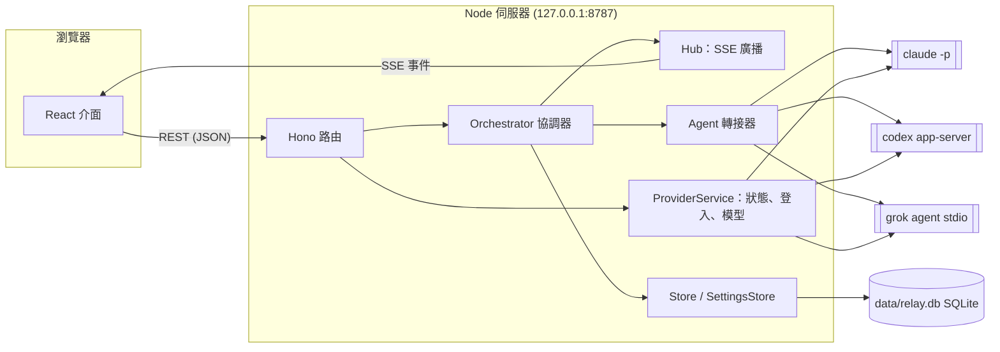
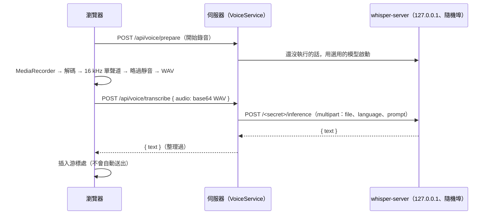

[English](architecture.md) | **繁體中文**

# 架構

Harness Relay 是一個在本機執行的網頁應用程式，分成兩半：

- **Node.js 伺服器**（Hono、TypeScript）：管理對話、決定下一個發言的 agent、啟動各個 agent CLI，並把所有資料存進 SQLite；
- **React 前端**（Vite）：顯示聊天畫面，並透過 Server-Sent Events（SSE）接收即時更新。

伺服器從不直接呼叫模型 API。每一次 agent 發言都是一次真正的 CLI（`claude`、`codex`、`grok`）無頭模式執行，所以每個 agent 都保有自己的工具、權限、登入狀態與 session 歷史。



## 元件

| 模組 | 職責 |
| --- | --- |
| `src/server/app.ts` | HTTP 路由、安全性中介層、SSE 端點（`createApp`，可用 `app.request()` 測試） |
| `src/server/index.ts` | 組裝各元件、靜態檔案、啟動與關閉 |
| `src/server/web.ts` | 提供建置好的介面：`assets/` 下的檔案（以內容雜湊命名）永久快取，`index.html` 每次載入都檢查 |
| `src/server/orchestrator.ts` | 執行一次「團隊回合」：依模式決定發言者、組出每個 agent 的 prompt、執行 CLI、串流結果；自動組隊的對話會先設計團隊 |
| `src/server/planner.ts` | 自動組隊：首席 agent 的 prompt、解析它的 JSON 回覆、轉成可執行的團隊、備援方案 |
| `src/server/grouping.ts` | 側邊欄群組：首席 agent 在背景依新對話的第一則訊息，把它分到使用者的某個群組（`AutoGrouper`） |
| `src/server/prompt.ts` | 角色簡報（system prompt）、每回合的 prompt、`@` 解析、`[PASS]` 判斷 |
| `src/server/approvals.ts` | 「本對話都允許」的規則 key 與比對 |
| `src/server/commands.ts` | 解析一行 shell 指令實際會執行哪些程式（串接、命令替換、`sh -c`、`env`／`sudo`、git 的全域選項）：用於核准規則 key 與 Grok 的推送／發佈判斷 |
| `src/server/agents/*` | 每個 CLI 一個轉接器：組參數、把 CLI 的 JSON 事件串流轉成共通事件（`acp.ts`：Grok ACP 的 JSON-RPC 對端） |
| `src/server/i18n.ts` | 兩種語言的伺服器訊息；每個請求與執行所用的語言（AsyncLocalStorage） |
| `src/server/process.ts` | 以獨立 process group 啟動程序、逐行讀 stdout、以原始位元組保存輸出、處理中止與逾時（先 SIGTERM，再對整個 process group 送 SIGKILL） |
| `src/server/providers.ts` | CLI 狀態（是否安裝、版本、是否登入）、登入流程、登出、模型清單快取 |
| `src/server/models.ts` | 從各 CLI 取得可用模型與推理強度 |
| `src/server/workspace.ts` | git 相關操作：自動 `git init`、工作目錄快照、每個 agent 的 worktree、diff、套用結果 |
| `src/server/store.ts` | 用 SQLite 保存對話、訊息、agent session 與範本 |
| `src/server/settings.ts` | 各 CLI 設定（執行檔路徑、API key、預設模型與推理強度）、預設工作目錄、首席 agent、子程序環境變數 |
| `src/server/attachments.ts` | 使用者訊息附加的檔案：存到 `data/attachments`、安全的檔名、哪些以圖片交給 agent |
| `src/server/media.ts` | 回覆中嵌入的圖片與影片：可以從哪些目錄取得、安全地解析路徑（實際路徑必須在其中之一、只限媒體類型）、位元組範圍 |
| `src/server/voice.ts` | 語音輸入：在背景安裝 whisper.cpp 引擎與模型（固定版本、檢查 SHA-256）、需要時執行 `whisper-server`、把錄音轉成文字 |
| `src/server/secrets.ts` | 存放 API key 的作業系統金鑰儲存區（`@napi-rs/keyring`）；系統沒有可用的儲存區時則為無 |
| `src/server/db.ts` | 開啟 SQLite、套用 schema 遷移、交易輔助函式 |
| `src/server/hub.ts` | 把每個對話的事件廣播給連線中的 SSE 用戶端 |
| `src/shared/search.ts` | 搜尋對話：拆出搜尋的詞、找出符合的位置（不分大小寫）、第一個符合處附近的摘錄、標示關鍵字 |
| `src/shared/mentions.ts` | 伺服器（判斷點名了誰）與介面（標示 @）共用的 `@` 規則：以 Markdown（GFM）解析訊息，只看一般文字，不含程式碼與連結文字 |
| `src/shared/types.ts` | 伺服器與前端共用的型別 |
| `src/shared/media.ts` | 哪些圖片與影片類型可以顯示，以及回覆中哪些圖片網址是本機檔案（相對或絕對路徑、`file:` 網址）而不是其他網站 |
| `src/web/*` | React 介面：側邊欄、團隊設計、聊天畫面、設定頁、使用導覽；`i18n.tsx` 與 `locales/` 存放介面文字；`chat.ts` 存放聊天畫面的純邏輯（重新連線、能否套用、團隊設定草稿）；`sidebar.ts` 存放側邊欄的純邏輯（各群組的對話、還沒確認的移動、收合群組的狀態）；`recorder.ts` 負責麥克風錄音，`voice.ts` 存放語音輸入的純邏輯（WAV 編碼、靜音判斷、插入辨識結果） |

## 對話模型

一個**對話**包含團隊（`agents`）、設定（`mode`、`rounds`、`maxHops`、`permission`、`cwd`；首席 agent 還沒設計團隊時另有 `autoTeam`）以及有順序的**訊息**。訊息的作者可能是使用者、agent 或系統，由多個 **part** 組成：依發生順序排列的文字區塊與工具呼叫（`Read`、`Edit`、`Shell`……）；失敗或被拒絕的工具呼叫會保留原因。系統訊息可能帶有一份 **plan**，也就是首席 agent 的團隊設計。

對話也會為每個 agent 保存 **agent 狀態**：

- `sessionId`：CLI 自己的 session / thread id，用來在下一回合接續 agent 的上下文；
- `seen`：已經交給這個 agent 看過的訊息 id。

## agent 之間如何共享上下文

每個 agent 都有自己長期存在的 CLI session，所以伺服器**不會**每回合重送整段對話，而是：

1. agent 發言前，協調器收集所有已完成、但不在該 agent `seen` 集合裡的訊息（使用者訊息、其他 agent 的回覆，以及在全新 session 時連同該 agent 自己先前的回覆）。
2. 把這些訊息轉成帶標籤的區塊作為 prompt：

   ```text
   New chat messages since your last turn:
   <chat>
   <message from="user">…</message>
   <message from="@Builder" via="Codex">
   Implemented step 2.
   <actions>
   Edit update src/api.ts
   Shell npm test
   </actions>
   </message>
   </chat>

   Roundtable round 2/3: it's your turn, @Reviewer. Reply with [PASS] if you have nothing new to add.
   ```

   `<actions>` 區塊摘要發言者改了哪些檔案、跑了哪些指令，讓隊友不用看原始工具輸出也知道變更了什麼。

   附加了檔案的使用者訊息還會多一個 `<attachments>` 區塊，列出每個檔案的名稱、類型、大小與絕對路徑，讓 agent 用自己的工具開啟。交付的訊息中的圖片（PNG、JPEG、GIF、WebP）也會以原生方式傳入：Claude Code 是 stream-json 使用者訊息中的 base64 圖片區塊（並以 `--add-dir` 加入附件資料夾，讓它的 Read 工具可以開啟檔案）、Codex 是 `turn/start` 的 `localImage` 輸入、Grok 則是 ACP 的圖片區塊（它宣告了 `promptCapabilities.image`）。超過約 3.75 MB 的圖片只會列出路徑，以免超過 API 每張 5 MB 的上限。
3. 用保存的 session id 接續 CLI，所以它記得之前看過的所有內容。
4. 回合成功後，把這次交付的訊息 id（以及 agent 自己的回覆）加進 `seen`。若回合失敗，交付會被撤回，下一回合重新提供這些訊息。

如果接續 session 失敗且 agent 還沒有任何輸出（例如 session 被刪除，或是工作目錄改了，而 Claude Code 是依目錄保存 session），協調器會用**全新** session 加上完整對話紀錄重試一次。若全新 session 也在任何輸出前就失敗，代表問題不在 session（例如用量上限、登入、網路），所以會保留原本的 session，下一輪繼續使用。

訊息確定之後才會轉交給隊友：已完成的回覆，以及失敗或被停止、但有說話或改過檔案的回覆（標記為 `status="failed"`／`status="stopped"`）。回覆 `[PASS]` 的訊息會以 `[PASS]` 加上它的 `<changed_files>` 轉交。

### 角色簡報

每個 agent 的角色透過 CLI 的 system prompt 機制注入，並且**每回合重新產生**，所以修改角色或團隊會在下一回合生效：

| CLI | 機制 |
| --- | --- |
| Claude Code | `--append-system-prompt <簡報>`，搭配 `--system-prompt-snapshot off`（否則接續的 session 會一直沿用第一次請求的 system prompt） |
| Codex | `thread/start`／`thread/resume` 的 `developerInstructions` |
| Grok | ACP `session/new`／`session/resume` 的 `_meta.rules` |

簡報內容包括 agent 的角色、團隊名單（含每位隊友的角色摘要）、目前模式的規則、`[PASS]` 約定、共用的工作目錄與權限等級。平行模式中還會寫出 agent 自己的 worktree 與分支，以及每位隊友的分支和該隊友 worktree 的起始快照。有[工具庫](#工具庫)項目時，簡報也會包含成員的記憶和它的 skill 清單。

## 發言排程（模式）

使用者送出訊息（或按下「**繼續**」，等於送出空訊息）時，協調器開始一次執行：

- **使用者訊息中的 `@`** 會限制參與者：只有被 @ 的 agent 發言（接力模式下則由他們開始接力）。
- **圓桌**：每一輪（`1…rounds`）參與者依團隊順序逐一發言，每個人都看得到前面的人說了什麼。若某一輪所有人都 pass（或失敗），提前結束。
- **平行**：每一輪所有參與者同時執行。還在串流中的訊息不會被交付，所以要到下一輪才看得到彼此的答案。
- **接力**：佇列從被 @ 的 agent 開始，沒有 @ 時從團隊第一位（「隊長」）開始。每次回覆後，回覆的一般文字中（不含程式碼與連結文字，見 `src/shared/mentions.ts`）被 @ 到的隊友會加進佇列。佇列清空或達到 `maxHops` 次時結束（系統訊息會告知使用者，可按「繼續」）。

回覆內容恰好是 `[PASS]`（或沒有工具呼叫的空回覆）會被標記為 *pass*，並以淡色顯示。

同一個對話一次只能有一個執行；不同對話可以同時執行。「**停止**」會中止執行並結束正在跑的 CLI 程序（對 process group 送 `SIGTERM`，3 秒後 `SIGKILL`）。每個 agent 回合另有 45 分鐘的安全逾時。

**團隊回覆時送出的訊息**（`Orchestrator.send()`）不會開始第二個執行。執行進行中或正在準備、或首席 agent 的團隊設計還在等確認時，訊息會放進對話的佇列（`conversation.queue`，存在 `conversations.queue`，最多 20 則），瀏覽器把它顯示在輸入框上方（`queue` 事件）。`deliverQueued()` 會在下一個「該收到它的 agent」發言前，依送出順序貼出等待中的訊息：圓桌在每位發言者之前、接力在每一棒之前、平行在每一輪開始時（讓同一輪的人看到相同的訊息）。只 @ 了其他 agent 的訊息會等到其中一位發言，排在它後面的訊息也一起等，所以對話維持送出的順序。送達的訊息就是一般的使用者訊息，另外標上 `queued`（介面顯示「插話」）；每個 agent 跟其他訊息一樣，從「還沒看過的訊息」收到它，所以當時正在發言的 agent 會在下一次發言時看到。執行結束時若還有訊息在等、而且不是被停止的，`startQueued()` 會為它們再開一次執行，參與者依它們的 @ 決定（每則都有 @：就是那些 agent；否則全員）。按「停止」後它們會繼續等使用者處理（`DELETE /api/conversations/:id/queue/:messageId` 撤回一則）；下一次送出或「繼續」會把它們排在新訊息前面送出。以 `interrupt: true` 送出時，會停止執行、等它結束，再把等待中的訊息與這則新訊息當成新的執行送出。訊息會先存成訊息、才從存好的佇列移除，所以當機後兩邊都有的訊息算已送達。

**向使用者提問。** briefing 會告訴 agent：好答案取決於只有使用者知道的事時，要先問、不要猜，並在這種回覆的最後單獨一行寫 `[ASK_USER]`（`src/shared/ask.ts`；介面在回覆串流時會隱藏這個標記）。回合結束時，`takeAsk()` 會把標記從訊息中移除、標上 `asked`，執行就在這裡停下：`pauseFor()` 記下停在哪裡（`conversation.pause`，一個 `RunPause`，存在 `conversations.pause`，並隨 `conversation` 事件送給瀏覽器）。圓桌會立刻停下並記住這一輪剩下的人；平行會讓這一輪跑完，再記住提問的 agent；接力則記住剩下的佇列與剩餘棒數。團隊等待期間，佇列中的訊息不會開始新的執行。下一次執行（`takePause()`）從那裡接續：提問的 agent 先發言，並在那個回合被告知使用者已經回覆（`TurnInfo.answered`），接著是這一輪剩下的人（或接力佇列）與剩下的輪次。沒有任何訊息的「繼續」會略過提問的 agent。回覆中 @ 了其他人、編輯或重試（`truncateFrom()` 會清除暫停）、重新設計團隊或模式改變時，則重新開始。對話清單會回報 `asking` 給側邊欄。

**重試 agent 的回覆**（`Orchestrator.retry()`）也是同樣的做法：刪除該則回覆與之後的所有內容，再由該 agent 重新回答；不是接力模式時，同一輪中回覆被一起刪除的 agent 也會接著回答，只跑一輪。

**編輯使用者訊息**（`Orchestrator.resend()`）會刪除該則訊息與之後的所有訊息、重設每個 agent 的 session（CLI 的 session 無法倒轉，所以每個 agent 都以剩下的對話紀錄重新開始）、把平行模式的 worktree 標記為需要重設，再把修改後的文字當成新的一次執行送出。截斷要等工作區準備好並取得目錄鎖之後才會進行，所以啟動失敗時對話紀錄不受影響。被刪除的回合改過的檔案不會還原。

## 自動組隊

以 `settings.autoTeam` 建立的對話一開始沒有成員。使用者的第一則訊息是描述需求，這次執行只會設計團隊（協調器中的 `designTeam()`，以及 `src/server/planner.ts`）：

1. 對話中出現一則 `plan.status = "planning"` 的系統訊息。
2. **首席 agent**（在設定頁指定：provider，以及選填的模型與推理強度）以唯讀權限在對話的工作目錄中執行一次，system prompt 為 `PLANNER_BRIEFING`。prompt 內容包括使用者的第一則訊息、已登入的 CLI 及其模型與推理強度、三種模式、使用者選的權限與工作目錄（首席 agent 無法更改），以及所有範本（內建與使用者儲存的）的完整內容（JSON）：說明、模式、輪數或交棒次數，以及每位成員的 CLI、模型、推理強度與完整角色。它必須回覆一個 JSON 物件：直接套用範本是 `{"choice": "template", "templateId", "reason"}`；依範本調整是 `{"choice": "adapted", "baseTemplateId", …團隊, "reason"}`；從頭設計是 `{"choice": "custom", …團隊, "reason"}`，其中團隊為 `"name", "description", "mode", "rounds", "maxHops", "agents": [{name, provider, role, model?, effort?}]`。reason 是給使用者看的說明：為什麼這個範本適合、改了什麼與原因，或為什麼沒有範本適合。
3. `parsePlanReply()` 從程式碼區塊（或最外層的大括號）取出 JSON；`decidePlan()` 把它轉成團隊。自訂成員會經過與手動設計團隊相同的驗證（`validateAgents`）：名稱中的空白會被替換，最多 5 位成員，輪數 1–5，交棒次數 1–30。`fitAgents()` 會把 CLI 尚未登入的成員改到首席 agent 的 CLI，並移除該 CLI 不提供的模型或推理強度。直接套用範本時若首席 agent 沒給原因，會補上預設說明。調整過的團隊會在 `plan.basedOn` 記下原本的範本（id 與名稱）；若原本範本的 id 不存在，就當成自訂團隊。調整或自訂的團隊若與某個範本完全相同（`sameTeam()`：成員、CLI、角色、模型、推理強度、模式與輪數或交棒次數都一樣），就記為直接套用該範本。
4. 若首席 agent 執行失敗或回覆無法使用，`fallbackPlan()` 會改用「一般問題智囊團」範本，卡片上會說明原因。若使用者停止執行，這則訊息會標為已中斷，`autoTeam` 維持開啟，下一則訊息會重新規劃。首席 agent 會拿到上一次團隊設計之後使用者說的所有內容，所以被停止的那次需求仍然算數。
5. 團隊與模式寫入對話、清除 `autoTeam`，plan 卡片變成 `ready` 並帶有 `awaitingConfirmation`（附上首席 agent 的費用與 token 數）。這次執行到此結束：沒有人回答這段需求描述。
6. 在使用者確認團隊之前（`POST /api/conversations/:id/messages/:messageId/confirm-plan`，會清除 `awaitingConfirmation` 並設定 `plan.confirmedAt`），「繼續」會被拒絕（409），送出的訊息則放進佇列等待（首席 agent 設計期間送出的也一樣）。手動設定團隊（`PATCH … { agents }`）也算確認。確認時若有等待中的訊息，就為它們開始一次執行；否則使用者接著問第一個問題。無論哪種，團隊都照常回答，並會在歷史中看到那段需求描述作為背景。plan 訊息是系統訊息，所以永遠不會轉交給 agent。

設計團隊的執行不會寫入任何東西（首席 agent 是唯讀的，其他人也不發言），所以不會鎖住目錄；團隊自己的執行則照確認後的模式上鎖。`POST /api/conversations/:id/messages/:messageId/save-plan` 會把首席 agent 設計或調整的團隊（`planSavable()`）存成使用者範本（沿用對話的權限），並記錄 `plan.savedPresetId`；直接套用的範本不是新團隊，卡片不會提供儲存。編輯需求描述會連同 plan 一起刪除，於是 `autoTeam` 重新開啟：團隊會依修改後的需求重新設計，並再次等待確認；但若 plan 之後團隊被手動改過（成員或模式、輪數、交棒次數與 plan 不同），就保留那個團隊。手動設定團隊（`PATCH … { agents }`）會關閉自動組隊。

## 側邊欄群組與搜尋

使用者在側邊欄建立群組（`conversation_groups`：id、名稱、順序），再把對話放進去（`conversations.group_id`）。不屬於任何群組的對話都在預設群組 **其他**：它一定存在、不會存進資料庫，任何群組都不能用它在兩種語言中的名稱（`validGroupName()`）。刪除群組時，外鍵的 `ON DELETE SET NULL` 會把裡面對話的 `group_id` 設成 NULL，讓它們回到「其他」。對話列表帶有每個對話的 `groupId`，前端會一起載入群組。

移動對話（`PUT /api/conversations/:id/group`，拖到群組上或用資料夾選單）會記下 `group_source = 'user'`。對話送出第一則使用者訊息時（`postUserMessage()`），如果使用者有群組，協調器的 `AutoGrouper` 會在團隊回覆的同時，在背景以唯讀方式執行一次**首席 agent**，系統 prompt 是 `GROUPER_BRIEFING`。prompt（`buildGroupPrompt()`）包含這則訊息（最多 4,000 字，加上附加檔案的名稱），以及編號的群組清單，每個群組附上最多五個最近的對話標題當作例子。首席 agent 回覆 `{"group": <編號>}`，0 代表都不適合；`parseGroupReply()` 也接受群組名稱。接著 `Store.sortIntoGroup()` 只在 `group_source` 仍是 NULL、而且群組還在時，才設定群組並記下 `group_source = 'auto'`：使用者自己的移動（即使是在首席 agent 決定時做的）一定優先，而且每個對話只會自動分類一次（選「都不適合」也算）。回覆失敗或無法使用時，對話留在「其他」、視為尚未分類；編輯第一則訊息會再試一次。分類期間對話列表會回報 `sorting`。刪除對話會停止分類並等它結束；關閉伺服器時會停止所有分類。

搜尋（`GET /api/search?q=`）把查詢依空白拆成詞（最多 8 個），找出每個詞都出現在標題、或使用者與 agent 訊息文字段落中的對話（不含系統訊息、思考過程與工具輸出）。先用 SQLite 的 `LIKE`（跳脫 `%` 與 `_`）篩出段落，再用 JavaScript 重新比對一次，非 ASCII 字母也不分大小寫。因為比對的是文字的任何一部分，中文不需要斷詞。搜尋前會先寫入還在排程中的訊息，所以仍在串流的回覆也找得到。每個結果帶有「包含最多關鍵字的段落」中第一個符合處附近的摘錄（`snippetAround()`）與符合的訊息數；標題符合的排在前面，其餘依最近時間，最多 50 筆。前端在停止輸入 200 毫秒後才搜尋，只顯示最新一次搜尋的結果，並標示關鍵字（`highlightParts()`）。

## 語言

介面提供繁體中文與英文（`src/web/locales/zh-TW.ts`、`en.ts`；英文字典的型別以中文字典為準，另有測試檢查兩者結構相同）。

- **前端**：第一次開啟時依 `navigator.languages` 決定語言（任何 `zh*` → zh-TW，否則英文），並存在 `localStorage`（`relay:lang`）；可在設定頁更改。`<html lang>` 會跟著改變。
- **伺服器**：每個 API 請求都帶有 `X-Relay-Lang`（沒有時改看 `Accept-Language`，再沒有就用 zh-TW）。`/api/*` 中介層會在 `withLang()`（AsyncLocalStorage）中處理請求，所以底下任何地方的 `t()` 都會回傳正確語言的訊息：驗證錯誤、轉接器錯誤、系統訊息，以及這個請求啟動的整個團隊執行（回應送出後仍會繼續）。
- **內建範本**有兩種語言版本（`builtinPresets(lang)`）；首席 agent 看到的是介面語言的版本，自訂角色則用使用者提問的語言撰寫。
- 給 agent 的 prompt（簡報、回合 prompt、規劃用的 prompt）維持英文；agent 會用使用者的語言回答。

## CLI 轉接器

每個轉接器把一次 CLI 回合轉成共通事件串流：`session`、`text`、`text_end`、`thinking`、`plan`、`tool_start`、`tool_end`（附上呼叫的輸出或失敗原因）；CLI 要求做權限沒涵蓋的事時，則呼叫 `requestApproval`（見[核准](#核准)）。

| | Claude Code | Codex | Grok |
| --- | --- | --- | --- |
| 指令 | `claude -p --input-format stream-json --output-format stream-json --verbose --include-partial-messages` | `codex app-server`（透過 stdin/stdout 傳 JSON-RPC，也就是 Codex IDE 擴充套件使用的協定） | `grok agent --no-leader stdio`（ACP：透過 stdin/stdout 傳 JSON-RPC） |
| prompt 傳入方式 | stdin 上的一則 `user` 訊息 | `turn/start` | `session/prompt` |
| 新建 / 接續 session | `--session-id <uuid>` / `--resume <id>` | `thread/start` / `thread/resume` | `session/new` / `session/resume` |
| 模型 | `--model` | thread 上的 `model` | `session/set_config_option`（`model`） |
| 推理強度 | `--effort` | thread 上的 `config.model_reasoning_effort` | `session/set_config_option`（`reasoning_effort`） |
| 文字串流 | `stream_event` 文字 delta | `item/agentMessage/delta` | `agent_message_chunk` |
| 思考過程 | `thinking_delta`（搭配 `--thinking-display summarized`） | `item/reasoning/summaryTextDelta`（`model_reasoning_summary="auto"`） | `agent_thought_chunk` |
| 計畫 / 待辦清單 | `TodoWrite` 工具 | `turn/plan/updated` | `plan` 更新（它的 `todo_write` 呼叫不會顯示成工具列） |
| 工具事件 | `tool_use` / `tool_result` 區塊 | `commandExecution`、`fileChange`、`mcpToolCall`、`webSearch` 項目 | `tool_call` / `tool_call_update` |
| 請求核准 | `can_use_tool` 控制請求（`--permission-prompt-tool stdio`） | `item/commandExecution/requestApproval`、`item/fileChange/requestApproval`、`item/permissions/requestApproval` | `session/request_permission` |

每個回合執行一個程序。Claude Code 的 `--thinking-display` 旗標沒有列在它的 `--help` 中，`--system-prompt-snapshot` 則是較新的旗標；若某個版本不接受其中之一，轉接器會記住，之後改為不帶它執行。

### 權限對應

權限決定哪些操作**不必詢問**就能執行；其他操作在對話設定為詢問（預設）時交給使用者決定，設定為拒絕（`settings.approvals = "deny"`）時則自動拒絕。

| Relay 權限 | Claude Code | Codex | Grok（ACP） |
| --- | --- | --- | --- |
| 唯讀 | `--permission-mode manual`（拒絕時：`dontAsk`）、`--allowedTools WebFetch WebSearch`、`--disallowedTools Edit MultiEdit Write NotebookEdit`：讀檔與上網直接執行，沒有修改檔案的工具，其他都要詢問 | 沙箱 `read-only`、核准政策 `on-request`（拒絕時：`never`） | 詢問模式（`_meta.yoloMode: false`）：讀網頁直接執行，其他都要詢問 |
| 可編輯 | `--permission-mode acceptEdits`，加上上網與常用的建置／測試／lint 指令（`CLAUDE_EDIT_COMMANDS`）：其他指令要詢問 | 沙箱 `workspace-write`，並固定關閉網路（`sandbox_workspace_write.network_access = false`，不受 `~/.codex/config.toml` 影響）、核准政策 `on-request`（拒絕時：`never`） | 在 `GROK_SANDBOX=workspace` 中使用詢問模式：除了推送／發佈（`git push`、`npm publish`、`gh release`……，由 `commands.ts` 判斷）要詢問，其他都直接執行 |
| 完全存取 | `--permission-mode bypassPermissions` | 沙箱 `danger-full-access`、核准政策 `never` | 全部自動核准（`_meta.yoloMode: true`） |

- **Claude Code** 把每個請求以 `can_use_tool` 控制請求送出，並等待我們的控制回應（允許，或拒絕並附上模型看得到的訊息）。對話設定為拒絕時，不會指定 permission prompt tool，由 Claude Code 自己拒絕這類呼叫。Claude Code 自己的 `permissions.allow` 規則（使用者設定，或已信任專案的設定）仍然有效；唯讀模式會移除修改檔案的工具，所以這類規則無法讓它們執行。
- **Codex** 的指令一律在作業系統沙箱中執行。使用 `on-request` 時，模型在需要超出沙箱（寫到工作目錄以外、存取網路……）時會提出請求；要不要詢問由模型決定，沒有詢問的話，沙箱就直接擋下呼叫，模型會看到錯誤。
- **Grok** 透過 ACP 執行，因為非互動的 `grok -p` 無法詢問：需要詢問的呼叫會被回報為「User cancelled」並**結束整輪**。改用 ACP 後，請求會送到 adapter。拒絕（使用者拒絕或自動拒絕）時回覆 `reject_once` 並附上 `_meta.followup_message`，Grok 會把它當成給模型的回饋，而不是取消這一輪。
  - session 的模式一律明確指定，所以使用者在 `~/.grok/config.toml` 設的 `[ui] permission_mode = "always-approve"` 不會放寬唯讀或可編輯。
  - Grok 內建的唯讀工具與指令（包含單純的 `mkdir`／`touch`）仍會直接執行、不經詢問。
  - 唯讀模式不使用 Grok 的 `read-only` 沙箱設定檔：它在某些機器上無法啟動（例如 `/var/run/docker.sock` 是 symlink 時）。可編輯模式若沙箱無法啟動，這一輪會失敗並顯示 Grok 給的原因。

被拒絕或失敗的呼叫會保留原因（`tool_end.error`，存在 `message_parts.tool_error`），這一輪會繼續進行。

**可編輯模式不會把專案程式碼關進沙箱。**「推送與發佈要詢問」能擋住 agent 直接執行這些指令；但可編輯模式不經詢問就能執行的指令（測試、建置、`npm run` 腳本、`make`）跑的是 agent 剛剛可能改過的程式碼，所以使用 Claude Code 與 Grok 時，執意要連網的 agent 仍能透過這些指令做到。Codex 的沙箱會讓所有指令都無法連網。不信任的程式碼或指示，請使用唯讀，或把「超出權限的動作」設為自動拒絕。

## 核准

轉接器收到請求時，協調器（`turn()` 中的 `requestApproval`，以及 `src/server/approvals.ts`）會：

1. 在 agent 的訊息中建立一個 **approval part**：種類（`command` / `edit` / `fetch` / `other`）、指令、檔案或網址、agent 說明的原因，以及「本對話都允許」用的規則 key。指令的 key 是這行指令實際執行的每個指令各一個，包括串接、管線、背景執行、`$( )` 與反引號的命令替換，以及 `sh -c '…'` 裡的指令（`src/server/commands.ts`）：程式名稱，若該工具有子指令再加上子指令（`npm install`、`git push`，會略過 `-C` 這類 git 全域選項）；`env`／`sudo` 前綴與 `VAR=value` 會被略過。所以允許 `npm test` 絕不會讓 `npm test && rm …` 或 `npm test $(rm …)` 通過。`sudo`／`doas` 會保留在 key 中；執行時才知道是哪個程式的指令（`$(which x) …`），或帶有可執行程式之設定的 git 指令（`-c`、`GIT_*` 環境變數），則以完整指令文字當作 key。最初較簡單的解析方式（以空白拆開每個 `&&`／`;`／`|` 片段）得到的 key 也一律包含在內，所以就算解析有誤，也不會比以前更容易被自動允許。key 依 CLI 實際執行的指令計算（Codex 用的是它加上引號的原始形式，而不是卡片上整理過的版本）。所有檔案修改共用一個 key，讀網頁用主機名稱，其他工具用工具名稱。
2. 若所有 key 在這個對話中都已允許（`conversation.allowRules`），就立即同意，並把該 part 顯示為已自動允許。
3. 否則該 part 為 `pending`，請求在 `orchestrator.approvals` 中等待，對話回報為 `waiting`（側邊欄與分頁標題會顯示）。`POST /api/conversations/:id/approvals/:approvalId` 帶上 `{ allow, always?, note? }` 回應請求；「always」會把這些 key 加進 `allowRules`。拒絕時附的說明會轉交給 agent。
4. 停止執行，或 agent 的 CLI 結束這一輪（當掉、逾時）時，它等待中的請求都會以 `expired`（拒絕）結束；之後才送來的回應會得到 404。
5. 在沒有持有目錄鎖的執行中（唯讀）被允許的動作，會先鎖住工作目錄直到這次執行結束；若有其他對話正在寫入，這個動作會被拒絕，並告知 agent 原因。

agent 的 CLI 在這段期間會一直等待；每回合 45 分鐘的安全逾時仍然適用。

## agent 活動

除了回覆文字與工具列，訊息還能顯示 agent 的思考與計畫：`thinking` part（串流顯示；介面中預設收合，串流時看得到最新一行）、`plan` part（agent 的待辦清單，原地更新），以及每個工具的 `output`（它回傳內容的最後一段，最多 4,000 個字元，展開工具列時顯示）。思考過程永遠不會轉交給其他 agent。

## 工具庫

Harness Relay 提供給成員的 MCP 伺服器、skill 與記憶，每個 CLI 都用同一套方式，而且加在各 CLI 自己的設定之外（`src/server/tools.ts` 的 `ToolLibrary`，透過 `settings.tools` 取得）。整個工具庫以 JSON 存在 `app_settings` 的 `tool_library` key。

- **範圍。** 每個 MCP 伺服器和 skill 都列出預設給哪些 CLI 的成員（`providers`；空的表示都不給）。記憶分成給所有人的 `all` 和每個 CLI 各一份。成員的例外設定存在 `AgentConfig.tools`，key 是 `mcp:<id>`（伺服器的 id，改名後不變）、`skill:<資料夾>`、`memory` 或 `memory:<provider>`：`true` 表示給它預設沒有的項目，`false` 表示拿掉預設有的項目。只儲存例外（`conversation_agents` 與 `preset_agents` 的 `tools` 欄位，schema 第 9 版）。
- **每一回合** orchestrator 都會用 `tools.forAgent(agent)` 取得成員的項目，所以工具庫或團隊的修改從下一回合開始生效。記憶和 skill 放進簡報；MCP 伺服器和 skill 資料夾交給轉接器（`RunOptions.mcpServers`、`RunOptions.readDirs`）。
- **Skill** 是有 `SKILL.md` 的資料夾，名稱和用途取自它的 YAML front matter（`parseFrontMatter`）。簡報會列出它們和 `SKILL.md` 的路徑，任務符合時由 agent 自己讀檔，因此每個 CLI 用法都一樣。加入資料夾之前，介面會先列出底下的 skill（`scanSkills`：資料夾本身，以及往下兩層內的 skill 資料夾，不看 skill 內部、隱藏資料夾與 `node_modules`）讓使用者勾選。工具庫的 skill 是加在各 CLI 自己載入的 skill 之外，工具庫無法拿掉後者。檔案不見、或名稱和前面的 skill 重複的，會在介面上標示且不會提供。
- **機密值。** 伺服器環境變數（stdio）與標頭（HTTP）的值存在作業系統的金鑰儲存區，每個伺服器一筆 `mcp-<id>`（JSON，以伺服器的 id 命名，改名時 id 不變），啟動時讀進記憶體；沒有金鑰儲存區時留在資料庫，同樣以 id 存放。介面只拿到遮蔽後的值；編輯時沒有送出的值會保留，改名完全不會動到金鑰儲存區（所以名稱不分大小寫的儲存區，例如 Windows 認證管理員，也不會因為 `github` → `GitHub` 而弄丟值）。沒能搬進金鑰儲存區的值會留在資料庫，等之後啟動時再搬；讀不到值的伺服器（金鑰儲存區被鎖住）要重新輸入值才能儲存，所以真正的值不會被空值覆蓋；在讀得到值之前（每回合會再試）不會提供給 agent。

| | Claude Code | Codex | Grok |
| --- | --- | --- | --- |
| MCP 伺服器 | `--mcp-config <檔案>`：放在新建私有暫存資料夾裡的 `0600` 檔案，回合結束後刪除（token 不會出現在指令列） | 在 `thread/start` / `thread/resume` 上每個伺服器一個設定覆寫 `mcp_servers.<name>`（`command`、`args`、`env` 或 `url`、`http_headers`），所以 `config.toml` 裡的伺服器仍保留 | ACP `session/new` / `session/resume` 的 `mcpServers`（`env` 與 `headers` 是名稱 / 值清單；HTTP 伺服器只在 Grok 宣告支援時才傳） |
| 讀取 skill | 完整存取以外的權限，每個 skill 資料夾加一條 `Read(//<資料夾>/**)` 規則（只能讀：`--add-dir` 會連編輯都允許） | sandbox 允許讀取任何位置 | 可讀取任何位置 |
| MCP 工具呼叫 | 和其他工具一樣走 `can_use_tool`：依權限詢問或拒絕 | Codex 用標示為工具呼叫核准的 MCP elicitation 詢問（`_meta.codex_approval_kind: "mcp_tool_call"`），和其他核准一樣顯示並回覆；其他 elicitation 一律拒絕。核准政策為 `never` 時 Codex 會拒絕 MCP 呼叫，所以完整存取下工具庫的伺服器會設 `default_tools_approval_mode = "approve"` | 和其他工具一樣走 `session/request_permission` |

## 各 CLI 自己載入的內容

設定頁每個 CLI 的卡片可以列出這個 CLI 在預設工作目錄下自己載入的內容：它自己的 skill、MCP 伺服器與記憶，和工具庫分開（`src/server/native.ts`，`POST /api/providers/:provider/native`）。查詢方式和 IDE 一樣，不送 prompt，所以不會呼叫模型：

| | Skill | MCP 伺服器 | 記憶與指示 |
| --- | --- | --- | --- |
| Claude Code | stream-json 的 `initialize` 控制請求：非內建的指令（skill、plugin 與自訂指令；只有名稱與說明） | `mcp_status` 控制請求（名稱、狀態、範圍、工具數） | 沒有清單：依文件列出它會讀、且目前存在的檔案（設定資料夾的 `CLAUDE.md` 與 `rules/`，從資料夾往上各層的 `CLAUDE.md` / `CLAUDE.local.md` / `.claude/CLAUDE.md` / `.claude/rules/`，以及 `projects/<資料夾>/memory/` 下的自動記憶），會依 `CLAUDE_CONFIG_DIR` |
| Codex | `codex app-server` 的 `skills/list` | `config/read`（設定的伺服器；不會啟動任何伺服器） | 沒有清單：`CODEX_HOME` 與 repository 根目錄往下各層的 `AGENTS.override.md` 或 `AGENTS.md`，以及它的 `memories/` |
| Grok | `grok inspect --json` | `grok inspect --json` | `grok inspect --json`（指示檔） |

查詢時會短暫啟動 CLI：Claude Code 會執行使用者的 SessionStart hooks 並連線它的 MCP 伺服器。因此介面只在使用者按下 **查詢** 時才詢問，展開這一區時不會：使用者可能正是因為某個 MCP 伺服器一啟動就會造成問題，才打開這一區要關掉它。它用 POST，資料夾固定是預設工作目錄，所以其他網站無法在任何地方啟動 CLI。每個 CLI、執行檔與資料夾的結果保留一分鐘（`refresh: true` 重新查詢）；CLI 沒有回報的部分會列出來，並依每次請求的語言顯示。回報的指示與記憶檔，以及 skill 的 `SKILL.md`，可以在介面中打開（`POST /api/providers/:provider/native/file`）：只會讀 CLI 最近一次回答裡的路徑，所以讀不到電腦上的其他檔案。只回傳名稱、說明、路徑與狀態；可能含有 token 的 MCP 伺服器設定不會回傳。

### 在 Harness Relay 的執行中不載入

使用者可以針對每個 CLI，讓 Harness Relay 啟動它的每一次執行都不載入它自己的 skill、MCP 伺服器、指示檔或記憶（`ProviderSettingsView.nativeOff`，欄位 `provider_settings.native_off`；`RunOptions.nativeOff`，由 orchestrator 傳給成員與首席 agent，群組分類也會傳）。各轉接器只在那一次執行中關掉，絕不修改 CLI 自己的設定檔。`src/shared/types.ts` 的 `NATIVE_OFF_SUPPORT` 列出各 CLI 能關掉的項目，其他的伺服器會丟掉。每個機制都在不呼叫模型的情況下，對真正的 CLI 驗證過（Claude Code 2.1.319、Codex 0.167.0、Grok 1.0.77）：

| | Skill | MCP 伺服器 | 指示檔 | 記憶 |
| --- | --- | --- | --- | --- |
| Claude Code | `--disable-slash-commands`（也包括 plugin 與自訂指令） | `--strict-mcp-config`：只保留工具庫的 `--mcp-config` | `CLAUDE_CODE_DISABLE_CLAUDE_MDS=1` | `CLAUDE_CODE_DISABLE_AUTO_MEMORY=1` |
| Codex（thread `config`） | `skills.include_instructions = false` | 每個設定的伺服器都設 `enabled = false`（thread 開始前用 `config/read` 讀取；同名的工具庫伺服器會直接取代它），和工具庫的伺服器放在同一個 `mcp_servers` 表；加上 `features.apps = false` | `project_doc_max_bytes = 0`：專案裡的 `AGENTS.md`；沒有設定能略過 `~/.codex/AGENTS.md` | `features.memories = false` |
| Grok（環境變數） | `GROK_CLAUDE_SKILLS_ENABLED` / `GROK_CURSOR_SKILLS_ENABLED=false`：只有從 Claude Code 與 Cursor 載入的 | `GROK_CLAUDE_MCPS_ENABLED` / `GROK_CURSOR_MCPS_ENABLED=false`：同上 | 沒有（它的 rules 開關仍會載入 `CLAUDE.md`） | `GROK_MEMORY=0` |

Codex 會把 `mcp_servers` 表合併進使用者的設定，所以使用者的其他伺服器與設定都會保留。之所以用一個表，而不是每個伺服器一個點分隔的 key，是因為 Codex 會在每個 `.` 切開 key（加引號也一樣），名為 `a.b` 的伺服器就無法指定。`config/read` 失敗時（例如舊版 `codex`），這次執行會失敗，並說明無法不載入那些伺服器，而不是默默照常執行它們。

Codex 在 thread 開始時，會把它的 skill 清單、專案的 `AGENTS.md` 與記憶寫進 thread，`thread/resume` 時會重播。所以對 Codex 來說，這三個開關從新對話開始生效，它的卡片上也會說明。MCP 伺服器與 apps 在每次開始與續接時都會設定，所以下一回合就生效。Claude Code 每次執行都會重新組出它的指示。

agent 的 CLI 不載入它自己的 skill 時，簡報裡工具庫的 skill 區塊不會再說 CLI 自己的 skill 照常可用。

Grok 自己的 skill 與 MCP 伺服器只能在 `~/.grok/config.toml` 關閉（`skills.disabled`、`mcp_servers.<name>.enabled`），Harness Relay 不會修改它。上面的查詢不套用這些開關，所以清單仍然顯示 CLI 自己載入的內容。

## 工作區與檔案修改

**唯讀**權限時，agent 直接在工作目錄（`cwd`）執行，不做其他處理。**可編輯**或**完全存取**時，Harness Relay 用 git 避免 agent 互相覆蓋，並記錄每個人改了什麼（`src/server/workspace.ts`）：

- **自動建立 repository**：若 `cwd` 不在任何 git repository 中，Harness Relay 會在該處執行 `git init`，並把常見的產生物資料夾（`node_modules/`、`.venv/`、`target/`……）加進 `.git/info/exclude`。在家目錄、檔案系統或磁碟區的根目錄（`/Volumes/<名稱>`），或家目錄的上層資料夾則會拒絕這麼做；若既有的 repository 以家目錄或檔案系統根目錄為根目錄（例如 dotfiles repository）也會拒絕，因為每一輪都得替整個資料夾做快照。絕不會 commit 到使用者的分支。
- **快照**：快照是把目前工作目錄（已追蹤與未追蹤的檔案，遵守 `.gitignore`）做成的一個 commit，透過暫時的 index 建立（`git add -A`、`write-tree`、`commit-tree`）。不會移動 `HEAD`、不會動到 index，也不會修改任何檔案。聊天訊息連結的 commit（它的 `base` 與 `head`）會保留在 `refs/harness-relay/<對話>/` 底下，`git gc` 不會清掉；刪除對話時會一併移除這些 ref。

| 模式 | agent 寫在哪裡 | 如何記錄修改 |
| --- | --- | --- |
| 圓桌 / 接力 | 真正的工作目錄。agent 輪流發言，同一時間只有一個在寫。 | 每回合前後各做一次快照；若內容不同，就把 diff 記在該則訊息上。 |
| 平行 | 每個 agent 自己的 **git worktree**（`data/worktrees/<對話>/<agent>`，分支 `relay/<對話>/<名稱>`），從同一份工作目錄快照建立。 | 每回合結束後，把 agent 改的所有內容 commit 到它的分支。 |

**平行模式。**每次執行的第一輪前，每位參與者都會拿到一個 worktree（跨執行沿用，直到需要重設）。簡報會告訴每個 agent 它的 worktree、分支與起始快照，以及每位隊友的分支和該隊友的起始快照（不同時間建立的 worktree 起始快照不同），所以後面的輪次可以用 `git diff <隊友的起始快照> <branch>` 看彼此的成果。若 agent 自己在 worktree 中 commit，那些 commit 就是這一輪的結果。使用者在聊天中檢視每個 agent 的 diff，對想要的結果按 **套用**：Harness Relay 取出該 agent 的 `base..branch`，先 `git apply --check` 再用 `git apply` 套用到真正的工作目錄，所以有衝突時不會改動任何檔案。patch 以位元組處理，所以 CRLF 換行與其他編碼的檔案都會原樣套用。不會自動 commit，修改留給使用者檢查。之後該對話所有的 worktree 都會被標記為需要重設，下一次平行執行會從工作目錄的新狀態開始。刪除對話時會一併移除它的 worktree 與分支。

**目錄鎖。**會寫入真正工作目錄的執行（可編輯 / 完全存取，且不是平行模式）會鎖住該 repository。其他對話若同時要寫入同一個 repository，會收到錯誤，直到第一個執行結束；套用 worktree 結果也會取得同一把鎖。唯讀執行與平行執行（只寫入自己的 worktree）不受影響，除非唯讀執行有動作被允許（見[核准](#核准)）。一個 repository 位在另一個裡面時，兩者的鎖也會互相衝突。只設計團隊的執行（自動組隊）不會上鎖。

**同一個對話一次只做一件事。**開始執行、套用結果、修改團隊或設定，從檢查到生效（包括準備工作區的期間）都會先保留這個對話（`Orchestrator.exclusive()`），所以期間的其他這類請求會收到「忙碌中」，不會插進中間（執行準備期間送出的訊息則放進佇列等待）。改名則隨時可以。刪除對話時，會先讓進行中的設定修改或套用完成（還在準備中的執行會放棄），再停止執行並等它寫完最後的狀態，才移除資料列、worktree、分支與保留的 ref；之後才送到的寫入會被捨棄。伺服器開始關閉後，不會再開始任何新的工作（503）。

**修改紀錄。**有修改的 agent 訊息會保存 `root`、`base`、`head`（兩個 commit）以及修改的檔案（A/M/D、增刪行數）。介面會以卡片顯示，附 diff 檢視（`git diff base head`），並在每個 agent 最新的 worktree 結果上提供 **套用** 按鈕。隊友會在轉交訊息的 `<changed_files>` 區塊看到檔案清單。清單來自 `git diff -z`，再長都完整，檔名中的引號、tab 與非 ASCII 字元也都保持原樣。

## 瀏覽檔案

對話上方的 **檔案** 會開啟對話工作目錄的瀏覽器，平行模式下也能看每位成員的 worktree（`src/server/files.ts`；`GET /api/conversations/:id/files`、`…/files/preview`、`…/files/raw`）。路徑會以所選資料夾的實際路徑解析並跟隨符號連結；最後落在資料夾外或 `.git` 資料夾內的（比對時不分大小寫：在 macOS 與 Windows 上 `.GIT/config` 會開到 `.git/config`）都是 404，指向外面的連結不會出現在列表中。一個資料夾最多列出 2,000 項（依顯示順序的前面幾項）。經由資料夾內的連結進入的資料夾，會保留當初要求的路徑。預覽以 JSON 回傳文字（長檔案只回傳前 512 KB）；圖片與影片只標示類型，由瀏覽器從 `…/files/raw` 載入，這個端點只提供這些媒體類型，並帶有和媒體端點相同的 `nosniff` 與沙箱化 `Content-Security-Policy` 標頭。介面用 highlight.js 為程式碼上色（輸出是包在 `<span>` 裡的跳脫文字），Markdown 則用聊天室的渲染器，所以預覽的檔案也無法執行腳本或載入遠端內容。

## 即時更新（SSE）

前端開啟 `GET /api/conversations/:id/events`，接收 JSON 事件：

| 事件 | 內容 | 時機 |
| --- | --- | --- |
| `snapshot` | 完整對話、是否執行中、正在發言的 agent | 連線時，以及使用者訊息被編輯後（對話紀錄被截斷） |
| `message` | 整則訊息（依 id 新增或取代） | 建立訊息、工具開始/結束、回合結束 |
| `delta` | `messageId`、`partIndex`、`text` | 每個串流文字片段 |
| `status` | 是否執行中、正在發言的 agent id | agent 開始/結束、執行開始/結束 |
| `queue` | 等待送出的訊息 | 訊息放進佇列、送達或撤回 |
| `conversation` | 標題、團隊、設定 | 標題或團隊變更 |

對話列表（`GET /api/conversations`）帶有側邊欄要顯示的各對話狀態：`running`、`waiting`（有等待中的核准請求）、`lastStatus`（最新一則 agent 回覆如何結束）、`groupId`，以及 `sorting`（首席 agent 正在幫它分群組）；前端每 3 秒輪詢一次，並在 `localStorage` 記住使用者看過哪些內容，用來標示使用者在別處時完成的回覆。執行從不依賴瀏覽器是否連線。

伺服器在同一個同步步驟中訂閱事件並序列化 snapshot，所以之後的事件對前端來說都是新的；snapshot 還在寫出時收到的事件會排隊，依序接在 snapshot 後送出（包括 delta）。每 15 秒送一次 `ping`。snapshot 與 `GET /api/conversations/:id` 不包含 agent 的 session 紀錄（`agentState`）。

串流中斷時，瀏覽器會持續重試（並顯示「重新連線中」），只有對話已不存在（404）時才停止。伺服器若回傳錯誤狀態碼，EventSource 自己的重試會停止，這時前端會在幾秒後自行重新連線。

## 資料保存

除了 API key 與附加檔案以外，所有資料都存在單一 SQLite 資料庫 `data/relay.db`（WAL 模式、開啟外鍵、開啟 `secure_delete` 讓刪除的資料被覆寫，檔案權限為 `0600`）。附加檔案存成 `data/attachments/<對話>/<附件 id>/<檔名>`（權限 `0600`），由 `message_parts.data` 中的 `attachment` part 參照；刪除對話時，或重新傳送、重試而刪掉它們所屬的訊息時，會一併移除。

| 資料表 | 內容 |
| --- | --- |
| `conversations` | id、標題、時間、模式、輪數、接力上限、權限、工作目錄、`auto_team`、`approvals`（`deny` 代表自動拒絕）、`allow_rules`（JSON）、`group_id`（側邊欄群組；NULL 代表「其他」）與 `group_source`（`user` 或 `auto`；NULL 代表尚未分類） |
| `conversation_groups` | 使用者的側邊欄群組（名稱、順序） |
| `conversation_agents` | 每個對話的團隊成員與順序（名稱、provider、角色、模型、推理強度、`tools`：成員對工具庫的例外設定，JSON） |
| `messages` | 每則訊息一列（作者、狀態、是否 pass、錯誤、輪次、耗時、費用、token、該回合修改的 commit，以及存成 JSON 的團隊設計 `plan`），依 `seq` 排序 |
| `message_changes` | 每則訊息修改的檔案（路徑、A/M/D、增刪行數） |
| `agent_worktrees` | 平行模式中每個 agent 的 worktree（repository 根目錄、路徑、分支、起始快照、是否需要重設） |
| `message_parts` | 每則訊息依序（`idx`）排列的 part：文字、思考、計畫與核准 part（資料以 JSON 存在 `data`），以及工具呼叫，含 `tool_error`（呼叫失敗或被拒絕的原因）與 `tool_output` |
| `agent_sessions` | 每個對話中每個 agent 的 CLI session id 與 provider |
| `agent_seen` | 每個 agent 已看過哪些訊息 |
| `presets`、`preset_agents` | 使用者儲存的團隊範本（內建範本寫在程式碼裡）；`preset_agents.tools` 同上 |
| `provider_settings` | 每個 CLI 的執行檔路徑、預設模型、預設推理強度；只有在系統沒有金鑰儲存區時才存 API key |
| `app_settings` | key/value 形式的應用程式設定（預設工作目錄、首席 agent、語音輸入、工具庫） |

使用中的對話會保留在記憶體中，因為協調器在串流時會直接修改它們。寫入是明確觸發的：使用者訊息、新的 agent 訊息、結束的回合與 session id 會立即寫入；串流中的變動則批次處理，每秒最多寫一次，而且只寫有變動的訊息。伺服器當機時留下的 `streaming` 訊息，會在下次啟動時標為 `aborted`。

Schema 變更以依序執行的遷移套用，版本記錄在 `PRAGMA user_version`（見 `src/server/db.ts`）。

**關閉**（SIGINT／SIGTERM）：停止接受連線、停止所有執行與群組分類、最多等 5 秒讓執行寫完最後的狀態、對每個 agent 的 process group（包括子程序）先送 SIGTERM 再送 SIGKILL，最後寫回並關閉資料庫。未處理的 promise rejection 會記錄下來，不會讓程序結束。

## Provider：狀態、登入與模型

- **狀態**：`<cli> --version` 加上登入檢查：`claude auth status`（JSON）、`codex login status`、`grok models`。快取 20 秒。
- **登入**：伺服器在背景執行 CLI 自己的登入指令並公開其輸出：從中擷取 URL 與裝置碼給介面顯示，介面中輸入的文字則寫進程序的 stdin（Claude Code 的貼上授權碼流程）。登入流程 15 分鐘後逾時。

  | CLI | 方式 |
  | --- | --- |
  | Claude Code | `claude auth login --claudeai`（訂閱帳號）/ `--console` |
  | Codex | `codex login --device-auth` / `codex login`（瀏覽器，localhost 回呼） |
  | Grok | `grok login --device-auth` / `grok login --oauth` |

- **API key**：Claude Code 與 Grok 的金鑰只會以 `ANTHROPIC_API_KEY` / `XAI_API_KEY` 注入到對應 CLI 的環境變數。Codex 的金鑰則透過 `codex login --with-api-key` 交給 Codex 自己保存。
  - *存放位置*：透過 [`@napi-rs/keyring`](https://github.com/Brooooooklyn/keyring-node)（預先編譯好的原生模組）存進作業系統的金鑰儲存區，service 為 `harness-relay`、account 為 `<provider>-api-key`：macOS 鑰匙圈、Windows 認證管理員，或 Linux 的 Secret Service。Linux 固定使用 Secret Service，因為這個函式庫的另一個儲存區（kernel keyring）重開機後就會清空。`SettingsStore` 在啟動時把金鑰讀進記憶體。
  - *備援*：`openSystemKeyring()` 會在啟動時用一次讀取確認儲存區可用。沒有可用的儲存區時（該平台沒有原生模組、沒有 D-Bus session，或設定了 `RELAY_KEYRING=off`），金鑰會留在 `provider_settings.api_key` 欄位，設定頁也會註明。若儲存區存在但拒絕寫入，該請求會回傳錯誤，絕不會默默改存到資料庫。
  - *搬移*：在儲存區可用時，若資料庫裡還有金鑰（舊版存的，或當時沒有儲存區），會先複製到儲存區、讀回確認、清空欄位，再對 WAL 做 checkpoint，讓明文不會殘留在 `relay.db-wal`。搬移失敗時金鑰會留在資料庫，設定頁也會顯示。
- **模型**：Codex 用 `codex debug models`（含每個模型支援的推理強度與預設值；預設模型讀 `~/.codex/config.toml`）。Grok 用 `grok models`。Claude Code 沒有列出模型的指令，所以介面提供它的別名（`fable`、`opus`、`sonnet`、`haiku`），預設值從 `CLAUDE_CONFIG_DIR`（或 `~/.claude`）的 `settings.json` 讀取。快取 10 分鐘。

## 語音輸入

輸入框可選用的語音轉文字，由這台電腦上的 [whisper.cpp](https://github.com/ggml-org/whisper.cpp) 處理（`src/server/voice.ts`）。使用者要求之前什麼都不會安裝；可以從輸入框的麥克風或「設定 → 語音輸入」開始。辨識不會離開這台電腦；唯一的網路存取是使用者安裝時下載引擎與模型，所以伺服器仍然不呼叫任何模型 API。



- **安裝**：`POST /api/voice/install` 會在背景開始一個工作，只執行缺少的步驟；介面輪詢 `GET /api/voice` 取得進度（位元組、速度、安裝程式的輸出）。同時只會有一個安裝；可以取消，錯誤訊息會以查看者的語言呈現。

  | 步驟 | macOS | Linux（x64、arm64） | Windows（x64、arm64） |
  | --- | --- | --- | --- |
  | 引擎 | `brew install whisper-cpp`（Metal GPU；需要 Homebrew） | 固定版本的官方預先編譯版（CPU），用 `tar` 解壓到 `data/voice/engine/<tag>/` | 同左（Windows 10 以後的 `tar` 能讀 `.zip`） |
  | 模型 | 從 Hugging Face 下載 `ggml-<model>.bin`（固定在某個 commit），放到 `data/voice/models/` | 同左 | 同左 |
  | 檢查 | `whisper-server --help`，再用該模型啟動 | 同左 | 同左 |

  每個下載都會邊寫入 `.part` 檔邊比對固定的大小與 SHA-256，兩者都相符才改名，否則刪除。下載前會先檢查硬碟空間。電腦上已有的引擎會直接使用（設定中指定的路徑、Harness Relay 下載的，或 PATH 與 Homebrew 目錄中的 `whisper-server`）。
- **模型**：Base、Small、Large v3 Turbo（q5_0 量化）、Large v3 Turbo、Large v3（q5_0）。Apple Silicon 推薦 Large v3 Turbo q5_0；其他電腦用 CPU 執行引擎，推薦 Small。改用已下載的模型只是改設定；未下載的會先安裝。
- **引擎程序**：`whisper-server` 透過 `process.ts` 啟動，只聽 `127.0.0.1` 上的空閒埠，並加上隨機 128 位元的路徑前綴（`--request-path`），`--public` 指向空資料夾。whisper-server 對任何 origin 都回應（`Access-Control-Allow-Origin: *`），所以是靠這個祕密前綴讓其他網頁無法使用它。第一次使用時（或一開始錄音時）啟動，模型或引擎路徑改變時重新啟動，閒置 10 分鐘或伺服器關閉時停止。
- **語言**：`follow`（跟隨介面語言）、`auto`、`zh` 或 `en`。中文會附上一段繁體中文的 prompt，引導 Whisper 輸出繁體字。辨識結果會整理過：去掉 `[BLANK_AUDIO]` 之類的標記，中日韓文字之間不留空白。瀏覽器不會送出太短、或從未高過背景噪音的錄音，因為 Whisper 會替靜音編出文字。
- **設定**：模型、語言與引擎路徑以 JSON 存在 `app_settings` 的 `voice` key。

## 安全性

這個伺服器可以啟動有寫入權限的 coding agent，因此只允許本機介面使用：

- 預設只綁定 `127.0.0.1`；
- 拒絕 `Host` 不是 localhost、也不在 `RELAY_ALLOWED_HOSTS` 名單中的請求（防 DNS rebinding），以及 `Origin` 來自其他網站的請求；
- 所有寫入請求的媒體類型都必須是 `application/json`（只是包含這段文字的 `Content-Type` 會被拒絕），所以跨站表單送出無法觸發回合；
- 檢查設定的輸入（型別、目錄是否存在、推理強度名稱），儲存的範本也不能使用內建範本的 id；
- agent 回覆中的圖片以連結顯示、不會自動載入，所以回覆無法讓瀏覽器連到其他網站。例外是這台電腦上的圖片與影片（``、絕對路徑或 `file:` 網址），介面會從 `GET /api/conversations/:id/messages/:messageId/media?path=…` 載入。這個端點只提供圖片與影片類型（PNG、JPEG、GIF、WebP、AVIF、SVG、MP4、WebM、MOV），而且檔案的實際路徑（跟隨 symlink 之後，並再次檢查媒體類型）必須位在工作目錄、回覆者的 worktree 或對話的附件資料夾之內。回應帶有 `nosniff` 與沙箱化的 `Content-Security-Policy`，所以單獨開啟 SVG 也無法執行腳本。它支援影片的位元組範圍，並以 ETag 重新驗證（agent 可能重寫檔案）。agent 的 briefing 會告訴它們這樣嵌入媒體；
- ```` ```mermaid ```` 區塊會把 Mermaid 產生的 SVG（以 `securityLevel: 'strict'` 繪製）當成 `` 顯示；瀏覽器在圖片中不執行任何腳本、也不載入任何資源，所以圖表同樣無法連到其他網站；
- API key 存在作業系統的金鑰儲存區而不是資料庫（見上方）；SQLite 檔案（及其 WAL 檔）只有擁有者可讀寫，刪除的資料列會被覆寫；
- 附加檔案回傳時帶有 `X-Content-Type-Options: nosniff` 與沙箱化的 `Content-Security-Policy`；只有 PNG、JPEG、GIF、WebP 會直接顯示，其他一律下載，所以附加的 HTML 或 SVG 檔絕不會在本程式的 origin 中執行。檔名寫入磁碟前會去掉目錄與控制字元；
- 啟動 `claude` 前會移除 Claude Code 替自己子程序設定的環境變數，所以即使從 Claude Code session 裡啟動本程式也能正常運作；
- MCP 伺服器變數與標頭的值和 API key 一樣是機密：存在金鑰儲存區、送到介面時會遮蔽，交給 Claude Code 時寫在私有暫存檔而不是指令列；
- Grok 對資料夾的信任只會在使用者於介面確認後記錄，而且要用 JSON POST（其他網站送不出來）；
- 瀏覽檔案只會讀取工作目錄或成員 worktree 裡的內容（跟隨符號連結之後），絕不讀 `.git`（不分大小寫，因為在不分大小寫的檔案系統上 `.GIT` 會開到 `.git`），圖片與影片的提供方式和媒體端點相同（見[瀏覽檔案](#瀏覽檔案)）；
- 語音輸入的錄音不會離開這台電腦：語音引擎只聽 `127.0.0.1`，並藏在隨機路徑前綴之後；它下載的引擎與模型固定在某個版本或 commit，並檢查 SHA-256（見[語音輸入](#語音輸入)）。

這是單人使用的工具：沒有帳號驗證，任何能連到你 localhost 的程序都能使用它。

要從手機使用時，伺服器仍然只綁定 `127.0.0.1`，由同一台電腦上的 `tailscale serve` 把使用者 tailnet 裡的請求以 HTTPS 轉給它；因為 Tailscale 會保留原本的 `Host` 標頭，tailnet 上的名稱要加進 `RELAY_ALLOWED_HOSTS`。之後 tailnet 裡的每台裝置都能使用它。若改成綁定 `0.0.0.0`，區域網路上的任何人都能透過未加密的 HTTP 操作 agent。詳見[用手機連線](remote-access.zh-TW.md)。

## 已知限制

- worktree 只包含快照中的檔案：被忽略的檔案（例如 `node_modules/` 或建置產物）不在裡面，所以平行模式中想跑測試的 agent 可能要先在自己的 worktree 安裝相依套件。
- 圓桌 / 接力模式中，回合前後的快照會把該回合期間目錄裡的所有變更都算在該 agent 頭上，包括你同時在編輯器做的修改。
- 目錄鎖存在伺服器程序中；其他工具（或第二個 Harness Relay 伺服器）仍然可以修改同樣的檔案。
- 巢狀 repository 與 submodule：在 worktree 中是空資料夾，裡面的修改也不會被記錄（快照只記錄它們指向哪個 commit）。
- 使用 Claude Code 與 Grok 時，可編輯模式不會把專案程式碼關進沙箱（見[權限對應](#權限對應)）；判斷推送與發佈指令只能盡力而為。
- Claude Code 自己的 `permissions.allow` 規則（使用者設定，或已信任專案的設定）仍可讓指令不經詢問就執行。
- 唯讀並選「詢問我」時，Claude Code 無法請求修改檔案（修改檔案的工具已移除）；Codex 與 Grok 可以。
- 保留的快照 ref（`refs/harness-relay/…`）會出現在列出所有 ref 的工具中（`git log --all`、部分 git GUI），`git push --mirror` 也會一併推送。編輯訊息時會移除被刪掉回合的 ref，刪除對話時移除其餘的。
- 開始新的 Codex 登入時，會先登出目前的 Codex 帳號。
- Claude Code 沒有列出模型的指令；模型選單只提供別名與自訂欄位。
- 長對話每回合只會傳送新訊息，但全新的 session（接續失敗、更換 provider 或編輯訊息之後）會收到完整的對話紀錄。
- 伺服器產生的文字使用產生當下的語言：系統訊息會一直維持那個語言，provider 狀態的細節也會維持那個語言，直到 20 秒的狀態快取過期。
- 首席 agent 選得好不好，完全取決於它的回覆品質；回覆無法使用時會改用「一般問題智囊團」範本。
- Codex 只有在它的模型決定要求超出沙箱的權限時才會詢問；被擋下但沒有詢問的呼叫就只會失敗。
- Claude Code 的思考內容需要未列入文件的 `--thinking-display summarized` 旗標；Claude Code 的待辦清單只有在它的 `TodoWrite` 工具可用時才會出現。
- 重試或編輯訊息會讓每個 agent 以剩下的對話紀錄開新的 CLI session。
- Grok 只有在使用者信任過的資料夾才會讀專案自己的 `AGENTS.md` / `CLAUDE.md`、skill、MCP 伺服器與 hooks，而 `grok agent stdio` 無法指定信任。Harness Relay 會標示資料夾尚未信任（在 Grok 卡片，以及有 Grok 成員的團隊的工作目錄下方），在那裡開始有 Grok 成員的新對話前會先詢問，並在使用者確認後，用和 `grok --trust` 相同的方式記錄信任（`src/server/grokTrust.ts`：在 `$GROK_HOME/trusted_folders.toml` 加入 `[folders."<路徑>"]`，權限 `0600`，再用 `grok inspect` 確認）。Grok 是以專案根目錄決定信任，而不是輸入的工作目錄：也就是它以 `projectRoot` 回報的儲存庫根目錄（解析連結後），不在儲存庫裡時則是工作目錄的實際路徑。記錄與確認時顯示的都是這個資料夾；它是工作目錄上層的儲存庫根目錄時，確認畫面會說明整個儲存庫都會被信任。使用者確認時若 Grok 已改為另一個資料夾，請求會被拒絕；記錄後 Grok 仍回報未信任時，檔案會還原成原本的內容。工具庫的項目不受影響。平行模式下 Grok 在 `data/worktrees/` 下的 worktree 工作，那是另一個資料夾，工作目錄的信任不一定涵蓋。Codex 每次呼叫 MCP 工具前也會詢問：完整存取以外的權限下會在聊天室顯示核准請求，在設成自動拒絕的對話裡呼叫會失敗；完整存取下只有工具庫的伺服器不經詢問就執行（使用者 `config.toml` 裡自己的伺服器依它們自己的設定）。Codex 其他的 MCP elicitation 一律拒絕。Grok 只有在宣告支援 `mcpCapabilities.http` 時才會拿到工具庫的 HTTP MCP 伺服器，否則會略過並在伺服器 log 留下警告。完整存取以外的權限下，Claude Code 每次呼叫 MCP 工具都會詢問（沒有預先允許任何 MCP 工具），所以在設成自動拒絕的對話裡用不到它們。
- 語音輸入：Linux 與 Windows 的預先編譯引擎用 CPU 執行（沒有 CUDA 或 Vulkan），大模型會比較慢；Linux 版需要 glibc 2.34 以上（Ubuntu 22.04、Debian 12 或更新，不支援 musl）；macOS 需要 Homebrew，它也會一併安裝 whisper.cpp 的相依套件。文字要等說完才出現，不會邊說邊顯示。Whisper 仍可能寫出簡體字，或從雜音編出一句話。
