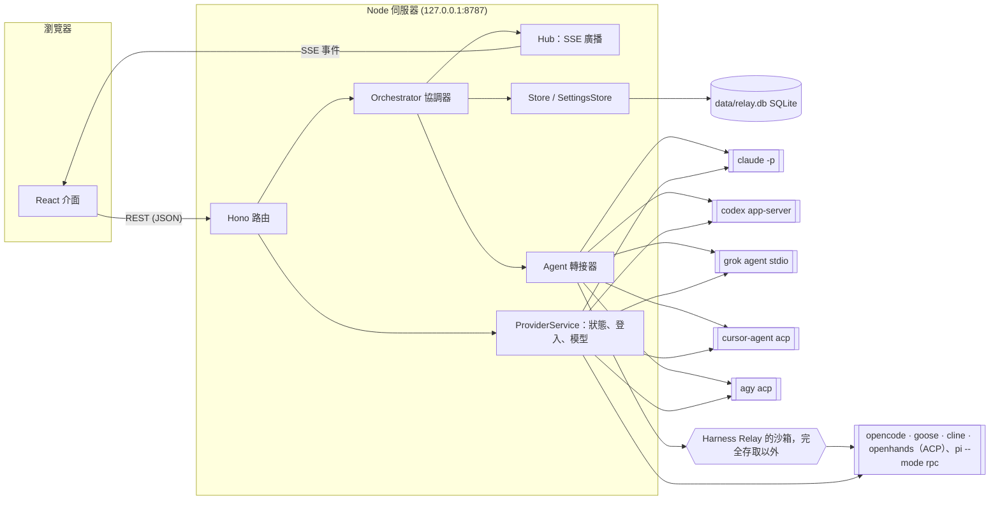
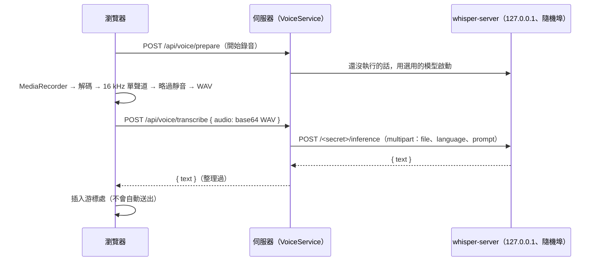

[English](architecture.md) | **繁體中文**

# 架構

Harness Relay 是一個在本機執行的網頁應用程式，分成兩半：

- **Node.js 伺服器**（Hono、TypeScript）：管理對話、決定下一個發言的 agent、啟動各個 agent CLI，並把所有資料存進 SQLite；
- **React 前端**（Vite）：顯示聊天畫面，並透過 Server-Sent Events（SSE）接收即時更新。

伺服器從不直接呼叫模型 API。每一次 agent 發言都是一次真正的 CLI（`claude`、`codex`、`grok`、`cursor-agent`、`agy`，或五個開源 agent 之一：`opencode`、`goose`、`cline`、`openhands`、`pi`）無頭模式執行，所以每個 agent 都保有自己的工具、權限與 session 歷史，Claude Code、Codex、Grok、Cursor 與 Antigravity 也保有自己的登入狀態。開源 agent 使用使用者設定的模型來源、在 Harness Relay 自己的家目錄中執行，完全存取以外則在 Harness Relay 自己的沙箱中執行（[開源 agent](open-agents.zh-TW.md)）。



## 元件

| 模組 | 職責 |
| --- | --- |
| `src/server/app.ts` | HTTP 路由、安全性中介層、SSE 端點（`createApp`，可用 `app.request()` 測試） |
| `src/server/index.ts` | 組裝各元件、靜態檔案、啟動與關閉 |
| `src/server/web.ts` | 提供建置好的介面：`assets/` 下的檔案（以內容雜湊命名）永久快取，`index.html` 每次載入都檢查；介面放在 `dist/web` 或 `RELAY_WEB_DIR` |
| `src/server/parent.ts` | 啟動伺服器的桌面 app（如果有）：告訴它伺服器已開始接收連線（或無法接收），並接收它的關閉要求 |
| `desktop/` | 桌面 app（Electron，獨立的套件）：用登入 shell 的環境在 utility process 裡執行伺服器，在自己的視窗裡顯示對話，系統匣選單、登入時自動啟動、分享到 tailnet、更新；見[桌面 app](#桌面-app) |
| `src/server/orchestrator.ts` | 執行一次「團隊回合」：依模式決定發言者、組出每個 agent 的 prompt、執行 CLI、串流結果；自動組隊的對話中，每個新問題都先讓首席 agent 設計團隊 |
| `src/server/planner.ts` | 自動組隊：首席 agent 的 prompt（問題、到目前為止的對話、目前的團隊、範本）、解析它的 JSON 回覆、轉成可執行的團隊、備援方案 |
| `src/server/grouping.ts` | 側邊欄群組：首席 agent 在背景依新對話的第一則訊息，把它分到使用者的某個群組（`AutoGrouper`） |
| `src/server/prompt.ts` | 角色簡報（system prompt）、每回合的 prompt、`@` 解析、`[PASS]` 判斷 |
| `src/server/approvals.ts` | 「本對話都允許」的規則 key 與比對 |
| `src/server/commands.ts` | 解析一行 shell 指令實際會執行哪些程式（串接、命令替換、`sh -c`／`eval`、`env`／`sudo`、保留字與 `if`／`while`／`for` 等複合指令、git 的全域選項）：用於核准規則 key，以及 Grok 與開源 agent 的推送／發佈判斷 |
| `src/server/agents/*` | 每個 CLI 一個轉接器：組參數、把 CLI 的 JSON 事件串流轉成共通事件（`acp.ts`：ACP 與 Codex 用的 JSON-RPC 對端，以及 ACP 組 prompt、MCP 伺服器與回覆權限請求的函式；`acpTurn.ts`：開源 agent 共用的 ACP 回合；`open.ts`：開源 agent 在程序周圍共用的部分；見[開源 agent](open-agents.zh-TW.md)） |
| `src/server/backends.ts` | 開源 agent 的模型來源：OpenAI、Anthropic、xAI 的 API key，以及使用者的 OpenAI 相容端點（金鑰存在作業系統的金鑰儲存區），還有一次執行拿到什麼（`backendRun()`）；Claude Code、Codex 或 Grok 的一次執行是否在某個端點上，以及在已刪除的端點上時拒絕執行（`endpointRunModel()`，已刪除的 id 在 `deleted_endpoints`） |
| `src/server/relaySandbox.ts`、`relaySandboxHost.ts` | 完全存取以外，包住開源 agent 的 Harness Relay 自己的沙箱（`@anthropic-ai/sandbox-runtime`，每次執行一個 host 程序；見[各平台的作業系統沙箱](sandboxing.zh-TW.md#harness-relay-自己的沙箱)）；`sandboxProcs.ts` 在 macOS 上依沙箱找出某次執行殘留的行程 |
| `src/server/i18n.ts` | 兩種語言的伺服器訊息；每個請求與執行所用的語言（AsyncLocalStorage） |
| `src/server/process.ts` | 以獨立 process group 啟動程序、逐行讀 stdout、以原始位元組保存輸出、處理中止與逾時（先 SIGTERM，再對整個 process group 送 SIGKILL） |
| `src/server/winLaunch.ts` | 在 Windows 上，找到的 CLI 是 `.cmd` 時要啟動什麼：npm 包裝檔指名的程式或 Node 腳本，或 Cursor 的最新版本（見 [CLI 轉接器](#cli-轉接器)） |
| `src/server/providers.ts` | CLI 狀態（是否安裝、版本、是否登入）、登入流程、登出、模型清單快取 |
| `src/server/models.ts` | 從各 CLI 取得可用模型與推理強度 |
| `src/server/workspace.ts` | git 相關操作：自動 `git init`、工作目錄快照、每個 agent 的 worktree、diff、套用結果 |
| `src/server/store.ts` | 用 SQLite 保存對話、訊息、agent session 與範本 |
| `src/server/settings.ts` | 各 CLI 設定（執行檔路徑）、每個帳號的 API key、預設模型與推理強度和它的執行不載入的項目、預設工作目錄、首席 agent、子程序環境變數 |
| `src/server/attachments.ts` | 使用者訊息附加的檔案：存到 `data/attachments`、安全的檔名、哪些以圖片交給 agent |
| `src/server/media.ts` | 回覆中嵌入的圖片與影片，以及回覆中連結的檔案：可以從哪些目錄取得、安全地解析路徑（實際路徑必須在其中之一、不可在 `.git` 裡；媒體只限媒體類型）、位元組範圍 |
| `src/server/voice.ts` | 語音輸入：在背景安裝 whisper.cpp 引擎與模型（固定版本、檢查 SHA-256）、需要時執行 `whisper-server`、把錄音轉成文字 |
| `src/server/secrets.ts` | 存放 API key 的作業系統金鑰儲存區（`@napi-rs/keyring`）；系統沒有可用的儲存區時則為無 |
| `src/server/db.ts` | 開啟 SQLite、套用 schema 遷移、交易輔助函式 |
| `src/server/hub.ts` | 把每個對話的事件廣播給連線中的 SSE 用戶端 |
| `src/server/share.ts` | 分享對話：介面做好的頁面透過使用者自己的 `gh` 上傳成 GitHub 上的 secret gist（`gh gist create`，在 gistpreview.github.io 閱讀），回覆連結的檔案不限種類，放進另一個 secret gist（用 `gh api` 建立，再用 git 把檔案推上去，由 `gh` 幫 git 登入），移除時兩個都用 `gh gist delete` 刪掉 |
| `src/shared/share.ts` | 分享頁面上指向附檔的連結：介面寫入的佔位連結（`relay-share-file:<n>`，只認真正 `<a>` 標籤的 href），由伺服器換成檔案在 GitHub 上的網址；依分享上限的算法顯示大小 |
| `src/shared/search.ts` | 搜尋對話：拆出搜尋的詞、找出符合的位置（不分大小寫）、第一個符合處附近的摘錄、標示關鍵字 |
| `src/shared/mentions.ts` | 伺服器（判斷點名了誰）與介面（標示 @）共用的 `@` 規則：以 Markdown（GFM）解析訊息，只看一般文字，不含程式碼與連結文字 |
| `src/shared/links.ts` | 沒有用 `<…>` 或 `[文字](…)` 包起來的網址在哪裡結束：GFM 只在空白處結束網址，所以直接接在後面的中文會被當成連結的一部分。`endBareUrls()` 也讓網址在中日韓或全形標點結束，以及在前面既不是另一個中日韓字、也不是 `/ ? # & = . - _ + (` 的中日韓字結束（所以 `/wiki/臺灣` 與 `?q=中文` 仍是連結），再像 GFM 一樣去掉結尾的標點；後面的文字中若還有網址，也會變成連結。介面的 Markdown 顯示與 `@` 規則都使用它，讓兩者對訊息的解讀一致 |
| `src/shared/types.ts` | 伺服器與前端共用的型別 |
| `src/shared/media.ts` | 哪些圖片與影片類型可以顯示，以及回覆中哪些圖片與連結網址是本機檔案（相對或絕對路徑、`file:` 網址、`檔案:行號`）而不是其他網站 |
| `src/web/*` | React 介面：側邊欄、團隊設計、聊天畫面、設定頁、使用導覽；`i18n.tsx` 與 `locales/` 存放介面文字；`chat.ts` 存放聊天畫面的純邏輯（重新連線、能否套用、團隊設定草稿、把訊息的工具呼叫和思考歸成動作列）；`sidebar.ts` 存放側邊欄的純邏輯（各群組的對話、還沒確認的移動、收合群組的狀態）；`recorder.ts` 負責麥克風錄音，`voice.ts` 存放語音輸入的純邏輯（WAV 編碼、靜音判斷、插入辨識結果） |

## 對話模型

一個**對話**包含團隊（`agents`）、設定（`mode`、`rounds`、`maxHops`、`permission`、`cwd`，有一個以上的工作目錄時另有 `extraCwds`（見[多個工作目錄](#多個工作目錄)）；[自動組隊](#自動組隊)時另有 `autoTeam`，直接採用首席 agent 的團隊、不必確認時再加上 `autoConfirm`）以及有順序的**訊息**。訊息的作者可能是使用者、agent 或系統，由多個 **part** 組成：依發生順序排列的文字區塊與工具呼叫（`Read`、`Edit`、`Shell`……）；失敗或被拒絕的工具呼叫會保留原因。系統訊息可能帶有一份 **plan**，也就是首席 agent 的團隊設計。

對話也會為每個 agent 保存 **agent 狀態**：

- `sessionId`：CLI 自己的 session / thread id，用來在下一回合接續 agent 的上下文；
- `seen`：已經交給這個 agent 看過的訊息 id。

### 分支對話

**分支對話**（agent 回覆下方的分支圖示，`POST /api/conversations/:id/messages/:messageId/branch`，`Orchestrator.branch()`）會建立一個新對話，從那則回覆之後各自往下走：

- 新對話裡有到這則回覆為止每則訊息的副本，每則都換上新的 id（訊息 id 是獨立的資料列），和對話一起在同一個 transaction 中寫入（`Store.create()`）。團隊、設定、「本對話都允許」的回答（`allowRules`）會照**現在**的樣子複製，而不是那則回覆當時的樣子：之後離開團隊的成員在分支裡無法重試，之後給的「本對話都允許」也會帶過去。它會放進它這串分支所在的側邊欄群組（`Store.placeBranch()`，`group_source = 'user'`，首席 agent 不會再分類；見[側邊欄群組與搜尋](#側邊欄群組與搜尋)）。標題是「**分支 · <標題>**」（`t().branchTitle`），直到在分支裡送出的第一則使用者訊息替它命名，就像新對話以第一個問題命名（`nameAfter()`：只在標題仍是這個名稱時，任一種語言皆可，`isBranchTitle()`；使用者自己取的名稱不會被改掉）。編輯到一則複製的訊息都不剩時，對話就不再是分支；如果還叫這個名稱，會改回「新對話」（`truncateFrom()`），由編輯後的訊息命名。排程與等待佇列不會複製。
- 那則回覆向使用者提的問題，在分支裡仍然等你回答（`branchPause()`），不管原本的對話之後怎麼回答，所以可以換個方式回答。在原本的對話正在等待的地方分支時，直接複製它的 `pause`；否則由提問的 agent（平行模式下，連同同一輪到它為止也提問的成員）先回答，圓桌模式接著是同一輪排在它後面的成員，之後的輪次則是這個問題指定的成員。和原本的對話一樣，你的回答不算新問題：首席 agent 不會為它設計團隊。
- 附加檔案會複製到它自己的 `data/attachments/<conversation>/`（檔案系統支援時用 copy-on-write 複製；已經不在的檔案略過），複製過來的回覆所改動檔案背後的 commit 也會保存在它自己的 `refs/harness-relay/<conversation>/` 下，因此原本的對話刪除後，這些檔案與 diff 仍然在。隔離（平行模式）的結果不能在分支裡套用；這些回覆連結的圖片與檔案，會從做出它們的 worktree 讀取（`replyWorktree()`：持有那一回合 branch 的 worktree，在寫出那則回覆的對話裡：複製過來的訊息來自的任何一個對話，分支的分支則再往上找），絕不會從分支自己給那位成員的 worktree 讀取；原本的對話刪除後（連同它的 worktree），就找不到了。
- 它是寫出那則回覆的對話的分支（`branchOrigin()`）。回覆是在原本的對話寫的，就是原本對話的分支；但分支在分支點以前的訊息是複製過來的，所以從那裡的回覆（包括分支點那則）分支，會做出「那則回覆被複製來的對話」的分支，分支的分支則可能是更上層的對話的分支，就像當初是在那裡分支的一樣：側邊欄會列在那個對話底下，顯示「**延續自**」那個對話，名稱是「**分支 · <它的標題>**」，用它現在的標題（`Store.titleOf()`；已刪除的對話，用側邊欄顯示的標題）。附加檔案複製完後，會在儲存分支的同一步重新算一次它的來源（除非原本的對話到那則回覆為止的訊息在這期間變了）：刪除只會等從被刪除的對話本身做出的分支，所以來源對話若在這期間被刪除，分支仍會知道它已刪除，並帶上它的 `via`。所以 B 從 A 分支出來之後，從 B 複製自 A 的回覆再分支，做出的是 A 的分支，不是 B 的。
- `conversation.branch`（`ConversationBranch`：它分支自的對話的 id、當時的標題，以及 `afterId`，也就是這裡最後一則複製的訊息；`earlier`：更前面那些複製的訊息若是從更上層複製來的，各自是一段，記下寫出它們的對話、標題與這段在這裡的最後一則，近的在前）以 JSON 存在 `conversations.branch`。從 `earlier` 某一段裡的回覆分支，做出的是那一段所記的對話的分支；只有那則回覆之前的段落會一起帶過去。最後一則訊息不在對話裡的段落無法定位，會被略過。ChatView 會在標題後方（兩者各取所需的寬度；都太長時各占一半，其中一個用不到一半時，剩下的讓給另一個，兩者都以 … 縮短）以及 `afterId` 之後的一條線上顯示「**延續自 <標題>**」：對話清單裡還有原本的對話時，是連到它的連結（用它現在的標題），刪除後則顯示當時的標題。這條線是訊息之間的元素，分享頁面會略過它（`messageElements()`，因為分享頁面以一則訊息一個元素對應）；分享頁面兩處都不顯示。重試或編輯複製過來的訊息時，`afterId` 會移回剩下的最後一則複製訊息（`branchAfterCut()`），訊息全被拿掉的段落也會移除：它分支自的對話的訊息一則都不剩時，它就成為更上層那個對話的分支，用那個對話現在的標題（名稱若仍是「**分支 · <標題>**」，會改成那個對話的）。複製的訊息一則都不剩時，`branch` 會被移除。
- agent 一開始沒有 session，`seen` 也是空的，所以第一次發言時會收到複製過來的紀錄（包括自己的回覆），和開新 session 時一樣。它們的 briefing 會說明這是分支出來的對話，原本的對話之後可能改過檔案；工作目錄是共用的，裡面的東西不會倒回去。
- 原本的對話不受影響，分支時也可以繼續回覆；只有到這則回覆為止的回合必須已經結束（還有回覆在串流時回 409，平行模式中同時發言的成員可能如此；或它的回合還在記錄改動的檔案：`Run.turns`）。刪除原本的對話與關閉伺服器（`settled()`）會等正在建立、還在複製檔案的分支完成。只能從 agent 的回覆分支（其他訊息回 400）。

## agent 之間如何共享上下文

每個 agent 都有自己長期存在的 CLI session，所以伺服器**不會**每回合重送整段對話，而是：

1. agent 發言前，協調器收集所有已完成、但不在該 agent `seen` 集合裡的訊息（使用者訊息、其他 agent 的回覆，以及在全新 session 時連同該 agent 自己先前的回覆）。
2. 把這些訊息轉成帶標籤的區塊作為 prompt：

   ```text
   New chat messages since your last turn:
   <chat>
   <message from="user">…</message>
   <message from="@Builder" via="Codex">
   Implemented step 2.
   <actions>
   Edit update src/api.ts
   Shell npm test
   </actions>
   </message>
   </chat>

   Roundtable round 2/3: it's your turn, @Reviewer. Reply with [PASS] if you have nothing new to add.
   ```

   `<actions>` 區塊摘要發言者改了哪些檔案、跑了哪些指令，讓隊友不用看原始工具輸出也知道變更了什麼。

   附加了檔案的使用者訊息還會多一個 `<attachments>` 區塊，列出每個檔案的名稱、類型、大小與絕對路徑，讓 agent 用自己的工具開啟。交付的訊息中的圖片（PNG、JPEG、GIF、WebP）也會以原生方式傳入：Claude Code 是 stream-json 使用者訊息中的 base64 圖片區塊（並以 `--add-dir` 加入附件資料夾，讓它的 Read 工具可以開啟檔案）、Codex 是 `turn/start` 的 `localImage` 輸入、Grok、Cursor 與 Antigravity 則是 ACP 的圖片區塊（三者都宣告了 `promptCapabilities.image`）。超過約 3.75 MB 的圖片只會列出路徑，以免超過 API 每張 5 MB 的上限。
3. 用保存的 session id 接續 CLI，所以它記得之前看過的所有內容。
4. 回合成功後，把這次交付的訊息 id（以及 agent 自己的回覆）加進 `seen`。若回合失敗，交付會被撤回，下一回合重新提供這些訊息。

如果接續 session 失敗且 agent 還沒有任何輸出（例如 session 被刪除，或是工作目錄改了，而 Claude Code 是依目錄保存 session），協調器會用**全新** session 加上完整對話紀錄重試一次。若全新 session 也在任何輸出前就失敗，代表問題不在 session（例如用量上限、登入、網路），所以會保留原本的 session，下一輪繼續使用。

訊息確定之後才會轉交給隊友：已完成的回覆，以及失敗或被停止、但有說話或改過檔案的回覆（標記為 `status="failed"`／`status="stopped"`）。回覆 `[PASS]` 的訊息會以 `[PASS]` 加上它的 `<changed_files>` 轉交。

### 角色簡報

每個 agent 的角色透過 CLI 的 system prompt 機制注入（Cursor 沒有這種機制，所以它的簡報放在 prompt 裡；Antigravity 的則附加到它的 system prompt，同樣只在改變時才送），並且**每回合重新產生**，所以修改角色或團隊會在下一回合生效：

| CLI | 機制 |
| --- | --- |
| Claude Code | `--append-system-prompt <簡報>`，搭配 `--system-prompt-snapshot off`（否則接續的 session 會一直沿用第一次請求的 system prompt） |
| Codex | `thread/start`／`thread/resume` 的 `developerInstructions` |
| Grok | ACP `session/new`／`session/resume` 的 `_meta.rules` |
| Cursor | 透過 ACP 時沒有：簡報放在 prompt 的最前面，包在 `<harness-relay-briefing>…</harness-relay-briefing>` 裡；新的 session 一定會送，接續的 session 只在簡報和上次送出的不同時才送（每個 session 記在記憶體中，所以伺服器重新啟動後會再送一次） |
| Antigravity | ACP `session/new`／`session/resume` 的 `_meta.antigravity.systemPrompt.append`（agy 有宣告它），包在 `<harness-relay-briefing>…</harness-relay-briefing>` 裡，並說明它取代先前的任何簡報。agy 會把每次送來的簡報都加進 session 的 system prompt，所以和 Cursor 一樣，接續的 session 只在簡報和上次送出的不同時才會再收到（每個 session 一個雜湊值，記在記憶體中）。沒有宣告這項能力的 agy，改把簡報放在 prompt 的最前面。Antigravity 的簡報還會說明：被拒絕的工具呼叫會結束它這一輪，而且要用 Harness Relay 的方式詢問使用者，不要用它的 `ask_question` 工具 |

簡報內容包括 agent 的角色、團隊名單（含每位隊友的角色摘要）、目前模式的規則、`[PASS]` 約定、共用的工作目錄與權限等級。平行模式中還會寫出 agent 自己的 worktree 與分支，以及每位隊友的分支和該隊友 worktree 的起始快照。有[工具庫](#工具庫)項目時，簡報也會包含成員的記憶和它的 skill 清單。

## 發言排程（模式）

使用者送出訊息（或按下「**繼續**」，等於送出空訊息）時，協調器開始一次執行：

- **使用者訊息中的 `@`** 會限制參與者：只有被 @ 的 agent 發言（接力模式下則由他們開始接力）。
- **圓桌**：每一輪（`1…rounds`）參與者依團隊順序逐一發言，每個人都看得到前面的人說了什麼。若某一輪所有人都 pass（或失敗），提前結束。
- **平行**：每一輪所有參與者同時執行。還在串流中的訊息不會被交付，所以要到下一輪才看得到彼此的答案。
- **接力**：佇列從被 @ 的 agent 開始，沒有 @ 時從團隊第一位（「隊長」）開始。每次回覆後，回覆的一般文字中（不含程式碼與連結文字，見 `src/shared/mentions.ts`）被 @ 到的隊友會加進佇列。佇列清空或達到 `maxHops` 次時結束（系統訊息會告知使用者，可按「繼續」）。

回覆內容恰好是 `[PASS]`（或沒有工具呼叫的空回覆）會被標記為 *pass*，並以淡色顯示。

同一個對話一次只能有一個執行；不同對話可以同時執行。「**停止**」會中止執行並結束正在跑的 CLI 程序（對 process group 送 `SIGTERM`，3 秒後 `SIGKILL`）。每個 agent 回合另有安全逾時：45 分鐘，或 `RELAY_TURN_TIMEOUT_MIN` 設定的分鐘數。

**團隊回覆時送出的訊息**（`Orchestrator.send()`）不會開始第二個執行。執行進行中或正在準備、或首席 agent 的團隊設計還在等確認時，訊息會放進對話的佇列（`conversation.queue`，存在 `conversations.queue`，最多 20 則），瀏覽器把它顯示在輸入框上方（`queue` 事件）。`deliverQueued()` 會在下一個「該收到它的 agent」發言前，依送出順序貼出等待中的訊息：圓桌在每位發言者之前、接力在每一棒之前、平行在每一輪開始時（讓同一輪的人看到相同的訊息）。只 @ 了其他 agent 的訊息會等到其中一位發言，排在它後面的訊息也一起等，所以對話維持送出的順序。送達的訊息就是一般的使用者訊息，另外標上 `queued`（介面顯示「插話」）；每個 agent 跟其他訊息一樣，從「還沒看過的訊息」收到它，所以當時正在發言的 agent 會在下一次發言時看到。執行結束時若還有訊息在等、而且不是被停止的，`startQueued()` 會為它們再開一次執行，參與者依它們的 @ 決定（每則都有 @：就是那些 agent；否則全員）。按「停止」後它們會繼續等使用者處理（`DELETE /api/conversations/:id/queue/:messageId` 撤回一則）；下一次送出或「繼續」會把它們排在新訊息前面送出。以 `interrupt: true` 送出時，會停止執行、等它結束，再把等待中的訊息與這則新訊息當成新的執行送出。訊息會先存成訊息、才從存好的佇列移除，所以當機後兩邊都有的訊息算已送達。

**向使用者提問。** briefing 會告訴 agent：好答案取決於只有使用者知道的事時，要先問、不要猜，並在這種回覆的最後單獨一行寫 `[ASK_USER]`（`src/shared/ask.ts`；介面在回覆串流時會隱藏這個標記）。回合結束時，`takeAsk()` 會把標記從訊息中移除、標上 `asked`，執行就在這裡停下：`pauseFor()` 記下停在哪裡（`conversation.pause`，一個 `RunPause`，存在 `conversations.pause`，並隨 `conversation` 事件送給瀏覽器）。圓桌會立刻停下並記住這一輪剩下的人；平行會讓這一輪跑完，再記住提問的 agent；接力則記住剩下的佇列與剩餘棒數。團隊等待期間，佇列中的訊息不會開始新的執行。下一次執行（`takePause()`）從那裡接續：提問的 agent 先發言，並在那個回合被告知使用者已經回覆（`TurnInfo.answered`），接著是這一輪剩下的人（或接力佇列）與剩下的輪次。沒有任何訊息的「繼續」會略過提問的 agent。回覆中 @ 了其他人、編輯或重試（`truncateFrom()` 會清除暫停）、重新設計團隊或模式改變時，則重新開始。使用者的回覆是回答、不是新問題，所以[自動組隊](#自動組隊)不會為它設計團隊。對話清單會回報 `asking` 給側邊欄。

**重試 agent 的回覆**（`Orchestrator.retry()`）也是同樣的做法：刪除該則回覆與之後的所有內容，再由該 agent 重新回答；不是接力模式時，同一輪中回覆被一起刪除的 agent 也會接著回答，只跑一輪。

**編輯使用者訊息**（`Orchestrator.resend()`）會刪除該則訊息與之後的所有訊息、重設每個 agent 的 session（CLI 的 session 無法倒轉，所以每個 agent 都以剩下的對話紀錄重新開始）、把平行模式的 worktree 標記為需要重設，再把修改後的文字當成新的一次執行送出。截斷要等工作區準備好並取得目錄鎖之後才會進行，所以啟動失敗時對話紀錄不受影響。被刪除的回合改過的檔案不會還原。

## 自動組隊

介面建立的每個對話都有 `settings.autoTeam`：團隊回答新問題之前，**首席 agent** 會先為這個問題設計團隊（協調器中的 `designTeam()`，以及 `src/server/planner.ts`）。使用者以**範本**設計團隊（在「新對話」頁面：可以複製內建範本，也可以新增、修改與刪除自己的範本；`POST /api/presets`），首席 agent 則針對每個問題挑選、調整或取代它們。新對話在第一個問題之前沒有成員。

**哪些執行會設計團隊。** 執行開始時由 `Orchestrator.designs()` 決定：對話還沒有團隊時，首席 agent 會設計；使用者自己的問題（沒有執行時送出的訊息，或編輯過的訊息）也會，除非它是在回答 agent 的問題（`conversation.pause`），或 @ 了目前團隊的成員（那就由他們回答）；團隊上次發言之後若有設計被停止，按「繼續」時也會設計（`designOwed()`）。重試、排程訊息、為佇列中等待的訊息開始的執行，以及確認之後接著的執行，都沿用目前的團隊（`StartOptions.keepTeam`）。沒有 `autoTeam` 的對話（透過 API 帶著團隊建立的）永遠不會設計團隊。

**設計團隊的執行**只會設計團隊：

1. 對話中出現一則 `plan.status = "planning"` 的系統訊息。
2. 首席 agent（在設定頁指定：provider，以及選填的模型與推理強度）以唯讀權限在對話的工作目錄中執行一次，system prompt 為 `PLANNER_BRIEFING`。prompt（`buildPlannerPrompt()`）內容包括**問題**——團隊上次發言或上次設計團隊之後使用者說的所有內容（`questionStart()`），所以被停止的那次設計的問題仍然算數——在它之前**到目前為止的對話**（`historyForLead()`：使用者的訊息與 agent 的回覆，由舊到新，不含工具呼叫、系統訊息、plan、pass 與失敗的回覆；每則最多 1,500 個字元，全部最多 12,000 個字元，保留最新的部分）、**目前的團隊**（模式、輪數或交棒次數，以及每位成員的 CLI、模型、推理強度與完整角色）、已登入的 CLI（`agentsForLead()`），每個都附上它提供的每個模型（名稱、支援的推理強度與預設推理強度）與 Harness Relay 執行它時用的預設值（兩者都以新成員會用的帳號為準：`catalogFor(ctx.catalog, p, ctx.accounts[p][0])`）、它在對話工作目錄裡自己載入的內容（`ctx.native`：內建工具、skill、MCP 伺服器與它們的工具、subagent 與 plugin，不含執行時不載入的項目；透過 `NativeSetupService.recent()` 詢問，不呼叫模型，在它新成員會用的帳號（`ctx.accounts[p][0]`）的家目錄裡問；只要執行時不載入的項目沒變，就直接用那個 CLI、資料夾與家目錄上次的答案，不論多舊，超過一分鐘就在背景重新詢問；還沒有答案時，設計最多等 `NATIVE_WAIT_MS`（20 秒），到時什麼都沒回答的 CLI 標為未知並註明原因；拒絕某個問題、某部分沒回答，或回答了一些之後逾時的 CLI，保留已回答的清單並註明可能不完整（`probeCompleteness()`；被拒絕的問題會標為 `refused`，所以清單都回答為空、自己什麼都沒有的 CLI，不會被當成無法詢問）），以及它的新成員會拿到的工具庫項目；接著是工具庫本身（`ctx.library`：每個 MCP 伺服器、可用的 skill 與記憶，以及預設給哪些 CLI 的成員），並說明怎麼依這些分配成員；三種模式、使用者選的權限與工作目錄（首席 agent 無法更改）、使用者會先檢視團隊還是團隊立刻回答、排程訊息 @ 了但目前沒有成員叫這個名字的名字（`src/shared/mentions.ts` 的 `unknownMentions()`；如果它們是訊息要找的人或角色，首席 agent 要用這些名字為成員命名，必要時調整範本為成員改名，因為只有被 @ 的成員會回答——一般問題不加這段，因為裡面的 @ 常常是程式碼），以及所有範本（內建與使用者儲存的）的完整內容（JSON）。它必須回覆一個 JSON 物件：保留目前的團隊是 `{"choice": "keep", "reason"}`（只有已經有團隊時才提供；同一件工作的後續問題優先選它，因為成員會保有他們已經知道的事）；直接套用範本是 `{"choice": "template", "templateId", "reason"}`；依範本調整是 `{"choice": "adapted", "baseTemplateId", …團隊, "reason"}`；從頭設計是 `{"choice": "custom", …團隊, "reason"}`，其中團隊為 `"name", "description", "mode", "rounds", "maxHops", "agents": [{name, provider, role, model?, effort?}]`。首席 agent 只看工具，不會改：目前的團隊和範本以 `fromToolLibrary` 列出每位成員實際拿到的工具庫項目（CLI 的預設套用成員的例外之後，`memberLibraryTools()`，規則同 `ToolLibrary.forAgent`）；新成員用它 CLI 的預設，留下的成員保留原本的例外設定。這些資料由 `planner.ts` 的 `plannerContext()` 收集（伺服器的 `PlannerSource.context(cwd)`）。reason 是給使用者看的說明。
3. `parsePlanReply()` 從程式碼區塊（或最外層的大括號）取出 JSON；`decidePlan()` 把它轉成團隊。保留的團隊就是目前的團隊原樣（id 也一樣）。自訂成員會經過與手動設計團隊相同的驗證（`validateAgents`）：名稱中的空白會被替換，最多 5 位成員（`RELAY_MAX_TEAM_AGENTS` 更小時以它為準），輪數 1–5，交棒次數 1–30。成員比隊伍上限多的範本（上限調低之前存的）不會提供給首席 agent，它點名時也不採用；備用的範本會截到上限。上限調低之前存的隊伍，仍可交給首席 agent 修改，它的回答會截到上限。`fitAgents()` 會把 CLI 尚未登入的成員改到首席 agent 的 CLI，移除該 CLI 不提供的模型或推理強度，並把帳號不可用的成員改到該 CLI 一個可用的帳號（見[帳號](#帳號)）。直接套用範本時若首席 agent 沒給原因，會補上預設說明。調整過的團隊會在 `plan.basedOn` 記下原本的範本（id 與名稱），其中是範本成員的成員（名稱不分大小寫相同、CLI 也相同）保留那位範本成員的工具與帳號（`fromTemplate()`）；若原本範本的 id 不存在，就當成自訂團隊。調整或自訂的團隊若與某個範本完全相同（`sameTeam()`：成員、CLI、角色、模型、推理強度、模式與輪數或交棒次數都一樣），就記為直接套用該範本。
4. 若首席 agent 執行失敗或回覆無法使用，`fallbackPlan()` 會保留目前的團隊，沒有團隊時改用「一般問題智囊團」範本，卡片上會說明原因（`source: "fallback"`，只有改用範本時才帶 `presetId`）。若使用者停止執行，這則訊息會標為已中斷；下一個問題或「繼續」會重新設計。
5. 留下來的成員（名稱與目前某位成員相同、不分大小寫，CLI 也相同；`keepMemberIds()`）保留原本的 id，連帶保留他們的 CLI session、worktree，以及使用者設定的帳號與工具（不論新團隊裡的那位成員怎麼寫）；其他成員從頭開始，跟任何新成員一樣，從「還沒看過的訊息」讀到這段對話。plan 卡片變成 `ready`（附上首席 agent 的費用與 token 數），團隊記在卡片上（`plan.agents`、`plan.settings`）。這次執行到此結束。
6. **確認。** 預設情況下 plan 會等待確認（`awaitingConfirmation`），對話仍保留目前的團隊，所以這時重試或編輯較早的訊息（會連同後面等待中的 plan 一起刪除）仍由那個團隊處理。使用者回應之前，「繼續」會被拒絕（409），訊息則放進佇列等待（首席 agent 設計期間送出的也一樣）。使用者可以確認（`POST /api/conversations/:id/messages/:messageId/confirm-plan`：plan 的團隊與模式成為對話的團隊，設定 `plan.confirmedAt`）、不採用（`…/decline-plan`：保留目前的團隊，設定 `plan.declinedAt`；第一個問題沒有團隊可以保留，所以不行），或手動設定團隊（`PATCH … { agents }`，以送出的團隊作為決定：團隊設定抽屜會編輯等待中的設計，並說明儲存就會採用它）。有其他操作佔用這個對話時，兩個按鈕都會被拒絕（409）。無論哪種，團隊接著都會回答（`startConfirmed()`）：用現在的團隊開始一次執行，先貼出等待中的訊息，並在歷史中看到那個問題。設了 `settings.autoConfirm` 時，plan 的團隊會立刻採用（`confirmedAt`、`autoConfirmed`），團隊的執行在設計團隊的執行結束時開始（`Run.answerNext`）；若無法開始（另一個對話正在修改同一個資料夾），對話中會說明原因，按「繼續」就由團隊回答，不會重新設計。plan 訊息是系統訊息，所以永遠不會轉交給 agent。

設計團隊的執行不會寫入任何東西（首席 agent 是唯讀的，其他人也不發言），所以不會鎖住目錄；團隊自己的執行則照確認後的模式上鎖。`POST /api/conversations/:id/messages/:messageId/save-plan` 會把首席 agent 設計或調整的團隊（`planSavable()`）存成使用者範本（沿用對話的權限），並記錄 `plan.savedPresetId`；直接套用的範本或保留的目前團隊都不是新團隊，卡片不會提供儲存。編輯問題會連同它的 plan 一起刪除，並依修改後的問題重新設計，之前的內容作為歷史。手動設定團隊或修改設定都不會開啟或關閉自動組隊（`PATCH` 會保留原本的 `autoTeam`）；`autoConfirm` 可以在團隊設定中修改。schema 第 13 版（`conversations.auto_confirm`）為在它之前儲存的每個對話開啟了自動組隊。

**依使用者的要求修改團隊。** 團隊設定可以請首席 agent 修改它顯示的團隊（對話的團隊，或等待確認的設計，連同使用者已經做的修改）。`POST /api/conversations/:id/revise-team` 帶著 `{ request, agents, settings }`（`settings`：成員的輪流方式，以及團隊設定裡的權限與工作目錄，不論是否已儲存，首席 agent 只會讀到它們：`draftPlace()`），以 `REVISER_BRIEFING` 與 `buildRevisePrompt()` 在已儲存的工作目錄中以唯讀方式執行首席 agent：要求、團隊、目前為止的對話、這個團隊是否是等待確認的設計（針對最新的問題、排程的訊息，或之後已刪除的排程）、排程開啟時或等待中的設計針對排程時的排程訊息（排程關閉時會說明）、團隊設定指定了別的資料夾時首席 agent 自己是在哪個資料夾執行、可以用的 CLI 與範本。它以 JSON 回覆整個團隊，只為新成員或改寫的角色給出角色，再由 `decideRevision()` 讓它可以執行。首席 agent 用 `was` 指出的成員（改名或換到另一個 CLI）、名字（不分大小寫）與 CLI 都沒變的成員、名字沒變但換了 CLI 的成員，或在兩邊剛好各只剩一位、且列出的那位沒有角色或角色相同時的那一位（改了名卻沒說），仍是同一位成員。所有的 `was` 會先於名字比對，所以和被改名的成員同名的新成員不會佔走它的位置，互換名字或連續改名時每位成員也都保留下來。如果 `was` 指向的成員也以原名、不變地（沒有角色、自己也不是改名來的）列在回覆裡，這個 `was` 會被忽略：它被誤用在以那位成員為範本的新成員上，這位新成員會從那位成員的角色開始，也不會被當成要移除的成員改名而來。它保留 id（也就保留 session；換到另一個 CLI 時 session 會重新開始，和手動修改一樣）、工具，以及首席 agent 沒有給（或給 `null`、空白角色）的角色、模型與推理強度（模型與推理強度不會帶到另一個 CLI）；首席 agent 照抄但去掉前後空白的角色，維持使用者原本寫的樣子；CLI 沒變的成員即使那個 CLI 沒有登入也不換，因為那是使用者選的。新成員、換 CLI 的成員，以及改過的模型與推理強度，則和設計團隊時一樣調整成可用的。沒有成員的回覆（首席 agent 婉拒並說明原因）會保留原本的成員。回應是 `TeamRevision`（成員、輪流方式、首席 agent 的說明，以及這次執行的時間與花費）。對話本身不會有任何變更：團隊設定會顯示這個團隊、列出改了什麼（`src/web/chat.ts` 的 `teamChanges()`，空的模型與角色前後的空白不算改變）並提供復原，直到使用者照常用 `PATCH` 儲存（等待中的設計也因此確認）。如果這段期間團隊設定重新載入了團隊，或已經無法儲存，就不採用這個回應（`revisionOutcome()`）。新的要求會停止前一個（409），關閉請求（關掉團隊設定，或按停止）、刪除對話與關閉伺服器也一樣；被停止的修改在刪除對話與關閉伺服器時仍會等到首席 agent 的程序結束。首席 agent 的 session 會在 AgentsView 中連到這個對話。

## 排程

一個對話可以有一個**排程**（`conversation.schedule`，型別 `ConversationSchedule`，存在 `schedules` 資料表）：在設定的時間把一則訊息傳給團隊，就在同一個對話裡，或（`newChat`）每次在一個新對話裡，如同使用者自己送出。這是[觸發提案](proposals/triggers.zh-TW.md)的第一步，每個對話一個排程，並加上提案第三步的每次開新對話選項。

- **時間。** `repeat` 可以是一次（某個時刻）、每天 `HH:MM`、選定的星期幾 `HH:MM`，或從最後一次設定時間起每隔 1–168 小時（只改訊息或其他選項時，節奏不變）。一天中的時間是排程時區裡的牆上時間（儲存時瀏覽器的時區；沒有給就用伺服器的）。`nextRun()`（`src/shared/schedule.ts`）算出下一次：時鐘跳過的時間往後移一個跳躍量，重複出現的時間取第一次。瀏覽器用同一個函式在儲存前顯示接下來三次，並以排程自己的時區顯示時間（附有改用這台裝置時區的按鈕）。
- **儲存**（`PUT /api/conversations/:id/schedule`，由 `validateSchedule()` 檢查）會取代原本的排程、算出 `nextRunAt`（關閉時沒有）、記下介面語言作為它寫入說明的語言，並保留上一次的結果。啟用的排程需要團隊：首席 agent 還要設計第一個團隊、或使用者還沒確認團隊時都不行（409）。排程訊息交給目前的團隊：在[自動組隊](#自動組隊)的對話中，首席 agent 不會為它們設計團隊，因為那時可能沒有人在場確認。
- **新排程**（側邊欄的 **新排程**，`POST /api/schedules`）一次建立一個自動組隊的對話和它的排程——排程預設啟用，標題沒有給就用訊息的第一行——留下一則說明，依訊息把它分到使用者的群組，並趁使用者在場可以確認時，立刻請首席 agent 為排程的訊息組隊（`Orchestrator.designForSchedule()`；`POST …/schedule/design` 可以再請一次，例如組隊被停止之後）。這次組隊的問題就是那則訊息（`Run.designFor`），不會貼出任何訊息；給首席 agent 的 prompt 會說明團隊會依排程收到它（在這個對話，或每次開新對話），而且可能沒人看著。它的設計標有 `forSchedule`：確認之後——在卡片上確認、手動設定團隊，或因 `autoConfirm` 直接採用——團隊現在不回答任何事（`startConfirmed()` 只會開始使用者在等待期間寫的訊息），要等排程送出訊息才會收到。第一個團隊還在設計或等確認時到期的時間會回答 `busy`：最多再試 30 分鐘，之後略過（沒有確認的團隊）。團隊卡片與排程視窗會用排程的說法描述這次設計（`src/web/copy.ts` 的 `planWording()`）。排程訊息 @ 了不在團隊裡的名字不會傳給任何人（由訊息 @ 到的其他成員回答；一個都沒有時才由整個團隊回答）：排程表單在輸入時就提醒（還沒有團隊時則說明首席 agent 會依 @ 的名字為成員命名），團隊編輯器在訊息 @ 的成員被改名或移除時提醒，有排程的對話裡，任何團隊設計的卡片都會在確認前、或直接採用時提醒（`src/web/copy.ts` 的 `mentionWarning()` 與 `planChecksMentions()`，以 `unknownMentions()` 為基礎；後面接 `/` 或 `(` 的名字是程式碼，例如 `@types/node` 或 `@Component(…)`）。
- **送出。** `Scheduler`（`src/server/scheduler.ts`，伺服器開始監聽後啟動，關閉時最先停止）每 15 秒檢查一次——用 unref 的 interval，並和牆上時鐘比較，所以電腦睡眠醒來後就會送出——找出啟用且到期的排程（`Store.dueSchedules()`），最久過期的先，一次一個，並在 `withLang(schedule.lang)` 之中執行。接著 `Orchestrator.sendScheduled()`：
  - 團隊接不了時先不送（`skipped`，附原因）：沒有確認的團隊；agent 的問題正在等使用者回答，而且沒有正在準備、帶著回答的執行（訊息會被當成回答）；團隊回覆中，先前的排程訊息還在佇列裡（不會越積越多）；佇列已滿；
  - 團隊回覆中或執行正在準備時放進佇列（`queued`），和回覆途中送出的訊息一樣；
  - 否則用它開始一次執行（`sent`），已在等待的訊息先送。沒有執行時還留在佇列裡的先前排程訊息（團隊被停止，或伺服器重新啟動），這時改送它，不會再多一份。

  排程訊息永遠不會被當成使用者的回答。使用者回覆或按**繼續**時，佇列裡的排程訊息會繼續等待（`start()` 不把它放在最先送出的訊息裡，但排在它後面、使用者寫的訊息仍依寫下的順序先送）：團隊從停下的地方接著做，這則訊息會在它指定的 agent 下一次發言前送達，或之後自己開始一次執行（`startQueued()`）。`takePause()` 也只看使用者寫的訊息。

  這則訊息是一般的使用者訊息，帶有 `scheduled: true`（`messages.scheduled`），所以 @、模式與交付方式都照常。agent 看到的是 `<message from="user" via="schedule">`，而有排程或有排程訊息的對話，其簡報會告訴 agent 使用者可能不在：說明假設後把事情做完，只有沒有使用者就無法合理回答時才發問（`[ASK_USER]`）。
- **每次開新對話**（`newChat`）。這時 `sendScheduled()` 不碰排程所在的對話——它的執行、等使用者回答的問題、佇列——而是由 `sendInNewChat()`：
  - 和其他排程一樣，沒有確認的團隊時先不送；另一個對話（包括排程所在的對話）鎖住資料夾時回答 `busy`，在建立任何東西之前就先檢查；
  - 建立一個對話，複製團隊、設定與「本對話都允許」的答案（`allowRules`），放在排程所在對話顯示的側邊欄群組（也就是它這串分支的群組：`Store.familyGroupOf()`，當成使用者的選擇，所以首席 agent 不會為它分類），以排程所在對話的標題加上到期時間命名，並留一則系統說明是哪個排程開的；
  - 在那裡用這則訊息開始一次執行（`scheduled`、目前的團隊、依排程設定處理核准），agent 都開新的 session；執行無法開始時會再刪掉這個對話（`failed`，或資料夾在這期間被占用時為 `busy`），不會留下空的對話。

  排程所在的對話還叫「新對話」，或是還叫「分支 · <標題>」的分支時，改用訊息的第一行命名。排程器記下它開的對話（`lastChatId`；沒有開對話的那次、或那個對話被刪除時會清掉），排程視窗會連到它；**立即執行一次** 也會回傳它（`chatId`）。新對話自己沒有排程：因為裡面有排程訊息，它的簡報會說明 `via="schedule"`，並且只在這次執行會自動拒絕時，才說權限以外的動作會被拒絕（`buildBriefing(…, unattended)`）。排程所在的對話既然不會收到排程訊息，就不會被告知排程執行的事。
- **核准。** 只由排程訊息開始的執行（`Run.refuseApprovals`：排程器開始的，或為它們接著開始的執行 `startQueued()`）會自動拒絕核准請求，除非排程的 `approvals` 是 `ask`：對話中一律允許的動作（`allowRules`）照樣通過，其餘的會顯示為已拒絕的核准卡片並附上原因（告訴 agent 的原因是英文）。一旦使用者自己寫的訊息進到這次執行（在某個回合前送達，或執行就是由它開始），代表使用者在場，執行就照常詢問。本來就自動拒絕的對話照樣拒絕，完全存取則不會詢問。排程啟用時，團隊設定會說明排程執行的情況，並對完全存取提出警告。
- **之後。** 排程器記下 `lastRunAt`（到期的時間）、`lastResult` 與 `lastError`，以及現在之後的下一次；一次性的排程會自己關閉。回答 `busy`——設定變更或套用占用對話、另一個對話正在修改同一個資料夾，或伺服器正在關閉——時留著到期狀態：每次檢查都再試，從第一次嘗試起最多 30 分鐘（`BUSY_RETRY_MS`；這段期間不算錯過），之後附上原因略過。另一個對話對資料夾的鎖會在準備執行之前就先檢查，所以使用者這時送出的訊息不會留在沒有人執行的佇列裡。關閉開始後不記錄任何結果，所以那個時間會在伺服器回來後處理。讀不懂的已存排程會被刪除。沒有送出的時間（`missed`、`skipped`、`failed`）會在對話中留下一則系統說明。如果送出期間排程被換掉，新的排程保留自己的時間。
- **錯過的時間。** 過了超過 10 分鐘的時間（`MISSED_AFTER_MS`：Harness Relay 沒在執行，或電腦在睡眠）會略過並留下說明（`missed: 'skip'`，預設），或晚一點補送（`'run'`）——錯過幾次都只補一次。
- **立即執行一次**（`POST /api/conversations/:id/schedule/run`）用同樣的方式送出已儲存的訊息，不改變排程的時間與紀錄。
- `conversation` 事件帶有排程，所以開著的對話會更新標頭的徽章；對話列表帶有 `schedule`（是否啟用、下一次、上次結果），供側邊欄的時鐘使用，上次沒有送出時時鐘變成琥珀色。

## 側邊欄群組與搜尋

使用者在側邊欄建立群組（`conversation_groups`：id、名稱、順序），再把對話放進去（`conversations.group_id`）。不屬於任何群組的對話都在預設群組 **其他**：它一定存在、不會存進資料庫，任何群組都不能用它在兩種語言中的名稱（`validGroupName()`）。刪除群組時，外鍵的 `ON DELETE SET NULL` 會把裡面對話的 `group_id` 設成 NULL，讓它們回到「其他」。對話列表帶有每個對話的 `groupId`，前端會一起載入群組。

**一串分支。** 一個對話、從它[分支](#分支對話)出來的對話、再從那些分支出來的對話……是同一串（`src/shared/family.ts`，伺服器與前端共用）。這一串的頂端是它們都不是從它分支出來的那個對話；它被刪除後，則是被刪除的對話的 id（`branch.fromId`），讓從它分支出來的對話仍然待在一起；分支不可能造成的循環，會在發現的地方切斷。一串分支中間的對話被刪除時，它仍保有自己的位置：`Store.delete()` 會在每個「往上追溯到它為止」的對話的 branch 裡，記下它原本是從哪裡分支來的（`ConversationBranch.via`：`fromId` 之上已刪除的對話，近的在前，各帶當時的標題；最後一個可能仍然存在；`earlier` 裡由它寫出的段落也一樣），和刪除在同一個 transaction 中寫入，記憶體中的也一起更新。所以 A → B → C 刪掉 B 之後，C 仍在 A 這一串裡，列在 B 原本的位置底下。一串分支在同一個群組：其中最早建立的對話所在的群組。`Store.moveToGroup()` 在同一個 transaction 裡移動每一個成員，新的分支會放進它這串的群組（`placeBranch()`），`sortIntoGroup()` 也會把其他成員一起帶過去（保留它們的 `group_source`），處理原本的對話還在分類時就做出的分支。對話列表帶有每個對話的 `createdAt` 與 `branchFrom`（原本對話的 id 與當時的標題；以記憶體中的為準，因為重試或編輯可能讓對話不再是分支）。前端（`src/web/sidebar.ts` 的 `groupSections()`）依每串分支中最早建立的對話所在的群組放置它（包含伺服器還沒回報的移動，這些移動會套用到整串），依整串最近的動態排序，並排成樹狀：每個對話列在它分支出來的對話底下，先建立的在上面；已刪除的對話是自己的一列，顯示它的標題（`deletedTitles()`：`via` 記下的刪除時的標題，否則是它最新的分支建立時的標題），依它底下最早建立的對話排序。開啟被收合的分支擋住的對話時，會把擋住它的展開（`revealIn()`，每個對話一次，在它出現在列表時）；使用者展開或收合任何分支時，不在側邊欄的節點的收合狀態會被忘掉（`foldedNow()`）。分支最多縮排三層（`MAX_INDENT`）。收合的分支記在 `localStorage`（`relay:collapsedBranches`），和收合的群組（`relay:collapsedGroups`）一樣。

移動對話（`PUT /api/conversations/:id/group`，拖到群組上或用資料夾選單）會記下 `group_source = 'user'`。對話送出第一則使用者訊息時（`postUserMessage()`），如果使用者有群組，協調器的 `AutoGrouper` 會在團隊回覆的同時，在背景以唯讀方式執行一次**首席 agent**，系統 prompt 是 `GROUPER_BRIEFING`。prompt（`buildGroupPrompt()`）包含這則訊息（最多 4,000 字，加上附加檔案的名稱），以及編號的群組清單，每個群組附上最多五個最近的對話標題當作例子。首席 agent 回覆 `{"group": <編號>}`，0 代表都不適合；`parseGroupReply()` 也接受群組名稱。接著 `Store.sortIntoGroup()` 只在 `group_source` 仍是 NULL、而且群組還在時，才設定群組並記下 `group_source = 'auto'`：使用者自己的移動（即使是在首席 agent 決定時做的）一定優先，而且每個對話只會自動分類一次（選「都不適合」也算）。回覆失敗或無法使用時，對話留在「其他」、視為尚未分類；編輯第一則訊息會再試一次。分類期間對話列表會回報 `sorting`。刪除對話會停止分類並等它結束；關閉伺服器時會停止所有分類。

搜尋（`GET /api/search?q=`）把查詢依空白拆成詞（最多 8 個），找出每個詞都出現在標題、或使用者與 agent 訊息文字段落中的對話（不含系統訊息、思考過程與工具輸出）。先用 SQLite 的 `LIKE`（跳脫 `%` 與 `_`）篩出段落，再用 JavaScript 重新比對一次，非 ASCII 字母也不分大小寫。因為比對的是文字的任何一部分，中文不需要斷詞。搜尋前會先寫入還在排程中的訊息，所以仍在串流的回覆也找得到。每個結果帶有「包含最多關鍵字的段落」中第一個符合處附近的摘錄（`snippetAround()`）、符合的訊息數，分支還會帶有它分支來源的標題（現在的標題，已刪除則是當時的標題）；標題符合的排在前面，其餘依最近時間，最多 50 筆。前端在停止輸入 200 毫秒後才搜尋，只顯示最新一次搜尋的結果，並標示關鍵字（`highlightParts()`）。

## 語言

介面提供繁體中文與英文（`src/web/locales/zh-TW.ts`、`en.ts`；英文字典的型別以中文字典為準，另有測試檢查兩者結構相同）。

- **前端**：第一次開啟時依 `navigator.languages` 決定語言（任何 `zh*` → zh-TW，否則英文），並存在 `localStorage`（`relay:lang`）；可在設定頁更改。`<html lang>` 會跟著改變。
- **伺服器**：每個 API 請求都帶有 `X-Relay-Lang`（沒有時改看 `Accept-Language`，再沒有就用 zh-TW）。`/api/*` 中介層會在 `withLang()`（AsyncLocalStorage）中處理請求，所以底下任何地方的 `t()` 都會回傳正確語言的訊息：驗證錯誤、轉接器錯誤、系統訊息，以及這個請求啟動的整個團隊執行（回應送出後仍會繼續）。
- **內建範本**有兩種語言版本（`builtinPresets(lang)`）；首席 agent 看到的是介面語言的版本，自訂角色則用使用者提問的語言撰寫。
- 給 agent 的 prompt（簡報、回合 prompt、規劃用的 prompt）維持英文；agent 會用使用者的語言回答。

## CLI 轉接器

每個轉接器把一次 CLI 回合轉成共通事件串流：`session`、`text`、`text_end`、`thinking`、`plan`、`tool_start`、`tool_end`（附上呼叫的輸出或失敗原因；CLI 到結束才說明這次呼叫做了什麼時，例如網路搜尋的查詢，也一併附上）；CLI 要求做權限沒涵蓋的事時，則呼叫 `requestApproval`（見[核准](#核准)）。

| | Claude Code | Codex | Grok | Cursor | Antigravity |
| --- | --- | --- | --- | --- | --- |
| 指令 | `claude -p --input-format stream-json --output-format stream-json --verbose --include-partial-messages` | `codex app-server`（透過 stdin/stdout 傳 JSON-RPC，也就是 Codex IDE 擴充套件使用的協定） | `grok agent --no-leader stdio`（ACP：透過 stdin/stdout 傳 JSON-RPC） | `cursor-agent --disable-project-configs acp`（ACP），完全存取時在 `acp` 前加上 `--force` | `agy acp --cli_dir_name harness-relay-<12 位十六進位>`（ACP），帳號的家目錄是 Harness Relay 的時加上 `--gemini-dir <家目錄>/.gemini`，完全存取時加上 `--dangerously-skip-permissions` |
| prompt 傳入方式 | stdin 上的一則 `user` 訊息 | `turn/start` | `session/prompt` | `session/prompt`，簡報放在最前面（見[角色簡報](#角色簡報)） | `session/prompt` |
| 新建 / 接續 session | `--session-id <uuid>` / `--resume <id>` | `thread/start` / `thread/resume` | `session/new` / `session/resume` | `session/new` / `session/load`（它沒有 `session/resume`） | `session/new` / `session/resume`（不會重播歷史） |
| 模型 | `--model` | thread 上的 `model` | `session/set_config_option`（`model`） | `session/set_config_option`（`model`：基本名稱，例如 `claude-opus-5-5`；`default` 是 Auto） | `session/set_config_option`（`model`：基本 id，例如 `gemini-3.8-flash`），接續的 session 也要設，因為它會回到帳號的預設模型 |
| 推理強度 | `--effort` | thread 上的 `config.model_reasoning_effort` | `session/set_config_option`（`reasoning_effort`） | `session/set_config_option`，設定模型自己類別為 `thought_level` 的選項（依模型叫 `effort`、`reasoning_effort`、`reasoning`……），只在模型提供那個值時才設 | `session/set_config_option`（`thought_level`），只設模型的選項提供的等級 |
| 文字串流 | `stream_event` 文字 delta | `item/agentMessage/delta` | `agent_message_chunk` | `agent_message_chunk` | `agent_message_chunk` |
| 思考過程 | `thinking_delta`（搭配 `--thinking-display summarized`） | `item/reasoning/summaryTextDelta`（`model_reasoning_summary="auto"`） | `agent_thought_chunk` | `agent_thought_chunk` | `agent_thought_chunk` |
| 計畫 / 待辦清單 | `TodoWrite` 工具 | `turn/plan/updated` | `plan` 更新（它的 `todo_write` 呼叫不會顯示成工具列） | `plan` 更新 | `plan` 更新 |
| 工具事件 | `tool_use` / `tool_result` 區塊 | `commandExecution`、`fileChange`、`mcpToolCall`、`webSearch` 項目 | `tool_call` / `tool_call_update` | `tool_call` / `tool_call_update`（指令的輸出與結束代碼取自 `rawOutput`） | `tool_call` / `tool_call_update`（agy 自己的工具名稱、種類與輸入；指令的輸出取自 `rawOutput.output`，結束代碼取自 `rawOutput.exit_code`） |
| 請求核准 | `can_use_tool` 控制請求（`--permission-prompt-tool stdio`） | `item/commandExecution/requestApproval`、`item/fileChange/requestApproval`、`item/permissions/requestApproval` | `session/request_permission` | `session/request_permission`（請求裡沒有指令；轉接器從對應的 `tool_call` 取得） | `session/request_permission`（帶著整個工具呼叫，包括它的輸入；只有 allow-once 與 deny-once） |

每個回合執行一個程序。Claude Code 的 `--thinking-display` 旗標沒有列在它的 `--help` 中，`--system-prompt-snapshot` 則是較新的旗標；若某個版本不接受其中之一，轉接器會記住，之後改為不帶它執行。

Cursor 的轉接器（`src/server/agents/cursor.ts`）在工作目錄啟動 `cursor-agent`，它會從那裡讀取指示檔。它先送出帶 `clientCapabilities._meta.parameterizedModelPicker: true` 的 `initialize`（模型與推理強度分成兩個設定，而不是每種組合一個項目），再送 `authenticate`（`cursor_login`）；有 API key 時不送：`CURSOR_API_KEY` 或 `CURSOR_AUTH_TOKEN` 已經讓它登入，`authenticate` 反而會丟掉存著的金鑰。`session/load` 在回答之前，會以 `session/update` 通知重播 session 的歷史；這些不屬於這一輪，所以會被忽略。無法載入的 session 會讓這一輪在說出任何話之前就失敗，所以協調器會用全新的 session 加上完整的對話紀錄重試。處於其他模式的 session 會切回 Cursor 的 `agent` 模式（`session/set_config_option` 的 `mode`）。沒有推理強度選項的模型（例如 Auto），或只有思考開關的模型，用它自己的推理強度執行；Cursor 不接受的模型會讓這一輪失敗。工具列依種類命名（Shell、Edit、Delete、Read、Search、Fetch……），MCP 工具則用它的標題（`<伺服器>: <工具>`）；結束代碼不是 0 的指令顯示為失敗；修改的檔案要等呼叫開始後才知道，所以隨 `tool_end.detail` 送來。Cursor 服務的錯誤會以回覆文字、在自己的一個文字區塊中送來（`"\n\nError: …"`、「Please sign in to continue」、「Upgrade your plan to continue」、「Add a payment method to continue」、「Check your settings to continue」）：它們不會放進回覆，這一輪會帶著這些錯誤失敗。其他種類的錯誤，Cursor 只送出錯誤訊息本身，和回覆分不出來，所以那一輪會當成一般的回覆結束。Cursor 不回報用量與費用（它的結果只有 `stopReason`）。

Antigravity 的轉接器（`src/server/agents/antigravity.ts`）在工作目錄啟動 `agy acp`：agy 從那裡往上到儲存庫根目錄讀取它的規則（`GEMINI.md`、`AGENTS.md`、`.agents/`）。agy 沒有指定家目錄的變數：家目錄是 Harness Relay 的帳號（`HARNESS_RELAY_ANTIGRAVITY_HOME`，見[帳號](#帳號)）會加上 `--gemini-dir <家目錄>/.gemini`，這會移動 agy 整個 `.gemini` 資料夾（它的設定、對話、log，以及放著 hook、MCP 伺服器、plugin 與 skill 的 `config/`）；沒有的話，agy 使用 `~/.gemini`。每一輪也用自己的設定執行：`--cli_dir_name harness-relay-<12 位十六進位>` 指定帳號的 `.gemini/antigravity-cli/` 裡的一個新資料夾（agy 只接受相對於那個資料夾的名稱，不接受路徑），agy 在那裡讀取這次執行的 `settings.json`，並寫入它的 log 與快取；它的對話仍留在 `antigravity-cli/conversations`，所以 session 照樣能接續。Harness Relay 在那裡只寫入帳號自己 `settings.json` 裡的模型與服務（`model`、`modelProvider`、`gcp` 與 `customModelsConfig`，有設定的才寫），加上 `toolPermission: "request-review"`（完全存取時是 `"always-proceed"`）、`agentMode: ""`（預設模式）、完全存取以外的 `allowNonWorkspaceAccess: false`，以及設定了 `GEMINI_API_KEY` 或帳號不是預設帳號時的 `modelProvider: "gemini"`（只有這樣 agy 才會用這把金鑰）；有 `--cli_dir_name` 時，agy 只讀這次執行的設定，不讀帳號的（確認過）。原因見[權限對應](#權限對應)。資料夾只有擁有者能存取（`0700`），檔案是 `0600`，回合結束後兩者都會刪除；伺服器在某一輪中途停止而留下的資料夾，會由那個帳號之後的某一輪在它超過一輪的時限（再加一分鐘）後刪除，因為使用同一個家目錄的另一個 Harness Relay 可能正在執行一輪。帳號自己的 `settings.json` 從不修改。在完全存取以外的權限，專案自己的 MCP 伺服器、hook 與 plugin 會在 agy 啟動前先詢問（見[權限對應](#權限對應)）。這一輪先送 `initialize`，再送 `session/new`，或以存著的 session id 送 `session/resume`（agy 宣告了 `sessionCapabilities.resume`，它不會重播歷史），附上工具庫的 MCP 伺服器（`mcpServers`）、其他工作目錄（`additionalDirectories`）與簡報（見[角色簡報](#角色簡報)）；接著以 `session/set_config_option` 設定 `mode`（接續的 session 處於其他模式時改回 `default`）、`model` 與 `thought_level`，然後送 `session/prompt`（文字與圖片），使用者停止時送 `session/cancel`。agy 把每個指令放在它自己的 session（process group）裡執行，而它移到背景的指令（`WaitMsBeforeAsync`、`IsDaemon`）在它結束時仍會留著執行，所以在 macOS 與 Linux 上，轉接器會在 agy 的指令執行期間與 agy 結束前一刻，用 `ps` 記下這些指令的 process group，等 agy 結束後，再結束這些群組裡仍在執行、而且是在這一輪中啟動的行程（先 SIGTERM，再 SIGKILL）；剛好有同樣群組編號的較舊行程不受影響。因此 agent 移到背景的指令，或使用者停止這一輪時還在執行的指令，都會隨這一輪結束：agent 在背景啟動的伺服器不會比這一輪活得久。在 Windows 上，agy 啟動的指令會隨它一起結束（以 agy 1.5.6 在 Windows 11 上確認過，包括移到背景的與被停止的）。無法接續的 session 會讓這一輪在說出任何話之前就失敗（「Failed to read session …」），所以協調器會用全新的 session 加上完整的對話紀錄重試。工具列依種類命名（Shell、Edit、Read、Search、Fetch……），否則用 agy 自己的工具名稱（`run_command`、`write_file`、`invoke_subagent`……）；指令的輸出取自 `rawOutput.output`，去掉 agy 放在前面的幾行（`Created At`、`Completed At`、`Command exited with code N.`、`Command output:`、「No output from the command.」），`rawOutput.exit_code` 不是 0 時這一列顯示為失敗（「結束代碼 N」）；agy 到結束才回報的呼叫也會有自己的一列。`session_info_update`（它自己給 session 的標題）、`user_message_chunk`、`available_commands_update` 與 `usage_update` 會被忽略。開啟 session 時與登入有關的錯誤（「Authentication required」）會讓這一輪失敗，並說明要到「設定」的 Antigravity 登入，或設定 Gemini API key；其他 JSON-RPC 錯誤會讓這一輪帶著 agy 的訊息失敗；使用者沒有要求而出現的 `stopReason` `cancelled`，會讓這一輪以「Antigravity 自行中止了這一輪」失敗。prompt 的結果會回報 `inputTokens` 與 `outputTokens`，但沒有費用。它的 `ask_question` 工具不會以權限請求送來：agy 把問題當成回覆文字印出，然後結束這一輪，所以 Harness Relay 不知道它問了問題；簡報因此要它改用 Harness Relay 的方式（`[ASK_USER]`）詢問。以上都是以 agy 1.5.6 在 macOS 上、用 Gemini API key 搭配 Gemini API 的替身確認的，沒有用真正的 Google 登入或真正的 Gemini 模型試過，也沒有在 Linux 或 Windows 上試過。

**在 Windows 上啟動 CLI。** 每個 CLI 都直接啟動，從不經過 shell，而 Windows 這樣只能啟動真正的程式（`.exe`、`.com`），不能啟動 `.cmd` 或 `.bat` 腳本。用 npm 安裝的 CLI 在 PATH 上就是這種腳本（npm 的 cmd-shim：`claude.cmd`、`codex.cmd`、`opencode.cmd`、`cline.cmd`、`pi.cmd`），Cursor 的也是（`cursor-agent.cmd`，它會執行 PowerShell）。所以在 Windows 上，`process.ts` 會問 `src/server/winLaunch.ts` 要啟動什麼（`launchOf()`，用於執行、探測與登入）：照 shell 的方式找 CLI（Node 交給子程序的那個 PATH 上的每個資料夾，依 PATHEXT 的順序，只找程式與 `.cmd`／`.bat` 腳本）；找到程式就直接啟動；找到 npm 包裝檔（每一行都是 npm 的 cmd-shim 會寫的腳本，`npmShimTarget()`；使用者自己先設定變數的腳本就不算）就讀出它執行的東西，也就是它指名的程式（`"%dp0%\node_modules\…\claude.exe" %*`），或用 Node 執行它指名的腳本（`"%_prog%" "%dp0%\…\cli.js" %*`，`_prog` 必須是 Node：用它旁邊的 `node.exe`，否則用 PATH 上的，再否則用執行 Harness Relay 的 Node，但桌面 app 不算，它不是 Node），腳本放在參數的最前面；Cursor 的啟動檔（它會設定 `CURSOR_INVOKED_AS` 並執行 `cursor-agent.ps1`）則照那個腳本的做法，啟動最新且完整的版本資料夾裡的 `node.exe` 與它的 `index.js`（`versions\<YYYY.M.D[-HH-MM-SS]-commit>`，依日期與建置時間），`CURSOR_INVOKED_AS` 設為腳本的名稱，`NODE_COMPILE_CACHE` 也照那個腳本設定。啟動檔的第一步是套用 Cursor 已下載待用的更新，這一步留到 Cursor 下次從 shell 啟動時再做。其他腳本不會啟動：執行會失敗，並說明原因，也說明可以在「設定」中改成它執行的程式的路徑；它指名的程式或腳本不在的包裝檔（請重新安裝那個 CLI），或找不到 Node 的 Node 腳本，也不會啟動。完全找不到的 CLI 會以找不到指令失敗，而不是直接用名稱啟動，那樣 Windows 會先在工作目錄（agent 的專案）裡找它。已在 Windows 11 on Arm 上試過以 npm 安裝的 Claude Code、Codex、OpenCode、Cline 與 Pi，以及以 Cursor 自己的安裝程式安裝的 Cursor。

**開源 agent。** 除了這五個，還有五個開源 CLI：OpenCode（`opencode acp`）、Goose（`goose acp`）、Cline（`cline --acp`）與 OpenHands（`openhands acp`）透過 ACP，使用同一套共用的 ACP 回合（`src/server/agents/acpTurn.ts`，取自 Grok 轉接器的邏輯，每個 CLI 有自己的 hook），Pi 則透過它的 JSONL RPC（`pi --mode rpc`）。和另外五個一樣，每一輪執行一個程序，事件也是同樣的共通事件。它們使用「設定」裡的模型來源而不是登入，在 Harness Relay 自己的家目錄中執行（每次執行前由它寫入設定），完全存取以外則在 Harness Relay 自己的沙箱中執行。詳見[開源 agent](open-agents.zh-TW.md)：模型來源、家目錄、共用的 ACP 回合、權限對應與 Harness Relay 的沙箱。

### 權限對應

權限決定哪些操作**不必詢問**就能執行；其他操作在對話設定為詢問（預設）時交給使用者決定，設定為拒絕（`settings.approvals = "deny"`）時則自動拒絕。

| Relay 權限 | Claude Code | Codex | Grok（ACP） | Cursor（ACP） | Antigravity（ACP） |
| --- | --- | --- | --- | --- | --- |
| 唯讀 | `--permission-mode manual`（拒絕時：`dontAsk`）、`--allowedTools WebFetch WebSearch`、`--disallowedTools Edit MultiEdit Write NotebookEdit`：讀檔與上網直接執行，沒有修改檔案的工具，其他都要詢問；另有它的沙箱（見下文） | 由 `:read-only` 延伸的權限設定檔 `harness-relay-…`（每次執行換一個名稱；Windows 上，或 Codex 無法載入自訂設定檔時，例如 Linux 上的 Codex 0.167：沙箱 `read-only`）、核准政策 `on-request`（拒絕時：`never`） | 在 `GROK_SANDBOX=harness-relay` 中使用詢問模式（`_meta.yoloMode: false`）：讀網頁直接執行，其他都要詢問 | 沒有作業系統沙箱；私有的設定資料夾，沒有允許規則、`approvalMode: "allowlist"`，並以拒絕規則擋住受保護的路徑與 `Write(**)`：讀檔、讀網頁與網路搜尋直接執行（subagent 的也是）；它的寫入工具既不能寫入也不能刪除（`Write(**)`，Cursor 在詢問之前就會檢查；兩者都顯示為沒有做）；每個指令（Cursor 團隊允許清單上的除外，見下文）與 MCP 工具呼叫都要詢問 | 沒有沙箱；用這次執行自己的設定（`toolPermission: "request-review"`），在 agy 的 `default` 模式下：讀檔（受保護的路徑除外，會被拒絕）、網路搜尋與讀網頁直接執行；每個寫入、指令、MCP 工具呼叫、subagent 與其他一切都要詢問（使用者允許的寫入會被執行） |
| 可編輯 | `--permission-mode acceptEdits`，加上上網與常用的建置／測試／lint 指令（`CLAUDE_EDIT_COMMANDS`）：其他指令要詢問；另有它的沙箱（見下文） | 由 `:workspace` 延伸、不能連網的權限設定檔 `harness-relay-…`（Windows 上，或 Codex 無法載入自訂設定檔時：沙箱 `workspace-write` 加上 `sandbox_workspace_write.network_access = false`）；兩者都不受 `~/.codex/config.toml` 影響；核准政策 `on-request`（拒絕時：`never`） | 在 `GROK_SANDBOX=harness-relay` 中使用詢問模式：除了推送／發佈（`git push`、`npm publish`、`gh release`……，由 `commands.ts` 判斷），以及 shell 或直譯器執行從標準輸入讀到的內容（`… \| sh`）要詢問，其他都直接執行 | 沒有作業系統沙箱；同樣的設定，但沒有 `Write(**)`：它自己在工作目錄內的修改直接執行（Cursor 不會詢問，它受保護的檔案除外，見下文），工作目錄內的刪除也直接執行（Cursor 每次刪除都會詢問）；每個指令（包括測試與建置；Cursor 團隊允許清單上的除外，見下文）、MCP 工具呼叫與它詢問的寫入（工作目錄內的也一樣）都要詢問 | 同上，再加上工作目錄內的寫入與修改直接執行，但決定 agent 如何執行的地方（`.agents`、`.gemini`、`.claude`、`.git/hooks`……，見下文）要詢問，工作目錄外的寫入也要詢問；每個指令（包括測試與建置）與 MCP 工具呼叫都要詢問 |
| 完全存取 | `--permission-mode bypassPermissions` | 沙箱 `danger-full-access`、核准政策 `never` | 全部自動核准（`_meta.yoloMode: true`） | `--force`（Cursor 的 Run Everything）、`approvalMode: "unrestricted"`、沒有拒絕規則 | `--dangerously-skip-permissions`、`toolPermission: "always-proceed"` |

- **Claude Code** 把每個請求以 `can_use_tool` 控制請求送出，並等待我們的控制回應（允許，或拒絕並附上模型看得到的訊息）。對話設定為拒絕時，不會指定 permission prompt tool，由 Claude Code 自己拒絕這類呼叫。Claude Code 自己的 `permissions.allow` 規則（使用者設定，或已信任專案的設定）仍然有效；唯讀模式會移除修改檔案的工具，所以這類規則無法讓它們執行。
  - 在完全存取以外的權限，`--settings` 會開啟它的沙箱（`claudeSandboxSettings()`）：它的 Bash 指令及它們啟動的行程，只能寫入工作目錄（每一個）、附件資料夾與暫存資料夾，要連到的每個主機都會詢問。`failIfUnavailable` 讓這一輪在沙箱無法使用時失敗並說明如何修正，而不是在沙箱外執行指令；`autoAllowBashIfSandboxed: false` 讓哪些操作不必詢問仍由權限決定；詢問規則 `Bash(dangerouslyDisableSandbox:true)` 則讓模型要在沙箱外執行的每個指令都交給使用者決定，包括可編輯模式允許規則涵蓋的指令。它的沙箱既不能讀也不能寫受保護的路徑（`denyRead`、`denyWrite`），`Read` 拒絕規則也讓它在沙箱外的檔案工具碰不到它們（[各平台的作業系統沙箱](sandboxing.zh-TW.md#agent-不能讀寫的地方)）；`filesystem.disabled: false` 勝過使用者的設定，而使用者自己的或受管理設定中的 `allowRead`／`allowWrite` 碰到受保護的路徑時，執行不會開始（`claudeReopening()`）。Claude Code 在原生 Windows 上沒有沙箱，所以在那裡不使用沙箱執行。
  - 沙箱中的指令要連到某個主機時，會送來 `SandboxNetworkAccess` 請求：以讀取網頁的核准詢問那個主機，「本對話都允許」也涵蓋之後對它的 WebFetch。Claude Code 因為某個沙箱無法寫入的路徑（`blocked_path`）而詢問的指令，就算允許了在沙箱中也會失敗，所以允許後會在沙箱外執行（允許的輸入中帶 `dangerouslyDisableSandbox`，`claudeOutsideSandbox()`），卡片也會註明；沙箱可寫入的資料夾中的路徑（例如唯讀模式下詢問的工作目錄檔案）則在沙箱中執行。對話設定為拒絕時，這些請求也會被拒絕。
- **Codex** 的指令一律在作業系統沙箱中執行。使用 `on-request` 時，模型在需要超出沙箱（寫到工作目錄以外、存取網路……）時會提出請求；要不要詢問由模型決定，沒有詢問的話，沙箱就直接擋下呼叫，模型會看到錯誤。
- **Grok** 透過 ACP 執行，因為非互動的 `grok -p` 無法詢問：需要詢問的呼叫會被回報為「User cancelled」並**結束整輪**。改用 ACP 後，請求會送到 adapter。拒絕（使用者拒絕或自動拒絕）時回覆 `reject_once` 並附上 `_meta.followup_message`，Grok 會把它當成給模型的回饋，而不是取消這一輪。
  - session 的模式一律明確指定，所以使用者在 `~/.grok/config.toml` 設的 `[ui] permission_mode = "always-approve"` 不會放寬唯讀或可編輯。
  - Grok 內建的唯讀工具與指令（包含單純的 `mkdir`／`touch`）仍會直接執行、不經詢問。
  - 兩者都使用 Grok 的自訂設定檔 `harness-relay`（`workspace` 加上受保護的路徑，見[各平台的作業系統沙箱](sandboxing.zh-TW.md#agent-不能讀寫的地方)），Harness Relay 會在每次執行前把它寫進 Grok 自己資料夾的 `sandbox.toml`；它也禁止 Grok 自己的程式（在 Linux 上，Grok 會透過 bubblewrap 再執行一次它，所以改為檢查並改回原樣），而 Grok 的設定在被某一輪改動後會改回原樣。唯讀模式不使用 Grok 的 `read-only`：後者在某些機器上無法啟動（例如 `/var/run/docker.sock` 是 symlink 時），而且設定檔一旦套用就無法撤除，使用者允許的寫入在它之下會失敗。兩者使用同一個設定檔，權限從可編輯降為唯讀後 session 也能續用（Grok 會拒絕以不同的設定檔續用 session；續用失敗的那一輪會開始新的 session）；權限提高時，每個 CLI 都會開始新的 session（見下）。所以唯讀模式下，專案的檔案仍靠詢問保護，和以前一樣；沙箱則保護工作目錄、`~/.grok` 與暫存資料夾以外的一切；在 macOS 上它擋不了網路。
  - Grok 因為沙箱而拒絕啟動時，這一輪會失敗並顯示 Grok 給的原因；但 Grok 的文件說，無法套用的內建設定檔也可能只顯示警告，然後在沒有沙箱的情況下執行（見[各平台的作業系統沙箱](sandboxing.zh-TW.md#沙箱無法啟動時)）。
- **Cursor** 也透過 ACP 執行，而且在那裡**沒有作業系統沙箱**：它的 ACP 模式從不套用沙箱（`--sandbox` 旗標與 `sandbox.mode` 都被忽略），在任何平台上都一樣。所以在完全存取以外的權限，沒有任何指令能不經詢問就執行（Cursor 團隊自動執行允許清單上的除外，見下文），測試與建置也一樣（對話中的「本對話都允許」會讓下一次同樣的指令直接執行）；使用者允許的指令則以使用者的完整權限執行，包括連網。請求一律以 allow-once 或 reject-once 回覆，絕不用「allow always」，因為 Cursor 會把它當成規則寫進自己的設定。
  - 每一輪都有自己的私有設定資料夾（`CURSOR_CONFIG_DIR`：在 Harness Relay 自己的 `data/tmp` 裡新建、只有擁有者能存取的資料夾，回合結束後刪除）：裡面是帳號的 `cli-config.json`（它的模型與網路設定）的副本，但沒有允許規則（`permissions.allow: []`，所以使用者自己的規則，例如 `Shell(ls)`，不會生效），保留使用者的拒絕規則並加上 Harness Relay 的，`approvalMode` 如上表；另有一個連到帳號 session 資料夾的連結 `acp-sessions`，所以 session 會保留，也能接續。Cursor 寫進設定的模型選擇與任何規則，都不會進到帳號自己的 `cli-config.json`。
  - `--disable-project-configs`：不讀專案自己的 `.cursor/cli.json`（Cursor 會把它合併到自己的設定上，例如用來允許指令）。
  - 在完全存取以外的權限，它的讀取與寫入工具碰不到受保護的路徑：每個路徑都有拒絕規則 `Read(<路徑>)`、`Read(<路徑>/**)`、`Write(<路徑>)` 與 `Write(<路徑>/**)`（見[各平台的作業系統沙箱](sandboxing.zh-TW.md#agent-不能讀寫的地方)）。這些規則只約束 Cursor 自己的工具，不約束 shell 指令；指令只能靠詢問擋在這些路徑之外。而且這些規則只擋得住 Cursor 比對得到的：它拿寫下來的路徑去比對，分大小寫，也不解析連結。所以受保護路徑的另一種寫法（換個大小寫，在 macOS 一般不分大小寫的磁碟上）或專案裡指向它的連結都不會被拒絕，它的讀取工具不經詢問就能讀。受保護的路徑名稱含 `*`、`?` 或 `[` 時，這次執行會拒絕開始，和 Grok 一樣。
  - Cursor 在工作區內寫入不會詢問，但它受保護的檔案（`.git/hooks/**`、`.git/config`、`.vscode/**`、`.claude/*.json`、`.cursor/*.json`、`*.code-workspace`……）會詢問。在 `/tmp` 這類暫存資料夾中寫入也不會詢問（以 cursor-agent 2026.11.11 在 macOS 上看到），即使那個資料夾是對話的另一個工作目錄。它詢問的每個寫入都會交給使用者（或被拒絕），工作目錄內的也一樣，因為這種寫入可能讓程式碼之後在任何沙箱之外執行。卡片會說 Cursor 為什麼詢問：寫入工作目錄外、寫入這個對話的其他工作目錄（Cursor 在第一個裡執行，`addDirs` 是其他的），或是第一個工作目錄內它受保護的檔案。可編輯模式只核准任一個工作目錄內的刪除（Cursor 每次刪除都會詢問；路上的連結以它指向的地方為準，`~/…` 的路徑則以家目錄為準）。在完全存取以外的權限，網路搜尋與讀網頁直接執行，subagent 的也是（它會問「Allow web search?」／「Allow web fetch?」）。
  - Cursor 團隊自動執行允許清單上的指令（由團隊管理員在 Cursor 的後台設定，從 Cursor 的伺服器讀取）可能不經詢問就執行。Harness Relay 無法清除它。
  - 拒絕只會以 Cursor 自己的「Rejected: User rejected」讓模型知道：Cursor 不接受附帶的訊息（它沒有像 Grok 的 `followup_message` 那樣的東西），所以拒絕時附的說明只顯示在聊天室，不會轉交給 agent。這一輪會繼續進行。
  - 模型自己的提問（Cursor 的 AskQuestion 工具）會以帶有略過選項的權限請求送來。它們都會被略過，因為 agent 是透過 Harness Relay 詢問使用者（`[ASK_USER]`）。
  - Cursor 自己的 hook（`~/.cursor/hooks.json`、組織的），以及 Cursor 也會載入的 `~/.claude/settings.json` 裡 Claude Code 的 hook（一律是這個檔案：它不看 `CLAUDE_CONFIG_DIR`），在 Harness Relay 的執行中仍會在它的工具呼叫上執行，不論 Claude Code 自己的執行不載入哪些；沒有能在單次執行中關掉它們的開關。
- **Antigravity** 也透過 ACP 執行，使用 agy 的 `default` 模式：在這個模式下，它在每個 shell 指令、每個寫入或修改，以及每個工作區外的讀取之前都會詢問（`session/request_permission`，只有 allow-once 與 deny-once）；工作區內的讀取與網路搜尋不經詢問就執行。Harness Relay **不替它使用沙箱**：agy 有終端機沙箱（`--sandbox`、`enableTerminalSandbox`；在 macOS 上也會擋網路），但透過 ACP（agy 1.5.6）時，它讓沙箱中的指令在工作目錄裡哪裡都寫不進去，只能寫暫存資料夾，不論哪種模式，加上 `--add-dir` 或 `additionalDirectories` 也一樣，所以不會開啟它。因此和 Cursor 一樣，在完全存取以外的權限，每個指令都要詢問，測試與建置也一樣（對話中的「本對話都允許」會讓下一次同樣的指令直接執行），卡片也會說明：指令一旦允許，就在任何沙箱之外以使用者的完整權限執行，包括連網。
  - 透過 ACP 時，agy 會忽略它自己的權限規則（它 `settings.json` 裡的 `permissions.allow` 與 `permissions.deny`：試過，兩者都沒有作用），但它的 `toolPermission` 設定有效：`proceed-in-sandbox` 或 `always-proceed` 會讓指令不經詢問就執行。所以每一輪都用自己的設定執行（`--cli_dir_name`，見[CLI 轉接器](#cli-轉接器)），不論帳號自己的設定怎麼寫，都是 `toolPermission: "request-review"`，session 也會切到 `default` 模式。這份設定只保留帳號的模型與服務（`model`、`modelProvider`、`gcp`、`customModelsConfig`）：帳號的其他設定有些會決定哪些東西不經詢問就執行（`allowNonWorkspaceAccess`、`permissions`、`trustedWorkspaces`、`agentMode`），所以其他設定都不會進到 Harness Relay 的執行，使用者自己的 `enableTerminalSandbox: true` 也一樣。在完全存取以外的權限，它還會設定 `allowNonWorkspaceAccess: false`，所以不論帳號怎麼設定，工作區外的讀取都會詢問。
  - 可編輯模式也核准對話工作目錄內的寫入與修改（路上的連結以它指向的地方為準，`~/…` 的路徑則以家目錄為準），但寫入可能改變 agent 之後在任何沙箱之外如何執行的地方除外：任何深度的 `.agents`、`.agent`、`_agents`、`_agent`、`.gemini`、`.claude`、`.codex`、`.grok`、`.cursor`、`.opencode`、`.goose`、`.cline`、`.clinerules`、`.openhands`、`.pi`、`.vscode`、`.idea`、`.mcp.json`、`.gitmodules`、`.gitconfig` 與 `.envrc`，`.git/hooks` 與 `.git/config`，以及 submodule 的 `.git/modules/<名稱>/hooks` 與 `…/config`，比對時都不分大小寫（macOS 常用的磁碟與 Windows 都不分，所以 `.Claude` 就是 `.claude`），也會像 Windows 一樣忽略結尾的點與空白。這些會交給使用者決定，工作目錄外的寫入也是，卡片會說明 agy 為什麼詢問。移動，或任何指名好幾個路徑的呼叫，會依所有路徑決定：在可編輯模式下，每一個都在工作目錄內、而且沒有一個是 agent 的設定，才會直接執行。唯讀時每個寫入都交給使用者決定，使用者允許的寫入會被執行。
  - 在完全存取以外的權限，讀寫受保護的路徑（見[各平台的作業系統沙箱](sandboxing.zh-TW.md#agent-不能讀寫的地方)）會不經詢問直接拒絕，任何一個路徑是受保護路徑的呼叫也一樣。經由連結讀到工作區外的檔案時，agy 會詢問（它會解析連結；以 agy 1.5.6 確認過），所以連結指向受保護的路徑時，Harness Relay 會拒絕；轉接器看不出路徑的讀取會詢問，而不是直接執行。Harness Relay 看不到的，是 agy 不經詢問、在工作區內的讀取；使用者允許的指令也什麼都讀得到。
  - **拒絕會結束這一輪。** 任何呼叫被拒絕之後（使用者拒絕、自動拒絕，或受保護的路徑），agy 會立刻結束這一輪（`stopReason: "end_turn"`），而且什麼都不告訴模型：不論回覆的 `_meta` 寫了什麼，拒絕都帶不了任何訊息。聊天室會在被拒絕的呼叫上顯示「（Antigravity 在拒絕後會結束這一輪）」，拒絕時附的說明也只顯示在那裡。簡報會把這件事告訴模型，並要它在可能需要核准的呼叫之前，先說明要做什麼。
  - **專案自己的設定會在 agy 啟動前先詢問。** agy 一開啟 session，就會啟動專案的 MCP 伺服器、hook 與 plugin（從對話的每個工作目錄往上到它的 repository 根目錄，`.agents`、`.agent`、`_agents` 或 `_agent` 裡的 `mcp_config.json`、`hooks.json`、`plugins/` 與 `plugins.json`），在任何沙箱之外執行，也不送出權限請求，唯讀模式下也一樣（以 agy 1.5.6 確認過）；沒有能讓單次執行不載入它們的開關。可編輯模式下的其他 agent 寫得到這些檔案（Claude Code、Codex、Grok 與 Cursor 都會寫入工作目錄；只有開源 agent 的 relay 沙箱讓 `.agents` 與它的其他寫法維持唯讀），做出這個 repository 的人也寫得到。所以在完全存取以外的權限，工作目錄裡有其中任何一個時，Harness Relay 會在 agy 啟動前先問使用者：種類為 `other`、工具為 `Antigravity project setup <8 位十六進位>` 的核准請求，卡片上列出這些檔案。這 8 位十六進位是它們內容的指紋，所以只要內容不變，「本對話都允許」就一直有效。被拒絕，或對話設為自動拒絕時，這一輪不會開始，並說明原因（移除這些檔案、允許它們，或改用完全存取）。完全存取時什麼都不問。帳號 `.gemini/config/` 裡的 hook 與 MCP 伺服器也會在每次執行中載入，在任何沙箱之外執行，不會先詢問。

**開源 agent。** 每個轉接器都把它的 CLI 設定成會詢問（多數預設幾乎什麼都不問），而 Harness Relay 用同一套方式判斷每個請求：唯讀時，讀取、搜尋、思考與抓取網頁的呼叫照常執行，其他的交給使用者；可編輯時，除了推送與發佈，以及 shell 或直譯器執行它從標準輸入讀到的內容，全部照常執行；完全存取則是 agent 自己的全部允許模式。Pi 自己不會詢問，所以由 Harness Relay 的一個 gate 擴充功能在它的每個工具呼叫前詢問。完全存取以外，不論 agent 自己怎麼設定，界線都是 Harness Relay 的沙箱：唯讀時，即使使用者允許了修改或指令，也寫不進工作目錄。回應只用 agent 的「這一次」選項，絕不用「always」的選項；回合被停止時還在等待的請求回答「cancelled」，在 prompt 送出前停止則這一輪就此結束。拒絕的理由怎麼傳給模型，依 CLI 而不同：OpenCode（透過它自己的伺服器）、Goose（在進行中的回合裡送入一則訊息）與 Pi（被擋下的呼叫的結果）會轉交使用者的留言；Cline 與 OpenHands 只傳它們自己固定的話，它們的角色說明會解釋被拒絕的呼叫代表什麼。見[開源 agent → 權限](open-agents.zh-TW.md#權限)與各 agent 的章節。

被拒絕或失敗的呼叫會保留原因（`tool_end.error`，存在 `message_parts.tool_error`），這一輪會繼續進行（Antigravity 除外，拒絕會結束它的這一輪，見上文）。

**權限提高時重新開始。** 成員在這個對話中最近一次執行的權限低於這一輪時（唯讀 → 可編輯 → 完全存取），不接續它的 session：這一輪改開新的 session，並從 Harness Relay 自己的紀錄給它完整的歷史，和接續失敗時一樣，所以權限較低的執行可能寫進它 session 的東西（例如 Grok 的沙箱讓它的指令能寫入 `~/.grok`），不會在權限較高時被讀到。開源 agent 在這個 CLI 家目錄裡的狀態資料夾，也會由 orchestrator 在執行前清空，無法清空時這一輪不執行（[開源 agent → 每位成員自己的狀態](open-agents.zh-TW.md#每位成員自己的狀態)）。每位成員最近一次執行的權限依 CLI 分別記在資料庫（`agent_sessions.by_cli`，附上開源 agent 那次執行所在的家目錄，因為在另一個家目錄執行時也會重新開始，以及它的資料夾還要清空時的標記；`permission` 是不論哪個 CLI 最近一次執行的權限），在執行開始前記下，絕不在 agent 能寫入的檔案中；記錄這項之前的 session 視為唯讀。權限降低時，session 照常接續。

**可編輯模式擋不住 Grok、Cursor 與 Antigravity 的專案程式碼連網。**「推送與發佈要詢問」能擋住 agent 直接執行這些指令；但可編輯模式不經詢問就能執行的指令（測試、建置、`npm run` 腳本、`make`）跑的是 agent 剛剛可能改過的程式碼，所以使用 Grok 時，執意要連網的 agent 仍能透過這些指令做到；在 Linux 上它的沙箱擋得住，但 Harness Relay 沒有要求它擋。Cursor 與 Antigravity 都不在沙箱中執行，所以在完全存取以外的權限，沒有任何指令能不經詢問就執行（Cursor 團隊自動執行允許清單上的除外）；但使用者允許它們執行的指令，以及這些指令啟動的一切，都在任何沙箱之外以使用者的完整權限執行，包括連網。Codex 的沙箱會讓所有指令都無法連網，Claude Code 的沙箱則會詢問每個主機（在 Claude Code 沒有沙箱的原生 Windows 上，只有 Codex 的沙箱會這樣做）。不信任的程式碼或指示，請使用唯讀，或把「超出權限的動作」設為自動拒絕。各 CLI 的沙箱能在哪些平台上運作、在那裡需要什麼前提，見[各平台的作業系統沙箱](sandboxing.zh-TW.md)。

## 核准

轉接器收到請求時，協調器（`turn()` 中的 `requestApproval`，以及 `src/server/approvals.ts`）會：

1. 在 agent 的訊息中建立一個 **approval part**：種類（`command` / `edit` / `fetch` / `other`）、指令、檔案或網址、agent 說明的原因，以及「本對話都允許」用的規則 key。指令的 key 是這行指令實際執行的每個指令各一個，包括串接、管線、背景執行、`$( )` 與反引號的命令替換、`sh -c '…'`、`eval` 與交給 shell 的 heredoc（`bash <<'EOF'`）裡的指令，以及 `if`／`while`／`until`／`for`／`case`、`{ }`／`( )` 群組與函式本體裡的指令，指令前的 shell 保留字與 `!` 會被略過（`src/server/commands.ts`）：程式名稱，若該工具有子指令再加上子指令（`npm install`、`git push`，會略過 `-C` 這類 git 全域選項）；`env`／`sudo` 前綴與 `VAR=value` 會被略過。所以允許 `npm test` 絕不會讓 `npm test && rm …` 或 `npm test $(rm …)` 通過，允許 `if` 也絕不會讓 `if … git push …` 通過。`sudo`／`doas` 會保留在 key 中（`sudo sh -c '…'` 裡執行的指令也是）；執行時才知道是哪個程式的指令（`$(which x) …`、`$TOOL`、`eval "$(…)"` 執行的內容），或帶有可執行程式之設定的 git 指令（`-c`、`GIT_*` 環境變數，包括設在外層 `sh -c` 上的），則以整行指令的完整文字當作 key。解析器有兩種讀法，兩者的 key 都會包含在內：一種逐字讀每個指令（所以 `if git push` 的 key 是 `if`），另一種也讀 shell 的語法。再加上最初較簡單的解析方式（以空白拆開每個 `&&`／`;`／`|` 片段）得到的 key，就算其中一種解析有誤，也不會比以前更容易被自動允許。巢狀太深而無法解析的指令（`sh -c` 裡再包 `sh -c`，超過三層）另外會以完整文字當作一個 key；shell 或直譯器執行它從標準輸入讀到的內容時（`curl … | bash`、`… | python3`、`xargs sh -c …`、`bash <(curl …)`）也一樣，因為讀不出它會執行什麼；推送／發佈判斷把這兩種都當作會發佈。分隔字沒有加引號的 heredoc 會執行內文中的 `$( )` 與反引號，所以這些也會被解析。決定執行什麼或如何執行的設定（`PATH`、`LD_*`、`DYLD_*`、`BASH_ENV`、`ENV`、`ZDOTDIR`、`PYTHONPATH`、`PYTHONSTARTUP`、`NODE_OPTIONS`、`PERL5OPT`、`RUBYOPT`、`GIT_*`、`npm_config_*`、`PROMPT_COMMAND` 等）不論在這行的哪裡設定（`PATH=… ls`、`export PATH=…; ls`），整行都會以完整文字當作 key，所以允許 `ls` 絕不會允許 `LD_PRELOAD=x ls`；其他 `VAR=value` 設定仍會被略過。只要一行裡有任何「shell 會評估陣列下標或算術」的情境——下標 `${v[…]}` 或 `a[i]=`、間接引用 `${!v}`／`${v@P}`、位移 `${v:n}`、`$[…]`、`(( … ))`／`$(( … ))`、`let`、`[[ … -eq|-v … ]]`、`declare`／`typeset`／`local` 加 `-i`／`-n`、`PS4=`、`trap`、`mapfile -C`、從標準輸入讀取的 `source`／`.`、`find -exec`——就只會以整行的完整文字當作 key，所以允許單一程式（`echo`、`declare`）絕不會把評估夾帶進來。這種行只有在隱藏形式真的會執行讀不到的東西時才算會發佈：評估所觸及的命令替換（`declare 'a[$(…)]=1'`、`x='a[$(…)]'; echo "${b[x]}"`、`y='[$(…)]'; declare "a$y=1"`）、執行回呼（`trap`、`PS4`、`mapfile -C`）、從標準輸入讀取的 `source`，或會發佈的 `find -exec`；沒有東西可執行的純評估（`for ((i=0; i<${#a[@]}; i++))`、`[[ ${#a[@]} -eq 0 ]]`、`export PS1='…'`）只會被 key，不會當作發佈。`/usr/bin/git push` 會與 `git push` 一樣解讀。**只能盡力而為：**程式自己做的事不會被解析，key 與推送／發佈判斷只看得到程式本身：它執行的腳本（`bash deploy.sh`、`source`／`.` 一個檔案）、`npm run` 腳本與 `make` 目標、git 與 shell alias、被當成指令使用的變數（`$cmd`）、`ssh host …`，以及直接交給其他語言的程式碼（`python -c`、`node -e`）。key 依 CLI 實際執行的指令計算（Codex 用的是它加上引號的原始形式，而不是卡片上整理過的版本）。所有檔案修改共用一個 key，讀網頁用主機，連接埠不是該協定預設的時候加上連接埠（`192.168.1.5:8000`，所以允許模型伺服器的連接埠，不會允許同一台主機的其他連接埠；443 與 80 則只用 `example.com`），其他工具用工具名稱。完全沒說是什麼的詢問（`noRule`：沒有標題、工具、指令、檔案、網址或輸入）沒有 key，所以只能允許一次。在這一輪開始收尾之後才來的詢問（例如沙箱排在另一個詢問後面的那一個），不建立 part，直接拒絕；替已經結束的執行回答的核准，也不會取得目錄鎖。
2. 若所有 key 在這個對話中都已允許（`conversation.allowRules`），就立即同意，並把該 part 顯示為已自動允許。
3. 否則該 part 為 `pending`，請求在 `orchestrator.approvals` 中等待，對話回報為 `waiting`（側邊欄與分頁標題會顯示）。`POST /api/conversations/:id/approvals/:approvalId` 帶上 `{ allow, always?, note? }` 回應請求；「always」會把這些 key 加進 `allowRules`。拒絕時附的說明會轉交給 agent，Cursor、Antigravity、Cline 與 OpenHands 除外：它們不接受拒絕時附帶的訊息，所以說明只顯示在聊天室（而且 Antigravity 在任何拒絕之後都會結束它這一輪）。
4. 停止執行，或 agent 的 CLI 結束這一輪（當掉、逾時）時，它等待中的請求都會以 `expired`（拒絕）結束；之後才送來的回應會得到 404。伺服器本身在執行中停止時，下次啟動會把那些沒完成的回覆中還在等待的核准也標為 `expired`，所以不會有卡片還讓你回應它們。
5. 在沒有持有目錄鎖的執行中（唯讀）被允許的動作，會先鎖住工作目錄直到這次執行結束；若有其他對話正在寫入，這個動作會被拒絕，並告知 agent 原因。

agent 的 CLI 在這段期間會一直等待；每回合的安全逾時（45 分鐘，除非 `RELAY_TURN_TIMEOUT_MIN` 另有設定）仍然適用。開源 agent 的請求也走同樣的步驟，它們的沙箱要詢問的主機也一樣（種類為 `fetch` 的核准，綁定在它來自的那次執行）。

## agent 活動

除了回覆文字與工具列，訊息還能顯示 agent 的思考與計畫：`thinking` part（串流顯示；介面中，中間沒有回覆文字、前後相連的思考與工具呼叫會收進同一個摺疊列，串流時看得到最新一行思考）、`plan` part（agent 的待辦清單，原地更新），以及每個工具的 `output`（它回傳內容的最後一段，最多 4,000 個字元，展開工具列時顯示）。思考過程永遠不會轉交給其他 agent。

## 工具庫

Harness Relay 提供給成員的 MCP 伺服器、skill 與記憶，每個 CLI 都用同一套方式，而且加在各 CLI 自己的設定之外（`src/server/tools.ts` 的 `ToolLibrary`，透過 `settings.tools` 取得）。整個工具庫以 JSON 存在 `app_settings` 的 `tool_library` key。

- **範圍。** 每個 MCP 伺服器和 skill 都列出預設給哪些 CLI 的成員（`providers`；空的表示都不給）。記憶分成給所有人的 `all` 和每個 CLI 各一份。成員的例外設定存在 `AgentConfig.tools`，key 是 `mcp:<id>`（伺服器的 id，改名後不變）、`skill:<資料夾>`、`memory` 或 `memory:<provider>`：`true` 表示給它預設沒有的項目，`false` 表示拿掉預設有的項目。只儲存例外（`conversation_agents` 與 `preset_agents` 的 `tools` 欄位，schema 第 9 版）。
- **每一回合** orchestrator 都會用 `tools.forAgent(agent)` 取得成員的項目，所以工具庫或團隊的修改從下一回合開始生效。記憶和 skill 放進簡報；MCP 伺服器和 skill 資料夾交給轉接器（`RunOptions.mcpServers`、`RunOptions.readDirs`）。
- **Skill** 是有 `SKILL.md` 的資料夾，名稱和用途取自它的 YAML front matter（`parseFrontMatter`）。簡報會列出它們和 `SKILL.md` 的路徑，任務符合時由 agent 自己讀檔，因此每個 CLI 用法都一樣。加入資料夾之前，介面會先列出底下的 skill（`scanSkills`：資料夾本身，以及往下兩層內的 skill 資料夾，不看 skill 內部、隱藏資料夾與 `node_modules`）讓使用者勾選。工具庫的 skill 是加在各 CLI 自己載入的 skill 之外，工具庫無法拿掉後者。檔案不見、或名稱和前面的 skill 重複的，會在介面上標示且不會提供。
- **機密值。** 伺服器環境變數（stdio）與標頭（HTTP）的值存在作業系統的金鑰儲存區，每個伺服器一筆 `mcp-<id>`（JSON，以伺服器的 id 命名，改名時 id 不變），啟動時讀進記憶體；沒有金鑰儲存區時留在資料庫，同樣以 id 存放。介面只拿到遮蔽後的值；編輯時沒有送出的值會保留，改名完全不會動到金鑰儲存區（所以名稱不分大小寫的儲存區，例如 Windows 認證管理員，也不會因為 `github` → `GitHub` 而弄丟值）。沒能搬進金鑰儲存區的值會留在資料庫，等之後啟動時再搬；讀不到值的伺服器（金鑰儲存區被鎖住）要重新輸入值才能儲存，所以真正的值不會被空值覆蓋；在讀得到值之前（每回合會再試）不會提供給 agent。

| | Claude Code | Codex | Grok | Cursor | Antigravity |
| --- | --- | --- | --- | --- | --- |
| MCP 伺服器 | `--mcp-config <檔案>`：放在 `data/tmp` 裡新建私有資料夾中的 `0600` 檔案（不是沙箱中的指令寫得進去的系統暫存資料夾），回合結束後刪除（token 不會出現在指令列） | 在 `thread/start` / `thread/resume` 上每個伺服器一個設定覆寫 `mcp_servers.<name>`（`command`、`args`、`env` 或 `url`、`http_headers`），所以 `config.toml` 裡的伺服器仍保留 | ACP `session/new` / `session/resume` 的 `mcpServers`（`env` 與 `headers` 是名稱 / 值清單；HTTP 伺服器只在 Grok 宣告支援時才傳） | ACP `session/new` / `session/load` 的 `mcpServers`，格式相同（HTTP 伺服器只在 Cursor 宣告支援時才傳，2026.11.11 有宣告） | ACP `session/new` / `session/resume` 的 `mcpServers`，格式相同（HTTP 伺服器只在 agy 宣告支援時才傳，1.5.6 沒有宣告：它們會被略過，並在伺服器 log 留下警告） |
| 讀取 skill | 完全存取以外的權限，每個 skill 資料夾加一條 `Read(//<資料夾>/**)` 規則（只能讀：`--add-dir` 會連編輯都允許） | sandbox 允許讀取任何位置 | 可讀取任何位置 | 它沒有沙箱：可讀取任何位置（它的讀取工具則除了受保護的路徑） | 它沒有沙箱：可讀取任何位置（工作區外的讀取會送到 Harness Relay，受保護的路徑以外都會執行） |
| MCP 工具呼叫 | 和其他工具一樣走 `can_use_tool`：依權限詢問或拒絕 | Codex 用標示為工具呼叫核准的 MCP elicitation 詢問（`_meta.codex_approval_kind: "mcp_tool_call"`），和其他核准一樣顯示並回覆；其他 elicitation 一律拒絕。核准政策為 `never` 時 Codex 會拒絕 MCP 呼叫，所以完全存取下工具庫的伺服器會設 `default_tools_approval_mode = "approve"` | 和其他工具一樣走 `session/request_permission` | 和其他工具一樣走 `session/request_permission`：完全存取以外的權限會詢問（或拒絕） | 和其他工具一樣走 `session/request_permission`：完全存取以外的權限會詢問（或拒絕，這會結束它這一輪） |

開源 agent 也拿得到工具庫：MCP 伺服器放在 ACP 的 `mcpServers` 或轉接器寫的設定裡（Pi 透過它的 MCP 擴充功能），skill 與記憶則和每個 agent 一樣放在角色說明裡；怎麼做見[開源 agent](open-agents.zh-TW.md)中各 agent 的章節。

## 各 CLI 自己載入的內容

設定頁每個 CLI 的每個帳號，可以列出這個 CLI 在該帳號的家目錄、預設工作目錄下自己載入的內容：它自己的 skill、MCP 伺服器與它們的工具、內建工具、hook、subagent、plugin、指示與記憶檔，和工具庫分開（`src/server/native.ts`，`POST /api/providers/:provider/native[?account=<id>]`）。每個帳號都有自己的家目錄（見[帳號](#帳號)），所以各自載入、各自查詢。查詢方式和 IDE 一樣，不送 prompt，所以不會呼叫模型。Cursor 透過 ACP 沒有這種查詢，所以它的清單來自已知它會讀的檔案（`probeCursor`）：不啟動 CLI、不花費用量；而且每個 Cursor 帳號列出的都一樣，因為它們都從家目錄讀取，不會隨它的設定資料夾移動。Antigravity 則用它在 print 模式下不需模型、對話或額度就能回答的指令詢問（`agy -p /skills`、`/hooks` 與 `/agents` 加上 `--output-format json`，以及 `agy plugin list --json`），在帳號的家目錄中執行（以 `HOME` 指定）；未登入時它們會失敗，只顯示一則說明。它的 MCP 伺服器與指示檔則來自它會讀的檔案：

| | Claude Code | Codex | Grok | Cursor（從它的檔案） | Antigravity |
| --- | --- | --- | --- | --- | --- |
| Skill | stream-json 的 `initialize` 控制請求：非內建的指令（skill、plugin 與自訂指令；只有名稱與說明） | `codex app-server` 的 `skills/list` | `grok inspect --json` | 資料夾（專案）與家目錄（使用者）中 `.cursor`、`.claude`、`.codex`、`.grok`、`.agents` 的 `skills` 資料夾，以及 `~/.cursor/skills-cursor` 中內建的：每個有 `SKILL.md` 的資料夾（不含連結；同名時以先找到的為準） | `agy -p /skills`：依路徑分為內建、使用者、專案或 plugin 的 |
| MCP 伺服器與它們的工具 | `mcp_status` 控制請求（名稱、狀態、範圍），加上 `/usage` 回合的 `system/init` 訊息裡的伺服器與工具（見下文） | `config/read`（設定的伺服器），再對每個開著的伺服器逐一詢問 `mcpServerStatus/list`（它的工具；這會啟動它） | `grok inspect --json`（沒有工具） | `~/.cursor/mcp.json`（只有名稱，沒有工具），以及專案的 `.cursor/mcp.json`（repository 根目錄與資料夾的），標示為需要核准：Cursor 只在 Cursor 裡核准過後才載入它們，而它的 ACP 模式從不詢問，所以它們不會在 Harness Relay 的執行中載入 | 從它的檔案：`<.gemini>/config/mcp_config.json`，以及資料夾與它上層每個資料夾（到 repository 根目錄為止）的 `.agents`（或 `.agent`、`_agents`、`_agent`）中專案的 `mcp_config.json`，專案的優先（名稱、傳輸方式，`disabled` 時標為關閉；沒有工具） |
| 內建工具 | `/usage` 回合的 `system/init` 訊息：名稱不是 `mcp__…` 的工具 | 沒有清單 | 沒有清單 | 沒有清單 | 沒有清單 |
| Hook | `get_hooks_listing` 控制請求（事件、matcher、來源） | `hooks/list`（事件、matcher、來源、檔案） | `grok inspect --json`（檔案型 hook 的檔案） | `~/.cursor/hooks.json` 與組織的（macOS 是 `/Library/Application Support/Cursor/hooks.json`，Linux 是 `/etc/cursor/hooks.json`，Windows 是 `%ProgramData%\Cursor\hooks.json`），以及 Cursor 也會載入的 `~/.claude/settings.json` 裡 Claude Code 的（來源「Claude Code」；一律是這個檔案，不是 `CLAUDE_CONFIG_DIR` 的）：事件與 matcher，絕不包括它們的指令 | `agy -p /hooks`（事件、matcher、hook 名稱與檔案，絕不包括它們的指令） |
| Subagent | `initialize`（名稱與說明），加上 `get_settings` 得知權限規則拒絕了哪些。它不說 subagent 從哪裡來，所以另外詢問哪些是內建的（見下文） | 沒有清單 | `grok inspect --json` | 資料夾的 `.cursor/agents` 與 `.claude/agents` 中的 Markdown 檔案 | `agy -p /agents`（它的自訂 agent） |
| Plugin | `claude plugin list --json`（id、範圍、開或關），加上 `get_settings` 得知設定關掉了哪些 | `plugin/installed`（已安裝的） | `grok inspect --json` | 沒有：它在 ACP 模式下不載入 plugin | `agy plugin list --json` |
| 記憶與指示 | 沒有清單：依文件列出它會讀、且目前存在的檔案（設定資料夾的 `CLAUDE.md` 與 `rules/`，從資料夾往上各層的 `CLAUDE.md` / `CLAUDE.local.md` / `.claude/CLAUDE.md` / `.claude/rules/`，以及 `projects/<資料夾>/memory/` 下的自動記憶），會依 `CLAUDE_CONFIG_DIR` | 沒有清單：`CODEX_HOME` 與 repository 根目錄往下各層的 `AGENTS.override.md` 或 `AGENTS.md`，以及它的 `memories/` | `grok inspect --json`（指示檔） | 資料夾與它上層每個資料夾的 `AGENTS.md`、`CLAUDE.md`、`CLAUDE.local.md` 與 `.cursor/rules/*.mdc` / `*.md`（在 Cursor 帳號上設定的規則不是檔案，不會列出）；沒有記憶檔 | 從它的檔案：資料夾與它上層每個資料夾（到 repository 根目錄為止）的 `GEMINI.md`、`AGENTS.md` 與 `.agents/rules/*.md`（或 `.agent`、`_agents`、`_agent` 的）；不列出記憶檔 |

Claude Code 只在開始一個回合的 `system/init` 訊息裡列出它的工具，所以控制請求之後會送它 `/usage`，這是它自己回答的指令（不呼叫模型，不花費用量），並加上 `--no-session-persistence`，不留下 session，收到那則訊息就結束它。只有 `initialize` 的回答把 `usage` 列為內建指令、而且沒有同名的 skill 或指令時才會送，因為其他情況會送到模型；不送時，以及 Claude Code 不接受 `--no-session-persistence` 時（會改成不送這個回合再問一次），就不列出內建工具，並以錯誤說明。claude.ai connector 等較晚連上的伺服器，也是在這則訊息裡出現，狀態也較新。

查詢時會短暫啟動 CLI：Claude Code 會執行使用者的 SessionStart hooks 並連線它的 MCP 伺服器，Codex 也會為了列出工具而啟動使用者的 MCP 伺服器（Cursor 的清單不會啟動任何東西；Antigravity 的 print 模式指令不會開始 agent 的回合）。因此介面只在使用者按下 **查詢** 時才詢問，展開這一區時不會：使用者可能正是因為某個 MCP 伺服器一啟動就會造成問題，才打開這一區要關掉它。它用 POST，資料夾固定是預設工作目錄，所以其他網站無法在任何地方啟動 CLI。每個 CLI、執行檔、資料夾與帳號家目錄的結果保留一分鐘，前提是該帳號不載入的設定（見下文）沒有變（`refresh: true` 重新查詢）；CLI 沒有回報的部分會列出來，並依每次請求的語言顯示。回報的指示與記憶檔，以及 skill 的 `SKILL.md`，可以在介面中打開（`POST /api/providers/:provider/native/file[?account=<id>]`）：只會讀該帳號最近一次回答裡的路徑，所以讀不到電腦上的其他檔案。只回傳名稱、說明、路徑與狀態；可能含有 token 的 MCP 伺服器設定與 hook 指令不會回傳。

開源 agent 透過它們轉接器的 `native` hook（`OpenAgentDefinition.native`）詢問：OpenCode 用 `opencode debug skill` 與 `opencode agent list`，Goose 用 `_goose/unstable/sources/list`，Cline 用 `cline config <kind> --json`，OpenHands 與 Pi 則讀它們會讀的檔案；它們的家目錄是 Harness Relay 的，所以只會列出專案的檔案與它們自己找到的東西。見[開源 agent](open-agents.zh-TW.md)中各 agent 的章節。

### 在 Harness Relay 的執行中不載入

使用者可以針對每個 CLI 的每個帳號，讓 Harness Relay 以該帳號啟動的每一次執行都不載入 CLI 自己的 skill、MCP 伺服器、內建工具、指示檔、記憶、hook、subagent 或 plugin，可以整類不載入（`ProviderAccountView.nativeOff`；預設帳號存在 `provider_settings` 的 `native_off` 欄位，其他帳號存在 `provider_accounts` 的同名欄位），也可以逐項（`nativeItems`，見下文）；新帳號什麼都不略過。`RunOptions.nativeOff` 與 `RunOptions.nativeItems` 用的是該帳號的設定（`SettingsStore.nativeOff(p, account)`）：orchestrator 傳給成員（依它的 `AgentConfig.account`）與首席 agent（依 `LeadAgentSettings.account`），群組分類也會傳（用首席 agent 的）。已不存在的帳號就是預設帳號，和家目錄的規則一樣。各轉接器只在那一次執行中關掉，絕不修改 CLI 自己的設定檔。`src/shared/types.ts` 的 `NATIVE_OFF_SUPPORT` 列出各 CLI 能整類關掉的項目，`NATIVE_ITEM_SUPPORT` 列出能逐項關掉的種類，其他的伺服器會丟掉。Cursor 什麼都不能略過（兩份清單對它都是空的）：沒有任何旗標或環境變數能在單次執行中關掉這些項目，而它的 skill、MCP 伺服器與 hook 從家目錄讀取，不會隨這次執行的設定資料夾移動；Antigravity 也不能（兩份清單對它也都是空的）：`agy acp` 沒有任何旗標或設定能關掉這些項目。所以下面的表格沒有 Cursor 與 Antigravity 欄。除了 Grok 的 hook（見下文），每個機制都在不呼叫模型的情況下，對真正的 CLI 驗證過（Claude Code 2.1.319、Codex 0.167.0、Grok 1.0.77）：

| | Claude Code | Codex（thread `config`） | Grok（環境變數） |
| --- | --- | --- | --- |
| Skill | `--disable-slash-commands`（也包括 plugin 與自訂指令） | `skills.include_instructions = false` | `GROK_CLAUDE_SKILLS_ENABLED` / `GROK_CURSOR_SKILLS_ENABLED=false`：只有從 Claude Code（包括它的 plugin 的 skill）與 Cursor 匯入的 |
| 內建工具 | `--tools ""`：MCP 工具保留 | 沒有清單 | 沒有清單 |
| MCP 伺服器 | `--strict-mcp-config`：只保留工具庫的 `--mcp-config` | 每個設定的伺服器都設 `enabled = false`（thread 開始前用 `config/read` 讀取；同名的工具庫伺服器會直接取代它），和工具庫的伺服器放在同一個 `mcp_servers` 表；加上 `features.apps = false` | `GROK_CLAUDE_MCPS_ENABLED` / `GROK_CURSOR_MCPS_ENABLED=false`：同上 |
| 指示檔 | `CLAUDE_CODE_DISABLE_CLAUDE_MDS=1` | `project_doc_max_bytes = 0`：專案裡的 `AGENTS.md`；沒有設定能略過 `~/.codex/AGENTS.md` | 沒有（它的 rules 與 agents 開關仍會載入 `CLAUDE.md`） |
| 記憶 | `CLAUDE_CODE_DISABLE_AUTO_MEMORY=1` | `features.memories = false` | `GROK_MEMORY=0` |
| Hook | `--settings '{"disableAllHooks":true}'`：設定檔與 plugin 裡的 hook | `features.hooks = false`（也包括 plugin 的 hook）；也傳給這次執行的 app-server，並會檢查（見下文） | `GROK_CLAUDE_HOOKS_ENABLED` / `GROK_CURSOR_HOOKS_ENABLED=false`：只有從 Claude Code、Cursor 設定檔匯入的 |
| Subagent | 啟動後拒絕（見下文） | 沒有：它的 agent role 沒有開關，`features.multi_agent = false` 會連內建的 subagent 一起拿掉 | 沒有：`subagents.enabled`（單次執行也可用 `GROK_SUBAGENTS=0` 或 `--no-subagents`）會連內建的 subagent 一起關掉 |
| Plugin | `--settings '{"enabledPlugins":{"<id>":false,…}}'`，列出 `claude plugin list --json` 回報的每個 plugin（它沒有關掉所有 plugin 的開關）；plugin 的 skill、指令、subagent、hook 與 MCP 伺服器會一起拿掉 | `features.plugins = false`（也包括它們的 skill、MCP 伺服器與 hook）；也傳給這次執行的 app-server，並會檢查（見下文） | 沒有（`plugins.disabled`，只能在 `config.toml` 設定） |

逐項不載入的項目（`ProviderAccountView.nativeItems`，上述兩個表的 `native_items` 欄位，JSON：種類 → id）以 CLI 回答時給每個項目的 id 指定（`NativeItem.id`），所以介面只在 CLI 能單獨略過的項目上顯示勾選框：

| | Claude Code（`--settings`） | Codex（thread `config`，app-server 用 `-c`） |
| --- | --- | --- |
| Skill | `skillOverrides: { "<名稱>": "off" }`（模型與 `/名稱` 都看不到） | 依 `SKILL.md` 路徑設 `skills.config = [{ path, enabled = false }]`（Codex 仍會套用使用者自己的設定） |
| MCP 伺服器 | 拒絕規則 `mcp__<伺服器>` 拿掉它的所有工具；伺服器仍會啟動（名稱照 Claude Code 的寫法：字母、數字、`_` 與 `-` 以外的字元都變成 `_`） | 在 `mcp_servers` 表設 `enabled = false`，只針對使用者設定裡的伺服器 |
| MCP 工具 | 拒絕規則 `mcp__<伺服器>__<工具>` | `disabled_tools`，加上使用者設定已關掉的工具（覆寫裡的清單會取代使用者的） |
| 內建工具 | 以工具名稱為拒絕規則 | 沒有清單 |
| 指示檔 | `claudeMdExcludes` 加上檔案路徑，glob 有特殊意義的字元放在中括號裡（不用 `\` 跳脫：Claude Code 會把它換成 `/`） | 沒有 |
| Hook | 沒有：hook 沒有 id | `hooks.state."<key>".enabled = false` |
| Subagent | 拒絕規則 `Agent(<名稱>)`，內建的也可以 | 沒有清單 |
| Plugin | `enabledPlugins: { "<id>": false }` | `plugins."<id>".enabled = false` |

整類已不載入時，那一類的個別項目交給整類的開關處理；Claude Code 的 subagent（整類開關保留內建的）與 plugin 例外。Claude Code 個別伺服器或工具的規則也會影響工具庫裡同名的伺服器（反正它會取代使用者自己的），所以這次執行從工具庫拿到的伺服器不會加上規則，MCP 伺服器整類不載入時也一條都不加。執行時這些設定寫進給 `--settings` 的私有暫存檔，而不是放在命令列上（id 多時命令列放不下）；Codex 的則放在 thread 的設定裡，也以 `-c` 參數傳入。

成員的簡報會列出工具庫的 skill，請它從 `SKILL.md` 讀取；沒有任何能讀檔工具的 Claude Code 成員（內建工具全部不載入，或 `Read` 與 `Bash` 都不載入）不會列出這些 skill（`canReadFiles`）。

Claude Code 的 `--settings` 是它的旗標層，位在使用者與專案的設定檔之上，那些檔案保持不變。`claude plugin list --json` 失敗時，這次執行會失敗，並說明無法不載入 plugin，而不是默默照常載入。

Claude Code 沒有只略過它自己 subagent 的開關（`--safe-mode` 會連工具庫的 `--mcp-config` 伺服器一起拿掉，`--bare` 不讀 OAuth 登入，`--setting-sources` 則會略過整個設定檔）。因此不載入 subagent 時，這次執行會先不送 prompt（`claudeAgentsGate`）：Claude Code 回應 `initialize`、列出它載入的 subagent 之後，每個非內建的 subagent 都透過 `apply_flag_settings` 控制請求加上權限規則 `Agent(<名稱>)`（併入這個 session 的旗標層），之後才送出 prompt。被拒絕的 subagent 會從 Agent 工具的清單中拿掉，也無法啟動；實際跑一回合時，模型只會列出內建的 subagent 類型。內建的 subagent，是 Claude Code 在空的暫存資料夾、不讀任何設定來源（`--setting-sources ''`、`--strict-mcp-config`、關掉 hook）時回報的那些，每個執行檔、版本與設定資料夾只問一次（`claudeBuiltinAgents`）；組織的受管設定加上的 subagent 也算內建。名稱與說明都和內建的相同，才算內建：使用者或專案裡同名的 subagent 會取代內建的那一個，所以會被拒絕，這次執行中那個名稱就沒有 subagent。任一步驟失敗時（例如舊版 Claude Code 沒有 `apply_flag_settings`，或 `initialize` 的回答沒有列出 subagent），這次執行會失敗並說明，而不是照常執行它們。

Codex 不認得的設定 key 會直接忽略，所以開關可能默默失效（舊版 Codex，或 key 改名）。因此這次執行也會把上面的覆寫設定以 `-c` 參數傳給它的 app-server（其中沒有任何秘密；MCP 伺服器仍只放在 thread 的設定裡），並在 thread 開始後詢問 `hooks/list` 與 `plugin/installed`，有個別 skill 不載入時也詢問 `skills/list`：設為不載入的 hook、已安裝的 plugin 或 skill（整類或個別的）仍然開著時，這次執行會在回合開始前失敗並說明。沒有這些方法的 Codex（回答方法不存在）比這些功能還舊，會照常執行；其他無法回答的情況無法確認，這次執行會失敗。

Codex 會把 `mcp_servers` 表合併進使用者的設定，所以使用者的其他伺服器與設定都會保留。之所以用一個表，而不是每個伺服器一個點分隔的 key，是因為 Codex 會在每個 `.` 切開 key（加引號也一樣），名為 `a.b` 的伺服器就無法指定。個別的伺服器與工具也一樣，在 thread 開始前用 `config/read` 讀取，不在使用者設定裡的伺服器就不加入（否則會變成沒有指令的伺服器）。`config/read` 失敗時（例如舊版 `codex`），這次執行會失敗，並說明無法不載入那些伺服器，而不是默默照常執行它們。

Codex 在 thread 開始時，會把它的 skill 清單（包括 plugin 帶來的 skill）、專案的 `AGENTS.md` 與記憶寫進 thread，`thread/resume` 時會重播。所以對 Codex 來說，這些開關從新對話開始生效，它的卡片上也會說明。MCP 伺服器與它們的工具、apps、hook 與 plugin 在每次開始與續接時都會設定；MCP 伺服器、它們的工具與 hook 的變更下一回合就生效。Claude Code 每次執行都會重新組出它的指示。

agent 的 CLI 不載入它自己的 skill 時，簡報裡工具庫的 skill 區塊不會再說 CLI 自己的 skill 照常可用。

Grok 自己的 skill、MCP 伺服器與 hook，以及它的 plugin，只能在 `~/.grok/config.toml` 關閉（`skills.disabled`、`mcp_servers.<name>.enabled`、`plugins.disabled`），這是 Grok 的全域設定，在終端機使用 Grok 時也有效，Harness Relay 不會修改它；它的 subagent 只能連同內建的一起關掉（`subagents.enabled`、`GROK_SUBAGENTS=0`）；ACP client 可以傳的覆寫層 `GROK_CONFIG` 只接受 `models`、`features`、`toolset` 與 `shell_environment_policy`。所以它的 skill 開關只略過從 Claude Code 與 Cursor 匯入的（包括專案的 `.claude/skills`）：Grok 自己找到的 skill（`~/.agents/skills`、`~/.grok/skills`、專案的 `.grok/skills` 與 `.agents/skills`、內建的）照常載入，卡片上也會說明。`grok inspect` 會顯示 Grok 讀到了 hook 的環境變數（它的 `externalCompat`，來源為 `env`），但不會列出它從 Claude Code 設定檔匯入的 hook，所以 hook 本身無法驗證；這個開關依據的是 Grok 自己的文件（`compat.claude.hooks`，也可用 `GROK_CLAUDE_HOOKS_ENABLED`）。plugin 的 hook 不在其中，仍會執行。

Cursor 和 Grok 不同，任何一類都沒有開關，連它從其他 CLI 的資料夾（例如 `.claude/skills`）取得的也沒有：它自己載入的一切都會在 Harness Relay 的執行中載入，包括它的 hook（也包括 `~/.claude/settings.json` 裡 Claude Code 的），它的卡片上也會逐類說明。Antigravity 也一樣：它的 skill、MCP 伺服器、hook、自訂 agent、plugin 與指示檔都會在 Harness Relay 的執行中載入，包括專案 `.agents` 裡的 hook、MCP 伺服器與 plugin，它們在任何沙箱之外執行（在完全存取以外的權限，要使用者允許後才會執行：見[權限對應](#權限對應)），它的卡片上也會逐類說明。

### 檢查執行時不載入的項目

有項目設為不載入時，查詢（見上文）會再依 Harness Relay 啟動它的方式問一次：Claude Code 用執行時的旗標、設定與環境變數，subagent 也像執行時一樣拒絕，第一次有送 `/usage` 回合、而且 `/usage` 仍是它自己的指令時也再送一次（skill 整類不載入時它不列任何指令，連內建的也不列，但仍會自己回答 `/usage`，也不會有 skill 用這個名稱）（只有指示檔或記憶設為不載入時不會再啟動它：這兩項依環境變數與 `claudeMdExcludes` 判斷）；`codex app-server` 把 thread 的覆寫設定改用 `-c` 參數傳入（Codex 合併 inline table 的方式和 thread 的設定相同；用 0.167 驗證過）；Grok 用執行時的環境變數。CLI 自己會載入、但第二次回答裡沒有或回報為關閉的項目，會標示為 `leftOut`；CLI 自己就關掉的不會標示。第二次回答裡工具全都消失的 MCP 伺服器也會標示（Claude Code 仍會啟動它）；沒有消失的伺服器則標示它的工具。工具可能連帶消失：拒絕 Claude Code 的 `Bash` 時，它的 `Monitor` 工具也會消失，標示會呈現出來。勾選了不載入、但第二次回答仍然載入的項目會標示 `stillLoaded`，只限第二次回答有給的清單（Claude Code 的伺服器要有工具可以判斷），介面顯示為 **仍會載入**。Codex 的 MCP 工具依 `mcpServerStatus/list` 列出的內容標示，而不是它的設定回報的 `disabled_tools`，所以忽略這個設定的 Codex 會顯示工具仍在。第二次詢問在 CLI 開始回答後逾時時，已回答的部分仍會標示，錯誤會說明其餘沒有標示，並列出缺少的清單。回答裡沒有的勾選項目（已不存在，或其他資料夾裡專案的檔案或 skill）會在清單下方列出數量，並提供清除的按鈕。Claude Code 與 Codex 沒有列出它們讀取的指示與記憶檔，所以這些檔案在第二次回答中，是依執行時的環境變數（Claude Code）或 Codex 回報的設定判斷。回答會記下詢問時不載入的項目（`nativeOff`、`nativeItems`）與第二次回答是否成功（`asRun`）；失敗時會有錯誤說明，而且不會標示任何項目；第二次回答缺少的清單會在錯誤中列出，不會標示。回答之後若不載入的設定有變更，介面會提示重新查詢，下一次查詢也不會沿用舊的回答。

## 工作區與檔案修改

**唯讀**權限時，agent 直接在工作目錄（`cwd`）執行，不做其他處理。**可編輯**或**完全存取**時，Harness Relay 用 git 避免 agent 互相覆蓋，並記錄每個人改了什麼（`src/server/workspace.ts`）：

- **自動建立 repository**：若 `cwd` 不在任何 git repository 中，Harness Relay 會在該處執行 `git init`，並把常見的產生物資料夾（`node_modules/`、`.venv/`、`target/`……）加進 `.git/info/exclude`。在家目錄、檔案系統或磁碟區的根目錄（`/Volumes/<名稱>`），或家目錄的上層資料夾則會拒絕這麼做；若既有的 repository 以家目錄或檔案系統根目錄為根目錄（例如 dotfiles repository）也會拒絕，因為每一輪都得替整個資料夾做快照。絕不會 commit 到使用者的分支。
- **快照**：快照是把目前工作目錄（已追蹤與未追蹤的檔案，遵守 `.gitignore`）做成的一個 commit，透過暫時的 index 建立（`git add -A`、`write-tree`、`commit-tree`）。Harness Relay 執行的每個 git 指令（`workspace.ts` 的 `git()`）都不執行 repository 自己的設定所指定、可能是 agent 寫入的東西：hooks 與 fsmonitor 關閉，repository 自己與其 submodule 所在 repository 的 filter、diff 與 merge driver 被清空，不用外部 diff 或 textconv，不抓取缺少的物件，`core.worktree` 指向其他資料夾時拒絕（`repoDriverGuards()`；見[各平台的作業系統沙箱](sandboxing.zh-TW.md#沙箱管不到的事)）。也不轉換換行字元（`core.autocrlf=false`；Windows 版 Git 預設會開啟它）：檔案回到資料夾時，就是 agent 寫下的那些位元組。不會移動 `HEAD`、不會動到 index，也不會修改任何檔案。聊天訊息連結的 commit（它的 `base` 與 `head`）會保留在 `refs/harness-relay/<對話>/` 底下，`git gc` 不會清掉；刪除對話時會一併移除這些 ref。

| 模式 | agent 寫在哪裡 | 如何記錄修改 |
| --- | --- | --- |
| 圓桌 / 接力 | 真正的工作目錄。agent 輪流發言，同一時間只有一個在寫。 | 每回合前後各做一次快照；若內容不同，就把 diff 記在該則訊息上。 |
| 平行 | 每個 agent 自己的 **git worktree**（`data/worktrees/<對話>/<agent>`，分支 `relay/<對話>/<名稱>`），從同一份工作目錄快照建立。 | 每回合結束後，把 agent 改的所有內容 commit 到它的分支。 |

**平行模式。**每次執行的第一輪前，每位參與者都會拿到一個 worktree（跨執行沿用，直到需要重設）。簡報會告訴每個 agent 它的 worktree、分支與起始快照，以及每位隊友的分支和該隊友的起始快照（不同時間建立的 worktree 起始快照不同），所以後面的輪次可以用 `git diff <隊友的起始快照> <branch>` 看彼此的成果。若 agent 自己在 worktree 中 commit，那些 commit 就是這一輪的結果。使用者在聊天中檢視每個 agent 的 diff，對想要的結果按 **套用**：Harness Relay 取出該 agent 的 `base..branch`，先 `git apply --check` 再用 `git apply` 套用到真正的工作目錄，所以有衝突時不會改動任何檔案。patch 以位元組處理，所以 CRLF 換行與其他編碼的檔案都會原樣套用。不會自動 commit，修改留給使用者檢查。之後該對話所有的 worktree 都會被標記為需要重設，下一次平行執行會從工作目錄的新狀態開始。刪除對話時會一併移除它的 worktree 與分支。

**目錄鎖。**會寫入真正工作目錄的執行（可編輯 / 完全存取，且不是平行模式）會鎖住該 repository。其他對話若同時要寫入同一個 repository，會收到錯誤，直到第一個執行結束；套用 worktree 結果也會取得同一把鎖。唯讀執行與平行執行（只寫入自己的 worktree）不受影響，除非唯讀執行有動作被允許（見[核准](#核准)）。一個 repository 位在另一個裡面時，兩者的鎖也會互相衝突。只設計團隊的執行（自動組隊）不會上鎖。

**同一個對話一次只做一件事。**開始執行、套用結果、修改團隊或設定，從檢查到生效（包括準備工作區的期間）都會先保留這個對話（`Orchestrator.exclusive()`），所以期間的其他這類請求會收到「忙碌中」，不會插進中間（執行準備期間送出的訊息則放進佇列等待）。改名則隨時可以。刪除對話時，會先讓進行中的設定修改或套用完成（還在準備中的執行會放棄），再停止執行並等它寫完最後的狀態，才移除資料列、worktree、分支與保留的 ref；之後才送到的寫入會被捨棄。伺服器開始關閉後，不會再開始任何新的工作（503）。

**修改紀錄。**有修改的 agent 訊息會保存 `root`、`base`、`head`（兩個 commit）以及修改的檔案（A/M/D、增刪行數）。介面會以卡片顯示，附 diff 檢視（`git diff base head`），並在每個 agent 最新的 worktree 結果上提供 **套用** 按鈕。隊友會在轉交訊息的 `<changed_files>` 區塊看到檔案清單。清單來自 `git diff -z`，再長都完整，檔名中的引號、tab 與非 ASCII 字元也都保持原樣。

### 多個工作目錄

一個對話最多可以有八個工作目錄（`MAX_CWDS`）：每個 CLI 從 `cwd` 開始，其他的在 `extraCwds`（`cwdsOf()`；由 `validDirectories()` 檢查：每一個都必須是資料夾，不能重複，換個寫法、經由連結，或在不分大小寫的檔案系統上改了大小寫，也算重複；有不存在的資料夾時回 404 `cwd-missing`，`paths` 列出所有不存在的，加上 `createCwd` 時全部建立）。設定頁的預設工作目錄也一樣（`defaultCwd`、`defaultExtraCwds`），沒有指定 `cwd` 的新對話會得到全部。每個資料夾都和 `cwd` 一樣是 agent 的：

- **以同樣的權限交給每個 CLI**（執行選項中的 `addDirs`）：Claude Code 以 `--add-dir` 取得每一個，所以它的權限模式與沙箱的寫入範圍都涵蓋它們；Codex 在可編輯模式下，權限設定檔中每一個都有一個 `write` 項目（其中受保護的路徑仍然拒絕），舊版沙箱則用 `sandbox_workspace_write.writable_roots`；Grok 會得到這次執行專用的設定檔 `harness-relay-<12 個十六進位字元>`，依這些資料夾命名（排序後，每一個也加上實際路徑），也就是 `harness-relay` 再加上這些資料夾的 `read_write`。這個設定檔在 `sandbox.toml` 中有自己的區塊，在主要區塊旁邊，和它一樣在執行前寫入；執行專用資料夾的區塊只保留最新的 32 個，但絕不刪掉進行中的一輪正在用的（`holdGrokProfile()`）。其他對話的執行會在一輪進行中寫入它們自己的區塊：Harness Relay 自己寫的內容會加進進行中各輪共用的快照（`guardGrokSettings()`），所以不會被當成指令做的修改，而任何區塊中其他的寫入仍然算是修改，也會被改回來。Grok 不會在另一個設定檔下接續 session，所以改變對話的工作目錄後，它的 Grok 成員會重新開始 session。開源 agent 的 relay sandbox 在可編輯模式下像寫入第一個一樣寫入每一個（`RelaySandboxSpec.extraCwds`），每一個裡專案的 agent 設定都是唯讀。沒有沙箱的 Cursor 在第一個裡執行：可編輯模式核准任一個裡的刪除，它詢問的、在其他工作目錄裡的寫入則交給使用者（`cursorOtherCwdWrite`），和工作目錄外的寫入一樣。Antigravity 在第一個裡執行，其他的以 `session/new`／`session/resume` 的 `additionalDirectories` 交給它；可編輯模式核准它在任一個裡的寫入，和第一個一樣（決定 agent 如何執行的地方除外）。角色說明會列出每個資料夾（以及 agent 從第一個開始）。
- **各自的 git repository**（可編輯／完全存取），建立方式同上，從最外層的資料夾開始，所以在另一個資料夾裡面的資料夾會加入它的 repository，而不會在裡面變成一個空的 repository（git 無法在它外面拍快照）；同一個 repository 裡的兩個資料夾共用它。`RunWorkspace.folders` 記錄每個資料夾和它所在 repository 的根目錄。
- **每一輪前後各拍一次快照**，每個 repository 各自處理（無法拍快照的那個不會讓其他 repository 的修改無法記錄）：一輪的修改是它改到的每個 repository 各一個 `MessageChanges`，依資料夾的順序（`ChatMessage.changes` 是清單；第一個照舊儲存，其他的以 JSON 存在 `messages.more_changes`）。隊友會收到每一個的 `<changed_files>` 區塊，這一輪改了一個以上的 repository 時，區塊會標出是哪一個（`repository="…"`）。一輪或一位 agent 所有 worktree 的 diff 是一份文字：有多個 repository 時，每一個的路徑以它的資料夾名稱開頭（`a/docs/guide.md`，`git diff --src-prefix/--dst-prefix`；名稱相同時加上 ` (2)`）。
- **agent 寫入時上鎖**：一次執行同時鎖住每個 repository，否則全都不鎖（另一個對話鎖住其中一個，或它裡面、外面的資料夾時回 409）；唯讀執行中允許的動作，以及套用結果，也是如此。
- **平行模式下各自的 worktree**：每位 agent 在每個 repository 各有一個（`Conversation.worktrees[agent]` 是清單；`agent_worktrees` 也以 repository 為鍵），位置是 `data/worktrees/<conversation>/<agent>-<根目錄的 8 個十六進位字元>`（之前建立的維持原路徑），每一個的分支名稱都相同。agent 在第一個資料夾的 worktree 中執行，其他資料夾的 worktree 以 `addDirs` 交給它；角色說明列出每個 worktree、它是哪個資料夾的副本與它的快照，以及每位隊友在每個資料夾的快照。已經沒有任何資料夾在其中的 repository，它的 worktree 會在下一次平行執行時移除；在那之前既不會套用，也不會出現在 diff 中。**套用** 會套用這位 agent 在目前各資料夾的所有 worktree：先檢查每一份 patch（`checkPatch()`），所以其中一份有衝突時哪裡都不會套用，再逐一套用（`applyPatch()`；萬一在套用了一份之後另一份失敗，例如期間有檔案被改了，worktree 仍會標記為需要重設）；只要結果改到的每個 repository 都還是做出它的那個 worktree，就能套用，套用後這位 agent 所有的 worktree 都會標記為需要重設。
- **可瀏覽、可連結**：檔案瀏覽器列出每個資料夾（`cwd`、`cwd:1`…）與每位 agent 在每一個的 worktree（`<agent>`、`<agent>:1`…；資料夾在另一個 repository 裡面時，取最內層的那個），回覆中的圖片與檔案連結會在每個資料夾中尋找，平行模式的回合也會在這位 agent 每個含有它的 worktree 中尋找。
- **和 `cwd` 一樣檢查**：任何一個資料夾含有 Harness Relay 本身，或決定 agent 如何執行的東西時，都會拒絕可編輯模式（`relayFolderRefusal()`）。

首席 agent 會知道每個資料夾，並讀取每個 CLI 在第一個資料夾（CLI 開始的地方）自己會載入的東西，Claude Code 也和執行時一樣以 `--add-dir` 取得其他資料夾（它也會載入其中的 skill；**設定** 中預設工作目錄的清單也一樣）；Grok 的信任也以第一個為準。

## 瀏覽檔案

對話上方的 **檔案** 會開啟對話工作目錄（每一個）的瀏覽器，平行模式下也能看每位成員的 worktree（`src/server/files.ts`；`GET /api/conversations/:id/files`、`…/files/preview`、`…/files/raw`、`…/files/download`）。路徑會以所選資料夾的實際路徑解析並跟隨符號連結；最後落在資料夾外或 `.git` 資料夾內的（比對時不分大小寫：在 macOS 與 Windows 上 `.GIT/config` 會開到 `.git/config`）都是 404，指向外面的連結不會出現在列表中。一個資料夾最多列出 2,000 項（依顯示順序的前面幾項）。經由資料夾內的連結進入的資料夾，會保留當初要求的路徑。預覽以 JSON 回傳文字（長檔案只回傳前 512 KB）；圖片與影片只標示類型，由瀏覽器從 `…/files/raw` 載入，這個端點只提供這些媒體類型，並帶有和媒體端點相同的 `nosniff` 與沙箱化 `Content-Security-Policy` 標頭。**下載** 會從 `…/files/download` 存下任何檔案，提供方式和回覆中連結的檔案相同（見[安全性](#安全性)）。資料夾（包括最上層）會從 `…/files/zip` 下載成 ZIP 檔：`zipPlan()` 取瀏覽時列出的同樣項目——不含 `.git`、只跟隨指向最上層裡面的連結、每個資料夾只放一次（所以繞回去的連結會略過）——放在以資料夾命名的資料夾裡；`zipStream()`（`src/server/zip.ts`，不需要額外套件）邊讀邊以 deflate 壓縮每個檔案、邊送出壓縮檔，使用 UTF-8 檔名、data descriptor 與每個檔案的權限，不論下載怎麼結束都會關閉開著的檔案。檔名會處理成任何解壓縮工具都安全的形式（`safeName()`：只有 `/` 是分隔符號，所以檔名裡的 `\`、`..`、磁碟代號的 `:` 或控制字元都會變成 `_`）。一個資料夾的檔案與資料夾合計最多 10,000 個、壓縮前 1 GB（`FILE_LIMITS`；走訪不會卡住伺服器，一超過就停止），因此不需要 ZIP64 就能低於 ZIP 的 4 GB 與 65,535 個項目。成員 worktree 的最上層以工作目錄和成員命名。介面會先問 `…/files/zip/check`：整個太大的資料夾，若在 git repository 裡，會提議只包沒被 git 忽略的檔案（`git ls-files --cached --others --exclude-standard`，`unignored=1`；裡面的其他 repository 與 submodule 也用同樣方式列出），所以含 `node_modules` 的專案仍然可以下載；否則就說明資料夾太大（下載本身會回 413）。介面用 highlight.js 為程式碼上色（輸出是包在 `<span>` 裡的跳脫文字），Markdown 則用聊天室的渲染器，所以預覽的檔案也無法執行腳本或載入遠端內容。

## 即時更新（SSE）

聊天頁面在重新載入之前都用同一份程式，所以更新之後，它會用舊版的程式讀新版送來的資料。它每分鐘、以及視窗回到前景時，會在 React 之外詢問 `GET /api/update`（`src/web/update.ts` 的 `watchVersion()`，由 `main.tsx` 啟動），伺服器的版本（`current`）和載入時不同時就重新載入。

前端開啟 `GET /api/conversations/:id/events`，接收 JSON 事件：

| 事件 | 內容 | 時機 |
| --- | --- | --- |
| `snapshot` | 完整對話、是否執行中、正在發言的 agent | 連線時，以及使用者訊息被編輯後（對話紀錄被截斷） |
| `message` | 整則訊息（依 id 新增或取代） | 建立訊息、工具開始/結束、回合結束 |
| `delta` | `messageId`、`partIndex`、`text` | 每個串流文字片段 |
| `status` | 是否執行中、正在發言的 agent id | agent 開始/結束、執行開始/結束 |
| `queue` | 等待送出的訊息 | 訊息放進佇列、送達或撤回 |
| `conversation` | 標題、團隊、設定、團隊在哪裡等使用者回答、排程 | 標題、團隊或排程變更 |

對話列表（`GET /api/conversations`）帶有側邊欄要顯示的各對話狀態：`running`、`waiting`（有等待中的核准請求）、`lastStatus`（最新一則 agent 回覆如何結束）、`groupId`、`sorting`（首席 agent 正在幫它分群組），以及 `schedule`（排程是否啟用、下一次何時送出、上次結果如何）；前端每 3 秒輪詢一次，並在 `localStorage` 記住使用者看過哪些內容，用來標示使用者在別處時完成的回覆。執行從不依賴瀏覽器是否連線。

伺服器在同一個同步步驟中訂閱事件並序列化 snapshot，所以之後的事件對前端來說都是新的；snapshot 還在寫出時收到的事件會排隊，依序接在 snapshot 後送出（包括 delta）。每 15 秒送一次 `ping`。snapshot 與 `GET /api/conversations/:id` 不包含 agent 的 session 紀錄（`agentState`）。

串流中斷時，瀏覽器會持續重試（並顯示「重新連線中」），只有對話已不存在（404）時才停止。伺服器若回傳錯誤狀態碼，EventSource 自己的重試會停止，這時前端會在幾秒後自行重新連線。

## 資料保存

除了 API key 與附加檔案以外，所有資料都存在單一 SQLite 資料庫 `data/relay.db`（WAL 模式、開啟外鍵、開啟 `secure_delete` 讓刪除的資料被覆寫，檔案權限為 `0600`）。附加檔案存成 `data/attachments/<對話>/<附件 id>/<檔名>`（權限 `0600`），由 `message_parts.data` 中的 `attachment` part 參照；刪除對話時，或重新傳送、重試而刪掉它們所屬的訊息時，會一併移除。

| 資料表 | 內容 |
| --- | --- |
| `conversations` | id、標題、時間、模式、輪數、接力上限、權限、工作目錄、`extra_cwds`（之後的工作目錄，JSON；NULL 代表沒有）、`auto_team`（首席 agent 為每個新問題設計團隊）、`auto_confirm`（直接採用它的團隊、不必確認）、`approvals`（`deny` 代表自動拒絕）、`allow_rules`（JSON）、`group_id`（側邊欄群組；NULL 代表「其他」）、`group_source`（`user` 或 `auto`；NULL 代表尚未分類）與 `branch`（JSON：從哪個對話分支出來，以及最後一則複製的訊息；schema 版本 17） |
| `conversation_groups` | 使用者的側邊欄群組（名稱、順序） |
| `conversation_agents` | 每個對話的團隊成員與順序（名稱、provider、角色、模型、推理強度、`tools`：成員對工具庫的例外設定，JSON；`account`：成員使用的 CLI 帳號，NULL 表示預設帳號，schema 版本 19） |
| `messages` | 每則訊息一列（作者、狀態、是否 pass、錯誤、輪次、耗時、費用、token、該回合修改的 commit、存成 JSON 的團隊設計 `plan`，以及是否在佇列中等過、是否向使用者提問、是否由排程送出：`queued`、`asked`、`scheduled`），依 `seq` 排序 |
| `schedules` | 每個對話一個，隨對話刪除：訊息、`repeat`（JSON）、時區、語言、是否啟用、核准與錯過時間的選擇、是否每次開新對話（`new_chat`）、下一次，以及上次結果（含它開的對話 `last_chat_id`） |
| `message_changes` | 每則訊息在它改的第一個 repository 中修改的檔案（路徑、A/M/D、增刪行數）；這一輪在其他 repository 的修改（含檔案）以 JSON 存在 `messages.more_changes` |
| `agent_worktrees` | 平行模式中每個 agent 的 worktree，工作目錄的每個 repository 各一個（repository 根目錄、路徑、分支、起始快照、是否需要重設） |
| `message_parts` | 每則訊息依序（`idx`）排列的 part：文字、思考、計畫與核准 part（資料以 JSON 存在 `data`），以及工具呼叫，含 `tool_error`（呼叫失敗或被拒絕的原因）與 `tool_output` |
| `agent_sessions` | 每個對話中每個 agent 的 CLI session id、provider 與帳號（NULL 表示預設帳號），它最近一次執行的權限（`permission`，schema 版本 23），以及依 CLI 分別記下的那個 CLI 最近一次執行的權限，與開源 agent 的狀態資料夾是否還要清空（`by_cli`，JSON，schema 版本 24：權限高於這個 CLI 最近一次時開新的 session，並先清空它的資料夾），以及 Claude Code、Codex 與 Grok 的 session 建立時所在的模型來源（`backend`：端點的 id，NULL 表示 CLI 自己的服務；schema 版本 26：在另一個模型來源上的一輪會開新的 session） |
| `agent_seen` | 每個 agent 已看過哪些訊息 |
| `presets`、`preset_agents` | 使用者儲存的團隊範本（內建範本寫在程式碼裡）；`preset_agents.tools` 與 `account` 同上 |
| `provider_settings` | 每個 CLI 的執行檔路徑；它預設帳號的名稱（`account_label`）、預設模型與推理強度，以及執行時不載入的項目（`native_off`、`native_items`）；macOS 上 OpenHands 能不能在 Harness Relay 的沙箱裡使用終端機（`sandbox_terminal`，schema 版本 25）；只有在系統沒有金鑰儲存區時才存預設帳號的 API key |
| `provider_accounts` | 每個 CLI 預設帳號以外的帳號與順序（id、provider、名稱）；每個帳號自己的預設模型與推理強度，以及執行時不載入的項目（schema 版本 20：原有的帳號沿用它所屬 CLI 的值）；只有在系統沒有金鑰儲存區時才存帳號的 API key（schema 版本 19）。開源 agent 沒有其他帳號 |
| `model_backends` | 開源 agent 的模型來源：你的 OpenAI 相容端點（id、名稱、base URL、模型），以及只有在系統沒有金鑰儲存區時才存的 API 來源（`openai`、`anthropic`、`xai`）或端點的金鑰（schema 版本 22；見[開源 agent](open-agents.zh-TW.md#模型來源)） |
| `deleted_endpoints` | 在「設定」裡刪除的端點 id，直到再新增同 id 的端點，或忘掉這個 id 為止（**忘掉**，`DELETE /api/backends/deleted-endpoints/:id`）：仍指定其中某個端點模型的 Claude Code、Codex 或 Grok 成員，這一輪會失敗，不會帶著那個模型送到 CLI 自己的服務（schema 版本 26） |
| `app_settings` | key/value 形式的應用程式設定（預設工作目錄與其後的工作目錄、首席 agent、語音輸入、工具庫、各 CLI 自己的資料夾與開源 agent 的家目錄待過的每個資料夾（`open_agent_roots`）、AgentsView 網址） |
| `shares` | 分享成 secret gist 的對話（頁面 gist 的 id、對話、當時的標題、結束的那則回覆、頁面與 gist 的連結、附上了幾個檔案與放附檔的 gist 的 id、是否只上傳了放附檔的 gist）；沒有外鍵，因為對話刪除後 gist 仍在（schema 第 15 版；附檔為第 16 版） |

使用中的對話會保留在記憶體中，因為協調器在串流時會直接修改它們。寫入是明確觸發的：使用者訊息、新的 agent 訊息、結束的回合與 session id 會立即寫入；串流中的變動則批次處理，每秒最多寫一次，而且只寫有變動的訊息。伺服器當機時留下的 `streaming` 訊息，會在下次啟動時標為 `aborted`；它們等待中的核准標為過期，仍顯示執行中的工具呼叫則和停止的執行一樣，標為沒有結果就結束。

Schema 變更以依序執行的遷移套用，版本記錄在 `PRAGMA user_version`（見 `src/server/db.ts`）。

**關閉**（SIGINT／SIGTERM）：停止接受連線、停止排程器、停止所有執行、群組分類與首席 agent 正在進行的團隊修改、最多等 5 秒讓它們結束、讓執行寫完最後的狀態、對每個 agent 的 process group（包括子程序）先送 SIGTERM 再送 SIGKILL，最後寫回並關閉資料庫。未處理的 promise rejection 會記錄下來，不會讓程序結束。

## Provider：狀態、登入與模型

- **狀態**：`<cli> --version` 加上登入檢查：`claude auth status`（JSON）、`codex login status`、`grok models`、`cursor-agent status --format json`（`isAuthenticated` 與帳號的 email；`status: "unauthenticated"` 表示未登入）、在帳號的家目錄執行的 `agy models`（未登入時回答「Please sign in to view available models」）。帶著金鑰的 Cursor 帳號（`CURSOR_API_KEY`／`CURSOR_AUTH_TOKEN`，不論是 Harness Relay 的還是伺服器的）不執行 `status`：Cursor 只在每次執行時用金鑰登入（放在它的記憶體儲存區），`status` 看不到，所以這個帳號顯示為以「API key」登入。有 `GEMINI_API_KEY` 的 Antigravity 帳號也不做檢查，顯示為以「API key」登入，因為它的執行會用那把金鑰；預設帳號以外、沒有自己金鑰的帳號顯示為未登入，也不會去問 agy（它會以預設帳號的 Google 登入回答）。快取 20 秒，但在帳號、登入或設定改變（`invalidate()`）之前就開始詢問的狀態不會留下，所以不會蓋掉這個改變；每個狀態都記著它的檢查何時開始（`checkedAt`，即使時鐘被調回，每次檢查也都比前一次晚；從快取拿的回答保留原本那次檢查的時間），聊天介面為每個 CLI 保留最後一次檢查的結果（`src/web/refresh.ts` 的 `newerStatuses()`），所以比較晚到的舊回答、或在強制檢查之後才到的快取回答，也一樣不會。模型清單沒有這個時間，所以依請求的順序採用，強制載入進行中時的一般載入會等它完成後才送出（`latestLoader()`）。開源 agent 沒有登入：CLI 已安裝、轉接器已完成，且設定了模型來源時就可使用（[開源 agent → 模型來源](open-agents.zh-TW.md#模型來源)）；它的登入路由回應 400。
- **登入**：伺服器在背景執行 CLI 自己的登入指令並公開其輸出：從中擷取 URL 與裝置碼給介面顯示，介面中輸入的文字則寫進程序的 stdin（Claude Code 的貼上授權碼流程）。登入流程 15 分鐘後逾時。

  | CLI | 方式 |
  | --- | --- |
  | Claude Code | `claude auth login --claudeai`（訂閱帳號）/ `--console` |
  | Codex | `codex login --device-auth` / `codex login`（瀏覽器，localhost 回呼） |
  | Grok | `grok login --device-auth` / `grok login --oauth` |
  | Cursor | `cursor-agent login`，搭配 `NO_OPEN_BROWSER=1`：它印出登入連結，而不是在伺服器上開瀏覽器，所以能在任何裝置上打開；只限預設帳號（見[帳號](#帳號)）。每次執行 Cursor 也都設定 `NO_OPEN_BROWSER=1`，所以未登入的 Cursor 絕不會在伺服器上開瀏覽器：它的回合會以「Cursor 尚未登入（…）」失敗，不附 Cursor 的登入連結（那一輪的程序結束後，這個連結就沒有作用），使用者從設定頁登入。登出用 `cursor-agent logout` |
  | Antigravity | `agy acp --login`（Google 帳號），在帳號的家目錄執行（以 `HOME` 指定）：它印出 Google 的登入連結，再讀取頁面顯示的授權碼（在 `antigravity.google/oauth-callback` 上）或那個頁面的整個網址，由使用者在介面的欄位中輸入。agy 會在這台電腦上開瀏覽器，除非它發現自己在 SSH 連線中，所以登入時會設定 `SSH_CONNECTION`（其他只是向 agy 詢問的指令也一樣），讓它改為印出連結，能在任何裝置上打開。只限預設帳號（見[帳號](#帳號)）。登出用 agy 的 ACP `logout` 方法（`agy acp`，先 `initialize` 再 `logout`） |

- **API key**：Claude Code、Grok、Cursor 與 Antigravity 的金鑰只會以 `ANTHROPIC_API_KEY` / `XAI_API_KEY` / `CURSOR_API_KEY` / `GEMINI_API_KEY` 注入到對應 CLI 的環境變數（Cursor 只在那一次執行中使用金鑰，見[帳號](#帳號)；Antigravity 那次執行自己的設定則會加上 `modelProvider: "gemini"`，沒有它 agy 不會用這把金鑰，所以它改在 Gemini API 上執行、依用量計費，而不是用 Google 登入，使用者自己的設定檔不會修改）。Codex 的金鑰則透過 `codex login --with-api-key` 交給 Codex 自己保存。開源 agent 的金鑰是模型來源的金鑰（`backend-<id>-api-key`、`endpoint-<id>-api-key`，規則相同：[開源 agent → 模型來源](open-agents.zh-TW.md#模型來源)）；它們的執行只拿到這些，絕不拿到伺服器繼承來的金鑰。Claude Code、Codex 或 Grok 在使用者自己的端點上執行時，只拿到那個端點的金鑰，放在環境變數裡（Claude Code 是 `ANTHROPIC_AUTH_TOKEN`，其他兩個是 `HARNESS_RELAY_ENDPOINT_API_KEY`），它的 CLI 的登入與 API key 都不會送到端點（[開源 agent → Claude Code、Codex 與 Grok 在端點上執行](open-agents.zh-TW.md#claude-codecodex-與-grok-在端點上執行)）。Cursor 與 Antigravity 只在它們自己的服務上執行，拿不到任何模型來源的金鑰或端點。
  - *存放位置*：透過 [`@napi-rs/keyring`](https://github.com/Brooooooklyn/keyring-node)（預先編譯好的原生模組）存進作業系統的金鑰儲存區，service 為 `harness-relay`、account 為 `<provider>-api-key`：macOS 鑰匙圈、Windows 認證管理員，或 Linux 的 Secret Service。Linux 固定使用 Secret Service，因為這個函式庫的另一個儲存區（kernel keyring）重開機後就會清空。`SettingsStore` 在啟動時把金鑰讀進記憶體。
  - *備援*：`openSystemKeyring()` 會在啟動時用一次讀取確認儲存區可用。沒有可用的儲存區時（該平台沒有原生模組、沒有 D-Bus session，或設定了 `RELAY_KEYRING=off`），金鑰會留在 `provider_settings.api_key` 欄位，設定頁也會註明。若儲存區存在但拒絕寫入，該請求會回傳錯誤，絕不會默默改存到資料庫。
  - *搬移*：在儲存區可用時，若資料庫裡還有金鑰（舊版存的，或當時沒有儲存區），會先複製到儲存區、讀回確認、清空欄位，再對 WAL 做 checkpoint，讓明文不會殘留在 `relay.db-wal`。搬移失敗時金鑰會留在資料庫，設定頁也會顯示。
- **模型**：Codex 用 `codex debug models`（含每個模型支援的推理強度與預設值；預設模型讀 `~/.codex/config.toml`）。Grok 用 `grok models`。Claude Code 沒有列出模型的指令，所以介面提供它的別名（`fable`、`opus`、`sonnet`、`haiku`），預設值從 `CLAUDE_CONFIG_DIR`（或 `~/.claude`）的 `settings.json` 讀取。Cursor 透過 ACP 查詢，不開 session 也不送 prompt（帶參數化模型選擇器的 `initialize`、沒有 API key 時再 `authenticate`，然後 `cursor/list_available_models`，限時 30 秒）：每個模型以基本名稱列出，附上它類別為 `thought_level` 的選項中的推理強度與該選項的預設值（思考的開關不算推理強度）；`default` 是 Auto。不從 Cursor 讀取預設模型：session 一開始用的是帳號設定裡的模型（使用者沒選過時是 Auto）。Antigravity：在帳號的家目錄執行 `agy models`（每行 `<id>\t<名稱>`，例如 `gemini-4-argon-high\tGemini 4 Argon (High)`），每個基本 id 一個模型（`gemini-4-argon`、`gemini-3.8-flash`……），以它的 id 結尾的思考等級作為推理強度（low、medium、high；`gemini-3.1-pro` 是 low 與 high）；帳號 `settings.json` 的 `model` 指的是其中之一時，預設模型與等級就取自它。開源 agent：CLI 有自己的模型清單時用它（`opencode models --verbose`、Goose 的 `_goose/unstable/providers/list`、Cline 對每個 API 來源各送一次 `session/new`、OpenHands 安裝裡 LiteLLM 的清單、Pi 的 `get_available_models`），寫成 `<模型來源>/<模型>`，只列出已設定的模型來源，再加上每個端點輸入的模型；不會呼叫任何模型 API。快取 10 分鐘。

### 帳號

一個 CLI 可以登入多個帳號（最多 10 個，含預設帳號，或 `RELAY_MAX_ACCOUNTS` 設定的數目）。帳號就是 CLI 的一個家目錄（CLI 在裡面保存登入、設定與 session），加上帳號自己的 API key：

- **預設帳號**（id 為 `''`，URL 中寫作 `default`）就是有帳號功能之前的樣子：CLI 平常的家目錄或 `<agentHome>/<cli>`，以及 `provider_settings`（或金鑰儲存區的 `<provider>-api-key`）裡的金鑰，沒有時則是伺服器環境變數裡的金鑰。它的名稱存在 `provider_settings.account_label`。
- **其他每個帳號**（`provider_accounts`；id 是 `SettingsStore.addAccount()` 產生的 8 位十六進位數字）的家目錄是 `<accountsDir>/<cli>-<id>`，`accountsDir` 在設定了各 CLI 自己的資料夾（`agentHome`）時就是它，否則是 `data/accounts`（`ACCOUNTS_DIR`）。它的金鑰在金鑰儲存區的名稱是 `<provider>-api-key-<id>`（和預設帳號的一樣，啟動時會從資料庫移過去）；`env(p, id)` 會先移除從伺服器環境變數繼承、CLI 會優先於家目錄裡的登入讀取的每個憑證變數（`CREDENTIAL_ENV`：Claude Code 的 `ANTHROPIC_API_KEY`、`ANTHROPIC_AUTH_TOKEN`、`CLAUDE_CODE_OAUTH_TOKEN`，Codex 的 `CODEX_API_KEY`、`OPENAI_API_KEY`，Grok 的 `XAI_API_KEY`，Cursor 的 `CURSOR_API_KEY`、`CURSOR_AUTH_TOKEN`，Antigravity 的 `GEMINI_API_KEY`、`AGY_ADC_AUTH`），再加入帳號自己的金鑰，所以帳號絕不會以別人的登入執行，它的成員執行的指令也看不到這些變數。Codex 的金鑰會讓那個帳號登入（在它的家目錄執行 `codex login --with-api-key`）。
- **每次啟動 CLI 都指定帳號。** `SettingsStore.env(p, account)` 設定帳號的家目錄變數與金鑰（CLI 沒有的 id，例如已移除的帳號，就是預設帳號：`resolveAccount()`）。agent 的回合用 `AgentConfig.account`，首席 agent 的執行（設計團隊、調整團隊、分群）用 `LeadAgentSettings.account`。狀態檢查會對每個帳號各做一次登入檢查（`ProviderStatus.accounts`，預設帳號在最前面；最上層的 `auth` 仍是預設帳號的），登入工作階段也按帳號分開保存（登入與登出路由的 `?account=<id>`）。模型清單在每個帳號的家目錄各問一次（`ProviderService.models(p, refresh, account)`，按帳號快取），所以各自帶有 CLI 在自己設定裡的預設值；`GET /api/models` 列出每個 CLI 的每個帳號（`ProviderModels.account`，預設帳號沒有這個欄位並排在最前面），`catalogFor()` 取出成員、首席 agent 或設定頁所用帳號的那一份（已不存在的帳號用預設帳號的）。
- **每個帳號各自的執行方式。** 預設模型與推理強度，以及它的執行不載入 CLI 在它家目錄裡自己載入的哪些項目（見[各 CLI 自己載入的內容](#各-cli-自己載入的內容)），都是帳號自己的（`AccountRunSettings`，在 `ProviderAccountView` 裡；用 `PUT /api/settings/providers/:provider/accounts/:account` 修改）：預設帳號的存在 `provider_settings`，其他帳號的存在 `provider_accounts`。新帳號的家目錄一開始是空的，所以它用 CLI 自己的預設值、什麼都不略過；schema 版本 20 讓原有的帳號沿用所屬 CLI 當時的值，執行方式不變。每次啟動都從所用的帳號取值（`SettingsStore.defaultModel(p, account)`、`defaultEffort`、`nativeOff`、`nativeItems`）：agent 的回合依 `AgentConfig.account`（成員自己指定的模型或推理強度優先），首席 agent 的執行與群組分類依 `LeadAgentSettings.account`。設定頁把它們和登入、API key 一起放在每個帳號的區塊裡；只有執行檔是整個 CLI 共用的（`PUT /api/settings/providers/:provider`，會拒絕帳號層級的欄位）。
- **session 跟著帳號。** session 存在建立它的家目錄，所以 `agent_sessions` 會記錄帳號；agent 改用另一個帳號（或另一個 CLI）執行時，回合會開始新的 session 並收到完整歷史，和任何續接失敗之後一樣。
- **選擇帳號。** 成員在團隊編輯器裡選擇帳號（`AccountPicker`，CLI 有不只一個帳號時才出現），模型選單隨之顯示該帳號的模型與預設值；在那裡新增的成員、以及空白範本的成員，預設帳號可用時用預設帳號，否則用第一個可用的帳號（`readyAccount()`）。首席 agent 看不到帳號 id：`keepMemberIds()` 與 `decideRevision()` 讓留任的成員在 CLI 不變時保留帳號，`fitAgents()` 則在其他成員的帳號不可用時，給它該 CLI 的一個可用帳號（`PlannerContext.accounts`，來自狀態：已登入、無法判斷，或有金鑰），預設帳號優先，再依該帳號的模型清單檢查成員的模型與推理強度。留任的成員保留自己的帳號（收到 `current` 時，`fitAgents()` 用和 `keepMemberIds()` 相同的方式比對成員），所以依它保留的帳號檢查模型。CLI 只要有任一帳號可用，對首席 agent 而言就算可用；首席 agent 讀到的模型、預設值與 CLI 自己的工具，都以它新成員會用的帳號為準。
- **移除帳號**（`DELETE /api/settings/providers/:provider/accounts/:account`，有對話正在執行時回 409）會停止它的登入，並在那次檢查之後立刻連同金鑰忘掉它（首席 agent 若用這個帳號，也會改回預設帳號）：之後指定它的 agent 都用預設帳號執行，所以這段期間開始的回合絕不會在它的家目錄執行。接著用忘掉之前取得的環境變數，在 15 秒內盡量讓 CLI 登出（macOS 上 Claude Code 把憑證存在鑰匙圈，名稱由家目錄推得），再刪除它的家目錄。
- **Grok 的資料夾信任** 會記錄到每個 Grok 帳號的家目錄，全部都寫或全部都不寫（`trustGrokFolderAll()`：有一個寫不進去時，已寫入的會還原）；Grok 不接受時，全部還原。之後新增的 Grok 帳號會複製一份預設帳號的信任紀錄（`copyGrokTrust()`），因為設定頁是問預設帳號哪些資料夾受信任。
- **Cursor 只有一個登入。** Cursor 在每個電腦使用者只保留一個登入，存在固定的名稱下（macOS 上在登入鑰匙圈，Linux 與 Windows 上在一個不隨設定資料夾移動的 `auth.json`），交給它的 API key 也會存在那裡，取代那個登入。所以它的家目錄變數 `CURSOR_CONFIG_DIR`（`AGENT_HOME_ENV.cursor`）只會移動它的設定與 session。Cursor 帶著金鑰執行時（`CURSOR_API_KEY` 或 `CURSOR_AUTH_TOKEN`，不論是 Harness Relay 的還是伺服器自己的），以及預設帳號以外的帳號一律，`env(p, account)` 都會設定 `AGENT_CLI_CREDENTIAL_STORE=memory`（`settings.ts` 的 `CURSOR_SHARED_SIGN_IN`），讓 Cursor 用來登入的東西只留在那一次執行；所以金鑰絕不會取代使用者自己的 Cursor 登入。預設帳號使用 Cursor 自己的登入。其他每個 Cursor 帳號只能用 API key 登入（`src/shared/types.ts` 的 `keyOnlyAccount()`）：設定頁以一段說明取代登入按鈕，並展開它的 API key 欄位；`POST /api/providers/cursor/login?account=<id>` 回 400；登出（或移除）這種帳號不會執行任何 CLI，因為它什麼都沒保存。登出預設帳號時，會在不帶金鑰、也不用記憶體儲存的情況下執行 `cursor-agent logout`（伺服器啟動時的 `AGENT_CLI_CREDENTIAL_STORE` 指定了儲存區時，就用那個），所以登出的是 Cursor 自己的登入。
- **Antigravity 的家目錄與登入。** agy 沒有指定家目錄的變數，所以 `AGENT_HOME_ENV.antigravity` 是 Harness Relay 自己的 `HARNESS_RELAY_ANTIGRAVITY_HOME`：預設帳號以外的帳號會設定它，預設帳號則在 **設定 → Agent 的 session** 指定了 CLI 的資料夾時設定。它指的是 agy 的 `.gemini` 所在的資料夾：`agy acp` 收到 `--gemini-dir <資料夾>/.gemini`，只是向 agy 詢問的指令（`agy models`、`agy -p /skills` 之類、`agy plugin list --json`、`agy acp --login`）則以 `HOME`（Windows 上是 `USERPROFILE`）收到這個資料夾，因為只有 `agy acp` 接受 `--gemini-dir`。有 Gemini API key 時，以及預設帳號以外的帳號一律，`agy models` 與 `-p` 的清單還會收到 `--settings '{"modelProvider":"gemini"}'`（只對那一個指令有效、不會存下的設定；`models` 要放在子指令前面）：沒有它，agy 不會用這個 key，回答得像未登入一樣。agent 自己執行的指令仍用使用者的 `HOME`，這個變數本身也不會傳給 agy；沒有它時，agy 使用 `~/.gemini`。agy 把它的 Google 登入存在系統的 keyring（macOS 鑰匙圈、Linux 的 Secret Service、Windows 認證管理員），Harness Relay 無法確認另一個資料夾會分開保存另一個登入，所以和 Cursor 一樣，預設帳號以外的每個 Antigravity 帳號只能用 Gemini API key 登入（`keyOnlyAccount()`）：設定頁不提供它 Google 登入，`POST /api/providers/antigravity/login?account=<id>` 回 400，登出（或移除）它也不會執行任何東西。這樣的帳號只用自己的金鑰執行，別的都不用：伺服器環境變數裡的 `GEMINI_API_KEY` 與 `AGY_ADC_AUTH` 都不會傳給它（`CREDENTIAL_ENV`），它的執行與詢問一律帶著 `modelProvider: "gemini"`（`HARNESS_RELAY_ANTIGRAVITY_KEY_ONLY`，由 `SettingsStore.env()` 設定，不會傳給 agy），所以絕不會退回 agy 存在系統 keyring 裡、屬於預設帳號的 Google 登入；沒有自己的金鑰時，它顯示為未登入。伺服器環境變數裡的 `GEMINI_API_KEY` 屬於預設帳號。
- **編輯模式** 不能用在包含 `accountsDir` 或位於其中的工作目錄，和其他 CLI 的家目錄一樣（`agentFolders()`；Antigravity 的是 `~/.gemini` 與帳號的 `.gemini`）；快照也會略過每個帳號的家目錄。

## Agent 的家目錄與 AgentsView

兩者都是選用的設定，存在 `app_settings`（`agent_home`、`agentsview_url`，以及介面連結打開的網址 `agentsview_link`），在 **設定 → Agent 的 session** 編輯，透過 `PUT /api/settings` 送出。兩者都不需要環境變數，所以在每個平台上 `npm start` 和 `npm run dev` 都不必改。

**Agent 的家目錄。** 設定資料夾後，`SettingsStore.env(p)` 會把各 CLI 的家目錄變數指到裡面：`CLAUDE_CONFIG_DIR=<資料夾>/claude`、`CODEX_HOME=<資料夾>/codex`、`GROK_HOME=<資料夾>/grok`、`CURSOR_CONFIG_DIR=<資料夾>/cursor`、`HARNESS_RELAY_ANTIGRAVITY_HOME=<資料夾>/antigravity`（agy 的 `.gemini` 資料夾放在它裡面，見[帳號](#帳號)），其他[帳號](#帳號)的家目錄也放在裡面（`<資料夾>/<cli>-<id>`）。所以換資料夾會讓每個帳號都換成新的、空的家目錄；舊的留在原處（移除帳號只會刪掉它目前的家目錄）。這個值會取代伺服器繼承來的值（例如使用者為自己的 Claude Code 在 shell 設定的 `CLAUDE_CONFIG_DIR`），資料夾在第一次使用時建立，因為 Codex 不接受不存在的 `CODEX_HOME`。每次啟動 CLI 都經過 `env(p)`：執行、狀態檢查、從設定頁開始的登入、模型查詢、詢問 CLI 自己載入了什麼（快取也以家目錄區分）以及 Grok 的資料夾信任。所以從設定頁登入的 CLI 是登入在 Relay 的家目錄，session 紀錄也寫在那裡（`claude/projects/`、`codex/sessions/`、`grok/sessions/`、`cursor/acp-sessions/`、`antigravity/.gemini/antigravity-cli/conversations/`）。登入的部分 Cursor 是例外：它的資料夾只放它的設定與 session，登入仍屬於電腦使用者（見[帳號](#帳號)），所以不必重新登入。Antigravity 的 `.gemini` 資料夾會移過去（它的設定、skill、MCP 伺服器、hook 與對話），而 agy 把它的 Google 登入存在系統的 keyring；agy 是否依資料夾分開保存這個登入，沒有確認過。開源 agent 一律在 Harness Relay 自己的家目錄中執行：在這個資料夾裡，或者在 `data/agent-homes/`（[開源 agent → Agent 的家目錄](open-agents.zh-TW.md#agent-的家目錄)），每位對話成員的 session、記錄與快取放在它自己的資料夾 `<home>/private/<key>`（[每位成員自己的狀態](open-agents.zh-TW.md#每位成員自己的狀態)）；它們沒有登入，所以也沒有其他帳號。更換資料夾會清掉 provider 狀態與模型的快取，並取消進行中的登入（它們會登入在舊的家目錄）；有對話正在執行、設定中、正在分群或首席 agent 正在修改團隊時會拒絕更換（409，且不會建立資料夾），因為回合會在 CLI 尚未登入的家目錄開始。更換前的 session 無法從新的家目錄接續，該回合會像其他接續失敗時一樣，開新 session 並提供完整紀錄。資料夾會先驗證（`validAgentHome`）：必須是完整路徑或 `~` 開頭的路徑（`~/` 與 `~\`），不可以是家目錄本身或檔案系統的根目錄，也不可以在 Harness Relay 自己的資料夾或預設工作目錄裡面，因為那裡的快照（`git add -A` 到暫存的 index）會把各 CLI 的登入與 session 紀錄一起收進去。在 macOS 與 Windows 上比對路徑時不分大小寫。資料夾只在請求不會被拒絕時才建立，而且只有擁有者能存取（`0700`）。這個檢查只是提早提醒；快照本身也會排除這個資料夾，不論它在 repository 的哪裡（`snapshot(root, exclude)` 加上 `:(exclude,literal)` pathspec，並解析連結），所以之後改的預設工作目錄、其他對話的工作目錄，或位於工作目錄上層的 repository 根目錄，也都不會把它收進去。

**AgentsView。** [AgentsView](https://www.agentsview.io) 會索引各 CLI 的 session 紀錄，每個 agent 一個 session，但沒有東西把同一個對話的 session 串在一起。`src/server/agentsview.ts` 補上這一點：

1. 每個回合結束和每次執行結束時，orchestrator 會呼叫 `TraceSink.schedule(conv)`（正在刪除的對話不會，而且 sink 出錯也不會中斷執行）；重新命名對話時也會呼叫。`AgentsViewSync` 對每個對話一次只跑一個更新；期間的變更會在它結束後一次送出。刪除對話會丟掉還在等待的更新（`forget`），已經送到 AgentsView 的內容則留著。
2. `threadTranscript(conv)` 把對話寫成 Claude Code 的 session 紀錄（AgentsView 的上傳只接受這種格式）：使用者的訊息是 user turn，每位成員的回覆是以成員名稱和 CLI 開頭的 assistant turn，最後是帶對話標題的 `custom-title` 紀錄。系統訊息和還在串流的回覆不會放進去。紀錄沿用訊息的 id，session id 就是對話的 id，所以每次上傳都取代同一個 session（`allow_shorter=true`，因為重試或編輯會刪掉訊息）。
3. thread 透過 `POST /api/v1/sessions/upload` 上傳，放在 AgentsView 給第一個它認得的 agent session 的 project 與 machine（`GET /api/v1/sessions/{id}`），否則用工作目錄的名稱和 `local`。
4. 每位成員目前的 session 用 `PUT /api/v1/sessions/{id}/parent` 連到 thread，名稱照 AgentsView 給那個 CLI 的 session 的命名（`AGENTSVIEW_SESSIONS`，是 `Record<Provider, …>`）：Claude Code 的 session 用它的 id，其他加上前綴（`codex:<id>`、`grok:<id>`，agy 的對話則是 `antigravity-cli:<id>`，也就是 `antigravity-cli/conversations/<id>.db`，AgentsView 把它當成「Antigravity CLI」來讀），這個對話的首席 agent 與分群用的 session 也一樣（`TraceSink.link`，存在記憶體中直到伺服器停止；它們結束時會再送一次對話，因為分群常在執行結束後才完成）。AgentsView 會把它們放在 thread 底下，並把成本加總到 thread；連到它還沒讀到的 session 時，連結會等到讀到後才生效。
5. **記下的 session。** 其他 CLI 的 session 所在之處 AgentsView 讀不到（在 `AGENTSVIEW_SESSIONS` 中是 `recorded`，`agentsViewSessionId()` 不給 id）。Cursor 把它的 ACP session 單獨存在資料庫（`acp-sessions/<id>/store.db`），而 AgentsView 只從 `projects/<project>/agent-transcripts/` 裡的 session 紀錄讀 Cursor 的 session，這種資料庫最多只是紀錄旁的補充。開源 agent 把每位成員的 session 存在它自己的資料夾（`<home>/private/<key>`，見[開源 agent → 每位成員自己的狀態](open-agents.zh-TW.md#每位成員自己的狀態)），而 AgentsView 只讀它自己的設定列出的資料夾，而且只往下一層（同步指定路徑的 `POST /api/v1/sessions/sync` 也只在那些資料夾裡）。所以每位在這些 CLI 上回覆過的成員，由 `memberTranscript(conv, agentId)` 依 Harness Relay 自己的紀錄寫出它的 session，格式是 Claude Code 的 session 紀錄：每則這種回覆之前，是一個 user turn，內容是它上次回覆之後大家說的話（使用者的訊息與其他 agent 的回覆，寫法和 thread 一樣）；回覆本身是 assistant 訊息（思考、文字、工具呼叫寫成 `tool_use`，細節放在 input；核准與計畫寫成文字），每組工具呼叫後面接一則 user 訊息，放它們的 `tool_result`（對話中保留的輸出結尾，或錯誤）；最後註明 `[PASS]` 或失敗；接著是 `cost-state` 紀錄，也就是 Claude Code 的 session 總計，依模型列出這些回覆的 token 與記下的成本（成員還在這個 CLI 上時用它的模型，否則用 CLI 的名稱；有回覆有 token 卻沒有成本時設 `hasUnknownModelCost`），AgentsView 會把它加到 thread 的成本；最後是 `custom-title`（`<成員> · <CLI> — <對話>`）。它的 session id 與各紀錄的 id 由對話與成員的 id 算出（`memberSessionId()`；絕不用 thread 已經用的訊息 id），所以每位成員一個 session，不論成員經過幾個 CLI session，再送一次就會取代它。成員在 AgentsView 讀得到的 CLI 上的回覆，算是它聽到的話，它自己的 session 在那個 CLI 那邊。記下的 session 在 thread 之後上傳，放在同一個 project 與 machine，再像其他 session 一樣連到 thread 底下（`memberTranscripts(conv)`，依成員第一次回覆的順序）。用這些 CLI 的首席 agent 或分群的 session 不會連結：Harness Relay 沒有記下它做了什麼。

AgentsView 會拒絕沒有它自己 `Origin` 的寫入，所以每次寫入都會帶上；也絕不跟隨重新導向（`redirect: 'error'`），對話不會被轉送到其他主機。失敗會記在 log，並連同發生時的網址保留在 `AgentsViewSync.error`，由 `GET /api/settings` 回傳（`agentsViewError`），直到對那個網址的更新成功；換成其他網址時不會顯示。它不會影響對話。伺服器關閉時最多等三秒，讓進行中的更新完成。

介面上的 **開啟 AgentsView** 連結在設定了 `agentsViewLink` 時打開它（任何 http(s) 網址，例如 `tailscale serve` 給 AgentsView 的網址，供其他裝置使用），否則打開 `agentsViewUrl`。不會有任何資料送到 `agentsViewLink`。

## 語音輸入

輸入框可選用的語音轉文字，由這台電腦上的 [whisper.cpp](https://github.com/ggml-org/whisper.cpp) 處理（`src/server/voice.ts`）。使用者要求之前什麼都不會安裝；可以從輸入框的麥克風或「設定 → 語音輸入」開始。辨識不會離開這台電腦；唯一的網路存取是使用者安裝時下載引擎與模型，所以伺服器仍然不呼叫任何模型 API。



- **安裝**：`POST /api/voice/install` 會在背景開始一個工作，只執行缺少的步驟；介面輪詢 `GET /api/voice` 取得進度（位元組、速度、安裝程式的輸出）。同時只會有一個安裝；可以取消，錯誤訊息會以查看者的語言呈現。

  | 步驟 | macOS | Linux（x64、arm64） | Windows（x64、arm64） |
  | --- | --- | --- | --- |
  | 引擎 | `brew install whisper-cpp`（Metal GPU；需要 Homebrew） | 固定版本的官方預先編譯版（CPU），用 `tar` 解壓到 `data/voice/engine/<tag>/` | 同左（Windows 10 以後的 `tar` 能讀 `.zip`） |
  | 模型 | 從 Hugging Face 下載 `ggml-<model>.bin`（固定在某個 commit），放到 `data/voice/models/` | 同左 | 同左 |
  | 檢查 | `whisper-server --help`，再用該模型啟動 | 同左 | 同左 |

  `RELAY_VOICE_MODEL_BASE_URL` 與 `RELAY_VOICE_ENGINE_BASE_URL` 可以指定其他 http(s) 資料夾，從那裡下載模型與引擎（鏡像站，或辦公室裡的伺服器）；`RELAY_VOICE_DIR` 可以指定 `data/voice/` 以外的資料夾來存放它們。每個下載都會邊寫入 `.part` 檔邊比對固定的大小與 SHA-256，兩者都相符才改名，否則刪除，所以鏡像站能提供檔案，卻改不了內容。下載前會先檢查硬碟空間。移除語音輸入時會刪掉整個 `data/voice/`；但在 `RELAY_VOICE_DIR` 指定的資料夾，只依檔名刪掉 Harness Relay 下載的檔案（模型、這個版本的引擎），以及它建立、已經變空的資料夾。那裡的引擎在沙箱外執行，所以那個資料夾不能在暫存資料夾裡（伺服器會拒絕啟動）；工作目錄包含語音輸入的資料夾或在它裡面時，可編輯模式會被拒絕，`data/voice/` 也一樣。設了 `RELAY_VOICE_DIR` 時，引擎提供靜態檔案的空資料夾（`--public`）是 `data/voice-public/`，不會用到使用者自己的 `public`。電腦上已有的引擎會直接使用（設定中指定的路徑、Harness Relay 下載的，或 PATH 與 Homebrew 目錄中的 `whisper-server`）。
- **模型**：Base、Small、Large v3 Turbo（q5_0 量化）、Large v3 Turbo、Large v3（q5_0）。Apple Silicon 推薦 Large v3 Turbo q5_0；其他電腦用 CPU 執行引擎，推薦 Small。改用已下載的模型只是改設定；未下載的會先安裝。
- **引擎程序**：`whisper-server` 透過 `process.ts` 啟動，只聽 `127.0.0.1` 上的空閒埠，並加上隨機 128 位元的路徑前綴（`--request-path`），`--public` 指向空資料夾。whisper-server 對任何 origin 都回應（`Access-Control-Allow-Origin: *`），所以是靠這個祕密前綴讓其他網頁無法使用它。第一次使用時（或一開始錄音時）啟動，模型或引擎路徑改變時重新啟動，閒置 10 分鐘或伺服器關閉時停止。
- **語言**：`follow`（跟隨介面語言）、`auto`、`zh` 或 `en`。中文會附上一段繁體中文的 prompt，引導 Whisper 輸出繁體字。辨識結果會整理過：去掉 `[BLANK_AUDIO]` 之類的標記，中日韓文字之間不留空白。瀏覽器不會送出太短、或從未高過背景噪音的錄音，因為 Whisper 會替靜音編出文字。
- **設定**：模型、語言與引擎路徑以 JSON 存在 `app_settings` 的 `voice` key。

## 分享對話

**分享**（在上方，或在 agent 回覆下方分享到那則回覆為止的內容）會在瀏覽器裡做出一個 HTML 頁面（`src/web/sharePage.tsx`，不需要 DOM 的部分在 `src/web/share.ts`）：複製畫面上的聊天室（標題列，以及每則訊息，`MessageItem` 依序每則一個元素），但不含工具呼叫與思考過程（`SHARE_DROP`：動作列、待辦清單、權限請求、變更的檔案），也不含 app 的按鈕、輸入框與連回 app 的連結，以及標題列的標籤（模式與輪數、檔案權限、排程）和完全存取的警示。頁面不執行腳本，無法得知團隊設計裡的角色（`RoleText`）在觀看者的寬度下是否超過它的行數：每個角色都完整顯示（`shareRoleFolds()`），只有在寬螢幕上仍超過行數的角色例外：做頁面時，把有角色的訊息連同 app 的樣式、以頁面的語言，放進畫面外一個 `SHARE_WIDEST`（1600 px）寬的 iframe 排版，那裡聊天欄位是最寬的，窄版面的 media query 都不適用，不論分享時的視窗多大。這種角色保留 **顯示更多**，折疊或展開都和畫面上一樣：它的按鈕換成 `<details>`（`shareFold()`），由 `<summary>` 只靠 CSS 展開角色。這些樣式（`SHARE_CSS`）原樣放進每個頁面，不經過分享端瀏覽器對 app 樣式的副本（瀏覽器讀不懂的規則會被它略去）；只在切換鈕收起、而且 `:has()` 可用時才折疊文字，其他情況則隱藏切換鈕、完整顯示角色。另一個瀏覽器或不同的字型，可能把剛好在界線上的角色換行得不一樣：這時它會完整顯示、比 app 會折疊的多一行，或是帶著一個展開後不會多出內容的 **顯示更多**；但絕不會被截斷而沒辦法展開。app 的樣式表整份放進一個 `<style>`。這台電腦上的圖片會畫成 data URL（WebP，或 JPEG），一步步縮小，還是放不下就從最大的開始不放，直到頁面小於 `SHARE_MAX_BYTES`（1 MB：gistpreview.github.io 透過 GitHub 的 API 讀取 gist，檔案內容超過 1 MB 會被截斷）；Mermaid 圖表本來就是 data URL。頁尾有一列 Harness Relay 的名稱與 logo、簡介，以及分享時間和它右邊的連結圖示；logo 與連結圖示都連到 Harness Relay 的網站（不顯示網址本身）。頁面自帶的 `Content-Security-Policy`（`default-src 'none'`，只允許內嵌樣式與 `data:` 圖片）讓它不執行任何腳本、不載入任何東西，被 gistpreview 寫進它自己的頁面時也一樣。

**回覆連結的檔案。** 回覆裡指向這台電腦上檔案的連結是從伺服器下載（`FileLink`），放到分享頁面上就連不到任何地方；預設會變成純文字（保留連結本身的文字）。分享對話框會從畫面上的聊天室收集要分享的訊息裡每一個這樣的連結（`linkedFiles()`，交給純函式 `linkedFileRefs()`：頁面不會略去的 `a.file-link`，由 `fileRefOf()` 讀回是哪則回覆、哪個路徑），再用 `POST /api/conversations/:id/share/files` 詢問伺服器。伺服器（`src/server/share.ts` 的 `findShareFiles()`）完全照那則回覆的下載連結的方式找檔案（`resolveDownload` 加上 `mediaRoots`：工作目錄、該 agent 的 worktree 或附件，跟隨符號連結之後也一樣，絕不讀 `.git`，也不查詢這些資料夾以外的任何路徑），只看分享範圍內的回覆（`upTo` 指的訊息不存在時什麼都不看），每個檔案回答一次（指向同一個實際檔案的連結，不管是不同路徑、不同回覆或經由符號連結，都算一個），附上大小，或說明為什麼不能附上：`missing`（不存在，或是資料夾）、`outside`（不在對話的資料夾裡，或在 `.git` 裡，`downloadProblem()`）、或 `too-large`。任何種類的檔案都能附上，二進位檔或空檔案也可以（透過 GitHub API 建立的 gist 只能放文字，所以檔案是用 git 推進它們的 gist，見下文）。這一步只量檔案大小（`measureShareFile()`），一個檔案都不讀，檔案內容完全不會傳給客戶端。對話框用核取方塊列出這些檔案，並說明附上的檔案有連結的人都能下載。一開始會勾選上限內能附上的檔案，但檔名看起來可能含有機密的除外（像 `.env`、`.npmrc` 這類點開頭的檔案、`*.pem`、`*.key`、`id_rsa…`，或檔名含 secret、credential、password、token、API key：`looksSecret()`），這些會在那一列註明，留給使用者決定。要分享的回覆改變，或分享因某個檔案被拒絕時，會重新檢查檔案，之前看過的檔案保留使用者的選擇（`nextFileSelection()`，依路徑對應）。上限是 `SHARE_FILE_MAX_BYTES`（每個 50 MB：GitHub 建議一個 repository 裡單一檔案的上限，遠低於它會拒收的 100 MB）、`SHARE_FILES_MAX_BYTES`（合計 100 MB：上傳時會讀進記憶體）與 `SHARE_FILES_MAX`（20 個）。頁面上（每個連結怎麼處理由 `anchorPlan()` 決定），要附上的檔案的連結會換成佔位連結（`href="relay-share-file:<n>"`，`src/shared/share.ts`，只認真正 `<a>` 標籤的 href，不會認聊天內容裡的文字），拿掉 `download`，並為它在 GitHub 上的網址預留 `SHARE_FILE_URL_MAX`（512 bytes）的空間，讓頁面仍在 1 MB 內；其他檔案的連結變成純文字。

`POST /api/conversations/:id/share` 會再檢查一次大小，然後執行 `gh gist create --filename index.html --desc … -`，頁面從 stdin 傳入（`src/server/share.ts`）：在使用者自己的 GitHub 帳號建立 secret gist。附上檔案時（`files`：佔位連結指向的那些連結），伺服器會照上面的方式重新量一次，有檔案已經不能附上時拒絕這次分享（409，`share-file-refused`，對話框會重新檢查檔案），超過上限時也拒絕（413）；之後才依序讀取它們（`readShareFiles()`：每個最多讀 `SHARE_FILE_MAX_BYTES` + 1 個位元組、合計最多 `SHARE_FILES_MAX_BYTES` + 1，所以量過大小之後才變大的檔案也會照上面的方式被拒絕；開檔時不跟隨被換成符號連結的檔案（Windows 開檔時無法這樣指定，改為確認開到的就是那個路徑上的檔案本身，而不是指向它的連結），只讀一般檔案，遇到具名管道也不會卡住等待）；從客戶端來的路徑絕不會比下載連結能讀的範圍更多。接著檔案放進它們自己的 secret gist，頁面放進另一個。分開放是因為 gistpreview 讀取的 GitHub API 給出一個 gist 所有檔案的內容合計只有一定的量（實際測試約 900 KB），依檔名順序分配：那次測試裡，同一個 gist 中排在 `index.html` 前面的一個 950 KB 檔案用完了額度，頁面內容變成空的，gistpreview 就顯示一片空白。先用 `gh api gists --method POST` 從 stdin 讀入 JSON 建立放附檔的 gist，裡面只有一個佔位的 `harness-relay.txt`（GitHub 不建立沒有檔案的 gist，附上的檔案也絕不會用這個名稱；`--jq` 只印出 id 和 gist 的網址），它的說明含有這次分享的代號（`relay-<16 個十六進位字元>`）。接著用 git 把檔案推進去（`pushToGist()`），因為透過 API 建立的 gist 只能放文字：在 `data/tmp` 底下自己的資料夾 bare clone `https://gist.github.com/<id>.git`（`shareTmpRoot()`；絕不用系統的暫存資料夾，因為有沙盒的 agent 可能寫得進去，像 Codex 的 `workspace-write`：在檔案上傳期間改掉 clone 設定的 agent，就能讓 git 在沙盒外執行它要的指令），加上 `--template=`，每個檔案用讀到的位元組建立一個 blob（`hash-object -w --no-filters --stdin`），用這些 blob 組成只有它們的 tree（`mktree -z`：不會用檔案的名稱寫出任何檔案，所以 gist 能用的檔名都沒問題，佔位檔也就此拿掉），在佔位檔那個 commit 之上建立 commit（`commit-tree`），推到 gist 本身的網址上的分支（`push --no-verify`），最後刪掉暫存資料夾；伺服器停止時留下的這類資料夾，會在伺服器啟動時刪除（`clearShareTmp()`）。每個 git 指令都把 `credential.helper` 重設成只用 `gh auth git-credential`（`gh auth setup-git` 設定的那個 helper），並設 `core.hooksPath=/dev/null`、`commit.gpgsign=false` 與 `push.gpgSign=false`，加上 `GIT_TERMINAL_PROMPT=0` 與空的 `GIT_ASKPASS`，所以絕不會要求輸入密碼；加上 `GIT_ALLOW_PROTOCOL=https`，所以就算有設定指名或改寫了 remote，也無法用其他方式連到它（`ssh` 與它的指令、`file`、`ext`）；也不沿用伺服器環境裡的 `GIT_DIR` 等變數。放附檔的 gist 一建立就記錄成沒有完成的分享（`onFilesGist`），但分享建立期間 `GET /api/shares` 不列出它，`DELETE` 也會拒絕（409）；所以只有伺服器在分享完成前停止時，「設定」才會列出它以便移除。頁面上傳之後這筆紀錄一步換成分享本身（`replaceShare()`），gist 又被刪除時則刪掉紀錄。然後用 `gh api gists/<id>` 讀回每個檔案的 `raw_url`（GitHub 留下空格時會整理成合法網址；GitHub 還沒列出所有檔案時最多問三次，間隔一秒、兩秒）。再用和沒有附檔時完全相同的方式建立頁面的 gist，佔位連結換成各檔案在 `gist.githubusercontent.com` 上的 `raw_url`（GitHub 在那裡原樣提供檔案：文字檔是純文字、圖片是圖片，其他檔案是 `application/octet-stream`，瀏覽器會下載；絕不會當成會執行的網頁）。每個檔案在它的 gist 裡只放一次，用它自己的檔名，不分大小寫重複時改成 `report.md`、`report-2.md`（檔名很長時截短主檔名讓出後綴的位置），絕不會像 GitHub 自己取的 `gistfile1.txt`，絕不會是佔位檔的名稱，也絕不會是 git 保留給自己的名稱（`.git`、`.gitmodules`、`.gitattributes`、`.gitignore`…，以 git 會檢查的寫法為準：不分大小寫、含 macOS 會忽略的字元，或 Windows 的短檔名；GitHub 可能因此拒收推送：這些會在前面加上 `_`）（`gistFileNames()`；`pushToGist()` 不接受其他名稱）。gistpreview.github.io 顯示的是頁面 gist 唯一的檔案 `index.html`（它的 `main.js` 有 `index.html` 就取它，否則取第一個檔案，並從 API 讀取 `files[name].content`）。檔案或頁面上傳失敗時，放附檔的 gist 會再被刪除並告知使用者；連刪除也失敗時，錯誤訊息會說檔案還在 GitHub 上（照原樣顯示，不會被 `gh` 沒登入的說明取代），並依 GitHub 給的網址把放附檔的 gist 記錄成沒有完成的分享，讓「設定」列出它以便移除。建立放附檔的 gist 時 `gh` 逾時，或沒印出可用的內容，伺服器會用代號在使用者最近的 gist 裡找它（`gh api 'gists?per_page=100'`）並刪除（刪不掉時同上列出）；連找都沒辦法時，錯誤訊息會說出代號。伺服器只保留每個分享的一筆紀錄（`shares`：頁面 gist 的 id、對話、當時的標題、結束的那則回覆、連結、附上了幾個檔案與它們的 gist id、是否沒有完成），**設定 → 分享的對話** 會列出它們，也附上放附檔的 gist 的連結；`DELETE /api/shares/:id` 先對放附檔的 gist、再對頁面的 gist 執行 `gh gist delete <id> --yes`，兩個都刪掉之後才刪掉紀錄：有一個刪不掉時，分享會留在列表上並顯示錯誤，可以再移除一次（這時已經不在的 gist 算是已刪除）。gh 對屬於另一個帳號的 gist（之後 gh 登入了別的帳號）也說「找不到或不是你的」，但它仍在網路上，所以只有 `gh api gists/<id>` 也找不到這個 gist 時才刪掉紀錄；否則請使用者切回原本的帳號。`gh` 會在 `PATH` 與 Homebrew 的資料夾中尋找。範圍內還有回覆在串流、有訊息正在編輯，或開啟對話框的那則回覆已經不在時，都不會建立連結（也絕不會改成分享整段對話）。沒有 `gh` 或沒有登入時，會用使用者的語言說明，並附上錯誤 `code`（`gh-missing`、`gh-signed-out`），介面依它列出處理步驟與連結（`GhHelp`），並且不留紀錄。

## 回報問題

「回報問題」（側邊欄底部「設定與登入」右邊的圖示）會開啟一個對話框（`ReportDialog`，邏輯在 `src/web/report.ts`），讓使用者回報問題、建議或其他事情，用電子郵件寄給開發者。伺服器不寄任何東西：瀏覽器把報告做成 `mailto:` 連結，使用者自己的郵件程式會開啟並填好內容（桌面 app 裡經由視窗的連結處理，把郵件連結交給系統），或用「用 Gmail 寄」在新分頁開啟 Gmail 的寫信頁面。兩種方式都由使用者自己寄出。連結帶不了附件，所以截圖可以拖進信裡，或在對話框裡加入（貼上、拖進來或選擇；最多 5 張 PNG、JPEG 或 WebP 圖片，每張 10 MB，也就是截圖與照片常見的格式：不接受 GIF，也不接受存成 `.jfif` 的 JPEG）再按「上傳截圖」：伺服器依內容確認每張都是圖片，依順序命名（`screenshot-1.png`…，不用原本的檔名，以免檔名透露比圖片更多的東西），也基於同樣的理由只保留顯示圖片必要的部分（`withoutMetadata()`，允許清單：JPEG 到結束標記為止的影格、表格、掃描、JFIF 標頭（不含縮圖）、ICC 色彩描述檔與 Adobe 區段，加上只含旋轉方向的最小 EXIF；PNG 到 IEND 為止的關鍵、色彩、透明、動畫與 HDR 區塊，加上同樣的最小 EXIF；WebP 在 RIFF 大小之內的影像、透明、動畫（每個影格只留影像）與 ICC 區塊）。照片的拍攝位置、相機與時間、XMP、IPTC、註解、縮圖、文字、內容憑證、動態照片附在影像後面的影片，全都拿掉。影像資料開始之後才中斷的 JPEG 或 PNG，會在中斷處補上結尾（結束標記，或在最後一個完整區塊後補上 IEND），照瀏覽器顯示的樣子上傳；不完整的 WebP 會被拒絕；讀不懂結構的圖片會被拒絕（400），絕不原樣上傳。接著用使用者自己的 `gh` 上傳成一個 secret gist（`POST /api/report/screenshots`，`src/server/screenshots.ts`），和分享對話附上的檔案一樣用 git 推上去（`share.ts` 的 `filesToGist()`）；信裡接著附上 gist 頁面的連結，取代「拖進信裡」的說明，加入的截圖上傳或移除之前，寄出的按鈕都不能按。「刪除上傳」會再刪除那個 gist（`DELETE /api/report/screenshots/:id`，只限伺服器這次啟動後上傳的）。使用者按下上傳之前，什麼都不會上傳。報告寄出後才上傳、沒有寄出的信連到的，對話框會提醒（再寄出一次才會連上），關掉對話框時會再刪除。比 `MAILTO_MAX`（2,000 個字元，每個郵件程式都收得下；有些會默默截掉更長的）或 `GMAIL_MAX`（8,000）還長的連結只放一句請使用者貼上的說明，報告本身改放進剪貼簿；「複製內容」會把整份報告連同信箱一起複製，可以用任何郵件寄出；複製成功就和「寄出」、「用 Gmail 寄」一樣算寄出。寄出前會等這些資訊載入（最多 10 秒，之後信裡會寫明伺服器沒有回應）。信裡一律會寫上這個 Harness Relay 的版本與執行方式、電腦的系統與 Node（`GET /api/about`，`src/server/about.ts`：桌面 app 建置時的版本，也就是它伺服器 bundle 裡的 `__RELAY_VERSION__`，否則是 checkout 的 commit）、瀏覽器、各 CLI 的版本與介面語言，每一行都列在對話框的「會一併附上版本與系統資訊」裡：絕不含路徑、帳號或使用者寫過的其他內容。輸入的內容在頁面開著時都會保留，報告寄出並關閉對話框後才清掉。對話框畫在頁面的 body 上，因為手機上開啟它的側邊欄是用 transform 移動的。

## 桌面 app

桌面 app（`desktop/`）是啟動同一個伺服器的另一種方式，給不想用終端機的人。它在自己的視窗裡顯示對話，跟瀏覽器裡是同一個網頁 app；關掉視窗後伺服器會繼續執行，所以手機跟以前一樣透過 `tailscale serve` 連到同一個伺服器。

- **程序。** Electron 的主程序顯示對話視窗與系統匣選單，並在 Electron 的 utility process 裡啟動打包成單一檔案的伺服器。Electron 45 的 Node 24 有 `node:sqlite`，所以不需要安裝 Node.js。兩者透過 utility process 的 port 溝通：伺服器說它已開始接收連線或為什麼無法接收（`src/server/parent.ts`），app 則要求它關閉，這會執行伺服器平常的關閉流程（停止執行中的回合、結束 agent 的 process group、關閉資料庫）。App 會等這些完成才結束，20 秒後仍未結束就強制結束伺服器。伺服器還在啟動時（例如在等鑰匙圈）結束 app，會立刻結束伺服器：它還沒開始接收連線，所以沒有執行任何 agent。
- **登入。** App 每次打開對話時（它的視窗，或用「在瀏覽器打開」時的瀏覽器），都會透過同一個 port 向伺服器要一個登入連結：新的一次性代碼，一分鐘內有效。它載入這個連結，讓視窗（或瀏覽器）登入，如果原本已登入，就取代原本的 session。伺服器也會讓登入頁知道它是由 app 啟動的（`GET /api/auth` 的 `desktop`），所以尚未登入的頁面會指向 app 的選單，而不是終端機：在 app 的視窗裡指向 **打開 Harness Relay**（它會在顯示登入頁的視窗載入新的連結），在瀏覽器裡指向 **在瀏覽器打開**。由 app 啟動的伺服器不會印出代碼，因為它的輸出會寫進 app 的記錄檔，而 agent 可能讀得到。手機則跟用 `npm start` 時一樣，從已登入的瀏覽器登入。
- **環境變數。** 從 Finder 或啟動器打開的 app 拿不到使用者的 shell 環境，CLI 會找不到。在 macOS 與 Linux 上，app 會在啟動時，以及 **重新啟動伺服器…** 與 **啟動伺服器** 時，從登入 shell 讀取環境（`$SHELL -i -l -c`，在標記之間印出 `/usr/bin/env -0`），失敗時改用 PATH 加上常見的安裝資料夾。在 Windows 上，app 啟動時就有系統的環境，重新啟動或啟動伺服器時會用 PowerShell 重新讀取 PATH 與使用者變數。它會設定資料夾（app 的使用者資料夾，除非已設定 `RELAY_DATA_DIR`）、金鑰儲存區的名稱（使用自己的資料夾時是 `harness-relay-desktop`，讓 key 跟著它的資料庫，不跟 `npm start` 的混在一起）、預設工作目錄（家目錄）、介面的資料夾、視窗的瀏覽器資料夾（`RELAY_APP_BROWSER_DIR`）、`HOST=127.0.0.1`、它自己的 port（取自 `desktop.json`，絕不採用設定檔匯出的 `PORT`），並在 Tailscale 已連線時把這台電腦的 tailnet 名稱加進 `RELAY_ALLOWED_HOSTS`。
- **Tailnet。** 「分享到手機」會執行 `tailscale serve --bg <port>`（沒有指令時改用 Mac App 自己的執行檔），用 HTTPS 443，除非那個 port 已被其他服務或 Funnel 使用（那就用 8443 或 10000，絕不取代原本的），再從 `tailscale serve status --json` 讀出分享的網址（讀不到時什麼都不分享，以免搶走某個 port）；需要開啟 Serve 或 HTTPS 時打開 Tailscale 的頁面；如果 tailnet 名稱還不被接受，則（經使用者同意）重新啟動伺服器。
- **視窗。** 一個 sandbox、沒有 Node 的 `BrowserWindow`，只顯示伺服器的頁面：連到其他網頁的連結交給預設瀏覽器，伺服器自己的頁面（檔案、附件）在 app 的視窗裡打開，`file:` 與 `javascript:` 一律不開（`linkAction()`）。它的頁面只能使用麥克風（只有聲音）、寫入剪貼簿與全螢幕（`permissionAllowed()`）。它的瀏覽器資料（包括登入資訊）放在自己的資料夾（app 使用者資料夾裡的 `browser/`），agent 的沙箱讀不到。關掉視窗後 app 會留在系統匣；再次打開 app 就會顯示它。
- **登入時啟動。** 登入時自動啟動在 macOS 與 Windows 上用 Electron 的 login item，在 Linux 上用 XDG autostart 項目。登入時啟動不會打開視窗。
- **更新。** 除非設定了 `RELAY_UPDATES=off`，打包好的 app 會在啟動約 30 秒後、之後每小時（GitHub 未登入時每個位址每小時允許 60 次請求，這裡用其中一次），以及從聊天介面再要求時（最多每 5 分鐘一次），向 GitHub 查詢它的版本（候選版本或自己建置的 app 查詢 `releases?per_page=20`，因為 `releases/latest` 會略過 pre-release；正式版本查詢 `releases/latest`，不論之後出了多少候選版本都找得到），取我們版本中最新的那一個（不含草稿）：app 是候選版本或自己建置的版本時，候選版本也算；app 是正式版本時，只取正式版本。比較新、而且有這個系統安裝檔的版本（在 Windows 與 Linux 上，是正在執行的 app 所屬處理器的：x64 或 Arm64）會出現在系統匣選單，也會出現在聊天介面：每次更新狀態改變，app 都會透過它的 port 告訴伺服器（`update` 訊息；`src/server/updates.ts`），聊天介面讀取它（`GET /api/update`，每分鐘一次，檢查、下載或安裝進行中，以及按下「更新」後一分鐘內每 2 秒一次，等對話結束時不會），顯示在「設定」最前面的「版本」卡片，並在 app 自己的視窗裡每個版本跳出一次對話框（其他瀏覽器例如手機不會跳；有其他對話框或導覽開著，或使用者正在文字欄位打字或錄音時會先等，以免搶走要給它們的按鍵；「稍後再說」記在那個瀏覽器，按 Esc 或 × 只關到下次打開頁面為止）。「設定」的「重新檢查狀態」會讓 app 立刻查詢 GitHub（`POST /api/update/check`，`update-check` 訊息），卡片或對話框裡的「更新」則讓它像從選單一樣更新（`POST /api/update/install`，`update-install` 訊息）：app 會先在它執行的電腦上用自己的對話框詢問。選了之後（先詢問）會下載安裝檔（發佈 workflow 以相同 tag 發佈在專用公開 repository `Agentic-System-Lab/harness-relay-updates` 的更新用副本，`…-update.dmg` 等，讓 GitHub 的下載次數分得出更新與新安裝，release 頁面也只列出安裝檔；GitHub 那裡沒有副本時則下載安裝檔本身），並用 GitHub 為安裝檔公布的 `digest` 檢查它的 SHA-256（副本是同一個檔案）（一分鐘都沒收到資料的下載會放棄）。它分段下載，同時最多用六條連線，因為在某些網路上，GitHub 的 CDN 每條連線只送得那麼快：只問一次 GitHub 的網址轉到哪裡，讓下載只算一次，再從那裡下載各段。接著它會等到伺服器說沒有對話有 agent 在工作（透過 app 的 port 詢問 `busy`：執行、正在套用的修改、修改隊伍、分組、建立分支；在等使用者回答的團隊算是閒置，它的暫停點已存起來；正在啟動或停止的伺服器、或正在結束的 app，絕不算是閒置），或等到使用者選擇立即切換，這會中斷正在回覆的對話（先詢問）。在那之前，正在執行的 app 都不會被改動。在 macOS 上，app 會在等待之前從 `.dmg` 複製到正在執行的 app 旁邊並檢查（`codesign --verify --deep --strict`，bundle id 與版本必須是這個 app 與這個版本的），等待之後才在伺服器停止前用改名的方式對調兩者，所以對調失敗時 app 維持原樣；接著一個小 shell 會等 app 結束，再打開新的。在 Windows 上，app 結束後安裝檔會在背景安裝，並打開新版。在 Linux 上，新的 AppImage 會取代正在執行的那一個。無法取代自己的那一份（從原始碼或 `.dmg` 執行、放在不能寫入的資料夾，或安裝檔沒有檢查碼）會改為提供該版本的頁面。更新依靠的是透過 HTTPS 連線的 GitHub：安裝檔沒有為發佈簽章，所以檢查碼證明的是檔案就是發佈的那一個，而不是誰建置了它。
- **它自己的檢查。** `--smoke-test` 讓打包好的 app 在出貨時的 Electron 裡檢查自己（伺服器在 utility process 裡、端對端測試的假 claude、codex 與 grok 組成的團隊回答一個問題、sandbox 視窗登入）後結束；`desktop/scripts/check-package.ts` 會執行它，並檢查 fuses 與 resources，在 CI（Linux 與 Windows）以及每次發佈前都會跑。

## 安全性

這個伺服器可以啟動有寫入權限的 coding agent，因此只允許本機介面使用：

- 預設只綁定 `127.0.0.1`；
- 拒絕 `Host` 不是 localhost、也不在 `RELAY_ALLOWED_HOSTS` 名單中的請求（防 DNS rebinding），以及 `Origin` 來自其他網站的請求；
- 所有寫入請求的媒體類型都必須是 `application/json`（只是包含這段文字的 `Content-Type` 會被拒絕），所以跨站表單送出無法觸發回合；
- 檢查設定的輸入（型別、目錄是否存在、推理強度名稱），儲存的範本也不能使用內建範本的 id；
- agent 回覆中的圖片以連結顯示、不會自動載入，所以回覆無法讓瀏覽器連到其他網站。例外是這台電腦上的圖片與影片（``、絕對路徑或 `file:` 網址），介面會從 `GET /api/conversations/:id/messages/:messageId/media?path=…` 載入。這個端點只提供圖片與影片類型（PNG、JPEG、GIF、WebP、AVIF、SVG、MP4、WebM、MOV），而且檔案的實際路徑（跟隨 symlink 之後，並再次檢查媒體類型）必須位在工作目錄、回覆者的 worktree 或對話的附件資料夾之內。回應帶有 `nosniff` 與沙箱化的 `Content-Security-Policy`，所以單獨開啟 SVG 也無法執行腳本。它支援影片的位元組範圍，並以 ETag 重新驗證（agent 可能重寫檔案）。agent 的 briefing 會告訴它們這樣嵌入媒體；
- agent 回覆中連到這台電腦上檔案的連結（`[Slides](out/deck.pptx)`、絕對路徑或 `file:` 網址；瀏覽器不會從網頁開啟 `file:` 連結，其他裝置更不可能）會改成從 `GET /api/conversations/:id/messages/:messageId/download?path=…` 下載。這個端點接受和媒體端點相同資料夾裡的任何檔案（跟隨 symlink 之後判斷），但絕不提供 `.git` 裡的檔案，而且一律以下載提供：`application/octet-stream` 加上 `Content-Disposition: attachment`、`nosniff` 與沙箱化的 `Content-Security-Policy`，所以 agent 寫出的 HTML 頁面或 SVG 永遠無法在 app 的 origin 中執行。這些資料夾以外的路徑完全不會被查詢（在 Windows 上，光是解析 `\\host\share\…` 就會連到那台電腦），這類連結也不會變成下載。下載的位元組範圍會依 `Last-Modified` 檢查 `If-Range`，所以檔案被重寫後，續傳的下載會從頭開始（影片的跳轉維持原樣）；HEAD 不會開啟檔案就回答：聊天室用它先確認每個連結，檔案不存在時保留連結並在後面顯示 **⚠ 無法下載 …**，而不是一個會失敗的下載；再點一次會重新確認，檔案做好就會下載。因為連結是這台伺服器上的路徑，在這台電腦上和透過 `tailscale serve` 在手機上都一樣能用。agent 的 briefing 會告訴它們把這類檔案存在工作目錄，並用相對路徑連結；
- ```` ```mermaid ```` 區塊會把 Mermaid 產生的 SVG（以 `securityLevel: 'strict'` 繪製）當成 `` 顯示；瀏覽器在圖片中不執行任何腳本、也不載入任何資源，所以圖表同樣無法連到其他網站；
- 開源 agent 的執行（完全存取以外）不能讀寫其他對話或其他成員的狀態，也只拿到它用的模型來源的金鑰；權限提高的成員會開新的 session（[開源 agent](open-agents.zh-TW.md#每位成員自己的狀態)）；
- API key 存在作業系統的金鑰儲存區而不是資料庫（見上方）；SQLite 檔案（及其 WAL 檔）只有擁有者可讀寫，刪除的資料列會被覆寫；
- 附加檔案回傳時帶有 `X-Content-Type-Options: nosniff` 與沙箱化的 `Content-Security-Policy`；只有 PNG、JPEG、GIF、WebP 會直接顯示，其他一律下載，所以附加的 HTML 或 SVG 檔絕不會在本程式的 origin 中執行。檔名寫入磁碟前會去掉目錄與控制字元；
- 啟動 `claude` 前會移除 Claude Code 替自己子程序設定的環境變數，所以即使從 Claude Code session 裡啟動本程式也能正常運作；
- MCP 伺服器變數與標頭的值和 API key 一樣是機密：存在金鑰儲存區、送到介面時會遮蔽，交給 Claude Code 時寫在私有暫存檔而不是指令列；
- Grok 對資料夾的信任只會在使用者於介面確認後記錄，而且要用 JSON POST（其他網站送不出來）；
- 每一輪 Cursor 都用 `data/tmp` 裡沒有允許規則的私有設定資料夾執行，也不讀專案的 `.cursor/cli.json`（`--disable-project-configs`），所以使用者自己的 Cursor 允許規則與專案的設定，都不能讓指令不經詢問就執行（來自 Cursor 伺服器的 Cursor 團隊自動執行允許清單仍可以：見[已知限制](#已知限制)）；Cursor 的請求絕不以「allow always」回覆，執行中決定的事（模型、規則）也不會寫進使用者自己的 Cursor 設定；
- 每一輪 Antigravity 都用自己的設定執行（`--cli_dir_name`：只有帳號的模型與服務，加上 `toolPermission: "request-review"`，完全存取以外再加 `allowNonWorkspaceAccess: false`；只有擁有者能存取，回合結束後刪除），因為 agy 透過 ACP 時會忽略它自己的權限規則，卻會照著讓呼叫不經詢問就執行的 `toolPermission` 或 `allowNonWorkspaceAccess`；在完全存取以外的權限，它沒有任何指令能不經詢問就執行（Harness Relay 不替它使用沙箱），agy 會不經詢問就啟動的專案 MCP 伺服器、hook 與 plugin，會在 agy 啟動前先詢問，它對受保護路徑的讀寫，只要 agy 有詢問就會被拒絕（見[已知限制](#已知限制)），它的請求只以 allow-once 或 deny-once 回覆，它留著執行的指令會隨這一輪結束，帳號自己的 `settings.json` 也從不修改；
- 工作目錄輸入框的選擇資料夾視窗（`src/server/folderPicker.ts`、`POST /api/cwds/pick`，和所有寫入一樣是 JSON POST）只為以本機名稱連線的請求開啟，所以經由 `tailscale serve` 的手機永遠不會開啟它（那裡沒人看得到）；一次只開一個，請求關閉時或十分鐘後關閉。它的腳本是固定的文字：AppleScript 從 run handler 的參數取得標題與資料夾，Windows PowerShell 從環境變數，zenity 與 kdialog 從參數，都不經過 shell。伺服器沒有 UTF-8 字元集時（由服務啟動的伺服器可能沒有），zenity 與 kdialog 會得到一個（`LC_CTYPE=C.UTF-8`，`LC_ALL` 指定別的時改它）：沒有的話，zenity 3.44 與 4.0 會拒絕它無法當成文字讀的標題（中文的那個）。它只回答使用者選的路徑，輸入框再像手動輸入的一樣使用它們；
- 對話只會送到這台電腦上的 AgentsView：`validAgentsViewUrl` 只接受 `localhost`、`127.0.0.1` 或 `[::1]` 的 `http(s)` 網址，不能帶帳號密碼，並只儲存 origin；也不跟隨重新導向。介面連結打開的網址（`agentsViewLink`）可以是任何 http(s) 網址，因為不會有資料送過去；
- 瀏覽檔案（以及把資料夾下載成 ZIP 檔）只會讀取工作目錄或成員 worktree 裡的內容（跟隨符號連結之後），絕不讀 `.git`（不分大小寫，因為在不分大小寫的檔案系統上 `.GIT` 會開到 `.git`；結尾多一個點或空白，或 Windows 的短檔名如 `GIT~1` 也一樣，在 Windows 上會再用系統自己的真實路徑檢查），圖片與影片的提供方式和媒體端點相同，其他檔案只以下載提供（見[瀏覽檔案](#瀏覽檔案)）；
- 完全存取以外，開源 agent 與它們啟動的一切都在 Harness Relay 自己的沙箱中執行（[各平台的作業系統沙箱](sandboxing.zh-TW.md#harness-relay-自己的沙箱)）：只能寫入權限允許的地方，受保護的路徑不能讀也不能寫，它們自己的設定唯讀，網路只到這次執行的模型來源（其他主機會詢問，但這台電腦自己與 link-local 的位址、安靜拒絕的主機，以及一次執行中第 30 個之後的主機會直接拒絕；Harness Relay 自己的埠（`PORT`、8787、8789 與 5173：`npm start` 與桌面 app 的，以及 `npm run dev` 的 API 與 Vite）一律連不到）。沙箱無法啟動就不執行，在原生 Windows 上它們只能以完全存取執行，Linux 上的 OpenCode 也是。它們的模型金鑰只透過環境變數傳入，絕不寫進設定檔；
- 語音輸入的錄音不會離開這台電腦：語音引擎只聽 `127.0.0.1`，並藏在隨機路徑前綴之後；它下載的引擎與模型固定在某個版本或 commit，並檢查 SHA-256（見[語音輸入](#語音輸入)）。
- 桌面 app 的視窗只顯示伺服器自己的頁面（sandbox、沒有 Node；其他連結交給預設瀏覽器，`file:` 與 `javascript:` 一律不開），頁面只能使用麥克風、剪貼簿與全螢幕。它的瀏覽器資料（cookie、localStorage：它的登入資訊）放在它自己的資料夾，以 `RELAY_APP_BROWSER_DIR` 告訴伺服器，`protectedReads()` 會像對待瀏覽器的資料夾一樣，讓權限低於完全存取的 agent 讀不到它。App 透過私有的 port 向伺服器拿登入連結，絕不經過記錄檔。在 Windows 與 Linux 上，它在瀏覽器打開的連結（「在瀏覽器打開」）會短暫出現在瀏覽器的指令列，其他程式可能讀得到，所以這些連結只在一分鐘內有效。除了伺服器的網址，app 只會在瀏覽器打開對話裡連結的網頁、Tailscale 的頁面（`login.tailscale.com`、`tailscale.com`）、Tailscale 下載頁，以及 GitHub 上該版本的頁面（只限 `github.com/Agentic-System-Lab/harness-relay/releases` 底下）。它只從這個 repository 的 release 下載網址下載更新（`isInstallerUrl()`），而且 SHA-256 相符才安裝。打包好的 app 關閉了 Electron 的 run-as-Node 模式、`NODE_OPTIONS` 與 `--inspect`（fuses），所以其他程式無法以這個 app 的身分執行程式碼、使用 macOS 給它的隱私權限；它只從自己的封存檔載入程式碼，並檢查封存檔（macOS、Windows），`file:` 頁面也不會得到額外權限。Cookie 加密維持關閉：視窗的資料夾本來就讓 agent 讀不到，localStorage 裡的 key 也不會被加密，而且 ad hoc 簽章的 app 每次更新後 macOS 都會詢問鑰匙圈。它的伺服器一律只聽 `127.0.0.1`；
- 只有使用者在分享對話框中建立連結時，Harness Relay 才會把對話發佈出去（各 CLI 仍照常把每一輪送到它們的模型服務），對話框會先說明它會去哪裡（使用者 GitHub 帳號上的 secret gist）；頁面不含工具呼叫與思考過程、圖片都包在頁面裡，並以自己的 `Content-Security-Policy` 禁止執行腳本。回覆連結的檔案只有在使用者於對話框中保持勾選時才會附上（對話框會說明有連結的人都能下載，看起來像機密的檔案一開始不勾選），而且只限該回覆的下載連結能提供的檔案，建立連結時由伺服器重新讀取；它們放在自己的 secret gist 裡，由 git 從 Harness Relay 自己資料夾裡的 clone 推上去（絕不用有沙盒的 agent 可能寫得進去的系統暫存資料夾），而且只走 HTTPS，再由 `gist.githubusercontent.com` 以純文字、圖片或下載（`application/octet-stream`）提供，絕不會成為會執行的網頁。移除分享時只會把十六進位的 gist id 交給 `gh`，兩個 gist 都會刪除。

這是單人使用的工具，只有使用者登入過的瀏覽器能使用 API：這台電腦上其他連得到 localhost 的程式，包括 agent 在沙箱中執行的程式碼，都會被拒絕（401，`code: "signed-out"`）。見[登入](#登入)。

### 登入

- 瀏覽器用一次性代碼登入（`src/server/auth.ts`；8 個 Crockford base 32 字元）：來自伺服器啟動時印出的連結（`#code=…`，一小時內有效）、`npm run login`（`scripts/login.ts`，10 分鐘內有效，不論伺服器有沒有在執行，都寫進同一個資料庫），或已登入的瀏覽器（「**設定 → 已登入的瀏覽器 → 讓另一個裝置登入**」，10 分鐘內有效，給手機用）。同時有效的是最新的五個代碼。介面會先把代碼從網址中拿掉再登入，即使已開著的頁面只改了片段也一樣；已登入的瀏覽器打開連結時也會用掉代碼（新的 session 取代舊的），所以代碼不會在瀏覽器的歷史紀錄中繼續有效。「已登出」的回應只在金鑰仍是請求送出時那把時才讓頁面登出，而且在讀完回應、等這個分頁中正在進行的登入都完成後才判斷：帶著被連結取代的舊 session、還在路上的請求會改用新金鑰重送（`src/web/auth.ts` 的 `signedOutAnswer()`）。金鑰本身留在原處：同一個瀏覽器的分頁共用它與 cookie，而分頁的 storage 副本可能還沒看到別的分頁剛存入的新金鑰（例如在新分頁打開登入連結）。只有刻意登出才會移除它。分頁會跟著別的分頁登入：別的分頁存入新金鑰時，其他每個分頁都會詢問伺服器，顯示登入頁或還在做第一次檢查的分頁，在瀏覽器已登入時顯示 app。剛被回應「已登出」的分頁可能會在那一瞬間顯示登入頁。登入超過 30 秒沒有回應就放棄，所以不會有東西一直等下去。一分鐘內錯了十次代碼，該分鐘剩下的時間都會被拒絕（429）；次數在每個代碼被試之前才檢查，所以同時送出的請求無法一起通過。
- 登入會給瀏覽器兩個秘密，請求必須兩者都有：一個 cookie（`relay_session`，`HttpOnly`、`SameSite=Strict`、`Path=/api`，400 天），以及介面存在 localStorage、以 `X-Relay-Key` 送出的金鑰。cookie 會送到同一主機的每個 port，所以 agent 在這台電腦另一個 port 提供的網頁，若使用者打開了，就會拿到它；localStorage 則只屬於介面自己的來源。瀏覽器自己載入的內容（回覆中的圖片與影片、下載、附件、資料夾的檔案與 ZIP：`app.ts` 的 `BROWSER_LOADS`）只需要 cookie：這些路由只讀取對話的資料夾，而它的 agent 本來就讀得到。即時更新（EventSource，無法帶標頭）把金鑰放在查詢字串中。
- 資料庫只存雜湊（`auth_codes`、`auth_sessions`）：cookie 的秘密與金鑰（各 256 位元）用 SHA-256，代碼則用 scrypt，每個各有自己的 salt，因為代碼短得可以手動輸入：40 位元的快速雜湊，逐一試過每個代碼，幾分鐘到幾小時就能還原。所以讀得到資料庫的程式（沙箱讓 agent 能讀）無法用它們登入。伺服器也會遵守 400 天的期限。「**設定 → 已登入的瀏覽器**」會列出已登入的瀏覽器（以 User-Agent 命名），並能登出其中任何一個。
- 在完全存取以外的權限，agent 的沙箱既讀不到瀏覽器的資料夾（包括桌面 app 視窗的），也讀寫不到資料庫（[各平台的作業系統沙箱 → agent 不能讀寫的地方](sandboxing.zh-TW.md#agent-不能讀寫的地方)）；沒有沙箱的 Cursor，則靠它自己讀寫工具上的拒絕規則（盡它們所能：Cursor 拿寫下來的路徑去比對，所以路徑的另一種寫法或指向它的連結擋不住），以及每個指令之前的詢問（它團隊允許清單上的除外）擋在外面；不在沙箱中執行的 Antigravity，則靠 agy 詢問時拒絕它對這些路徑的讀寫（它在工作區內讀取不會詢問，所以那裡指向它們的連結擋不住），以及每個指令之前的詢問擋在外面。工作目錄包含 Harness Relay 本身（包括語音輸入的資料夾：`data/voice` 或 `RELAY_VOICE_DIR` 指定的位置）、家目錄或 CLI 自己的資料夾或程式時，也會拒絕可編輯模式；Grok 的沙箱改不了它自己的程式，它的設定被改動時也會改回原樣。它擋不住的：在這些沙箱之外、讀得到瀏覽器設定檔的程式能在那裡找到金鑰；瀏覽器若把 cookie 以未加密的方式存放（Firefox 就是；macOS 上的 Chrome 與 Edge 會用鑰匙圈中的金鑰加密），也能找到 cookie；寫得到 `data/relay.db` 的程式能加入一個 session。這指的是擁有完全存取的 agent、使用者允許在沙箱外執行的指令、CLI 在沙箱外執行的東西（Claude Code 的 hooks 與本機 MCP 伺服器）、使用者允許 Cursor 執行或它團隊允許清單放行的任何指令、拿到受保護路徑另一種寫法或指向它的連結的 Cursor 讀取工具，以及 Cursor 的 hook 與 MCP 伺服器（Cursor 沒有沙箱）、使用者允許 Antigravity 執行的任何指令、它透過工作區內連結的讀取，以及它的 hook 與 MCP 伺服器（它不在沙箱中執行）、資料夾不在清單上的瀏覽器、Grok 在它資料夾中自己維護的 plugin 資料夾，或 Claude Code 與 Grok 沒有沙箱（開源 agent 只能以完全存取執行）的原生 Windows。不斷送出錯誤代碼的程式，在它這麼做的期間會讓新的瀏覽器無法登入（已登入的瀏覽器照常運作）。

要從手機使用時，伺服器仍然只綁定 `127.0.0.1`，由同一台電腦上的 `tailscale serve` 把使用者 tailnet 裡的請求以 HTTPS 轉給它；因為 Tailscale 會保留原本的 `Host` 標頭，tailnet 上的名稱要加進 `RELAY_ALLOWED_HOSTS`。之後 tailnet 裡的每台裝置都能連到它，登入後就能使用。若改成綁定 `0.0.0.0`，區域網路上的任何人都能透過未加密的 HTTP 連到它，代碼、cookie 與金鑰都能從網路上讀到。詳見[用手機連線](remote-access.zh-TW.md)。

## 已知限制

- worktree 只包含快照中的檔案：被忽略的檔案（例如 `node_modules/` 或建置產物）不在裡面，所以平行模式中想跑測試的 agent 可能要先在自己的 worktree 安裝相依套件。
- 圓桌 / 接力模式中，回合前後的快照會把該回合期間目錄裡的所有變更都算在該 agent 頭上，包括你同時在編輯器做的修改。
- 目錄鎖存在伺服器程序中；其他工具（或第二個 Harness Relay 伺服器）仍然可以修改同樣的檔案。
- 巢狀 repository 與 submodule：在 worktree 中是空資料夾，裡面的修改也不會被記錄（快照只記錄它們指向哪個 commit）。同一個對話中一個在另一個裡面的工作目錄，由 Harness Relay 建立時會共用一個 repository（它從最外層開始建立）；使用者自己在另一個 repository 裡面建立、還沒有 commit 的 repository，會讓 git 無法替外層拍快照（這時外層的修改不會記錄，其他的仍會記錄）。
- Grok 執行的專案程式碼仍能連網，而在原生 Windows 上 Claude Code 與 Grok 完全沒有沙箱（見[權限對應](#權限對應)與[各平台的作業系統沙箱](sandboxing.zh-TW.md)）；判斷推送與發佈指令只能盡力而為：shell 或直譯器執行管線傳來的內容時會詢問，但腳本與程式自己做的事（`source`／`.`、腳本檔、`npm run`、`make`、git alias、`find -exec`、`ssh`）不會被解析（見[核准](#核准)）。
- Cursor 在 Harness Relay 的執行中沒有作業系統沙箱，任何平台都一樣（它的 ACP 模式不套用沙箱）：在完全存取以外的權限，它執行的每個指令都要詢問，包括測試與建置；使用者允許的指令則以使用者的完整權限執行，包括連網。Cursor 團隊自動執行允許清單上的指令（由團隊管理員在 Cursor 的後台設定，從 Cursor 的伺服器讀取）可能不經詢問就執行，Harness Relay 無法清除它。它的拒絕規則只讓它自己的讀取與寫入工具碰不到受保護的路徑，只在 macOS 與 Linux 上（在 Windows 上 Harness Relay 沒有受保護的路徑），而且只擋得住 Cursor 比對得到的：它拿寫下來的路徑去比對，分大小寫，也不解析連結，所以受保護路徑的另一種寫法（換個大小寫，在 macOS 一般不分大小寫的磁碟上）或專案裡指向它的連結都不會被拒絕，它的讀取工具不經詢問就能讀。它的 hook（`~/.cursor/hooks.json`、組織的，以及 `~/.claude/settings.json` 裡 Claude Code 的）每次執行都會執行，它自己載入的東西也都無法在單次執行中略過。
- Cursor 透過 ACP 沒有 system prompt，所以它的簡報放在 prompt 的最前面，模型會把它當成使用者訊息的一部分來讀；接續的 session 只在簡報改變時才會再收到（伺服器重新啟動後會再收到一次）。拒絕時附的說明只顯示在聊天室，不會轉交給 Cursor 的 agent，它只知道呼叫被拒絕了。Cursor 不回報用量與費用，所以它的回合不會顯示 token 與費用。Cursor 服務的錯誤若只以錯誤訊息本身送來，而不是它會標示的那幾種，就和回覆分不出來，所以那一輪會當成一般的回覆結束。
- Antigravity 在 Harness Relay 的執行中不在沙箱中執行，任何平台都一樣：agy 的終端機沙箱透過 ACP（1.5.6）時，讓指令在工作目錄裡哪裡都寫不進去，所以 Harness Relay 不會開啟它（使用者自己的 `enableTerminalSandbox: true` 也不會進到這次執行的設定）。在完全存取以外的權限，它執行的每個指令都要詢問，包括測試與建置；使用者允許的指令則以使用者的完整權限執行，包括連網。它在工作區內的讀取從不會送到 Harness Relay（經由連結讀到工作區外的會送到，指向受保護路徑時會被拒絕）。它的 hook 與 MCP 伺服器在任何沙箱之外執行，它自己載入的東西也都無法在單次執行中略過：帳號的（`.gemini/config/`）每次執行都會執行，專案的（`.agents` 與它的其他寫法裡的）在完全存取以外的權限，要使用者在 agy 啟動前允許後才會執行。它移到背景的指令，例如伺服器，會隨這一輪結束。
- Antigravity 在任何呼叫被拒絕後都會結束這一輪，而且什麼都不告訴模型，所以拒絕時附的說明只顯示在聊天室，agent 也無法在同一輪改用其他做法；它的簡報要它在可能需要核准的呼叫之前，先說明要做什麼。它自己的 `ask_question` 工具會結束這一輪，Harness Relay 不知道它問了問題。它回報 token，但不回報費用。它是以 agy 1.5.6 在 macOS、Linux（aarch64）與 Windows（arm64）上、用 Gemini API key 搭配 Gemini API 的替身確認的：沒有用真正的 Google 登入或真正的 Gemini 模型試過，目前也沒有端對端或實機測試涵蓋它。
- Grok 的沙箱讓指令連得到 localhost。Harness Relay 的 API 會拒絕它們，除非它們拿得出已登入瀏覽器的 cookie 與金鑰；而沙箱讓它們讀不到這些；但在沙箱之外、讀得到瀏覽器設定檔或寫得到 `data/relay.db` 的程式仍可能登入（見[登入](#登入)）。
- Claude Code 的沙箱涵蓋它的 Bash 指令，不包括它自己的檔案工具、hooks 與 MCP 伺服器（包括工具庫的）；Grok 的沙箱涵蓋 Grok 執行的一切。Claude Code 的沙箱會擋下的指令會先詢問，允許後在沙箱外執行；Grok 的沙箱擋下的指令則完全無法允許。
- Claude Code 自己的 `permissions.allow` 規則（使用者設定，或已信任專案的設定）仍可讓指令不經詢問就執行。
- 唯讀並選「詢問我」時，Claude Code 無法請求修改檔案（修改檔案的工具已移除），Cursor 的寫入工具則既不能寫入也不能刪除（`Write(**)`，Cursor 在詢問之前就會檢查：兩者都顯示為沒有做）；Codex、Grok 與 Antigravity 可以。
- 保留的快照 ref（`refs/harness-relay/…`）會出現在列出所有 ref 的工具中（`git log --all`、部分 git GUI），`git push --mirror` 也會一併推送。編輯訊息時會移除被刪掉回合的 ref，刪除對話時移除其餘的。
- 開始新的 Codex 登入時，會先登出目前的 Codex 帳號。
- Claude Code 沒有列出模型的指令；模型選單只提供別名與自訂欄位。
- 長對話每回合只會傳送新訊息，但全新的 session（接續失敗、更換 provider、模型換到另一個模型來源、權限提高或編輯訊息之後）會收到完整的對話紀錄。
- 伺服器產生的文字使用產生當下的語言：系統訊息會一直維持那個語言，provider 狀態的細節也會維持那個語言，直到 20 秒的狀態快取過期。
- 首席 agent 選得好不好，完全取決於它的回覆品質；回覆無法使用時會保留目前的團隊，沒有團隊時改用「一般問題智囊團」範本。它讀的是精簡過的對話（說過的話中最新的 12,000 個字元），不是團隊改過的檔案。每次設計都是首席 agent 的 CLI 的一次執行，所以每個新問題都要多一次執行（預設還要多按一次確認）。被首席 agent 換掉的成員會從頭開始：重試已經不在團隊裡的成員的回覆會被拒絕。
- Codex 只有在它的模型決定要求超出沙箱的權限時才會詢問；被擋下但沒有詢問的呼叫就只會失敗。
- Claude Code 的思考內容需要未列入文件的 `--thinking-display summarized` 旗標；Claude Code 的待辦清單只有在它的 `TodoWrite` 工具可用時才會出現。
- 提高對話的權限後，每個 agent 在下一輪都會以完整的對話紀錄開新的 CLI session（權限較低時執行過的 session 不會在權限較高時接續），這會讓那一次的 prompt 比較長；開源 agent 這位成員的狀態資料夾也會清空，它的 CLI 在那裡保存的東西（包括快取）會重新建立。
- 重試或編輯訊息會讓每個 agent 以剩下的對話紀錄開新的 CLI session；分支出來的對話裡的 agent 也一樣，用的是複製過來的紀錄。分支共用工作目錄，不會倒回分支那則回覆當時的樣子。
- Grok 只有在使用者信任過的資料夾才會讀專案自己的 `AGENTS.md` / `CLAUDE.md`、skill、MCP 伺服器與 hooks，而 `grok agent stdio` 無法指定信任。Harness Relay 會標示資料夾尚未信任（在 Grok 卡片、有 Grok 成員的團隊的工作目錄下方，以及等待確認、或最近一次直接採用、有 Grok 成員的團隊設計上），並在使用者確認後，用和 `grok --trust` 相同的方式記錄信任（`src/server/grokTrust.ts`：在 `$GROK_HOME/trusted_folders.toml` 加入 `[folders."<路徑>"]`，權限 `0600`，再用 `grok inspect` 確認）。Grok 是以專案根目錄決定信任，而不是輸入的工作目錄：也就是它以 `projectRoot` 回報的儲存庫根目錄（解析連結後），不在儲存庫裡時則是工作目錄的實際路徑。記錄與確認時顯示的都是這個資料夾；它是工作目錄上層的儲存庫根目錄時，確認畫面會說明整個儲存庫都會被信任。使用者確認時若 Grok 已改為另一個資料夾，請求會被拒絕；記錄後 Grok 仍回報未信任時，檔案會還原成原本的內容。工具庫的項目不受影響。平行模式下 Grok 在 `data/worktrees/` 下的 worktree 工作，那是另一個資料夾，工作目錄的信任不一定涵蓋。Codex 每次呼叫 MCP 工具前也會詢問：完全存取以外的權限下會在聊天室顯示核准請求，在設成自動拒絕的對話裡呼叫會失敗；完全存取下只有工具庫的伺服器不經詢問就執行（使用者 `config.toml` 裡自己的伺服器依它們自己的設定）。Codex 其他的 MCP elicitation 一律拒絕。Grok 只有在宣告支援 `mcpCapabilities.http` 時才會拿到工具庫的 HTTP MCP 伺服器，否則會略過並在伺服器 log 留下警告；Cursor 與 Antigravity 也一樣（agy 1.5.6 沒有宣告，所以 Antigravity 只拿到 stdio 伺服器）。完全存取以外的權限下，Claude Code 每次呼叫 MCP 工具都會詢問（沒有預先允許任何 MCP 工具），Cursor 與 Antigravity 也是，所以在設成自動拒絕的對話裡它們用不到 MCP 工具。
- 帳號：首席 agent 讀的各 CLI 的模型、預設值與自己的工具，以它新成員會用的帳號為準，所以已經在其他帳號的成員，可能有和它讀到的不同的模型、預設值、skill 與 MCP 伺服器。CLI 的執行檔由它的所有帳號共用。首席 agent 不能替它設計的團隊選帳號（新成員用第一個可用的帳號；可在團隊編輯器修改）。移除帳號會連同家目錄刪除它的 session 紀錄。把憑證存在家目錄以外的 CLI（macOS 鑰匙圈裡的 Claude Code），登出失敗時憑證仍會留在那裡。Cursor 在每個電腦使用者只保留一個登入，所以預設帳號以外的 Cursor 帳號只能用 API key 登入；Antigravity 的也一樣，因為 agy 把它的 Google 登入存在系統的 keyring，而 Harness Relay 無法確認兩個資料夾會分開保存兩個登入。
- Agent 的家目錄：各 CLI 不再讀使用者自己的設定、MCP 伺服器、skill、記憶與 plugin，而且要在新的家目錄重新登入（Cursor 除外：只有它的設定與 session 會移動，它的登入，以及家目錄裡的 skill、MCP 伺服器與 hook 都維持原樣，它也仍會從 `~/.claude/settings.json` 載入 Claude Code 的 hook；Antigravity 的 `.gemini` 資料夾會移動，但它的 Google 登入仍留在系統的 keyring，之後 agy 是否需要重新登入，沒有確認過）。AgentsView：Cursor 與開源 agent 的 session 是 Harness Relay 記下的，不是 CLI 自己的（那些 AgentsView 在原處讀不到）：工具呼叫的輸出只有對話中保留的結尾，送給 agent 的內容是它上次回覆之後大家說的話，而不是 CLI 實際收到的 prompt，用這些 CLI 的首席 agent 或分群在那裡沒有 session；成員的回覆被重試或編輯刪光後，它最後記下的 session 仍留在 AgentsView，也仍連著；它的上傳只接受 Claude Code 的 session 紀錄，所以 thread 與記下的 session 都會被列為 Claude Code 的 session，thread 的回覆都是 assistant turn；它預設隱藏使用者只說了一則訊息的 session（直到對話有第二則，或開啟 **Include single-turn**）；不支援需要 token 的 AgentsView（`require_auth`）；成員開新 session 後，舊的 session 仍連在 thread 下，之後只會重新連結目前的 session；首席 agent 與分群用的 session 只在執行它們的伺服器還開著時才會連結；刪除對話後，它的 thread 仍留在 AgentsView。
- 語音輸入：Linux 與 Windows 的預先編譯引擎用 CPU 執行（沒有 CUDA 或 Vulkan），大模型會比較慢；Linux 版需要 glibc 2.34 以上（Ubuntu 22.04、Debian 12 或更新，不支援 musl）；macOS 需要 Homebrew，它也會一併安裝 whisper.cpp 的相依套件。文字要等說完才出現，不會邊說邊顯示。Whisper 仍可能寫出簡體字，或從雜音編出一句話。
- 桌面 app：安裝檔沒有為發佈簽章，也沒有公證（Mac app 是 ad hoc 簽章，所以更新後 macOS 會再詢問它的鑰匙圈項目），每個安裝檔都要在它對應的系統與處理器上建置（Arm64 的在 GitHub 的 Arm runner 上）。更新依靠的是 GitHub 的檢查碼，不是簽章，而且只有放在能寫入的資料夾裡的 Mac app、Windows 安裝檔裝的 app 與 AppImage 能自己更新；macOS 可能不讓 app 取代自己（App 管理），這時會打開 `.dmg` 讓你手動安裝。在原生 Windows 上，Claude Code 與 Grok 沒有沙箱，所以沒有東西能讓它們讀不到視窗的瀏覽器資料夾；Cursor 與 Antigravity 在任何系統上都不在沙箱中執行，所以使用者允許它們執行的指令，在每個系統上都讀得到那個資料夾。強制結束 app 時，正在回覆的 agent 可能會繼續執行，就像用 `kill -9` 停止 `npm start` 一樣。在限制非特權 user namespace 的系統（Ubuntu 24.04）上，AppImage 可能需要 `--no-sandbox`。它在啟動伺服器時（打開 app、**重新啟動伺服器…** 與 **啟動伺服器**）讀取登入 shell 的環境（Windows 上是 PATH 與使用者變數），伺服器執行期間不會再讀。在會隱藏系統匣圖示的 Linux 桌面（沒有 AppIndicator 擴充套件的 GNOME），系統匣選單用不到：再次打開 app 會顯示視窗，而視窗自己的選單除了編輯、縮放與視窗之外，只有 **在瀏覽器打開** 與 **結束**。
- 排程只在 Harness Relay 執行時送出（背後沒有系統排程器）；期間錯過的時間會略過，或晚一點補送一次。每個對話一個排程、間隔以整數小時計，也還沒有事件（webhook）觸發：見[提案](proposals/triggers.zh-TW.md)。在同一個對話裡的排程執行都接著同樣的 agent session，所以長期的排程對話會一直變長；每次開新對話的排程從乾淨的上下文開始，但 agent 不記得前幾次的事（除非寫進檔案），而且它開的對話會在側邊欄越積越多——平行模式下每個都有自己的 worktree 與 `relay/*` 分支，刪除那個對話時才會清掉。
- 開源 agent：它們的限制依 CLI 而不同，列在[開源 agent](open-agents.zh-TW.md)中各 agent 的章節。使用者最常遇到的：拒絕時的留言只會以 Cline 與 OpenHands 自己固定的話傳給它們的模型；OpenCode 自己的伺服器，任何知道它密碼的東西都能操作（在 macOS 上，指令讀得到 OpenCode 啟動時的環境變數），所以 Harness Relay 監看它的事件，有不是它做的核准、session 或權限變更時就結束這次執行，但那是事後的；監看本身失敗時也會結束；有些專案檔案一定會載入、沒有開關（Goose 的 skill、Cline 的規則與 hook、OpenHands 的指示、skill 與 hook）；Cline 與 Pi 沒有計畫或待辦清單；端點的模型不回報成本。Harness Relay 的沙箱會停掉一次執行留下還在跑的程序，伺服器當掉後也一樣（在下次啟動時），只有 macOS 上完全 daemon 化、關掉所有繼承來的檔案的程序例外；完全存取時，脫離的程序不在這一輪的行程樹裡，和其他 CLI 一樣。它不限制讀取（只有受保護的路徑除外），它允許的模型來源完全連得到；在 macOS 上，Goose 的憑證檢查會開放信任服務 trustd，是帶出少量資料的可能管道。在 Linux 上它需要 bubblewrap、socat 與 ripgrep（Ubuntu 23.10 以上還要 AppArmor 設定檔），也無法只允許單一個 Unix socket，所以 OpenHands 在那裡不用 tmux。各 agent 的章節會說明用真正的 CLI 驗證過什麼、在哪裡驗證（Cline 與 OpenHands 還沒在 Linux 上驗證；OpenHands 與 Pi 沒有試過 HTTP MCP 伺服器）。
- 資料夾下載成 ZIP 檔時，檔案與資料夾合計最多 10,000 個、壓縮前 1 GB（不使用 ZIP64）；更大的資料夾若在 git repository 裡，可以只下載沒被 git 忽略的檔案，否則只能下載其中的子資料夾。
