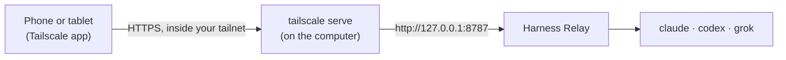

**English** | [繁體中文](remote-access.zh-TW.md)

# Use it from your phone (Tailscale)

Harness Relay runs on one computer: the agents, your projects and the CLIs' logins stay there. With [Tailscale](https://tailscale.com) you can open the same chat from your phone, a tablet or another computer, wherever you are, without opening it to your local network or the internet.



The server stays bound to `127.0.0.1`. `tailscale serve`, on the same computer, takes the requests that come in from your tailnet and passes them on. So:

- only devices in your tailnet can reach it;
- the connection is HTTPS with a real certificate, which a phone's browser requires before it lets a page use the microphone (for [voice input](user-guide.md#voice-input)).

## What you need

- **The computer that runs Harness Relay**, set up as in the [user guide](user-guide.md#1-install-and-start), with the agent CLIs installed there (you can sign them in from the phone later). Any computer that stays on will do: your Mac, or a Linux machine such as a home server or an NVIDIA DGX Spark.
- **Tailscale on that computer and on the phone**, signed in to the same tailnet (on iOS and Android, the Tailscale app). On a Mac, if the `tailscale` command is missing, install it from the Tailscale app's settings (CLI integration).
- **MagicDNS and HTTPS certificates** turned on in the Tailscale admin console (**DNS** page). If HTTPS is off, the first `tailscale serve` prints a link that turns it on.

## 1. Share the server with your tailnet

On the computer that runs Harness Relay:

```bash
tailscale serve --bg 8787
```

It prints the address your devices will use, for example:

```
Available within your tailnet:

https://my-computer.tail1234.ts.net/
|-- / proxy http://127.0.0.1:8787
```

- **Once is enough.** With `--bg` the sharing stays on after the command returns, and comes back by itself after the computer or Tailscale restarts.
- **The first time**, if Serve or HTTPS is not enabled for your tailnet yet, the command prints a link. Open it, allow it, and run the command again if it has stopped.
- **On Linux**, if it answers *Access denied*, run it with `sudo`. Or run `sudo tailscale set --operator=$USER` once, so that your user may change Tailscale's settings without `sudo`.
- **Another port:** if you start Harness Relay with another `PORT`, use that port here.

`tailscale serve status` shows what is shared.

## 2. Start Harness Relay with that name

To block DNS rebinding, the server answers only requests addressed to `localhost` or `127.0.0.1`. Add the name from step 1, without `https://` or the trailing `/`:

```bash
RELAY_ALLOWED_HOSTS=my-computer.tail1234.ts.net npm start
```

In Windows PowerShell:

```powershell
$env:RELAY_ALLOWED_HOSTS="my-computer.tail1234.ts.net"
npm start
```

Put several names in one list, separated by commas. On the computer itself, http://127.0.0.1:8787 keeps working. Use `npm start` (the built UI and the API on one port), not `npm run dev`.

## 3. Open it on your phone

Turn Tailscale on in the phone and open the address from step 1, for example `https://my-computer.tail1234.ts.net`. The first time, it shows the sign-in page: on the computer, open **Settings → Signed-in browsers → Sign in another device**, and type the code it shows on the phone (or open its link there). The chat, **Settings & sign-in** and voice input then work as they do on the computer, in a layout made for small screens.

- **Working directories** are folders on the computer, not on the phone.
- **Files the agents make** (a PDF, slides, a spreadsheet…): tap the link in the reply, or **Download** in **Files**, and the file is saved on the phone: on an iPhone or iPad in the Files app under **Downloads** (Safari may ask first), on Android in **Downloads**.
- **Signing in an agent** from the phone: pick a method that shows a link or a code. Codex's *ChatGPT browser sign-in* opens a browser on the computer, not on the phone; use *ChatGPT device code* instead.
- **Conversations keep running** on the computer when the phone locks or you close the page. When you come back, the page reconnects and catches up.
- **Voice input**: allow the microphone when the browser asks. The recording goes to the computer, which turns it into text; it is never sent anywhere else.

## 4. Add it to the home screen

An icon on the home screen, Harness Relay's three dots, opens the chat with one tap. It only works while Tailscale is on in the phone and the computer can be reached.

### iPhone and iPad (Safari)

1. Open the address in Safari.
2. Tap **Share** (if you don't see it, tap **⋯** first), then **Add to Home Screen**. You may have to scroll down the list.
3. If you see **Open as Web App**, keep it on. Change the name if you like, and tap **Add**.

The icon opens Harness Relay as a web app: full screen, without Safari's address bar, with its own place in the app switcher. The web app keeps its own storage apart from Safari, so the guided tour opens once more there, and the language starts from your phone's setting. Chrome and Edge on iOS have **Add to Home Screen** in their share menu too.

### Android (Chrome)

1. Open the address in Chrome.
2. Tap **⋮** at the top right, then **Install app**. Depending on the version of Chrome it may be called **Add to home screen** or **Install and create shortcut**.
3. Tap **Install**. Chrome may also offer it by itself, in a bar at the bottom of the page.

Installed this way, Harness Relay opens as its own app, without Chrome's address bar, and shows up with your other apps. If Chrome offers only **Create shortcut** (for example on an `http://` address), the shortcut opens the page in Chrome; you can tell it by the small Chrome logo on its icon. Samsung Internet has the same under its menu: **Add page to → Home screen**.

## 5. Browse AgentsView too (optional)

If you send conversations to [AgentsView](user-guide.md#agent-sessions-the-clis-own-folder-and-agentsview), you can browse it from the phone as well. It stays on `127.0.0.1` too, and `tailscale serve` shares it on a port of its own. These steps assume the setup from the user guide: AgentsView's data in `~/.relay-agents/agentsview`, listening on port 9999.

1. Share AgentsView with your tailnet, on HTTPS port 9999:

   ```bash
   tailscale serve --bg --https=9999 9999
   ```

   It answers at the same name as Harness Relay, on that port: `https://my-computer.tail1234.ts.net:9999`.
2. Tell AgentsView that address. Without it, AgentsView shows its page but refuses its own requests (*403*), so the page stays empty. Add this line at the very top of `~/.relay-agents/agentsview/config.toml`, above the `[agents.…]` sections:

   ```toml
   public_url = "https://my-computer.tail1234.ts.net:9999"
   ```

3. Restart AgentsView, with the same `AGENTSVIEW_DATA_DIR` as when you started it (see the [user guide](user-guide.md#agent-sessions-the-clis-own-folder-and-agentsview) for Windows):

   ```bash
   AGENTSVIEW_DATA_DIR=~/.relay-agents/agentsview agentsview serve stop
   AGENTSVIEW_DATA_DIR=~/.relay-agents/agentsview agentsview serve --port 9999 --background
   ```

   The sharing comes back by itself after a restart of the computer; AgentsView doesn't, so start it again then.
4. Open `https://my-computer.tail1234.ts.net:9999` on the phone. You can add it to the home screen like Harness Relay.

In **Settings → Agent sessions → AgentsView**, keep `http://127.0.0.1:9999` as the address: Harness Relay sends the conversations from the computer itself. Enter the tailnet address (`https://my-computer.tail1234.ts.net:9999`) under **Address to open it**, so that **Open AgentsView** opens it, on the phone too.

## Keep it running

Your phone can reach Harness Relay only while the computer is awake and the server is running.

### macOS

Start it with `caffeinate -i`, which keeps the Mac from going to sleep while the server runs:

```bash
RELAY_ALLOWED_HOSTS=my-computer.tail1234.ts.net caffeinate -i npm start
```

A MacBook still goes to sleep when you close its lid, unless it is connected to power and an external display.

### Linux server (systemd)

On a machine you reach over SSH, such as a home server or a DGX Spark, run Harness Relay as a systemd user service, so it starts with the machine and restarts if it stops. This example assumes the repository is in `~/harness-relay`. Create `~/.config/systemd/user/harness-relay.service`:

```ini
[Unit]
Description=Harness Relay
After=network-online.target

[Service]
WorkingDirectory=%h/harness-relay
Environment=PORT=8787
Environment=RELAY_ALLOWED_HOSTS=my-computer.tail1234.ts.net
# systemd does not read your shell profile. Paste the output of `echo $PATH` here,
# so the server finds node and the claude, codex and grok commands.
Environment=PATH=/usr/local/bin:/usr/bin:/bin
ExecStart=%h/harness-relay/node_modules/.bin/tsx src/server/index.ts
# Stop only the server: it stops the agents' processes itself.
KillMode=mixed
TimeoutStopSec=20
# A stop by SIGTERM is a clean stop, not a failure.
SuccessExitStatus=143
Restart=on-failure
RestartSec=3

[Install]
WantedBy=default.target
```

Then start it, and let it run while you are logged out:

```bash
systemctl --user daemon-reload
systemctl --user enable --now harness-relay
sudo loginctl enable-linger $USER
```

| Command | What it does |
| --- | --- |
| `systemctl --user status harness-relay` | Show whether it is running |
| `journalctl --user -u harness-relay -f` | Follow its log |
| `systemctl --user restart harness-relay` | Restart it (after an update, or after you change the unit file and run `systemctl --user daemon-reload`) |
| `systemctl --user disable --now harness-relay` | Stop it, and don't start it at boot |

To update, in `~/harness-relay`:

```bash
git pull
npm install
npm run build
systemctl --user restart harness-relay
```

A restart stops any agent turn that is running, so update when no conversation is replying.

On a server:

- **Port already taken:** if another program already uses port 8787, set another `PORT` in the unit file and share that port in step 1.
- **Signing in the CLIs:** sign in from **Settings & sign-in** in the browser (with a device code or a link), or over SSH with each CLI's own login command.
- **API keys:** a machine without a desktop session usually has no Secret Service, so API keys saved in Settings stay in `data/relay.db` (see [API keys](user-guide.md#api-keys-optional)). To avoid that, add `Environment=ANTHROPIC_API_KEY=…` or `XAI_API_KEY` to the unit file instead.

## Security

- **Only browsers you signed in can use it**, with the permissions the agents have on that computer; every device in your tailnet can still reach its sign-in page. If other people share your tailnet, also use Tailscale's [access controls](https://tailscale.com/kb/1018/acls) so that only your own devices can reach that computer. Sign out a phone you no longer use in **Settings → Signed-in browsers**.
- **Don't use `tailscale funnel`.** It publishes the page to the whole internet.
- **Don't start the server with `HOST=0.0.0.0`** to reach it over your Wi-Fi. Anyone on the same network could then drive agents with write access, over plain HTTP, and the phone's browser would not allow the microphone.
- **Your machine's name becomes public.** With HTTPS certificates on, Tailscale records the full name of each machine that gets a certificate (`my-computer.tail1234.ts.net`) in public Certificate Transparency logs. Don't use a machine name you want to keep private.
- **AgentsView has no login either** (Harness Relay's updates need it that way), and every device in your tailnet can browse every session in it and remove them from its list. The same access controls cover it.
- **To stop sharing:** `tailscale serve --https=443 off`, and `tailscale serve --https=9999 off` for AgentsView. (`tailscale serve reset` removes everything the computer shares, including other services.)

## Troubleshooting

| Symptom | What to try |
| --- | --- |
| The page opens but nothing loads, and errors say *Forbidden host* or *Forbidden origin* | `RELAY_ALLOWED_HOSTS` doesn't match the address you opened. Use the exact name from `tailscale serve status`, without `https://`, and restart Harness Relay. |
| The address doesn't open at all | Check that Tailscale is on in the phone and signed in to the same tailnet as the computer (the Tailscale app can switch between accounts), that the computer is awake, and that `tailscale serve status` on the computer still shows the address. |
| *Access denied* from `tailscale serve` on Linux | Run it with `sudo`, or run `sudo tailscale set --operator=$USER` once. |
| Another program's page or certificate shows up | Another program on the computer listens on port 443 and answers when nothing is shared. Check `tailscale serve status`: if the address is gone, run step 1 again. If it is listed and the other program still answers, share on another port: `tailscale serve --bg --https=8443 8787`, then open `https://my-computer.tail1234.ts.net:8443` (`RELAY_ALLOWED_HOSTS` stays the same). |
| AgentsView's page opens on the phone but stays empty | Its requests are refused because `public_url` doesn't match the address you opened. Check the line at the top of `~/.relay-agents/agentsview/config.toml` (the exact address, with `https://` and `:9999`), then restart AgentsView. |
| An agent shows *Command not found* only when it runs as a service | The service's `PATH` doesn't include that CLI. Find it with `command -v claude` (or `codex`, `grok`), add its folder to `Environment=PATH=` and restart. |
| 🎙 says the microphone is not available on the phone | Open the `https://` address, not an `http://` one. Allow the microphone for this site in the browser, and in the phone's settings for that browser. |
| The home-screen icon opens a blank or error page | Turn Tailscale on in the phone, then open the icon again. |
