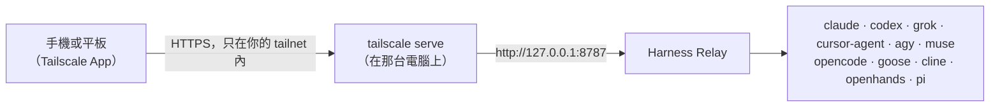

[English](remote-access.md) | **繁體中文**

# 用手機連線（Tailscale）

Harness Relay 在一台電腦上執行：agent、你的專案和各 CLI 的登入都留在那台電腦。透過 [Tailscale](https://tailscale.com)，你可以在任何地方用手機、平板或另一台電腦打開同一個聊天室，不必把它開放到區域網路或網際網路。



伺服器仍然只綁定 `127.0.0.1`。同一台電腦上的 `tailscale serve` 會接收從 tailnet 進來的請求，再轉給它。因此：

- 只有你 tailnet 裡的裝置連得到；
- 連線是有正式憑證的 HTTPS。手機瀏覽器要在 HTTPS 下才允許網頁使用麥克風（[語音輸入](user-guide.zh-TW.md#語音輸入)需要）。

## 需要準備

- **執行 Harness Relay 的電腦**：照[使用者說明](user-guide.zh-TW.md#1-安裝與啟動)設定好，agent CLI 也安裝在這台電腦上（之後可以用手機登入）。任何一直開著的電腦都可以：你的 Mac，或家用伺服器、NVIDIA DGX Spark 這類 Linux 機器。
- **那台電腦和手機都裝好 Tailscale**，並登入同一個 tailnet（iOS 與 Android 用 Tailscale App）。Mac 上如果沒有 `tailscale` 指令，到 Tailscale App 的設定裡安裝（CLI integration）。
- **MagicDNS 與 HTTPS 憑證**：在 Tailscale 管理後台的 **DNS** 頁開啟。HTTPS 還沒開的話，第一次執行 `tailscale serve` 時會印出開啟用的連結。

## 用桌面 app

用[桌面 app](user-guide.zh-TW.md#桌面-app) 的話，它的選單會幫你完成第 1、2 步。選 **分享到手機（Tailscale）…**：它會執行 `tailscale serve --bg 8787`，讓伺服器接受你電腦的 tailnet 名稱，並顯示手機要打開的網址。之後在選單選 **複製手機網址** 就能複製它。接著從[第 3 步](#3-用手機打開)繼續。

- **第一次**分享時，如果你的 tailnet 還沒開啟 Serve 或 HTTPS，app 會在瀏覽器打開 Tailscale 的對應頁面。在那裡允許之後，再選一次 **分享到手機**。
- **在 Linux 上**，如果 Tailscale 不允許你的帳號修改設定，app 會顯示要執行一次的指令：`sudo tailscale set --operator=$USER`。
- **Tailnet 名稱**會在 app 啟動時自動加入，所以你不用自己設定 `RELAY_ALLOWED_HOSTS`。app 會記住這個名稱，所以在 Tailscale 連線前啟動（例如登入時），手機一樣連得進來。只有伺服器還不知道這個名稱時（app 執行期間 Tailscale 從沒連線過），分享時才會問你要不要重新啟動伺服器。
- **電腦原本分享的服務不受影響。** App 用 HTTPS 的 443 port 分享，除非那裡已經分享了其他服務：那就改用 8443 或 10000，顯示的網址也會帶上那個 port（`https://my-computer.tail1234.ts.net:8443`）。如果三個都被佔用，請照第 1 步手動分享，並用其他 `--https` port。如果 app 讀不到電腦目前分享了什麼（`tailscale serve status` 失敗或沒有回應），它就不會分享任何東西，並告訴你，以免蓋掉某個 port 或 Funnel。
- **手機登入**跟用 `npm start` 時一樣：見[第 3 步](#3-用手機打開)。
- **在 Mac 上**，裝好 Tailscale App 就夠了：沒有 `tailscale` 指令時，桌面 app 會直接使用 Tailscale App。
- 要讓手機一直連得到，見[讓它一直執行](#讓它一直執行)。

## 1. 把伺服器分享到 tailnet

在執行 Harness Relay 的電腦上：

```bash
tailscale serve --bg 8787
```

它會印出其他裝置要用的網址，例如：

```
Available within your tailnet:

https://my-computer.tail1234.ts.net/
|-- / proxy http://127.0.0.1:8787
```

- **只要做一次。** 加上 `--bg`，指令結束後仍會繼續分享；電腦或 Tailscale 重新啟動後也會自動恢復。
- **第一次執行**時，如果你的 tailnet 還沒啟用 Serve 或 HTTPS，指令會印出一個連結。打開並允許後，若指令已經結束，再執行一次。
- **在 Linux 上**，如果出現 *Access denied*，請加上 `sudo` 執行。也可以先執行一次 `sudo tailscale set --operator=$USER`，之後你的帳號不用 `sudo` 就能修改 Tailscale 的設定。
- **用了別的 port：** 如果你用其他 `PORT` 啟動 Harness Relay，這裡也要換成那個 port。

`tailscale serve status` 會顯示目前分享了什麼。

## 2. 用這個名稱啟動 Harness Relay

為了防範 DNS rebinding，伺服器只回應發給 `localhost` 或 `127.0.0.1` 的請求。把第 1 步的名稱加進去，不含 `https://` 和結尾的 `/`：

```bash
RELAY_ALLOWED_HOSTS=my-computer.tail1234.ts.net npm start
```

Windows PowerShell：

```powershell
$env:RELAY_ALLOWED_HOSTS="my-computer.tail1234.ts.net"
npm start
```

有多個名稱時，用逗號隔開放在同一個值裡。在電腦本機上，http://127.0.0.1:8787 照樣可以用。請用 `npm start`（建置好的介面和 API 在同一個 port），不要用 `npm run dev`。

## 3. 用手機打開

在手機上開啟 Tailscale，打開第 1 步的網址，例如 `https://my-computer.tail1234.ts.net`。第一次會顯示登入頁：在電腦上打開「**設定 → 已登入的瀏覽器 → 讓另一個裝置登入**」，把它顯示的代碼輸入手機（或在手機上打開它的連結）。之後聊天、**設定與登入**和語音輸入都跟在電腦上一樣，版面會配合小螢幕調整。

- **工作目錄**是那台電腦上的資料夾，不是手機上的。
- **agent 做的檔案**（PDF、簡報、試算表…）：點回覆裡的連結，或在 **檔案** 裡按 **下載**，檔案就會存到手機上：iPhone 與 iPad 存在「檔案」App 的 **下載項目**（Safari 可能會先詢問），Android 則在 **下載**。
- **用手機登入 agent**：選會顯示連結或代碼的方式。Codex 的「ChatGPT 瀏覽器登入」會在那台電腦上開瀏覽器，不是在手機上，請改用「ChatGPT 裝置碼」。Cursor 的「Cursor 帳號」會顯示連結，不會開瀏覽器，所以在手機上也能登入。Antigravity 的「Google 帳號」也一樣：在手機上開啟它的連結、登入 Google，再把頁面顯示的授權碼（或整個網址）貼回框中。Muse Code 的「Meta 帳號」也是：在手機上開啟它的連結、登入你的 Meta 帳號，確認頁面上的代碼和連結下方的一樣（沒有用真正的 Meta 帳號試過）。
- **對話會繼續跑**：手機鎖定或關掉頁面時，對話仍在電腦上進行。回來後頁面會重新連線並補上進度。
- **語音輸入**：瀏覽器詢問時，允許使用麥克風。錄音會送到那台電腦轉成文字，不會傳到其他地方。

## 4. 加到主畫面

把圖示（Harness Relay 的三個圓點）放到主畫面，點一下就能打開聊天室。手機的 Tailscale 必須開著、而且連得到那台電腦，圖示才能用。

### iPhone 與 iPad（Safari）

1. 用 Safari 打開網址。
2. 點 **分享**（看不到的話先點 **⋯**），再點 **加入主畫面**。可能要往下捲才看得到。
3. 如果有 **以網頁 App 開啟**（Open as Web App），保持開啟。可以改名稱，然後點 **加入**。

圖示會把 Harness Relay 當成網頁 App 打開：全螢幕，沒有 Safari 的網址列，在 App 切換器裡也是獨立的一個。網頁 App 的儲存空間跟 Safari 分開，所以第一次在那裡打開時會再出現一次使用導覽，介面語言也會先跟著手機的語言設定。iOS 上的 Chrome 與 Edge，分享選單裡也有 **加入主畫面**。

### Android（Chrome）

1. 用 Chrome 打開網址。
2. 點右上角的 **⋮**，再點 **安裝應用程式**（Install app）。依 Chrome 版本不同，也可能叫 **加到主畫面**（Add to home screen）或 **安裝並建立捷徑**（Install and create shortcut）。
3. 點 **安裝**（Install）。Chrome 也可能自己在頁面底部跳出安裝提示。

這樣安裝後，Harness Relay 會像獨立的 App 一樣打開，沒有 Chrome 的網址列，也會出現在你的應用程式清單裡。如果 Chrome 只提供 **建立捷徑**（Create shortcut），例如用 `http://` 網址打開時，這個捷徑會在 Chrome 裡打開頁面，圖示上會有小小的 Chrome 標誌。Samsung Internet 也有同樣的功能，在選單的 **新增頁面至 → 主螢幕**（Add page to → Home screen）。

## 5. 也瀏覽 AgentsView（選用）

如果你把對話送到 [AgentsView](user-guide.zh-TW.md#agent-的-session各-cli-自己的資料夾與-agentsview)，也可以用手機瀏覽它。它同樣留在 `127.0.0.1`，由 `tailscale serve` 用另一個 port 分享。以下步驟沿用使用者說明中的設定：AgentsView 的資料放在 `~/.relay-agents/agentsview`，監聽 port 9999。

1. 把 AgentsView 分享到 tailnet，使用 HTTPS port 9999：

   ```bash
   tailscale serve --bg --https=9999 9999
   ```

   它和 Harness Relay 用同一個名稱，只是在這個 port：`https://my-computer.tail1234.ts.net:9999`。
2. 告訴 AgentsView 這個網址。沒有設定時，AgentsView 雖然打得開頁面，卻會拒絕自己的請求（*403*），頁面一直是空的。在 `~/.relay-agents/agentsview/config.toml` 的最上方、所有 `[agents.…]` 區塊之前加上這一行：

   ```toml
   public_url = "https://my-computer.tail1234.ts.net:9999"
   ```

3. 用啟動時同樣的 `AGENTSVIEW_DATA_DIR` 重新啟動 AgentsView（Windows 的寫法見[使用者說明](user-guide.zh-TW.md#agent-的-session各-cli-自己的資料夾與-agentsview)）：

   ```bash
   AGENTSVIEW_DATA_DIR=~/.relay-agents/agentsview agentsview serve stop
   AGENTSVIEW_DATA_DIR=~/.relay-agents/agentsview agentsview serve --port 9999 --background
   ```

   電腦重新開機後，分享會自己恢復，AgentsView 則不會，請再啟動一次。
4. 用手機打開 `https://my-computer.tail1234.ts.net:9999`。也可以像 Harness Relay 一樣加到主畫面。

在 **設定 → Agent 的 session → AgentsView**，網址請維持 `http://127.0.0.1:9999`：Harness Relay 是在電腦上把對話送過去。把 tailnet 的網址（`https://my-computer.tail1234.ts.net:9999`）填在 **開啟用的網址**，**開啟 AgentsView** 就會打開它，在手機上也能用。

## 讓它一直執行

只有在電腦醒著、伺服器也在執行時，手機才連得到 Harness Relay。

用桌面 app 的話，在它的選單開啟 **登入時自動啟動** 與 **執行時不讓電腦睡著**：電腦重新開機後它會再啟動，執行期間電腦也不會睡眠。這一節其餘的內容是給 `npm start` 用的。

### macOS

用 `caffeinate -i` 啟動，伺服器執行期間 Mac 就不會進入睡眠：

```bash
RELAY_ALLOWED_HOSTS=my-computer.tail1234.ts.net caffeinate -i npm start
```

MacBook 闔上螢幕時仍會睡眠，除非它接著電源和外接螢幕。

### Linux 伺服器（systemd）

在透過 SSH 使用的機器上（例如家用伺服器或 DGX Spark），把 Harness Relay 設成 systemd user service，開機時自動啟動，停掉時也會自動重啟。下面的例子假設 repository 在 `~/harness-relay`。建立 `~/.config/systemd/user/harness-relay.service`：

```ini
[Unit]
Description=Harness Relay
After=network-online.target

[Service]
WorkingDirectory=%h/harness-relay
Environment=PORT=8787
Environment=RELAY_ALLOWED_HOSTS=my-computer.tail1234.ts.net
# systemd 不會讀 shell 的設定檔。把 `echo $PATH` 的結果貼在這裡，
# 伺服器才找得到 node 以及各 agent 的指令：claude、codex、grok、cursor-agent、agy、muse，
# 以及開源 agent 的 opencode、goose、cline、openhands 與 pi（常在 ~/.local/bin，
# 或 npm、Homebrew、uv 安裝的位置）。
Environment=PATH=/usr/local/bin:/usr/bin:/bin
ExecStart=%h/harness-relay/node_modules/.bin/tsx src/server/index.ts
# 只停止伺服器：它會自己停掉 agent 的程序。
KillMode=mixed
TimeoutStopSec=20
# 用 SIGTERM 停止是正常停止，不算失敗。
SuccessExitStatus=143
Restart=on-failure
RestartSec=3

[Install]
WantedBy=default.target
```

完全存取以外，agent 的指令都在沙箱中執行，而這些沙箱在 Linux 上各自需要一些程式：Claude Code 的需要 `bubblewrap` 與 `socat`；Codex 的使用 `bubblewrap`（沒安裝時用它自帶的那份，建議安裝）；Grok 的需要 `bubblewrap`（以及 5.13 以後的 kernel）；Muse Code 的自己帶著；開源 agent 所用的 Harness Relay 自己的沙箱需要 `bubblewrap`、`socat` 與 `ripgrep`。所以請執行 `sudo apt-get install bubblewrap socat ripgrep`，Ubuntu 23.10 以後還要加上[各平台的作業系統沙箱](sandboxing.zh-TW.md#在-linux-上)裡的 AppArmor 設定檔。Cursor 與 Antigravity 不需要：它們在 Harness Relay 的執行中都沒有沙箱，所以它們的指令會先問你（Cursor 團隊允許清單上的 Cursor 指令除外；對話設為自動拒絕時則直接拒絕）。service 也是在同一個 `PATH` 上找這些程式。

接著啟動它，並讓它在你登出後繼續執行：

```bash
systemctl --user daemon-reload
systemctl --user enable --now harness-relay
sudo loginctl enable-linger $USER
```

| 指令 | 作用 |
| --- | --- |
| `systemctl --user status harness-relay` | 看它是否在執行 |
| `journalctl --user -u harness-relay -f` | 即時看 log |
| `systemctl --user restart harness-relay` | 重新啟動（更新之後，或修改 unit 檔並執行 `systemctl --user daemon-reload` 之後） |
| `systemctl --user disable --now harness-relay` | 停止，並取消開機自動啟動 |

更新時，在 `~/harness-relay` 執行：

```bash
git pull
npm install
npm run build
systemctl --user restart harness-relay
```

重新啟動會中斷正在進行的 agent 回合，請在沒有對話正在回覆時更新。

在伺服器上：

- **port 已被佔用：** 如果 8787 已經被其他程式使用，在 unit 檔設定另一個 `PORT`，第 1 步也分享那個 port。
- **登入各 CLI：** 在瀏覽器的 **設定與登入** 登入（用裝置碼或連結），或透過 SSH 執行各 CLI 自己的登入指令。在 Harness Relay 的登入中，Antigravity 不會在伺服器上開瀏覽器：在任何一台裝置開啟它的連結，再把授權碼貼回來。Muse Code 也不會：在任何一台裝置開啟它的連結，確認代碼即可。
- **API key：** 沒有桌面環境的機器通常沒有 Secret Service，在設定頁儲存的 API key 會留在 `data/relay.db`（見 [API key](user-guide.zh-TW.md#api-key選用)）。若不想這樣，改在 unit 檔加上 `Environment=ANTHROPIC_API_KEY=…`、`XAI_API_KEY`、`GEMINI_API_KEY`（Antigravity 的）或 `META_API_KEY`（Muse Code 的）。

## 安全性

- **只有你登入過的瀏覽器能使用它**，權限就是 agent 在那台電腦上的權限；tailnet 裡的每台裝置仍然打得開它的登入頁。如果你的 tailnet 有其他人，也請用 Tailscale 的[存取控制](https://tailscale.com/kb/1018/acls)，只讓你自己的裝置連到那台電腦。不再使用的手機，請在「**設定 → 已登入的瀏覽器**」登出。
- **不要用 `tailscale funnel`。** 它會把頁面公開到整個網際網路。
- **不要為了用 Wi-Fi 連線而用 `HOST=0.0.0.0` 啟動伺服器。** 這樣同一個網路上的任何人都能透過未加密的 HTTP 操作有寫入權限的 agent，手機瀏覽器也不會允許使用麥克風。
- **電腦的名稱會被公開。** 開啟 HTTPS 憑證後，Tailscale 會把每台取得憑證的電腦的完整名稱（`my-computer.tail1234.ts.net`）記錄在公開的 Certificate Transparency 紀錄中。不要用帶有私人資訊的電腦名稱。
- **AgentsView 也沒有登入機制**（Harness Relay 的更新需要這樣），tailnet 裡的每台裝置都能瀏覽其中所有 session，也能把它們從清單中移除。同樣的存取控制也涵蓋它。
- **停止分享：** `tailscale serve --https=443 off`；AgentsView 用 `tailscale serve --https=9999 off`。（`tailscale serve reset` 會移除這台電腦分享的所有內容，包含其他服務。）

## 疑難排解

| 狀況 | 處理方式 |
| --- | --- |
| 頁面打得開但什麼都載不出來，錯誤顯示 *Forbidden host* 或 *Forbidden origin* | `RELAY_ALLOWED_HOSTS` 跟你打開的網址不一樣。照 `tailscale serve status` 顯示的名稱填寫，不含 `https://`，然後重新啟動 Harness Relay。 |
| 網址完全打不開 | 確認手機的 Tailscale 已開啟，並登入跟電腦同一個 tailnet（Tailscale App 可以切換帳號）；確認電腦醒著；確認電腦上的 `tailscale serve status` 還顯示這個網址。 |
| Linux 上的 `tailscale serve` 出現 *Access denied* | 加上 `sudo` 執行，或先執行一次 `sudo tailscale set --operator=$USER`。 |
| 桌面 app 說「找不到 Tailscale」 | 在電腦上安裝 Tailscale 並登入。在 Linux 上，app 會在 shell 的 `PATH`，以及 `/usr/bin`、`/usr/sbin` 與 `/usr/local/bin` 裡找 `tailscale`；在 Windows 上，則在 `Program Files\Tailscale` 裡找。 |
| 桌面 app 說讀不到這台電腦分享了什麼 | `tailscale serve status --json` 失敗或沒有及時回應，所以 app 沒有分享任何東西。確認 Tailscale 正在執行並已登入（`tailscale status`），再選一次 **分享到手機**，或照[第 1 步](#1-把伺服器分享到-tailnet)手動分享。 |
| 出現其他程式的頁面或憑證 | 電腦上有其他程式在監聽 443 port，沒有分享時就由它回應。先看 `tailscale serve status`：網址不見了就重做第 1 步。如果網址還在、卻仍由那個程式回應，就改用其他 port 分享：`tailscale serve --bg --https=8443 8787`，然後打開 `https://my-computer.tail1234.ts.net:8443`（`RELAY_ALLOWED_HOSTS` 不用改）。 |
| 手機上 AgentsView 的頁面打得開，但一直是空的 | `public_url` 跟你打開的網址不一樣，所以它的請求被拒絕。檢查 `~/.relay-agents/agentsview/config.toml` 最上方那一行（完整網址，含 `https://` 與 `:9999`），然後重新啟動 AgentsView。 |
| 只有以 service 執行時，agent 顯示「找不到指令」 | service 的 `PATH` 裡沒有那個 CLI。用 `command -v claude`（或 `codex`、`grok`、`cursor-agent`、`agy`、`muse`、`opencode`、`goose`、`cline`、`openhands`、`pi`）找到它的位置，把所在資料夾加進 `Environment=PATH=`，再重新啟動。 |
| 手機上 🎙 顯示無法使用麥克風 | 請打開 `https://` 開頭的網址，不要用 `http://`。在瀏覽器允許這個網站使用麥克風，並在手機設定中允許該瀏覽器使用麥克風。 |
| 主畫面圖示打開後是空白或錯誤頁 | 開啟手機的 Tailscale，再點一次圖示。 |
