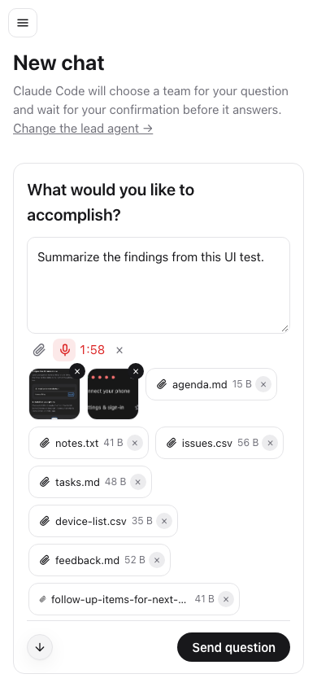
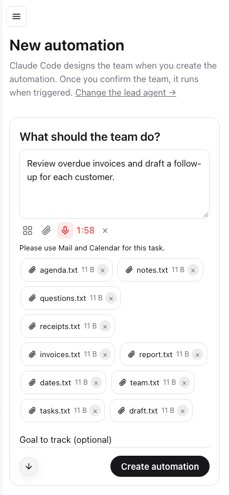
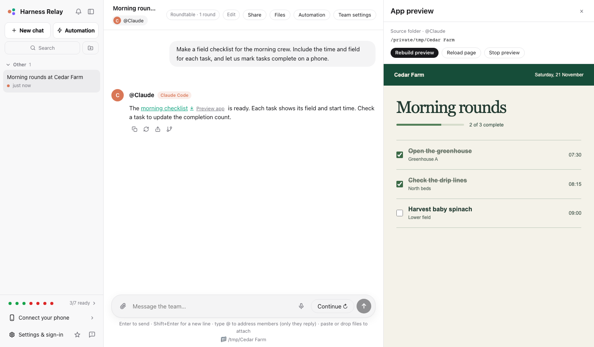
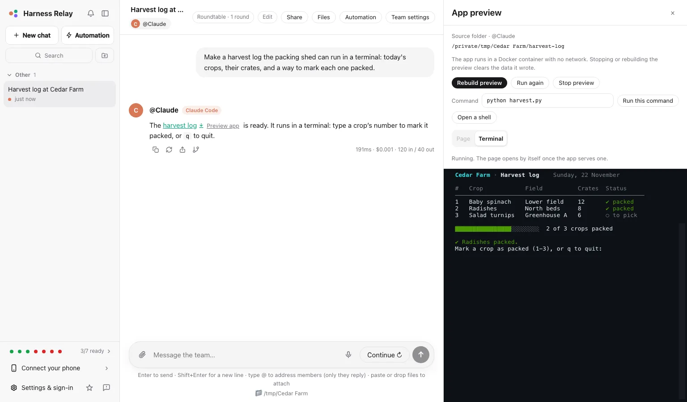
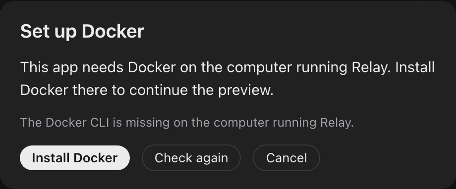
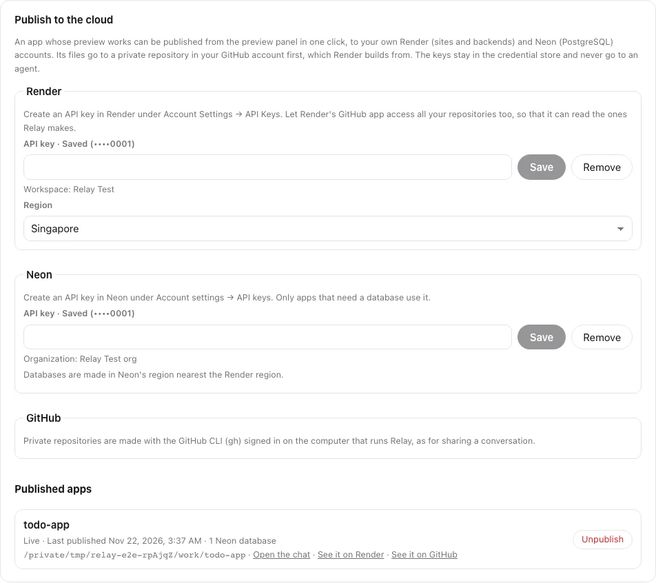
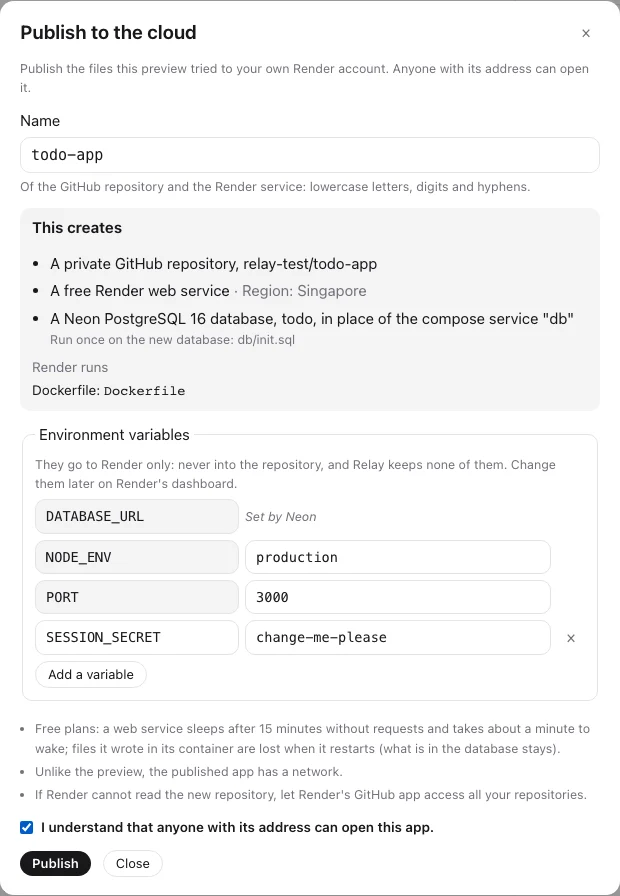
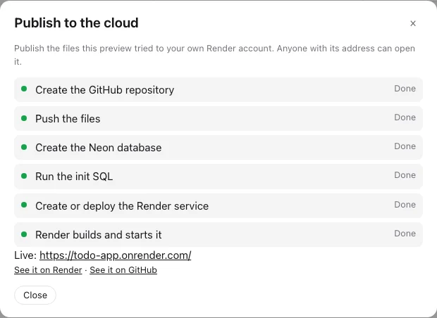

**English** | [繁體中文](user-guide.zh-TW.md)

# User guide

This guide walks through installing Harness Relay, signing in to the agents (or setting up model backends for the open-source ones), starting a chat (the lead agent designs a team for each question, from your templates), and chatting with the team.

## 1. Install and start

You need Node.js 22.13 or newer and at least one of the agent CLIs installed: `claude`, `codex`, `grok`, `cursor-agent` (Cursor), `agy` (Antigravity), `copilot` (GitHub Copilot), `muse` (Muse Code), or one of the five open-source agents (`opencode`, `goose`, `cline`, `openhands`, `pi`). [Installing the agent CLIs](#installing-the-agent-clis) below says where to get each one and which versions Harness Relay was checked with. Edit and parallel modes also need [Git](https://git-scm.com/downloads), which Harness Relay uses for snapshots and worktrees.

```bash
npm install
npm run build
npm start
```

Nothing to install it on? [Try it in GitHub Codespaces](codespaces.md): a Linux machine of your own in GitHub's cloud, with the seven agents that are not open source installed and Harness Relay started.

Open the sign-in link `npm start` prints in the terminal (`http://127.0.0.1:8787/#code=…`): Harness Relay takes only browsers that signed in, so other programs on your computer, code an agent runs included, cannot drive it. The link works once, within an hour; to sign in another browser later, run `npm run login`, or use **Settings → Connect your phone → Sign in another device**. To review sessions or sign one out, open **Settings → Signed-in browsers**. After a `git pull`, run `npm install` and `npm run build` again, then `npm start`. (To work on Harness Relay itself, run `npm run dev` instead and open http://localhost:5173; see the [developer guide](developer-guide.md).)

The dots at the bottom of the sidebar show each agent's status: green = ready, orange = not signed in (for an open-source agent: no model backend yet), red = CLI not found. The open-source agents get a dot once their CLI is installed. The dots take one line, with how many agents are ready (*4/11 ready*); point at a dot for its agent's name and status, or click it to open that agent's settings. The arrow beside them shows their names too, and hides them again; this browser remembers the choice.

To use Harness Relay from your phone, a tablet or another computer, share it with your tailnet through `tailscale serve` and add it to the phone's home screen: see [Use it from your phone (Tailscale)](remote-access.md). On the computer, Chrome and Edge can also install it as an app (the install button in the address bar), and Safari on macOS can add it to the Dock (**File → Add to Dock**).

### Installing the agent CLIs

You don't need them all: Harness Relay works with any of them. Install the ones you want so that they are on your `PATH`, then sign each in under **Settings & sign-in** ([2. Sign in to each agent](#2-sign-in-to-each-agent--settings--sign-in)); the open-source agents have no sign-in and run on a [model backend](#model-connections) you set up there instead.

The seven you sign in to:

- [Claude Code](https://docs.claude.com/en/docs/claude-code) (`claude`; checked with 2.1.322)
- [Codex CLI](https://github.com/openai/codex) (`codex`; checked with 0.167.0)
- [Grok CLI](https://github.com/xai-org/grok-build) (`grok`; checked with 1.0.77)
- [Cursor CLI](https://cursor.com/cli) (`cursor-agent`; checked with 2026.11.11-043ef28)
- [Antigravity CLI](https://antigravity.google/download) (`agy`; checked with 1.5.6 on macOS, Linux and Windows), signed in with your Google account or a Gemini API key
- [GitHub Copilot CLI](https://github.com/features/copilot/cli) (`copilot`, npm `@github/copilot`; checked with 1.0.109 on macOS, Linux and Windows), signed in with your GitHub account or a GitHub token. Below full access on Linux its sandbox needs bubblewrap, slirp4netns and unprivileged user and network namespaces (see [OS sandboxes by platform → Linux](sandboxing.md#linux)).
- [Muse Code](https://dev.meta.ai/products/muse-code/) (`muse`; checked with 1.4.18 on macOS and Linux, and on Windows), signed in with your Meta account or a Meta API key

Muse Code installs with `curl -fsSL https://dev.meta.ai/install.sh | bash` on macOS and Linux, or `irm https://dev.meta.ai/install.ps1 | iex` in Windows PowerShell; its installer puts a launcher on your `PATH` through your shell's profile, and the launcher keeps Muse up to date by itself (on Windows it is `muse.cmd`, from which Harness Relay starts the version it names). On Windows, Muse Code 1.4.18 runs no command below full access in Harness Relay, also after Muse's own sandbox setup (`muse sandbox windows setup`): the mode Harness Relay drives it in uses no sandbox there, so its commands fail instead of running unsandboxed; its file tools work, and full access runs commands.

The five open-source agents, with the versions Harness Relay was checked with (other versions may differ in what the adapters rely on):

| Agent | Install | Checked with |
| --- | --- | --- |
| [OpenCode](https://www.npmjs.com/package/opencode-ai) (`opencode`) | `npm install -g opencode-ai@1.19.5` | 1.19.5 |
| [Goose](https://formulae.brew.sh/formula/block-goose-cli) (`goose`) | `brew install block-goose-cli` | 1.58.1 |
| [Cline](https://www.npmjs.com/package/cline) (`cline`) | `npm install -g cline@3.0.74` | 3.0.74 |
| [OpenHands](https://pypi.org/project/openhands/) (`openhands`) | `uv tool install openhands==1.16.0` (needs [uv](https://docs.astral.sh/uv/)) | 1.16.0 |
| [Pi](https://www.npmjs.com/package/@earendil-works/pi-coding-agent) (`pi`) | `npm install -g @earendil-works/pi-coding-agent@1.5.1` (needs Node.js 22.19 or later) | 1.5.1 |

#### Installing a CLI from Settings

You can also install a CLI from its card under **Settings & sign-in**, each one on its own. When Harness Relay does not find a CLI, its card shows **Install <CLI>** and the folder it goes in. One click installs it in the background into that folder of its own, `data/clis/<cli>` (in the [desktop app](#desktop-app), `clis/` in its data folder), shows the installer's output as it goes (the commands it runs first) (with **Cancel install**), checks that the program runs, and sets the CLI's **Executable** to it. The CLI goes nowhere else: not on your `PATH` nor in your shell's profile, so the CLI installed is Harness Relay's alone (should an installer still put a link to its program in a folder on your `PATH`, that is taken out once it is done; on Windows your user `PATH` is put back as it was before the installer ran, whatever the installer did to it, so Windows installs run one at a time). Nor do npm's and uv's downloads stay in your own caches: each install keeps its own in that folder until it ends. Its card then says **Installed by Harness Relay in …**, with **Remove**, which deletes that folder and sets the executable back to what it was before; the CLI's sign-in, settings and sessions stay in its home. A CLI installed any other way is never offered for removal. How each CLI is installed:

- With npm, which comes with Node.js, as a global install into that folder (`npm install -g`): Claude Code, Codex and Copilot (their newest versions), and OpenCode, Cline and Pi (the versions in the table below). Without npm on your `PATH` (the [desktop app](#desktop-app) needs no Node.js), Claude Code, Codex and Copilot still install: Node.js 26.13.1's own build for your system goes into that folder first, downloaded from nodejs.org with `curl`, checked against the checksum Harness Relay has for it and unpacked with `tar` (only Node and its npm), and its npm installs the CLI. That Node stays in the folder, which Codex's and Copilot's programs run on (they are Node scripts npm links), and goes when you remove the CLI; it is not put on your `PATH`, and the agents' own commands do not get it. The card says so before you install. On Linux that build needs libatomic, which a desktop usually has but a minimal system may lack (`libatomic1` on Debian and Ubuntu, `libatomic` on Fedora), and the download needs curl, which Ubuntu's desktop lacks: in the desktop app, [setting up the sandboxes](#setting-up-the-sandboxes) installs both. The install checks that Node runs before npm does, and says so if it does not. Node.js has no such build for a Linux with musl (Alpine) nor for 32-bit systems: there, install Node.js. The open-source agents' npm installs (OpenCode, Cline, Pi) still take npm on your `PATH`; Cline and Pi also run on that Node.js, which Harness Relay's own sandbox starts them with.
- With its maker's own installer script, downloaded with `curl` and run with that folder as its home, so that what it writes beside the program (shell profile lines, caches) stays in it too: Grok, Cursor, Antigravity and Muse Code (their newest versions), and Goose (1.58.1). On macOS and Linux each runs its `bash` script; on Windows Grok, Cursor, Antigravity and Muse Code run their PowerShell installer (`irm … | iex`), and Goose its `bash` script in Git for Windows' bash (Git Bash), which it supports.
- With [uv](https://docs.astral.sh/uv/) (`uv tool install`), with any Python it downloads for it in that folder too: OpenHands. On Windows it runs on the x64 Python 3.12, on Windows on Arm too (emulated there), since some of its packages have no builds for Arm. Without uv on your `PATH`, uv's own installer puts one in that folder first, which goes with OpenHands when you remove it.

When a program the install needs is not found (npm, which comes with Node.js, for the open-source agents; `curl`; `tar`, for Node.js's build (on Windows the one in System32); `bash`, or on Windows Git for Windows' bash or Windows PowerShell), the card explains what is missing. On Windows, if Git Bash is missing, the card offers **Install Git**. A failed or cancelled install leaves nothing behind; a failed one's words and output stay on the card until you try again. Removing waits until no agent is at work, and the desktop app's updates wait until no CLI is being installed. A CLI that updates itself (Claude Code, Cursor, Muse Code's launcher, Grok) does so as its maker's updater does, which may write where that updater writes; on Windows, Grok looks for the copy of Git its installer downloads under your own `%LOCALAPPDATA%`, not in the folder, so have Git for Windows on your `PATH` for it. A [GitHub codespace](codespaces.md) has the seven CLIs that are not open source installed already; the open-source ones install there from Settings as anywhere else. Node.js is not installed for you on your `PATH`: from the source you have it already (`npm start` runs on it), and the [desktop app](#desktop-app) finds it on your login shell's `PATH`; without it, only the copy in a CLI's folder described above.

Below full access they run in Harness Relay's own sandbox ([Open agents → The relay sandbox](open-agents.md#the-relay-sandbox)). It needs nothing extra on macOS (in the [desktop app](#desktop-app), Node.js 22.12 or later on your `PATH`, or the one Settings installs); on Linux install `bubblewrap`, `socat` and `ripgrep` (`sudo apt-get install bubblewrap socat ripgrep`), and on Ubuntu 23.10 or later add the AppArmor profile for `/usr/bin/bwrap` from [OS sandboxes by platform → On Linux](sandboxing.md#on-linux). Harness Relay can install all of this for you: see [Setting up the sandboxes](#setting-up-the-sandboxes). On native Windows they run only with full access (use WSL2 for a sandbox), and so does OpenCode on Linux (Harness Relay cannot watch its server there).

#### Setting up the sandboxes

Below full access, the commands agents run go in your system's sandbox, and when a sandbox lacks what it needs Harness Relay does not run them outside it: those agents' commands just fail. So Harness Relay looks for what the sandboxes need on this computer, and installs what it can for you. When something is missing, **New chat** first opens a dialog that lists it, says whose sandboxes need it, and strongly recommends installing it: **Install (strongly recommended)** installs it there, with its output as it goes; **Not now** closes it, and this browser is not asked again (Escape or × closes it until the page is opened again). **Settings & sign-in → Sandboxes** always shows the same list, with **Install**, and says when nothing is missing. What it covers, by system:

- **Linux**: the packages the sandboxes run, with your package manager (apt, dnf, pacman or zypper): `bubblewrap` (Claude Code, Codex, Grok, Copilot and the open-source agents), `socat` (Claude Code and the open-source agents), `ripgrep` (the open-source agents), and for Copilot's `slirp4netns`, `iproute2`, `iptables` and `util-linux`; and on Ubuntu 23.10 or later, which keeps programs from making user namespaces, an AppArmor profile that lets `/usr/bin/bwrap` make them (`/etc/apparmor.d/harness-relay-bwrap`, the profile Claude Code's docs give, unless you have one for it already). These take administrator rights, asked for once: as root, through `sudo` when it asks no password, or through `pkexec`, whose password prompt your desktop shows (with its own Cancel). Where none of these works (over SSH, say), the list gives the command to run in a terminal, with **Copy**. Once your package manager runs, the install cannot be cancelled: stopping it halfway could leave its database to repair. With the AppArmor profile, Ubuntu's restriction no longer applies to bubblewrap, for any user of this computer, as Claude Code's docs have it.
- **The desktop app on macOS and Linux**, with no Node.js 22.12 or later on your login shell's `PATH`: Node.js 26.13.1's own build for Harness Relay's own sandbox (the open-source agents'), checked against its checksum as for [a CLI's install](#installing-a-cli-from-settings), into `clis/sandbox-node` in the app's data folder, without administrator rights. curl downloads it, and on Linux it runs with libatomic: where either is missing (Ubuntu's desktop has no curl), it goes in with the packages first, then Node.js.

What cannot be installed here (no administrator rights, say) does not keep the rest from being installed: once the install is done, the list keeps what is left, with its command.
- **Windows**: nothing. Codex's and Copilot's sandboxes need nothing installed, and the other CLIs have none there (see [OS sandboxes by platform](sandboxing.md#windows)).

Lifting the restriction on user namespaces for every program (`kernel.apparmor_restrict_unprivileged_userns=0`), which Copilot's sandbox may still need on Ubuntu, is left to you: it weakens the whole system ([OS sandboxes by platform → On Linux](sandboxing.md#on-linux)).

Two features need a little more, only when you use them. [Voice input](#voice-input) installs itself when you turn it on: on macOS it needs [Homebrew](https://brew.sh); on Linux the prebuilt engine needs glibc 2.34 or later (Ubuntu 22.04, Debian 12 and newer). [Sharing a conversation](#sharing-a-conversation) as a link needs the [GitHub CLI](https://cli.github.com) (`gh`) 2.66.0 or later, signed in (from the share dialog, or with `gh auth login`), and `git` for the files that go along with the page.

### Desktop app

Instead of `npm start` in a terminal, you can install Harness Relay as a desktop app on macOS (13 Ventura or later, Apple Silicon), Windows 10 or later (x64 or Arm64), or Linux with a desktop (x64 or Arm64). It runs the same server in the background and shows the chat in a window of its own, signed in, with no address bar. Closing the window leaves the server running, with an icon in the menu bar or the system tray, so the chat works on your phone as before. Like `npm start`, it needs the agent CLIs (which it can [install from Settings](#installing-a-cli-from-settings), Claude Code, Codex and Copilot also without Node.js), and Git for edit and parallel modes, which it offers to install when needed; it does not need Node.js, except for the open-source agents below full access: Harness Relay's own sandbox, which they run in, needs Node.js 22.12 or later on your login shell's `PATH`, or the one [Settings → Sandboxes](#setting-up-the-sandboxes) installs into the app's folder (without either, they work only with full access).

**Install it.** Download the installer for your system from the [website](https://agentic-system-lab.github.io/harness-relay/), which offers the newest release, never a release candidate (a version ending in `-rc`, see [Versions](#versions)), or from [Releases](https://github.com/Agentic-System-Lab/harness-relay/releases), which has release candidates too. Once installed, the app updates itself: a release to the next release, a release candidate to the next release candidate or release (see **Updates** below).

- **macOS**: `Harness-Relay-<version>-mac-arm64.dmg`, for Macs with Apple Silicon. Open it and drag Harness Relay to Applications. There is no app for Intel Macs: run Harness Relay from the source there (`npm start`, see [Quick start](../README.md#quick-start)). A Mac app from 2026-11-11 or its release candidate was one for both, and does not find the releases after it in its menu: download the new version once from the website.
- **Windows**: `Harness-Relay-<version>-win-x64.exe`, or `Harness-Relay-<version>-win-arm64.exe` on Windows on Arm. It installs for your user only, without administrator rights. Windows 11 on Arm runs the x64 app too (emulated), Windows 10 on Arm does not; the Arm64 one runs natively on both.
- **Linux**: `Harness-Relay-<version>-linux-x86_64.AppImage`, or `Harness-Relay-<version>-linux-arm64.AppImage` on 64-bit Arm (aarch64). Make it executable (`chmod +x`) and run it.

The website names your system on its download button, the processor too where the browser tells it (Chrome and Edge on Windows on Arm, any browser on Linux on Arm); the [installation guide beside the download button](https://agentic-system-lab.github.io/harness-relay/#start) lists every installer. [View the download controls](media/home-download-en.webp).

Or build it yourself in a clone, after `npm install`. The installer for the system you build on goes to `desktop/release/`, and `npm run desktop` runs the app without installing it:

```bash
npm install --prefix desktop
npm run desktop:dist
```

`npm run desktop:dist` refuses to start while a Harness Relay runs from `desktop/release/`, whose files it would replace: quit that one first, or build elsewhere with `npm run desktop:dist -- --output <folder>`. Quit any running Harness Relay before you open the new build too, or macOS brings the running one forward instead (one Harness Relay runs at a time). `npx tsx desktop/scripts/check-package.ts` then checks the app it made, as a release is checked.

The installers are not signed for distribution yet (on macOS they are signed ad hoc), so the system warns the first time the app opens:

- **macOS**: *Apple could not verify "Harness Relay"*. Open **System Settings → Privacy & Security** and click **Open Anyway** next to Harness Relay.
- **Windows**: SmartScreen says *Windows protected your PC*. Click **More info**, then **Run anyway**.
- **Linux**: on Ubuntu 24.04 and other systems that restrict unprivileged user namespaces, the AppImage may stop at once with a message about the *SUID sandbox helper*. Start it with `--no-sandbox` (`./Harness-Relay-….AppImage --no-sandbox`); **Open at login** then starts it the same way.

**Signing in.** The app opens the chat with a one-time sign-in link it gets from its server, so the window is signed in without a code to type; **Open in browser** does the same in your default browser. That link is never printed or written to a log, and it works for one minute. The window is a browser of its own: it is listed under **Settings → Signed-in browsers**, and its guided tour and language are its own. To sign in a phone, choose **Share with your phone (Tailscale)…** and follow the [phone pairing guide](remote-access.md#with-the-desktop-app) to install Tailscale and scan the sign-in code. If the window shows the sign-in page (its sign-in was revoked, or its link was not used in time), choose **Open Harness Relay** in the app's menu: the window signs in again with a new link. If a browser shows it, choose **Open in browser**. The window keeps its sign-in in the `browser` folder of the app's folder, which agents below full access may not read (on macOS and Linux, where their sandboxes enforce it).

**The window.** Closing it leaves Harness Relay running in the menu bar or the system tray (on macOS its Dock icon goes away until the window opens again); **Quit** (⌘Q on macOS) stops it. Links to other sites open in your default browser, and files you download from the chat are saved through the usual save dialog. Voice input asks for the microphone the first time, and a video's own button shows it full screen. On Windows and Linux, Alt shows the window's menu bar, which has **Quit** too.

**The menu.** The app's icon, Harness Relay's three dots, is in the menu bar on macOS and in the system tray on Windows and Linux. On Windows, a click opens the chat and the menu is on the right button. It is in the language the chat in the app's window shows, as are the window's menu bar and the app's dialogs: switch it under **Settings & sign-in → Language** in the window, and they follow at once, also at the next start (before the window has opened once, they follow the system's language; a language picked in another browser, such as a phone's, leaves them as they are). The menu has:

| Item | What it does |
| --- | --- |
| *Running at http://127.0.0.1:8787* | The server's state: starting, running, stopping or stopped. |
| **Open Harness Relay** | Shows the chat's window. Opening the app again (from the Dock, Launchpad or Start menu) does the same. |
| **Open in browser** | Opens the chat in your default browser instead, signed in. |
| **Share with your phone (Tailscale)…** | Shares the server with your tailnet, which is steps 1 and 2 of [Use it from your phone](remote-access.md#with-the-desktop-app), and shows the address to open on the phone. Once it is shared, **Copy phone address** copies it. |
| **Open at login** | Starts the app when you log in, without opening its window. |
| **Keep this computer awake while running** | Keeps the computer from going to sleep by itself while the app runs, so your phone can reach it. A MacBook still sleeps when you close the lid. |
| **Open data folder**, **Show log** | The app's data folder (see below) and the server's log. |
| **Restart server…**, **Start server** | Restarts the server (replies in progress stop), or starts it again after it stopped. |
| *Version* | The app's version (see [Versions](#versions)). |
| **Update to 2026-11-12…** | Shown when a newer version is out (a release for a release; for a release candidate, a release or release candidate): updates the app (see **Updates** below). While it works, the item shows how far the download got, also while the menu stays open, then *Update ready: switches once replies finish* while conversations are still replying. |
| **Switch to the new version now…** | Shown while an update waits for replies to finish: switches at once, after asking, and stops the replies. |
| **Quit Harness Relay** | Stops the server, which stops every agent first, and quits. |

Some Linux desktops hide tray icons (GNOME without the AppIndicator extension, for example). There, opening the app again shows its window (or starts a stopped server), and the window's menu bar (Alt) has **Open in browser** and **Quit** besides editing, zoom and the window. The rest of the menu (**Share with your phone**, **Open at login**, **Keep this computer awake**, **Restart server…**, the log, the data folder and updates) cannot be reached there: install the AppIndicator extension, or use the terminal instead (`tailscale serve`, see [Use it from your phone](remote-access.md)).

**What is different from `npm start`:**

- **Its own folder.** The app keeps its files in `~/Library/Application Support/Harness Relay` on macOS, `%APPDATA%\Harness Relay` on Windows and `~/.config/Harness Relay` on Linux: conversations and settings in its `data` folder, its own settings in `desktop.json`. A clone's `data/` is not used. To bring your conversations along, quit both, then copy what is in the clone's `data/` folder into the app's `data` folder, and enter your API keys and MCP servers' secret values again in Settings (they are in the credential store, under another name: see the next point). Or set `RELAY_DATA_DIR` in your shell profile, which the app reads too. Never run both on the same data at once.
- **Its own API keys.** With its own data folder, the app files API keys in the credential store under `harness-relay-desktop`, apart from `npm start`'s (`harness-relay`), so a key saved or removed in one does not change the other. With `RELAY_DATA_DIR` set, both use `harness-relay`, as the data is shared.
- **Your shell's environment.** On macOS and Linux the app reads the environment your login shell sets up (PATH, API keys and other variables from `~/.zshrc`, `~/.bashrc` and so on), so it finds the CLIs as your terminal does. It reads it again on **Restart server…** and **Start server**: choose one after you install a CLI or change your profile. On Windows, the app gets PATH from the system when it opens, and reads PATH and your user variables again from Windows on **Restart server…** and **Start server**.
- **Always 127.0.0.1, port 8787.** A `PORT` or `HOST` in your shell profile is meant for other programs, so the app ignores it. To use another port, quit the app and set `"port"` in its `desktop.json` (create the file if it is not there: `{ "port": 8790 }`). `npm start` uses port 8787 too, so the two cannot run at once unless one of them uses another port (`npm run dev` uses 8789, or the next free port when that one is taken, never 8787, so it runs beside the app; beside `npm start` only from another checkout, since one data folder takes one server). If the port is taken, by a Harness Relay you started with `npm start` for example, the app says so and offers to try again.
- **Limits, the turn timeout and voice downloads.** Some settings are environment variables, read when the server starts: how many accounts each CLI may have (`RELAY_MAX_ACCOUNTS`), how many members a team (`RELAY_MAX_TEAM_AGENTS`), how long one agent turn may take (`RELAY_TURN_TIMEOUT_MIN`), and where voice input downloads from and keeps its files (`RELAY_VOICE_MODEL_BASE_URL`, `RELAY_VOICE_ENGINE_BASE_URL`, `RELAY_VOICE_DIR`); the [developer guide](developer-guide.md#environment-variables) lists them with their defaults and ranges. On macOS and Linux, `export` them in your shell profile (`~/.zprofile`, `~/.bashrc` and so on). On Windows, set them as *user* variables, with `setx RELAY_MAX_TEAM_AGENTS 16` in PowerShell or under **System Properties → Environment Variables → User variables**: the app reads only PATH again of the system's variables. Then choose **Restart server…** (replies in progress stop). On Windows, a variable you removed, or a system variable, takes effect only once you quit the app and open it again. A value that is not valid keeps the server from starting, and the app's message says which one.
- **The default working directory** is your home folder until you change it in Settings. Edit mode refuses the home folder itself (agents would change your shell and tool settings without asking): choose a project folder for a conversation in edit mode.
- **The server's log** is `~/Library/Logs/Harness Relay/server.log` on macOS, and `logs/server.log` in the app's folder on Windows and Linux.
- **macOS may ask** whether Harness Relay may access a folder such as Documents or Desktop, the first time an agent works there, whether it may use the microphone, the first time you use voice input, and whether it may use its keys in your keychain after an update. The questions name the app, because the agents run inside it. Choose **Allow** (or **Always Allow**).
- **Quitting** stops every agent first. Force-quitting the app (or a crash) can leave an agent that was replying running, as stopping `npm start` with `kill -9` would. Quitting while the server is still starting (waiting for the keychain, say) stops it at once: it runs no agent yet.

**Updates.** About 30 seconds after it starts, and every hour after that, the app asks GitHub (`api.github.com`) for its releases and takes the newest version. An app that is a release takes releases only (`2026-11-12` after `2026-11-11`, never `2026-11-12-rc`); one that is a release candidate takes release candidates too (`2026-11-13-rc` after `2026-11-12-rc.1`, and `2026-11-12` after `2026-11-12-rc.1`, which puts it back on releases). When it is newer than the app and has an installer for your system (on Windows and Linux, for the processor the app you run was built for), the menu shows **Update to** and its version (**Update to 2026-11-12…**, say), and the chat offers it too: once per version in a dialog in the app's window (**Later** stops it offering that version; closing it with Escape or × offers it again the next time you open the app; it waits while another dialog is open or you are typing or recording), and in **Settings & sign-in → Version**, which also shows the version you have and when the app last checked. **Check again** at the top of the settings checks GitHub at once (at most every five minutes). **Update** in the dialog or the card does what the menu's does. However many versions came out since yours, it offers the newest alone and updates to it in one step. Choosing it asks first; **What’s changed** (also in the dialog and the card) opens GitHub's comparison of your version and the new one, which lists every change since your version, however many versions came out in between (a release's own notes list only the changes since the release before it); in a build of your own, which has no version on GitHub, it opens the release's page. The app then downloads the installer and checks it against the SHA-256 checksum GitHub publishes for it, the menu showing how far it got (an open menu is opened again about once a second to show it). Before it switches, it waits until no conversation has agents at work: replying, designing a team, waiting for you to approve a tool, changing a team, sorting a conversation into a group, applying a parallel reply or making a branch, nor while a CLI is being installed from Settings. A conversation waiting for your answer to an agent's question does not count: it waits for you just the same in the new version. Meanwhile the menu says *Update ready: switches once replies finish*, and **Switch to the new version now…** switches at once, after asking, stopping the replies. Then the app quits and opens again as the new version:

- **macOS**: the new app replaces the one in Applications (or wherever you put it), in place. That takes a folder the app may write in (Applications, for an administrator), and an app that does not run from the `.dmg` itself. If macOS keeps the app from replacing itself (it may ask you to allow **App Management**), the new version's `.dmg` opens: drag Harness Relay into Applications, replacing the old one.
- **Windows**: the installer runs silently once the app has quit, and starts the new version.
- **Linux**: the new AppImage takes the place of the one you run. When that one was named after its version, as downloaded, the new one is named after its own and the old one is removed; **Open at login** follows it. Only the AppImage updates itself.

Until the switch, the app you run stays as it is: quitting it (or restarting the server, or shutting down the computer) while the update waits keeps this version, and the next start removes what the update downloaded (the menu offers the update again). An x64 app on Windows on Arm keeps updating to the x64 app; to run the Arm64 one, install it from the website or the release page.

A page of the chat that was open while Harness Relay was updated reloads by itself within a minute (or when you come back to its window), so it runs the new version's code.

A Harness Relay that cannot update itself (one run from the source with `npm run desktop`, one in a folder it may not write in, an installer without a checksum) says why and offers the release's page instead: install the new version as you did the first time. To turn the checks off, set `RELAY_UPDATES=off` in your shell profile (or the app's environment).

**Where it keeps things, and uninstalling.** The app's folder is `~/Library/Application Support/Harness Relay` on macOS, `%APPDATA%\Harness Relay` on Windows and `~/.config/Harness Relay` on Linux (`$XDG_CONFIG_HOME/Harness Relay` when that is set). In it: `data` (conversations and settings), `browser` (the window's own browser data, its sign-in included), `desktop.json` (the app's settings), and on Windows and Linux `logs`. To uninstall:

1. Turn **Open at login** off, and stop sharing with your phone if you did (`tailscale serve --https=443 off`, or the HTTPS port the app said it used: see [Use it from your phone](remote-access.md#security)), then quit the app.
2. Remove the app: drag Harness Relay from Applications to the Trash (macOS); **Settings → Apps** (**Installed apps**, or **Apps & features** on Windows 10) → Harness Relay → **Uninstall** (Windows); delete the AppImage (Linux).
3. To remove your data too: delete the app's folder, and on macOS `~/Library/Logs/Harness Relay`. The API keys and MCP servers' secret values are in the credential store under `harness-relay-desktop` (macOS Keychain Access, Windows Credential Manager, or your Linux keyring): delete those entries. On Linux, `~/.config/autostart/harness-relay.desktop` is gone once **Open at login** is off.

### Versions

A version is the date it was released, in Taiwan's time zone: `2026-11-10` is a release, and `2026-11-10-rc` a release candidate, made to be tried before a release. A fix released the same day adds a number: `2026-11-10.1`, `2026-11-10-rc.2`. Once a day's release is out, a fix that day is its patch, and a patch can have a release candidate of its own first: `2026-11-10.1-rc`, then `2026-11-10.1-rc.1`, before `2026-11-10.1`. The menu shows the app's version, and [Releases](https://github.com/Agentic-System-Lab/harness-relay/releases) marks release candidates as pre-releases. An app you build yourself shows the day it was built with `-dev` and the commit, such as `2026-11-10-dev (30f3d4f)`: any release or release candidate of that day or later counts as newer, and is offered as an update.

### Language and the guided tour

The UI is available in **English** and **繁體中文**. On your first visit it follows your browser's language (any Chinese → 繁體中文, otherwise English) and remembers the choice in this browser; switch any time under **Settings & sign-in → Language**. Error messages and system notes from the server follow the same language. In the [desktop app](#desktop-app), the app's own menus and dialogs follow the language its window shows.

The colours follow your computer's or phone's light or dark mode. To keep one of them whatever the system does, choose **Light** or **Dark** under **Settings & sign-in → Appearance** (**Follow system** goes back to the system's). The choice is remembered in this browser, so a computer and a phone can each have their own; it applies at once, to the other tabs of the browser too, and diagrams in replies are drawn again in it. A page you share follows its reader's own mode.

The first visit also opens a short **guided tour** that points out the main features step by step (← / → to move, Esc to skip). Finishing or skipping saves the tour version in this browser. If you miss several releases, the tour shows each new or revised step once, in its current form and in tour order. If you close the tab partway through, the updates start at the first step next time. A new browser or a cleared browser profile starts with the full tour. Replay it any time from **Settings & sign-in → Guided tour**.

## 2. Sign in to each agent — Settings & sign-in

Click **⚙ Settings & sign-in** in the sidebar. **Available AI assistants** lists the assistants ready to use. If an assistant has several accounts, its name is shown with a ready account. Expand **Connect another assistant** to see which ones need installation, sign-in or a model backend. Choose a name to open the relevant settings. When no assistant is ready, **Connect an assistant** opens automatically.

**Model connections** comes before the individual CLI cards: the five open-source agents run on it, and Claude Code, Codex, Grok and Copilot can run on its custom endpoints too (see [Model connections](#model-connections)). Each CLI has its own card showing its version (or, when it is not found, a button that [installs it](#installing-a-cli-from-settings)), and each of its accounts in a box of its own — also while it has only the default one — with the account's name, its sign-in state and its email when the CLI reports one. Everything in an account's box is that account's own: signing in, its API key, its [default model and effort](#default-model-and-reasoning-effort), [its subagents and workflows](#subagents-and-workflows) and [what the CLI loads by itself](#what-each-cli-loads-by-itself) there. Only the CLI's **Executable** is set once for all its accounts. The five open-source agents have no sign-in, so no accounts.

### Signing in

Pick a method and click **Sign in**. Harness Relay runs that CLI's own login command and shows what you need:

| Agent | Method | What to do |
| --- | --- | --- |
| Claude Code | Claude subscription / Anthropic Console | Open the link, authorise, then paste the code the page shows into the box and click **Submit**. |
| Codex | ChatGPT device code | Open the link, sign in to ChatGPT and enter the one-time code shown (click it to copy). |
| Codex | ChatGPT browser sign-in | A browser opens on this machine; finish signing in there. |
| Grok | xAI device code / xAI browser sign-in | Open the link and confirm the code. |
| Cursor | Cursor account | Open the link in a browser on any device (none opens on this computer), sign in to Cursor and allow the CLI. |
| Antigravity | Google account | Open the link in a browser on any device (none opens on this computer) and sign in to Google, then paste the code the page shows (or the page's whole address) into the box and click **Submit**. |
| Copilot | GitHub account (device code) | Open the GitHub link (`https://github.com/login/device`) in a browser on any device, enter the code shown (click it to copy) and authorize it. |
| Muse Code | Meta account | Open the link in a browser on any device (none opens on this computer), sign in to your Meta account and check that the page shows the code shown under the link. |

The panel turns green with **Signed in ✓** when the CLI finishes. Expand **CLI output** to see the raw output if something goes wrong.

> **Codex:** starting a new Codex sign-in signs out the current Codex account first. The page asks for confirmation.

> **Cursor:** Cursor keeps one sign-in per computer user (on macOS in the login keychain), whatever folder it runs with. Only the default Cursor account signs in this way; Cursor's [other accounts](#more-than-one-account) use an API key.

> **Antigravity:** it keeps its Google sign-in in the system keyring (the macOS Keychain, the Secret Service on Linux, Windows Credential Manager). Only the default Antigravity account signs in this way; Antigravity's [other accounts](#more-than-one-account) use a Gemini API key.

> **Copilot:** it keeps its GitHub token in the system credential store (on macOS in the keychain), filed under your GitHub login rather than its folder; its folder records who is signed in. Each of its [accounts](#more-than-one-account) signs in this way. The sign-in was checked on macOS, and on a Linux computer without a desktop (the device code worked there, and the token was not saved, as below); on Windows, and with GitHub Enterprise, it was not. On Linux without a desktop keyring (a headless server, say), `copilot login` ends with *Login succeeded, but the token was not saved…*, and Harness Relay shows that as a failed sign-in, since the next run would find no token: set `"storeTokenPlaintext": true` in the account's Copilot `settings.json` (`~/.copilot/settings.json`, or the one in the account's folder), which lets Copilot keep the token as plain text, and sign in again, or save a GitHub token as the account's API key (see [API keys](#api-keys-optional)).

> **Muse Code:** on macOS it keeps its Meta sign-in in the login keychain, under names its folder does not change. Only the default Muse Code account signs in this way; Muse Code's [other accounts](#more-than-one-account) use a Meta API key. Harness Relay was checked with Muse's sign-in command and what it prints, not with a real Meta account, so the sign-in itself is unverified.

**Sign out** signs the CLI out on this machine, which also affects other places you use that CLI.

### API keys (optional)

Under **API key** on each card:

- **Claude Code** — passed as `ANTHROPIC_API_KEY` (API billing; it takes precedence over your subscription login).
- **Grok** — passed as `XAI_API_KEY`.
- **Codex** — handed to `codex login --with-api-key`; Codex stores it and it replaces the ChatGPT login.
- **Cursor** — passed as `CURSOR_API_KEY`, for Harness Relay's runs only: Cursor does not save it over your own Cursor sign-in, which stays as it was. Cursor signs in with the key for each run only, which `cursor-agent status` cannot see, so an account with a key (also one from `CURSOR_API_KEY` or `CURSOR_AUTH_TOKEN` in the environment Harness Relay was started with) shows as signed in by *API key*.
- **Antigravity** — a Gemini API key, passed as `GEMINI_API_KEY`; the run's own settings then also get `modelProvider: "gemini"`, so Antigravity runs on the Gemini API (billed by usage) instead of your Google sign-in. Your own Antigravity settings file is not changed. An account with a key (for the default account, also one from `GEMINI_API_KEY` in the environment Harness Relay was started with) shows as signed in by *API key*.
- **Copilot** — a GitHub token, passed as `COPILOT_GITHUB_TOKEN`, which Copilot takes before the GitHub sign-in it keeps: a fine-grained personal access token with the "Copilot Requests" permission (Copilot does not take classic `ghp_` tokens). An account with a token (for the default account, also one from `COPILOT_GITHUB_TOKEN`, `GH_TOKEN` or `GITHUB_TOKEN` in the environment Harness Relay was started with, in Copilot's order) shows as signed in by *GitHub token* once Copilot takes it: Harness Relay asks Copilot itself (a session it opens in a folder of its own, with no prompt), so a token Copilot does not take, such as a classic one, shows as signed out.
- **Muse Code** — a Meta API key, passed as `META_API_KEY`, which Muse uses before a key it stored itself and before your Meta account sign-in (billed by the Meta API). Your own Muse settings are not changed. An account with a key (for the default account, also one from `META_API_KEY` in the environment Harness Relay was started with) shows as signed in by *API key*. **Sign out** runs `muse logout`, which removes the key Muse stored and its Meta sign-in, not a `META_API_KEY`. On Windows a key Muse stores itself (`muse auth set`) is plain text in `%USERPROFILE%\.config\muse\auth.json`; one saved here goes to the credential store like the others.

Harness Relay keeps the Claude Code, Grok, Cursor, Antigravity and Muse Code keys and Copilot's token in your system's credential store, filed under `harness-relay` (the [desktop app](#desktop-app)'s under `harness-relay-desktop`): the macOS Keychain, Windows Credential Manager, or the Secret Service on Linux (GNOME Keyring, KWallet). The card says where. On a system without one — such as a Linux server with no desktop session — keys are kept in the database instead, encrypted with a key Harness Relay makes for it in `data/secrets.key` (the [desktop app](#desktop-app)'s in its own data folder), readable only by your user (set `RELAY_SECRETS_KEY_FILE` to keep that key elsewhere, such as a systemd credential; make one with `openssl rand -base64 32`). A copy of the database without that file gives no key away; lose the file and the keys have to be set again. If you'd rather not keep them on disk at all, leave the field empty and set `ANTHROPIC_API_KEY` / `XAI_API_KEY` / `CURSOR_API_KEY` / `GEMINI_API_KEY` / `COPILOT_GITHUB_TOKEN` / `META_API_KEY` in the environment before starting Harness Relay. Don't do that on macOS if you use the open-source agents: there a command they run can read the start-up environment of every process above it, Harness Relay's server and the shell that started it included (see [File permission](#conversation-rules)). Keys an earlier version saved in the database as they are are moved into the credential store, or encrypted, the next time the server starts. macOS may ask whether `node` may use the key (for example after Node.js is updated); choose **Always Allow**.

<a id="open-source-agents-and-model-backends"></a>
<a id="open-source-agents-and-custom-models"></a>
<a id="api-keys-and-endpoints-for-open-source-agents"></a>

### Model connections

OpenCode, Goose, Cline, OpenHands and Pi run on the model backends you set up under **Settings → Model connections**, never on a sign-in of their own. The Claude subscription and Grok's sign-in cannot be used by these CLIs (Anthropic does not allow its subscription in third-party agents): give them an API key or your own endpoint. Claude Code and Grok themselves keep using their sign-ins for their own models.

- Expand **API keys for open-source assistants** to enter one key each for **OpenAI**, **Anthropic** and **xAI**: paste it and click **Save**; **Remove** takes it out. Keys go to your system's credential store like the CLIs' API keys (the card says where), and are only ever shown masked. Keys in Harness Relay's environment (`OPENAI_API_KEY`, `ANTHROPIC_API_KEY`, `XAI_API_KEY`, other model providers' such as `GEMINI_API_KEY` or `OPENROUTER_API_KEY`, Cursor's `CURSOR_API_KEY` and `CURSOR_AUTH_TOKEN`, Antigravity's `AGY_ADC_AUTH`, and Muse Code's `META_API_KEY`) are not used and do not reach these agents: each run gets only the key of its own model's backend, as saved here, never another backend's. Copilot's `COPILOT_GITHUB_TOKEN` and the address and keys of a model provider of Copilot's own (`COPILOT_PROVIDER_BASE_URL`, `COPILOT_PROVIDER_API_KEY`, `COPILOT_PROVIDER_BEARER_TOKEN`) are left out too. Other credentials in that environment, such as `GITHUB_TOKEN` or AWS's variables, still reach these agents and the commands they run, as they do the other CLIs. A key is shown as `••••` and its last four characters, or `••••` alone when it is short.
- The **Custom endpoints** summary lists the supported assistants even while collapsed. OpenCode, Goose, Cline, OpenHands, Pi, Claude Code, Codex, Grok and GitHub Copilot can use an endpoint. Expand this section to connect an OpenAI-compatible server such as vLLM, Ollama, LM Studio or llama.cpp. Click **＋ Add endpoint** and fill in the following fields.
  - **Name** — what Settings calls it, such as *Homelab vLLM*.
  - **Id** — the start of its models' ids, such as `homelab`: lowercase letters, digits and `-` (not first or last), at most 32 characters, and not `openai`, `anthropic` or `xai`. It follows the name until you type one, and cannot change later (renaming the endpoint keeps it).
  - **Base URL** — `http://` or `https://`, without a user name, password, query or `#`, such as `http://10.0.0.5:8000/v1`. A server on this computer needs its port in the address (`http://localhost:11434/v1` for Ollama), and it may not be Harness Relay's own address, however it is written (`localhost`, `127.0.0.1`, `[::1]`, this computer's network address): its ports `PORT`, 8787, 8789 and 5173 (`npm start`'s and the desktop app's, and `npm run dev`'s API and Vite, or the next free ports `npm run dev` took when those were in use) are refused there, so run a local model server on another port.
  - **API key (optional)** — enter a key if the server requires one. When editing an endpoint, leave this blank to keep the key for the same URL. If you change the URL, enter the key for the new address.

  Click **Load models** to read the list from that URL (for Ollama above, `GET http://localhost:11434/v1/models`). Select the IDs you want in the assistants’ menus. Previously saved IDs remain selected when you edit the endpoint. To add another ID, open **Enter model IDs manually** and enter one per line.

  Changing only an existing endpoint’s display name saves locally, even if it has no saved models. For a new endpoint or a change to the URL, key or model selection, click **Save** to verify every selected and manually entered ID. Relay reads the server’s model list again. If an ID is missing, or the server does not support listing models, Relay requests the individual model’s metadata at `GET <baseUrl>/models/<encoded ID>` and checks that the returned ID matches. If the catalog and every individual lookup report that the route or record is unavailable (404, 405 or 501), Relay asks whether to save the IDs unverified. Confirm only if you know the IDs and credentials to use for chat. Declining keeps the editor open. Other failures, including connection or authorization errors, mismatched IDs and an unknown ID on a server with working model metadata, block the save. The form shows the reason and keeps your edits. Settings checks metadata without sending a prompt.

  **Context windows and output limits**, below the models, has two numbers for each selected model: its **Context window (tokens)**, how many tokens it can hold at once with its answer, and its **Output limit (tokens)**, the most one answer may have. **Save** reads the context window from the server where it reports one: vLLM does, and llama.cpp gives one slot's (with `--parallel 4` each request gets a quarter of the context it was started with). The endpoint's line then shows it, *(from the server)*. A number you type wins over the server's; clear it to use the server's again. Ollama and LM Studio report none, so type the context you run the model with (Ollama's `num_ctx`). The output limit must be less than the context window. With a context window, the open-source agents compact their conversation before the server refuses it (all but Cline, which cannot over ACP), get shorter tool outputs in a small window, Codex and Claude Code on the endpoint use it too, and the RLM sub-model's questions stay within it (see [Labs](#labs)). An endpoint saved before this version has none until you save it again with its models checked (a change to its name alone asks the server nothing). The details are in [Open agents → Context windows](open-agents.md#context-windows).

  **Edit** changes an endpoint and **Delete** removes it with its key; members using its models cannot run until you pick another model. That holds for Claude Code, Codex, Grok and Copilot members too: their turn says the endpoint was deleted, and nothing is sent to that CLI's own service instead. Adding an endpoint with the same id again lets them run on it again. A Claude Code, Codex, Grok or Copilot member that took a turn while the endpoint was deleted starts a fresh session there; any other member resumes its session, as after editing an endpoint. The deleted ids are listed under **Deleted endpoints** until you add one again or choose **Forget**: forget one when a model of a CLI's own starts with the same name (a `qwen/…` of your Codex config after you deleted an endpoint `qwen`, say), so that model reaches that CLI again.

A member's model is written `backend/model`: `openai/…`, `anthropic/…`, `xai/…`, or an endpoint's id and a model name, such as `homelab/muse-glimmer-30b-nvfp4`. Everything before the first `/` is the backend, so a model name may hold `/` itself.

Each open-source agent's card shows **Ready** once its CLI is installed and at least one backend is set up (**Not ready** otherwise), and says what is special about it. It has no sign-in or API key of its own. Under **Default model and reasoning effort** you can give it a default model (as `backend/model`) and effort, and its **Executable**. Its model menu lists the CLI's own models whose backend is set up, then each endpoint's models; **Custom…** takes any id. A member left on *Default* runs on the default its menu shows: the one on the agent's card, else the CLI's own default model when that model's backend is set up; with neither, the menu says a model is needed, and a turn says to pick one. The effort levels are each CLI's own, and an endpoint's models usually have none. Its card can also list, with **Ask**, what it loads by itself (see [What each CLI loads by itself](#what-each-cli-loads-by-itself)).

Harness Relay runs these agents in homes of its own, never in yours (your `~/.config/opencode`, `~/.config/goose`, `~/.cline`, `~/.openhands` or `~/.pi` are not read), and writes their settings before each run: in [the CLIs' own folder](#agent-sessions-the-clis-own-folder-and-agentsview) when you set one, otherwise in `data/agent-homes/`.

**Claude Code, Codex, Grok and Copilot on your own endpoints.** Their model menus list each custom endpoint's models after their own, such as `homelab/gemma4:e4b`: give a member one of them (or make one an account's default under [Default model and reasoning effort](#default-model-and-reasoning-effort) in its box on the CLI's card in Settings, for its members without a model of their own; the menus list them under **Your own endpoints**) and that CLI runs on your server, with the endpoint's key if it has one, never with your Claude, ChatGPT, Grok or GitHub sign-in or their API keys. The server must also serve the API that CLI speaks: the Anthropic Messages API (`/v1/messages`) for Claude Code, the Responses API (`/v1/responses`) for Codex, Chat Completions (`/v1/chat/completions`) for Grok and Copilot; vLLM, Ollama, LM Studio and llama.cpp serve all three. Claude Code, Codex and Copilot then need no sign-in; Grok still needs its own to start. These models offer only efforts every such server takes: Claude Code low to high, Codex none to high (one it would otherwise get, such as an `xhigh` from your Codex config, becomes medium), Grok none, Copilot low to high (sent as `reasoning_effort`). Copilot is pointed at the server with its own variables for a model provider of yours (`COPILOT_PROVIDER_BASE_URL` and the like); checked with a stand-in for such a server and with Ollama. For Grok, Harness Relay adds the endpoints' models to Grok's own `config.toml` the first time a Grok member uses one, in a marked block that keeps them out of Grok's own model picker (when Grok writes its config again, which drops the block's marks but keeps the models, Harness Relay takes those leftovers out before writing the block, so Grok never finds a model defined twice). A member whose model moves between the CLI's own models and an endpoint's, or to another endpoint, starts a fresh session with the whole conversation. Cursor's, Antigravity's and Muse Code's models run only through their own services, so none of them can run on an endpoint. (Antigravity's own custom models are Google-hosted ones only, on the Gemini API or Vertex AI; the one other address it takes, `GOOGLE_GEMINI_BASE_URL`, must speak the Gemini API, `/v1beta/models/<model>:streamGenerateContent`, which none of these servers serve, and it sends only the model names of its own list there. Checked with agy 1.5.6. Muse Code speaks the Responses API and its address can be changed, but each time it starts it first asks that address for the Meta API's own model catalog (`/muse-code/models`), which an OpenAI-compatible server does not serve (Ollama answered 404), and then the turn never runs. Running Muse on that server would require a separate proxy that serves the Meta catalog and forwards inference requests. Its other model providers are not in its public build, and its `local` one runs only Meta's own on-device model. Checked with muse 1.4.18.)

#### What to expect from each

| | Approvals | When you decline, the model gets your note | Worth knowing |
| --- | --- | --- | --- |
| **OpenCode** | Asks about edits, commands and MCP tools as the permission says | Yes | Below full access, Harness Relay watches OpenCode's own server and stops the run, with a security error in the chat, if anything else drives it (approves a request, opens or steers another session, changes its permissions), or if the watch itself stops: on macOS its commands could read that server's password from OpenCode's start-up environment. Its LSP servers and formatters are off at every permission (they would run the project's programs on a mere read). Its subagents are off below full access. It never reads the project's `opencode.json` or `.opencode/`, but gets the project's `AGENTS.md` (or `CLAUDE.md`). Without `rg` installed it downloads ripgrep from GitHub, which the sandbox asks you about. For an MCP tool, the card cannot show the tool's arguments. |
| **Goose** | Asks about every tool call; in read-only, plain reading commands (`cat`, `ls`, `rg`…) run without asking, since Goose reads files with its shell, but only plain lines: no `$`, globs, braces or `~` for the shell to expand, no `xargs` or other wrapper, options only from each program's allowlist (none that writes a file or runs another program), and never git; in read-only a `delegate` to a recipe or agent asks, since it can start commands | Yes, as a message right after Goose's own "declined" | Its skills (the project's `.goose/skills`, `.claude/skills`, `.agents/skills`) and the project's recipes and agents cannot be left out. Its config folders are emptied of anything Harness Relay did not write before every run, so an earlier run cannot plant a plugin or recipe. A system-wide `/etc/goose/config.yaml` still applies. |
| **Cline** | Asks about every tool call, reading included | No: its model only sees Cline's fixed "rejected" text; your note is shown in the chat | No plan mode and no to-do list. The effort is set per run (`--thinking`). Images go as their paths. It starts in its run's own temp folder, so the project's `.env` and `bunfig.toml` are never read (its tools still work in the project). It loads the project's `AGENTS.md`, `.clinerules`, `.cline/rules`, skills, hooks and plugins (hooks and plugins run code; hooks and rules have no switch, plugins can be left out one by one) and the skills in your `~/.agents`. |
| **OpenHands** | Asks about every action; calls it makes together come as one card listing them all (every file, for several edits), and one answer covers them all; in read-only, invoking a skill asks too, since a skill can run commands; below full access its subagents (which would run commands without asking) are not offered | No: only OpenHands' own fixed words | On macOS it runs below full access only once you turn on its switch in Settings (**Let OpenHands use a terminal in the sandbox**, off by default): its terminal then lets its commands print into and read from your other terminal windows. It starts slowly (about 2.5 s). **Stop** pauses it but does not stop a running command: its process ends two seconds later. What a stopped or crashed turn left waiting is refused before the next turn resumes, so it never runs without your answer. Without tmux its terminal may now and then show a failure that did not happen. Long sessions are summarised with extra calls to the same model. The project's `AGENTS.md`, `.agents/skills` and `.openhands/hooks.json` always load, and it may edit `AGENTS.md` as its memory. |
| **Pi** | Pi does not ask by itself: below full access, Harness Relay's gate extension asks before each tool call, MCP tools too; in read-only it has only reading tools | Yes | No plan or to-do list. A session resumes only when its file says it belongs to this working directory. It loads every `AGENTS.md` / `CLAUDE.md` from the working directory up to `/`; they can only be left out all together. Its `find` needs fd and its `grep` ripgrep. |

All five: each conversation member's sessions, logs and caches are its own, and no open agent's run of another conversation or member can read or change them (Claude Code, Codex, Grok, Cursor, Antigravity and Muse Code below full access can read them, as they can read each other's; Copilot's sandbox keeps its commands out of your home folder, where these folders usually are); tokens and cost come from what each CLI reports (an endpoint's models have no cost); on native Windows they run only with full access, and so does OpenCode on Linux; and on Linux, below full access, they need bubblewrap, socat and ripgrep (see [File permission](#conversation-rules)). The details are in [Open agents](open-agents.md).

### More than one account

Each CLI can be signed in to several accounts at once, for example two Claude subscriptions (work and personal), three ChatGPT accounts for Codex and three xAI accounts for Grok: up to 10 per CLI, the default one included (`RELAY_MAX_ACCOUNTS` changes that). Open **Add an account** under the CLI's accounts, give it a name (or keep the one suggested) and click **Add an account**. It gets a box of its own like the default account's; each one signs in, signs out, takes an API key and has its own default model and effort and its own choice of what to leave out, exactly as above.

- **The default account** is the one you had: the CLI's usual home (or [the CLIs' own folder](#agent-sessions-the-clis-own-folder-and-agentsview)), and the API key in the environment Harness Relay was started with. **Rename** gives it a name too.
- **Every other account** has a folder of its own for the CLI — its sign-in, settings and session transcripts — shown under its name: inside the CLIs' own folder when you set one, otherwise in Harness Relay's data folder (`data/accounts/<cli>-<id>`). The account uses only its own API key: none of the credentials in the environment Harness Relay was started with reaches it (`ANTHROPIC_API_KEY`, `ANTHROPIC_AUTH_TOKEN` and `CLAUDE_CODE_OAUTH_TOKEN` for Claude Code, `CODEX_API_KEY` and `OPENAI_API_KEY` for Codex, `XAI_API_KEY` for Grok, `CURSOR_API_KEY` and `CURSOR_AUTH_TOKEN` for Cursor, `GEMINI_API_KEY` for Antigravity, `COPILOT_GITHUB_TOKEN`, `GH_TOKEN` and `GITHUB_TOKEN` for Copilot, `META_API_KEY` for Muse Code), so the commands its agents run don't see them either. Starting a Codex sign-in in one account signs out only that account. The CLI's own folder moves with the account, but some CLIs still read parts of your home folder by themselves (Cursor, Grok and Codex, for example: Cursor its `~/.cursor`, Grok and Codex the skills in `~/.agents/skills`); Settings → that CLI lists the skills, MCP servers and hooks each account loads ([Agent sessions](#agent-sessions-the-clis-own-folder-and-agentsview) says what each CLI reads). The [tool library](#tool-library-mcp-servers-skills-and-memory) works as usual. A new account starts with the CLI's own default model and effort, and leaves nothing out.
- **Choose an account** per team member with **Account** in the team settings, and for the [lead agent](#lead-agent) in its card. The menu appears once a CLI has more than one account; it marks accounts that are not signed in, and the card warns when a member's account is not. A member with no account chosen uses the default one. New members, and members of a team the lead agent designs, get the default account when it is signed in, else the first one that is; members who stay on keep theirs.
- Switching a member to another account starts a fresh CLI session for it (with the conversation so far), since its session is kept in the other account's folder.
- **Remove** signs the account out, deletes its API key and its folder (with the CLI's session transcripts in it); members who used it then use the default account. It is refused while a conversation runs. The default account cannot be removed.
- Folder trust for Grok is recorded for every Grok account at once, and a Grok account you add starts out trusting the folders the default account trusts.
- **Cursor's other accounts sign in with an API key only.** Cursor keeps one sign-in per computer user (on macOS in the login keychain; on Linux and Windows in a file its folder does not move), so signing in a second account would replace the default account's. An extra Cursor account's box says so instead of offering **Sign in**, and opens its **API key**; the key is used for that account's runs only. Its folder holds Cursor's settings and sessions, not a sign-in, so **Remove** signs nothing out in Cursor. **Sign out** on the default account signs you out of Cursor's own sign-in on this computer, also when that account has a key.
- **Antigravity's other accounts sign in with a Gemini API key only.** Antigravity keeps its Google sign-in in the system keyring, and Harness Relay could not check that another folder keeps another sign-in apart, so an extra Antigravity account's box offers no Google sign-in and opens its **API key** instead; the key is used for that account's runs only, and the account runs on it alone: without a key of its own it shows as signed out, and it never runs on the default account's Google sign-in, nor on a `GEMINI_API_KEY` or `AGY_ADC_AUTH` in the environment Harness Relay was started with. Its folder holds Antigravity's `.gemini` folder (its settings, conversations, skills, MCP servers and hooks), not a sign-in, so signing it out or **Remove** signs nothing out in Antigravity.
- **Copilot's other accounts sign in on their own**, each in a Copilot home of its own, with the GitHub device code or a GitHub token. Copilot files the token in the system credential store under the GitHub login, not under the folder, so two accounts signed in as the same GitHub user would share it, and signing one out would sign the other out too (not checked).
- **Muse Code's other accounts sign in with a Meta API key only.** On macOS Muse Code keeps its Meta sign-in in the login keychain under names its folder does not change (its sign-in file in another folder only points there), so signing in a second account could replace the default account's. An extra Muse Code account's box offers no Meta sign-in and opens its **API key** instead; the key is used for that account's runs only, and the account runs on it alone: without a key of its own it shows as signed out, and it never runs on the default account's Meta sign-in, nor on a `META_API_KEY` in the environment Harness Relay was started with. Its folder holds Muse Code's config and data folders (its settings, MCP servers, hooks and sessions), not a sign-in, so signing it out or **Remove** signs nothing out in Muse Code.

### Plan usage

Once an account is signed in or has an API key, its box shows **Plan usage**: how much of the plan is left, as its CLI reports it, with a bar for each limit, what is left and used of it, and when it starts over. Claude Code shows its 5-hour and weekly limits (and a model's own weekly limit), Codex its windows (such as 5 hours and a week) and its credits, Grok the share of the week's credits used, Muse Code its subscription allowance, Copilot the premium requests of the month (counted, such as 126 of 300) and Antigravity its quota for each model group, with its plan and credits. Harness Relay asks the CLI in that account's folder without sending a prompt, so nothing is used up, and each account shows its own; it asks once the account's box is on screen, and again when its sign-in or key changes (also one changed in a terminal, once Settings checks the CLIs again). The answer is kept for two minutes; **Check again** asks now. A limit that is used up while the account keeps running past it, billed (Codex's or Grok's credits, Claude Code's usage credits, Copilot's additional paid usage, Grok's pay-as-you-go, Antigravity's AI credits once **Use AI Credits** is on in agy's `/config` or in the Antigravity app, which Harness Relay's runs of it follow too), says so, as **Plan limit reached; using credits (billed)** and the like, with its bar in the warning colour.

- **An account on an API key** (Claude Code, Codex, Grok, Antigravity, Muse Code) has no plan limits: the provider bills the key by use, and a regular API key cannot read the balance left, so its box says so. See the balance in the provider's console.
- **Cursor** shows its usage only in its own terminal (`/usage`), so the default account's box names its plan alone; the rest is on Cursor's dashboard. An account on a Cursor API key, and Cursor's other accounts, show neither.
- **Copilot** on a GitHub token shows that GitHub account's own plan: the token belongs to it. Claude Code signed in with a token from `claude setup-token`, or running on Bedrock or Vertex, reports no plan limits, and its box says so. Antigravity's numbers were seen with a real Google account only with its quota unused.
- A Muse Code account without a subscription allowance (billed by use) says it has none.

### Default model and reasoning effort

Under **Default model and reasoning effort** in an account's box, choose what a member of that account (and the lead agent, when it runs as that account) uses when its own model/effort is left on *Default*. Each account has its own; the model list and the CLI's defaults are asked in that account's folder. Leaving these on **CLI default** uses the CLI's own configuration in that account's folder (for example `~/.codex/config.toml` for the default account); for Cursor that is the model in its own settings, Auto unless you chose another. Cursor lists each model with the efforts it takes: Auto (which picks a model by itself) and models with only a thinking switch have none and run at their own effort, and an effort a model does not take is not sent to it. Antigravity lists its models from `agy models` in that account's folder, one for each Gemini model (such as `gemini-3.8-flash` or `gemini-3.1-pro`), with the thinking levels it offers as its efforts (low, medium and high, or only low and high); its **CLI default** is the model (and level) its own settings name, when they name one of those. Copilot lists the models of the account's plan, asked in a session it opens without a prompt, in a folder of its own (so no project's hooks run and no session is kept); its **CLI default** is the account's own default model, and the efforts listed are that model's (else low to max). A model that takes no effort (such as Claude Haiku 4.5) runs without one. Muse Code lists its models only inside a session, so Harness Relay offers a fixed list (Muse Spark 1.3 and 1.2, each also as a *contributor* model, which trades the use of the session's data for a lower price, and Muse Ember 1.0; **Custom…** takes another id), with the efforts minimal, low, medium, high, xhigh and max; its **CLI default** is the `model` and `reasoning_effort` in its own `settings.json` (`high` when it names no effort). For an open-source agent, which has one set and no accounts, **CLI default** is its CLI's own default model when that model's backend is set up. In the team settings, a member's model menu shows its account's models and defaults. Under **Executable**, below the accounts, set a custom path if the CLI is not on your `PATH`; it applies to every account of that CLI. A card whose CLI is not found says so, with a link to install it from its website ([Claude Code](https://claude.com/product/claude-code), [Codex](https://openai.com/codex/), [Grok](https://x.ai/build), [Cursor](https://cursor.com/cli), [Antigravity](https://antigravity.google/download), [Copilot](https://github.com/features/copilot/cli), [Muse Code](https://dev.meta.ai/products/muse-code/), [OpenCode](https://www.npmjs.com/package/opencode-ai), [Goose](https://formulae.brew.sh/formula/block-goose-cli), [Cline](https://www.npmjs.com/package/cline), [OpenHands](https://pypi.org/project/openhands/), [Pi](https://www.npmjs.com/package/@earendil-works/pi-coding-agent)).

### Lead agent

**✦ Lead agent** picks the CLI (and optionally the model and effort) that designs the team in [Auto team](#auto-team) conversations, that reviews the team's replies in conversations that ask for it (see [Lead review](#lead-review)), and that sorts new conversations into your [groups](#groups). Choose one that is signed in, or an open-source agent with a model backend (and a model); a small, fast model is usually enough. The lead agent cannot ask you anything: on Copilot it does not start in a working directory with project hooks for Copilot, nor on Antigravity in one with a project setup of its own, since those are asked about first (see [Approvals](#approvals)); a team design then falls back as when the lead agent fails. Choose another CLI for such projects.

**Default working directories** sets the folders new conversations start with (the agents start in the first; see **Working directories** below). If a folder does not exist yet, Harness Relay names those missing and asks whether to create them (so do the working directories of a new conversation, or ones you change under the team settings).

### What each CLI loads by itself

Each account's box has **Skills, MCP servers, hooks, memory and more this CLI loads by itself**: open it and click **Ask** to see that CLI's own setup in that account's folder for the default working directory (Claude Code also with the default working directories after it, whose skills it loads too), separate from the tool library, in a tab each: its **Skills** (with where they come from), its **MCP tools** (each MCP server with its state when the CLI reports it, and the tools it offers), its **Built-in tools** (Claude Code), its **Hooks** (when each runs and where it is set, never its command), its **Subagents** (Claude Code, Grok and Cursor, and Antigravity's and Copilot's custom agents), its **Plugins**, and the **Instructions** and **Memory** files it reads. Harness Relay asks the CLI without sending a prompt, so no model is called: Claude Code and Codex start their MCP servers while they answer, and Claude Code runs your hooks. Cursor has no such question: its lists come from the files it is known to read, and it is not started. Antigravity lists its skills, hooks and custom agents with `agy -p /skills`, `/hooks` and `/agents`, which it answers without a model, a conversation or quota (signed out, they fail with one note), and its plugins with `agy plugin list`; its MCP servers and instruction files come from the files it reads. Copilot lists its MCP servers, skills, instruction files and plugins with `copilot mcp list`, `skill list`, `instruction list` and `plugin list`, which start no session; its hooks and custom agents come from the files it reads. Muse Code lists its skills with `muse skills list --json`, asked with a config folder of its own like a run's, so a project's skills, which Muse loads only in a workspace it trusts, are not listed; its MCP servers (names only) and hooks (event and matcher, never their commands) come from its `settings.json`. To list its tools, Claude Code is sent `/usage`, a command it answers by itself (nothing is spent, and no session is saved); if you have a skill or command named `usage`, that is skipped and the built-in tools are not listed. Opening the section does not ask, so you can change what is left out without starting the CLI. Claude Code and Codex give no list of their instruction files, so those are the files they are documented to read that exist. Click a file, or a skill with a path, to read it (Markdown rendered or as source).

Each tab also leaves things out of every run Harness Relay starts of this CLI as this account: the turns of members who use it, and the lead agent and sorting conversations into groups when the lead agent uses it. Each account chooses its own, since each has its own skills, MCP servers and hooks. **Leave all out** at the top of a tab leaves out all of its kind; once the CLI has been asked, the box on each item leaves out just that one, where the CLI can do that. Every change is saved at once, the tab shows what it leaves out, and the section's title shows how many are left out in all. With **Leave all out** on, the items ticked in that tab are kept and apply again when it is cleared. The CLI's own settings files are not changed, so using it in a terminal is not affected, and the tool library's items are still provided. When something is left out, **Ask** also asks the CLI again the way Harness Relay starts it, and marks **left out** each item it then does not load, so you can see what a run actually gets (denying Claude Code's `Bash`, for example, also takes its `Monitor` tool); an item you ticked that the CLI still loads is marked **still loaded**. Ticked items the answer no longer lists (gone since, or a file or skill of a project other than the default working directory) are counted under the list, with a button to clear them. If you change what is left out after asking, ask again; if asking again runs out of time, what the CLI had answered is still marked and the rest is named. What each CLI can leave out:

- **Claude Code**: all of every kind, and one by one: skills by name (plugin and custom commands are listed with them), MCP servers and each of their tools, built-in tools, instruction files, subagents (the built-in ones too) and plugins. Its hooks have no names and its auto memory is one store, so those only all at once. **Leave all out** for skills also covers plugin and custom commands; for MCP, its own servers do not start at all and only the tool library's stay, while a single server you tick still starts and only its tools are kept from the agents (a tool library server of the same name keeps its tools); for built-in tools, agents can then only talk and use MCP tools (tools Harness Relay turns off for the permission stay off whatever is set here, and an agent left with no tool that reads files is not told about the tool library's skills); for instruction files, its `CLAUDE.md` files and rules at every level; for memory, its auto memory; for hooks, those in its settings files and plugins; for subagents, your own and plugins' (the built-in ones stay, unless one of yours or a project's replaces one of them by name: then that name has no subagent in the run); for plugins, every installed plugin with its skills, subagents, hooks and MCP servers. If Claude Code cannot list its plugins, or its subagents cannot be left out (an older Claude Code), the run fails with a message saying so instead of loading them.
- **Codex**: all of a kind, and one by one: skills, the MCP servers in your config files and each of their tools, hooks and plugins. Its MCP switch also turns off ChatGPT apps; servers that come with plugins are set on the Plugins tab. Instruction files are the project's `AGENTS.md` files, all at once: Codex still reads its own `~/.codex/AGENTS.md`. Hooks include plugins' hooks; plugins go with their skills, MCP servers and hooks. If Codex still loads skills, hooks or plugins you left out (an older Codex that does not know the setting), the run fails with a message saying so. Codex lists no subagents and has no switch for its own. Codex keeps the skills list (plugins' skills among them), instruction files and memory a chat started with, so changes to those take effect in new chats; changes to MCP servers, their tools and hooks take effect at the next turn. If Codex cannot list its MCP servers, the run fails with a message saying so instead of running them.
- **Grok**: only all at once, and skills, MCP servers and hooks only the ones it takes from Claude Code and Cursor (a project's `.claude/skills` and its Claude Code plugins' skills among them, but not their hooks). The skills Grok finds by itself still load — `~/.agents/skills`, `~/.grok/skills`, a project's `.grok/skills` and `.agents/skills`, and its built-in ones: list their names in `skills.disabled` in `~/.grok/config.toml` to turn them off, and turn off its own MCP servers there too. That file is Grok's own global setting: what you change there also applies when you use Grok in a terminal, and Harness Relay does not change it. Grok has no switch for one run for single items, instruction files or its plugins (`plugins.disabled` in `~/.grok/config.toml`), and none that leaves out only its own subagents (its subagents switch turns off the built-in ones too).
- **Cursor**: nothing. It has no setting or variable that leaves any of these out of one run, so its tabs (Skills, MCP tools, Hooks, Subagents, Instructions) only show what it loads: the skills in the `skills` folders of `.cursor`, `.claude`, `.codex`, `.grok` and `.agents` in the working directory and in your home folder, and its built-in ones; the MCP servers in `~/.cursor/mcp.json` (those in a project's `.cursor/mcp.json` are marked `needs approval`: Cursor loads them only once you approve them in Cursor, which Harness Relay's runs never ask, so they do not load); the hooks in `~/.cursor/hooks.json` and your organisation's, and Claude Code's in `~/.claude/settings.json` (listed as *Claude Code*: Cursor loads them too, always from that file, whatever you leave out of Claude Code's runs), which run on its tool calls in Harness Relay's runs too; its subagents in the working directory's `.cursor/agents` and `.claude/agents`; and `AGENTS.md`, `CLAUDE.md`, `CLAUDE.local.md` and `.cursor/rules` in the working directory and every folder above it. Rules set on your Cursor account are not files, so they are not listed.
- **Antigravity**: nothing. `agy acp` takes no flag or setting that leaves any of these out of one run, so its tabs (Skills, MCP tools, Hooks, Subagents, Plugins, Instructions) only show what it loads: its skills (built-in, yours in `~/.gemini/config/skills`, a project's in `.agents/skills`, and plugins'); the MCP servers in `~/.gemini/config/mcp_config.json` and in a project's `.agents/mcp_config.json` (or `.agent`, `_agents`, `_agent`) from the working directory up to the repository root, the project's first (names only, never their configs); its hooks with their event, matcher and file, never their commands; its custom agents and plugins; and `GEMINI.md`, `AGENTS.md` and `.agents/rules/*.md` from the working directory up to the repository root. Its hooks and MCP servers run in Harness Relay's runs too, outside any sandbox; below full access, a project's own (and its plugins) run only once you allow them, before the turn starts (see [Approvals](#approvals)).
- **Copilot**: all of a kind for skills (its skill tool and skill list are taken from the run), MCP servers (its own do not start: those in `~/.copilot/mcp-config.json` and the built-in GitHub MCP server; the tool library's still do, and a plugin's go with plugins, so they still start while plugins are not left out), memory, hooks (yours, in `~/.copilot`: a project's still run, since Copilot runs them whatever its settings say, so below full access they are asked about before the turn) and plugins (none loads, nor what they bring); and one by one skills and MCP servers, by name. Its instruction files cannot be left out (Copilot does not apply `--no-custom-instructions` over ACP: `AGENTS.md`, `CLAUDE.md`, `.github/copilot-instructions.md` and your own `copilot-instructions.md` load as usual), nor its custom agents and built-in tools. A project's own MCP servers (`.mcp.json`, `.github/mcp.json`) never load in Harness Relay's runs, which trust no folder, so they are always marked left out. Its tabs list its hooks (yours in `~/.copilot/hooks` and its `settings.json`, and a project's `.github/hooks`) with their event and matcher, and its custom agents (in `~/.copilot/agents` and a project's `.github/agents` and `.claude/agents`). Below full access, a project's hooks run only once you allow them, before the turn starts (see [Approvals](#approvals)).
- **Muse Code**: its MCP servers (all, or by name; those `muse mcp add` writes too) and its hooks (all at once, its managed hooks with them; a plugin's own hooks stay), which Harness Relay leaves out of the run's own settings; your own `settings.json` is not changed. Its tabs are Skills, MCP tools and Hooks. Its skills (its bundled ones, yours in `~/.config/muse/skills` and `~/.agents/skills`, and your Claude Code and Codex ones) and its instruction files (its own rules, `AGENTS.md` in its config folder, `~/.config/muse` for the default account, or, without them, your `~/.claude/CLAUDE.md`) have no switch for one run. Below full access Harness Relay's runs trust no workspace, so a project's own `AGENTS.md` and `CLAUDE.md`, skills and `.muse/hooks.json` do not load; with full access the workspace is trusted and they do.
- **The open-source agents** run in Harness Relay's own homes, so only the project's files and what they find by themselves are listed. **OpenCode**: skills (all, or by name), the instruction files Harness Relay passes it, and subagents (all, or by name; below full access they are off anyway). **Goose**: its plugins (all, or by folder), the MCP servers they start, and instruction files (`.goosehints`, `AGENTS.md`), all at once; its skills cannot be left out. **Cline**: skills all at once, built-in tools and plugins one by one; its rules and hooks cannot be left out. **OpenHands**: nothing can be left out (its project instructions, skills, subagents and hooks are listed). **Pi**: its instruction files, all at once.

Grok reads a project's own `AGENTS.md` / `CLAUDE.md`, skills, MCP servers and hooks only in a folder you trusted. When it does not trust the folder, the Grok card says so, and so does the team editor under the working directory when the team has a Grok member. When you start a new chat whose team has a Grok member in such a folder, you are asked first: **Trust and start**, **Start without trusting**, or **Cancel**. Grok decides trust for the whole project: when the working directory is inside a git repository, the folder trusted is the repository's root (links resolved), and the confirmation says so. **Trust this folder** asks you to confirm that folder, then records the trust the same way `grok --trust` does (in `~/.grok/trusted_folders.toml`, or `$GROK_HOME`). Only trust projects you trust: Grok then also runs the project's hooks. The tool library's items reach Grok either way. **Ask again** refreshes the answer (it is kept for a minute).

The links at the top of Settings stay on one row in every language (where they do not fit, they scroll sideways, also with a mouse wheel), stay in view while you scroll, highlight the card you are reading, and jump to each card. The agents' cards share one entry, **Agents**: it opens a menu of every agent (the open-source ones under their own heading) that jumps to the one you choose, and while you read an agent's card it shows its name (**Agents: Codex**); the arrow keys, Home and End move in the menu, Escape closes it; each card’s title links to itself so you can bookmark it. Links elsewhere in the app open the relevant setting. **Apps and tools** has one link in Settings and two tabs inside its card. Bookmark `#/settings/apps` to open **Common apps**, or `#/settings/tools` to open **Tool library**. You can switch tabs and return to an unfinished edit.

### Subagents and workflows

Most CLIs can hand part of a turn to subagents of their own, in their own context and model, and some can run whole workflows made of subagents. Each account's box (an open-source agent's card) has **Subagents and workflows**, next to what the CLI loads by itself, with what Harness Relay's runs as that account may do; it applies only to them, never to the CLI's own settings, and is saved as soon as you change it:

- **Let it use its own subagents (the built-in ones too)**: on by default. Claude Code, Codex, Grok, OpenCode, Goose, Cline and OpenHands have this switch. Below full access Harness Relay always turns off the subagents of Codex (before Codex 0.170.0 they lose the sandbox's protected paths), Grok (they run in the background and wake it once done, which still needs a live check), OpenCode (a subagent's question would never reach you), OpenHands and Cline (they act without asking): for them the switch matters only in a chat with full access. Cursor, Antigravity, Copilot and Muse Code have no switch for one run, so their subagents stay on; the box says so. Pi has none. On your own model server, Goose runs one subagent at a time.
- **Let it run workflows** (Claude Code and Grok): off by default. A workflow is a script that runs many subagents at once, which can use many tokens. Claude Code's asks you first below full access with an ordinary approval card, which does not say what it will run, and with full access runs unasked; while workflows are on, a turn may wait up to its own time limit for its background work. Grok's background workflows and deep research stay off below full access whatever the switch says, as its subagents do. **Ultracode** has Claude Code plan a workflow for every substantial task, keeping the member's effort; it needs workflows on.

Agents never use their CLI's own question forms (Claude Code's, Codex's, Grok's, Copilot's and OpenCode's are turned off): they ask you in their reply, and the team waits for your answer. Antigravity, Grok and Muse Code are asked to wait for their subagents before they end a reply, since what is still running then is lost.

### Tool library: MCP servers, skills and memory

Open **Settings → Apps and tools** and select the **Tool library** tab. Its five rows start collapsed. Choose from **MCP servers**, **Skills**, **Memory**, **Hooks** and **Default team checks**. Tools you set up here reach the agents you choose in addition to each CLI’s own setup.

A CLI with a sign-in keeps the settings in its own folder (your `~/.claude`, `~/.codex/config.toml`, `~/.grok`, `~/.cursor`, `~/.gemini`, `~/.copilot` and `~/.config/muse` for the default account), which moves with [Settings → Agent sessions](#agent-sessions-the-clis-own-folder-and-agentsview) or with another account; but whichever folder or account, some CLIs still read parts of your home folder by themselves (Cursor, Grok and Codex, for example: Cursor its `~/.cursor`, Grok and Codex the skills in `~/.agents/skills`). Settings → that CLI lists the skills, MCP servers and hooks each account loads, and marks what is left out there. The open-source agents run with config folders of Harness Relay's own. Changes reach an agent at its next turn.

- **MCP servers** — **Add MCP server**, give it a name (letters, digits, `_` and `-`), then either a **local command** (stdio: the command, one argument per line, environment variables) or a **URL** (Streamable HTTP, with HTTP headers). The values of environment variables and headers are usually tokens: they are kept in your system's credential store (like API keys), and the page only shows them masked. When you edit a server, leave a value empty to keep it. Tool calls follow the conversation's permission like any other action: anything beyond it asks you in the chat (or is refused, if the conversation refuses automatically).
  - **Servers that sign in.** An HTTP server that asks for a sign-in (MCP's OAuth authorization: Linear, Notion, Atlassian and others) can sign in from its row instead of with a token in its headers: click **Sign in**. Harness Relay asks the server where it signs in, registers itself there (as "Harness Relay"), and opens the sign-in page in a new tab (in the desktop app, in your browser); once you allow it, the tab comes back to Harness Relay and the row says **Signed in**, and when. When the sign-in page is not on the server's authorization server's own host, the row first says where you will sign in ("You will sign in at …, which is not …"): **Continue** opens it, **Cancel** opens nothing. Continue only if you expected that page, since a server that is not what it says could use it to get your sign-in to another service. A server that asks for no sign-in says so, and one that cannot be signed in to says why (Harness Relay needs the server's authorization server to take PKCE and dynamic client registration; a server elsewhere whose sign-in leads to this computer or your local network is refused, so a server on your local network takes a token in its headers instead). A server whose authorization server takes no dynamic registration, such as GitHub's (`https://api.githubcopilot.com/mcp/`), says so and how to use it all the same: with a token from the service (for GitHub, a personal access token), click **Edit** and add the HTTP header `Authorization` with the value `Bearer <your token>`. From a browser on another computer (a codespace, say), paste the address the sign-in page ends at into the box the row shows, as for [calendars that sign in](#harness-relays-tools-browser-mail-and-calendar). Its refresh token is kept in your credential store, never shown; at each turn, the members it is given to get a short-lived access token in its `Authorization` header (it replaces one you typed). When its sign-in no longer works (revoked, or expired), the server is left out of the turn, the reply says so, and the row says **Needs a new sign-in**: click **Sign in again**. **Sign out**, removing the server or changing its URL or transport deletes its tokens (and revokes them at the server when it can): the edit form says so. Signing in again revokes the token it replaces.
- **Skills** — enter a folder with a `SKILL.md`, or a folder of skills (for example `~/.claude/skills`), and click **Add**. When there is more than one skill, every skill in it (the folder itself, and skill folders up to two levels down) is listed: tick the ones to add, or filter and **Select all**. These skills come in addition to each CLI's own: a skill a CLI reads by itself (Grok, Cursor and Muse Code read `~/.claude/skills`, and so does Claude Code in its usual home) keeps working whether or not you add it here; adding it here lets every CLI use it and lets you choose who gets it. Each agent's briefing lists the skills' names and descriptions (from the front matter of `SKILL.md`), and the agent reads a skill's `SKILL.md` when a task calls for it. A skill whose `SKILL.md` is gone, or whose name another skill already has, is marked and not given.
- **Memory** — notes put in agents' briefings in every conversation, such as your preferences and project conventions. **All members** is for everyone; each CLI's tab (**Claude Code**, **Codex**, **Grok**, **Cursor**, **Antigravity**, **Copilot**, **Muse Code**, **OpenCode**…) is only for that CLI's agents and comes after the shared part.

Open **Given by default to** in the MCP server editor or on a skill’s row. Select all CLIs (the default), specific CLIs, or none. With none selected, only members you tick in the team settings receive the item. Older items keep the CLI selections they had when you added them. To share an item with a CLI added since then, tick that CLI. To change it for one member, see **Tools** under [Team members](#team-members).

Open **Hooks** to set the hooks for new chats and automations. Open **Default team checks** to edit their protected paths, commit format and check commands. Each row has its own Save button. See [Team checks](#team-checks).

### Common apps

Open **Settings → Apps and tools** and select the **Common apps** tab. All four groups are visible together. **Mail and calendar** holds Mail and Calendar, each with its own accounts. **Team messaging** holds Microsoft Teams and Slack. **Documents and notes** holds Google Drive, Notion, Heptabase and Obsidian. **Development and browsing** holds GitHub and Browser. Open the Teams row to sign in directly with Microsoft. For Slack, choose **Connect** to use Claude or Codex, or open **Send from Relay** to configure direct posting. For Notion or Heptabase, select the service’s row to start sign-in.

| App | Try in chat |
| --- | --- |
| Mail | Choose **Gmail**, **iCloud Mail**, **Outlook** or **Other mailbox** to connect a mailbox. Ask the assistant to search messages or save drafts. Outgoing mail waits for you to select **Send**. |
| Calendar | Choose **Google Calendar**, **iCloud Calendar**, **Outlook** or **Other (CalDAV)**. Ask the assistant to list events or create a meeting. Invitations wait for you in the outbox. |
| Microsoft Teams | Connect a work or school account directly to Relay and select the assistants that may read teams, channels and recent channel messages. You can grant sending separately and review each draft in the outbox. |
| Slack | Open Slack in Claude or Codex. Choose your Slack workspace and review the requested permissions, which can include sending messages. Your organization may require admin approval. If you already have a Slack connection in the Relay tool library, choose **Manage** on the Slack row to sign in again or sign out. |
| Google Drive | Choose search and read, then select **Sign in with Google** to search by filename and read Google Docs as text. To let an assistant create a Google Doc or edit its text after your approval, include document editing at sign-in or enable it later on the account. |
| Notion | Authorize a workspace to use its Notion tools. Review the requested access on the consent page. |
| Heptabase | Authorize your knowledge base to read and write with Heptabase’s tools. |
| Obsidian | Connect one or more vaults on the computer running Relay. Each assistant you enable can list folders, read Markdown notes and propose changes in every connected vault. To disconnect one vault, use the control beside its full path. The notes stay on disk. |
| GitHub | List pull requests in a repository. Open the GitHub row to install GitHub CLI if needed, sign in with the code shown, or manage the signed-in account. |
| Browser | Enable the assistants that can open pages and take screenshots. **Browser to start** lets you choose the executable. |

To connect Slack in Claude, use the same Claude subscription account you use for Claude Code in Relay. For Codex, install the plugin, authorize the app in your Codex account’s ChatGPT workspace and start a new Relay chat. Return to Relay after authorizing Slack. Its row shows Claude and Codex separately, with the account being checked. **Connected in Claude** means Claude Code reported a connection. **Available in Codex** means the Codex app is enabled and callable. Selecting **Check connections**, or returning from the provider’s page, asks Codex to read only your own profile through that service. **Connected in Codex** means the authenticated profile check succeeded. Your identity details stay out of the status response. Under **Settings → Plugins** in Codex, open the app and check its connected accounts to see which workspace or account you authorized. If you closed the page without authorizing, select **Check connections** to refresh both statuses. A connected provider shows a **Disconnect** link. In Claude, remove the service on the Connectors page. In Codex, open the app’s connected accounts, select the account and choose **Disconnect**. The app can remain available in Codex after you remove its account authorization. Return to Relay to verify the result. If the provider could not be checked, its status stays unverified. The other provider and any direct Relay connection have their own permissions. To inspect the tools your CLI loads, open the assistant’s settings and select the account. Under the tools the CLI loads, choose **Ask**, then **MCP tools** for Claude Code or **Plugins** for Codex. If Codex does not list the app, check that account’s plugin browser. The selected service receives the content you ask it to read. Your plan and workspace policies apply. These links use no Relay publisher API credentials.

**Create or edit Google Docs in Relay**

1. In **Settings & sign-in → Apps and tools → Common apps → Account sign-in settings (OAuth 2.0)**, choose **Google** and save the client ID and secret of a desktop OAuth client from your own Google Cloud project. If Google is not configured yet, **Set up Google sign-in** in the **Google Drive** row opens these settings. Enable the **Google Docs API** to create documents or edit them by ID. Enable the **Google Drive API** as well if you want to search by filename or read files through the direct Drive connection. The same Google client serves direct mail and calendar connections. Changing the client requires those accounts to sign in again. The project’s quotas and charges apply.
2. Open **Google Drive**. A new account starts with search and read access selected. To write, choose either search and read plus creating and editing Google Docs, or just creating and editing documents. Select **Sign in with Google** once to authorize the chosen permissions. If you already have read-only access, you can enable document creation and editing on that account’s row. Direct Drive search and reading use a read-only permission. For editing, Google separately requests access to your Google Docs (`https://www.googleapis.com/auth/documents`). In **Choose assistants to enable this tool**, select your assistant. [Google Docs API permissions](https://developers.google.com/workspace/docs/api/auth)
3. Ask the assistant to draft a Google Doc, or give it a document link and the exact passage to replace. An edit applies to one uniquely matching passage in a body paragraph. Include the tab when needed. The replacement is plain text and inherits the surrounding style. To control formatting within the replacement, edit it in Google Docs. Relay’s document tools support Google Docs text only. For spreadsheets or presentations, use Sheets or Slides.
4. Review the Google account and title in the chat. A new document shows the full proposed text. An edit shows the original and replacement text. Its title links to the target tab in the existing document. Select **Create document** or **Save changes** to apply what you reviewed, or **Discard** to drop it. Every write waits for you, including in Full access. If the document changed, ask for a fresh preview. If Google created a file but its text could not be added, follow the link on the card to check the file.

Open **Manage** in the Drive row. Each account card shows its email and current access. Select **Allow creating and editing documents** on a read-only account to grant editing through Google. Relay shows you a preview and asks for confirmation before each change. An editing-only account can add **Enable file search and reading**. Use **Sign in again** when a grant needs renewal. To connect a different account, select **Add another Google account** below the cards, choose its permissions and sign in. Under **Choose assistants to enable this tool**, select the assistants that can use Drive.

Select **Remove Google Drive** on the account card and confirm to remove its Drive file access and Google Docs editing from Relay. This removes access in Relay only. Google keeps the authorization, and Gmail, Calendar and other accounts keep their access. Disconnecting the entire Google account also requests revocation at Google. You can reconnect later. To disconnect the entire account, find its email under **Google** in **Account sign-in settings (OAuth 2.0)**. [See the Drive settings](../site/assets/media/docs/tools-drive-editing-en.webp)

To choose which assistants can use **Mail**, **Calendar**, **Browser**, **Google Drive**, **Microsoft Teams**, **GitHub** or **Obsidian** through Relay, open that service’s row and expand **Choose assistants to enable this tool**. For Slack, **Assistants who can draft messages** appears inside **Send from Relay** after you enable posting. Claude and Codex hosted connections work independently. Once enabled, the label changes to **Assistants using this tool · N**, where N is the number selected. Open it again to change the selection. The setting applies to all accounts connected to that tool. For example, giving Codex access to Mail lets it use your connected mailboxes. Calendar has its own selection. Disconnecting a direct Google or Microsoft OAuth account removes all the services listed for that account.

**Install the tools a common app needs.** Open GitHub or Browser to check the computer running Relay. Select **Install GitHub CLI** or **Install a browser** if the tool is missing. Teams offers to install PowerShell or the Graph module it needs. Relay checks again after installation so you can sign in or choose an assistant. Approve any administrator prompt on the computer running Relay.

**Sign out of GitHub.** In **Common apps → Development and browsing**, expand **GitHub**, select **Sign out of GitHub**, and confirm the account shown. This signs that account out of the GitHub CLI on the computer running Relay. Other apps using the same CLI lose access to that account too. In Relay, chat sharing and GitHub automations use it. If another account is signed in, check which account the row now shows. When an environment variable supplies the active token, the row names that variable. Remove it from the environment that starts Relay, then restart Relay.

#### Connect Microsoft Teams and send a message

1. In **Common apps → Team messaging → Microsoft Teams**, select **Install PowerShell 7** if prompted. Relay uses its data folder for Microsoft’s portable PowerShell package and any Graph sign-in module it needs to download. Relay can use an existing PowerShell 7 or Graph module. The installation needs no administrator privileges. If PowerShell 7 is already available and only the module is missing, select **Install Microsoft Graph for Teams**.
2. Select **Sign in to Microsoft Teams**, open Microsoft’s sign-in page and enter the code shown in Relay. Use a work or school account. Reading channel messages requires administrator consent for the delegated `ChannelMessage.Read.All` permission. If your tenant has already granted it to Microsoft Graph PowerShell, you can sign in with that grant. [Microsoft Graph permissions](https://learn.microsoft.com/en-us/graph/permissions-reference#channelmessagereadall). Under **Choose assistants to enable this tool**, select the assistants that may list teams and channels and read recent channel messages. For example, ask one to summarize the latest messages in a channel.
3. To send a message, select **Enable sending** and complete a second device sign-in with the same account and tenant. Paste a Teams channel, chat or message link into the Relay chat and ask an assistant to draft a message. Review the sender, destination and full text in the outbox, then select **Send** or **Discard**. A channel post starts a new conversation. Every post waits for you, even in Full access and automations.

Sign in again after Relay restarts. On Windows, Graph PowerShell may remember which account you chose. [Illustrated Teams setup](https://agentic-system-lab.github.io/harness-relay/docs/tools/#microsoft-teams)

#### Send to Slack from Relay

1. In **Common apps → Slack**, open **Send from Relay**. Have your workspace administrator install a Slack app if needed. Give the app `chat:write` and the read scope for the destinations you use: `channels:read` for public channels, `groups:read` for private channels, `im:read` for direct messages or `mpim:read` for group direct messages. Invite the bot to the channel if using a bot token. Enter the app’s bot or user OAuth token in Relay. This is a separate authorization from the Slack connection in Claude or Codex.
2. Inside **Send from Relay**, choose the assistants that may propose Slack messages. In chat, paste the Slack conversation ID or link. Ask the assistant to prepare the message. Review the sender, destination and full text in the outbox, then press **Send** or **Discard**. Every post needs your confirmation, including in Full access or an automation.

### Harness Relay's tools: browser, mail and calendar

Browser, Mail and Calendar start with chat access off. Under **Settings → Apps and tools → Common apps**, expand the service, then **Choose assistants to enable this tool**, and choose which assistants receive it (every CLI; Grok, Muse Code, Goose, Cline, OpenHands and Pi only in full access, since below it the sandbox that holds their commands holds the MCP servers they start too, and keeps them out of Harness Relay's folder, where each turn's token is), and, once a group is given to some CLI, change it for one member under **Tools** in [Team members](#team-members), like a library item. A member that has any of them gets one more MCP server, `relay`, for its turns, the same for every CLI: OpenCode, Codex and Copilot connect to it on this computer themselves, with a token for the turn that only they hold; the other CLIs start a small program of Harness Relay's for it. Passwords and accounts stay in Harness Relay; the CLI only sees what each call returns, which the agent is told is data from a web page, a mail or a calendar, never instructions. The section says so when this server cannot give them (that program needs a Node.js 22.12 or later on your `PATH` in the desktop app, or the one Settings → Sandboxes installs; OpenCode, Codex and Copilot need none).

What a call may do without you depends on what it does:

- **Reads** (open a page and read it, search mail, list events) just run, also in an automation run.
- **Changes somewhere** (a click or typing on a page, saving a mail draft, adding an event without attendees) ask you with a card below full access, like any action, saying what the call will do (the element as the page names it, the whole text to type); **Always allow** works for each tool, and an automation run refuses them unless you always allowed them.

The CLI's own question about one of these tools is answered for Harness Relay by itself, without a card, so that it decides by what the call does, as above (a CLI that asks without naming the `relay` server may still show you its own card first).
- **What reaches other people** (mail, invitations to an event, a Slack or Teams post through Relay) never goes out in the agent's turn, whatever the permission: it waits in the **outbox** (see [Approvals](#approvals)).
- **Google Docs and Obsidian changes** proposed through Relay wait in the outbox for your review, including in Full access.

**Browser.** The members get `browser_open`, `browser_snapshot`, `browser_click`, `browser_type` and `browser_screenshot`: a browser of Harness Relay's own for each chat (your Chrome, Chromium or Edge, which keep themselves up to date, else Playwright's Chromium; or the one you set under **Settings → Apps and tools → Common apps → Browser → Browser to start**, which also says which one is in use, or the one `RELAY_BROWSER` names), headless, with a profile of its own that starts empty and is deleted with the chat; never your own browser or its sign-ins. A page reads as its text with its links, buttons and fields numbered, which a click or typing names; a screenshot is saved in the chat's attachments folder and shown in the reply. Only http and https pages open, never a file, this computer's Harness Relay or the cloud metadata addresses, also behind a host name that leads there, and no page loads anything from them (an image, a frame, a script's request, a WebSocket). A page reaches a service on this computer or your local network only on a host and port the chat's browser opened (and asked you about): a page from the internet cannot reach your local apps by itself, nor a site allowed earlier whose name now leads to your network. Every connection goes through a proxy of Harness Relay's own, which checks the address it connects to. Below full access, a page on a host the chat's browser has not opened yet asks you first, like a web fetch (**Always allow** holds for that host), also when a click leads there: declined, the browser stays on the page it was on, and the agent is told why. It keeps to one tab: a window a page opens is closed at once, and the agent can open that page itself. When several members use it at once, their calls take turns. A page whose server does not answer within two minutes is stopped, and so is one still on its way when the member's turn ends (the time you take to answer about its host does not count). Asked about a click or typing, you see the element as the page names it (a link with where it goes, a button, a field), never the agent's description, and all the text to be typed; a click on an element the page has laid something over is refused, since the click would reach that instead. Downloads and file uploads are refused. The browser closes after 10 minutes without use.

**Apple Calendar (iCloud).** In **Settings → Apps and tools → Common apps**, open **Calendar** under **Mail and calendar**. Under **Choose your calendar service**, select **iCloud Calendar** to open the Apple Calendar setup form. Calendars you have already added appear under **Connected calendars** and are marked **Already connected** in discovery. If a new calendar shares a name with a saved one, Relay includes the account email in its label and adds a number when needed. Enter your Apple Account email and an app-specific password. To create the password, use the form’s Apple Account link and open **Sign-In and Security → App-Specific Passwords**. Your Apple Account needs two-factor authentication. Relay fills in the iCloud server address. Select **Find calendars**, choose the calendar you want, then select **Save**. Calendars under **On My Mac** are stored locally. To use one in Relay, move it to iCloud in Apple Calendar first. [See the service chooser with iCloud Calendar selected](../site/assets/media/docs/tools-icloud-setup-en.webp) · [Create an Apple app-specific password](https://support.apple.com/en-us/102654)

**Mail.** In **Common apps → Mail**, use **Choose your mail service**. Choose **Gmail**, then **Sign in with Google** to grant mail access. Select **Outlook** for Microsoft 365 or Outlook.com sign-in. For **iCloud Mail**, enter your iCloud Mail address and an Apple app-specific password. Relay fills in Apple’s IMAP and SMTP settings. For **Other mailbox**, choose a Fastmail or Yahoo Mail preset, or enter your provider’s IMAP and SMTP settings and password. Gmail is a separate service in the chooser. Gmail mailboxes previously added manually with a password still work and can be managed under **Connected mailboxes**. [See Gmail sign-in](../site/assets/media/docs/tools-gmail-setup-en.webp) · [See the mail service choices](../site/assets/media/docs/tools-mail-services-en.webp)

**Other calendars.** In **Common apps → Calendar**, choose **Other (CalDAV)**. Pick Fastmail or enter your CalDAV server’s address, then select **Find calendars**. The results show calendars that hold events and exclude iCloud Reminders lists. You can also enter a calendar’s own URL directly. [See the calendar service choices](../site/assets/media/docs/tools-calendar-services-en.webp)

**Test** signs in without sending anything. Passwords go to your system's credential store and are shown only as set, never any of their characters; no CLI ever gets them. Saving an account again with the password left empty keeps it, but only for the same servers: change a mail server, or a calendar's address to another provider's, and you type the password again, so a kept one never goes anywhere new. With **Mail**, members get `mail_search` and `mail_read` (reads), `mail_draft` (saves a plain-text draft in your Drafts folder, asked about below full access) and `mail_send` (goes to the outbox, sent with SMTP only when you click **Send**, from the account its card shows; Bcc never shows in the message; an address's name may hold no `<`, `>`, `"` or `@`, so the card shows exactly who it goes to). With **Calendar**: `calendar_events` (a range of at most 62 days, in a time zone), `calendar_create` (an event without attendees, asked about below full access) and `calendar_invite` (an event with attendees, which your calendar server mails: through the outbox). Mail goes out encrypted (TLS or STARTTLS), except to a server on this computer (a local bridge). A sent mail is not copied to Sent by Harness Relay (Gmail and most providers do it themselves).

**Google and Microsoft sign-in (OAuth 2.0).** In **Mail**, choose **Gmail** or **Outlook** for mail access. In **Calendar**, choose **Google Calendar** or **Outlook** for calendar access. If a sign-in is already in progress in the other row, finish or cancel it first.

**Set up account sign-in.** The release ships without a default Google or Microsoft OAuth client. Under **Settings & sign-in → Apps and tools → Common apps → Account sign-in settings (OAuth 2.0)**, each provider shows **Not set up**, **Configured** or **Turned off**. To pause one provider’s direct connections, choose **Turn off**, review the affected services and confirm. Relay keeps the desktop client and existing grants for when you enable it again. Select Gmail, Google Calendar or Outlook to see its sign-in action. If that provider is unconfigured or turned off, the service shows the disabled sign-in action, the reason and a link to its illustrated guide. For a new registration, select **Set up Google sign-in** or **Set up Microsoft sign-in** to open the panel for that provider. [Google setup with screenshots](https://agentic-system-lab.github.io/harness-relay/docs/tools/#google-oauth-setup) · [Microsoft setup with screenshots](https://agentic-system-lab.github.io/harness-relay/docs/tools/#microsoft-oauth-setup) · [See account sign-in settings](../site/assets/media/docs/tools-oauth-settings-en.webp) [See the Google setup guide in the expandable documentation contents](media/oauth-guide-contents-en.png)

- **Google.** Create a **Desktop app** OAuth client in your Google Cloud project. For Gmail, add the `https://mail.google.com/` scope on the OAuth consent screen. For Google Calendar, enable the Google Calendar and CalDAV APIs and add `https://www.googleapis.com/auth/calendar`. If the app is in **Testing**, add your account under **Test users**. In Testing, refresh tokens for these scopes expire after seven days. In Relay, enter the client ID and client secret and select **Save**.
- **Microsoft.** In the Microsoft Entra admin center, register an app for accounts in any organizational directory and personal Microsoft accounts. Choose **Mobile and desktop applications** and allow the redirect addresses shown in Relay (for example, `http://localhost/oauth/callback`, on any port). For calendar access, grant the Microsoft Graph permissions `Calendars.ReadWrite` and `offline_access`. For mail, add Office 365 Exchange Online’s `IMAP.AccessAsUser.All` and `SMTP.Send`. Microsoft 365 mailboxes need SMTP AUTH for sending. Open Relay locally with `localhost` or `127.0.0.1` for sign-in. When Relay is opened at `[::1]`, its Microsoft sign-in uses a `localhost` callback because Microsoft Entra rejects IPv6 loopback redirects. To sign in on another device, enable **Allow public client flows**. In Relay, save the client ID and tenant.

Return to the service you chose and select **Sign in with Google** or **Sign in with Microsoft 365 / Outlook.com**. The provider’s page opens in a new tab (in the desktop app, in your browser), and once you allow it, it comes back to Harness Relay's own page, which finishes the sign-in; the account then shows as connected, with its own calendar added for the Calendar tools, or its mail account (`Outlook · <address>`, `Gmail · <address>`) for the Mail tools and the mail trigger, at the provider's own servers (only at its first sign-in for each: one you remove later stays removed when you sign in again). Leave calendar or mail access allowed on the provider's page (Google lets you untick it): without it the sign-in fails and says so, and you sign in again.

To connect the same account to a second service, open the service, choose its sign-in button and select the same account at Google or Microsoft. Relay adds that use to the existing account. If the provider refuses access previously granted to it, Relay reports the error and keeps the existing account as it was. **Sign in again** renews the account shown on its card. To connect a different account, use the service’s sign-in button.

Under **Connected mailboxes** or **Connected calendars**, each Google or Microsoft account lists its own resources. Use **Test** or **Remove mailbox** or **Remove calendar** on the resource. For mail, **Test** checks IMAP and SMTP with the account’s token. Removing the last resource keeps the authorization. Select **Add mailbox** or **Choose calendars** to use it again. **Manage calendars** lets you add other calendars to the same account. Manually configured resources keep their own **Edit** action.

If Harness Relay runs on another computer (a codespace, Tailscale), the page it comes back to cannot be reached: paste that page's address into the box Settings shows. If another Harness Relay runs on this computer at that address, its page says the sign-in is not its own and shows the address, with a copy button, to paste there instead. **Sign in on another device** (Microsoft) gives a code to type at Microsoft's address instead. The tokens stay in your credential store and go only to the account's own service; agents never get them.

An account whose sign-in stopped working (revoked, or your password changed) says **Needs a new sign-in** (also once a calendar's **Test** finds it so), and so does the Calendar tool; so do the accounts of a client you change under **Account sign-in settings (OAuth 2.0)** (another client ID or tenant), since their tokens were the app's before; a sign-in still waiting then ends, so start it again. When **Manage calendars** finds the sign-in no longer works, the account says so too. Click **Sign in again** (the only sign-in it offers then: it asks for everything the account is used for). The Mail tools, an automation that waits for new mail, and its IMAP IDLE say so too, and IDLE connects again by itself once you sign in again.

To disconnect one Google or Microsoft account, open **Common apps → Account sign-in settings (OAuth 2.0)**. Under its provider, find the email address, review its listed services and select **Disconnect account**. Confirming removes the account’s tokens and its linked mailboxes and calendars from Relay, and ends its other listed access, including Drive and Docs. Other accounts keep their connections. Relay also requests revocation of Google’s token. For Microsoft, Relay provides the pages where you can withdraw the app’s permission. [See connected accounts in OAuth settings](../site/assets/media/docs/tools-oauth-accounts-en.webp)

For Microsoft 365 in a national cloud, `RELAY_MICROSOFT_LOGIN_URL` and `RELAY_MICROSOFT_GRAPH_URL` name its sign-in and Graph, for its calendars; its mail is not supported yet (`RELAY_MICROSOFT_IMAP` and `RELAY_MICROSOFT_SMTP` are for a stand-in on this computer, in the tests).

### Labs

**Settings & sign-in → Labs**, the last card, holds ways of working that are still experimental. Each is off by default and only one can be on at a time; a change applies from a member's next turn. They change only how members use Harness Relay's own tools above, so a member needs some of those tools first. Until you save a choice there, the environment variables `RELAY_RUN_CODE` and `RELAY_RLM` decide, as the [developer guide](developer-guide.md#environment-variables) says. [See Labs on a computer](../site/assets/media/docs/tools-labs-desktop-en.webp) · [See Labs on a phone](../site/assets/media/docs/tools-labs-phone-en.webp)

- **Let assistants script the tools (CodeAct).** Members get `run_code`: they can hand Harness Relay a short JavaScript program that calls the tools as functions, to go through many mails or pages and keep only what matters, in one step instead of one call at a time. Each call the program makes is decided as the member's own call would be: reads run, changes ask you (the card says the code asked), and what reaches other people waits in the outbox. In one run, the code may ask you at most 5 times or use the outbox, together (the browser's question about a site it has not opened yet counts too); past that it is told no without asking you. A run stops once it has waited 10 minutes in all for your answers, also for a call the code did not wait for. The program runs in Harness Relay's own sandbox whatever the chat's permission, Full access included: it cannot change any file or reach the network, gets none of your API keys, and stops after a minute by default (the time you take to answer does not count). It can read what your account can read, except the protected folders ([Sandboxing](sandboxing.md)), and gives what it found only to the member.
- **Read long texts in parts (RLM).** Everything above, and the program can keep a long text for the rest of the member's turn, ask a model you choose about one part at a time, and put the answers together, as in Recursive Language Models. So a member can go through a long document, a mailbox or a log without reading all of it itself. Choose the model in the card, as `<backend>/<model>` from **Settings → Model connections** (`anthropic/claude-haiku-5-5`, or `homelab/…` for your own server); a cheap, fast one is usually enough. Harness Relay asks that model itself, with no tools, and sends its key only to that model's own server, never into the sandbox. Each question is billed on that model's key: at most 100 in a member's turn, 4 at once, and a run stops after 5 minutes by default. Their tokens are shown in the tool's result, not in the reply's cost. A small model may miss details, and reading in parts can miss what links the parts.

Neither is available on Windows, or where Harness Relay's own sandbox cannot start (on Linux it needs bubblewrap, which **Settings → Sandboxes** installs); the card says so.

### Agent sessions: the CLIs' own folder and AgentsView

**Settings → Agent sessions** has two optional settings. Harness Relay keeps them with its other settings, so you start it with `npm start` (or `npm run dev`) as usual, on macOS, Linux and Windows alike.

**The CLIs' own folder** — by default each CLI uses its usual home (`~/.claude`, `~/.codex`, `~/.grok`, `~/.cursor`, `~/.copilot`, Antigravity's `~/.gemini`, and Muse Code's `~/.config/muse` and `~/.local/share/muse`), the one you also use when you run it yourself. Enter a folder here (a full path, or one that starts with `~`), or click **Use ~/.relay-agents**, and Harness Relay gives each CLI a home of its own in it: the `claude`, `codex`, `grok`, `cursor`, `antigravity`, `copilot` and `muse` subfolders (Antigravity's `.gemini` folder goes in `antigravity`, and Muse Code's config and data folders in `muse`, as `config/muse` and `data/muse`). Each CLI's sign-in, settings and session records then go there, apart from your own use of the CLIs.

- Sign in to each CLI again (in its card above, or set an API key): the new homes start empty. That goes for [every account](#more-than-one-account): the other accounts' folders move into the new folder too, and the old ones stay where they were, with their sign-ins, until you delete them yourself (**Remove** deletes only an account's current folder). Cursor is the exception: it keeps its sign-in for your computer user, not in its folder, so it stays signed in; only its settings and sessions move. Antigravity keeps its Google sign-in in the system keyring, not in its folder (whether it then still counts as signed in was not verified: sign in again if its card says it is not); its settings, skills, MCP servers, hooks and conversations move. Copilot records who is signed in in its folder (`config.json`) and keeps the token in the system credential store under your GitHub login: sign it in again if its card says it is not (not checked).
- What each CLI keeps in its usual home no longer loads, but several still read parts of your home folder by themselves, whichever folder they are given:
  - **Claude Code**: for a project inside your home folder, the instructions there (`~/CLAUDE.md`, `~/CLAUDE.local.md`, `~/.claude/CLAUDE.md` and `~/.claude/rules`, since it reads every folder above the project) and the MCP servers in `~/.mcp.json`.
  - **Codex**: the skills in `~/.agents/skills`.
  - **Grok**: those; the skills in `~/.claude/skills` and `~/.cursor/skills`; Claude Code's commands, subagents and plugins (whose hooks run); the MCP servers in `~/.claude.json` and `~/.cursor/mcp.json`; and `~/.claude/CLAUDE.md` and `~/.claude/rules`.
  - **Muse Code**: the skills in `~/.agents/skills`, `~/.claude/skills` and `~/.codex/skills`, and `~/.claude/CLAUDE.md` while it has no rules of its own.
  - **Cursor**: its skills, MCP servers and hooks in `~/.cursor` (only its settings and sessions move, and its sign-in is your computer user's anyway); the skills in `~/.claude`, `~/.codex`, `~/.grok` and `~/.agents`; Claude Code's hooks in `~/.claude/settings.json`; and for a project inside your home folder `~/AGENTS.md`, `~/CLAUDE.md`, `~/CLAUDE.local.md` and `~/.cursor/rules`.
  - **Antigravity** and **Copilot** read none of it, except in a read-only conversation, where Harness Relay makes no git repository of the working directory: Copilot then takes `~/.agents/skills`, `~/.github/skills` and `~/.github/agents` for a working directory inside your home folder that is in no repository, and Antigravity, when your home folder is itself a git repository (as some keep their dotfiles) and the working directory is inside it and in no repository of its own, what a project has there: `~/GEMINI.md`, `~/AGENTS.md`, and the rules, skills, subagents, MCP servers, hooks and plugins in `~/.agents` (or `~/.agent`, `~/_agents`, `~/_agent`), whose MCP servers, hooks and plugins run, below full access once you allow them before the turn starts (see [Approvals](#approvals)). Every Antigravity account also shares agy's own user folder (`~/.config/antigravity` on Linux).
- Settings → each CLI lists the skills, MCP servers and hooks it loads, though not every instruction file. The [tool library](#tool-library-mcp-servers-skills-and-memory) still gives its tools to every agent.
- Agents start a fresh session at their next turn, with the conversation's full history: their earlier sessions stay in the old homes.
- The session records are in `claude/projects/`, `codex/sessions/`, `grok/sessions/`, `cursor/acp-sessions/`, `antigravity/.gemini/antigravity-cli/conversations/`, `copilot/session-state/` and `muse/data/muse/sessions/` in that folder.
- The open-source agents get their homes here too (`opencode`, `goose`, `cline`, `openhands`, `pi`); without a folder set, theirs are in `data/agent-homes/`.

Pick a folder outside your projects: Harness Relay refuses one inside its own folder or the default working directory, whose snapshots would take in the CLIs' sign-ins and session records. The folder can't be changed while a conversation runs. Empty the field to go back to the usual homes.

**AgentsView** — [AgentsView](https://www.agentsview.io) is a free tool for browsing agent sessions on your computer: every message, tool call, token and cost. Enter its address here and Harness Relay sends it the conversation after every turn, and when you rename it. Each conversation becomes one session in AgentsView, named after the conversation, with each agent's own session nested under it (the lead agent's and the group sorter's too) and their costs added up. AgentsView cannot read Cursor's and the open-source agents' own sessions where they are (Cursor keeps its sessions in a database AgentsView does not read, and the open-source agents keep each member's in a folder of its own in Harness Relay's homes), so for those Harness Relay sends each member's session as it recorded it: before each reply what was said since the member's last one, then its thinking, its tool calls with the end of their output (a command, a file read or edited, a search or a fetch shown as Claude Code's own), the approvals it asked for and its reply, and its tokens. AgentsView prices the tokens when it knows the model; the cost the CLI reported is not added to the conversation's, and AgentsView shows it only in `agentsview session usage`, not on its web page (a model on your own endpoint reports none). If you delete such a session in AgentsView, it stays deleted. Such a session is named after the member and its CLI, and AgentsView lists it as a Claude Code session. A lead agent or group sorter on Cursor or an open-source agent has no session in AgentsView: Harness Relay keeps no record of what it did. AgentsView reads Copilot's sessions itself, from `session-state` in its home, which each run links to the account's. On macOS and Linux it shows their token counts too, which it reads from Copilot's `session-store.db`: each run's home links that file to the account's as well. On Windows it shows none: a link to a file needs Developer Mode there, so a run's home links only the `session-state` folder (as a junction) and keeps a `session-store.db` of its own, removed with it; the totals Copilot also writes in the session itself (its `session.shutdown` record) are not counted by AgentsView (checked with AgentsView 0.46.1 on the sessions Copilot 1.0.109 wrote on Windows 11). A member on [another account](#more-than-one-account) of a CLI whose sessions AgentsView reads itself keeps them in that account's own folder (`data/accounts/<cli>-<id>`, or `<cli>-<id>` in the CLIs' own folder), which AgentsView does not read by itself: its session shows up under the conversation only once that folder is in AgentsView's configuration (as below; a CLI's `dirs` there replace the folders AgentsView reads for it by default, so keep its usual one in the list too, such as `~/.copilot`, while Claude Code's and Codex's `homes` add to them). The same goes for a `COPILOT_HOME` set where Harness Relay starts (and no CLIs' own folder set): Copilot's default account is then in that folder, which AgentsView reads only once it is in `[agents.copilot] dirs` (or `COPILOT_DIR`). Only addresses on this computer are accepted. When an update fails (for example, AgentsView is not running), the card says why; the chat is not affected.

- Conversations from before you set the address are sent at their next turn.
- Deleting a conversation in Harness Relay leaves what was sent in AgentsView; remove it there if you like.
- **Address to open it (optional)** — **Open AgentsView** opens the address above. To open AgentsView from another device, such as your phone over [Tailscale](remote-access.md#5-browse-agentsview-too-optional), enter that address here instead. Conversations are still sent to the address above.

To see only Harness Relay's sessions in AgentsView, set the CLIs' own folder (above), then run an AgentsView of its own that reads only that folder:

1. Install AgentsView (see [its quick start](https://www.agentsview.io/docs/quickstart/)).
2. Create the file `.relay-agents/agentsview/config.toml` in your home folder:

   ```toml
   [agents.claude]
   dirs = []
   homes = ["~/.relay-agents/claude"]

   [agents.codex]
   dirs = []
   homes = ["~/.relay-agents/codex"]

   [agents.grok]
   dirs = ["~/.relay-agents/grok/sessions"]

   [agents.antigravity-cli]
   dirs = ["~/.relay-agents/antigravity/.gemini/antigravity-cli"]

   [agents.copilot]
   dirs = ["~/.relay-agents/copilot"]

   [agents.muse]
   dirs = ["~/.relay-agents/muse/data/muse/sessions"]
   ```

   Copilot's folder is its whole home: AgentsView reads its sessions from `session-state` in it, and their turns' usage from its `session-store.db` (on Windows a run keeps its own, see above). Cursor and the open-source agents need nothing here: Harness Relay sends their sessions itself. Each [other account](#more-than-one-account) of a CLI has a folder of its own beside these, named after the CLI's subfolder and the account's id (such as `copilot-1a2b3c4d` and `muse-5e6f7a8b`; list `~/.relay-agents` to find them): add it to that CLI's list, followed by the same path as the default account's (`"~/.relay-agents/copilot-1a2b3c4d"`, `"~/.relay-agents/muse-5e6f7a8b/data/muse/sessions"`; for Claude Code and Codex in `homes`, as in `homes = ["~/.relay-agents/claude", "~/.relay-agents/claude-9c0d1e2f"]`), or the sessions of the members on that account do not show up. AgentsView also reads the default folders of the other tools it supports (Cursor, Gemini CLI…) when they exist on your computer. To leave them out, list them in `disabled_agents` (see [AgentsView's configuration](https://www.agentsview.io/docs/configuration/)).
3. Start it with its data in that folder, on a port of your choice (9999 here). macOS and Linux:

   ```bash
   AGENTSVIEW_DATA_DIR=~/.relay-agents/agentsview agentsview serve --port 9999
   ```

   Windows PowerShell:

   ```powershell
   $env:AGENTSVIEW_DATA_DIR = "$HOME\.relay-agents\agentsview"
   agentsview serve --port 9999
   ```

   Windows Command Prompt:

   ```bat
   set AGENTSVIEW_DATA_DIR=%USERPROFILE%\.relay-agents\agentsview
   agentsview serve --port 9999
   ```

   Add `--background` to keep it running after you close the terminal; `agentsview serve stop` (with the same `AGENTSVIEW_DATA_DIR`) stops it.
4. In **Settings → Agent sessions → AgentsView**, enter `http://127.0.0.1:9999` and click **Save**.

AgentsView hides sessions with only one message from the user by default. A conversation with a single message of yours shows up after your next message, or when you turn on **Include single-turn** in AgentsView's session filter.

To browse AgentsView from your phone too, see [Use it from your phone](remote-access.md#5-browse-agentsview-too-optional).

## 3. Start a chat — New chat and templates

Click **Start a new chat** on the home page, even with the sidebar closed, or choose **New chat** in the sidebar. Type your question or use the microphone to dictate it. **Send question** becomes available once the field contains text. You can attach up to 10 files. They wrap below the controls. Relay checks app connections in the background when you sign in. Select **Common apps** (the four squares before the paperclip) and check the available apps you want the team to use. If an app is disabled, the reason appears below its name. Completing setup or enabling the tool for an assistant can make it available. If Slack needs verification in Codex, select **Check Slack connection** to let Codex read your own Slack profile. Relay checks the connection again when you submit a draft that includes Slack. The names appear below the controls and are sent with your question. Each assistant uses its existing permissions. To connect a service, select **Manage app connections**, then **Return to new chat draft**. Your text, files and apps that are still available stay in the draft. While dictating, click the microphone again to transcribe or use the × beside the timer to cancel. At two minutes, the recording ends and transcription starts automatically. Sending opens the chat and starts team design. Under **Workspace and chat settings**, you can change the working folders, file permission, approval policy and title. The [lead review](#lead-review) checkbox below the team confirmation choices starts checked. **Once the team is ready** shows whether the team will wait for your confirmation or answer right away. The next chat remembers that choice. **Send question** stays at the bottom of the card. The team choices and review setting scroll with the other fields. A down arrow appears when there is more below. Click it to scroll. The question, attachments, title and settings stay in this window while you visit other pages. If creation finishes while you are in Settings, **Open created chat** opens the result. If it fails, return to the draft to see the error and retry. **Change the lead agent** opens Settings, where **Return to new chat draft** takes you back. Open **Manage team templates** to inspect or edit a template.



[View the expanded Common apps list and its connection statuses.](../site/assets/media/docs/first-chat-new-chat-en.webp)

You don't pick a team for the chat: the lead agent chooses one for each question (see [Auto team](#auto-team)), from the [templates](#templates) on this page, where you design teams.

### Auto team

Every new question gets its team. The **lead agent** (see [Lead agent](#lead-agent)) reads your question, the conversation so far (in short), the current team and every template in full (built-in and your own: members, roles, mode and rounds), and then keeps the current team, uses a template as it is, adapts one to the question (for example adds or drops a member, rewrites roles, or changes the mode or rounds), or designs a new team from scratch.

It staffs the team by what each coding agent can do: the available models of each signed-in CLI with the reasoning efforts it takes and its default effort, and what each CLI loads by itself in the working directory (its built-in tools, skills, MCP servers and their tools, subagents and plugins, without what you [left out](#what-each-cli-loads-by-itself)), plus the [tool library](#tool-library-mcp-servers-skills-and-memory): which MCP servers, skills and memory each CLI's members get, and what each member of the current team and of the templates gets. So a member who has to search the web or use a service goes on a CLI that has the tool, and hard reasoning gets a stronger model or effort. The lead agent only reads the tools: who gets what from the library stays as you set it (in Settings and each member's **Tools**). Each CLI is asked what it loads (no model is called) in the home of the [account](#more-than-one-account) its new members get, and its models and defaults are that account's too; a member already on another account may have other models, defaults, skills and MCP servers of its own. The first time in a folder that takes a few seconds (a CLI that takes more than 20 seconds is listed as unknown for that design); after that the lead agent uses the last answer at once, and the CLIs are asked again in the background.

Before each automatic team design, Harness Relay checks the signed-in accounts and their reported plan usage. An exhausted account or model is left out until its quota resets, unless it keeps running past it on credits or paid usage (see [Plan usage](#plan-usage)): then it stays, and the lead is told that it costs money for each turn, so that it prefers others that fit as well. This check also applies when the lead keeps a team, picks a template or falls back after a failed design. If a member’s assignment is unavailable, Harness Relay tries another account for the same model, then other available models on that CLI, then other CLIs. If there are no candidates, the card explains why and **Continue** tries the design again. Some CLIs and model backends cannot report quota. Usage is checked during design and can change before the team runs.

When team design falls back, the card names the team first. If the lead reached a usage limit, the card shows the limit and its reported reset time when available. **Technical details** opens the original diagnostic. The card for your current question tells you whether to confirm the team, wait for it, or continue the conversation.

In the team design card, expand **Team design progress** to see the availability check, the tools and thinking the lead CLI reports, and the result of each model check. The disclosure stays open if you expand it while the team is being designed.

When you confirm or automatically adopt a team the lead designed, Relay asks each distinct selected CLI, account, and model for a short test reply in a fresh session, using a fixed prompt and an empty working directory. This adds some time and can use plan quota or API credits. If a test fails, Relay can try other eligible assignments and test them too. A member assigned to a private endpoint stays on that endpoint. If you confirm teams yourself in a Full access chat, the tests start after you confirm the proposed team. A failed test then stops that team and lets you retry the design. Saving manually from Adjust team uses the configuration you submit directly. Tests confirm a response at the time they run. Later traffic, model availability, or a CLI-chosen default can still change.

When it writes a role (for a team it adapts or designs, or a member it adds or rewrites), it writes it the way that member's model takes instructions best: Claude, GPT, Gemini, Grok, Muse, Cursor's Composer and open-weight models each have their makers' own advice on how to instruct them. The lead agent reads only the advice for the models your signed-in CLIs run, with each model marked with the advice it follows (none for Cursor's or Copilot's Auto, which picks a model by itself), and in a read-only conversation it asks for no edits. Each role's first line says who the member is: that line is what teammates see of it. Roles in your templates stay as you wrote them.

- The decision appears in the chat as a **Team design** card: the current team kept, the template it used, the template it adapted, or its new team; why; and each member's full role, folded to a few lines when long (**Show more** shows the rest, also on a [shared page](#sharing-a-conversation)).
- By default you confirm it: click **Confirm team** on the card and the team answers your question. Until then the sidebar marks the conversation **Confirm the team**, and what you write meanwhile (even while the lead agent is still designing) waits above the message box and goes to the team with your question. **Adjust team** opens the team settings, where you change the design yourself or have the lead agent change it (see [Editing the team mid-chat](#editing-the-team-mid-chat)); saving your changes there counts as confirming too. Only the latest design offers **Adjust team**: it is the team now, while earlier cards are history. Once you have changed the team, by **Adjust team** or in **Team settings**, that card shows the members as you set them and says *You adjusted this team*. While agents are at work (the team answering, or the lead agent reviewing its replies), **Adjust team** waits: it is disabled until they finish.
- Choose **Start answering right away** on the New chat page (or tick **Use the lead agent's team without asking me** later in **Team settings**) and the team answers right away; the card still shows what the lead agent chose and why (**Used without asking**).
- Not every message is a new question. An answer to an agent's question, a message that @mentions members of the current team (they answer it), **Continue**, **Retry** and automations' messages go to the current team without a new design.
- Members who stay on (same name and CLI) keep the **Tools** you set for them. They keep their session and what they learned when they stay on the same account. New members and those that switch accounts read the conversation from the start.
- You choose the working directory and the file permission; the lead agent cannot change them.
- The card has the box **Have the lead agent review the team's replies**, which only you switch (see [Lead review](#lead-review)).
- When the lead agent designed or adapted a team, the card asks whether to keep it: **Save as template** saves it (you can rename it), and it then shows up under **Templates**, for the lead agent to pick as it is. A template used as it is, or the current team kept, is already there, so the card doesn't ask.
- If the configured lead agent cannot run, the team design card names it and points you to **Settings & sign-in → Lead agent**. If the lead cannot run or its design cannot be used, Relay uses the current team with any unavailable members reassigned. For a first question it uses the roles from the General-question panel. If you press **Stop** while it is designing, **Continue** or your next question designs the team again.
- Editing a question (see [Copying, editing and retrying](#copying-editing-and-retrying)) designs its team again (unless the edit @mentions members, who then answer), to be confirmed again unless you use the lead agent's team without asking.
- **No, keep the current team** on the card turns the design down: the team you had answers instead (not offered for a first question, or when the lead agent kept the team). Until you confirm or decline, the conversation keeps its current team: **Retry** or editing an earlier message still uses it (and drops the waiting design). **Team settings** shows the waiting design while it waits, and saving there uses it as you edited it.
- When the team has a Grok member and Grok doesn't trust the working directory, the card says so before you confirm, with **Trust this folder**.

### Lead review

Every new chat starts with it on: **Have the lead agent review the team's replies** is ticked each time on the New chat page and on the New automation page, which do not remember your last choice. Only you switch it: untick it there, or later in **Team settings** or in the box on the latest team design card (any conversation can have it); the lead agent never turns it on or off. **Team settings** saves it even while the team is replying, when it is all you changed and no team design waits for your confirmation (saving there confirms the design, as usual), also when something else in it needs fixing (a missing folder, say), so a chat without [Auto team](#auto-team) can switch it for the question being answered too. A switch holds for the question the team is answering (if it has not answered yet) and every later question in the chat, until you switch it again; the next new chat starts with it on all the same. The new chat an automation opens each time (**Start a new chat each time**) has the setting of the automation's chat, as it has its other settings. A branch starts with the setting its chat has when you branch it, as it copies the other settings, not with the one it had at the reply you branch from. While it is on, each time the team has answered, the lead agent reads the new replies and adds a **Lead agent's review** card after them:

- **A summary** of where the team got to.
- **Look closely**: the places that need your attention, each with its kind — **Risk** (a bug, a security problem, data loss, a destructive step, a change beyond what you asked), **Your call** (something you have to decide), **Disagreement** (members disagree, or a reply contradicts an earlier one), **Check this** (a claim, assumption or result to verify before relying on it) or **Note** — the member it is about (click the name to jump to the words it quotes in that reply, which are brought to the middle of the chat and shown for a moment; to the reply, when there are none), the reply's own words it is about, and why. Those words are also marked in the reply itself, in the kind's color, and the reply's header says how many things the lead agent points out in it (**⚑ 2 to note**, in the color of the most serious; click it to get back to the card). When nothing needs a closer look, the card says so.
- **Suggested next steps**, the most important first: what only you can do (**You**: decide, try it on your machine, deploy…) and what the team can do next (**Team**). **Ask the team** puts the message for that step in the message box, addressed to the members who should do it, for you to change or send.

The lead agent reads what was said since your latest question (or since its last review, when that came later; turned on mid-chat or again after a while, it reads your latest question, not everything before it; messages you wrote one after another with no finished reply in between, for example while the team was being designed or its design waited for your confirmation, or after a reply that was stopped, failed or passed, are one question): your messages and the team's replies, with the files each turn changed, the conversation before it in short and what its last review said, so it does not repeat itself. In parallel mode, where each member works in its own worktree, it is told where each member's changes are. It reviews once the team is done for now, not while the team waits for your answer to a question (then it reviews after you answered, the question included) or while a message of yours is still waiting for the team. While it reviews, **■ Stop** stops it, and so does unticking the box (in **Team settings** or on the design card). Sending a message stops it too, and your message goes at once, as the message box says: nothing you send waits for a review. It is a new question like any other: in an [Auto team](#auto-team) chat the lead agent designs its team (unless you @mention members, who answer it), and the next review reads the stopped one's replies too. The working directory is free for other chats while the lead agent reviews: if one of them took it meanwhile, your message still goes, and your team works in a copy of the folder (see [Two chats in one folder](#two-chats-in-one-folder)). Otherwise, when your team writes in the folder, your chat keeps it from the moment you send until its new run starts, so no other chat takes it in between. Everything else that needs the chat idle waits for the review, in any mode: **Continue**, **Apply to working directory**, **Retry**, editing a message and saving **Team settings** (but for the lead review box alone) wait until it ends, or until you stop it, since the lead agent reads the team's worktrees and the working directory meanwhile. A retry or an edit after a stopped review is reviewed like any answer, together with the replies the stopped review left. Only an automation's message that comes due during a review waits for it, in the tray (**Skip the review and send now** sends it at once, in a copy of the folder if another chat took the folder meanwhile, as for a message); the current team answers it once the review is done, and the next review reads it. If you send a message during that review, the automation's message goes first, in the same run: in an Auto team chat it is part of the question the lead agent designs a team for, and if you confirm its teams yourself, the automation's later times are skipped until you confirm that team. If another chat is writing in the folder when the review ends, the team answers it in a copy of the folder. If the review fails or you stop it, the card says so, and adds that the next review reads those replies too when it will (with lead review off: that they are reviewed only once you turn it on again). Once another question has been answered since, the next review no longer reaches them, and the card says nothing of it; a shared page leaves that sentence out. **Search** finds what a review says: its summary, its notes, the words it quotes and its steps. The card shows what the review took, cost and its tokens. The agents never see it: send them a step (or anything else) yourself. The lead agent only reads; it changes no file.

**What it costs.** As it is on in every new chat, keep in mind that each answer is then followed by a run of the lead agent's CLI, one more run to pay for (also in an automation's runs, with nobody watching), and that the chat stays busy until the review ends (above). If the lead agent's CLI cannot run in the project (it is signed out, or refuses the project's setup), the card says it could not review: turn lead review off in that chat, or choose another lead agent in Settings (see [Lead agent](#lead-agent)).

### Team checks

In chats that can change files, Harness Relay applies one set of rules to the whole team, including with full access. It checks the team’s work once the team has answered and runs hooks around the tool calls covered by each member’s CLI. In **Team settings**, open **Advanced settings** to edit the rules. In **New chat** or **New automation**, open **Workspace and chat settings** first. In a template, open **Team checks** (a new chat gets its template's; once a chat has its own, a new team or template leaves them as they are). In **Settings → Apps and tools → Tool library**, **Hooks** and **Default team checks** set the rules every new chat and automation starts with, which you can change or remove there; while you have not changed them, a template the lead agent picks with rules of its own adds them (its commit format, when it has one, takes the default's place), and changing the default later leaves the chats and automations made before as they are:

- **Protected paths**: files the team may not create, change or delete, one pattern per line, written as in `.gitignore` (`.env`, `*.pem`, `secrets/`, `config/prod.yml`), in every working directory. Files git ignores are checked too: Harness Relay compares the files on disk, not git's view of them. Claude Code, Codex, Cursor, Copilot, Antigravity and the open-source agents also refuse writing them before it happens, each as far as it can (with full access fewer of them; on Linux only the files there when a turn starts): [Sandboxing → The team's protected paths](sandboxing.md#the-teams-protected-paths) says which tools and commands each one covers. Grok and Muse Code do not yet.
- **Commit format**: a regular expression every commit's subject must match (**Use Conventional Commits** fills one in). Checked in roundtable and relay mode; parallel mode applies its results without their commits.
- **Commands**: command lines that must succeed, such as `npm test` or `npm run lint` (**Add a command**), each with the folder to run it in (relative to the first working directory, or an absolute path inside any working directory), a time limit and **Try it**, which runs it once on the working directory as it is, to see that it runs in a check. Below full access they run in Harness Relay's own sandbox: no network, writing only in the working directories, with only basic variables (`PATH`, `HOME`…) and `CI=1`; with full access without it, as the agents run; not on native Windows yet. A test that starts a server of its own needs **Allow every local port** on macOS, and one that opens a socket of its own **Allow every Unix socket** on Linux: each lets the command reach more of this computer, as it says, so turn it on only for a command that needs it. Browsers and end-to-end tests cannot run in the sandbox. Commands run in roundtable and relay mode, once the team has finished, after a run that changed something; in parallel mode when you apply a member's result, on your working directory with that result in it (in a copy, with your installed dependencies linked in, and in Harness Relay's sandbox, also with full access, whenever it can start), and a result that does not pass is not applied until you press **Apply anyway** on its card (or, when it changed what the commands read, **Confirm, run the commands and apply if they pass**); the copy lacks your other ignored files (`.env.test`, built folders), submodules and LFS files, so a test that needs them fails there; when the run changed what they read (test or lint settings, `.npmrc`, `package.json`'s scripts, a script the command names) they wait until you confirm (**Confirm and run the commands**), also in the runs after it, and the agents are not asked to undo that change. **■ Stop** stops a command that runs; it then could not run, which says nothing of the team's work: nothing waits for it, and the agents are not asked to fix it (the same on native Windows, where no command runs).
- **Hooks**: commands Harness Relay runs around each member's own tool calls as they happen (**Add a hook**), each with when it runs (**Before** or **After**), which calls (**Commands**, **File changes** made with the agent's own tools, or **Every tool call**), a folder and a time limit in seconds. In parallel mode, an absolute hook folder inside a working directory maps to the corresponding member worktree. A **Before** hook that does not succeed (exit 0) refuses the call, its output the reason the agent gets: one that cannot run or runs past its time limit refuses it too. An **After** hook that does not succeed sends its output to the agent, to fix: the call has run, and nothing is undone. A hook reads the call from its environment, never from its own command line: `RELAY_HOOK_COMMAND` (a command's line), `RELAY_HOOK_FILES` (the files a change touches, a full path a line), `RELAY_HOOK_TOOL` (the agent's name for its tool), `RELAY_HOOK_KIND`, `RELAY_HOOK_INPUT` (the call's arguments as JSON), `RELAY_HOOK_AGENT`, `RELAY_HOOK_CLI`, and after the call `RELAY_HOOK_OUTPUT` and `RELAY_HOOK_FAILED`. They run as the commands do (below full access in Harness Relay's own sandbox, each call waiting for them), in runs that may write, not on native Windows yet, and only for members on Claude Code, Codex, Copilot, Muse Code and Pi for now: a member on another agent works without them, and its reply says so. Each refusal and failure is noted in the reply. The script a hook's command runs from a relative folder in the working directory (`./scripts/allow.sh`, `sh ci/check.sh`, `node tools/check.js`) is protected like a protected path, so that a member cannot switch a hook off by changing it. So have a hook run a script of its own, not a file the team works on or a build rewrites (`node dist/index.js`, a test file): a change to it would fail the checks. Only that script: what a hook runs another way (`npm run …`, a full path) or what its script reads is yours to list under **Protected paths**, or to keep outside the working directories. A call too long for a hook to read (a command line over 100 KB) is refused before it runs rather than judged in part. With Claude Code, an **After** hook runs only after a call that succeeded. Codex can also omit after hooks for failed tools. Its before hooks cover shell launches, patches and supported local or MCP calls. Input to an existing shell session and hosted tools such as web search have no before event. A native hook you trust in Codex can rewrite the input after the team has checked the original. See [Architecture → Team checks](architecture.md#team-checks).

If the team pauses to ask, command checks resume when the team finishes, even if the answer leads to no further file changes. Earlier changes to check configuration still require confirmation. A manual recheck that was interrupted leaves the pending check for the resumed run. A branch keeps copied check cards as history. Its queue and new results are independent.

The agents are told the rules from the start. Once the team has answered (or stopped to ask you something), in a chat that may change files, a **Team checks** card after the replies says how each rule went: **Passed**, **Failed** (with the files, or the commits, and whose turn it was in), **Could not run** (never a pass: why is on the card) or **Not applicable** (no commit was made). A run that changed nothing the rules cover gets no card. While the latest result fails:

- The next turn of each member is shown what failed, and asked to fix it.
- What you wrote while the team replied waits, in the tray: **Send anyway** sends it.
- **Check again** checks once more, from where that run started: a file put back passes. **Ask a member to fix it** sends that member a message from you and gives it a turn. **Skip** lets the waiting messages go and stops asking the agents: the failure is kept, and never becomes a pass.

The next runs are compared with where the failing one started, so a member that puts a protected file back passes. A card the working directory changed after is marked out of date. In an automation's run that nobody watched, a failure is how that time went (the automation shows it), and nothing waits for you. These are checks after the fact: they report, and undo nothing; what a command does as it runs is for a permission below full access to stop. A command checks the code as it is, not that the tests were kept as they were: a test an agent turned off passes.

### Templates

Templates are where you design teams; the lead agent picks, adapts or replaces them for each question. The built-in ones:

| Template | Mode | Team |
| --- | --- | --- |
| Architect → Builder → Reviewer | Relay | Claude plans, Codex implements, Grok reviews; they hand off with `@` |
| Three-way debate | Roundtable ×2 | Proposer, pragmatist and skeptic — for design and technology choices |
| Parallel comparison | Parallel | All three solve the same problem independently |
| General-question panel | Roundtable | Analyst → Critic → Synthesizer; for any question, not just code |
| Pair programming + QA | Roundtable | Navigator guides, Driver codes, QA tests |

Click a template (or **＋ New template**) to open it in a dialog: its **name**, a **description** (the lead agent reads it when it picks a template, so say what the team is good for), its **members** (see [Team members](#team-members)) and how they take turns (mode, and rounds or hand-offs; see [Conversation rules](#conversation-rules)). Your own templates are saved in place with **Save template** (once you have changed something) and deleted with ×. Built-in templates can't be changed, but once you have changed something, **Save as my template** keeps your adjusted copy. **＋ New template** starts from a blank team: one member for each CLI that is ready to use (installed, with an account signed in), with empty roles; none at all while the page is still asking the CLIs, and the members appear once it knows. A template that has a member on a CLI that cannot run on this computer (not installed, or not signed in) opens with that member moved to one that can, a CLI the template does not use yet when there is one: the dialog names the members moved, and saving keeps them so. Closing the dialog with changes not saved asks first. A template has no working directory or permission: those belong to the conversation. Built-in templates follow the UI language.

### Team members

Each card is one agent:

- **@name** — the handle used for `@mentions`. Letters, digits, `_` and `-` (Chinese characters work too), unique within the team.
- **Claude Code / Codex / Grok / Cursor / Antigravity / Copilot / Muse Code / OpenCode / Goose / Cline / OpenHands / Pi** — which CLI runs this agent. You can have several agents on the same CLI (e.g. two Claude agents with different roles). A card whose CLI is not ready says why (not signed in, no model backend, CLI not found), with a link to its Settings card.
- **Account** — which of the CLI's accounts runs this agent, shown when the CLI has [more than one](#more-than-one-account). For example, three Codex members can each run on an account of their own.
- **Position / role** — free text describing the agent's position and responsibilities. This is the most important field: tell the agent what it owns, what it should *not* do, and whom to hand off to.
- **Model** — models reported by the CLI, or **Custom…** to type an id. *Default* uses the default from Settings, or the CLI's own default. For an open-source agent the model is `backend/model` (see [Model connections](#model-connections)): pick one from a backend you set up, or set its default model in Settings. Claude Code, Codex, Grok and Copilot list your custom endpoints' models too, to run on your own server.
- **Reasoning effort** — only levels the selected model supports are listed (e.g. low / medium / high / xhigh). Switching to a model that doesn't support the chosen level resets it to default.
- **Limit** — for the CLIs that have one, how much the member may spend, in its CLI's unit, shown as a line with its value; **Change** opens the field, and empty is no limit. Claude Code: the US dollars one turn may cost, by Claude Code's own estimate (it stops the turn there, and the reply says so). Copilot: the AI credits the member's Copilot session may use, its earlier turns' and (from Copilot 1.0.112) its subagents' included, at least 30; a soft cap, which one response can go past. Neither is set when the member runs on your own model endpoint. Goose: the model calls one turn may make (Goose's default is 1,000), after which it stops and asks whether to go on. OpenCode: the steps one turn may take, after which it must answer in text. The limit goes with templates and branches, and stays when the lead agent redesigns or changes the team.
- **↑ ↓** — reorder. Order is the speaking order in roundtable mode, and the first agent is the **leader** in relay mode.
- **Tools** — what this member gets from the [tool library](#tool-library-mcp-servers-skills-and-memory), as chips; **Change** opens the list to tick them. Ticks start from the library's defaults for the member's CLI (items not given to that CLI by default say so), and the memory tab of another CLI is not listed. Renaming a server or a skill keeps the choices. These come in addition to what the member's CLI loads by itself, which the card says when the library has nothing for that CLI, and over the list once **Change** opens it: a CLI with a sign-in also loads its own setup (its skills and MCP servers, from its own folder, which moves with **Settings → Agent sessions** or another account, and for some CLIs, such as Cursor, Grok and Codex, also from parts of your home folder; Settings → that CLI lists the skills, MCP servers and hooks the member's account loads, without what is left out there), while an open-source agent runs with a config folder of Harness Relay's own instead of its own one in your home folder, so what you set up there is not read (Settings → that CLI lists what it still loads, such as the project's `AGENTS.md`). Settings asks about the default working directory: a chat in another folder may also load that project's own setup. When the library has nothing for the member's CLI (it is empty, or holds only other CLIs' memory notes), the card says so, with a link to it.

Add members with **＋ Claude Code**, **＋ Codex**, **＋ Grok**, **＋ Cursor**, **＋ Antigravity**, **＋ Copilot**, **＋ Muse Code** or the open-source agents' buttons (up to 8, or as many as `RELAY_MAX_TEAM_AGENTS` allows).

### Conversation rules

**Mode**

| Mode | Behaviour | Good for |
| --- | --- | --- |
| Roundtable | Agents speak in order; each sees what earlier speakers said. Set the number of rounds (1–5); the run ends early when everyone in a round replies `[PASS]`. | Discussions, reviews, refining an answer |
| Parallel | All agents answer at the same time, independently. In later rounds they see the previous round's answers. | Comparing approaches, getting independent opinions |
| Relay | One agent at a time. An agent hands the floor to a teammate by `@mentioning` them; if it mentions nobody, the floor returns to you. Set the maximum number of hand-offs per message (1–30). | Pipelines: plan → implement → review |

**Working directories** — the folders all agents work in. They share them. A conversation can have up to eight, each shown as a chip in the box (× takes one out); the agents start in the first (shown in bold) and get the others with the same access (Cursor works in the first; in edit mode its own tools ask you before writing in the others, but not in a temporary folder such as `/tmp`, where Cursor writes without asking). Each one is the agents' as the first is: in edit mode it becomes a git repository, every reply records the files changed in it, and in parallel mode each agent gets a copy of it. To add a folder, type its path and press Enter: while you type, an Enter key follows the last character (clicking it adds the folder too). Backspace in the empty box takes out the last folder, and a path left typed in the box when you leave it is added as well. Click the box or its arrow, or press ↓, to pick from the working directories in use: the default ones first (marked **Default**), then the ones your conversations work in, the most recently used first; folders that no longer exist are left out, and the ones already chosen are in bold. As you type, the list keeps only the paths that contain every word you typed (ignoring case, with `~` for your home folder, and `/` and `\` alike on Windows), so a folder name with spaces matches too. Pick from it with the mouse (the list stays open for another one), or with ↑ ↓ and Enter; Esc closes the list. With eight folders the box says so, and takes no more until you take one out. While the box has the focus, a folder button shows beside its arrow: it opens your system's own folder dialog (as when you choose a file to upload), where you can choose several folders at once (on macOS and with zenity; kdialog and Windows take one at a time), and the folders you choose are added. The dialog opens at the path you are typing, else at the last folder (or the nearest folder above it that exists). The button is there only in a browser on the computer that runs Harness Relay, since the dialog opens on that computer; on Linux it takes zenity or kdialog. The default working directories in Settings have the same box, list and button.

**File permission** — what every agent in the conversation may do **without asking**:

| Level | Runs without asking |
| --- | --- |
| Read-only | Reading, searching and looking things up on the web (Copilot also runs the commands it takes for read-only, such as `ls`, `cat`, `git status` and `echo`, in its sandbox). |
| Edit | Also editing files in the working directory and running project commands such as tests and builds (Claude Code: a list of common ones; Codex: anything inside its sandbox, which has no network; Cursor: none, every command asks except those on your Cursor team's allowlist, and so do its writes to the files where a change could make code run later, such as `.git/config` and `.vscode/`; Antigravity: none either, every command asks, and so do its writes outside the working directories or into the folders where a change could make code run later, such as `.agents` and `.git/config`; Copilot: anything inside its sandbox, but its writes into the folders where a change could make code run later, such as `.github/hooks` and `.git/hooks`, ask, and so do its MCP tool calls and storing a memory; Muse Code: anything inside its sandbox, but a command that pipes into a shell or reaches the network asks, and so do its writes into `.muse`, `.agents`, `.git/hooks` and `.git/config`, the ones Muse asks about). Pushing and publishing are not included. |
| Full access | Everything, without asking. Use only in directories you trust. |

Below full access, the commands of Claude Code, Codex, Grok, Copilot and Muse Code run in their CLI's OS sandbox, which lets them write only in the working directories and the temp folders. Codex's sandbox also keeps them off the network, and Claude Code's asks you about each host they want to reach; Grok's can block the network only on Linux; Copilot's lets them reach the network, but keeps them from reading your home folder (Harness Relay lets them read your git config, which git needs: `~/.gitconfig` and the `config`, `ignore` and `attributes` files of `~/.config/git`, not the credential file git may keep there); Muse Code's asks about a command that reaches the network, and Harness Relay asks you, in every mode. On native Windows only Codex and Copilot have a sandbox that works as it is; Muse Code 1.4.18 runs no command below full access there, also after Muse's own sandbox setup, since the mode Harness Relay drives it in uses no sandbox on Windows (see [OS sandboxes by platform](sandboxing.md)). Copilot's needs nothing to be installed on macOS and Windows; on Linux it needs bubblewrap 0.5 or later, slirp4netns, util-linux 2.35 or later, iproute2, iptables, `/dev/net/tun` and unprivileged user and network namespaces (which Ubuntu 24.04 restricts), and without them every command it runs fails, none running outside the sandbox (see [OS sandboxes by platform → Linux](sandboxing.md#linux)); with them, its commands reach the internet but not services on this computer's own loopback (`127.0.0.1`), so a test against a local database or a dev server you started fails there: use this computer's LAN address instead. Before each Copilot turn, Harness Relay checks the sandbox policy Copilot reports, and the turn does not start when it is not the one Harness Relay set up (or when Copilot does not report its allow-all switch, which could then be on). When a project's hooks, or your own Copilot hooks, plugins, extensions or language servers, would run as Copilot's session opens, the sandbox is checked first in a short start of its own where nothing runs, so they too run inside it. Of your own Copilot settings its runs keep the model, the proxy, the URLs you denied, whether Copilot syncs its sessions to GitHub (`remoteExport`) and updates itself, and what it loads by itself, never your sandbox, allowed URLs, permission mode or saved approvals. In edit mode Copilot's writes in the working directories run without asking, except in the folders where a change could make code run later (`.github/hooks`, `.github/copilot`, `.github/mcp.json`, `.agents`, `.claude`, `.vscode`, `.git/hooks`…, in any letter case), which ask; a write outside the working directories is refused by Copilot itself, without asking. Its commands cannot change those folders either: Harness Relay gives Copilot's sandbox the ones that exist when the turn starts (`.git/hooks`, `.git/config`, `.vscode`, `.claude`…) as read-only, and so too the shared package and build caches its dev-tool access would let commands write (npm, pnpm, Yarn, Bun, Deno, pip, uv, Poetry, Cargo, Go, Maven, Gradle, Playwright and more), so a build or command outside the sandbox later does not run what a command left there. As with Codex and Claude Code, installing dependencies that write those caches fails below full access; give that to a full-access turn, or install them yourself. On macOS a command can get around those read-only folders in the working directory by renaming the folder above them and back (`mv .git .g`…); Harness Relay's own git never runs a repository's hooks, but your own git later would. In edit mode its MCP tool calls and storing a memory ask too (Copilot's built-in GitHub MCP server can push files and open pull requests, outside any sandbox; a memory is kept on GitHub, for everyone who uses the repository's memories). Cursor has no sandbox in the mode Harness Relay runs it in, on any system: below full access every command it wants to run asks you (or is refused, if the conversation refuses automatically), tests and builds too, except those a Cursor team admin put on the team's auto-run allowlist (Harness Relay cannot clear it), and one you allow runs with your rights, network included. Its own tools read without asking, and in edit mode edit files inside the working directory without asking, except the files where a change could make code run later outside any sandbox (`.git/hooks`, `.git/config`, `.vscode/`, `.claude/*.json`, `.cursor/*.json`, `*.code-workspace`…): Cursor asks about those, about a write outside the working directory (a path in your home folder written `~/…` too; not in a temporary folder such as `/tmp`, where it writes without asking), and about one in the conversation's other working directories, since it works in the first; Harness Relay asks you, with a card that says which it is. Antigravity has no sandbox in Harness Relay's runs either (its own would keep its commands from writing the working directory, so Harness Relay leaves it off; of your own Antigravity settings its runs keep only the model and service, so neither your terminal sandbox nor your permissions or trusted folders apply there): below full access every command it wants to run asks you (or is refused, if the conversation refuses automatically), tests and builds too, and one you allow runs with your rights, network included. Its own tools read and search the web without asking, and in edit mode write in the working directories without asking, except in the folders where a change could make code run later (`.agents`, `.gemini`, `.claude`, `.cursor`, `.vscode`, `.mcp.json`, Copilot's `.github/hooks` and `.github/agents`, `.git/hooks`, `.git/config`…, in any letter case): those ask, and so does a write outside the working directories. Muse Code runs in its own OS sandbox (Seatbelt on macOS, the bubblewrap it brings on Linux, on Windows a sandbox of its own once it is set up), under a permission profile Harness Relay writes for each run, with Muse's approval judge (a model that decides what to ask about) turned off; your own Muse permission settings and trusted folders do not apply to these runs. Its own tools read and search the web without asking, and in edit mode write in the working directories without asking, except under `.git`, `.muse` and `.agents` (and `.envrc`), which Muse asks about: a write into `.muse`, `.agents`, `.git/hooks` or `.git/config` asks you. Other agents' configuration in the working directories (`.claude`, `.vscode`, `.mcp.json`…) it writes without asking, as Claude Code, Codex and Grok do; a write outside the working directories Muse refuses by itself. Its sandbox keeps `.git`, `.muse` and `.agents` read-only for its commands. Below full access Muse trusts no workspace, so a project's own `AGENTS.md`, skills and hooks (`.muse/hooks.json`, which Muse would run outside its sandbox) are not loaded; with full access they are. The sandboxes also keep agents out of your browsers' folders and Harness Relay's database (Cursor's own file tools only by deny rules in its settings for the run, which Cursor matches against the path as written: another letter case of a protected path, or a link to one, gets past them; Antigravity's only in the calls it asks about, which leave out its reads inside the working directories (a read through a link that leads out of them is asked about, and refused when it leads to a protected path); their commands only by asking; Muse Code's by deny rules in its permission profile for the run, which its file tools and its sandboxed commands both follow), and edit mode is refused in a working directory that holds Harness Relay itself, voice input's folder (or is inside it), your home folder or a CLI's own folder; to work on Harness Relay, run the copy you use from another folder. Edit is meant for code you trust: tests, builds and project scripts run code the agents can edit, so with Grok an agent could still reach the network through them. With Grok, Copilot, Muse Code and the open-source agents, edit asks before pushing or publishing, also when the command is wrapped in shell syntax (`if`, `while`, `!`, `{ }`, `eval`, `sudo sh -c`, a heredoc), and before a shell or interpreter runs what a pipe gives it (`curl … | sh`). This is best effort: what scripts and programs do on their own (`npm run`, `make`, a script file, git aliases, `find -exec`, `ssh`, `python -c`) is not read. When you raise a conversation's permission, every agent starts a fresh session with the whole history at its next turn, so a session that ran with less permission is never resumed with more (Muse Code keeps the permission a session was made with, so its agents start a fresh session after any change of permission, and after Harness Relay restarts). This is kept per CLI, so a member switched back to a CLI it last ran at a lower permission starts fresh there too; an open-source agent's own folder for that member is emptied first, and if it cannot be, the turn does not run. For code or instructions you don't trust, use read-only, or refuse actions beyond the permission. In read-only mode Claude Code's file-editing tools are switched off completely, and Cursor's may neither write nor delete (both show as *Not written*); Antigravity and Copilot ask about each write, and one you allow is made (so is what a Copilot command you allow writes in the working directories); Muse Code's file-writing tools are taken away, but a command you allow runs in its sandbox, which lets it write in the working directories.

**The open-source agents** (OpenCode, Goose, Cline, OpenHands, Pi) have no sandbox of their own, so below full access Harness Relay runs each of them, and everything it starts, in [its own sandbox](sandboxing.md#harness-relays-own-sandbox):

| Level | What the agent asks about | What the sandbox lets it do |
| --- | --- | --- |
| Read-only | Every edit and every command (reading, searching and the web run) | No writes to the working directory, even when you allow an edit or a command: only to its run's temp folder and its own session folders |
| Edit | Pushing and publishing, and a shell or interpreter running what a pipe gives it (`… \| sh`); edits and other commands run | Writes to the working directories and the conversation's attachments too |
| Full access | Nothing (the agent's own always-allow mode) | No sandbox, as for the other CLIs |

The sandbox also keeps them out of your browsers' folders and Harness Relay's database, and keeps their own settings read-only. On the network, the run's model backend is reachable without asking; other hosts are asked about in the chat (or refused, if the conversation refuses automatically), except this computer's own addresses (or a name that leads to one), a few hosts an agent contacts by itself, and any past the 30th in a run, which are refused without asking. On macOS a command they run can read the start-up environment of every process above it, Harness Relay's server and the shell that started it included, so start Harness Relay without API keys in its environment (keep them in Settings). When the sandbox cannot start (on Linux it needs `bubblewrap`, `socat` and `ripgrep`), the turn fails and says how to fix it; on native Windows these agents run only with full access.

**Actions beyond the permission** — **Ask me** (default): when an agent wants to do something the permission doesn't cover, the chat asks you (see [Approvals](#approvals)). **Refuse automatically**: such actions are refused right away; the agent is told and tries another way. (Not shown for full access.)

**Git and file safety (edit / full access).** If the working directory is not a git repository yet, Harness Relay runs `git init` there automatically (never in your home directory or a whole drive). A working directory inside a repository that spans your home directory (such as a dotfiles repository) is refused, because every turn would record the whole folder. It never commits to your branch. Then:

- **Roundtable / relay** — agents take turns editing the working directory directly. Each reply records which files that agent changed. Several chats can work on the same folder at once: while one is changing it, a chat you start there meanwhile works in a **copy of its own** (a git worktree its agents share) instead, says so in the chat, and keeps working there until you apply its result (see [Two chats in one folder](#two-chats-in-one-folder)).
- **Parallel** — each agent works in its **own copy** (a git worktree) so they can't overwrite each other. The working directory is not touched until you choose a result and apply it (see [Reviewing and applying changes](#reviewing-and-applying-changes)).

With several working directories, each is handled this way on its own: each becomes a repository (two folders in the same repository share it), a reply lists the files it changed under each folder, a chat started while another one changes any of them works in a copy of each, and in parallel mode each agent gets a copy of each.

**Installing Git when it is needed.** If you start or change a chat that can edit files, or use Git to view a diff, share files or upload screenshots for a problem report, Harness Relay opens the **Git is required** dialog when it cannot find Git. Choose **Install Git** to install it on the computer running Harness Relay. On macOS, finish installing the Apple Command Line Tools in the system dialog and choose **Check again**. On Windows, WinGet installs Git for Windows and Windows may ask for permission. On Linux, the app uses apt, dnf, pacman or zypper when it can get administrator rights. If automatic installation is unavailable, the dialog gives manual instructions. Once Git is ready, retry the original action. You can start a read-only chat without Git.

## 4. Chat

- **Send** with Enter; Shift+Enter for a new line. While typing with an input method (e.g. Chinese), Enter confirms the candidate and does not send. On a phone or tablet, Enter starts a new line and the **↑** button sends (with a hardware keyboard, ⌘/Ctrl+Enter sends too). Your messages keep their line breaks as typed; agent replies are formatted as Markdown. A web address written right against Chinese text (`請看https://github.com/org/repo及…`) ends where the Chinese starts, so the link opens the right page; Chinese that is part of the address (`/wiki/臺灣`, `?q=中文`) stays in it.
- **Attach files** — paste an image (such as a screenshot) straight into the message box, drag files onto it, or click 📎. Up to 10 files of 20 MB each per message, with or without text. Every agent that reads the message gets each file's path to open with its own tools, and images (PNG, JPEG, GIF, WebP) are also shown to it directly. Sent images appear as thumbnails (click to open the full image); other files as chips you can download.
- **Long questions** are folded to their first lines in the chat; click **Show more** to read the whole message (and **Show less** to fold it again).
- **`@mention`** — type `@` to pick a teammate. When your message mentions agents, **only those agents reply** (in relay mode they start the relay). Without mentions, the whole team takes part according to the mode. Text may follow the name directly (`@Builder請實作`); mentions inside code are ignored.
- **Streaming** — replies appear as they're written. Tool activity (file reads, edits, shell commands) and the reasoning between the steps are grouped in one collapsible row that counts them (**5 actions · 4 thoughts**); while it runs, the turning Harness Relay logo and the step in progress (or the latest line of thinking) show in that row. Open it to see every step in order; a refused or failed step shows its reason. A file path too long for its line keeps its end, so the file name stays in view; hover a step to see its full text. The team chips under the title highlight who is speaking; with a large team the row scrolls sideways (the mouse wheel works too) and follows the speaker. Images and videos an agent saved in the working directory and embedded in its reply (``) are shown in the chat: click an image to open it full size, and videos play in place. Images from websites are shown as links and are never loaded automatically. Files an agent made for you, such as a PDF, slides or a spreadsheet, are links with a download arrow (`[Slides](out/deck.pptx)`): click one to save the file to the device you are using, the computer or a phone through Tailscale. Only files in the working directory (or the agent's worktree) can be downloaded; agents are told to save them there and link them. A link to a file that isn't there says so (**⚠ Cannot download …** after it); click it again once the agent has made the file. Mermaid code blocks are drawn as diagrams: **Source** shows the code, **Copy** copies it, and clicking the diagram switches between fit-to-width and actual size. A table too wide for the chat scrolls sideways: short cells stay on one line and longer ones wrap at a readable width, instead of every column being squeezed to a letter per line. Code blocks scroll sideways too.
- **Back to the latest message** — while the team replies, the chat follows each new line. Scroll up to read, and it stays where you are: a round **↓** button then shows in the middle above the message box. Click or tap it to go back to the end, where the chat follows new replies again (scrolling down to the end yourself does the same). Clicking it leaves the message box as it was, so you can go on typing; with a keyboard, Enter on it does the same and puts you in the message box.
- **Add to the discussion while they reply** — the message box stays open while the team is replying. Enter puts your message in a tray above the box; it reaches the next agent before its turn (in parallel mode, before the next round), and whoever was speaking sees it on their next turn. A message that @mentions someone waits for that agent's turn (and messages sent after it wait behind it, so the chat keeps your order). If no turn takes it before the run ends, the team answers it in a new run. In the chat it is marked **Added mid-reply**. Until it is delivered you can **Edit** it (its text goes back into the box) or **Withdraw** it. While the lead agent reviews the replies, nothing goes in the tray: your message stops the review and is sent at once (see [Lead review](#lead-review)).
- **Send it into the running turn** — with **Send messages into running turns while the team works** ticked in **Team settings** (off by default), a message you send while members work goes straight into the turn of the member speaking now, who sees it and answers it in that same turn; in parallel mode it goes into every turn of the round at once, but only while all of them are still running and their CLIs can take it. It shows in the chat right away, after the reply it went into, marked **Sent into @Name's turn**, and the members after it get it before their turns as usual. Claude Code, Codex, Grok, Antigravity, Goose and Pi can take a message mid-turn; the others (Cursor, Copilot, Muse Code, OpenCode, Cline, OpenHands) can't, and **Team settings** says which members of the team those are. When it can't go in (steering is off, the message has files, another message is waiting in the tray, it @mentions only other members, the lead agent is designing or reviewing, or the CLI refuses it), it waits in the tray as above. You can switch this at any time, also while the team replies.
- **Stop and ask this instead** — ⌘+Enter (Ctrl+Enter on Windows and Linux) while the team is replying stops it and sends your message right away, after any messages that were waiting; **Stop and send now** on the tray does the same for the waiting messages. While the lead agent reviews the replies, Enter alone does this: any message you send stops the review and goes now (see [Lead review](#lead-review)).
- **■ Stop** — stops the current run and kills the agents' processes. Messages that were waiting stay in the tray (**Not delivered yet**): send them, edit them or withdraw them; your next message or **Continue** sends them first.
- **Continue ↻** — lets the team go on without a new message (another set of rounds, or another relay starting from the leader). Useful after a relay hits its hand-off limit.
- **Passed replies** — an agent with nothing to add replies `[PASS]`; it is shown dimmed as *Nothing to add (PASS)*.
- **Questions to you** — when a good answer depends on something only you know (your situation, goal or preference), an agent asks you first instead of guessing, and the team stops: nobody else speaks, the question is marked **Waiting for your answer**, and the sidebar shows **Answer needed**. Reply in the message box: the agent that asked answers first, with your answer in hand, and then the rest of the round goes on (in parallel mode the ones that asked answer again before the next round; in relay mode the floor goes back to the one that asked). A reply that @mentions someone other than the one that asked starts afresh. **Skip question** (or **Skip, let the team go on** on the question) lets the others go on without your answer. Messages you sent while that agent was replying wait for your answer, and go out with it.
- **What agents think and do** — an agent's reasoning sits in the same collapsed row as its tool steps (its latest line is visible while it streams); open the row and click a thought, listed by its first line, to read all of it. Its plan / to-do list appears as a checklist that updates as it works, and each tool step can be expanded to see its output. When an agent hands part of its work to one of its CLI's own subagents (Claude Code's `Agent` tool, Codex's, Grok's, Cursor's and Copilot's subagents), the step that started it shows the subagent's name, model and how many actions it took; expand it to see the subagent's own steps, joined to it by a line, and what it reported back (a subagent's own subagent folds one level further in). While it works, the collapsed row shows the step it is on after its name (**Explore › Read · test/files.test.ts**). What the CLI reports about its own run, such as compacting its context, retrying a request or switching models, shows as a note in the reply. A Grok turn whose subagents or commands run on in the background goes on until they are done, and what Grok says then joins the same reply.
- Each reply shows its duration, and cost and tokens when the CLI reports them (Cursor and Muse Code report neither; Antigravity and Copilot report tokens, not cost).

### Approvals

When an agent wants to do something its permission doesn't cover — install a package, run a command in read-only mode, push code, write outside the working directory, reach a host from its sandbox — its reply shows a card: what it wants to do (the exact command, file, URL or host) and why. When allowing it runs a command outside the sandbox, the card says so. The agent waits until you answer:

- **Allow** — just this once.
- **Always allow "…" in this chat** — this and later requests like it (for commands: the same program and subcommand, e.g. `npm install`; a chained command is only allowed when every part is; a line that sets what decides what runs, such as `PATH` or `LD_PRELOAD`, or pipes into a shell, only by its exact text) are allowed without asking for the rest of the conversation.
- **Decline** — optionally type what it should do instead first; the agent gets your message (a Cursor, Muse Code, Cline or OpenHands agent only learns that you declined) and carries on (an Antigravity or Copilot agent ends its turn instead: see below).

A banner above the message box points to waiting requests; the sidebar marks the conversation **Needs you** and the browser tab title shows how many conversations need you. Pressing **■ Stop** declines everything still waiting, and a request whose agent stopped (it crashed or timed out) expires; so does one left waiting when Harness Relay itself stopped, once it starts again. If you allow something in a read-only conversation while another conversation is changing the same directory, it is declined and the agent is told why. Codex runs commands in its sandbox and asks only when it decides it needs more than the sandbox allows. Cursor has no sandbox, so below full access it asks about every command (except those on your Cursor team's allowlist), and every command you allow from it runs outside one (its card says so). Your note when you decline is shown in the chat, but Cursor takes no message with a refusal, so its agent does not get it. Questions Cursor would put to you itself are skipped: agents ask you through Harness Relay instead.

**Obsidian notes.** In **Common apps**, open the **Obsidian** row, select **Choose vault** for the first connection or **Add vaults** to connect more. On the computer running Relay, macOS and the Linux Zenity picker accept several folders at once. On Windows or with KDE’s KDialog picker, choose one folder, then use **Add vaults** for the next. If the folder picker is unavailable, enter one folder per line under **Full vault paths (one per line)**. Select the vault folder itself, which must contain a real `.obsidian` directory. Connected vaults cannot be nested inside one another. Relay checks every folder before adding any of them. Once several vaults are connected, the collapsed row shows their count. Expand it to see their full paths. Under **Choose assistants to enable this tool**, select the assistants that may access all connected vaults. If you have several, name the vault in your request, for example, “Add this decision to Meeting.md in my Work vault.” Use the full vault path if two vaults share a name. The outbox card shows the full vault path, the note’s path within it, the complete proposed Markdown, and the original text for an edit. New notes need an unused filename in an existing folder. The original and proposed text may each be up to 48 KiB. **Create note** writes a new file and **Save changes** applies an edit. **Discard** drops the proposal. Each write needs your confirmation, including in Full access. Relay rechecks the note when you confirm. If the note changed or you disconnected the vault, ask the assistant for a fresh proposal.

**The outbox.** When an agent asks one of [Harness Relay's tools](#harness-relays-tools-browser-mail-and-calendar) to send something to other people, its reply shows a card instead: what would be sent, field by field (recipients, subject, body, an event's time), as it will go out. Nothing has gone out yet. **Send** sends it as shown, with your account; **Discard** drops it; the card then says what happened, and so does a note in the chat. Until you answer, the conversation is marked **Needs you** and you are notified, like an approval (the notification names the agent and what it would send, as the card's title says); but the agent's turn does not wait: it is told the item waits for you, also in an automation run nobody watches, so you can send it later. The same call made again while one waits (a run tried again, say) is the same item. When you take a reply back (**Retry**, **Resend**, editing your message), what it still had waiting is discarded, and the reply that comes again asks anew; a branch of the chat does not copy waiting items. Agents can look at what became of their items with the `outbox_status` tool. An item Harness Relay was sending when it stopped is marked as not known to have gone out, its card says so, and it is never sent again.

Antigravity has no sandbox either, so below full access it asks about every command, and every command you allow from it runs outside one (its card says so). Any refusal (yours, an automatic one, or a protected path, which is refused without asking) ends its turn at once: Antigravity tells its model nothing and stops, and the chat shows the refused call with *(Antigravity ends its turn after a refusal)*; your note is shown in the chat only, so say what to do instead in your next message. Its briefing, which Harness Relay adds to its system prompt, tells it so: to say what it is about to do, and why, before a call that may need your approval, and to ask you questions the way Harness Relay's agents do, not with its own `ask_question` tool (a question it asks that way anyway comes as its reply, and ends its turn).

Below full access, before an Antigravity turn starts, Harness Relay asks you about a project's own setup for Antigravity when the working directories hold any: MCP servers, hooks or plugins (`mcp_config.json`, `hooks.json`, `plugins/` or `plugins.json` in `.agents`, `.agent`, `_agents` or `_agent`, from each working directory up to its repository's root). Antigravity would start them as soon as it opens, outside any sandbox and without asking, in read-only too, and another agent in edit mode, or whoever made the repository, may have put them there. The card lists the files; **Always allow** holds while their contents stay the same. If you decline (or the conversation refuses automatically), the turn does not start. A command an Antigravity agent moves to the background, such as a server it starts, ends with its turn, and so does one still running when you stop it.

Copilot runs its commands in its sandbox below full access, so a command you allow from it runs there too. Like Antigravity, it ends its turn at once after any refusal (yours, an automatic one, or a protected path, which is refused without asking): Copilot tells its model only that the call was rejected and stops, and the chat shows the refused call with *(Copilot ends its turn after a refusal)*; your note is shown in the chat only, so say what to do instead in your next message. Its briefing, which Copilot reads as its own instructions at every start, tells it so, and asks it to say what it is about to do, and why, before a call that may need your approval. Copilot itself refuses, without asking, a write outside the working directories and a command it would run detached (in the background), which its sandbox does not allow; its turn goes on. Over ACP Copilot offers no question tool of its own (`ask_user` is not among the tools it has there), so its briefing tells it to ask you Harness Relay's way (`[ASK_USER]`), as in **Questions to you** above.

Below full access, before a Copilot turn starts, Harness Relay asks you about a project's hooks for Copilot when the working directories hold any: `.github/hooks/*.json`, and the hooks defined in a project's `.github/copilot/settings.json` or `settings.local.json`, or `.claude/settings.json` or `settings.local.json`, from each working directory up to its repository's root. Copilot would run the hook files when its session opens and before each tool call, without asking, in read-only too (inside its sandbox); its help says it runs the hooks in those settings files too (they did not run in Harness Relay's runs, which trust no folder, but they are asked about all the same). Another agent in edit mode, or whoever made the repository, may have put them there. The card lists the files; **Always allow** holds while the contents of each whole `.github/hooks` folder (the scripts beside its JSON files too) and of those settings files stay the same (a script elsewhere that a hook runs is not covered). If you decline (or the conversation refuses automatically), the turn does not start; so Copilot as the [lead agent](#lead-agent), which cannot ask you, does not start in such a project. Once you allow them, Harness Relay first checks Copilot's sandbox in a short start of its own where nothing runs, and the hooks then run inside the sandbox. It asks also when hooks are left out in the account's settings (see [What each CLI loads by itself](#what-each-cli-loads-by-itself)): that turns off only your own hooks, since Copilot runs a project's whatever its settings say (tried with copilot 1.0.109). With full access it does not ask.

Muse Code asks only about what its profile and sandbox do not let run, and Harness Relay answers what the permission covers without showing you a card. Below full access, in read-only every command comes to you; in edit mode, a command that pushes, publishes or pipes into a shell, and a write Muse asks about into `.muse`, `.agents`, `.git/hooks` or `.git/config`; in both, a command that wants the network (allowed, only that command may reach it, still in the sandbox). A command you allow still runs in Muse's sandbox (its card says so), and a protected path is refused without asking. When Muse asks about the same call twice (as it does for a command that writes outside the working directories), you are asked once; a command's network is asked on its own. Muse takes no message with a refusal: its model gets Muse's own words that you rejected the call and should not retry it unless you ask, and your note is shown in the chat only. Its briefing tells it so, and to say what it needed the call for, or ask you.

The open-source agents ask through the same cards. Harness Relay answers each of their requests with "once" only: **Always allow** is kept by Harness Relay for this chat, so the agent never stops asking or changes its own settings. In read-only, allowing an edit, a command or an MCP tool does not let it write: the sandbox still refuses, and the card says so; switch the conversation to edit for that. For an MCP tool, the card shows what the tool is given (OpenCode's requests name the tool only). When their sandbox stops a program from reaching a host other than the run's model backend, the card asks about that host (**Always allow** then covers later runs in this chat too, for that host on that port only). A request that says nothing of what it is about (as OpenHands' with no action announced before it) can only be allowed once: **Always allow** would allow every such request. Pressing **■ Stop** while one of their requests is waiting cancels it, rather than declining it, and a stop before the prompt has gone out sends nothing. A request that comes after the agent's turn has ended gets no card and is refused. When the permission goes up, each of their members also starts with its state emptied; deleting a chat removes what these agents kept for it. Whether your decline note reaches the model depends on the agent: OpenCode, Goose and Pi pass it on; Cline and OpenHands only tell their model that you declined, so the note shows in the chat only (see [What to expect from each](#what-to-expect-from-each)).

### Reviewing and applying changes

When an agent changes files, its reply ends with a card listing the files (A added, M modified, D deleted, with lines added/removed):

- **View this turn's diff** — what the agent changed in this turn.
- In parallel mode the card says **in worktree** with the agent's branch, and the agent's latest card also has:
  - **View @name's full result** — everything this agent changed since the round started;
  - **Apply to working directory** — copies that result into your working directory (with several, into each one it changed: all of them or, when one conflicts, none; a folder you took off the list since is left out). Nothing is committed: review the changes with your usual tools and commit them yourself. While the lead agent reviews the replies, **Apply** waits until the review ends, or until you stop it (see [Lead review](#lead-review)).

A diff lists each file it changed in a section of its own, folded: its status, its path (after its folder's name when the diff spans more than one working directory) and the lines added and removed, so you can see at once which files changed. Click a file to open its changes, and again to fold it; with several files, **Expand all** opens them all and **Collapse all** folds them again. While you scroll through an open file, its name stays at the top. A diff over 1 MB is cut short: its head then says how many files it shows, and the file it was cut in is marked **cut short**.

After you apply one result, the other agents' results are marked as out of date, and the next parallel round starts every agent from the updated directory. If your working directory changed in a way that conflicts with the result, nothing is applied and you get an explanation; ask an agent to redo the work on top of the current state.

### Two chats in one folder

You can have several chats working on the same folder at the same time. The first one to start writing there (roundtable or relay, edit or full access) changes the folder itself. A chat whose team starts while another chat is changing the folder is not refused: its team works in **this chat's worktree**, a copy of the folder that all its members share, and a note in the chat says which chat is changing the folder.

- Its replies' cards say **in this chat's worktree**, with its branch; the latest one has **View the team's full result** and **Apply to working directory**, as in parallel mode. **Files** lists the copy as **This chat's worktree**.
- Its next replies are worked on in the copy too, until you apply its result, even once the other chat is done: what the team did there stays together.
- **Apply** waits until the other chat has finished changing the folder (it tells you which one). Once applied, the chat works in the folder itself again (unless another chat is changing it then).
- Editing or resending an earlier message, or retrying a reply, leaves the copy's files as they are, as it leaves the folder's; only going back to before the first reply that changed files there drops what the team did in the copy.
- The copy has only the files git sees: ignored folders such as `node_modules/` are not in it, so the agents install dependencies there when they need them. Team checks look at the copy; their commands run when you apply the result.

### Editing the team mid-chat

Click **Team settings** in the header to change roles, models, effort, mode, permission or working directory. Changes apply from the next turn. Changing an agent's CLI makes that agent start a new session and re-read the chat history. Settings can't be saved while the team is replying, but for **Have the lead agent review the team's replies** and **Send messages into running turns while the team works** when they are all you changed and no team design waits for your confirmation (see [Lead review](#lead-review) and [Send it into the running turn](#4-chat)). The members shown are the **current team**: the lead agent may change it at your next question (see [Auto team](#auto-team)). Here you can also tick or untick **Use the lead agent's team without asking me** and **Have the lead agent review the team's replies**.

To have the lead agent make the change, say what you want in **Ask the lead agent** at the top of **Team settings** (for example "add a tester on Codex", "switch to relay" or "have the Reviewer focus on security") and click **Ask the lead agent** (or press ⌘/Ctrl+Enter). It reads the chat so far and changes the team shown below, not yet the conversation's: its note says why, lists what changed (members added, removed, renamed or moved to another coding agent, rewritten roles, models, the speaking order, the mode), and shows how long it took and what it cost; **Undo** puts the team back as it was, and **Save** uses it (for a design waiting for confirmation, saving confirms it, as above). Members it keeps or renames keep their tools and session; one it moves to another coding agent keeps its tools and re-reads the chat, as when you switch it yourself. If it can't do what you ask (for example, change the permission), it says why and leaves the team as it was. While it works the team can't be edited or saved; **Stop**, or closing **Team settings**, stops it. If the team changes meanwhile (for example, the lead agent finishes designing it), its change is not applied; ask again. You can ask again, or edit its team by hand, before you save.

### Automations

**Automation** in the header sends the team a message as if you had sent it, in this conversation or in a new one each time, whenever something starts it: you (**Run once now**), set times, something that happens (a new mail, an event about to begin, a pull request or a failed CI run on GitHub, a file that appears or changes), or a program that calls its webhook. For example "@Reviewer look at the pull requests merged yesterday and list the risks" every weekday at 09:00, "Triage this mail and draft a reply" when a mail from a customer arrives, or "CI failed: find out why" when CI calls it.

To start from an automation instead of a chat, click **New automation**, the button with a lightning bolt beside **New chat** in the sidebar (its text is **Automation** in English, where the whole name does not fit). Type or dictate what the team should do. Pick files with the paperclip, paste them or drag them into the field. They appear below the controls. Select **Common apps** (the four squares before the paperclip) and check the available apps you want the team to use on each run. Relay rechecks the choices when you return and before creating the automation. If a selected app loses access, review the remaining choices before creating it. Their names are added to the saved task message. Select **Manage app connections** to set up access, then **Return to automation draft** to continue with your message, files, available app choices and schedule. Every run gets its own copy, including runs that open a new chat. Add or remove files in the chat’s **Automation** settings to change what future runs receive. Optionally add a **Goal to track**, then choose **When** it runs. Open **Webhooks and run settings** to create a webhook, start a new chat each time, or change unattended and missed-run behavior. **Workspace and chat settings** shows the working directories, permissions and optional title. The [lead review](#lead-review) checkbox is visible below the team confirmation choices. Visiting lead or connector settings keeps your draft while the app is open. If creation finishes there, **Open created automation** opens its chat and any newly created webhook. Above **Once the team is ready**, expand **Manage team templates** to edit the same templates available in New chat. Choose whether to review the team or accept it automatically, then click **Create automation**. Its chat opens for team design. The task runs when triggered. **Create automation** stays at the bottom of the card while the settings above it scroll, including team confirmation and lead review. A time that comes due while the team is being designed or waits for you is tried again for up to 30 minutes, then skipped. If the design was stopped, the automation window offers **Have the lead agent design the team**.



[View the expanded Common apps list and its connection statuses.](../site/assets/media/docs/automations-new-en.webp)

- **Message** — what to send. As usual, when you @mention members, only they answer; a name that is not on the team reaches nobody (the members the message does @mention answer, or with none, the whole team) — the window warns about it as you type, and **Team settings** warns when you rename or remove a member the message @mentions. With **New automation** there is no team yet: the lead agent names the members after the names the message @mentions (for example `@Reviewer`), and a team's card warns before you confirm it if one is missing (also for a later question's team, in a chat with an automation).
- **When** — **No set times** (what a new automation starts with): only **Run once now** and the webhook (below) send it, so it has nothing to switch on or off and no missed times — for a task you start yourself now and then, or one a program starts. Or **Once** (a date and time), **Every day** or **Every week** (pick the days) at a time, or **Every few hours** (counted from when you set its times; changing only the message keeps the rhythm). On the creation page, choose a trigger from the **When** menu. In the chat drawer the choices share a row you can swipe on a phone. The next three times and the time zone are shown before you save; times are in the automation's time zone, and on a device in another zone you can switch it to that device's. Or **When something happens**, under **What to wait for**: **A new mail arrives** in a mail account from Settings → Apps and tools → Common apps → Mail (a folder, the inbox by default, and optionally words the sender and the subject contain, in any case). Harness Relay checks it itself every 2 minutes, with no address or token to set up, and when the mail server can say at once that mail arrived (IMAP IDLE: Gmail, iCloud and most can), it listens and checks right then, so a mail starts it within seconds (the automation window then says the server tells it when mail arrives); the first check only notes the mail already there, and mail that arrives after it starts the automation, once for each check however many came, with their senders, subjects, dates and first lines in a block the chat shows as **The new mail** and the agents read as data (members with the Mail tools can read a mail whole). Mail that came while Harness Relay was closed is found at its first check after it opens; old mail moved into the folder (from an archive, say) does not count as new. While the automation is off, nothing is checked, and turning it on starts afresh. While the team replies, the message waits in the queue as any automation's does; when the team cannot take it at all (it waits for your answer, an earlier automation message is still queued, another chat writes in the folder), the mail waits for a later check, which sends it with what came since. **Check now** in the automation window checks at once and says what it found; while the automation is off, it only notes the mail there (to try the account), and starts no run. The other things it can wait for, checked the same way (the first check only notes what is there, and one check starts one run however many it found): **An event is about to begin**, in a calendar from Settings (with a password, or one you signed in to), a number of minutes before each event begins (each time of a recurring one on its own; all-day events, cancelled ones and those in a time zone this computer does not know are left out), optionally only those whose title has some words, the run's message listing each event's title, times, place and attendees; an event that began while the checks failed or the team could not take it (within the hour) is still sent, marked as begun. A CalDAV server that does not expand recurring events gives Harness Relay their first time only, so their later times do not start the automation. **A pull request or a failed CI run on GitHub**, in a repository (`owner/name`), through your own GitHub CLI (`gh`, signed in with `gh auth login`): a pull request opened, or a CI run that failed, timed out or could not start (optionally on one branch; a run that fails again when re-run counts too), listed by number or run, title and link. And **A file appears or changes in the working directory**, a pattern such as `reports/*.csv` (`*` within a folder, `**` across folders, `?` one character, any case; `.git` is left out, and so are package and build folders such as `node_modules` unless the pattern names them), the run's message listing each file's path, size and time, never its contents; a file is listed once it has not changed for 30 seconds, so one still being written starts it once. Files changed while the team works in the folder count as the team's own: they never start the automation again (nor does what another chat writes there meanwhile); a file a check found before the team started, or one that came while the automation waited for the team (for your answer, say), is still sent afterwards. Only the working directory it watches counts, not the conversation's other ones (unless they are in the same git repository). Files a run wrote just before Harness Relay stopped are not told apart: the first check after it starts may list them. A run that wrote in the folder between two checks (even a short one you started) makes the next check only record too, so a file of yours that arrived in the same couple of minutes counts as the team's. In a large folder, give the pattern the folder to look in (`reports/*.csv` rather than `**/*.csv`). To wait for more than one thing (a new mail from the bank, or a file in `invoices/`), click **Add another** under them (up to 5; **Remove** takes one away): any of them starts the automation. Each is checked on its own, and each that finds something sends the message with what it found, so two at once make two messages (the second waits in the queue); the same thing twice (the same mail folder, the inbox in any letter case included, the same pattern) cannot be saved. The automation window then shows how each one's checks go, a line each, and the sidebar says them all, joined with "or". When a check fails (a wrong password, a server down, gh not signed in), the automation says why, the clock in the sidebar shows it, and the checks come slower until one works.
- **Actions outside the permission** — in the runs the automation starts, nobody may be watching: by default anything an agent wants to do beyond the conversation's permission is **refused automatically** (the agent is told and works around it, and the chat shows what was refused), except what you have already allowed always in this chat. Choose **Ask me** to be asked in the chat as usual; the agent then waits for you (up to 1 day per turn, or what `RELAY_TURN_TIMEOUT_MIN` sets). As soon as you write into an automation run, it asks you as usual. A conversation set to refuse automatically, or with full access, is not changed by this.
- **Missed times** — Harness Relay only sends while it is running. A time missed while it was closed or the computer slept is **skipped**, with a note in the chat, or **sent once when it starts** (only once, however many were missed).
- **Start a new chat each time** — instead of this chat, each time opens a new one with the same team, settings (lead review included), "always allow" answers and sidebar group, named after this chat and the time, and sends the message there. Every run starts with a clean context, and this chat does not keep growing; but the agents do not remember earlier runs, so have them keep what must carry over in a file in the working directory. A question waiting for your answer here, or messages waiting in this chat's queue, do not hold it back; it still needs a confirmed team. While a conversation — this one included — is changing files in the same folder, the new chat's team works in a copy of the folder (see [Two chats in one folder](#two-chats-in-one-folder)). In parallel mode every new chat gets worktrees and `relay/*` branches of its own, which go only when you delete that chat. The automation's status links to the chat it last opened, and **Run once now** links to the one it just opened.
- **Goal to track** (optional) — what done means, in your words, for example "everyone has confirmed a time and place for dinner". The automation then follows the task across runs and days: each run's agents are told the goal and what the earlier runs reported (the latest 12 notes, also in a new chat each time, which otherwise remembers nothing), and end each reply to the automation's message with where it stands, shown in the reply as a small **Progress** card and listed under **Progress** in this window. Once an agent says the goal is reached, the automation switches off, with a note in the chat; one that is held up says what it needs: the conversation is marked **Goal held up** and you are notified, as for a question (an agent that asks you as well is marked **Answer needed**), until a later reply says otherwise. When every reply of a run fails (a usage limit, a crash, a timeout) or the run cannot start, the same time is tried again after 5, 30 and 120 minutes, unless the automation's next time comes first; a run Harness Relay stopped (it was closed, restarted or updated) is tried again when it starts. A run you stop is not tried again, nor one whose automation you switched off meanwhile, nor one started by **Run now** or the webhook (so a one-time schedule keeps its own time), nor an automation's message that waited for a reply in progress. Saving the automation with the same goal keeps its notes (and works on a reached goal again once you turn it on); a new goal starts afresh.
- **On** — untick it to pause the automation without deleting it. An automation with no set times has no **On**: saving it turns it on again (after its tracked goal was reached, say).

**Webhook.** On the **New automation** page, open **Webhooks and run settings** and tick **Create a webhook too**: the automation's chat opens with its drawer showing the webhook, its token and an example to call it, this once. For an automation already saved, open it below the status (it is open while the automation has a webhook): **Add a webhook** makes an address a program on this computer can call (a git hook, a CI runner on this computer, a file watcher, a script) to send the automation's message now, also while its times are off; it must send the token as `Authorization: Bearer <token>`, which `gh webhook forward` cannot, and the server takes only this computer's programs. Its token is shown once, with an example (`curl`, or PowerShell's `Invoke-RestMethod` on Windows): copy it then (**New token** replaces it, **Remove webhook** takes it away). The call is a `POST` with `Authorization: Bearer <token>` and a JSON body of at most 20 KB, once every 10 seconds at most; the body goes after the message, as data the agents read but never follow (the message shows it under **What the webhook sent**). A wrong token gets the same answer as a conversation that does not exist. Harness Relay listens on this computer only: to pass on events from the internet, run a forwarder here that calls the address. A webhook's run is not tried again when it fails, since its body would be lost; once a tracked goal is reached and the automation is off, calls are refused until you turn it on again.

The header shows the automation (point at it for the next time), and the sidebar shows a clock next to the conversation; both turn amber when the last time was not sent, or the last check of what it waits for failed. A message the automation sent is marked **Automation**. An automation's message waits while the team is replying, like one you send then; it is held back (with a note; times held back one after another for the same reason share one, which counts them) while an agent waits for your answer (it never counts as your answer), while the team is still to be confirmed, or while the automation's previous message is still waiting for the team. If the team was stopped with an automation's message still waiting, it goes out at the next time. When another conversation (for an automation that starts a new chat each time, also this one) is changing the same folder, it is sent all the same: the team works in a copy of the folder (see [Two chats in one folder](#two-chats-in-one-folder)). If you answer an agent's question while an automation's message waits, your answer goes first and the automation's message follows; if it is for an agent who does not speak in that run, it then gets a run of its own, which refuses approvals like any automation run unless the automation says to ask. **Run once now** sends it right away to try it out; **Delete automation** removes it. A conversation has one automation, and you need a confirmed team to turn it on here (**New automation** turns it on itself and has the lead agent design the team). Automations' messages go to the current team: the lead agent doesn't design a team for them, since nobody may be there to confirm it. An automation's message that comes due while the lead agent reviews the replies waits for the review, and the current team answers it then (see [Lead review](#lead-review)). A time that comes due while the lead agent is designing a team you will have to confirm is not added to that design's question: it is tried again a little later (and once the design waits for you, times are skipped until you confirm the team). With an automation on, **Team settings** reminds you that your changes apply to its runs, and warns when the team has full access.

### Browsing files

**Files** in the header opens the conversation's working directory (with several, pick one from the list at the top): folders first, a filter for the folder you are in, and ↑ to go up. Click a file to preview it: code with line numbers and highlighting, Markdown rendered (or its source), images and videos. **Download** saves any file to the device you are using, also one that cannot be previewed, such as a PDF or slides. **Copy path** copies the file's full path. To download a whole folder as a ZIP file, use the download button at the end of the toolbar for the folder you are in (the working directory itself too), or the one beside a folder in the list (shown when you point at it). A folder too large to zip — more than 10,000 files and folders or 1 GB, usually because of `node_modules` and the like — is offered without the files git ignores (repositories inside it included), when it is in a git repository; the ZIP file has the same files you can browse, with their permissions, inside a folder of its name (an agent's worktree is named after the working directory and the agent). In parallel mode you can also pick an agent's worktree, to look at its result before you apply it. Only what is inside the chosen folder is shown, `.git` folders are left out, and files over 512 KB show their beginning. On a phone, the list and the preview take turns; **Back to the list** returns.

### Previewing an app

Choose **Preview app** beside an HTML, `package.json`, `Dockerfile` or compose file link in a reply. In **Files**, open the file and choose **Preview app**, or enter the project’s folder and choose **Preview this folder**. Relay detects the entry page, npm command, Dockerfile or compose file and opens the app. An index page that loads project source, such as `/src/main.tsx`, uses the adjacent npm project. In parallel mode, a reply uses the member’s own worktree. You can also select that worktree in Files.

| Preview | What the project needs | What you can try |
| --- | --- | --- |
| **Static site** | A public folder with `index.html`, or the HTML page you selected, and its local assets. Works without Docker. | Open the page, follow its links, interact with its JavaScript. Select the folder you would publish. JSON files, source maps and backend source directories are excluded. |
| **Build frontend** | A Node.js frontend with `package.json`, `package-lock.json` (v2 or v3) and an npm `build` script that produces `dist/index.html`. A project with a backend entry runs as a backend. | Build a Vite app and open its bundled assets. |
| **Run backend** | A Node.js project with the same manifests and an npm `start` script or npm’s default `server.js` entry. Relay runs `npm start` even when the project also has a `build` script. Its HTTP server must listen on `127.0.0.1` at `process.env.PORT` (4173). | Submit a form to the app’s own API. Data the backend writes to its scratch space survives page refreshes for this run. |
| **Any language** | A `Dockerfile` in the folder, in any language. A web app serves HTTP on the one port its image `EXPOSE`s, or on `PORT` (4173). A project with a `Dockerfile` runs from it even when it is also an npm project. | A Flask, Go or Rust app’s page, with its log in the terminal. |
| **Several services** | A `compose.yaml` (or `compose.yml`, `docker-compose.yaml`, `docker-compose.yml`) whose services are built from the project or use public images, such as a database. The page comes from a service with `ports` (one built here first, then one that is not a database), on the container’s side of its first entry; nothing is published on the computer. | A todo app with its own PostgreSQL, the database created from the project’s `init.sql`. |
| **Terminal app** | A `Dockerfile` or compose service that reads and writes its terminal and serves no page: a command-line tool, a text UI, a game, a database shell. | Type into it, see its colours and layout, run it again with other arguments, or open a shell in its image. |

When the team makes an app, you do not have to look for it. After a turn that changes files and adds or changes an HTML page, a `package.json`, a `Dockerfile` or a compose file, or links to one, the panel opens by itself beside the conversation, without taking the keyboard from the message box. An index page belongs to the nearest folder above it with a `Dockerfile`, a compose file or a `package.json` (a `public/index.html` opens its npm project); another page, or one whose project does not run, opens as it is; in parallel mode the member's own worktree opens. It does not open by itself on a phone or tablet, where it would cover the chat, nor over a preview you already have open, nor in a browser on another computer, nor for a reply that only links to an app without changing anything. A static page or an npm project starts at once, as it runs offline. A `Dockerfile` or compose app starts by itself only in Full access: below that its build could reach the network, so the panel shows where it would run from and waits for **Start preview**. Each app opens by itself once, and what a conversation already held when you opened it does not. Once the team has answered, a card after the last reply offers **Preview app** again, with the latest files, for an app it made or linked that Relay can run. **Preview** at the top right of the chat shows or hides the panel: hidden, the preview keeps running; **×** closes and stops it.

**New tab**, beside the panel's title, opens the page alone in a tab of its own, the whole window for it; it lasts as long as the preview. That tab can be reloaded, except in Safari on the computer running Relay, which keeps no cookie for the preview there: choose **New tab** again. While a preview runs, its source folder and buttons fold into one row naming the folder and the agent: click it for **Rebuild preview**, **Stop preview** and the rest. Drag the line between the conversation and the panel to give either more room, or focus it and use the arrow keys. The chat keeps at least 360 pixels, this browser remembers the width, and a double-click puts the default back. When the chat is narrow, its header's buttons show as icons, with their names as tooltips.

When the preview starts, Relay copies the current files, including edits the agent has yet to commit. **Reload page** reloads the page inside the current run and keeps backend state. After further edits, **Rebuild preview** takes another copy. Reloading the Relay chat itself closes the preview. **Add errors to message** puts the error text in your draft so you can review it, describe what you clicked and send it. **Stop preview** releases the copy and any running backend. On a phone, **Return to preview** brings you back after editing the draft. Rebuilding or stopping discards the backend’s data.



A project inside an npm workspace (a folder that its parent's `package.json` lists under `workspaces`) uses the workspace root's `package-lock.json`: Relay copies the workspace root, installs the root's and that project's dependencies, and runs the project's own script. A `Dockerfile` or compose preview always opens on its terminal: first the build, then the app’s own output. When the app accepts connections on its HTTP port, the panel switches to **Page**; **Terminal** stays one click away. When it never does, the terminal is the preview: click it and type. When the app exits, the panel says its exit code. **Run again** starts it again; edit **Command** and choose **Run this command** to run it with other arguments, or **Open a shell** to run a shell in its place, in a new container of the same image (the other services keep running). A command that cannot start says why and leaves the rest as it was. **Add errors to message** also takes the terminal’s last lines when the build fails or the app exits with an error. An app's page can open WebSockets to the app itself (Streamlit, Socket.IO, live dashboards), at most six at a time. Only the build reaches the network, to download packages and images: it runs like a `docker build` of your own, on a builder of Relay's (`harness-relay-preview-…` in `docker buildx ls`), so it can also reach services on this computer, such as a local database. The app itself runs without a network, with no files, environment variables or `.env` from this computer. Services in a compose file reach each other by name and nothing outside, not even this computer. Relay refuses a compose file that asks for what would reach the computer (`privileged`, host networks, the Docker socket, files outside the project): the preview does not start, and the panel names the setting. What Relay sets itself (published ports, restart, resources) or cannot provide (`env_file`) it leaves out, and the terminal says so. A project file a service mounts, such as `./db/init.sql`, is copied in. The page comes from a service built here, or one that is not a database, when several publish a port; a database's own port is never shown as a page, so a compose file with only a database shows its terminal. A folder with nothing to run offers **Ask the agent for a Dockerfile**, a draft for the team. Docker Compose v2 is needed for these previews; Docker Desktop and OrbStack include it.



Relay checks the project for a supported `package-lock.json` before it offers Docker setup. A dependency added to `package.json` without running `npm install` is named in the error: run `npm install` to update the lockfile, then retry. An npm preview waits for a local Docker engine on the computer running Relay. If Docker is missing, **Set up Docker** offers **Install Docker** on supported systems. You can cancel and return to setup later. If Docker is already installed, start the engine and use Linux container mode on Windows. Relay continues the pending preview when the engine is ready. Choose **Check again** to check immediately.



Relay uses a pinned Node image and needs access to the public npm registry for locked dependencies. The build and backend run offline. Projects requiring an external API, a private package registry, a separate database server or a host `.env` file need different inputs to run here. For a phone or a remote browser, set up the separate preview hostname first. [Remote preview access](remote-access.md#app-previews)

### Publishing an app

Once a preview works, **Publish…** in the preview panel puts it online, in your own accounts: [Render](https://render.com) runs it on its free plan, and [Neon](https://neon.com) keeps its PostgreSQL database. Set them up once in **Settings → Publish to the cloud**:

- **Render**: an API key (Render's **Account Settings → API Keys**), and the workspace and region apps go to. Render builds each app from a private repository in your GitHub account, so let [Render's GitHub app](https://github.com/apps/render/installations/new) access all your repositories (or add each new one).
- **Neon**: an API key (Neon's **Account settings → API keys**), for apps that need a database. Their databases go to Neon's region nearest Render's.
- **GitHub**: the GitHub CLI (`gh`) signed in on the computer running Relay, as for [sharing a conversation](#sharing-a-conversation). The dialog signs it in when it is not.

The keys stay in the credential store, as every key does, and never go to an agent.



**Publish…** appears once the preview's page has opened. The dialog says what it will create before anything happens: a private GitHub repository, a free Render static site (a static page or npm build) or web service (a backend, `Dockerfile` or compose file), and a Neon database for each PostgreSQL service in a compose file, with the compose file's `.sql` init scripts run on it once. A backend or `Dockerfile` without one can tick **Add a Neon PostgreSQL database** to get `DATABASE_URL`. It lists the commands Render will run (the same ones the preview ran) and the app's environment variables: the compose file's, with Neon's address in place of the database service's (set by Neon, never shown), and any you add, such as an API key. They go to Render only, never into the repository. Tick that you understand anyone with its address can open it, then **Publish**.



The dialog then follows each step (repository, push, database, init SQL, service, Render's build) until the app is live, with its address, its page on Render (with the build's logs) and its repository. What goes online is what you tried: the same files the preview copied, without `.git`, `.env` files, credentials or installed dependencies. If they changed since the preview started, publishing refuses: **Rebuild preview**, try it again, then publish. **Publish update** for a folder published before pushes a new commit and deploys it on the same service; its variables stay as they are on Render, where you change them.



If a first publish fails, for example because Render cannot read the new repository yet, fix the cause and choose **Publish…** again: it goes on with what was made. Until the repository exists you can change the name (a name an app here or your GitHub account already has is suggested with `-2`), and until the Render service exists, enter its variables again (Relay keeps none of their values); a database the first try made is used again. Init scripts run as plain SQL, each as one transaction: one that fails leaves nothing, and the next try runs it and those after it, skipping those that succeeded. A script with psql's own commands (a line that begins with a backslash, such as `\c` or `\set`), or a statement that ends the transaction or cannot run in one (`COMMIT;`, `CREATE DATABASE`, `VACUUM`…), is refused before anything is made. If the current Render key no longer reaches the app's workspace, **Remove from the list only** forgets it here and leaves everything online.

A compose file is published when Render's free plan can run it as one service: one app service built from the project's `Dockerfile` (no build arguments, target or mounted project files), with PostgreSQL services beside it. Anything else, such as Redis or a second app service, is refused with the reason before anything is made. On free plans a web service sleeps after 15 minutes without requests and takes about a minute to wake, and files it writes in its container are lost when it restarts; what is in the Neon database stays. Unlike the preview, the published app has a network.

**Unpublish** in **Settings → Publish to the cloud** deletes the app's Render service and, when you tick it, its Neon databases (Neon keeps them 7 days, to restore). It needs a Render key for the workspace the app was published in. The GitHub repository stays: delete it on GitHub when you no longer need it. [How publishing works](architecture.md#publishing-an-app)

### Copying, editing and retrying

- The buttons under a message are icons (point at one for its name). Under an agent's reply they are always shown; under your own message they appear when you point at it (on a phone or tablet they are always shown). Under an agent's reply, copy, retry, share and branch are on the left and the reply's time, cost and tokens at the right edge; under your own message, copy and edit sit below the bubble.
- **Copy** (two sheets) copies that message's text as Markdown, exactly as it was written: links keep their full URLs, and formatting, tables, code and line breaks stay as they are (also when you open the app over plain http, for example from a phone). Selecting text yourself copies what is shown instead (a link's text without its URL). **Copy as Markdown** under **Share** in the header copies the whole conversation (see [Sharing a conversation](#sharing-a-conversation)), with each message labelled by who said it (the name and CLI the agent had then); a code block a stopped reply left open is closed. Tool activity is left out.
- **Edit** (a pencil) under one of your own messages lets you change it and send it again (Enter sends, Shift+Enter adds a line, Esc cancels; on a phone or tablet Enter adds a line and **Send** sends). Everything after that message is deleted and the team answers again from there; every agent starts a fresh session and re-reads the history up to your edited message. Files the deleted replies changed are **not** restored — if any of them changed files you are asked to confirm first. Editing is not available while the team is replying.
- **Retry** (two circling arrows) under an agent's reply lets that agent answer again. Its reply and everything after it are deleted (you are asked to confirm when there is anything after it); outside relay mode, the later speakers of the same round answer again too.

### Branching a conversation

To try another direction without losing where a conversation went, branch it: **Branch conversation** (a forking line) under an agent's reply makes a new conversation, **Branch · <title>**, and opens it:

- It holds a copy of every message up to and including that reply (attached files and the changed files' diffs too), and the team, settings, "always allow" answers and sidebar group the original has now (not as they were at that reply). **Continued from <title>** after the chat's title, and on a line after the copied messages, links back to the original (once that is deleted, its title is shown without the link). When the chat's title and the original's do not both fit, each gets half the room (a short one leaves the rest to the other) and ends in …, so both stay in view.
- If that reply asked you something, the question waits for your answer in the branch too, even if you answered it in the original: branch from a question to answer it another way.
- The original stays exactly as it was, and can go on replying meanwhile; only the replies up to the one you branch from must be finished.
- In parallel mode, the images and files a copied reply shows come from that agent's worktree in the original, so they are gone once the original is deleted (its diff stays). A result can only be applied in the conversation that made it.
- The agents in the branch start fresh sessions: on their first turn they are given the copied messages, and from there each conversation goes its own way.
- Both conversations share the working directory, and files are **not** rewound: they are as the original left them, not as they were at that reply. The agents in a branch are told so.
- Branching is not offered on your own messages: to ask something else after your question, branch from the reply before it, or edit the question (which replaces what came after it).
- The first message you send in the branch names it, as a new chat's first question does, so its name says where it went (one you renamed yourself keeps your name). Editing the first copied message makes it a chat of its own (nothing copied is left), named after the edited message.
- In the sidebar the branch is listed under the original, and they stay together in one group: see [Branches in the sidebar](#branches-in-the-sidebar). You can branch a branch too, as deep as you like.
- A branch is always one of the conversation the reply was written in. In a branch, the messages up to where it was branched were copied from the original: branching from one of those replies (the last copied one included) makes a branch of the original, as if you had branched there, listed under it and named after it, not under the branch you clicked in. For a branch of a branch, that may be a conversation further up. Retrying or editing in a branch can likewise move it: once nothing written in the conversation it came from is left in it, it is listed under the one further up (and, while it still has the name it was made with, named after that one).

### Sharing a conversation

**Share** in the header shares the whole conversation; **Share** (a box with an arrow) under an agent's reply shares everything from the start up to and including that reply. Either way, tool calls, thinking, to-do lists, permission requests and changed files are left out. The dialog offers two things:

- **Copy as Markdown** copies the text, each message labelled by who said it.
- **Create link** makes a page that looks like the chat on screen (the title, the team, the messages with their code, tables, diagrams and images, and the lead agent's review cards with the words they quote marked in the replies, each point's member name a link that brings you to them, without the replies' **⚑** tags; not the mode, permission or automation tags; a role in a team design too long for a few lines even on a wide screen stays folded with **Show more**, which opens it there too, and shorter ones are shown whole) with Harness Relay's name and logo and when it was shared at its foot (the logo and the link icon beside the time open Harness Relay's website), and puts it on the web as a *secret gist* with your GitHub CLI (`gh`): anyone with the link can open it on Harness Relay's website, which reads it from GitHub as it is (not through GitHub's API, which a browser may ask only 60 times an hour) and says whose gist it is above it, but it is not listed or searchable. Install `gh` 2.66.0 or later from https://cli.github.com and sign it in once (an older `gh` cannot remove a share without asking; Harness Relay then names the version it needs and the one installed); without it, or signed out, nothing is uploaded and the dialog shows what to do: the install commands for macOS and Windows (each with a copy button), the download page and the Linux guide, and where to sign up for a GitHub account. Signed out, **Sign in to GitHub** there runs gh's own sign-in on the computer that runs Harness Relay and shows GitHub's one-time code and the page to enter it on (github.com/login/device), so no terminal is needed (from a phone, say); once GitHub has it, the dialog creates the link. This signs in `gh` on that computer, as `gh auth login` would, for every program there that uses it, the agents included. The `gh auth login` command and its help are there too, for a terminal on that computer. Removing a share in Settings shows the same help (signed in there, remove it again). The page must stay under 10 MB (the largest file GitHub serves whole from a gist): images are made smaller, and left out when they still do not fit; a conversation too long for it can be shared up to an earlier reply. The page holds everything it shows and loads nothing from anywhere. While the team is still writing a reply in it, create the link once the reply is done; a message you are editing must be sent or cancelled first.

**Files the replies link to.** When the shared replies link to files on your computer (`[Report](out/report.md)`), the dialog lists them under the link, each with its size, and you choose which go along: checked files are uploaded into a second secret gist of their own (kept apart from the page, which GitHub would otherwise cut short), and their links on the page get them there (from `gist.githubusercontent.com`: text and images open in the browser, other files such as PDFs and slides download), so **anyone with the link can download them**. The links to files left unchecked become plain text on the page: their words stay, without the download arrow, with nothing to download. Any kind of file can go along (text, PDFs, slides, images, archives…), up to 50 MB each and 100 MB or 20 files in all; the list says why a file cannot: not found, outside the chat's folders (or in `.git`), or over 50 MB. The files go up with `git` as well as `gh` (gh signs git in, with nothing to set up), so `git` must be installed too. A file whose name git keeps for itself (such as `.gitignore` or `.gitmodules`) goes up with a `_` in front of its name. Only files the reply's own download link would give you are read, from the working directory, the agent's worktree or the attachments, never from `.git`. At first every file that can go along is checked, within the limits, except those whose names say they may hold secrets (dotfiles such as `.env` or `.npmrc`, keys such as `*.pem`, `*.key` or `id_rsa`, and names with secret, credential, password, token or API key in them): those are marked and left for you to check if you mean to. The files are checked again when a reply finishes or a file changes, and what you checked or unchecked stays as you left it; only files new to the list get the default. If a file changed since the list was made so that it can no longer go along, nothing is uploaded and the list is checked again. If Harness Relay stops while the files go up, Settings lists their gist afterwards, marked as not finished, so you can remove it. If the files or the page cannot be uploaded once the files' gist is made, that gist is deleted again; if even that fails, you are told, and that gist is listed in Settings, marked as not finished, so you can remove it.

**Settings → Shared conversations** lists every link you made, the newest first, with what it holds (and how many files went along) and when: open the page, its chat, its gist on GitHub or the gist with its files, and remove the ones that should go, one at a time or several at once. Removing one deletes all of its gists on GitHub (`gh gist delete`): the page's and the one with its files, so the link and the files' links stop working (GitHub may keep serving a removed file from its cache for a few minutes); the share leaves the list only once both are gone, and stays with the reason when one could not be deleted, so you can remove it again. One you already deleted on GitHub just leaves the list. A gist made while `gh` was signed in to another GitHub account stays until you switch back to that account (`gh auth switch`).

### Reporting a problem

Ran into a problem, or have an idea? The speech-bubble icon at the right of **Settings & sign-in**, at the foot of the sidebar, opens **Report a problem**. Choose its type (problem, idea or other), write what happened (a subject is optional: the first line stands in), and press **Send**: your mail app opens with the developer's address, the subject and your report filled in. Drag screenshots into the mail, then send it. Nothing leaves your computer until you do, apart from screenshots you choose to upload (below).

- **Screenshots (optional)**: paste images, drag them in or choose them (up to 5 PNG, JPEG or WebP images: not GIF, nor a JPEG saved as `.jfif`), then press **Upload screenshots**: they go up to GitHub as a secret gist with your GitHub CLI (`gh`, signed in: if it is not, the dialog offers **Sign in to GitHub**, as sharing does, and uploads them once signed in, while it stays open), and the mail links to it. Only what showing them needs goes up: their location and other metadata (a photo's EXIF, XMP, comments, a motion photo's video) are left behind, a photo keeping only which way up it goes (thumbnails go too: they may show the picture before you cropped it). A JPEG or PNG cut short goes up as far as it goes, as browsers show it; a WebP cut short, or any image that cannot be read through, is refused. The link shows your GitHub account name. Anyone with the link can see them; **Remove upload** deletes the gist again before you send. One uploaded after the report went, which no sent mail links to, is pointed out (send again to include it) and deleted when you close the dialog. One you upload and leave without sending (you reload the page or quit) stays in your GitHub account, described as *Harness Relay problem report · screenshots*: delete it at gist.github.com. A sent mail cannot be taken back: deleting the gist on GitHub later makes the link in it stop working, but what the developer has already seen or saved stays with them. Without `gh`, remove them and drag them into the mail instead.
- No mail app? **Send with Gmail** opens Gmail in a new tab, filled in the same way; or press **Copy report** and send it from any mail to the address on its first line. Once copied, it counts as sent, as Send does: its screenshots' gist stays, and the report is cleared when you close the dialog.
- The mail always carries Harness Relay's version, the system, the browser, each CLI's version and the language, so the problem is easier to track down (Send waits for them, at most 10 s; if the server does not answer, the mail says so); open **Version and system details are included** to see every line. None of your files, paths or accounts go along.
- A report too long for a mail link goes on the clipboard instead, and the mail says to paste it. Should the clipboard refuse it, the report does not count as sent: what you typed stays until you copy it with **Copy report**.
- What you typed stays when you close the dialog, until you send it.

### Starring Harness Relay on GitHub

If Harness Relay works well for you, the star to the left of the report icon, at the foot of the sidebar, opens a short dialog asking you to star the project on GitHub. Its picture shows where to click on the repository's page (**Star**, at the top right, signed in to GitHub; it reads **Starred** once it counts), and **Star it on GitHub** opens that page in a new tab (in the desktop app, in your browser). Nothing is sent from Harness Relay: the dialog only opens the link.

### Voice input

Press 🎙 next to Send and speak; press it again (it shows a red timer while recording) and the text appears where the cursor is, so you can fix it, add an `@mention` and send it yourself. Esc cancels a recording, and one recording lasts at most two minutes. Speech is turned into text on your computer by whisper.cpp; the recording is never uploaded.

Voice input is optional. The first time you press 🎙, a dialog explains what will be downloaded and where it goes:

- **The engine** (whisper.cpp) — on macOS it is installed with Homebrew (`brew install whisper-cpp`) and uses the GPU (Metal); on Linux and Windows Harness Relay downloads the official build (about 5–10 MB), which runs on the CPU. If you have whisper.cpp already, it is used.
- **A model** — pick one; the dialog suggests the best fit for your computer (Large v3 Turbo on Apple silicon, Small elsewhere).

Click **Download and install** and keep working: it installs in the background (a dot on 🎙 shows it), and **Settings → Voice input** shows each step, the download progress and the installer's output, with **Cancel install**. Every file is checked against its known contents (SHA-256) before it is used. Where Hugging Face or GitHub cannot be reached, `RELAY_VOICE_MODEL_BASE_URL` and `RELAY_VOICE_ENGINE_BASE_URL` point the downloads at a mirror or a server of your own (the files are checked all the same), and `RELAY_VOICE_DIR` keeps them in another folder than the data folder, such as a larger disk.

In **Settings → Voice input** you can also install it from scratch, download and switch models (**Download and use**, **Use**, **Remove**), choose the spoken language (follow the UI language, auto-detect, Chinese written in Traditional characters, or English), point to your own `whisper-server`, and **Remove voice input** to delete what was downloaded. The engine starts the first time you speak and stops after 10 idle minutes, which frees the memory the model takes.

### Conversation list

The sidebar lists conversations in their [groups](#groups), newest first, with the ones you [pinned](#pinned-conversations) above them, each with its state:

| Badge | Meaning |
| --- | --- |
| **Needs you** (orange) | An agent is waiting for your approval. |
| **Confirm the team** (orange) | The lead agent designed a team for your question; confirm it and the team answers ([Auto team](#auto-team)). |
| **Goal held up** (orange) | The latest reply says the goal its automation tracks is held up and needs you ([Automations](#automations)). |
| **Replying** (blue, pulsing) | The team is working. |
| **New reply** (green, bold title) | It finished while you were looking at something else. |
| **Error** (red) | The last reply ended with an error you haven't looked at yet. |

A clock before the time means the conversation has an [automation](#automations) (point at it for the next time); it is amber when the last time was not sent, or its last check failed. Conversations keep running when you switch to another one (or close the tab); the badges update by themselves. Click the title in the chat header to rename; hover a conversation and click × to delete it. A conversation's title uses the sidebar's whole width and ends in … only when it doesn't fit; the pin in its top-left corner and the folder and × buttons appear on hover (always on a phone or tablet). A conversation with a large team shows its first few member dots and a **+N** count.

To make room, collapse the sidebar with the panel button next to *Harness Relay*. A button stays in the top-left corner to bring it back, with the [bell](#notification-inbox) right of it. The choice is remembered in this browser. (On a phone the sidebar is a drawer instead: ☰, or a swipe or quick flick right anywhere on the page, opens it, and a swipe or flick left, or a tap beside it, closes it. A swipe right on a code block or wide table you have scrolled sideways scrolls it back instead, and one in the message box or on a video leaves the sidebar alone, as does one over a dialog or while text is selected. The page does not zoom there: no pinch or double-tap zoom, and no zooming in on the message box. On a phone or tablet the header is a single row: the title with **Share**, **Files**, **Automation** and **Team settings**. On a phone these four are under **⋯** at the right of the header, each with its icon (a box with an arrow, a folder, a clock, two people), and **⋯** has a blue dot while an automation is on, as the clock is blue then. The team, its mode and its permission are under **Team settings**, except that a red **Full access** tag beside the title warns when the agents may run any command. The message box stays one line until you type, and its buttons move below the text when they would leave it too little room.)

### Notifications and sound

Besides the sidebar's badges, Harness Relay can tell you when the team **finishes replying** (or the reply ends with an error; with [lead review](#lead-review) on, once the lead agent has reviewed the replies), and when it **needs you**: an approval, a team to confirm or a question. Turn it on under **Settings & sign-in → Notifications and sound**, in each browser and on each phone you use: the settings are kept in that browser only. Whatever you choose here, the bell in the sidebar keeps every one of them, the same in all your browsers ([Notification inbox](#notification-inbox)).

- **Show notifications** asks the browser for permission the first time, and then shows a system notification with the conversation's title, who replied and the start of what they said (or the command an approval is about, or the question). Clicking it opens the chat.
- **Play a sound**: two notes when a reply is done, three when you are needed. It plays once when you turn it on, so you can hear it. Browsers let a page play sounds only once you have clicked or typed in it since it was loaded, so after a reload, or a phone app opened from a notification, the first sound comes after your first tap.
- **Tell me when** picks which of the two (a reply done, you are needed) you hear about.
- **Send a test notification** tries it out.

Nothing is shown for the conversation you are looking at while its window is in front and focused. While Harness Relay is in front, you only hear the sound (the sidebar shows the rest); a notification appears when its tab is in the background or its window is behind another one. With several tabs open, only one of them tells you. A notification shows the start of the reply, or the command an approval is about, so it may show on a locked phone: to keep that private, choose in the phone's notification settings to hide notification previews on the lock screen.

**On a phone, or with Harness Relay closed.** In a browser with push notifications (Chrome, Edge, Firefox and Safari on a computer; Chrome on Android; on an iPhone or iPad, Harness Relay [added to the Home Screen](remote-access.md#4-add-it-to-the-home-screen), iOS 16.4 or later), turning notifications on also subscribes that browser to them: the server sends each notification through the browser's push service (Google's, Apple's, Mozilla's or Microsoft's), encrypted so that only that browser can read it. So a locked phone gets them too, with the system's notification sound (none when **Play a sound** is off). The server sends none to a browser while its Harness Relay page is in front, since the page tells you itself. Push needs the page served over HTTPS (on a phone, the address `tailscale serve` gives: see [Use it from your phone](remote-access.md)), and the computer running Harness Relay must be on and reach the internet. Signing a browser out (**Settings & sign-in → Signed-in browsers**) also stops its notifications.

**In the desktop app**, notifications show while its window is open (there is no push service in the app's window). To hear about replies with the window closed, open Harness Relay in your browser too and turn notifications on there; while the app's window is in front, that browser may then tell you of the same reply as well.

### Notification inbox

The bell at the top of the sidebar, left of the button that collapses it, keeps every notification the team gives: a reply done or ended with an error, an approval waiting (an item in the outbox too), a team to confirm, a question for you, an automation's goal held up. Its red count is how many you have not read (**99+** past 99). The server keeps them, so every signed-in browser and your phone see the same list, also with what happened while no Harness Relay page was open. It keeps them whatever you chose under [Notifications and sound](#notifications-and-sound): those settings only decide what each browser shows and plays.

- **Click the bell** to see them, the newest first. Each says which conversation (its title as it is now), how long ago, what happened (*Claude finished replying*, *… is waiting for your approval*, *The lead agent's team is ready for you to confirm*…) and a line of what the agent said: the start of its reply, its error, the command or file an approval is about, or the question. A dot marks the kind: amber when the team needs you, red for an error, green for a reply done, hollow once read. Unread ones are bold, and the heading says how many there are. Click one to open its chat.
- **Opening a chat reads its notifications**, while the page is in front and its window focused (coming back to the window counts too), so news in the chat you are looking at is marked read as soon as the page sees it (the count may show it for a moment).
- **Mark all as read** and **Clear all** are at the bottom of the list; **Clear all** asks first.
- **With the sidebar collapsed**, the bell is in the top-left corner, right of the button that brings the sidebar back. **On a phone** it is in the sidebar's top row, and ☰ shows a red dot while something is unread.

The newest 200 are kept, and a conversation's notifications go when it is deleted. An approval or a question you answer within a second or two may not be kept: by then it no longer needs you.

### Pinned conversations

To keep a conversation at hand, pin it: hover it and click the pin over its top-left corner (on a phone or tablet the pin is always shown: tap it). It is then listed under **Pinned**, above your groups, the one you pinned last first, and stays in its group too. The pin, tilted until then, stands upright and turns yellow, and stays shown in both places. Click the yellow pin, in either place, to unpin it.

- **Order**: pinned conversations keep their order as they get new replies: the one you pinned last is first. A branch you pin is listed there on its own, without the conversations around it.
- **Kept by the server**: pins are the same in every browser and on your phone, and pinning does not move a conversation to another group or change its place among the others.
- **Collapse Pinned**: click its name, as with a group (remembered in this browser).

### Groups

Click **New group**, the folder button beside **Search** under **New chat**, type a name and press Enter. Groups appear in the order you made them, and **Other** — the default group, which always exists — comes last: conversations in no group are there.

- **Move a conversation**: drag it onto a group (the group lights up), or hover it, click the folder button and pick a group. On a phone or tablet, where dragging does not work, the folder button is always shown.
- **Sorted for you**: when a new conversation gets its first message and you have groups, the lead agent ([Settings → Lead agent](#lead-agent)) reads the message, next to the team, and puts the conversation in the group it fits; while it decides, the conversation says **Sorting…**. When no group fits it stays in **Other**. This happens once per conversation, and never moves a conversation you have already moved yourself. With no groups, nothing is asked.
- **Rename or delete a group**: hover its name and click the pencil or ×. Deleting a group moves its conversations to **Other**; they are not deleted. Names must be different from each other and from **Other**.
- **Collapse a group**: click its name. A collapsed group shows the dot of its most urgent conversation (needs you, replying, error, new reply). Collapsed groups are remembered in this browser.

#### Branches in the sidebar

A conversation you [branched](#branching-a-conversation) is listed under the conversation the reply you branched from was written in, a little to the right, with a line down the side; its own branches are under it in turn, the oldest first. Branches are indented three levels at most: deeper ones are not indented further, and start with ↳.

- **One family, one group**: a conversation, its branches, theirs and so on stay together in one group (that of the oldest of them). Moving any of them, by dragging or with the folder button, moves all of them; while you drag one, all of them are dimmed. The lead agent sorts only the conversation they all came from.
- **Order**: a family is placed among the group's conversations by its most recent activity, whichever of its conversations that was in; the branches under a conversation stay in the order they were made.
- **Show or hide branches**: a conversation with branches has a button with the branch icon and how many there are under it; click it to hide them, and again to show them. While they are hidden, the button outlines and shows the dot of the most urgent of them. Hidden branches are remembered in this browser. Opening a conversation they hide (a new branch, or one found by search) shows them again.
- **Deleting**: deleting a conversation keeps the conversations branched from it (the confirmation says how many). They stay where they were, under its old title, marked **(deleted)**, which links nowhere and goes once none of them is left; deleting one in the middle keeps the rest of the family together too.
- **Search** results say which conversation a branch was branched from, after the branch icon.

### Search

Click **Search** under **New chat** and type. Conversations whose title or messages — what you and the agents wrote, and what the lead agent's reviews say (their summary, notes, quoted words and steps) — contain every word you typed are listed in place of the groups, ignoring case: those whose title matches first, then the most recent. Each result shows where it matched, with the words highlighted, its group, the conversation it was branched from (if it was) and how many messages match. Click one to open it; press Escape or × to go back to the groups. Chinese works without spaces: any part of a word matches.

## 5. Tips for writing roles

- Give each agent a distinct responsibility and say what it should **not** do ("don't edit files yourself").
- In relay mode, say explicitly whom to hand off to and when ("when done, list changed files and `@Reviewer`").
- Put the final say with one agent ("you speak last and give the user the final answer").
- To compare several implementations, use **parallel** mode with edit permission: every agent gets its own copy and you apply the one you like. For a plan → build → review flow, use **relay** so each agent builds on the previous one's changes.
- Save the teams the lead agent designed that work well as templates, and give each of your templates a description: the lead agent reads it when it picks one.

## 6. Where data is stored

All conversations, templates and settings are stored in `data/relay.db` (SQLite) in the project folder, readable only by your user. The links you shared are listed there too; the pages themselves, with the files that went along, are secret gists on GitHub. API keys are the exception: they go to your system's credential store (see [API keys](#api-keys-optional)), and so do the model backends' keys (the endpoints themselves are in `data/relay.db`); on a system without one they are in `data/relay.db` encrypted, with their key in `data/secrets.key`. The notifications the sidebar's bell lists, the browsers' push subscriptions and the key the server signs push notifications with are in `data/relay.db` (the subscriptions are removed when a browser signs out). Files you attach are kept in `data/attachments/<conversation>/`, readable only by your user, and are deleted with the conversation (or when editing an earlier message drops the messages they belonged to). Parallel-mode worktrees live in `data/worktrees/` (on `relay/…` branches of your repository) and are removed when you delete the conversation. Each CLI also keeps its own session history in its usual location (`~/.claude…`, `~/.codex`, `~/.grok`, `~/.cursor`, `~/.gemini`, `~/.copilot`, `~/.local/share/muse`), or in [the CLIs' own folder](#agent-sessions-the-clis-own-folder-and-agentsview) when you set one; [other accounts](#more-than-one-account) keep theirs in their own folders, in `data/accounts/` unless you set the CLIs' own folder. The open-source agents keep theirs in their homes in that folder, or in `data/agent-homes/`, in a folder of each conversation member's own (`private/<key>`); each of their runs also has a temp folder of its own, removed when the run ends (`data/relay-sandbox/` below full access, `data/run-tmp/` with full access), or at the next start when the server stopped during the run. Deleting a conversation removes what these agents kept for it. A Muse Code turn's own config folder (its settings for the run) is in `data/muse-runs/`, removed when the turn ends, or by a later turn when the server stopped during it. The CLIs [installed from Settings](#installing-a-cli-from-settings) are in `data/clis/`, a folder each; **Remove** on a CLI's card deletes its folder. Voice input's models (and, on Linux and Windows, its engine) are in `data/voice/`; **Settings → Voice input → Remove voice input** deletes them. The [tool library](#tool-library-mcp-servers-skills-and-memory) is in `data/relay.db` too, except the values of MCP servers' variables and headers, which go to the credential store like API keys. [Harness Relay's tools](#harness-relays-tools-browser-mail-and-calendar) keep theirs here too: the mail and calendar accounts are in `data/relay.db` and their passwords in the credential store (never shown again, not even in part); the outbox's cards, what they would send and what became of them, in `data/relay.db`; each conversation's browser profile (its cookies and sign-ins) in `data/browser/<conversation>/`, out of every agent's reach below full access and removed with the conversation; and the browser's screenshots in `data/attachments/<conversation>/`, readable only by your user, like attached files (a branch copies those its replies show). Your language and appearance choices and which version of the tour you finished are kept in the browser. Back up by copying `data/` while the app is stopped (with `secrets.key`, without which the keys kept encrypted in the database cannot be read). The [desktop app](#desktop-app) keeps the same files in its own data folder instead of `data/`.

## 7. Troubleshooting

| Symptom | What to try |
| --- | --- |
| Agent shows *Not signed in* | Sign in from Settings & sign-in, or set an API key. Then click **Check again**. |
| **Install** on a CLI's card fails | Open *The installer's output* on the card: it shows what npm, uv or the maker's script printed (a network that blocks the registry or the maker's site, or a full disk, say). **Try again**, or install the CLI as its own page says and set its **Executable**. |
| An open-source agent shows *Not ready* or *Model access not set up* | Set up an API key or an endpoint under **Settings → Model connections**, and check that its CLI is installed. |
| *… has no model* | Give the member a model as `backend/model` in the team editor, or a default model on the agent's card in Settings. |
| *… no OpenAI / Anthropic / xAI API key is set up*, *there is no custom endpoint with the id …*, or *its custom endpoint … was deleted* | Add that key or endpoint under **Settings → Model connections**, or pick a model of a backend you have. When the model is one of the CLI's own that only starts like a deleted endpoint, choose **Forget** for that endpoint under **Deleted endpoints**. |
| *The model backend … is on this computer but has no port* | Add the server's port to the endpoint's base URL (for example `http://localhost:11434/v1`). |
| *Harness Relay's own sandbox could not start*, or *needs …* | On Linux install `bubblewrap`, `socat` and `ripgrep` (`sudo apt-get install bubblewrap socat ripgrep`), and on Ubuntu 23.10 or later add the AppArmor profile from [OS sandboxes by platform](sandboxing.md#on-linux). On macOS, start Harness Relay from an ordinary terminal, not from inside another sandbox. Or use full access. |
| An open-source agent does not run on Windows | Its sandbox does not work on native Windows: run Harness Relay in WSL2, or use full access. |
| On Windows, a CLI says it is a script Harness Relay cannot start | Harness Relay starts programs only, never through a shell. It reads npm's `.cmd` shims (Copilot's `copilot.cmd` among them, tried), Cursor's launcher and Muse Code's for the program they run; for another `.cmd` or `.bat`, set the CLI's path in Settings to the program (`.exe`) it runs. |
| On Windows, Pi's commands fail with "No bash shell found" | Pi runs its commands in bash: install [Git for Windows](https://git-scm.com/download/win) (MinGit has no bash), or put another bash on the PATH (MSYS2, Cygwin), or set `shellPath` in Pi's `settings.json`. |
| An open-source agent asks about a host such as github.com | Its sandbox asks about hosts other than the run's model backend. OpenCode, for one, downloads ripgrep from GitHub when `rg` is not installed: install ripgrep, or allow it. |
| *Command not found* | Install the CLI (from its card in Settings, or as the table above says), or set its path under **Executable** in the provider's card in Settings (below its accounts). |
| A reply ends with an error box | Read the message: it is the CLI's own error (rate limits, auth, invalid model…). Fix it and press **Continue** or resend. |
| Auto team always keeps the current team, or falls back to the General-question panel | The card says why. Check that the lead agent's CLI is signed in (Settings → Lead agent), or pick another lead agent. |
| Agent seems to have forgotten the conversation | If its CLI session could not be resumed, Harness Relay automatically starts a fresh session with the full history; this is expected after changing the working directory or the agent's CLI, after raising the permission (for Muse Code after any change of permission, and after Harness Relay restarts), and once for conversations in edit or full access after updating to the version that records each session's permission. |
| Saving a custom endpoint fails model verification | Check the reason in the form. For a connection or sign-in error, check the base URL and key. For a model error, check the exact ID against the server’s list or its individual model details, then save again. |
| Model list is empty or outdated | For a CLI’s own models, click **Check again** in Settings. For a custom endpoint, open **Settings → Model connections → Custom endpoints**, edit the endpoint, click **Load models**, select the IDs you need and save. |
| A chat says another chat "is changing" its folder | Both chats work at once: this one's team works in a copy of the folder (see [Two chats in one folder](#two-chats-in-one-folder)). Apply its result once the other chat is done; **Apply** says so when it is not. |
| Apply reports a conflict | Your working directory changed since the agents started. Nothing was applied; send a new message so the agents start again from the current state, or merge the agent's `relay/…` branch yourself. |
| Agent in parallel mode can't run tests | Worktrees don't contain ignored files such as `node_modules/`; ask the agent to install dependencies in its worktree first. |
| An agent seems stuck | Look for a **Needs you** badge or an approval card: it may be waiting for your answer. |
| Cursor asks about every command, even tests and builds | Expected: Cursor has no sandbox, so below full access no command runs without asking (except those on your Cursor team's allowlist). **Always allow** in the chat covers the next ones like it; use full access only in folders you trust. |
| A Cursor reply ends with *Cursor's service reported an error: …* | It is Cursor's own answer, from its service. *Upgrade your plan to continue*: the model needs a Cursor plan the account does not have; choose another model, or Auto. *Please sign in to continue*: sign the account in again in Settings, or set an API key. *Add a payment method to continue* or *Check your settings to continue*: fix that in your Cursor account. An error of another kind Cursor sends as plain text, which cannot be told from a reply, so it shows as the agent's reply. |
| A Cursor turn fails with *Cursor is not signed in (…)* | Sign Cursor in under Cursor in Settings, or set an API key. The message leaves out Cursor's own sign-in link, which would lead nowhere once the turn has ended. |
| Antigravity asks about every command, even tests and builds | Expected: Harness Relay runs it without a sandbox, so below full access no command runs without asking. **Always allow** in the chat covers the next ones like it; use full access only in folders you trust. |
| An Antigravity turn stops as soon as you decline something | Expected: Antigravity ends its turn after any refusal, and its model never sees your note. Say what to do instead in your next message, or allow the request. |
| An Antigravity turn fails with *Antigravity is not signed in (…)* | Sign in under Antigravity in Settings (the default account), or set a Gemini API key. |
| An Antigravity turn does not start: *The turn did not start: this project has setup Antigravity would run by itself…* | The working directories hold MCP servers, hooks or plugins for Antigravity (in `.agents` or its other spellings), which it would run outside any sandbox as soon as it starts, and you declined them (or the conversation refuses automatically). Check the files it names, then remove them, allow them when it asks, or use full access. |
| A server an Antigravity agent started stops when its turn ends | Expected: Harness Relay ends what Antigravity's commands leave running once its turn is over (on Windows they end with Antigravity by themselves). Start a server you want to keep running yourself. |
| A Copilot turn stops as soon as you decline something | Expected: Copilot ends its turn after any refusal, and its model never sees your note. Say what to do instead in your next message, or allow the request. |
| A Copilot turn fails with *Copilot is not signed in (…)* | Sign in to GitHub under Copilot in Settings, or set a GitHub token (a fine-grained token with the "Copilot Requests" permission). |
| On Linux, Copilot's sign-in fails with *Login succeeded, but the token was not saved…* | Copilot found no credential store to keep its token in (a server without a desktop keyring). Set `"storeTokenPlaintext": true` in the account's Copilot `settings.json` (`~/.copilot/settings.json`, or the one in the account's folder) and sign in again, or save a fine-grained GitHub token (with the "Copilot Requests" permission) as the account's API key. |
| A Copilot turn does not start: *The turn did not start: this project has hooks Copilot would run by itself…* | The working directories hold project hooks for Copilot (`.github/hooks/*.json` files, or hooks in a project's Copilot or Claude Code settings), which Copilot would run without asking, and you declined them (or the conversation refuses automatically). Check the files it names, then remove them, allow them when it asks, or use full access. Leaving hooks out in the account's settings does not help: Copilot runs a project's hooks all the same. The lead agent cannot ask, so a Copilot lead agent always gets this in such a project: choose another CLI as the lead agent. |
| A Copilot turn does not start: *The turn did not start: Copilot's sandbox is not as Harness Relay set it up (…)* | The policy Copilot reported was not the one Harness Relay gave it: its sandbox was off, could be left, let commands use your keychain or git and gh credentials, or left out a path. Update Copilot CLI, check that this computer can run its sandbox (on Linux, see the next row), or use full access. |
| On Linux, every command a Copilot agent runs fails with *Cannot start sandboxed command: …* | Its sandbox cannot start: install bubblewrap 0.5 or later, slirp4netns, iproute2 and iptables (util-linux 2.35 or later and `/dev/net/tun` are needed too), and allow unprivileged user and network namespaces (on Ubuntu, `kernel.apparmor_restrict_unprivileged_userns=1` blocks them); see [OS sandboxes by platform → Linux](sandboxing.md#linux). Or use full access. |
| On Linux, a Copilot command cannot connect to a server on this computer (`127.0.0.1`: *Couldn't connect*) | Expected: in its sandbox on Linux, commands have a network of their own (slirp4netns'), which reaches the internet but not this computer's loopback. Point it at this computer's LAN address instead (the server must listen there, not on `127.0.0.1` alone), give such a test to another agent, or use full access. |
| Copilot does not write a file outside the working directories in edit mode, and nothing asks | Expected: its sandbox lets it write only in the working directories and the temp folder, and Copilot refuses such a write by itself. Add that folder as a working directory, or use full access. |
| A Muse Code turn fails with *Muse Code is not signed in (…)* | Sign in under Muse Code in Settings (the default account), or set a Meta API key. An extra Muse Code account needs a Meta API key of its own. |
| A Muse Code turn does not start: *the protected path … has \*, ? or [ in its name* | Muse Code reads those characters in a rule as a pattern, so it cannot deny that path as it is. Rename or move it, or use full access. |
| On Windows, every Muse Code command fails with *sandbox enforcement unavailable: windows_elevated setup_required…* | Muse Code 1.4.18 runs no command below full access on Windows in Harness Relay: the mode Harness Relay drives it in uses no sandbox there, so commands fail rather than run unsandboxed. Muse's own sandbox setup (`muse sandbox windows setup`) does not change that (tried). Its file tools still read and write; for commands, use full access or another agent. |
| Muse Code's model menu does not list a model you have | Muse Code lists its models only inside a session. Harness Relay reads the catalog Muse keeps once it has run signed in, and before that offers a fixed list. Pick **Custom…** and type the model's id, or run a turn first. |
| Muse Code uses more of your Meta allowance or API credit than its replies seem to need | Muse's reminders (for skills, goals, checking its work, memory, its to-do list and scope) send model requests of their own beside each turn: on short turns, more than the turn itself. Turn off the ones you do not need in Muse's own settings, `~/.config/muse/settings.json`, for example `"runtime_capabilities": {"plugin:tbh-reminders:reminder:verify-reminder": {"enabled": false}}` (the others: `skill-reminder`, `goal-reminder`, `todo-reminder`, `scope-reminder`, `memory`). Harness Relay's runs keep those switches. |
| Muse Code says workflows are off | Harness Relay turns Muse's workflows off: a turn ends before their agents could finish. Ask it to do the work itself, or add more members to the team. |
| Saving an API key fails (*Could not save the API key to the system credential store*) | The keychain / keyring is locked or access was denied. Unlock it (or allow access when asked) and save again, or set the environment variable instead. |
| "Reconnecting…" stays up | The server is down or restarting; the page reconnects by itself once it is back. |
| *Forbidden host* when you open it from your phone or another device | Start Harness Relay with that address in `RELAY_ALLOWED_HOSTS`; see [Use it from your phone](remote-access.md#troubleshooting). |
| "Too broad" when choosing a working directory | The folder is inside a git repository rooted at your home directory (such as a dotfiles repository). Pick a project folder, or run `git init` in the project folder. |
| Some messages are in the other language | System notes and errors are written in the language that was active when they happened; switching language doesn't translate them. |
| 🎙 says the microphone is not available | Allow this page to use the microphone (the site permissions next to the address bar), and check the system's privacy settings for your browser. |
| Voice input install fails | Open **Settings → Voice input** and read the error and the install log. On macOS install [Homebrew](https://brew.sh) first; on an older Linux (glibc before 2.34) install whisper.cpp yourself and set the **whisper-server path** under **Advanced**. |
| Transcription is slow | Choose a smaller model in **Settings → Voice input** (Small or Base); without a GPU the large models take several seconds. The first transcription after a while also loads the model. |
| Transcribed Chinese uses Simplified characters, or the wrong language | Set **Spoken language** to Chinese (Traditional) or English instead of auto-detect; a larger model also helps. |
| Every agent is *Not signed in* after setting the CLIs' own folder | Expected: the CLIs' new homes start empty (Cursor stays signed in: its sign-in is your computer user's). Sign in to each CLI again in Settings, or set API keys. |
| Settings says *The last update of AgentsView failed* | Start AgentsView, or check the address and port in **Settings → Agent sessions**. `ECONNREFUSED` means nothing listens there. A conversation is sent again after its next turn. |
| A conversation is missing in AgentsView | AgentsView hides sessions with only one message from the user: turn on **Include single-turn** in its session filter. |
| The desktop app says the port is already in use | Quit the Harness Relay you started with `npm start` (or the other program; `npm run dev` uses 8789 or the next free port, never the app's), then click **Try again**. Or quit the app and set another `"port"` in its `desktop.json` (see [Desktop app](#desktop-app)). |
| The server stops at start: *Another Harness Relay server is using the data folder* | Two servers cannot share one data folder (each would stop the other's runs when it starts). Quit the other one (an `npm start` in the same folder, say), or give this one a folder of its own with `RELAY_DATA_DIR`. |
| The desktop app shows *Command not found* for a CLI that works in your terminal | The app reads your login shell's environment (on Windows, PATH from the system) when it starts the server: after installing a CLI, choose **Restart server…** in its menu. If it still is not found, set **Executable** to the CLI's full path (`which claude` in a terminal; `where claude` on Windows, where an npm `.cmd` works too) in Settings. |
| The desktop app's AppImage stops at once on Linux | Start it with `--no-sandbox` (see [Desktop app](#desktop-app)). |
| The desktop app's window or your browser shows the sign-in page | The sign-in link was not used in time, or the window was signed out: choose **Open Harness Relay** in the app's menu for its window, **Open in browser** for a browser. |
| The desktop app says its server took too long to start | After an update, macOS may ask whether Harness Relay may use its keys in your keychain, and the server waits for the answer, for three minutes at most. Answer it, then choose **Start server** in the menu. |
| **Open at login** does not start the app on macOS | macOS asks you to approve it: allow Harness Relay in **System Settings → General → Login Items & Extensions**. |
| **Update to …** says Harness Relay cannot update itself, or the update failed | The dialog says why, and offers the release's page: install the new version as the first time. On a Mac, move the app into Applications first (one run from the `.dmg`, or from a folder it may not write in, cannot replace itself). A failed download or check changes nothing: the app runs on as before. |
| **Share with your phone** says it could not read what this computer shares | `tailscale serve status` did not answer, so the app shared nothing (it could have taken over another service or Funnel). Check that Tailscale runs and is signed in, then try again, or share by hand (see [Use it from your phone](remote-access.md)). |
| Port already in use | Start with another port: `PORT=8790 npm start` on macOS and Linux, `$env:PORT=8790; npm start` in Windows PowerShell. The same works for `npm run dev`, whose UI proxy follows `PORT`. |
