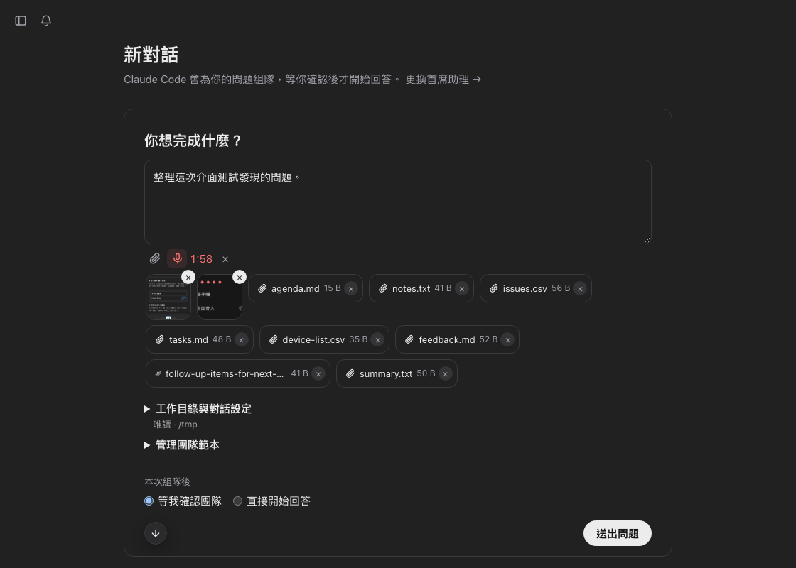
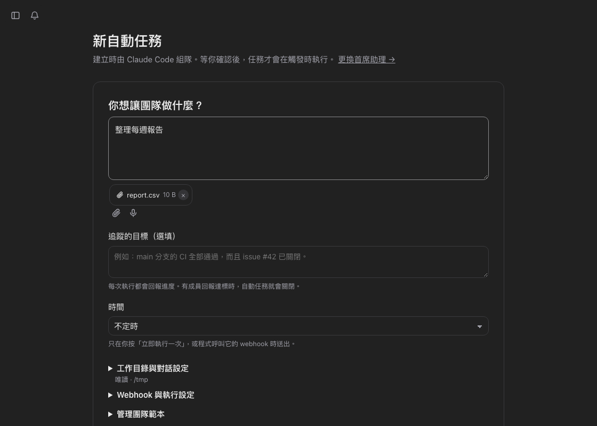
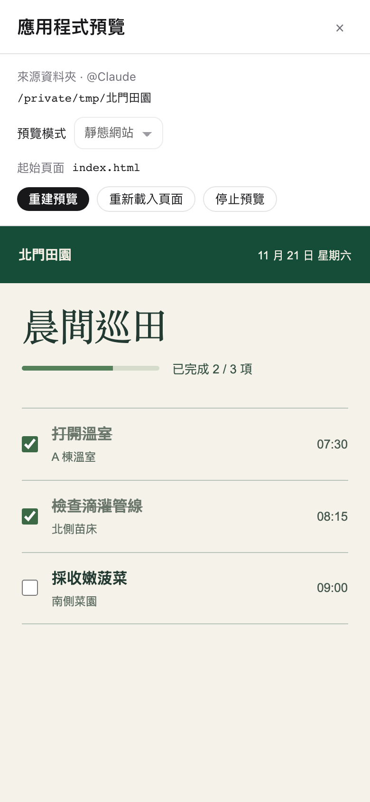
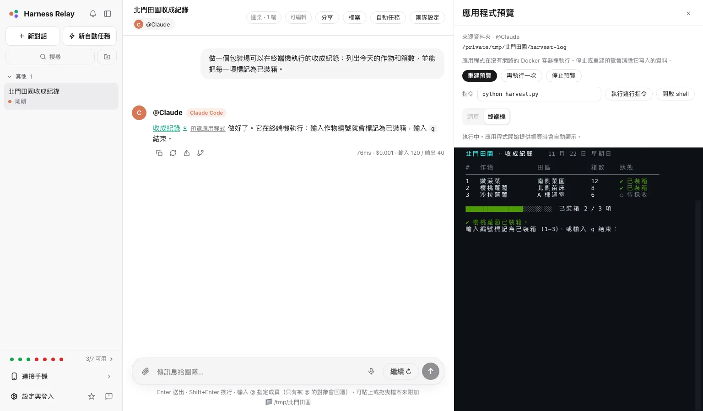
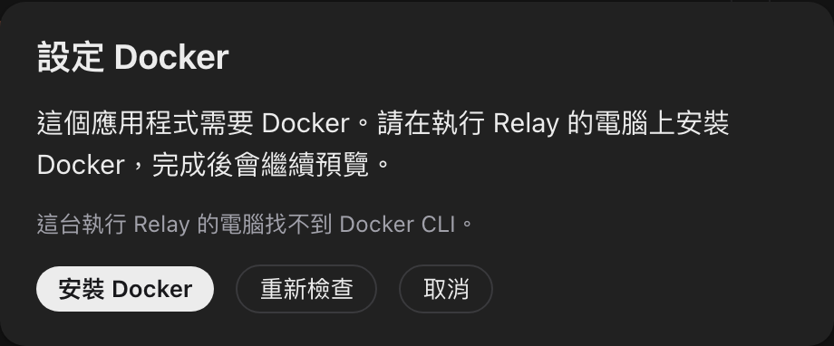
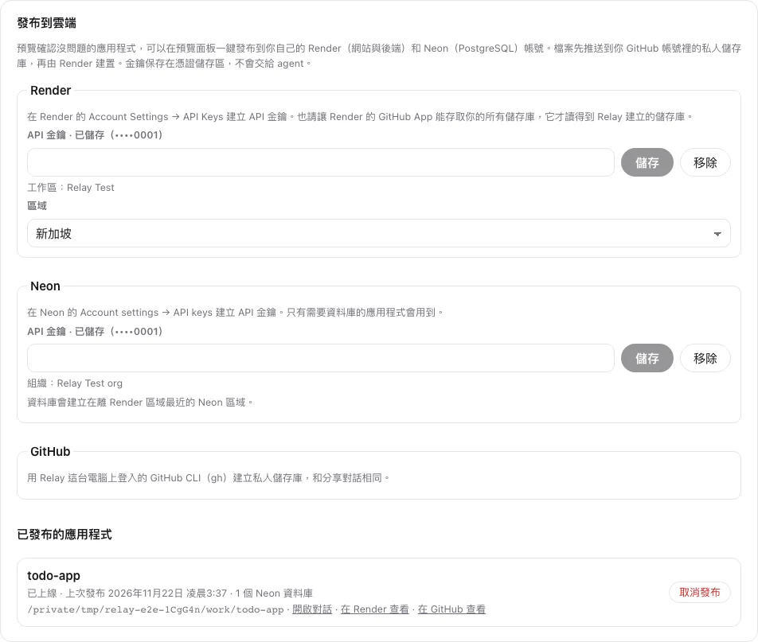
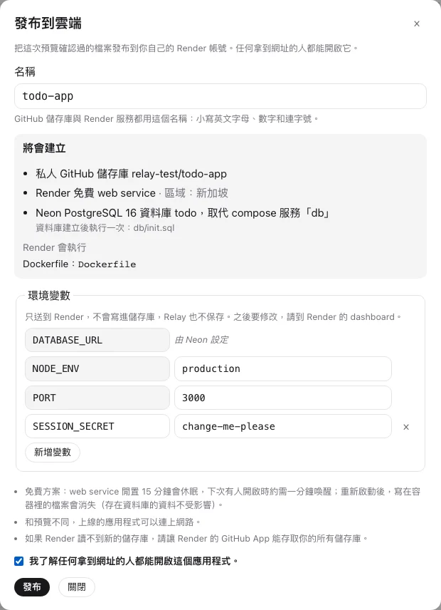
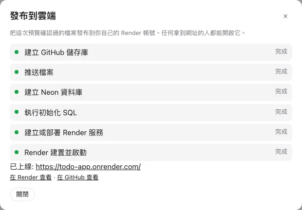

[English](user-guide.md) | **繁體中文**

# 使用者說明

這份說明介紹如何安裝 Harness Relay、登入各個 agent（或替開源 agent 設定模型來源）、開始對話（首席 agent 會從你的範本出發，為每個問題組隊），以及跟團隊對話。

## 1. 安裝與啟動

需要 Node.js 22.13 以上，以及至少一個 agent CLI：`claude`、`codex`、`grok`、`cursor-agent`（Cursor）、`agy`（Antigravity）、`copilot`（GitHub Copilot）、`muse`（Muse Code），或五個開源 agent 之一（`opencode`、`goose`、`cline`、`openhands`、`pi`）。各自去哪裡取得、Harness Relay 以哪些版本驗證過，見下方的[安裝 agent 的 CLI](#安裝-agent-的-cli)。編輯與平行模式還需要 [Git](https://git-scm.com/downloads)，Harness Relay 用它做快照與 worktree。

```bash
npm install
npm run build
npm start
```

手邊沒有能安裝它的電腦？可以[在 GitHub Codespaces 試用](codespaces.zh-TW.md)：GitHub 雲端上一台屬於你的 Linux 機器，已經裝好七個非開源的 agent 並啟動 Harness Relay。

打開 `npm start` 在終端機印出的登入連結（`http://127.0.0.1:8787/#code=…`）：Harness Relay 只接受登入過的瀏覽器，所以你電腦上的其他程式，包括 agent 執行的程式碼，都無法操作它。這個連結只能用一次，一小時內有效；之後要讓另一個瀏覽器登入，請執行 `npm run login`，或使用「**設定 → 連接手機 → 讓另一個裝置登入**」。如要查看或登出瀏覽器，請到「**設定 → 已登入的瀏覽器**」。`git pull` 之後，請重新執行 `npm install` 和 `npm run build`，再執行 `npm start`。（要開發 Harness Relay 本身，改用 `npm run dev` 並打開 <http://localhost:5173>；詳見[開發者說明](developer-guide.zh-TW.md)。）

側邊欄底部的圓點代表各 agent 的狀態：綠色＝可以使用、橘色＝尚未登入（開源 agent 則是還沒有模型來源）、紅色＝找不到 CLI。開源 agent 要等它的 CLI 安裝好才會出現圓點。這些圓點排成一行，後面是可用的數目（*4/11 可用*）；把滑鼠移到圓點上可以看到它的名稱與狀態，點它會打開那個 agent 的設定。旁邊的箭頭可以顯示名稱，再按一次就收起來；這個瀏覽器會記住你的選擇。

要用手機、平板或另一台電腦使用 Harness Relay，用 `tailscale serve` 把它分享到你的 tailnet，也可以加到手機主畫面：詳見[用手機連線（Tailscale）](remote-access.zh-TW.md)。在電腦上，Chrome 與 Edge 也能把它安裝成 App（網址列的安裝按鈕），macOS 的 Safari 則能把它加到 Dock（**檔案 → 加入 Dock**）。

### 安裝 agent 的 CLI

不需要全部都裝，任何組合都能用。把想用的裝好、放上 `PATH`，再到「**設定與登入**」分別登入（[2. 分別登入各個 agent](#2-分別登入各個-agent設定與登入)）；開源 agent 沒有登入流程，改在那裡設定[模型來源](#模型連線)。

要登入的七個：

- [Claude Code](https://docs.claude.com/en/docs/claude-code)（`claude`；以 2.1.322 驗證過）
- [Codex CLI](https://github.com/openai/codex)（`codex`；以 0.167.0 驗證過）
- [Grok CLI](https://github.com/xai-org/grok-build)（`grok`；以 1.0.77 驗證過）
- [Cursor CLI](https://cursor.com/cli)（`cursor-agent`；以 2026.11.11-043ef28 驗證過）
- [Antigravity CLI](https://antigravity.google/download)（`agy`；在 macOS、Linux 與 Windows 上以 1.5.6 驗證過），用你的 Google 帳號或 Gemini API key 登入
- [GitHub Copilot CLI](https://github.com/features/copilot/cli)（`copilot`，npm `@github/copilot`；在 macOS、Linux 與 Windows 上以 1.0.109 驗證過），用你的 GitHub 帳號或 GitHub token 登入。在 Linux 上，完全存取以外它的沙箱需要 bubblewrap、slirp4netns，以及 unprivileged user namespace 與 network namespace（見[各平台的作業系統沙箱 → Linux](sandboxing.zh-TW.md#linux)）。
- [Muse Code](https://dev.meta.ai/products/muse-code/)（`muse`；在 macOS 與 Linux 上以 1.4.18 驗證過，Windows 上也驗證過），用你的 Meta 帳號或 Meta API key 登入

Muse Code 在 macOS 與 Linux 上用 `curl -fsSL https://dev.meta.ai/install.sh | bash` 安裝，在 Windows PowerShell 用 `irm https://dev.meta.ai/install.ps1 | iex`；它的安裝程式會透過你 shell 的設定檔把一個啟動器放上 `PATH`，啟動器會自己把 Muse 保持在最新版（在 Windows 上是 `muse.cmd`，Harness Relay 會啟動它指名的版本）。在 Windows 上，Muse Code 1.4.18 在 Harness Relay 裡完全存取以外的權限不執行任何指令，完成 Muse 自己的沙箱設定（`muse sandbox windows setup`）後也一樣：Harness Relay 驅動它的那個模式在那裡不用沙箱，所以它的指令會失敗，而不會在沙箱外執行；它的檔案工具能用，完全存取時也能執行指令。

五個開源 agent，以及 Harness Relay 驗證過的版本（其他版本在轉接器依賴的地方可能不同）：

| Agent | 安裝 | 驗證過的版本 |
| --- | --- | --- |
| [OpenCode](https://www.npmjs.com/package/opencode-ai)（`opencode`） | `npm install -g opencode-ai@1.19.5` | 1.19.5 |
| [Goose](https://formulae.brew.sh/formula/block-goose-cli)（`goose`） | `brew install block-goose-cli` | 1.58.1 |
| [Cline](https://www.npmjs.com/package/cline)（`cline`） | `npm install -g cline@3.0.74` | 3.0.74 |
| [OpenHands](https://pypi.org/project/openhands/)（`openhands`） | `uv tool install openhands==1.16.0`（需要 [uv](https://docs.astral.sh/uv/)） | 1.16.0 |
| [Pi](https://www.npmjs.com/package/@earendil-works/pi-coding-agent)（`pi`） | `npm install -g @earendil-works/pi-coding-agent@1.5.1`（需要 Node.js 22.19 以上） | 1.5.1 |

#### 從設定頁安裝 CLI

也可以在「**設定與登入**」裡，從每個 CLI 自己的卡片分別安裝它。Harness Relay 找不到某個 CLI 時，它的卡片會顯示「**安裝 <CLI>**」按鈕，以及會裝進哪個資料夾。按一下就會在背景把它裝進那個專屬的資料夾 `data/clis/<cli>`（在[桌面 app](#桌面-app) 裡是它資料夾中的 `clis/`），一邊安裝一邊顯示安裝程式的輸出（最前面是它執行的指令）（可以「**取消安裝**」），確認程式能執行，再把這個 CLI 的「**執行檔**」設成它。CLI 不會放到其他地方：不會放上你的 `PATH`，也不會改你 shell 的設定檔，所以這樣裝的 CLI 只給 Harness Relay 用（安裝程式若仍在你 `PATH` 上的資料夾放了指向它程式的連結，裝完就會拿掉；在 Windows 上，不論安裝程式對你使用者的 `PATH` 做了什麼，它跑完後都會還原成執行前的樣子，所以 Windows 上的安裝一次只跑一個）。npm 與 uv 下載的檔案也不會留在你自己的快取裡：每次安裝都把自己的快取放在那個資料夾，裝完就刪掉。之後卡片會顯示「**由 Harness Relay 安裝在 …**」與「**移除**」按鈕：移除會刪掉那個資料夾，並把執行檔設定改回安裝前的樣子；CLI 的登入、設定與對話紀錄都留在它自己的家目錄。用其他方式安裝的 CLI 不會出現移除按鈕。各 CLI 的安裝方式：

- 用 npm（隨 Node.js 一起安裝），以全域安裝的方式裝進那個資料夾（`npm install -g`）：Claude Code、Codex 與 Copilot（最新版），以及 OpenCode、Cline 與 Pi（下表的版本）。`PATH` 上沒有 npm 時（[桌面 app](#桌面-app) 不需要 Node.js），Claude Code、Codex 與 Copilot 照樣能安裝：會先把適合你系統的 Node.js 26.13.1 官方版本放進那個資料夾，用 `curl` 從 nodejs.org 下載，和 Harness Relay 記下的檢查碼核對過，再用 `tar` 解開（只取出 Node 與它的 npm），然後由它的 npm 安裝 CLI。這份 Node 會留在資料夾裡，Codex 與 Copilot 的程式就是用它執行的（它們是 npm 連結的 Node 腳本），移除 CLI 時一起刪除；它不會被放上你的 `PATH`，agent 自己執行的指令也拿不到它。安裝前卡片會先說明。在 Linux 上，這個版本需要 libatomic，桌面系統通常都有，精簡的系統可能沒有（Debian 與 Ubuntu 的 `libatomic1`、Fedora 的 `libatomic`），下載則需要 curl，而 Ubuntu 桌面版沒有：在桌面 app 中，[安裝沙箱需要的元件](#安裝沙箱需要的元件)會把兩者都裝好。安裝時會先確認 Node 能執行，才讓 npm 在上面跑，不能執行時會說明原因。Node.js 沒有給使用 musl 的 Linux（Alpine）或 32 位元系統的官方版本，在那些系統上請自行安裝 Node.js。開源 agent 的 npm 安裝（OpenCode、Cline、Pi）仍然需要 `PATH` 上的 npm；Cline 與 Pi 也用那份 Node.js 執行，Harness Relay 自己的沙箱就是用它啟動它們。
- 用它官方的安裝腳本，以 `curl` 下載，並把那個資料夾當作它的家目錄執行，所以它在程式旁邊寫的東西（shell 設定檔、快取）也都留在裡面：Grok、Cursor、Antigravity 與 Muse Code（最新版），以及 Goose（1.58.1）。在 macOS 與 Linux 上執行各自的 `bash` 腳本；在 Windows 上 Grok、Cursor、Antigravity 與 Muse Code 執行它們的 PowerShell 安裝程式（`irm … | iex`），Goose 則在 Git for Windows 附的 bash（Git Bash）裡執行它的 `bash` 腳本，它本來就支援。
- 用 [uv](https://docs.astral.sh/uv/)（`uv tool install`），它替這個工具下載的 Python 也放在那個資料夾裡：OpenHands。在 Windows 上它用 x64 的 Python 3.12，在 Windows on Arm 上也一樣（在那裡以模擬方式執行），因為它的一些套件沒有給 Arm 的版本。你的 `PATH` 上沒有 uv 時，會先用 uv 自己的安裝程式把 uv 裝進那個資料夾，移除 OpenHands 時一起刪掉。

找不到安裝需要的程式（開源 agent 需要的、隨 Node.js 一起安裝的 npm；`curl`；解開 Node.js 下載檔用的 `tar`（在 Windows 上是 System32 裡的那個）；`bash`，或在 Windows 上的 Git for Windows bash 或 Windows PowerShell）時，卡片會說明缺了什麼。在 Windows 上缺少 Git Bash 時，卡片會提供「**安裝 Git**」。安裝失敗或取消都不會留下任何檔案；失敗的原因與輸出會留在卡片上，直到你再試一次。要等沒有 agent 在工作時才能移除，桌面 app 的更新也會等到沒有 CLI 正在安裝。會自行更新的 CLI（Claude Code、Cursor、Muse Code 的啟動器、Grok）照它官方更新程式的方式更新，可能寫到那個更新程式會寫的地方；在 Windows 上，Grok 會到你自己的 `%LOCALAPPDATA%` 找它安裝程式下載的那份 Git，而不是到資料夾裡找，所以請讓你的 `PATH` 上有 Git for Windows 給它用。[GitHub codespace](codespaces.zh-TW.md) 裡已經裝好七個非開源的 CLI；開源的那幾個在那裡也一樣從設定頁安裝。Node.js 不會替你裝到 `PATH` 上：從原始碼執行時你已經有了（`npm start` 就是用它跑的），[桌面 app](#桌面-app) 則從你登入 shell 的 `PATH` 找它；沒有的話，只有上面說的、放在 CLI 資料夾裡的那一份。

完全存取以外，它們在 Harness Relay 自己的沙箱中執行（[開源 agent → Harness Relay 的沙箱](open-agents.zh-TW.md#harness-relay-的沙箱)）。macOS 上不需要另外安裝（在[桌面 app](#桌面-app) 裡則需要 `PATH` 上有 Node.js 22.12 以上，或設定頁裝的那一份）；Linux 上請安裝 `bubblewrap`、`socat` 與 `ripgrep`（`sudo apt-get install bubblewrap socat ripgrep`），Ubuntu 23.10 以上還要加上[各平台的作業系統沙箱 → 在 Linux 上](sandboxing.zh-TW.md#在-linux-上)裡 `/usr/bin/bwrap` 的 AppArmor 設定檔。這些 Harness Relay 都能替你安裝：見[安裝沙箱需要的元件](#安裝沙箱需要的元件)。在原生 Windows 上它們只能以完全存取執行（要有沙箱請用 WSL2），Linux 上的 OpenCode 也一樣（Harness Relay 在那裡無法監看它的伺服器）。

#### 安裝沙箱需要的元件

在完全存取以外，agent 執行的指令都在系統的沙箱裡跑；沙箱缺少需要的東西時，Harness Relay 不會讓指令在沙箱外執行，那些 agent 的指令就會直接失敗。所以 Harness Relay 會檢查這台電腦上沙箱需要的東西，能裝的就替你裝。有東西缺少時，按**新對話**會先跳出一個對話框，列出缺少的東西、哪些 agent 的沙箱需要，並強烈建議安裝：按**安裝（強烈建議）**就在那裡安裝，邊裝邊顯示輸出；按**先不要**會關掉它，這個瀏覽器之後不再詢問（按 Escape 或 × 則只關到下次開啟頁面）。**設定與登入 → 沙箱**一直列著同樣的清單，附**安裝**按鈕，什麼都不缺時也會說明。依系統，它涵蓋：

- **Linux**：沙箱要用的套件，用你的套件管理工具（apt、dnf、pacman 或 zypper）安裝：`bubblewrap`（Claude Code、Codex、Grok、Copilot 與開源 agent）、`socat`（Claude Code 與開源 agent）、`ripgrep`（開源 agent），以及 Copilot 的沙箱需要的 `slirp4netns`、`iproute2`、`iptables` 與 `util-linux`；在 Ubuntu 23.10 以上（預設不讓程式建立 user namespace），再加上讓 `/usr/bin/bwrap` 能建立它的 AppArmor 設定檔（`/etc/apparmor.d/harness-relay-bwrap`，就是 Claude Code 文件給的那份；你已經有一份時就不加）。這些需要系統管理員權限，只問一次：以 root 執行、`sudo` 不需要密碼時用 `sudo`，或用 `pkexec`，由你的桌面環境跳出密碼視窗（視窗有它自己的取消）。這些方法都不行的地方（例如透過 SSH），清單會附上要在終端機執行的指令，以及**複製**按鈕。套件管理工具開始執行後，安裝就不能取消：中途停止可能讓它的資料庫需要修復。加了 AppArmor 設定檔後，Ubuntu 的那項限制就不再管 bubblewrap，對這台電腦的每個使用者都是，跟 Claude Code 文件說的一樣。
- **macOS 與 Linux 上的桌面 app**，登入 shell 的 `PATH` 上沒有 Node.js 22.12 以上時：給 Harness Relay 自己的沙箱（開源 agent 的）用的 Node.js 26.13.1 官方版本，跟[安裝 CLI](#從設定頁安裝-cli) 時一樣核對檢查碼，放進 app 資料夾裡的 `clis/sandbox-node`，不需要系統管理員權限。它用 curl 下載，在 Linux 上要有 libatomic 才能執行：缺少其中之一時（Ubuntu 桌面版預設沒有 curl），它會先跟套件一起安裝，再放進 Node.js。

這裡裝不了的東西（例如沒有系統管理員權限）不會擋住其他東西的安裝：裝完後，清單留下剩下的部分與它們的指令。
- **Windows**：沒有要裝的。Codex 與 Copilot 的沙箱不需要另外安裝，其他 CLI 在那裡沒有沙箱（見[各平台的作業系統沙箱](sandboxing.zh-TW.md#windows)）。

替所有程式解除 user namespace 的限制（`kernel.apparmor_restrict_unprivileged_userns=0`）——Ubuntu 上 Copilot 的沙箱可能仍然需要——則留給你自己決定：這會削弱整個系統的保護（[各平台的作業系統沙箱 → 在 Linux 上](sandboxing.zh-TW.md#在-linux-上)）。

有兩個功能用到時才需要多裝一點。[語音輸入](#語音輸入)開啟時會自動安裝：macOS 需要 [Homebrew](https://brew.sh)；Linux 的預先編譯引擎需要 glibc 2.34 以上（Ubuntu 22.04、Debian 12 或更新）。把[對話分享](#分享對話)成連結需要 [GitHub CLI](https://cli.github.com)（`gh`）2.66.0 以上並登入（在分享對話框裡，或用 `gh auth login`），附上檔案時還需要 `git`。

### 桌面 app

除了在終端機執行 `npm start`，也可以把 Harness Relay 安裝成桌面 app，支援 macOS（13 Ventura 以上，Apple Silicon）、Windows 10 以上（x64 或 Arm64），以及有桌面環境的 Linux（x64 或 Arm64）。它在背景執行同一個伺服器，並在它自己的視窗裡顯示已登入的對話，沒有網址列。關掉視窗後，伺服器會繼續執行，選單列或系統匣留著一個圖示，所以手機照常能用。跟 `npm start` 一樣，它需要 agent 的 CLI（可以[從設定頁安裝](#從設定頁安裝-cli)，Claude Code、Codex 與 Copilot 不需要 Node.js 也能裝），編輯與平行模式需要 Git，缺少時會提供安裝按鈕。但不需要 Node.js，只有開源 agent 在完全存取以外執行時例外：它們所在的 Harness Relay 自己的沙箱，需要登入 shell 的 `PATH` 上有 Node.js 22.12 以上，或[設定 → 沙箱](#安裝沙箱需要的元件)裝進 app 資料夾的那一份（兩者都沒有的話，它們只能以完全存取執行）。

**安裝。** 從[網站](https://agentic-system-lab.github.io/harness-relay/zh-TW/)（提供最新的正式版本，不提供候選版本：版本結尾是 `-rc` 的，見[版本](#版本)）或 [Releases](https://github.com/Agentic-System-Lab/harness-relay/releases)（也有候選版本）下載你系統的安裝檔。安裝之後，app 會自己更新：正式版本只更新到下一個正式版本，候選版本則會更新到之後的候選版本或正式版本（見下方 **更新**）。

- **macOS**：`Harness-Relay-<版本>-mac-arm64.dmg`，給 Apple Silicon 的 Mac。打開後把 Harness Relay 拖到「應用程式」。Intel Mac 沒有 app：請在那裡從原始碼執行 Harness Relay（`npm start`，見[快速開始](../README.zh-TW.md#快速開始)）。2026-11-11 與它的候選版本的 Mac app 是兩種 Mac 通用的，它們的選單找不到之後的版本：請從網站重新下載一次新版。
- **Windows**：`Harness-Relay-<版本>-win-x64.exe`，Windows on Arm 用 `Harness-Relay-<版本>-win-arm64.exe`。只安裝給你的帳號，不需要系統管理員權限。Windows 11 on Arm 也能執行 x64 版（透過模擬），Windows 10 on Arm 則不行；Arm64 版在兩者上都是原生執行。
- **Linux**：`Harness-Relay-<版本>-linux-x86_64.AppImage`，64 位元 Arm（aarch64）用 `Harness-Relay-<版本>-linux-arm64.AppImage`。加上執行權限（`chmod +x`）後執行。

網站的下載按鈕會寫出你的系統；瀏覽器有提供處理器時也會分辨（Windows on Arm 上的 Chrome 與 Edge，以及 Linux on Arm 上的任何瀏覽器）。點[下載按鈕旁的安裝指南](https://agentic-system-lab.github.io/harness-relay/zh-TW/#start)即可查看各系統的安裝檔。[查看下載區畫面](media/home-download-zh-TW.webp)。

也可以在 clone 下來的資料夾執行 `npm install` 之後自己建置。建置所在系統的安裝檔會放在 `desktop/release/`；`npm run desktop` 則是不安裝、直接執行：

```bash
npm install --prefix desktop
npm run desktop:dist
```

有 Harness Relay 正從 `desktop/release/` 執行時，`npm run desktop:dist` 會拒絕開始，因為它會替換那些檔案：請先結束那一個，或用 `npm run desktop:dist -- --output <資料夾>` 建置到其他地方。打開新建置的 app 之前，也要先結束正在執行的 Harness Relay，否則 macOS 只會把正在執行的那一個帶到前面（同時只會有一個 Harness Relay 在執行）。之後可以用 `npx tsx desktop/scripts/check-package.ts` 像檢查正式版本一樣檢查剛建置的 app。

安裝檔還沒有為發佈簽章（macOS 上是 ad hoc 簽章），所以第一次開啟時系統會警告：

- **macOS**：「Apple 無法驗證 "Harness Relay"」。打開 **系統設定 → 隱私權與安全性**，在 Harness Relay 旁按 **強制打開**。
- **Windows**：SmartScreen 顯示「Windows 已保護您的電腦」。按 **其他資訊**，再按 **仍要執行**。
- **Linux**：在 Ubuntu 24.04 這類限制非特權 user namespace 的系統上，AppImage 可能一啟動就結束，並提到 *SUID sandbox helper*。請加上 `--no-sandbox` 啟動（`./Harness-Relay-….AppImage --no-sandbox`）；之後 **登入時自動啟動** 也會這樣啟動它。

**登入。** App 會向它的伺服器拿一個一次性的登入連結來打開對話，所以視窗不用輸入代碼就已登入；**在瀏覽器打開** 則在預設瀏覽器做同樣的事。這個連結不會印出，也不會寫進記錄檔，而且只在一分鐘內有效。視窗本身就是一個獨立的瀏覽器：它會列在 **設定 → 已登入的瀏覽器** 裡，使用導覽與介面語言也是它自己的。要讓手機登入，在選單選 **分享到手機（Tailscale）…**，依[手機配對說明](remote-access.zh-TW.md#用桌面-app)安裝 Tailscale 並掃描登入碼。如果視窗出現登入頁（它的登入被撤銷，或登入連結沒有及時使用），從 app 的選單選 **打開 Harness Relay**：視窗會用新的連結重新登入。如果是瀏覽器出現登入頁，就選 **在瀏覽器打開**。視窗的登入資訊放在 app 資料夾裡的 `browser` 資料夾，權限低於完全存取的 agent 讀不到它（在 macOS 與 Linux 上，由它們的沙箱強制執行）。

**視窗。** 關掉視窗後，Harness Relay 會繼續在選單列或系統匣執行（macOS 上它的 Dock 圖示會消失，直到視窗再次打開）；選 **結束**（macOS 上是 ⌘Q）才會停止。連到其他網站的連結會在預設瀏覽器打開，從對話下載的檔案則透過一般的儲存對話框儲存。第一次使用語音輸入時會詢問麥克風權限；影片本身的全螢幕按鈕也能用。在 Windows 與 Linux 上，按 Alt 會顯示視窗的選單列，裡面也有 **結束**。

**選單。** App 的圖示是 Harness Relay 的三個圓點，在 macOS 的選單列，或 Windows 與 Linux 的系統匣。在 Windows 上，點一下圖示會打開對話，選單在右鍵。選單使用 app 視窗裡對話介面的語言，視窗的選單列與 app 的對話框也一樣：在視窗的 **設定與登入 → 介面語言** 切換後，它們會立刻跟著換，下次啟動也一樣（視窗還沒打開過之前，它們跟著系統的語言；在其他瀏覽器例如手機選的語言不會改變它們）。選單有：

| 項目 | 作用 |
| --- | --- |
| 「執行中：<http://127.0.0.1:8787>」 | 伺服器的狀態：啟動中、執行中、停止中或已停止。 |
| **打開 Harness Relay** | 顯示對話視窗。再次打開 app（從 Dock、啟動台或「開始」選單）也一樣。 |
| **在瀏覽器打開** | 改用預設瀏覽器打開已登入的對話。 |
| **分享到手機（Tailscale）…** | 把伺服器分享到你的 tailnet，也就是[用手機連線](remote-access.zh-TW.md#用桌面-app)的第 1、2 步，並顯示手機要打開的網址。分享之後，**複製手機網址** 會複製它。 |
| **登入時自動啟動** | 登入電腦時啟動 app，但不打開視窗。 |
| **執行時不讓電腦睡著** | App 執行時，電腦不會自己進入睡眠，手機才連得到。MacBook 闔上蓋子還是會睡眠。 |
| **打開資料夾**、**查看記錄檔** | App 的資料夾（見下方）與伺服器的記錄檔。 |
| **重新啟動伺服器…**、**啟動伺服器** | 重新啟動伺服器（正在回覆的對話會中斷），或在它停止後再啟動。 |
| 「版本」 | App 的版本（見[版本](#版本)）。 |
| **更新到 2026-11-12…** | 有更新的版本時出現（正式版本只看正式版本；候選版本看正式版本與候選版本）：更新 app（見下方 **更新**）。更新進行中，這一項會顯示下載進度（選單開著時也會即時更新）；還有對話在回覆時，則顯示「更新已就緒，等回答結束後切換」。 |
| **立即切換到新版…** | 更新在等回覆結束時出現：詢問後立即切換，正在回覆的對話會被中斷。 |
| **結束 Harness Relay** | 停止伺服器（它會先停止所有 agent），然後結束。 |

有些 Linux 桌面會隱藏系統匣圖示（例如沒有 AppIndicator 擴充套件的 GNOME）。在那裡，再次打開 app 會顯示視窗（或啟動已停止的伺服器），視窗的選單列（Alt）除了編輯、縮放與視窗之外，還有 **在瀏覽器打開** 與 **結束**。選單的其他項目（**分享到手機**、**登入時自動啟動**、**執行時不讓電腦睡著**、**重新啟動伺服器…**、記錄檔、資料夾與更新）在那裡都用不到：請安裝 AppIndicator 擴充套件，或改用終端機（`tailscale serve`，見[用手機連線](remote-access.zh-TW.md)）。

**跟 `npm start` 不同的地方：**

- **它有自己的資料夾。** App 把檔案放在 macOS 的 `~/Library/Application Support/Harness Relay`、Windows 的 `%APPDATA%\Harness Relay`、Linux 的 `~/.config/Harness Relay`：對話與設定在其中的 `data` 資料夾，app 自己的設定在 `desktop.json`。它不使用 clone 資料夾裡的 `data/`。要沿用原本的對話，先把兩者都結束，再把 clone 資料夾裡 `data/` 的內容複製到 app 的 `data` 資料夾，並在設定中重新輸入 API key 與 MCP 伺服器的祕密值（它們在金鑰儲存區裡另一個名稱下：見下一點）。或者在 shell 設定檔裡設定 `RELAY_DATA_DIR`，app 也會讀取。絕對不要讓兩者同時使用同一份資料。
- **它有自己的 API key。** 使用自己的資料夾時，app 把 API key 存在金鑰儲存區的 `harness-relay-desktop` 名下，跟 `npm start` 的（`harness-relay`）分開，所以在其中一邊儲存或移除 key，不會影響另一邊。設定了 `RELAY_DATA_DIR` 時，兩者共用資料，也都使用 `harness-relay`。
- **你的 shell 環境。** 在 macOS 與 Linux 上，app 會讀取登入 shell 設定好的環境（`~/.zshrc`、`~/.bashrc` 等檔案裡的 PATH、API key 與其他變數），所以會像終端機一樣找到 CLI。**重新啟動伺服器…** 與 **啟動伺服器** 時會再讀一次：安裝新的 CLI 或修改設定檔之後，選其中一個。在 Windows 上，app 在打開時從系統取得 PATH，並在 **重新啟動伺服器…** 與 **啟動伺服器** 時，從 Windows 重新讀取 PATH 與你的使用者變數。
- **一律使用 127.0.0.1、port 8787。** Shell 設定檔裡的 `PORT` 或 `HOST` 是給其他程式用的，app 不會採用。要改用其他 port，先結束 app，再修改它的 `desktop.json` 裡的 `"port"`（檔案不存在時就建立它：`{ "port": 8790 }`）。`npm start` 也使用 port 8787，所以除非其中一個改用其他 port，兩者不能同時執行（`npm run dev` 使用 8789，被佔用時改用下一個空的，絕不用 8787，所以能和 app 同時執行；和 `npm start` 同時執行則要在另一個 checkout，因為一個資料夾只能有一個伺服器）。如果 port 已被佔用（例如被用 `npm start` 啟動的 Harness Relay），app 會告訴你，並讓你再試一次。
- **上限、回合逾時與語音下載。** 有些設定是環境變數，在伺服器啟動時讀取：每個 CLI 能有幾個帳號（`RELAY_MAX_ACCOUNTS`）、一個隊伍能有幾位成員（`RELAY_MAX_TEAM_AGENTS`）、一個 agent 回合最久多長（`RELAY_TURN_TIMEOUT_MIN`），以及語音輸入從哪裡下載、檔案放在哪裡（`RELAY_VOICE_MODEL_BASE_URL`、`RELAY_VOICE_ENGINE_BASE_URL`、`RELAY_VOICE_DIR`）；[開發者指南](developer-guide.zh-TW.md#環境變數)列出了它們的預設值與範圍。在 macOS 與 Linux 上，把它們 `export` 在 shell 設定檔裡（`~/.zprofile`、`~/.bashrc` 等）。在 Windows 上，請設成*使用者*變數：在 PowerShell 執行 `setx RELAY_MAX_TEAM_AGENTS 16`，或到 **系統內容 → 環境變數 → 使用者變數**；系統變數中，app 只會重新讀取 PATH。接著選 **重新啟動伺服器…**（進行中的回覆會停止）。在 Windows 上，刪掉的變數或系統變數，要結束 app 再重新打開才會生效。值不合法時伺服器不會啟動，app 的訊息會說明是哪一個。
- **預設工作目錄**是你的家目錄，直到你在設定中修改。編輯模式不接受家目錄本身（agent 會在不詢問的情況下修改你的 shell 與工具設定）：編輯模式的對話請選一個專案資料夾。
- **伺服器的記錄檔**在 macOS 是 `~/Library/Logs/Harness Relay/server.log`，在 Windows 與 Linux 是 app 資料夾裡的 `logs/server.log`。
- **macOS 可能會詢問** Harness Relay 能否存取「文件」或「桌面」等資料夾（agent 第一次在那裡工作時）、能否使用麥克風（第一次使用語音輸入時），以及更新後能否使用鑰匙圈裡它的金鑰。詢問的對象是這個 app，因為 agent 在它裡面執行。請選 **允許**（或 **永遠允許**）。
- **結束 app** 時會先停止所有 agent。強制結束 app（或 app 當機）時，正在回覆的 agent 可能會繼續執行，就像用 `kill -9` 停止 `npm start` 一樣。伺服器還在啟動時（例如在等鑰匙圈）結束 app，會立刻停止它：那時它還沒有執行任何 agent。

**更新。** App 啟動約 30 秒後，以及之後每小時，會向 GitHub（`api.github.com`）查詢它的版本，取版本最新的那一個。正式版本的 app 只取正式版本（`2026-11-11` 之後是 `2026-11-12`，絕不會是 `2026-11-12-rc`）；候選版本的 app 也取候選版本（`2026-11-12-rc.1` 之後可以是 `2026-11-13-rc`，也可以是 `2026-11-12`，更新到正式版本後就回到只取正式版本）。當那個版本比 app 新、並且有你系統的安裝檔時（在 Windows 與 Linux 上，是你執行的 app 所屬處理器的安裝檔），選單會出現 **更新到** 加上它的版本（例如 **更新到 2026-11-12…**），聊天介面也會提供：在 app 的視窗裡每個版本跳出一次對話框（按「稍後再說」就不再為那個版本跳出；用 Esc 或 × 關掉的，下次打開 app 時會再跳出；有其他對話框開著、或你正在打字或錄音時會先等），以及「設定與登入 → 版本」這張卡片，它也會顯示你目前的版本與上次檢查的時間。設定頁上方的「重新檢查狀態」會立刻再檢查一次 GitHub（最多每 5 分鐘一次）。對話框或卡片裡的「更新」和選單裡的效果一樣。不論你的版本之後出了幾個版本，它都只提供最新的那一個，一次更新到它。選了之後會先詢問；**查看變更內容**（對話框和卡片裡的「變更內容」也是）會打開 GitHub 上你的版本與新版本的比較頁，列出你的版本之後的每一個變更，不論中間出了幾個版本（每個正式版本自己的版本說明只列出它前一個正式版本之後的變更）；自己建置的版本在 GitHub 上沒有對應的版本，打開的是該版本的頁面。接著 app 會下載安裝檔、用 GitHub 公布的 SHA-256 檢查碼檢查它，選單會顯示進度（選單開著時，大約每秒重新打開一次來顯示）。切換之前，它會等到沒有任何對話有 agent 在工作：正在回覆、正在組隊、在等你核准工具、正在修改隊伍、正在把對話分組、正在套用平行模式的回覆或建立分支，也會等從設定頁進行中的 CLI 安裝完成。在等你回答 agent 問題的對話不算：換成新版後，它一樣會等你回答。這段期間選單會顯示「更新已就緒，等回答結束後切換」，選 **立即切換到新版…** 則會在詢問後立即切換，並中斷正在回覆的對話。接著 app 會結束，再以新版重新打開：

- **macOS**：新的 app 會就地取代「應用程式」（或你放它的地方）裡的 app。這需要一個 app 能寫入的資料夾（系統管理員的「應用程式」資料夾即可），而且 app 不能直接從 `.dmg` 執行。如果 macOS 不讓 app 取代自己（可能會要求你允許 **App 管理**），會打開新版的 `.dmg`：把 Harness Relay 拖到「應用程式」、取代舊版即可。
- **Windows**：app 結束後，安裝檔會在背景安裝，並打開新版。
- **Linux**：新的 AppImage 會取代你執行的那一個。如果那一個是以版本命名的（下載時的名稱），新的會用它自己的版本命名，並刪除舊的；**登入時自動啟動** 也會跟著改。只有 AppImage 能自己更新。

切換之前，你執行的 app 都不會被改動：更新在等待時結束 app（或重新啟動伺服器、關機），會保留目前的版本，下次啟動時會刪掉更新下載的檔案（選單會再提供這次更新）。Windows on Arm 上的 x64 版會繼續更新成 x64 版；要改用 Arm64 版，請從網站或版本頁面安裝它。

Harness Relay 更新時開著的聊天頁面，會在一分鐘內（或你回到它的視窗時）自己重新載入，改用新版本的程式。

無法自己更新的 Harness Relay（用 `npm run desktop` 從原始碼執行的、放在不能寫入的資料夾裡的、安裝檔沒有檢查碼的）會說明原因，並改為提供該版本的頁面：照第一次的方式安裝新版即可。要關掉這些查詢，在 shell 設定檔（或 app 的環境）設定 `RELAY_UPDATES=off`。

**它把東西放在哪裡，以及解除安裝。** App 的資料夾在 macOS 是 `~/Library/Application Support/Harness Relay`，Windows 是 `%APPDATA%\Harness Relay`，Linux 是 `~/.config/Harness Relay`（有設定 `$XDG_CONFIG_HOME` 時是 `$XDG_CONFIG_HOME/Harness Relay`）。裡面有：`data`（對話與設定）、`browser`（視窗自己的瀏覽器資料，包括它的登入資訊）、`desktop.json`（app 的設定），在 Windows 與 Linux 上還有 `logs`。解除安裝的步驟：

1. 關掉 **登入時自動啟動**；如果分享過到手機，停止分享（`tailscale serve --https=443 off`，或 app 說它用的那個 HTTPS port：見[用手機連線](remote-access.zh-TW.md#安全性)），再結束 app。
2. 移除 app：把 Harness Relay 從「應用程式」拖到垃圾桶（macOS）；**設定 → 應用程式**（**已安裝的應用程式**，Windows 10 是 **應用程式與功能**）→ Harness Relay → **解除安裝**（Windows）；刪除 AppImage（Linux）。
3. 要連資料一起移除：刪除 app 的資料夾，在 macOS 上還有 `~/Library/Logs/Harness Relay`。API key 與 MCP 伺服器的祕密值在金鑰儲存區的 `harness-relay-desktop` 名下（macOS 的「鑰匙圈存取」、Windows 的認證管理員，或 Linux 的 keyring）：刪除這些項目。在 Linux 上，關掉 **登入時自動啟動** 後，`~/.config/autostart/harness-relay.desktop` 就會被刪除。

### 版本

版本就是發佈當天的日期（台灣時區）：`2026-11-10` 是正式版本，`2026-11-10-rc` 是候選版本，在正式版本之前先給大家試用。同一天再發佈的修正會加上編號：`2026-11-10.1`、`2026-11-10-rc.2`。當天的正式版本發佈之後，當天的修正就是它的修正版，修正版也可以先有自己的候選版本：先是 `2026-11-10.1-rc`、再來 `2026-11-10.1-rc.1`，然後才是 `2026-11-10.1`。選單會顯示 app 的版本，[Releases](https://github.com/Agentic-System-Lab/harness-relay/releases) 則把候選版本標成 pre-release。你自己建置的 app 會顯示建置的日期加上 `-dev` 與 commit，例如 `2026-11-10-dev (30f3d4f)`：當天或之後的任何版本（包括候選版本）都算比較新，會被提供為更新。

### 介面語言與使用導覽

介面提供 **English** 與 **繁體中文**。第一次開啟時會依瀏覽器的語言決定（任何中文 → 繁體中文，其他 → English），並記在這個瀏覽器；之後隨時可以在 **設定與登入 → 介面語言** 切換。伺服器傳來的錯誤訊息與系統訊息也會使用同一種語言。在[桌面 app](#桌面-app) 裡，app 自己的選單與對話框會跟著它視窗裡的介面語言。

介面的顏色會跟隨電腦或手機的淺色／深色模式。想不管系統怎麼設定都固定用其中一種，就在 **設定與登入 → 外觀** 選 **淺色** 或 **深色**（選 **跟隨系統** 則回到跟隨系統）。這個選擇記在這個瀏覽器，所以電腦和手機可以各用各的；它會立刻生效，同一個瀏覽器的其他分頁也會跟著換，回覆裡的圖表也會用它重新繪製。你分享出去的頁面則跟隨讀者自己的模式。

第一次開啟時也會出現簡短的 **使用導覽**，一步一步介紹主要功能（← / → 切換步驟，Esc 跳過）。看完或跳過會把版本記在這個瀏覽器。隔了幾版再回來，會依導覽順序列出這段期間新增或修改的步驟，每一步只顯示最新版一次。中途關掉分頁，下次會從這批更新的第一步開始。換瀏覽器或清除網站資料後，會從完整導覽開始。隨時可以在 **設定與登入 → 使用導覽** 按 **重新觀看導覽** 再看一次。

## 2. 分別登入各個 agent：設定與登入

點側邊欄的 **⚙ 設定與登入**。**可用的 AI 助理**會列出已可用的助理。若有多個帳號，也會顯示可用帳號的名稱。展開**連接另一個助理**，就能看到哪些需要安裝、登入或設定模型來源。點名稱可前往對應的設定。還沒有可用的助理時，頁面會自動展開**連接助理**。

**模型連線**排在各個 CLI 的卡片之前：五個開源 agent 用它執行，Claude Code、Codex、Grok 與 Copilot 也能用它的自訂端點執行（見[模型連線](#模型連線)）。每個 CLI 有一張卡片，顯示版本（找不到它時則顯示[安裝它](#從設定頁安裝-cli)的按鈕），並把它的每個帳號放在自己的框裡（只有預設帳號時也一樣），顯示帳號名稱、登入狀態，以及 CLI 回報的 email。帳號框裡的一切都屬於那個帳號：登入、API key、[預設模型與推理強度](#預設模型與推理強度)、[它的 subagent 與 workflow](#subagent-與-workflow)，以及 CLI 在那裡[自己載入的內容](#各-cli-自己載入的內容)。只有 CLI 的 **執行檔** 是所有帳號共用一個設定。五個開源 agent 沒有登入流程，所以也沒有其他帳號。

### 登入

選擇登入方式後按 **登入**。Harness Relay 會執行該 CLI 自己的登入指令，並顯示你需要的資訊：

| Agent | 方式 | 操作 |
| --- | --- | --- |
| Claude Code | Claude 訂閱帳號 / Anthropic Console | 開啟連結並授權，把頁面顯示的授權碼貼到輸入框，按 **送出**。 |
| Codex | ChatGPT 裝置碼 | 開啟連結、登入 ChatGPT，輸入畫面上的一次性代碼（點一下即可複製）。 |
| Codex | ChatGPT 瀏覽器登入 | 會在這台電腦開啟瀏覽器，在瀏覽器完成登入。 |
| Grok | xAI 裝置碼 / xAI 瀏覽器登入 | 開啟連結並確認代碼。 |
| Cursor | Cursor 帳號 | 在任何一台裝置的瀏覽器開啟連結（不會在這台電腦開瀏覽器），登入 Cursor 並允許 CLI。 |
| Antigravity | Google 帳號 | 在任何一台裝置的瀏覽器開啟連結（不會在這台電腦開瀏覽器）並登入 Google，再把頁面顯示的授權碼（或整個網址）貼到輸入框，按 **送出**。 |
| Copilot | GitHub 帳號（裝置代碼） | 在任何一台裝置的瀏覽器開啟 GitHub 連結（`https://github.com/login/device`），輸入畫面上的代碼（點一下即可複製）並授權。 |
| Muse Code | Meta 帳號 | 在任何一台裝置的瀏覽器開啟連結（不會在這台電腦開瀏覽器）並登入你的 Meta 帳號，確認頁面上的代碼和連結下方顯示的一樣。 |

CLI 完成後，面板會變成綠色的 **登入成功 ✓**。若出了問題，展開 **CLI 輸出** 可以看到原始輸出。

> **Codex：**開始新的 Codex 登入時，會先登出目前的 Codex 帳號，頁面會先請你確認。

> **Cursor：**不管用哪個資料夾執行，Cursor 在每個電腦使用者只保留一個登入（macOS 上存在登入鑰匙圈）。只有 Cursor 的預設帳號用這種方式登入；Cursor 的[其他帳號](#多個帳號)使用 API key。

> **Antigravity：**它把 Google 登入存在系統的 keyring（macOS 鑰匙圈、Linux 的 Secret Service、Windows 認證管理員）。只有 Antigravity 的預設帳號用這種方式登入；Antigravity 的[其他帳號](#多個帳號)使用 Gemini API key。

> **Copilot：**它把 GitHub token 存在系統的金鑰儲存區（macOS 上是鑰匙圈），依你的 GitHub 帳號名稱存放，而不是依它的資料夾；登入的是誰則記在它的資料夾裡。它的每個[帳號](#多個帳號)都用這種方式登入。登入在 macOS 上確認過，也在一台沒有桌面環境的 Linux 上試過（裝置碼可以用，token 則如下所述沒有存下來）；Windows 與 GitHub Enterprise 都沒有確認。在沒有桌面金鑰圈的 Linux 上（例如沒有桌面環境的伺服器），`copilot login` 最後會說 *Login succeeded, but the token was not saved…*，Harness Relay 會把它顯示為登入失敗，因為下一次執行找不到 token：在帳號的 Copilot `settings.json`（`~/.copilot/settings.json`，或帳號資料夾裡的那一個）設定 `"storeTokenPlaintext": true`，讓 Copilot 可以用明文保存 token，再登入一次；或把 GitHub token 存成帳號的 API key（見下方「API key（選用）」）。

> **Muse Code：**在 macOS 上它把 Meta 登入存在登入鑰匙圈，名稱不隨它的資料夾改變。只有 Muse Code 的預設帳號用這種方式登入；Muse Code 的[其他帳號](#多個帳號)使用 Meta API key。Harness Relay 只以 Muse 的登入指令與它印出的內容驗證過，沒有用真正的 Meta 帳號試過，所以登入本身尚未確認。

**登出** 會讓這台電腦上的該 CLI 登出，也會影響你在其他地方使用這個 CLI。

### API key（選用）

每張卡片的 **API key** 區塊：

- **Claude Code**：以 `ANTHROPIC_API_KEY` 傳入（改為 API 計費，優先於訂閱登入）。
- **Grok**：以 `XAI_API_KEY` 傳入。
- **Codex**：交給 `codex login --with-api-key`，由 Codex 自己保存，會取代 ChatGPT 登入。
- **Cursor**：以 `CURSOR_API_KEY` 傳入，只用在 Harness Relay 的執行：Cursor 不會把它存進去蓋掉你自己的 Cursor 登入，你的登入維持原樣。Cursor 只在每次執行時用金鑰登入，`cursor-agent status` 看不到，所以有金鑰的帳號（包括從啟動 Harness Relay 時環境中的 `CURSOR_API_KEY` 或 `CURSOR_AUTH_TOKEN` 拿到金鑰的）會顯示為以 *API key* 登入。
- **Antigravity**：Gemini API key，以 `GEMINI_API_KEY` 傳入；這次執行自己的設定也會加上 `modelProvider: "gemini"`，讓 Antigravity 改用 Gemini API（依用量計費），而不是你的 Google 登入。你自己的 Antigravity 設定檔不會被改動。有金鑰的帳號（預設帳號也包括從啟動 Harness Relay 時環境中的 `GEMINI_API_KEY` 拿到金鑰的）會顯示為以 *API key* 登入。
- **Copilot**：GitHub token，以 `COPILOT_GITHUB_TOKEN` 傳入，Copilot 會優先用它，而不是它保存的 GitHub 登入：請用有「Copilot Requests」權限的 fine-grained personal access token（Copilot 不接受 classic 的 `ghp_` token）。有 token 的帳號（預設帳號也包括從啟動 Harness Relay 時環境中的 `COPILOT_GITHUB_TOKEN`、`GH_TOKEN` 或 `GITHUB_TOKEN` 拿到的，依 Copilot 自己的順序）在 Copilot 接受它時，會顯示為以 *GitHub token* 登入：Harness Relay 會直接問 Copilot（在它自己的資料夾開一個 session，不送 prompt），所以 Copilot 不接受的 token（例如 classic 的）會顯示為未登入。
- **Muse Code**：Meta API key，以 `META_API_KEY` 傳入，Muse 會優先用它，先於它自己存的金鑰與你的 Meta 帳號登入（依 Meta API 計費）。你自己的 Muse 設定不會被改動。有金鑰的帳號（預設帳號也包括從啟動 Harness Relay 時環境中的 `META_API_KEY` 拿到金鑰的）會顯示為以 *API key* 登入。**登出** 會執行 `muse logout`，移除 Muse 自己存的金鑰與它的 Meta 登入，不包括 `META_API_KEY`。在 Windows 上，Muse 自己保存的金鑰（`muse auth set`）以純文字存在 `%USERPROFILE%\.config\muse\auth.json`；在這裡儲存的則和其他金鑰一樣放在金鑰儲存區。

Claude Code、Grok、Cursor、Antigravity 與 Muse Code 的金鑰，以及 Copilot 的 token，由 Harness Relay 存放在系統的金鑰儲存區，名稱為 `harness-relay`（[桌面 app](#桌面-app) 則是 `harness-relay-desktop`）：macOS 鑰匙圈、Windows 認證管理員，或 Linux 的 Secret Service（GNOME Keyring、KWallet）。卡片上會寫出存放位置。在沒有這類儲存區的系統（例如沒有桌面環境的 Linux 伺服器）上，金鑰會改存在資料庫，並以 Harness Relay 為此產生、存在 `data/secrets.key`（[桌面 app](#桌面-app) 則在它自己的資料夾）的金鑰加密，這個檔案只有你的帳號能讀取（設定 `RELAY_SECRETS_KEY_FILE` 可以把這把金鑰放在別處，例如 systemd credential；可用 `openssl rand -base64 32` 產生）。只拿到資料庫、沒有這個檔案，就得不到任何金鑰；這個檔案遺失的話，金鑰得重新設定。若完全不想存在磁碟上，可以不填這個欄位，改在啟動 Harness Relay 前設定環境變數 `ANTHROPIC_API_KEY` / `XAI_API_KEY` / `CURSOR_API_KEY` / `GEMINI_API_KEY` / `COPILOT_GITHUB_TOKEN` / `META_API_KEY`。如果你在 macOS 上使用開源 agent，請不要這樣做：在那裡，它們執行的指令讀得到上層每個程序啟動時的環境變數，包括 Harness Relay 的伺服器與啟動它的 shell（見[檔案權限](#對話規則)）。舊版以原文存在資料庫裡的金鑰，會在伺服器下次啟動時搬進金鑰儲存區，或改為加密。macOS 可能會詢問是否允許 `node` 使用這把金鑰（例如更新 Node.js 之後），請選 **永遠允許**。

<a id="開源-agent-與模型來源"></a>
<a id="開源-agent-與自定義模型"></a>
<a id="開源-agent-的-api-key-與端點"></a>

### 模型連線

OpenCode、Goose、Cline、OpenHands 與 Pi 使用你在 **設定 → 模型連線** 設定的模型來源執行，從不使用它們自己的登入。Claude 訂閱帳號與 Grok 的登入不能用在這些 CLI（Anthropic 不允許在第三方 agent 中使用它的訂閱）：請給它們 API key 或你自己的端點。Claude Code 與 Grok 本身的模型照常使用它們的登入。

- 展開 **開源助理的 API Key** 後，**OpenAI**、**Anthropic**、**xAI** 各一把：貼上後按 **儲存**，**移除** 則刪掉它。金鑰和各 CLI 的 API key 一樣存在系統的金鑰儲存區（卡片上會註明存在哪裡），畫面上只會顯示遮蔽過的內容。Harness Relay 環境變數裡的金鑰（`OPENAI_API_KEY`、`ANTHROPIC_API_KEY`、`XAI_API_KEY`，其他模型供應商的，例如 `GEMINI_API_KEY` 或 `OPENROUTER_API_KEY`，Cursor 的 `CURSOR_API_KEY` 與 `CURSOR_AUTH_TOKEN`、Antigravity 的 `AGY_ADC_AUTH`，以及 Muse Code 的 `META_API_KEY`）不會被使用，也不會傳給這些 agent：每次執行只拿到它的模型所屬來源的那一把金鑰（也就是這裡儲存的），絕不會拿到其他來源的。Copilot 的 `COPILOT_GITHUB_TOKEN`，以及 Copilot 自己的模型供應商的位址與金鑰（`COPILOT_PROVIDER_BASE_URL`、`COPILOT_PROVIDER_API_KEY`、`COPILOT_PROVIDER_BEARER_TOKEN`）也一樣不會傳給它們。那個環境裡的其他憑證，例如 `GITHUB_TOKEN` 或 AWS 的變數，仍會傳給這些 agent 與它們執行的指令，和其他 CLI 一樣。金鑰顯示成 `••••` 加最後四個字元，短的金鑰只顯示 `••••`。
- **自訂端點** 預設收合，標題旁會列出支援的助理，包括 OpenCode、Goose、Cline、OpenHands、Pi、Claude Code、Codex、Grok 與 GitHub Copilot。展開後即可連接自己的 OpenAI 相容伺服器，例如 vLLM、Ollama、LM Studio 或 llama.cpp。按 **＋ 新增端點**，填寫以下欄位。
  - **名稱**：設定頁上顯示的名字，例如 *Homelab vLLM*。
  - **id**：它的模型 id 的開頭，例如 `homelab`：只能有小寫字母、數字與 `-`（不能在開頭或結尾），最多 32 個字元，也不能是 `openai`、`anthropic` 或 `xai`。在你自己輸入之前，它會跟著名稱產生；建立後不能修改（端點改名時 id 不變）。
  - **網址（base URL）**：`http://` 或 `https://`，不含帳號、密碼、查詢字串或 `#`，例如 `http://10.0.0.5:8000/v1`。在這台電腦上的伺服器，網址必須寫出埠號（Ollama 是 `http://localhost:11434/v1`），也不能是 Harness Relay 自己的位址，不論怎麼寫（`localhost`、`127.0.0.1`、`[::1]`、這台電腦的網路位址）：那裡的 `PORT`、8787、8789 與 5173 埠（`npm start` 與桌面 app 的，以及 `npm run dev` 的 API 與 Vite，或它們被佔用時 `npm run dev` 改用的下一個空的埠）都會被拒絕，所以本機的模型伺服器請用其他埠。
  - **API key（選填）**：伺服器需要金鑰時才填。修改端點時，如果網址相同，留空即可沿用已儲存的金鑰。若變更網址，請填入新網址使用的金鑰。

  按 **載入模型** 向端點取得清單（以上面的 Ollama 為例，會送出 `GET http://localhost:11434/v1/models`）。勾選要在助理選單中顯示的 ID。修改端點時，先前已儲存的 ID 仍會保持勾選。要加入其他 ID，可展開 **手動輸入模型 ID**，每行填一個。

  只修改既有端點的顯示名稱時會直接在本機儲存，即使原本沒有選取模型也一樣。新增端點或變更網址、金鑰、模型選擇時，按 **儲存** 會重新讀取模型清單，驗證所有勾選或手動輸入的 ID。如果清單裡找不到某個 ID，或伺服器不支援列出模型，Relay 會透過 `GET <baseUrl>/models/<編碼後的 ID>` 查詢個別模型，確認回傳的 ID 完全相符。只有在清單和所有個別模型查詢都回報該路徑或資料不存在或未支援（404、405 或 501）時，Relay 才會詢問是否儲存未驗證的 ID。知道該服務聊天用的 ID 與憑證時可以確認，取消則會留在編輯畫面。其他錯誤會阻止儲存，包括連線失敗、金鑰遭拒、回傳的 ID 不符，或伺服器有提供模型資料卻找不到該 ID。表單會顯示原因並保留你剛填的內容。這些檢查只讀取模型資料，不會送出提示詞。

  模型下方的 **上下文長度與輸出上限**，為每個勾選的模型各有兩個數字：**上下文長度（token）**是它一次能容納多少 token（回答也算在內），**輸出上限（token）**是一次回答最多幾個 token。按 **儲存** 時，伺服器有回報就會讀取上下文長度：vLLM 會回報，llama.cpp 回報的是一個 slot 的長度（用 `--parallel 4` 啟動時，每個請求只有啟動時上下文的四分之一）。之後端點那一行會顯示它，標示 *（伺服器回報）*。你填的數字優先於伺服器的；清空就改回伺服器的。Ollama 與 LM Studio 不會回報，請填你執行模型時的上下文長度（Ollama 的 `num_ctx`）。輸出上限必須小於上下文長度。有了上下文長度，開源 agent 會在伺服器拒絕之前壓縮對話（Cline 例外，它在 ACP 下無法壓縮），上下文短時工具輸出也會縮短；在這個端點上的 Codex 與 Claude Code 也會使用它，RLM 子模型的問題也不會超過它（見[實驗室](#實驗室)）。在這個版本之前儲存的端點沒有上下文長度，直到你再次在檢查模型後儲存它（只改名稱不會詢問伺服器）。細節在[開源 agent → 上下文長度](open-agents.zh-TW.md#上下文長度)。

  **修改** 可以改端點，**刪除** 會連同它的金鑰一起刪除；使用它的模型的成員，要改選其他模型才能執行。Claude Code、Codex、Grok 與 Copilot 的成員也一樣：它們的這一輪會說端點已被刪除，也不會改送到那個 CLI 自己的服務。重新新增同 id 的端點後，它們就能再在上面執行。端點被刪除期間跑過一輪的 Claude Code、Codex、Grok 或 Copilot 成員，會在那裡開始新的 session；其他成員則接續它的 session，和修改端點之後一樣。刪除的 id 會列在 **已刪除的端點**，直到你再新增同 id 的端點或按 **忘掉**：如果某個 CLI 自己的模型剛好以同樣的名稱開頭（例如刪掉端點 `qwen` 之後，你 Codex 設定裡的 `qwen/…`），忘掉它，那個模型就能再交給那個 CLI。

成員的模型寫成「模型來源/模型」：`openai/…`、`anthropic/…`、`xai/…`，或端點的 id 加上模型名稱，例如 `homelab/muse-glimmer-30b-nvfp4`。第一個 `/` 之前是模型來源，所以模型名稱本身也可以含 `/`。

CLI 已安裝、且至少設定了一個模型來源時，開源 agent 的卡片會顯示 **可使用**（否則是 **尚未就緒**），並說明它特別的地方。它沒有自己的登入或 API key。在 **預設模型與推理強度** 可以設定它的預設模型（寫成「模型來源/模型」）與推理強度，以及它的 **執行檔**。它的模型選單會先列出 CLI 自己的模型中、模型來源已設定的那些，再列出每個端點的模型；**自訂…** 可以輸入任何 id。維持「預設」的成員，會用它選單上顯示的預設模型：它卡片上的預設模型，沒有的話，用 CLI 自己的預設模型（那個模型的來源已設定時）；兩者都沒有時，選單會說明需要指定模型，這一輪也會請你挑一個。推理強度的選項是各 CLI 自己的，端點的模型通常沒有。它的卡片也能用 **查詢** 列出它自己載入的內容（見[各 CLI 自己載入的內容](#各-cli-自己載入的內容)）。

Harness Relay 讓這些 agent 在它自己的家目錄中執行，絕不使用你的（不會讀你的 `~/.config/opencode`、`~/.config/goose`、`~/.cline`、`~/.openhands` 或 `~/.pi`），並在每次執行前寫入它們的設定：設定了[各 CLI 自己的資料夾](#agent-的-session各-cli-自己的資料夾與-agentsview)時放在那裡，否則放在 `data/agent-homes/`。

**Claude Code、Codex、Grok 與 Copilot 在你自己的端點上執行。** 它們的模型選單會在自己的模型後面列出每個自訂端點的模型，例如 `homelab/gemma4:e4b`：給成員選其中一個（或在「設定」裡那個 CLI 卡片上、某個帳號區塊的[預設模型與推理強度](#預設模型與推理強度)選一個當作那個帳號的預設，它沒有指定模型的成員就用它；選單會把它們列在「**你自己的端點**」底下），那個 CLI 就在你的伺服器上執行，帶著端點的金鑰（有的話），絕不帶你的 Claude、ChatGPT、Grok 或 GitHub 登入或它們的 API key。伺服器也要提供那個 CLI 用的 API：Claude Code 用 Anthropic Messages API（`/v1/messages`），Codex 用 Responses API（`/v1/responses`），Grok 與 Copilot 用 Chat Completions（`/v1/chat/completions`）；vLLM、Ollama、LM Studio 與 llama.cpp 三種都提供。這時 Claude Code、Codex 與 Copilot 不需要登入；Grok 啟動時仍需要它自己的登入。這些模型只提供這類伺服器都接受的推理強度：Claude Code 是 low 到 high，Codex 是 none 到 high（原本會用的其他值，例如你的 Codex 設定裡的 `xhigh`，改成 medium），Grok 不送，Copilot 是 low 到 high（以 `reasoning_effort` 送出）。Copilot 是用它自己那組「你自己的模型供應商」變數（`COPILOT_PROVIDER_BASE_URL` 等）指向伺服器；以這類伺服器的替身與 Ollama 確認過。Grok 的部分，Harness Relay 會在 Grok 成員第一次用到端點的模型時，把端點的模型加進 Grok 自己的 `config.toml`，放在一段有標記的區塊裡，不出現在 Grok 自己的模型選單（Grok 重寫自己的設定時會丟掉區塊的標記、卻留下這些模型，Harness Relay 寫入區塊前會先把這些殘留拿掉，所以 Grok 不會讀到重複定義的模型）。成員的模型在 CLI 自己的模型與端點的模型之間切換，或換到另一個端點時，會帶著完整的對話開始新的 session。Cursor、Antigravity 與 Muse Code 的模型只透過它們自己的服務執行，所以都不能在端點上執行。（Antigravity 自己的自訂模型只能是 Google 託管的，在 Gemini API 或 Vertex AI 上；它唯一能改的位址 `GOOGLE_GEMINI_BASE_URL` 必須提供 Gemini API（`/v1beta/models/<模型>:streamGenerateContent`），這些伺服器都沒有提供，而且它送過去的只會是它自己清單裡的模型名稱。以 agy 1.5.6 確認。Muse Code 用的是 Responses API，位址也能改，但它每次啟動都會先向那個位址要 Meta API 自己的模型目錄（`/muse-code/models`），而 OpenAI 相容伺服器不提供（Ollama 回 404），這一輪就不會執行。要讓 Muse 在這種伺服器上執行，需要另設代理來提供 Meta 的目錄並轉送推論請求。它的其他模型供應商不在公開版本裡，它的 `local` 只執行 Meta 自己的裝置端模型。以 muse 1.4.18 確認。）

#### 各 agent 要注意的地方

| | 核准 | 你拒絕時，模型會收到你的留言 | 值得知道的事 |
| --- | --- | --- | --- |
| **OpenCode** | 依權限詢問修改、指令與 MCP 工具 | 會 | 完全存取以外，Harness Relay 會監看 OpenCode 自己的伺服器，有任何其他東西操作它（核准請求、開啟或驅動另一個 session、改變它的權限），或監看本身中斷時，就結束這次執行，並在對話中顯示安全性錯誤：在 macOS 上，它的指令讀得到 OpenCode 啟動時環境變數裡那個伺服器的密碼。不論哪種權限，它的 LSP 伺服器與 formatter 都關閉（它們光是讀檔就會執行專案的程式）。完全存取以外，它的 subagent 會關閉。它不讀專案的 `opencode.json` 與 `.opencode/`，但會拿到專案的 `AGENTS.md`（或 `CLAUDE.md`）。沒有安裝 `rg` 時，它會從 GitHub 下載 ripgrep，沙箱會為此詢問你。詢問 MCP 工具時，卡片無法顯示工具的參數。 |
| **Goose** | 每個工具呼叫都詢問；唯讀時，單純讀取的指令（`cat`、`ls`、`rg`…）不詢問，因為 Goose 用 shell 讀檔，但只限單純的指令行：沒有要 shell 展開的 `$`、萬用字元、大括號或 `~`，沒有 `xargs` 之類的包裝，選項只能來自每個程式的允許清單（不會寫檔或執行其他程式的），git 一律詢問；唯讀時，交給 recipe 或 agent 的 `delegate` 也會詢問，因為它可能啟動指令 | 會，在 Goose 自己的「已拒絕」之後以一則訊息傳入 | 它的 skill（專案的 `.goose/skills`、`.claude/skills`、`.agents/skills`）與專案的 recipe 和 agent 無法排除。每次執行前，它的設定資料夾裡不是 Harness Relay 寫的東西都會清掉，所以先前的執行埋不下 plugin 或 recipe。系統層級的 `/etc/goose/config.yaml` 仍然有效。 |
| **Cline** | 每個工具呼叫都詢問，讀取也是 | 不會：它的模型只看到 Cline 固定的「已拒絕」訊息；你的留言只顯示在對話中 | 沒有 plan 模式，也沒有待辦清單。推理強度是每次執行設定的（`--thinking`）。圖片以路徑傳入。它在這次執行自己的暫存資料夾裡啟動，所以從不讀專案的 `.env` 與 `bunfig.toml`（它的工具照樣在專案裡運作）。它會載入專案的 `AGENTS.md`、`.clinerules`、`.cline/rules`、skill、hook 與 plugin（hook 與 plugin 會執行程式；hook 與規則沒有開關，plugin 可以逐項排除），以及你 `~/.agents` 裡的 skill。 |
| **OpenHands** | 每個動作都詢問；它一起發出的呼叫會合成一張列出全部的卡片（好幾個修改時列出每個檔案），一次回答就涵蓋全部；唯讀時，叫用 skill 也會詢問，因為 skill 可能執行指令；完全存取以外，不提供它會不經詢問執行指令的 subagent | 不會：只有 OpenHands 自己固定的話 | 在 macOS 上，要等你在「設定」打開它的開關（**讓 OpenHands 在沙箱裡使用終端機**，預設關閉），它才會在完全存取以外執行：它的終端機這時會讓它的指令能在你其他的終端機視窗印出文字、讀取內容。啟動較慢（約 2.5 秒）。**停止** 會暫停它，但不會中止正在執行的指令：它的程序在兩秒後結束。被停止或當掉的回合留下、還在等待的動作，會在下一輪接續前被拒絕，所以絕不會沒經過你同意就執行。沒有 tmux 時，它的終端機偶爾會顯示一個沒有發生的失敗。很長的 session 會用同一個模型額外呼叫幾次來做摘要。專案的 `AGENTS.md`、`.agents/skills` 與 `.openhands/hooks.json` 一定會載入，它也可能把 `AGENTS.md` 當作記憶來修改。 |
| **Pi** | Pi 自己不會詢問：完全存取以外，Harness Relay 的 gate 擴充功能在每個工具呼叫前詢問，MCP 工具也是；唯讀時它只有讀取的工具 | 會 | 沒有計畫或待辦清單。只有 session 檔寫明屬於這個工作目錄時才會接續。它會載入從工作目錄往上直到 `/` 的每個 `AGENTS.md` / `CLAUDE.md`，只能全部一起排除。它的 `find` 需要 fd，`grep` 需要 ripgrep。 |

五個都一樣：每位對話成員的 session、記錄與快取都是它自己的，其他對話或其他成員的開源 agent 執行都無法讀取或修改（完全存取以外的 Claude Code、Codex、Grok、Cursor、Antigravity 與 Muse Code 讀得到，就像它們讀得到彼此的；Copilot 的沙箱讓它的指令讀不到你的家目錄，而這些資料夾通常就在那裡）；token 與成本來自各 CLI 的回報（端點的模型沒有成本）；在原生 Windows 上只能以完全存取執行，Linux 上的 OpenCode 也一樣；在 Linux 上，完全存取以外需要 bubblewrap、socat 與 ripgrep（見[檔案權限](#對話規則)）。細節見[開源 agent](open-agents.zh-TW.md)。

### 多個帳號

每個 CLI 都能同時登入多個帳號，例如兩個 Claude 訂閱（公司和個人）、Codex 的三個 ChatGPT 帳號、Grok 的三個 xAI 帳號：每個 CLI 最多 10 個，含預設帳號（可用 `RELAY_MAX_ACCOUNTS` 調整）。打開 CLI 各帳號下方的 **新增帳號**，取個名稱（或用建議的名稱），按 **新增帳號**。它會和預設帳號一樣有自己的框；每個帳號都各自登入、登出、設定 API key，也有自己的預設模型與推理強度、自己決定不載入哪些項目，做法和上面相同。

- **預設帳號** 就是你原本的帳號：CLI 平常的家目錄（或[各 CLI 自己的資料夾](#agent-的-session各-cli-自己的資料夾與-agentsview)），以及啟動 Harness Relay 時環境變數裡的 API key。按 **重新命名** 也能幫它取名。
- **其他每個帳號** 都有自己的 CLI 資料夾（登入、設定與 session 紀錄），路徑顯示在名稱下方：設定了各 CLI 自己的資料夾時放在裡面，否則放在 Harness Relay 的資料夾（`data/accounts/<cli>-<id>`）。這個帳號只用自己的 API key：啟動 Harness Relay 的環境變數裡的憑證都不會傳給它（Claude Code 的 `ANTHROPIC_API_KEY`、`ANTHROPIC_AUTH_TOKEN`、`CLAUDE_CODE_OAUTH_TOKEN`，Codex 的 `CODEX_API_KEY`、`OPENAI_API_KEY`，Grok 的 `XAI_API_KEY`，Cursor 的 `CURSOR_API_KEY`、`CURSOR_AUTH_TOKEN`，Antigravity 的 `GEMINI_API_KEY`，Copilot 的 `COPILOT_GITHUB_TOKEN`、`GH_TOKEN`、`GITHUB_TOKEN`，Muse Code 的 `META_API_KEY`），所以它的成員執行的指令也看不到它們。在某個帳號開始 Codex 登入，只會登出那個帳號。CLI 自己的資料夾會隨帳號移動，但有些 CLI 仍會自己讀你家目錄的部分內容（例如 Cursor、Grok 與 Codex：Cursor 讀 `~/.cursor`，Grok 與 Codex 讀 `~/.agents/skills` 的 skill）；「設定 → 該 CLI」列出每個帳號會載入的 skill、MCP 伺服器與 hook（各 CLI 會讀什麼，見 [Agent 的 session](#agent-的-session各-cli-自己的資料夾與-agentsview)）。[工具庫](#工具庫mcp-伺服器skill-與記憶)照常提供。新帳號使用 CLI 自己的預設模型與推理強度，也不略過任何項目。
- **選擇帳號**：在團隊設定裡用每位成員的 **帳號** 選擇，[首席助理](#首席助理) 則在它的卡片上選。CLI 有不只一個帳號時才會出現這個選單；選單會標出尚未登入的帳號，成員的帳號尚未登入時卡片也會提醒。沒有選帳號的成員使用預設帳號。新成員、以及首席 agent 設計的團隊中的成員，預設帳號已登入時用預設帳號，否則用第一個已登入的帳號；留任的成員保留原本的帳號。
- 成員換到另一個帳號時，會開始新的 CLI session（並收到目前為止的對話），因為原本的 session 存在另一個帳號的資料夾。
- **移除** 會登出這個帳號，刪除它的 API key 和資料夾（包括 CLI 在裡面的 session 紀錄）；原本用它的成員之後改用預設帳號。有對話正在執行時不能移除。預設帳號不能移除。
- Grok 的資料夾信任會一次記錄到每個 Grok 帳號；之後新增的 Grok 帳號，一開始就信任預設帳號信任的資料夾。
- **Cursor 的其他帳號只能用 API key 登入。** Cursor 在每個電腦使用者只保留一個登入（macOS 上存在登入鑰匙圈；Linux 與 Windows 上存在一個不會跟著它的資料夾移動的檔案），所以再登入一個帳號就會蓋掉預設帳號的登入。額外的 Cursor 帳號框裡會說明這一點，不提供 **登入**，並直接展開它的 **API key**；這把金鑰只用在這個帳號的執行。它的資料夾只放 Cursor 的設定與 session，沒有登入，所以 **移除** 不會在 Cursor 登出任何東西。預設帳號的 **登出** 會登出這台電腦上 Cursor 自己的登入，即使這個帳號設了 API key 也一樣。
- **Antigravity 的其他帳號只能用 Gemini API key 登入。** Antigravity 把 Google 登入存在系統的 keyring 裡，而 Harness Relay 無法確認另一個資料夾會把另一個登入分開保存，所以額外的 Antigravity 帳號框裡不提供 Google 登入，而是直接展開它的 **API key**；這把金鑰只用在這個帳號的執行，這個帳號也只用它執行：沒有自己的金鑰時，它顯示為未登入，而且絕不會用預設帳號的 Google 登入執行，也不會用啟動 Harness Relay 時環境中的 `GEMINI_API_KEY` 或 `AGY_ADC_AUTH`。它的資料夾放的是 Antigravity 的 `.gemini` 資料夾（設定、對話紀錄、skill、MCP 伺服器與 hook），沒有登入，所以登出它或 **移除** 都不會在 Antigravity 登出任何東西。
- **Copilot 的其他帳號各自登入**，每個帳號有自己的 Copilot 家目錄，用 GitHub 裝置代碼或 GitHub token 登入。Copilot 把 token 依 GitHub 帳號名稱存在系統的金鑰儲存區，而不是依資料夾，所以兩個以同一個 GitHub 使用者登入的帳號會共用它，登出其中一個也會讓另一個登出（沒有確認過）。
- **Muse Code 的其他帳號只能用 Meta API key 登入。** 在 macOS 上，Muse Code 把 Meta 登入存在登入鑰匙圈裡，名稱不隨它的資料夾改變（另一個資料夾裡的登入檔只是指向那裡），所以登入第二個帳號可能取代預設帳號的登入。額外的 Muse Code 帳號框裡不提供 Meta 登入，而是直接展開它的 **API key**；這把金鑰只用在這個帳號的執行，這個帳號也只用它執行：沒有自己的金鑰時，它顯示為未登入，而且絕不會用預設帳號的 Meta 登入執行，也不會用啟動 Harness Relay 時環境中的 `META_API_KEY`。它的資料夾放的是 Muse Code 的設定與資料資料夾（設定、MCP 伺服器、hook 與 session），沒有登入，所以登出它或 **移除** 都不會在 Muse Code 登出任何東西。

### 方案用量

帳號登入或設了 API key 後，它的區塊會顯示**方案用量**：它的 CLI 回報的方案還剩多少，每個額度一條長條，以及剩下多少、用了多少、何時重置。Claude Code 顯示 5 小時與每週額度（以及某個模型自己的每週額度），Codex 顯示它的時段（例如 5 小時與一週）與點數，Grok 顯示這週用掉的點數比例，Muse Code 顯示它的訂閱額度，Copilot 顯示這個月的 premium 請求（以次數計，例如 300 次用了 126 次），Antigravity 顯示每組模型的額度，以及它的方案與點數。Harness Relay 在那個帳號的資料夾向 CLI 詢問，不送 prompt，所以不會用掉額度，每個帳號顯示自己的；帳號的區塊出現在畫面上時才問，登入或金鑰改變時再問（包括在終端機改的，在設定頁重新檢查 CLI 之後）。回答保留兩分鐘；按**重新查詢**立即再問。額度用完、但帳號會繼續執行並另外計費時（Codex 或 Grok 的點數、Claude Code 的用量點數、Copilot 的額外付費用量、Grok 的隨用隨付，以及在 agy 的 `/config` 或 Antigravity 應用程式開啟 **Use AI Credits** 後 Antigravity 的 AI 點數，Harness Relay 執行它時也照這個設定），會顯示 **已達方案上限，正在使用點數（另外計費）** 之類的說明，長條用警告色。

- **用 API key 的帳號**（Claude Code、Codex、Grok、Antigravity、Muse Code）沒有方案額度：供應商按用量向金鑰計費，一般的 API key 也查不到剩餘餘額，所以區塊會這樣說明。餘額請到供應商的主控台查看。
- **Cursor** 只在它自己的終端畫面（`/usage`）顯示用量，所以預設帳號的區塊只列出方案；其他的在 Cursor 的 Dashboard。用 Cursor API key 的帳號與 Cursor 的其他帳號兩者都不顯示。
- 用 GitHub token 的 **Copilot** 顯示那個 GitHub 帳號自己的方案：token 屬於它。用 `claude setup-token` 產生的 token 登入，或在 Bedrock、Vertex 上執行的 Claude Code 不回報方案額度，區塊會這樣說明。Antigravity 的數字只在額度都還沒用時，用真正的 Google 帳號看過。
- 沒有訂閱額度（按用量計費）的 Muse Code 帳號會說明它沒有額度。

### 預設模型與推理強度

在帳號框裡的 **預設模型與推理強度** 區塊，設定使用這個帳號的成員（以及首席 agent 用這個帳號時）模型 / 推理強度選「預設」時要用什麼。每個帳號各自設定；模型清單與 CLI 的預設值是在這個帳號的資料夾裡查詢的。若這裡也維持 **CLI 預設**，就交給 CLI 在這個帳號資料夾裡的設定（例如預設帳號的 `~/.codex/config.toml`）；Cursor 則是它自己設定裡的模型，沒有另外選過就是 Auto。Cursor 會列出每個模型各自能用的推理強度：Auto（由它自己挑模型）和只有思考開關的模型沒有推理強度，以它們自己的強度執行；模型不支援的推理強度不會傳給它。Antigravity 的模型清單來自在這個帳號資料夾裡執行的 `agy models`，每個 Gemini 模型一項（例如 `gemini-3.8-flash` 或 `gemini-3.1-pro`），它提供的思考等級就是它的推理強度（low、medium 與 high，或只有 low 與 high）；它的 **CLI 預設** 是它自己設定裡指定的模型（與等級），前提是指定的是其中之一。Copilot 列出這個帳號方案中的模型，是在它自己的資料夾裡開啟一個不送 prompt 的 session 來查詢的（所以不會執行任何專案的 hook，也不會留下 session）；它的 **CLI 預設** 是帳號自己的預設模型，列出的推理強度是那個模型的（沒有的話是 low 到 max）。不接受推理強度的模型（例如 Claude Haiku 4.5）會不帶推理強度執行。Muse Code 只在 session 裡列出它的模型，所以 Harness Relay 提供一份固定的清單（Muse Spark 1.3 與 1.2，各自也有 *contributor* 版本，以讓 session 的資料被使用換取較低的價格，以及 Muse Ember 1.0；**自訂…** 可以輸入其他 id），推理強度是 minimal、low、medium、high、xhigh 與 max；它的 **CLI 預設** 是它自己 `settings.json` 裡的 `model` 與 `reasoning_effort`（沒指定推理強度時是 `high`）。開源 agent 只有一組設定、沒有其他帳號，它的 **CLI 預設** 是 CLI 自己的預設模型（那個模型的來源已設定時）。在團隊設定裡，成員的模型選單會顯示它所用帳號的模型與預設值。各帳號下方的 **執行檔** 可以指定路徑，用於 CLI 不在 `PATH` 中的情況，這個 CLI 的所有帳號都會使用。找不到 CLI 時，該卡片會說明，並附上到官網安裝的連結（[Claude Code](https://claude.com/product/claude-code)、[Codex](https://openai.com/codex/)、[Grok](https://x.ai/build)、[Cursor](https://cursor.com/cli)、[Antigravity](https://antigravity.google/download)、[Copilot](https://github.com/features/copilot/cli)、[Muse Code](https://dev.meta.ai/products/muse-code/)、[OpenCode](https://www.npmjs.com/package/opencode-ai)、[Goose](https://formulae.brew.sh/formula/block-goose-cli)、[Cline](https://www.npmjs.com/package/cline)、[OpenHands](https://pypi.org/project/openhands/)、[Pi](https://www.npmjs.com/package/@earendil-works/pi-coding-agent)）。

<a id="首席-agent"></a>

### 首席助理

**✦ 首席 agent** 決定在[自動組隊](#自動組隊)的對話中，由哪個 CLI（以及選填的模型與推理強度）來設計團隊，在要求審閱的對話中由它審閱團隊的回覆（見[首席 agent 審閱](#首席-agent-審閱)），也由它把新對話分到你的[群組](#群組)，並在[長期記憶](#長期記憶)開啟時不時整理它。請選一個已登入的 CLI，或已有模型來源（與模型）的開源 agent；通常小而快的模型就夠用。首席 agent 不能問你任何事：工作目錄裡有專案替 Copilot 準備的 hook 時，Copilot 不會啟動；有專案自己的設定時，Antigravity 也一樣，因為這些都要先問過你（見[核准](#核准)）；設計團隊時會像首席 agent 失敗時那樣改用替代方案。這種專案請選其他 CLI。

**預設工作目錄** 決定新對話預設在哪些資料夾工作（agent 從第一個開始；見下方的 **工作目錄**）。有資料夾還不存在時，Harness Relay 會列出不存在的資料夾，詢問是否要建立（新對話的工作目錄、在團隊設定裡修改的工作目錄也一樣）。

### 各 CLI 自己載入的內容

每個帳號的框裡都有 **這個 CLI 自己載入的 skill、MCP、hook 與記憶等**：展開後按 **查詢**，就能看這個 CLI 在這個帳號的資料夾、預設工作目錄下自己的設定（Claude Code 也包含預設工作目錄之後的那些，它也會載入其中的 skill），和工具庫分開，每類一個分頁：它的 **Skills**（附來源）、**MCP 工具**（每個 MCP 伺服器，CLI 有回報時附狀態，以及它提供的工具）、**內建工具**（Claude Code）、**Hooks**（何時執行、在哪裡設定，不顯示指令）、**Subagents**（Claude Code、Grok 與 Cursor，以及 Antigravity 與 Copilot 的自訂 agent）、**Plugins**，以及它會讀的 **指示** 和 **記憶** 檔。Harness Relay 查詢時不會送 prompt，所以不會呼叫模型：Claude Code 與 Codex 回答時會啟動它們的 MCP 伺服器，Claude Code 也會執行你設定的 hooks。Cursor 沒有這種查詢，它的清單來自它已知會讀的檔案，不會啟動它。Antigravity 用 `agy -p /skills`、`/hooks` 與 `/agents` 列出它的 skill、hook 與自訂 agent，這些指令不必呼叫模型、不會開對話，也不耗用額度（未登入時會失敗，只顯示一則說明），再用 `agy plugin list` 列出 plugin；它的 MCP 伺服器與指示檔則來自它會讀的檔案。Copilot 用 `copilot mcp list`、`skill list`、`instruction list` 與 `plugin list` 列出它的 MCP 伺服器、skill、指示檔與 plugin，這些指令不會開啟 session；它的 hook 與自訂 agent 則來自它會讀的檔案。Muse Code 用 `muse skills list --json` 列出它的 skill，查詢時用一個和執行時一樣、它自己的設定資料夾，所以專案的 skill（Muse 只在它信任的工作區才載入）不會列出；它的 MCP 伺服器（只列名稱）與 hook（事件與 matcher，絕不列出指令）來自它的 `settings.json`。為了列出工具，會送給 Claude Code `/usage`，這是它自己回答的指令（不花費用量，也不會留下 session）；如果你有名為 `usage` 的 skill 或指令，就不送，內建工具也就不會列出。展開這一區不會查詢，所以你可以先改不載入的設定，不必啟動 CLI。Claude Code 和 Codex 沒有提供指示檔清單，所以列出的是依它們的讀檔規則找到、目前存在的檔案。點檔案或有路徑的 skill 就能閱讀內容（Markdown 可切換預覽與原始內容）。

每個分頁也能讓 Harness Relay 以這個帳號啟動這個 CLI 的每一次執行（使用這個帳號的成員的回合；首席 agent 用這個帳號時，它的執行與把對話分類到群組）不載入其中的項目。每個帳號各自設定，因為各有自己的 skill、MCP 伺服器與 hook。分頁最上方的 **全部不載入** 會關掉這一類的全部；查詢之後，每個項目前的勾選框可以只關掉那一項（CLI 能做到時）。每次變更都會立刻儲存，分頁上會標示不載入的情形，這一區的標題會顯示總共不載入幾項。開啟 **全部不載入** 時，這個分頁裡個別的勾選會保留，取消後恢復。CLI 自己的設定檔不會被修改，所以在終端機使用它不受影響，工具庫的項目也照常提供。有項目設為不載入時，**查詢** 也會依 Harness Relay 啟動它的方式再問一次，把那時不會載入的項目標示為 **不載入**，讓你看到執行時實際拿到什麼（例如拒絕 Claude Code 的 `Bash`，它的 `Monitor` 工具也會一起消失）；勾選了但 CLI 仍然載入的項目會標示為 **仍會載入**。查詢結果裡已經沒有的勾選項目（之後被刪掉，或屬於預設工作目錄以外的專案的檔案或 skill）會在清單下方列出數量，並可一鍵清除。查詢後若改了不載入的設定，請重新查詢；再問一次時若逾時，CLI 已回答的部分仍會標示，其餘會說明沒有標示。各 CLI 能不載入哪些：

- **Claude Code**：每一類都能全部不載入，也能逐項勾選：skill 依名稱（plugin 指令與自訂指令也列在一起）、MCP 伺服器與它的每個工具、內建工具、指示檔、subagent（內建的也可以）與 plugin。它的 hook 沒有名稱，自動記憶是一整份，所以這兩類只能全部不載入。各類的 **全部不載入**：skill 也包括 plugin 指令與自訂指令；MCP 是它自己的伺服器都不啟動，只保留工具庫的，而個別勾選的伺服器仍會啟動，只是它的工具不提供給成員（工具庫裡同名的伺服器工具照常提供）；內建工具全部不載入後，成員只能對話並使用 MCP 工具（Harness Relay 依權限關掉的工具不論這裡怎麼設都會關掉；沒有任何能讀檔工具的成員，簡報裡不會列出工具庫的 skill）；指示檔是各層的 `CLAUDE.md` 與規則檔；記憶是它的自動記憶；hook 是設定檔與 plugin 裡的 hook；subagent 是你自己的與 plugin 的（內建的照常提供，除非你或專案有同名的 subagent 取代了它：這時那個名稱在執行中就沒有 subagent）；plugin 會關掉每個已安裝的 plugin，連同它的 skill、subagent、hook 與 MCP 伺服器。Claude Code 無法列出它的 plugin，或無法不載入它的 subagent 時（舊版 Claude Code），這次執行會失敗並說明原因，而不是照常載入。
- **Codex**：每一類都能全部不載入，也能逐項勾選：skill、你設定檔裡的 MCP 伺服器與它的每個工具、hook 與 plugin。MCP 開關也會關掉 ChatGPT apps；plugin 帶來的伺服器在 Plugins 分頁設定。指示檔是專案裡的 `AGENTS.md`，只能全部不載入：Codex 仍會讀它自己的 `~/.codex/AGENTS.md`。Hook 也包括 plugin 的 hook；plugin 會連同它們的 skill、MCP 伺服器與 hook 一起關掉。設為不載入的 skill、hook 或 plugin 若仍被 Codex 載入（不認得這項設定的舊版 Codex），這次執行會失敗並說明原因。Codex 不列出 subagent，也沒有只略過它自己 subagent 的開關。Codex 會沿用對話開始時載入的 skill 清單（包括 plugin 帶來的 skill）、指示檔與記憶，所以這些變更從新對話開始生效；MCP 伺服器、它們的工具與 hook 的變更下一回合就生效。Codex 無法列出它的 MCP 伺服器時，這次執行會失敗並說明原因，而不是照常執行它們。
- **Grok**：只能全部不載入，而且 skill、MCP 伺服器與 hook 只有從 Claude Code、Cursor 匯入的（包括專案的 `.claude/skills` 與 Claude Code plugin 的 skill，但不包括它們的 hook）。Grok 自己找到的 skill 照常載入，包括 `~/.agents/skills`、`~/.grok/skills`、專案的 `.grok/skills` 與 `.agents/skills`，以及內建的：要關掉，請在 `~/.grok/config.toml` 的 `skills.disabled` 列出名稱，Grok 自己的 MCP 伺服器也在那裡關閉。這個檔案是 Grok 的全域設定：在那裡的變更也會影響你在終端機使用 Grok，Harness Relay 不會修改它。個別項目、指示檔與它的 plugin 都沒有單次執行的開關（plugin 要在 `~/.grok/config.toml` 的 `plugins.disabled` 關閉），也沒有只略過它自己 subagent 的開關（它的 subagent 開關會連內建的一起關掉）。
- **Cursor**：都不行。它沒有任何設定或變數能讓單次執行不載入這些項目，所以它的分頁（Skills、MCP 工具、Hooks、Subagents、指示）只顯示它會載入什麼：工作目錄與家目錄裡 `.cursor`、`.claude`、`.codex`、`.grok`、`.agents` 底下 `skills` 資料夾的 skill，以及它內建的；`~/.cursor/mcp.json` 的 MCP 伺服器（專案 `.cursor/mcp.json` 裡的會標示 `needs approval`：要先在 Cursor 裡核准才會載入，而 Harness Relay 的執行從不詢問，所以不會載入）；`~/.cursor/hooks.json` 與你組織的 hook，以及 `~/.claude/settings.json` 裡 Claude Code 的 hook（列為 *Claude Code*：Cursor 也會載入，一律從這個檔案，不論你讓 Claude Code 的執行不載入哪些），它們在 Harness Relay 的執行中也會在它的工具呼叫上執行；工作目錄 `.cursor/agents` 與 `.claude/agents` 裡的 subagent；以及工作目錄與它上層每個資料夾的 `AGENTS.md`、`CLAUDE.md`、`CLAUDE.local.md` 與 `.cursor/rules`。設在 Cursor 帳號上的規則不是檔案，所以不會列出。
- **Antigravity**：都不行。`agy acp` 沒有任何旗標或設定能讓單次執行不載入這些項目，所以它的分頁（Skills、MCP 工具、Hooks、Subagents、Plugins、指示）只顯示它會載入什麼：它的 skill（內建的、你在 `~/.gemini/config/skills` 的、專案 `.agents/skills` 的，以及 plugin 的）；`~/.gemini/config/mcp_config.json` 以及從工作目錄到 repository 根目錄之間、專案 `.agents/mcp_config.json`（或 `.agent`、`_agents`、`_agent`）的 MCP 伺服器，專案的優先（只列名稱，絕不列出它們的設定）；它的 hook，附事件、matcher 與檔案，絕不列出指令；它的自訂 agent 與 plugin；以及從工作目錄到 repository 根目錄之間的 `GEMINI.md`、`AGENTS.md` 與 `.agents/rules/*.md`。它的 hook 與 MCP 伺服器在 Harness Relay 的執行中也會執行，而且在任何沙箱之外；在完全存取以外的權限，專案自己的（以及它的 plugin）要在這一輪開始前經你允許才會執行（見[核准](#核准)）。
- **Copilot**：skill（它的 skill 工具與 skill 清單都不提供給這次執行）、MCP 伺服器（它自己的都不啟動：`~/.copilot/mcp-config.json` 裡的與內建的 GitHub MCP 伺服器；工具庫的照樣啟動，plugin 的則跟著 plugin 走，沒有略過 plugin 時仍會啟動）、記憶、hook（你在 `~/.copilot` 的：專案的 hook 照樣會執行，因為不管設定怎麼寫，Copilot 都會執行它們，所以在完全存取以外的權限，這一輪開始前會先問你）與 plugin（一個都不載入，也不載入它們帶來的東西）都能整類略過；skill 與 MCP 伺服器也能依名稱逐一略過。它的指示檔無法略過（Copilot 透過 ACP 執行時不套用 `--no-custom-instructions`：`AGENTS.md`、`CLAUDE.md`、`.github/copilot-instructions.md` 與你自己的 `copilot-instructions.md` 照常載入），它的自訂 agent 與內建工具也不行。專案自己的 MCP 伺服器（`.mcp.json`、`.github/mcp.json`）在 Harness Relay 的執行中從不載入，因為這些執行不信任任何資料夾，所以它們一律標為略過。它的分頁會列出它的 hook（你在 `~/.copilot/hooks` 與它的 `settings.json` 裡的，以及專案 `.github/hooks` 裡的），附事件與 matcher，以及它的自訂 agent（在 `~/.copilot/agents`，以及專案的 `.github/agents` 與 `.claude/agents`）。在完全存取以外的權限，專案的 hook 要在這一輪開始前經你允許才會執行（見[核准](#核准)）。
- **Muse Code**：它的 MCP 伺服器（全部，或依名稱；`muse mcp add` 寫入的也算）與它的 hook（只能全部一起，連同它的 managed hook；plugin 自己的 hook 會保留），Harness Relay 會把它們從這次執行自己的設定中拿掉；你自己的 `settings.json` 不會被改動。它的分頁是 Skills、MCP 工具與 Hooks。它的 skill（內建的、你在 `~/.config/muse/skills` 與 `~/.agents/skills` 的，以及你 Claude Code 與 Codex 的）與指示檔（它自己的規則，也就是它設定資料夾裡的 `AGENTS.md`，預設帳號是 `~/.config/muse`；沒有的話是你的 `~/.claude/CLAUDE.md`）沒有單次執行的開關。在完全存取以外的權限，Harness Relay 的執行不信任任何工作區，所以專案自己的 `AGENTS.md` 與 `CLAUDE.md`、skill 與 `.muse/hooks.json` 都不會載入；完全存取時工作區受信任，它們就會載入。
- **開源 agent** 在 Harness Relay 自己的家目錄中執行，所以只會列出專案的檔案與它們自己找到的東西。**OpenCode**：skill（全部，或依名稱）、Harness Relay 交給它的指示檔，以及 subagent（全部，或依名稱；完全存取以外本來就關閉）。**Goose**：它的 plugin（全部，或依資料夾）、plugin 啟動的 MCP 伺服器，以及指示檔（`.goosehints`、`AGENTS.md`），後兩者只能全部一起；它的 skill 無法排除。**Cline**：skill 只能全部一起，內建工具與 plugin 可以逐項；它的規則與 hook 無法排除。**OpenHands**：什麼都不能排除（會列出專案的指示、skill、subagent 與 hook）。**Pi**：它的指示檔，只能全部一起。

Grok 只有在你信任過的資料夾，才會讀專案自己的 `AGENTS.md` / `CLAUDE.md`、skill、MCP 伺服器與 hooks。資料夾尚未信任時，Grok 卡片會標示出來；團隊裡有 Grok 成員時，團隊編輯器的工作目錄下方也會提示。在這種資料夾開始一個有 Grok 成員的新對話時，會先問你：**信任並開始**、**不信任，直接開始**或 **取消**。Grok 是以整個專案決定信任：工作目錄在 git 儲存庫裡時，被信任的是儲存庫的根目錄（解析連結後），確認時也會這樣說明。按 **信任這個資料夾** 會先請你確認這個資料夾，再用和 `grok --trust` 相同的方式記錄（在 `~/.grok/trusted_folders.toml`，或 `$GROK_HOME`）。請只信任你信任的專案：信任後 Grok 也會執行專案的 hooks。工具庫的項目不管有沒有信任都會提供給 Grok。**重新查詢** 會更新結果（結果保留一分鐘）。

設定頁上方的區塊連結在任何語言下都排成一行（放不下時可以橫向捲動，滑鼠滾輪也可以），捲動時會固定在頂端，並標亮你正在看的卡片，點了會跳到對應的卡片。所有 agent 的卡片共用一個項目 **助理設定**：它會打開列出每個 agent 的選單（開源 agent 在自己的標題下），選哪一個就跳到哪一張卡片；你正在看某個 agent 的卡片時，它會顯示那個 agent 的名稱（**助理設定：Codex**）；在選單裡可以用方向鍵、Home 與 End 移動，Escape 關閉；每張卡片的標題也連到自己，可以加入書籤。app 其他地方的連結會直接打開對應的設定。設定頁上方只有一個 **App 與工具**連結，卡片內有兩個分頁。要直接開啟**常用 App**，可以將 `#/settings/apps` 加入書籤；**工具庫**則用 `#/settings/tools`。切換分頁後再回來，可以繼續編輯尚未儲存的內容。

### Subagent 與 workflow

大多數 CLI 都能把回合的一部分交給它自己的 subagent，在另一個 context、用它自己的模型完成，有的還能執行一整套由 subagent 組成的 workflow。每個帳號的框（開源 agent 是它的卡片）在它自己載入的內容旁，有 **Subagent 與 workflow**，決定 Harness Relay 以這個帳號啟動它時可以做什麼；只套用在這些執行，不會修改 CLI 自己的設定，一改就會儲存：

- **讓它使用自己的 subagent（包括內建的）**：預設開啟。Claude Code、Codex、Grok、OpenCode、Goose、Cline 與 OpenHands 有這個開關。完全存取以外，Harness Relay 一律關閉 Codex（Codex 0.170.0 之前，它們會失去沙箱的受保護路徑）、Grok（它們在背景執行，完成後會喚醒它，這還需要實際確認）、OpenCode（subagent 的提問永遠到不了你面前）、OpenHands 與 Cline（它們不經詢問就行動）的 subagent：這些 CLI 的開關只在完全存取的對話裡有作用。Cursor、Antigravity、Copilot 與 Muse Code 沒有能單次關閉的開關，所以它們的 subagent 保持開啟，框裡會說明。Pi 沒有 subagent。在你自己的模型伺服器上，Goose 一次只跑一個 subagent。
- **讓它執行 workflow**（Claude Code 與 Grok）：預設關閉。workflow 是一次執行多個 subagent 的腳本，可能用掉很多 token。Claude Code 的在完全存取以外會先以一般的核准卡詢問你（卡片不會說它要執行什麼），完全存取時直接執行；打開 workflow 時，一回合可能為它的背景工作等到回合的時間上限。Grok 的背景 workflow 與 deep research 不論開關怎麼設，完全存取以外都和它的 subagent 一樣關閉。**Ultracode** 讓 Claude Code 為每個實質的任務規劃一個 workflow，保留成員的推理強度；需要先開啟 workflow。

agent 從不使用它的 CLI 自己的提問表單（Claude Code、Codex、Grok、Copilot 與 OpenCode 的都已關閉）：它們會在回覆裡問你，團隊會等你回答。Antigravity、Grok 與 Muse Code 會被要求在結束回覆前等它們的 subagent 完成，因為那時還在跑的部分會遺失。

### 工具庫：MCP 伺服器、skill 與記憶

開啟**設定 → App 與工具**，切換到**工具庫**分頁。這裡有五列，預設都是收合的。依工作需要展開 **MCP 伺服器**、**Skills**、**記憶**、**Hooks** 與**團隊檢查預設**。（[長期記憶](#長期記憶)在[實驗室](#實驗室)。）你選的成員會拿到工具庫的項目，也會載入各 CLI 自己的設定。

有登入的 CLI 保有它自己資料夾裡的設定（預設帳號是你的 `~/.claude`、`~/.codex/config.toml`、`~/.grok`、`~/.cursor`、`~/.gemini`、`~/.copilot` 與 `~/.config/muse`），這個資料夾會隨 [設定 → Agent 的 session](#agent-的-session各-cli-自己的資料夾與-agentsview) 或帳號移動；但不論資料夾或帳號，有些 CLI 仍會自己讀你家目錄的部分內容（例如 Cursor、Grok 與 Codex：Cursor 讀 `~/.cursor`，Grok 與 Codex 讀 `~/.agents/skills` 的 skill）。「設定 → 該 CLI」列出每個帳號會載入的 skill、MCP 伺服器與 hook，也標出在那裡設成不載入的。開源 agent 則用 Harness Relay 自己的設定資料夾。變更從成員的下一回合開始生效。

- **MCP 伺服器**：按 **新增 MCP 伺服器**，取一個名稱（英文字母、數字、`_` 和 `-`），再選 **本機指令**（stdio：指令、每行一個參數、環境變數）或 **網址**（Streamable HTTP，可加 HTTP 標頭）。環境變數和標頭的值通常是 token，會跟 API key 一樣存進系統的金鑰儲存區，頁面上只顯示遮蔽後的值；編輯時把值留空就會保留原本的值。工具呼叫和其他動作一樣受對話權限限制：權限範圍以外的會在對話中詢問你（對話設成自動拒絕時則直接拒絕）。
  - **需要登入的伺服器。** 要求登入的 HTTP 伺服器（MCP 的 OAuth 授權：Linear、Notion、Atlassian 等）可以在它那一列登入，不必把 token 填進標頭：按 **登入**。Harness Relay 會問伺服器要到哪裡登入，在那裡註冊自己（名稱是「Harness Relay」），並在新分頁打開登入頁面（桌面版則在你的瀏覽器）；你允許之後，分頁會回到 Harness Relay，那一列會顯示 **已登入** 與時間。登入頁面不在伺服器的授權伺服器自己的主機上時，那一列會先說你會在哪裡登入（「你會在 … 登入，它不是 …」）：**繼續** 才打開，**取消** 什麼都不打開。只有在你預期是那個頁面時才繼續：冒充的伺服器可以藉此拿到你在別的服務的登入。不要求登入的伺服器會這麼說，無法登入的會說明原因（Harness Relay 需要伺服器的授權伺服器支援 PKCE 與動態用戶端註冊；別處的伺服器，登入卻指向這台電腦或你的區域網路時會被拒絕，所以區域網路上的伺服器請改在它的標頭填 token）。授權伺服器不支援動態註冊的伺服器（例如 GitHub 的 `https://api.githubcopilot.com/mcp/`）會這麼說，也會說還是可以怎麼用：用這個服務給的權杖（GitHub 的話是 personal access token），按 **編輯**，加一個 HTTP 標頭，名稱 `Authorization`，值 `Bearer <你的權杖>`。在另一台電腦上的瀏覽器（例如 codespace）登入時，把登入頁面最後停在的網址貼到那一列顯示的欄位，和[需要登入的行事曆](#harness-relay-的工具瀏覽器郵件與行事曆)一樣。它的更新權杖（refresh token）存在你的憑證儲存區，從不顯示；每一回合，拿到它的成員會在它的 `Authorization` 標頭收到一個很快就到期的存取權杖（取代你填的同名標頭）。它的登入失效時（被撤銷或過期），這一回合不會給這台伺服器，回覆會說明，那一列則顯示 **需要重新登入**：按 **重新登入**。**登出**、移除伺服器或改它的網址或傳輸方式，都會刪除它的權杖（伺服器能撤銷時也會撤銷）：編輯表單會這麼說。重新登入時，被取代的權杖也會撤銷。
- **Skills**：輸入有 `SKILL.md` 的資料夾，或包含多個 skill 的資料夾（例如 `~/.claude/skills`），按 **加入**。找到不只一個 skill 時，會列出裡面所有 skill（資料夾本身，以及往下兩層內的 skill 資料夾），勾選要加入的，也可以篩選後 **全選**。這些 skill 是加在各 CLI 自己的 skill 之外：CLI 本來就會讀的 skill（Grok、Cursor 與 Muse Code 會讀 `~/.claude/skills`，Claude Code 在它平常的家目錄時也會）不管有沒有加到這裡都能用；加到這裡則讓每種 CLI 都能用，並能選擇給誰。每位成員的說明會列出 skill 的名稱和用途（取自 `SKILL.md` 開頭的 front matter），需要時 agent 會自己讀那個 `SKILL.md`。`SKILL.md` 不見了、或名稱和另一個 skill 重複的會被標示出來，不會提供給 agent。
- **記憶**：放進每個對話成員說明裡的筆記，例如你的偏好和專案慣例。**所有成員** 每個人都收到；每個 CLI 的分頁（**Claude Code**、**Codex**、**Grok**、**Cursor**、**Antigravity**、**Copilot**、**Muse Code**、**OpenCode**…）只給該 CLI 的成員，接在共用記憶後面。

在 MCP 伺服器的編輯表單或已加入的 skill 那一列，展開**預設提供給**，選擇哪些 CLI 的成員可以使用。可以選全部 CLI（預設）、其中幾種，或全部取消勾選，這時只有在團隊設定裡勾選的成員會拿到該項目。舊項目會保留加入時的設定。要將項目開放給後來支援的 CLI，請勾選該 CLI。要針對單一成員調整，見[團隊成員](#團隊成員)的 **工具**。

展開 **Hooks** 可設定新對話和新自動任務的預設 hook。展開**團隊檢查預設**可編輯受保護路徑、commit 格式與檢查指令。兩列各有自己的儲存按鈕。詳見[團隊檢查](#團隊檢查)。

### 長期記憶

這是一項實驗功能，要你開啟才會使用：開啟**設定 → 實驗室 → 長期記憶**，勾選**讓助理讀取和記下長期記憶**。之後助理會記下在一個對話中學到、之後的對話也用得到的事：你的偏好和決定、你希望怎麼做事、查證過的事實、一個錯誤和避開它的方法。每件事各是一則記憶，在你要助理記住某件事時（「記住我都在週五部署」），或助理判斷值得記下時保存。記憶記的是之後的對話自己查不到的事，不是能再讀到的東西（例如你的檔案）。

- **在聊天中。** 記下、修正或擱置記憶的回覆，會在文字下方顯示**長期記憶**卡片（助理沒有其他要補充時也一樣），標出它記下的每則記憶的狀態：**使用中**、**待你保留**、**已擱置**。**擱置**會讓助理不再拿到這則記憶（**還原**可以恢復）；待確認的記憶有**保留**和**捨棄**。隊友也看得到回覆記下了什麼。只有助理獨立成行、不在程式碼區塊裡寫的區塊才會記下，所以程式碼區塊裡的語法範例會保留為文字。
- **助理會拿到什麼。** **釘選**的記憶會帶進每個它適用的對話。其他記憶在和你說的話相關時，才在聊天訊息之後提供給助理，每個 session 一次。記憶只是背景資料：你在聊天中說的話優先，助理沒查證就得出的記憶也會標示出來。
- **記憶適用的地方。** 所有對話，或只有工作目錄和記下它時相同的對話（例如某個專案的慣例和指令）。
- **設定。** **設定 → 實驗室 → 長期記憶**列出所有記憶，分成**使用中**、**待確認**和**已擱置**，並標出作者、怎麼知道的（**你說的**、**已查證**、**推論，未查證**）以及來自哪個對話。你可以搜尋、**新增記憶**、**編輯**、**釘選**或**取消釘選**、**擱置**、**還原**與**刪除**。你編輯過的記憶就成為你的。助理從不刪除記憶：它要忘掉的記憶會連同原因被擱置；你寫的或釘選的記憶只有你能改（助理對它的修正會等你按**保留**）。
- **助理新記下或修正的記憶，要我保留後才使用**會讓助理記下的每則記憶與修正，以及首席 agent 整理時提出的每個修正或合併，都等你確認；助理忘掉的記憶，以及首席 agent 移除或釘選的記憶，則會立即生效（你可以復原）。**讓助理讀取和記下長期記憶**可以整個關閉或開啟；記憶本身會保留。關閉而且沒有任何記憶時，實驗室的這一部分只顯示這個開關。
- **最多保留 1,000 則記憶**，已擱置的也算。超過後新記憶不會記下（卡片顯示**未記下**），請刪除不再需要的已擱置記憶。
- **重試，或編輯訊息後重新送出**時，被移除的回覆所記下的記憶會被擱置，除非你之後改過它們：按**還原**可以恢復。
- **整理。** 首席 agent 會不時整理（累積五則新增或修改的記憶後，最多每 12 小時一次）：對照記憶來自的對話檢查新記憶、修正、合併重複的、擱置錯誤或不再值得保留的，並釘選每個對話都需要的少數幾則；**立即整理**會馬上進行。整理使用首席 agent 的帳號，而且從不修改你寫的記憶。上次整理的摘要顯示在記憶清單上方。關閉**讓首席 agent 定期整理記憶**後，就只在你要求時整理。

刪除記憶來自的對話時，記憶仍會保留。記憶存在這台電腦上 Harness Relay 的資料庫裡；助理會在 prompt 中拿到釘選與相關的記憶，而 prompt 和聊天的其他內容一樣會送到各 CLI 的模型供應商。分享的對話不包含記憶卡片。記憶是依詞和你說的話比對，所以要讓每個對話都拿到某則記憶，請把它釘選。這和工具庫的**記憶**那一列不同：那一列是你寫給每位助理簡報的筆記。

### 常用 App

開啟**設定 → App 與工具**，選擇**常用 App**分頁。四組服務都在同一頁。**郵件與行事曆**分別管理郵件及行事曆帳號。**團隊通訊**包含 Microsoft Teams 與 Slack。**文件與筆記**包含 Google Drive、Notion、Heptabase 與 Obsidian。**開發與瀏覽**包含 GitHub 與瀏覽器。展開 Teams 即可直接用 Microsoft 帳號登入。Slack 可按**連結**選擇 Claude 或 Codex，也可在**從 Relay 傳送訊息**設定直接發文。使用 Notion 或 Heptabase 時，按該服務那一列即可開始登入。

| App | 在聊天中可以做什麼 |
| --- | --- |
| 郵件 | 選 **Gmail**、**iCloud 郵件**、**Outlook**或**其他信箱**連結信箱，就能請助理搜尋郵件或儲存草稿。外寄郵件會等你按**送出**才寄出。 |
| 行事曆 | 可選 **Google Calendar**、**iCloud 行事曆**、**Outlook** 或**其他（CalDAV）**。你可以請助理列出活動或建立會議。邀請會在待送出匣等你確認。 |
| Microsoft Teams | 用工作或學校帳號直接連結 Relay，勾選可列出團隊、頻道和讀取近期頻道訊息的助理。需要發文時可另行授權，在待送出匣逐則確認。 |
| Slack | 選擇在 Claude 或 Codex 開啟 Slack，選取自己的工作區，確認要求的權限（可能包含傳送訊息）。組織可能需要管理員核准。工具庫中如果已有 Slack 連線，可按 Slack 這一列的**管理**，重新登入或登出。 |
| Google Drive | 選擇搜尋與讀取後按**用 Google 登入**，即可依檔名搜尋，並以純文字讀取 Google 文件。若要讓助理在你核准後建立或編輯 Google 文件，可在登入時選擇編輯權限，或稍後在該帳號那一列開啟。 |
| Notion | 授權工作區以使用 Notion 工具。授權頁會說明要求的存取權。 |
| Heptabase | 授權知識庫，使用 Heptabase 的工具讀寫其中的內容。 |
| Obsidian | 可在執行 Relay 的電腦上連結一個或多個筆記庫。獲得授權的每位助理都能列出所有已連結筆記庫中的資料夾、讀取 Markdown 筆記，並提議修改。要解除某個筆記庫的連結，請使用該完整路徑旁的按鈕。筆記會留在磁碟上。 |
| GitHub | 列出儲存庫的拉取請求。展開 GitHub 可安裝 GitHub CLI、使用畫面上的代碼登入，或管理已登入的帳號。 |
| 瀏覽器 | 選擇哪些助理可以開啟網頁與擷取畫面。「要啟動的瀏覽器」可指定執行檔。 |

要在 Claude 連結 Slack，請用與 Relay 的 Claude Code 相同的 Claude 訂閱帳號。使用 Codex 時，在該帳號的 ChatGPT 工作區安裝外掛、授權，再到 Relay 建立新對話。在供應商頁面授權 Slack 後，請回到 Relay。Slack 列會分別顯示 Claude 與 Codex 的狀態，以及目前查詢的帳號。Claude 顯示已連結時，代表 Claude Code 回報連線成功。Codex 顯示可使用時，代表該 App 已啟用且可呼叫；按**重新檢查連線**或從供應商頁回到 Relay 時，Codex 會透過該服務唯讀查詢自己的個人資料。顯示**已在 Codex 連結**表示已通過需要登入的查詢，狀態回應不包含個人資料。要核對授權的工作區或帳號，可在 Codex 的**設定 → 外掛（Plugins）**開啟該 App，查看已連結帳號。若未授權就關閉頁面，可按**重新檢查連線**更新兩個供應商的狀態。已連結的供應商會顯示解除連結的選項。使用 Claude 時，請前往連接器管理頁移除服務。若使用 Codex，請在該 App 的已連結帳號中選取帳號後解除連結，再回到 Relay 確認結果。移除帳號授權後，該 App 仍可能顯示為可使用。若查詢失敗，狀態會顯示無法確認。另一個供應商與 Relay 的直接連線各有自己的權限。若要檢視 CLI 載入的工具，請打開該助理的設定、選擇帳號，在 CLI 自行載入的工具清單中按「查詢」。Claude Code 查看「MCP 工具」，Codex 查看「Plugins」。若 Codex 沒有列出該 App，請檢查該帳號的外掛目錄。所選服務會收到你請它讀取的內容，適用你自己的方案與工作區規則。這些連結不使用 Relay 發行者的 API 憑證。

**在 Relay 新增或編輯 Google 文件**

1. 到**設定與登入 → App 與工具 → 常用 App → 帳號登入設定（OAuth 2.0）**，選 **Google**，輸入並儲存自己 Google Cloud 專案的桌面 OAuth 用戶端 ID 與用戶端密碼。若還沒設定 Google 用戶端，可在 **Google Drive** 按**設定 Google 登入**，開啟同一處設定。在該專案啟用 **Google Docs API**，即可建立文件或依 ID 編輯文件。若也要透過 Drive 直接連線依檔名搜尋或讀取檔案，再啟用 **Google Drive API**。郵件與行事曆的直接連線也使用同一個 Google 用戶端，更換後既有帳號需要重新登入。配額與可能的費用歸該專案。
2. 展開 **Google Drive**。新帳號預設為搜尋與讀取。若要寫入，可選「搜尋與讀取、新增及編輯 Google 文件」，也可只選新增及編輯。按一次**用 Google 登入**即可授予所選權限。若帳號已唯讀連結，可在該帳號那一列按**開啟文件新增與編輯**。Drive 的直接搜尋與讀取使用唯讀權限，編輯時 Google 會另行要求存取 Google 文件的權限（`https://www.googleapis.com/auth/documents`）。在**選擇助理以啟用工具**勾選你的助理。[Google 文件 API 權限說明](https://developers.google.com/workspace/docs/api/auth?hl=zh-tw)
3. 請助理起草 Google 文件，或提供文件連結並指明要替換的原文。每次編輯可替換內文段落中一段只出現一次的文字，必要時可指定文件分頁。替換的內容是純文字，會沿用周圍的格式。若要在同一段文字內套用不同格式，請直接在 Google 文件編輯。Relay 的文件工具僅支援 Google 文件的文字；試算表或簡報請在 Google 試算表或 Google 簡報編輯。
4. 在聊天中核對 Google 帳號和標題。新文件會顯示完整的提議文字。編輯時會列出修改前後的文字，點選文件標題即可開啟既有文件的目標分頁。按**建立文件**或**儲存變更**套用預覽中的內容，或按**捨棄**取消。每次寫入都要經過你確認，包括「完全存取」模式。如果文件版本已變更，請助理重新產生預覽。若 Google 已建立檔案但未能加入內文，可從卡片上的連結開啟檔案確認。

在 Drive 列按**管理**。每張帳號卡都會顯示電子郵件地址與目前權限。唯讀帳號可按**開啟文件新增與編輯**，由 Google 再次請你授權。每次新增或編輯前，你都會在 Relay 預覽並確認。只有編輯權限的帳號可按**開啟檔案搜尋與讀取**。需要更新授權時，請按**重新登入**。要連結不同帳號，請按卡片下方的**新增另一個 Google 帳號**，選擇用途再登入。在**選擇助理以啟用工具**勾選可使用 Drive 的助理。

在帳號卡按**移除 Google Drive**並確認，即可從 Relay 移除該帳號的 Drive 檔案存取與 Google 文件編輯權限。這只移除 Relay 裡的存取權。Google 仍保留原授權，Gmail、行事曆及其他帳號仍可照常使用。解除整個 Google 帳號的連結時，Relay 才會向 Google 要求撤銷授權。之後也能重新連結。若要解除整個帳號的連結，請到**帳號登入設定（OAuth 2.0）**的 **Google** 區塊找到該電子郵件地址。[查看 Drive 設定](../site/assets/media/docs/tools-drive-editing-zh-TW.webp)

要選擇哪些助理可透過 Relay 使用**郵件**、**行事曆**、**瀏覽器**、**Google Drive**、**Microsoft Teams**、**GitHub** 或 **Obsidian**，請展開該服務，再展開**選擇助理以啟用工具**。Slack 的**可提議傳送訊息的助理**位於**從 Relay 傳送訊息**中，開啟傳送權限後才會出現。Claude 與 Codex 代管的 Slack 連線各自獨立。選好後會顯示**可使用此工具的助理 · N 種**，N 是目前勾選的數量。再次展開即可更改。這項設定適用於該工具所有已連結的帳號。例如，開放郵件給 Codex 後，它可以使用你連結的信箱。行事曆可另外選擇助理。解除直接透過 OAuth 連線的 Google 或 Microsoft 帳號時，會一併移除該帳號列出的所有用途。

**安裝常用 App 需要的元件。** 展開 GitHub 或瀏覽器時，Relay 會先偵測這台電腦上的工具。若缺少元件，按**安裝 GitHub CLI** 或**安裝瀏覽器**。Teams 也會提示安裝所需的 PowerShell 或 Graph 模組。安裝成功後 Relay 會重新檢查，接著即可登入或選擇助理。需要管理員核准時，請在執行 Relay 的電腦上回應系統提示。

**登出 GitHub。** 在**常用 App → 開發與瀏覽**展開 **GitHub**，按**登出 GitHub**，並確認畫面上的帳號。這會將該帳號從執行 Relay 那台電腦的 GitHub CLI 登出。其他使用同一套 CLI 的應用程式也會失去該帳號的存取權。Relay 的對話分享與 GitHub 自動任務都使用這套 CLI。如果還有其他已登入的帳號，請查看 GitHub 列目前顯示的是哪一個。若目前的權杖來自環境變數，GitHub 列會顯示變數名稱。請從啟動 Relay 的環境移除該變數，再重新啟動 Relay。

#### 連結 Microsoft Teams 並發送訊息

1. 在**常用 App → 團隊通訊 → Microsoft Teams**，若出現**安裝 PowerShell 7**，請按下按鈕。Relay 會將 Microsoft 的可攜式 PowerShell 套件與需要下載的 Graph 登入模組安裝到自己的資料夾，不需系統管理員權限。已安裝的 PowerShell 7 或 Graph 模組可直接使用。若已有 PowerShell 7、只缺少模組，請按**安裝 Teams 需要的 Microsoft Graph 工具**。
2. 按**登入 Microsoft Teams**，開啟 Microsoft 登入頁面，輸入 Relay 顯示的代碼，再用工作或學校帳號登入。讀取頻道訊息所需的委派權限 `ChannelMessage.Read.All` 必須由管理員同意。如果租用戶已授予 Microsoft Graph PowerShell 這項權限，即可沿用既有授權登入。[Microsoft Graph 權限參考](https://learn.microsoft.com/zh-tw/graph/permissions-reference#channelmessagereadall)。在**選擇助理以啟用工具**勾選可以列出團隊、頻道和讀取近期頻道訊息的助理。例如，可以請助理摘要某個頻道最新的討論。
3. 若要發文，按**開啟發送權限**，在相同租用戶用同一帳號完成第二次裝置登入。在 Relay 聊天貼上 Teams 頻道、聊天或訊息連結，請助理擬稿。在待送出匣核對發送帳號、目的地與全文，再按**送出**或**捨棄**。在頻道發文會開始新的對話。即使在「完全存取」或自動任務，每則訊息仍需你確認。

Relay 重新啟動後需要再登入。在 Windows 上，Graph PowerShell 可能會記住你選的帳號。[Teams 設定圖解](https://agentic-system-lab.github.io/harness-relay/zh-TW/docs/tools/#microsoft-teams)

#### 從 Relay 發送 Slack 訊息

1. 在**常用 App → Slack** 開啟**從 Relay 傳送訊息**。視需要請管理員在 Slack 工作區安裝 App，授予 `chat:write` 及目的地所需的讀取權限。公開頻道用 `channels:read`、私人頻道用 `groups:read`、私訊用 `im:read`、多人私訊用 `mpim:read`。若使用機器人權杖，請邀請它加入要發文的頻道。在 Relay 填入該 App 的機器人或使用者 OAuth 權杖。這項授權與你在 Claude 或 Codex 的 Slack 連線分開設定。
2. 在**從 Relay 傳送訊息**中勾選可以擬稿的助理。在聊天中貼上 Slack 對話 ID 或連結，請助理準備訊息。待送出匣會顯示發送者、目的地與完整訊息，檢閱後按**送出**或**捨棄**。每一則都要你確認，即使是「完全存取」或自動任務也一樣。

### Harness Relay 的工具：瀏覽器、郵件與行事曆

瀏覽器、郵件與行事曆的聊天存取預設是關閉的。在**設定 → App 與工具 → 常用 App** 展開該服務，再展開**選擇助理以啟用工具**，勾選要給哪些 CLI 的成員（每個 CLI 都可以；Grok、Muse Code、Goose、Cline、OpenHands 與 Pi 只有完全存取時才能用，因為在那以下，裝著它們指令的沙箱也裝著它們啟動的 MCP server，讀不到 Harness Relay 放每一回合權杖的資料夾），某一組給了任何 CLI 之後，也可以像工具庫的項目一樣，在[團隊成員](#團隊成員)的 **工具** 為單一成員調整。有其中任何一項的成員，它的每一回合會多一個 MCP server：`relay`，每個 CLI 都一樣：OpenCode、Codex 與 Copilot 自己在這台電腦上連過去，用只有它們持有、只限這一回合的權杖；其他 CLI 則啟動 Harness Relay 的一個小程式來連。密碼與帳號留在 Harness Relay，CLI 只會看到每次呼叫的結果，而且 agent 會被告知那是網頁、郵件或行事曆的資料，不是指令。這個伺服器無法提供時，這一段會說明原因（在桌面 app 中，那個小程式需要 `PATH` 上有 Node.js 22.12 以上，或 設定 → 沙箱 安裝的那一個；OpenCode、Codex 與 Copilot 不需要）。

每次呼叫不經你同意能做什麼，取決於它做的事：

- **讀取**（開啟並閱讀網頁、搜尋郵件、列出活動）直接執行，自動任務的執行也一樣。
- **改變外部的東西**（在網頁上點擊或輸入、存郵件草稿、新增沒有邀請對象的活動）在完全存取以下會用卡片詢問你，和其他動作一樣，並說明這次呼叫會做什麼（照網頁上的名稱指出元素、要輸入的完整文字）；**一律允許** 以工具為單位，自動任務的執行除非你已一律允許，否則會拒絕。

CLI 自己對這些工具的詢問，由 Harness Relay 直接回答、不顯示卡片，好依照上面所說、照這次呼叫做的事來決定（詢問時沒有說出 `relay` server 名稱的 CLI，可能仍會先顯示它自己的卡片）。
- **會送到別人那裡的東西**（寄信、寄送活動邀請、透過 Relay 發送 Slack 或 Teams 訊息）不論權限為何，都不會在 agent 的那一回合送出：它會在 **待送出匣** 等待（見[核准](#核准)）。
- **Google 文件與 Obsidian 筆記的變更**若透過 Relay 提議，每次都會在待送出匣等你檢閱，即使使用「完全存取」也一樣。

**瀏覽器。** 成員會拿到 `browser_open`、`browser_snapshot`、`browser_click`、`browser_type` 與 `browser_screenshot`（還有下面的 `browser_hand_over`）：每個對話一個 Harness Relay 自己的瀏覽器（你的 Chrome、Chromium 或 Edge，它們會自己保持最新，否則用 Playwright 的 Chromium；或你在**設定 → App 與工具 → 常用 App → 瀏覽器 → 要啟動的瀏覽器**中指定的那一個，那裡也會寫出使用中的是哪一個；或 `RELAY_BROWSER` 指定的那一個），無頭模式，有自己的設定檔，一開始是空的，刪除對話時一起刪除；絕不使用你自己的瀏覽器或它的登入。網頁讀出來是它的文字，連結、按鈕與欄位都有編號，點擊或輸入時用編號指定；截圖會存在對話的附件資料夾，顯示在回覆中。只會開啟 http 與 https 網頁，絕不開啟檔案、這台電腦上的 Harness Relay 或雲端的 metadata 位址，透過指向那裡的主機名稱也一樣，網頁也不會從那裡載入任何東西（圖片、框架、腳本的請求、WebSocket）。網頁只有在這個對話的瀏覽器開過（並問過你）的主機與 port 上，才連得到這台電腦或區域網路上的服務：來自網際網路的網頁不能自己連到你本機的應用程式，之前允許過、名稱現在卻指向你網路的網站也不行。每個連線都經過 Harness Relay 自己的 proxy，它會檢查要連的位址。在完全存取以下，這個對話的瀏覽器還沒開過的主機上的網頁，會先詢問你，和讀取網頁一樣（**一律允許** 對那個主機有效），點擊前往那裡時也一樣：被拒絕時，瀏覽器會留在原本的網頁，並告訴 agent 原因。它只用一個分頁：網頁開啟的視窗會立刻關閉，agent 可以自己開那個網頁。幾個成員同時使用時，它們的呼叫會輪流執行。伺服器兩分鐘內沒有回答的網頁會被停止，成員的回合結束時還在載入的網頁也一樣（你回答要不要開它的主機所花的時間不算在內）。詢問點擊或輸入時，你看到的是網頁自己對那個元素的稱呼（連結與它前往的地方、按鈕、欄位），絕不是 agent 的描述，也會看到要輸入的全部文字；網頁在上面蓋了東西的元素，點擊會落到那個東西上，所以會被拒絕。下載與上傳檔案都會被拒絕。瀏覽器閒置 10 分鐘後會關閉。

**接手瀏覽器。** 網頁需要你本人時（登入、兩步驟驗證碼、CAPTCHA、同意授權的畫面），成員會呼叫 `browser_hand_over`（寫明你要在那裡做什麼，也可以先開一個網頁），而不是向你要密碼。卡片會用成員自己的話說明原因、是哪個網頁，並在開始前告訴你：你在這裡登入的帳號，這個對話的助理之後都能在它的瀏覽器裡使用，直到刪除對話為止，也看得到那個帳號顯示的內容；所以會顯示金鑰或權杖的網頁（權杖產生器）請用你自己的瀏覽器，或密鑰卡片開的只給你的瀏覽器（見[密鑰與固定指令](#密鑰與固定指令)），不要在這裡開。選擇怎麼看網頁：**在視窗中開啟** 會在執行 Harness Relay 的那台電腦上，用同一個設定檔把同一個瀏覽器開成視窗（只有那台電腦能顯示視窗時才提供：桌面版、在螢幕前登入的 Mac、有顯示器的 Linux、Windows；卡片會寫出視窗開在哪裡，對話本身就在那台電腦上時（桌面版，或在 `127.0.0.1`、`localhost` 開的網頁）會排在前面）；**在這裡顯示** 會在對話中顯示網頁，在哪裡都能用（透過遠端存取的手機、codespace），你的點擊、捲動和打字會傳回給它：在手機上點一下就是點擊、拖曳就是捲動，打字框接受輸入法與螢幕鍵盤打出的字和你貼上的文字，面板上也有網址、上一頁、下一頁與重新載入。剪貼簿不會跨過去：可以把文字貼進網頁，但不能從網頁複製出來。兩種方式都是同一個瀏覽器、同一套規則：在完全存取以下，它還沒開過的網站會先問你（面板裡也會問），它只有一個分頁（你開的分頁或視窗會立刻關閉；在視窗中，Chromium 自己的網頁，像設定、flags、記錄，以及你開的檔案也一樣），下載與選擇檔案都會被拒絕，也絕不儲存密碼或自動填入的資料。這段期間，成員的呼叫和這個對話其他的瀏覽器呼叫都會等著。**完成**（或關閉視窗）就交回給成員，可以附上給它的話；**取消交接** 或 **不用了** 會停止。成員只會知道結果和你寫的話，絕不會知道你打了什麼或網頁的內容；它之後會自己讀網頁，網頁就停在你離開的地方（用視窗的話，瀏覽器之後會以無頭模式重新開啟，回到視窗最後所在的網頁，你登入的帳號也還在）。你有 15 分鐘可以開始，開始後 30 分鐘內要交回。沒人看著的自動任務不能交接瀏覽器：成員會被告知改為告訴你要做什麼。在 Harness Relay 的任何瀏覽器裡，網站都拿不到你的位置、通知、相機、麥克風或剪貼簿的內容；你在視窗中（透過網頁資訊）允許網站的權限，瀏覽器下次啟動時會收回。面板的網址列可以輸入帶或不帶 scheme 的網址（`localhost:3000` 用 http 開，`example.com` 用 https），開不了時會說明原因。成員的 CLI 不再等這個呼叫時（它自己的時間限制），交接會結束，卡片也會說明；一開就關掉的視窗（沒有可用的顯示器）不算交回。限制：瀏覽器仍由 Harness Relay 操控，所以網站仍可能把它當成自動化的瀏覽器（有些登入會拒絕這種瀏覽器，CAPTCHA 也可能比較難），系統鑰匙圈裡的密碼金鑰（passkey）也不會出現；透過畫面串流時，硬體安全金鑰也無法使用，網頁也會看到它是無頭瀏覽器。

**Apple 行事曆（iCloud）。** 在**設定 → App 與工具 → 常用 App** 的**郵件與行事曆**中展開**行事曆**。在**選擇行事曆服務**中按 **iCloud 行事曆**，即可開啟 Apple 行事曆的設定表單。先前加入的行事曆會另外列在**已連結的行事曆**，再次搜尋時會標示**已連結**。新行事曆與既有名稱相同時，Relay 會加上帳號電子郵件，必要時再加上編號。輸入 Apple 帳號的電子郵件地址和 App 專用密碼。要產生密碼，先為 Apple 帳號啟用雙重認證，透過表單的連結開啟 Apple 帳號，再選**登入與安全 → App 專用密碼**。Relay 會自動填入 iCloud 伺服器位址。按**尋找行事曆**，選取想使用的行事曆，再按**儲存**。列在「我的 Mac」的行事曆只存在該台 Mac，要在 Relay 使用，請先在 Apple 行事曆中把它移到 iCloud。[查看選擇 iCloud 行事曆後的設定畫面](../site/assets/media/docs/tools-icloud-setup-zh-TW.webp) · [建立 Apple App 專用密碼](https://support.apple.com/zh-tw/102654)

**郵件。** 在**常用 App → 郵件**找到**選擇郵件服務**。選 **Gmail**，按**用 Google 登入**並授予郵件存取權。選 **Outlook** 可用 Microsoft 365 或 Outlook.com 登入。若使用 **iCloud 郵件**，輸入 iCloud 郵件地址與 Apple App 專用密碼，Relay 會填入 Apple 的 IMAP 和 SMTP 設定。選**其他信箱**可使用 Fastmail 或 Yahoo Mail 的預設值，或自行輸入服務提供的 IMAP、SMTP 設定與密碼。新增 Gmail 信箱請直接選 Gmail；先前用密碼手動加入的 Gmail 信箱仍可使用，可在**已連結的信箱**管理。[查看 Gmail 登入畫面](../site/assets/media/docs/tools-gmail-setup-zh-TW.webp) · [查看郵件服務選項](../site/assets/media/docs/tools-mail-services-zh-TW.webp)

**其他行事曆。** 在**常用 App → 行事曆**選**其他（CalDAV）**。選 Fastmail 或輸入 CalDAV 伺服器網址，再按**尋找行事曆**。結果只列出能儲存活動的行事曆，會排除 iCloud 的提醒事項清單。也可直接輸入行事曆自己的網址。[查看行事曆服務選項](../site/assets/media/docs/tools-calendar-services-zh-TW.webp)

**測試** 只會登入，不會送出任何東西。密碼存在系統的金鑰儲存區，畫面上只顯示有沒有設定，從不顯示它的任何字元；任何 CLI 都拿不到。再次儲存帳號時密碼留空，會沿用保存的密碼，但只限同樣的伺服器：改了郵件伺服器，或把行事曆的網址改成其他服務的，就要重新輸入密碼，所以保存的密碼不會送到新的地方。有 **郵件** 時，成員會拿到 `mail_search` 與 `mail_read`（讀取）、`mail_draft`（在你的草稿匣存一封純文字草稿，在完全存取以下會詢問）與 `mail_send`（進待送出匣，只有你按 **送出** 時才用 SMTP 從卡片顯示的帳號寄出；密件副本絕不會出現在郵件中；地址的名稱中不能有 `<`、`>`、`"` 或 `@`，所以卡片顯示的就是真正的收件人）。有 **行事曆** 時：`calendar_events`（某個時區中最多 62 天的範圍）、`calendar_create`（沒有邀請對象的活動，在完全存取以下會詢問）與 `calendar_invite`（有邀請對象的活動，由你的行事曆伺服器寄出邀請：透過待送出匣）。郵件一定加密寄出（TLS 或 STARTTLS），除非伺服器就在這台電腦上（本機的轉接程式）。Harness Relay 不會把寄出的郵件複製到寄件備份（Gmail 與大多數服務會自己做）。

**用 Google 或 Microsoft 登入（OAuth 2.0）。** 在**郵件**選 **Gmail** 或 **Outlook** 可授予郵件存取權。在**行事曆**選 **Google Calendar** 或 **Outlook** 可授予行事曆存取權。如果另一列已有登入進行中，請先完成或取消該次登入。

**設定帳號登入。** 發行版未內建 Google 或 Microsoft 的 OAuth 用戶端。在**設定與登入 → App 與工具 → 常用 App → 帳號登入設定（OAuth 2.0）** 可查看 Google 和 Microsoft 各自的狀態：**未設定**、**已設定**或**已停用**。你可以單獨停用其中一家，暫停該服務提供者的直接連線。Relay 會保留桌面用戶端設定與原有授權，方便之後重新啟用。選取 Gmail、Google Calendar 或 Outlook 後會顯示該服務的登入按鈕。若尚未完成設定或已停用該服務提供者，登入按鈕會停用，旁邊會說明原因並連到對應的圖解教學。初次設定時，按**設定 Google 登入**或**設定 Microsoft 登入**可直接開啟該服務的設定。[Google 設定圖解](https://agentic-system-lab.github.io/harness-relay/zh-TW/docs/tools/#google-oauth-setup) · [Microsoft 設定圖解](https://agentic-system-lab.github.io/harness-relay/zh-TW/docs/tools/#microsoft-oauth-setup) · [查看帳號登入設定](../site/assets/media/docs/tools-oauth-settings-zh-TW.webp) [查看文件目錄展開至 Google 設定圖解的畫面](media/oauth-guide-contents-zh-TW.png)

- **Google**：在自己的 Google Cloud 專案建立「電腦版應用程式」類型的 OAuth 用戶端。要使用 Gmail，在 OAuth 同意畫面加入範圍 `https://mail.google.com/`。要使用 Google Calendar，啟用 Google Calendar API 與 CalDAV API，並加入範圍 `https://www.googleapis.com/auth/calendar`。若 app 還在「測試」階段，請將自己的帳號加入**測試使用者**。在這個階段，這些範圍的更新權杖會在七天後失效。在 Relay 輸入用戶端 ID 與用戶端密碼，按**儲存**。
- **Microsoft**：在 Microsoft Entra 系統管理中心註冊支援「任何組織目錄中的帳戶及個人 Microsoft 帳戶」的 app。平台選「行動與桌面應用程式」，允許 Relay 顯示的重新導向網址（例如 `http://localhost/oauth/callback`，連接埠不限）。行事曆需要 Microsoft Graph 的 `Calendars.ReadWrite` 與 `offline_access` 權限，郵件則需加入 Office 365 Exchange Online 的 `IMAP.AccessAsUser.All` 與 `SMTP.Send`。Microsoft 365 信箱需開啟 SMTP AUTH 才能寄信。本機登入請以 `localhost` 或 `127.0.0.1` 開啟 Relay，若以 `[::1]` 開啟 Relay，Microsoft 登入會改用 `localhost` 回呼，因為 Microsoft Entra 不接受 IPv6 回送位址。若要在另一台裝置登入，請開啟「允許公用用戶端流程」。在 Relay 儲存用戶端 ID 與租用戶設定。

回到所選服務，按**用 Google 登入**或**用 Microsoft 365 / Outlook.com 登入**。服務的登入頁面會在新分頁開啟（桌面版則在你的瀏覽器開啟），你允許之後會回到 Harness Relay 自己的頁面完成登入；帳號會顯示為已連線，它自己的行事曆會加入行事曆工具，或它的郵件帳號（`Outlook · <地址>`、`Gmail · <地址>`）會加入郵件工具與郵件觸發，用該服務自己的伺服器（只在每種用途第一次登入時加入：之後你移除的，重新登入也不會再加回來）。請在服務的頁面上保留行事曆或郵件的存取權限（Google 讓你取消勾選）：沒有它，登入會失敗並說明原因，請重新登入。

若要讓同一帳號使用另一項服務，請展開該服務、按登入，再於 Google 或 Microsoft 的授權頁選取相同帳號。Relay 會將新用途加入該帳號。如果服務提供者拒絕原先已授予的存取權，Relay 會回報錯誤並保留原有帳號。**重新登入**是為卡片上所列的帳號更新授權。若要使用其他帳號，請從該服務的登入按鈕開始。

在**已連結的信箱**或**已連結的行事曆**，每個 Google 或 Microsoft 帳號會列出自己的資源。每個資源可**測試**，也可單獨**移除信箱**或**移除行事曆**。測試信箱會用該帳號的權杖登入 IMAP 與 SMTP。移除最後一項資源仍會保留授權，可按**加入信箱**或**選擇行事曆**重新加入。已有行事曆時，按**管理行事曆**可加入同帳號的其他行事曆。手動設定的資源保留各自的**編輯**。

如果 Harness Relay 在另一台電腦上（codespace、Tailscale），回來的那個頁面會打不開：把那個頁面的網址貼到「設定」顯示的欄位。如果這台電腦上在那個網址跑的是另一個 Harness Relay，它的頁面會說這不是它的登入，並顯示網址與複製按鈕，讓你改貼到開始登入的那一個。**在另一台裝置上登入**（Microsoft）則會給你一組代碼，到 Microsoft 的網址輸入。權杖存在你的憑證儲存區，只會送到該帳號的服務；agent 永遠拿不到。

登入失效的帳號（被撤銷，或你改了密碼）會顯示 **需要重新登入**（行事曆的 **測試** 發現時也會），行事曆工具也會這樣說；你在**帳號登入設定（OAuth 2.0）**更換用戶端（另一個用戶端 ID 或租用戶）時，它的帳號也一樣，因為它們的權杖屬於原本的 app；還在等待的登入也會結束，請重新開始。**管理行事曆**發現登入已經失效時，帳號也會這樣顯示。按 **重新登入** 即可（這時只提供這一種登入：它會要求帳號所有的用途）。郵件工具、等新郵件的自動任務與它的 IMAP IDLE 也會這樣說，你重新登入後 IDLE 會自己再連線。

若要解除單一 Google 或 Microsoft 帳號的連結，請開啟**常用 App → 帳號登入設定（OAuth 2.0）**，在對應服務提供者下找到電子郵件地址，核對列出的服務後按**解除帳號連結**。確認後，Relay 會移除該帳號的權杖及其連結的信箱與行事曆，並終止列出的其他存取權，包括 Drive 和 Google 文件。其他帳號仍可使用。Relay 也會向 Google 要求撤銷該權杖。Microsoft 則提供可撤銷 App 授權的頁面。[查看 OAuth 設定中的已連結帳號](../site/assets/media/docs/tools-oauth-accounts-zh-TW.webp)

Microsoft 365 在國家雲時，用 `RELAY_MICROSOFT_LOGIN_URL` 與 `RELAY_MICROSOFT_GRAPH_URL` 指定它的登入與 Graph，用於它的行事曆；它的郵件還不支援（`RELAY_MICROSOFT_IMAP` 與 `RELAY_MICROSOFT_SMTP` 是給測試中這台電腦上的替身用的）。

### 實驗室

**設定與登入 → 實驗室**是最後一張卡片，放的是還在試驗中的功能，每一項都要你開啟才會使用：成員使用 Harness Relay 自己工具的方式，以及下方的[長期記憶](#長期記憶)。使用工具的方式（**助理怎麼使用 Harness Relay 的工具**）一次只能開一種；改了以後，從成員的下一個回合開始生效。它們只改變成員使用上面這些 Harness Relay 自己工具的方式，所以成員要先拿到其中一些工具。在那裡儲存選擇之前，由環境變數 `RELAY_RUN_CODE` 與 `RELAY_RLM` 決定，見[開發者指南](developer-guide.zh-TW.md#環境變數)。[看電腦上的實驗室](../site/assets/media/docs/tools-labs-desktop-zh-TW.webp) · [看手機上的實驗室](../site/assets/media/docs/tools-labs-phone-zh-TW.webp)

- **讓助理寫程式來用工具（CodeAct）。** 成員會拿到 `run_code`：它們可以交給 Harness Relay 一段簡短的 JavaScript 程式，把這些工具當成函式呼叫，一步就看完許多郵件或網頁、只留下重要的，而不必一次呼叫一個。程式發出的每個呼叫都和成員自己呼叫時一樣決定：讀取直接執行，改變外部的東西會問你（卡片會說明是程式碼提出的），會送到別人那裡的東西在待送出匣等你。一次執行裡，程式詢問你與使用待送出匣合計最多 5 次（瀏覽器詢問還沒開過的網站也算在內），超過之後不會再問你，直接告訴程式不行。等你回答的時間合計滿 10 分鐘，這次執行就會停止，程式沒有等的呼叫也一樣。不論聊天的權限為何，包括完全存取，程式都跑在 Harness Relay 自己的沙箱裡：不能修改任何檔案、連不上網路、拿不到你的任何 API 金鑰，預設一分鐘後就會停止（你回答的時間不算）。它讀得到你的帳號讀得到的東西，受保護的資料夾除外（見[沙箱](sandboxing.zh-TW.md)），找到的內容只交給成員。
- **分段閱讀長文字（RLM）。** 包含上一種的全部，再加上：程式可以在成員這一回合剩下的時間裡保留一段長文字，一次就其中一段詢問你選的模型，再把回答組合起來，就像 Recursive Language Models。這樣成員就能看完一份長文件、整個信箱或一份 log，不必自己全部讀進來。在卡片上選模型，寫成**設定 → 模型連線**裡的 `<backend>/<model>`（`anthropic/claude-haiku-5-5`，或你自己伺服器的 `homelab/…`）；便宜、快速的模型通常就夠了。Harness Relay 自己詢問那個模型，沒有工具，金鑰只送到那個模型自己的伺服器，絕不進到沙箱裡。每個問題都用那個模型的金鑰計費：成員一個回合最多 100 個，同時 4 個，每次執行預設 5 分鐘後停止。它們的 token 數會顯示在工具的結果裡，不算進回覆的費用。小模型可能漏掉細節，分段閱讀也可能錯過段落之間的關聯。

  除了模型連線，**透過什麼來問**也可以選你的某個 **Claude Code**、**Copilot** 或 **Muse Code** 帳號，這樣問題就算在那個帳號的方案額度上，不需要 API 金鑰；模型留空就用帳號的預設模型，也可以指定一個（例如 Claude Code 的 `haiku`）。這時每個問題都會啟動一次那個 CLI，拿掉它所有的工具、MCP 伺服器、技能和 hooks，它要求的一切都拒絕，在它自己的一個空資料夾裡執行，也不留下工作階段，所以每題多花幾秒（用 Claude Code 與 Copilot 量到每題 3 到 5 秒）。只提供這三個：Harness Relay 能讓它們完全沒有工具地執行，而模型讀的文字常是外來的，這點很重要。CLI 回報的費用（Claude Code 的）會加進回覆的費用。這裡不能選你自己端點的模型：CLI 會把問題送到它自己的服務，所以請透過那個端點的模型連線來問。不管哪一種，子模型都不會有工具：工具由程式自己呼叫，再把結果交給模型讀。

兩種都不能在 Windows 上使用，在 Harness Relay 自己的沙箱啟動不了的地方也不行（Linux 上需要 bubblewrap，可以在**設定 → 沙箱**安裝）；卡片上會說明。

卡片最後的**長期記憶**和它們無關：不論選了哪種使用工具的方式都能開啟，在每個系統上都能用。見[長期記憶](#長期記憶)。

### Agent 的 session：各 CLI 自己的資料夾與 AgentsView

**設定 → Agent 的 session** 有兩個選用的設定。它們和其他設定一起存在 Harness Relay 裡，所以不論 macOS、Linux 或 Windows，都照常用 `npm start`（或 `npm run dev`）啟動。

**各 CLI 自己的資料夾**：預設各 CLI 用它們平常的家目錄（`~/.claude`、`~/.codex`、`~/.grok`、`~/.cursor`、`~/.copilot`、Antigravity 的 `~/.gemini`，以及 Muse Code 的 `~/.config/muse` 與 `~/.local/share/muse`），也就是你自己執行 CLI 時用的那一個。在這裡填入一個資料夾（完整路徑，或以 `~` 開頭的路徑），或按 **使用 ~/.relay-agents**，Harness Relay 就會在裡面替每個 CLI 準備自己的家目錄：`claude`、`codex`、`grok`、`cursor`、`antigravity`、`copilot` 與 `muse` 子資料夾（Antigravity 的 `.gemini` 資料夾放在 `antigravity` 裡，Muse Code 的設定與資料資料夾放在 `muse` 裡，分別是 `config/muse` 與 `data/muse`）。之後各 CLI 的登入、設定與 session 紀錄都放在那裡，和你平常直接使用 CLI 時分開。

- 各 CLI 要重新登入一次（在上方各 CLI 的卡片，或設定 API key）：新的家目錄一開始是空的。[每個帳號](#多個帳號)都是如此：其他帳號的資料夾也會改放在新的資料夾裡，舊的則連同登入資料留在原處，要自己刪除（**移除** 只會刪掉帳號目前的資料夾）。Cursor 例外：它的登入屬於你的電腦使用者，不在它的資料夾裡，所以仍然是登入狀態；移過去的只有它的設定與 session。Antigravity 把 Google 登入存在系統的 keyring，不在它的資料夾裡（之後是否仍算登入沒有驗證過：它的卡片顯示未登入時請重新登入）；移過去的是它的設定、skill、MCP 伺服器、hook 與對話紀錄。Copilot 把登入的是誰記在它的資料夾（`config.json`），token 則依你的 GitHub 帳號名稱存在系統的金鑰儲存區：它的卡片顯示未登入時請重新登入（沒有確認過）。
- 各 CLI 放在平常家目錄裡的內容不再載入，但有好幾個 CLI 不論給它哪個資料夾，仍會自己讀你家目錄的部分內容：
  - **Claude Code**：專案在你家目錄底下時，家目錄裡的指示檔（`~/CLAUDE.md`、`~/CLAUDE.local.md`、`~/.claude/CLAUDE.md` 與 `~/.claude/rules`，因為它會讀專案上面的每一層），以及 `~/.mcp.json` 的 MCP 伺服器。
  - **Codex**：`~/.agents/skills` 的 skill。
  - **Grok**：這些；`~/.claude/skills` 與 `~/.cursor/skills` 的 skill；Claude Code 的指令、subagent 與 plugin（plugin 的 hook 會執行）；`~/.claude.json` 與 `~/.cursor/mcp.json` 的 MCP 伺服器；以及 `~/.claude/CLAUDE.md` 與 `~/.claude/rules`。
  - **Muse Code**：`~/.agents/skills`、`~/.claude/skills` 與 `~/.codex/skills` 的 skill，以及它沒有自己的規則時的 `~/.claude/CLAUDE.md`。
  - **Cursor**：`~/.cursor` 裡它的 skill、MCP 伺服器與 hook（只有它的設定與 session 會移動，它的登入本來就屬於你的電腦使用者）；`~/.claude`、`~/.codex`、`~/.grok` 與 `~/.agents` 的 skill；`~/.claude/settings.json` 裡 Claude Code 的 hook；以及專案在你家目錄底下時的 `~/AGENTS.md`、`~/CLAUDE.md`、`~/CLAUDE.local.md` 與 `~/.cursor/rules`。
  - **Antigravity** 與 **Copilot** 都不讀，唯讀的對話除外，因為那時 Harness Relay 不會把工作目錄變成 git repository：工作目錄在你家目錄底下、又不在任何 repository 裡時，Copilot 會載入 `~/.agents/skills`、`~/.github/skills` 與 `~/.github/agents`；你的家目錄本身是 git repository（有些人這樣管理 dotfiles），而工作目錄在它裡面、自己又不是 repository 時，Antigravity 會載入專案放在那裡的東西：`~/GEMINI.md`、`~/AGENTS.md`，以及 `~/.agents`（或 `~/.agent`、`~/_agents`、`~/_agent`）裡的規則、skill、subagent、MCP 伺服器、hook 與外掛，其中的 MCP 伺服器、hook 與外掛會執行，低於完全存取時要等你在回合開始前允許（見[核准](#核准)）。所有 Antigravity 帳號也共用 agy 自己的使用者資料夾（Linux 上是 `~/.config/antigravity`）。
- 「設定 → 各 CLI」列出它會載入的 skill、MCP 伺服器與 hook，但不是每個指示檔都列。[工具庫](#工具庫mcp-伺服器skill-與記憶)裡的工具照常提供給每位成員。
- 成員在下一回合會開新的 session，並取得對話的完整紀錄：之前的 session 留在原本的家目錄。
- session 紀錄在那個資料夾的 `claude/projects/`、`codex/sessions/`、`grok/sessions/`、`cursor/acp-sessions/`、`antigravity/.gemini/antigravity-cli/conversations/`、`copilot/session-state/` 與 `muse/data/muse/sessions/`。
- 開源 agent 的家目錄也放在這裡（`opencode`、`goose`、`cline`、`openhands`、`pi`）；沒有設定資料夾時，它們的家目錄在 `data/agent-homes/`。

請選專案以外的資料夾：在 Harness Relay 自己的資料夾或預設工作目錄裡面的會被拒絕，因為那裡的快照會把各 CLI 的登入與 session 紀錄一起收進去。有對話正在執行時不能更改這個資料夾。把欄位清空，就會改回平常的家目錄。

**AgentsView**：[AgentsView](https://www.agentsview.io) 是在你電腦上瀏覽 agent session 的免費工具，看得到每則訊息、每個工具呼叫、token 與成本。在這裡填入它的網址，Harness Relay 會在每個回合結束後、以及你重新命名對話時，把對話送過去。每個對話在 AgentsView 中是一個以對話標題命名的 session，底下是各 agent 自己的 session（首席 agent 和分群用的 session 也在內），成本也會加總。Cursor 與開源 agent 自己的 session 所在之處 AgentsView 讀不到（Cursor 把 session 存在 AgentsView 不讀的資料庫裡；開源 agent 把每位成員的 session 存在 Harness Relay 家目錄中它自己的資料夾），所以這些成員改由 Harness Relay 送出它記下的 session：每次回覆前，上次回覆之後大家說了什麼；接著是它的思考、工具呼叫與輸出的結尾（指令、讀取或編輯的檔案、搜尋與擷取網頁，都像 Claude Code 自己的一樣顯示）、它請求的核准、它的回覆；最後是它的 token。AgentsView 認得模型時會依 token 算出成本；CLI 回報的成本不加到對話的成本，AgentsView 只在 `agentsview session usage` 中顯示它，網頁上看不到（你自己端點上的模型不回報成本）。在 AgentsView 刪掉這種 session 後，它會一直是刪掉的。這種 session 以成員名稱與它的 CLI 命名，AgentsView 會把它列為 Claude Code 的 session。用 Cursor 或開源 agent 的首席 agent 或分群在 AgentsView 中沒有 session：Harness Relay 沒有記下它做了什麼。Copilot 的 session 由 AgentsView 自己讀取，來自它家目錄裡的 `session-state`，每次執行都會連結到帳號的那一個。在 macOS 與 Linux 上，AgentsView 也會顯示它們的 token 數，從 Copilot 的 `session-store.db` 讀取：每次執行的家目錄也會把這個檔案連結到帳號的那一個。在 Windows 上則不會顯示：那裡要連結到檔案需要開發人員模式，所以執行的家目錄只把 `session-state` 資料夾連結過去（用 junction），`session-store.db` 是它自己的，會跟著它一起刪除；Copilot 另外寫在 session 本身的總量（它的 `session.shutdown` 紀錄），AgentsView 不會算進去（用 AgentsView 0.46.1 讀 Copilot 1.0.109 在 Windows 11 上寫的 session 確認過）。成員若用的是 AgentsView 自己讀取 session 的 CLI 的[其他帳號](#多個帳號)，它的 session 會存在那個帳號自己的資料夾（`data/accounts/<cli>-<id>`，或各 CLI 自己的資料夾中的 `<cli>-<id>`），AgentsView 不會自己去讀：要把那個資料夾加進 AgentsView 的設定，它的 session 才會出現在對話底下（做法如下；某個 CLI 在那裡的 `dirs` 會取代 AgentsView 預設替它讀的資料夾，所以也要把平常那個列進去，例如 `~/.copilot`；Claude Code 與 Codex 的 `homes` 則是加在預設之外）。啟動 Harness Relay 的環境設了 `COPILOT_HOME`（且沒有設定各 CLI 自己的資料夾）時也一樣：Copilot 的預設帳號就在那個資料夾，AgentsView 要等它列進 `[agents.copilot] dirs`（或 `COPILOT_DIR`）才會讀。只接受這台電腦上的網址。更新失敗時（例如 AgentsView 沒有在執行），卡片上會說明原因，不影響對話。

- 設定網址之前就有的對話，會在它的下一回合結束後送出。
- 在 Harness Relay 刪除對話，已經送到 AgentsView 的內容會留著；需要的話請在 AgentsView 裡移除。
- **開啟用的網址（選用）**：**開啟 AgentsView** 預設打開上面的網址。想從其他裝置打開 AgentsView，例如[透過 Tailscale](remote-access.zh-TW.md#5-也瀏覽-agentsview選用) 用手機打開，就在這裡填那個網址。對話仍然送到上面的網址。

想在 AgentsView 中只看到 Harness Relay 的 session，先設定各 CLI 自己的資料夾（見上方），再執行一個只讀那個資料夾的 AgentsView：

1. 安裝 AgentsView（見[它的快速入門](https://www.agentsview.io/docs/quickstart/)）。
2. 在你的家目錄建立 `.relay-agents/agentsview/config.toml`：

   ```toml
   [agents.claude]
   dirs = []
   homes = ["~/.relay-agents/claude"]

   [agents.codex]
   dirs = []
   homes = ["~/.relay-agents/codex"]

   [agents.grok]
   dirs = ["~/.relay-agents/grok/sessions"]

   [agents.antigravity-cli]
   dirs = ["~/.relay-agents/antigravity/.gemini/antigravity-cli"]

   [agents.copilot]
   dirs = ["~/.relay-agents/copilot"]

   [agents.muse]
   dirs = ["~/.relay-agents/muse/data/muse/sessions"]
   ```

   Copilot 填的是它整個家目錄：AgentsView 從其中的 `session-state` 讀它的 session，從它的 `session-store.db` 讀這些 session 每個回合的用量（Windows 上執行時用的是自己的那一份，見上方）。Cursor 與開源 agent 在這裡什麼都不用設：Harness Relay 會自己送出它們的 session。CLI 的每個[其他帳號](#多個帳號)在這些資料夾旁邊都有自己的資料夾，以 CLI 的子資料夾名稱加上帳號的 id 命名（例如 `copilot-1a2b3c4d`、`muse-5e6f7a8b`；列出 `~/.relay-agents` 的內容就找得到）：把它加進那個 CLI 的清單，後面接上和預設帳號相同的路徑（`"~/.relay-agents/copilot-1a2b3c4d"`、`"~/.relay-agents/muse-5e6f7a8b/data/muse/sessions"`；Claude Code 與 Codex 則加在 `homes`，例如 `homes = ["~/.relay-agents/claude", "~/.relay-agents/claude-9c0d1e2f"]`），否則用那個帳號的成員的 session 不會出現在 AgentsView。電腦上有 AgentsView 支援的其他工具（Cursor、Gemini CLI……）時，它也會讀那些工具的預設資料夾。不想要的話，把它們列在 `disabled_agents`（見 [AgentsView 的設定說明](https://www.agentsview.io/docs/configuration/)）。
3. 讓它的資料放在那個資料夾，用你選的 port 啟動（這裡用 9999）。macOS 與 Linux：

   ```bash
   AGENTSVIEW_DATA_DIR=~/.relay-agents/agentsview agentsview serve --port 9999
   ```

   Windows PowerShell：

   ```powershell
   $env:AGENTSVIEW_DATA_DIR = "$HOME\.relay-agents\agentsview"
   agentsview serve --port 9999
   ```

   Windows 命令提示字元：

   ```bat
   set AGENTSVIEW_DATA_DIR=%USERPROFILE%\.relay-agents\agentsview
   agentsview serve --port 9999
   ```

   加上 `--background` 可以在關掉終端機後繼續執行；要停止時，用同樣的 `AGENTSVIEW_DATA_DIR` 執行 `agentsview serve stop`。
4. 在 **設定 → Agent 的 session → AgentsView** 填入 `http://127.0.0.1:9999`，按 **儲存**。

AgentsView 預設會隱藏使用者只說了一則訊息的 session。你只傳過一則訊息的對話，會在你傳下一則訊息後出現，或在 AgentsView 的 session 篩選中開啟 **Include single-turn** 後出現。

想用手機瀏覽 AgentsView，見[用手機連線](remote-access.zh-TW.md#5-也瀏覽-agentsview選用)。

## 3. 開始對話：新對話與範本

在首頁按 **開始新對話**，或從側邊欄選 **新對話**。在「你想完成什麼？」輸入或用麥克風口述問題。欄位有文字後就能按 **送出問題**。最多可附加 10 個檔案，排滿一列會在操作列下方換行。登入 Relay 後會在背景檢查 App 連線。按迴紋針前的**常用 App**（四個方格的圖示），勾選可用且想請團隊使用的服務，無法勾選的 App 會在名稱下方說明原因。可在設定完成連線或為助理啟用工具。若透過 Codex 使用的 Slack 需要確認連線，按**檢查 Slack 連線**，讓 Codex 讀取你自己的 Slack 個人檔案。送出含 Slack 的草稿時會再確認一次。勾選的名稱會顯示在下方，和問題一起送出。每位助理依現有權限使用。需要連結服務時，按**管理 App 連線**，再按**返回新對話草稿**，原來的問題、附件和尚可使用的 App 選項都會保留。口述時再按一次麥克風即可轉成文字，按計時器旁的 × 可取消錄音。錄滿 2 分鐘會自動停止並開始轉寫。送出後會直接開啟對話，由首席 agent 開始組隊。展開 **工作目錄與對話設定** 可調整工作資料夾、檔案權限、核准方式與標題。組隊確認選項下方可切換[首席 agent 審閱](#首席-agent-審閱)，預設勾選。**本次組隊後** 可選 **等我確認團隊** 或 **直接開始回答**，下一個對話會記住這次的選擇。**送出問題** 固定在表單框內的底部。組隊選項與首席審閱會跟著上方欄位捲動，下方還有內容時會顯示向下箭頭，也可點箭頭往下捲。在同一視窗前往其他頁面時，問題、附件、標題和設定會保留。在設定頁等待建立時，成功後可按 **開啟已建立的對話**；若失敗，可返回草稿查看原因並重試。點 **更換首席助理** 可前往設定，完成後按 **返回新對話草稿**。要檢視或編輯範本，請展開 **管理團隊範本**。



[查看展開的常用 App 清單與連線狀態。](../site/assets/media/docs/first-chat-new-chat-zh-TW.webp)

你不必為對話挑選團隊：首席 agent 會為每個問題選一個（見[自動組隊](#自動組隊)），依據的是這個頁面上的[範本](#範本)；設計團隊就是在範本裡進行。

### 自動組隊

每個新問題都有它的團隊。**首席 agent**（見[首席助理](#首席助理)）會讀你的問題、到目前為止的對話（精簡過的）、目前的團隊，以及所有範本（內建與你自己存的）的完整內容（成員、角色、模式與輪數），然後決定沿用目前的團隊、直接套用某個範本、依範本調整（例如增減成員、改寫角色、換模式或輪數），或從頭設計新團隊。

它會依每個 coding agent 能做什麼來分配成員：每個已登入 CLI 的可用模型、各自支援的推理強度與預設推理強度，以及各 CLI 在工作目錄裡自己載入的內容（內建工具、skill、MCP 伺服器與它們的工具、subagent、plugin，不含你[設為不載入](#各-cli-自己載入的內容)的項目），再加上[工具庫](#工具庫mcp-伺服器skill-與記憶)：每個 CLI 的成員預設會拿到哪些 MCP 伺服器、skill 與記憶，以及目前團隊和範本裡每位成員實際拿到哪些。所以需要搜尋網路或使用某個服務的成員，會放在有那個工具的 CLI 上；困難的推理工作會用較強的模型或較高的推理強度。首席 agent 只看工具，不會改：誰拿到工具庫的哪些項目，維持你的設定（在設定頁和每位成員的 **工具**）。詢問各 CLI 載入了什麼（不會呼叫模型）是在它新成員會用的[帳號](#多個帳號)的家目錄裡進行，模型清單與預設值也以那個帳號為準；已經在其他帳號的成員，模型、預設值、自己的 skill 與 MCP 伺服器可能不同。在一個資料夾第一次詢問需要幾秒鐘（超過 20 秒還沒回答的 CLI，這次設計會標為未知）；之後首席 agent 會直接用上次的答案，並在背景重新詢問各 CLI。

每次自動組隊時，Harness Relay 會檢查已登入的帳號及 CLI 回報的方案用量。帳號或模型的額度用完時，會先從候選名單移除，直到額度重置；但它若會改用點數或付費用量繼續執行（見[方案用量](#方案用量)），就會保留，並告訴首席 agent 它每回合都要花錢，讓它優先選其他一樣合適的。沿用團隊、採用範本或設計失敗改用備援團隊時也會檢查。若成員使用的模型或帳號暫時無法使用，會先找能執行相同模型的其他帳號，再試同一 CLI 的其他可用模型，最後才試其他 CLI。若沒有可用的模型，卡片會說明，按 **繼續** 可重新設計。部分 CLI 與模型來源無法回報額度，用量也可能在設計完成到團隊開始回答之間改變。

組隊失敗時，卡片會先列出本次改用哪個團隊。若首席 agent 已達用量上限，會說明額度與服務回報的重設時間。展開 **技術細節** 可以閱讀原始訊息。目前問題的卡片會提示你確認團隊、等候回覆，或繼續提問。

在團隊設計卡片裡展開 **團隊設計進度**，即可查看可用性檢查、首席 CLI 回報的工具活動與思考，以及各模型的實測結果。如果在設計中展開，設計完成後會維持展開。

確認或直接採用首席 agent 設計的隊伍時，Relay 會為每組不同的 CLI、帳號與模型開一個新 session，在空目錄中用固定的短提示測試回覆。這會增加等待時間，也可能使用方案額度或 API 點數。實測失敗時會嘗試其他可用配置，並再次驗證。原本用私人端點的成員會留在同一端點。若對話採完全存取並需要你確認團隊，實測會等你確認後才開始。若實測失敗，團隊會停下來，讓你重新設計。從「調整團隊」手動儲存時，會直接採用你提交的配置。實測能確認當下有回覆，後續流量、模型狀態或 CLI 選用的預設值仍可能改變。

它寫角色時（調整或設計團隊，或新增、改寫某個成員），會用那位成員的模型最適合的方式來寫：Claude、GPT、Gemini、Grok、Muse、Cursor 的 Composer 與開放權重模型，各家都有自己對怎麼下指示的建議。首席 agent 只參考你已登入的 CLI 會跑的模型的建議，每個模型也會標明適用哪一份（Cursor 或 Copilot 的 Auto 自己挑模型，所以沒有），唯讀的對話裡也不會要求修改檔案。每個角色的第一行說明這位成員是誰：隊友看到的就是這一行。你範本裡的角色則維持你寫的樣子。

- 首席 agent 的決定會以 **團隊設計** 卡片出現在對話中：沿用的目前團隊、直接套用的範本、依哪個範本調整，或新設計的團隊；原因；以及每位成員的完整角色，太長時會折疊成幾行（按 **顯示更多** 看全部，[分享出去的頁面](#分享對話)上也一樣）。
- 預設由你確認：在卡片上按 **確認團隊**，團隊就會回答你的問題。確認前側邊欄會把這個對話標為 **等你確認團隊**；這段期間（甚至首席 agent 還在設計時）你寫的訊息會停在輸入框上方，和你的問題一起交給團隊。**調整團隊** 會開啟團隊設定，你可以自己修改這份設計，或請首席 agent 修改（見[對話中修改團隊](#對話中修改團隊)）；在那裡儲存修改也算確認。只有最新一份設計會出現 **調整團隊**：它就是現在的團隊，較早的卡片則是紀錄。用 **調整團隊** 或在 **團隊設定** 改了團隊之後，那張卡片會列出你設定的成員，並寫著*你調整過這個團隊*。agent 工作時（團隊回答中，或首席 agent 審閱回覆中），**調整團隊** 要等一下：它會停用到它們結束。
- 在新對話頁選 **直接開始回答**（或之後在 **團隊設定** 裡勾選 **直接採用首席 agent 組的團隊，不必等我確認**），團隊就會立刻回答；卡片上仍會顯示首席 agent 選了什麼、為什麼（**已直接採用**）。
- 不是每則訊息都是新問題。回答 agent 的提問、@ 目前團隊成員的訊息（由被 @ 的成員回答）、**繼續**、**重試** 與自動任務的訊息，都會直接交給目前的團隊，不會重新設計。
- 留任的成員（名稱與 CLI 都相同）保留你替他們設定的 **工具**。帳號也相同時會接續原本的 session。新成員及更換帳號的成員會從頭讀取對話。
- 工作目錄與檔案權限由你決定；首席 agent 不能更改。
- 卡片上有 **團隊回答後，請首席 agent 審閱回覆** 的勾選框，只有你能切換（見[首席 agent 審閱](#首席-agent-審閱)）。
- 如果團隊是首席 agent 設計或調整的，卡片會問你要不要保留：按 **存成範本** 就會存起來（可以重新命名），之後會出現在 **範本** 中，讓首席 agent 直接選用。直接套用的範本或沿用的目前團隊本來就在，卡片不會詢問。
- 若指定的首席 agent 無法執行，團隊設計卡片會標明該 agent，並提示可到 **設定與登入 → 首席助理** 切換。首席無法執行或設計無法採用時，會沿用目前的團隊，並替換其中無法使用的帳號或模型。第一個問題會採用「一般問題智囊團」的角色。設計時若按 **停止**，按 **繼續** 或提出下一個問題時會重新設計。
- 原本要在尚未就緒的 CLI（未登入，或沒有模型來源的開源 agent）上執行的成員，會改用首席 agent 的 CLI。首席 agent 可以安排任何已就緒的 CLI，包括開源 agent，並使用它們選單裡列出的模型。
- 編輯問題（見[複製、編輯與重試](#複製編輯與重試)）會為它重新設計團隊（除非修改後 @ 了成員，那就由他們回答），並需要再確認一次（勾了直接採用時則不必）。
- 卡片上的 **不採用，沿用目前的團隊** 會婉拒這份設計，改由原本的團隊回答（第一個問題，或首席 agent 本來就沿用團隊時不會出現）。在你確認或不採用之前，對話仍保留目前的團隊：**重試** 或編輯較早的訊息都還是用它（並刪除等待中的設計）。等待期間，**團隊設定** 會顯示這份等待中的設計，在那裡儲存就會照你修改後的樣子採用。
- 團隊有 Grok 成員、而 Grok 還不信任工作目錄時，卡片會在你確認前提醒你，並附上 **信任這個資料夾**。

### 首席 agent 審閱

每個新對話都預設開啟：新對話頁面與新自動任務頁面每次都會預先勾選 **團隊回答後，請首席 agent 審閱回覆**，不會記住你上次的選擇。只有你能切換：在那裡取消勾選，或之後在 **團隊設定**、最新一張團隊設計卡片上的勾選框切換（任何對話都可以開啟）；首席 agent 不會開啟或關閉它。如果只改了這一項，而且沒有團隊設計在等你確認（那時儲存會照常確認設計），團隊回覆中也能在 **團隊設定** 儲存，即使其他地方需要修正（例如資料夾不存在）也可以，所以沒有[自動組隊](#自動組隊)的對話，也可以為正在回答的問題切換。切換後，團隊正在回答的問題（如果還沒回答完）與這個對話之後的每個問題都照新的設定，直到你再次切換；下一個新對話仍然預設開啟。自動任務每次開的新對話（**每次開新對話**）沿用自動任務所在對話的設定，和它沿用的其他設定一樣。分支一開始的設定，是你建立分支當下對話的設定，和它複製的其他設定一樣，而不是你分支的那則回覆當時的設定。開啟時，團隊每次回答完，首席 agent 就會讀過新的回覆，在後面加上一張 **首席 agent 的審閱** 卡片：

- **摘要**：團隊做到哪裡。
- **特別注意**：需要你留意的地方，各有類型——**風險**（bug、安全問題、資料遺失、破壞性的步驟、超出你要求的修改）、**待你決定**（需要你做的決定）、**意見分歧**（成員意見不同，或某則回覆和先前的矛盾）、**待確認**（依賴之前應該先驗證的說法、假設或結果）或 **注意**——它針對哪位成員（點名稱就會跳到那則回覆中它引用的文字，那段文字會被帶到對話中間並短暫加強顯示；沒有引用文字時跳到那則回覆）、針對那則回覆中的哪些原文，以及為什麼。這些文字也會以該類型的顏色標在回覆裡，回覆的標頭會顯示首席 agent 在這則回覆指出幾處（**⚑ 2 處注意**，顏色取最嚴重的類型；點一下回到卡片）。沒有需要特別注意的地方時，卡片也會說明。
- **建議的下一步**，最重要的在前：只有你能做的（**你**：做決定、在自己的電腦上試、部署……）與團隊接著可以做的（**團隊**）。**交給團隊** 會把那一步的訊息（寫給應該做這件事的成員）放進輸入框，讓你修改或送出。

首席 agent 讀的是從你最新的問題開始說的內容（如果它上一次審閱在那之後，就從那次審閱之後開始；對話中途才開啟，或隔一陣子再開啟時，它讀的是你最新的問題，而不是之前的全部內容；你接連寫下、中間沒有完成的回覆的訊息算同一個問題，例如在設計團隊時或設計等你確認時寫的，或在被停止、失敗或 pass 的回覆之後寫的）：你的訊息與團隊的回覆，加上每個回合修改的檔案、之前對話的摘要，以及它上一次審閱說了什麼，避免重複。平行模式中每位成員在自己的 worktree 工作，它會知道每位成員的修改在哪裡。它會等團隊這次做完才審閱：團隊在等你回答問題時不會（你回答之後才審閱，連同那個問題），你的訊息還在等團隊時也不會。審閱進行中，**■ 停止** 會停止它，取消勾選（在 **團隊設定** 或設計卡片上）也會。送出訊息同樣會停止它，你的訊息則立刻送出，輸入框也這樣說明：你送出的任何訊息都不會等審閱。它和其他訊息一樣是新的問題：在[自動組隊](#自動組隊)的對話中，首席 agent 會為它組隊（除非你 @ 了成員，那就由他們回答），下一次審閱也會把被停止的那次的回覆一起讀。首席 agent 審閱期間工作目錄不會被鎖住，其他對話可以使用：如果這段期間有其他對話佔用了它，你的訊息照樣送出，你的團隊則改在資料夾的副本裡工作（見[兩個對話同一個資料夾](#兩個對話同一個資料夾)）。否則，如果你的團隊會寫入這個資料夾，從你送出到新的執行開始為止，這個對話都會保留它，其他對話不會在這中間佔用。其他需要對話閒置的操作也會等審閱，不論哪種模式：**繼續**、**套用到工作目錄**、**重試**、編輯訊息，以及儲存 **團隊設定**（單獨改首席 agent 審閱勾選框除外），都要等審閱結束或你停止它，因為首席 agent 這段期間會讀團隊的 worktree 與工作目錄。審閱被停止之後的重試或編輯，和任何回答一樣會被審閱，連同被停止的審閱留下的回覆。只有審閱期間到期的自動任務的訊息會等審閱，放在佇列區（**略過審閱並立即送出** 會立刻送出它；這段期間另一個對話佔用了資料夾時，就在資料夾的副本裡進行，和送出訊息一樣）；審閱結束後由目前的團隊回答，下一次審閱也會讀它。如果你在那次審閱期間送出訊息，自動任務的訊息會在同一次執行中先送出：在自動組隊的對話中，它屬於首席 agent 要組隊的那個問題；如果你是自己確認首席 agent 組的團隊，在你確認那個團隊之前，自動任務之後的時間都會略過。如果審閱結束時有其他對話正在那個資料夾寫入，團隊就在資料夾的副本裡回答它。審閱失敗或被你停止時，卡片會說明；下一次審閱會把這些回覆一起讀時，卡片也會說明（首席 agent 審閱關閉時，則說明要等你重新開啟，這些回覆才會被審閱）。之後如果又回答了其他問題，下一次審閱就讀不到它們，卡片也不再提下一次審閱；分享頁面則拿掉這句說明。**搜尋** 找得到審閱的內容：摘要、說明、它引用的文字與下一步。卡片會顯示審閱花的時間、費用與 token。agent 永遠看不到這張卡片：要請他們做某一步（或其他事），請你自己送出。首席 agent 只會讀，不會修改任何檔案。

**要付出的成本。** 它在每個新對話都預設開啟，所以請留意：每次回答之後都會多執行一次首席 agent 的 CLI，也就多一次要付費的執行（自動任務在沒有人看著時的執行也一樣），而且審閱結束前對話都算忙碌中（見上文）。如果首席 agent 的 CLI 無法在這個專案中執行（沒有登入，或拒絕專案自己的設定），卡片會說明它無法審閱：請在那個對話中關閉首席 agent 審閱，或在設定頁換一個首席 agent（見[首席助理](#首席助理)）。

### 團隊檢查

在可修改檔案的對話中，Harness Relay 用同一份規則檢查整個團隊的工作，包含完全存取的對話。團隊回答後執行檢查，hook 則在各 CLI 涵蓋的工具呼叫前後執行。在**團隊設定**中，展開**進階設定**即可編輯規則。在**新對話**或**新自動任務**中，請先展開**工作目錄與對話設定**。編輯範本時，請展開**團隊檢查**（新對話會帶進它範本的規則；對話有了自己的之後，換團隊或換範本都不會覆蓋）。**設定 → App 與工具 → 工具庫**的 **Hooks** 和**團隊檢查預設**決定每個新對話和新自動任務一開始帶著的規則，在那裡可以修改或拿掉；你還沒改過時，首席 agent 選用的範本若有自己的規則，會加進來（範本有 commit 格式時，以範本的為準）；之後再改預設，不會動到之前建立的對話和自動任務：

- **受保護路徑**：團隊不能新增、修改或刪除的檔案，一行一條，寫法同 `.gitignore`（`.env`、`*.pem`、`secrets/`、`config/prod.yml`），每個工作目錄都適用。被 git 忽略的檔案也會檢查：Harness Relay 比對的是磁碟上的檔案，不是 git 看到的。Claude Code、Codex、Cursor、Copilot、Antigravity 和開源 agent 也會在寫入前就拒絕，各自擋得到的範圍不同（完全存取時較少；Linux 上只擋一輪開始時已存在的檔案）：[沙箱 → 團隊的受保護路徑](sandboxing.zh-TW.md#團隊的受保護路徑)寫明每個 CLI 涵蓋哪些工具和指令。Grok 和 Muse Code 還沒有。
- **commit 格式**：每個 commit 的標題都要符合的正規表示式（**填入 Conventional Commits** 會幫你填一個）。只在圓桌和接力模式檢查；平行模式套用結果時不帶 commit。
- **指令**：必須成功的指令，例如 `npm test` 或 `npm run lint`（**新增指令**），各有要執行的資料夾（相對於第一個工作目錄，或任何工作目錄內的絕對路徑）、時間上限，以及**試跑**：在現在的工作目錄上跑一次，確認它在檢查裡能跑。低於完全存取時在 Harness Relay 自己的沙箱裡執行：沒有網路，只能寫工作目錄，環境變數只有 `PATH`、`HOME` 等基本的，加上 `CI=1`；完全存取時不經過沙箱，和 agent 一樣；原生 Windows 上還不能執行。測試要開自己的伺服器時，macOS 上要開啟**允許所有本機連接埠**；要開自己的 socket 時，Linux 上要開啟**允許所有 Unix socket**：兩者都會讓指令接觸到這台電腦更多東西（開啟的地方有說明），只對需要的指令開啟。沙箱裡無法執行瀏覽器和端對端測試。指令在圓桌和接力模式、團隊做完、而且這一輪改了東西時執行；平行模式則在你套用某位成員的結果時執行，對象是你的工作目錄加上那個結果（在一份副本裡，並連進你已安裝的依賴；只要沙箱能啟動，完全存取也在 Harness Relay 的沙箱裡），沒通過的結果不會套用，直到你在它的卡片上按**仍要套用**（或在它改到指令會讀的東西時，按**確認後執行指令，通過就套用**）；副本裡沒有你其他被忽略的檔案（`.env.test`、建置出來的資料夾）、submodule 和 LFS 檔案，需要它們的測試在那裡會失敗；這一輪改到了指令會讀的東西（測試或 lint 設定、`.npmrc`、`package.json` 的 scripts、指令提到的腳本）時，會等你確認（**確認後執行指令**），之後的每一輪也是，agent 也不會被要求把那個修改改回去。**■ 停止**會停下執行中的指令；它就算無法執行，不代表團隊的工作有問題：不會擋住任何訊息，agent 也不會被要求修正它（原生 Windows 上不執行指令，也是這樣）。
- **團隊做的應用程式必須能在預覽中開啟**：團隊回覆完後，每一輪新增或修改的應用程式（它寫了 `Dockerfile`、compose 檔、`package.json`、首頁，或 `app.py`、`main.go`、`server.js` 這類應用程式入口的資料夾），都必須能照檔案現在的樣子在[應用程式預覽](#預覽應用程式)中執行：從 `Dockerfile` 或 compose 檔、作為有 `package-lock.json` 和 `start` 或 `build` 指令碼的 npm 專案，或作為首頁。Relay 只讀檔案來判斷，不會建置任何東西。沒有可執行指令碼的函式庫或 workspace `package.json`，以及依賴資料夾裡的檔案（`node_modules`、`.venv`、`vendor`…）都不算應用程式。未通過的應用程式要能執行才會通過：之後某一輪只改了其他檔案，不會讓它通過。這一輪沒做出應用程式就沒有東西要檢查；只有這條規則時也不會有卡片。套用平行模式的結果前若有其他規則要檢查，也會再檢查一次應用程式。agent 會被告知：有伺服器的東西和終端機程式都要有 `Dockerfile`，並在回覆中連結它。
- **沒通過時自動交回團隊修正**：未通過的結果會自動交回團隊，就像按**請成員修正**一樣。它會交給未通過項目提到的那位成員，否則交給最後修改檔案的成員，訊息上標著 **Relay 自動修正 1/3**。連續最多三次；之後卡片會說明，並等你決定。只有未通過的會交回，無法執行的檢查（找不到指令或超過時間上限）不會。團隊在等你回答、你在回覆期間寫的訊息還在佇列裡等著（由你決定）、按了 **■ 停止**、沒人看著的自動任務那一輪，或修正的那一輪沒改任何檔案時（沒有新東西要檢查），都不會自動交回。你自己請成員修正，次數就重新計算。
- **Hook**：成員每次使用自己的工具時，Harness Relay 在前後執行的指令（**新增 hook**），各有執行的時機（**執行前**或**執行後**）、哪些呼叫（**指令**、agent 自己的工具做的**檔案修改**，或**所有工具呼叫**）、資料夾和以秒計的時間上限。平行模式會把工作目錄內的絕對 hook 路徑對應到該成員的 worktree。**執行前**的 hook 沒有成功（exit 0）就拒絕那次呼叫，它的輸出就是 agent 收到的原因；無法執行或超過時間上限也會拒絕。**執行後**的 hook 沒有成功，它的輸出會交給 agent 修正：呼叫已經執行，不會撤銷。hook 從環境變數讀這次呼叫，絕不放進它自己的指令：`RELAY_HOOK_COMMAND`（指令那一行）、`RELAY_HOOK_FILES`（修改涉及的檔案，一行一個完整路徑）、`RELAY_HOOK_TOOL`（agent 對它的工具的稱呼）、`RELAY_HOOK_KIND`、`RELAY_HOOK_INPUT`（呼叫的參數，JSON）、`RELAY_HOOK_AGENT`、`RELAY_HOOK_CLI`，呼叫之後還有 `RELAY_HOOK_OUTPUT` 和 `RELAY_HOOK_FAILED`。它們和指令一樣執行（低於完全存取時在 Harness Relay 自己的沙箱裡，每次呼叫都會等它們跑完），只在可以修改檔案時執行，原生 Windows 上還不行，目前也只有用 Claude Code、Codex、Copilot、Muse Code 和 Pi 的成員才有：用其他 agent 的成員不經過 hook，它的回覆會註明。每次拒絕和沒有通過都會在回覆裡註明。hook 的指令從工作目錄執行的腳本（`./scripts/allow.sh`、`sh ci/check.sh`、`node tools/check.js`）會像受保護路徑一樣受保護，成員就不能靠改它讓 hook 失效。所以請讓 hook 執行它自己的腳本，不要執行團隊會改的檔案或 build 會重寫的檔案（`node dist/index.js`、測試檔）：那個檔案一改，檢查就不會通過。只有那個腳本：hook 用其他方式執行的（`npm run …`、完整路徑）或腳本讀取的東西，請自己列進**受保護路徑**，或放在工作目錄以外。長到 hook 讀不完的呼叫（超過 100 KB 的指令）會在執行前拒絕，不會只判斷一部分。用 Claude Code 時，**執行後**的 hook 只在呼叫成功後執行。 Codex 也可能省略失敗呼叫的事後 hook。它的事前 hook 涵蓋啟動 shell、patch，以及支援的本機和 MCP 工具。向既有 shell session 輸入或使用網路搜尋等代管工具時，Codex 不會送出事前事件。你在 Codex 信任的原生 hook 可以在團隊檢查原始輸入後改寫它。見[架構 → 團隊檢查](architecture.zh-TW.md#團隊檢查)。

團隊停下來提問時，指令檢查會等到續跑結束，即使回答後未再修改檔案也一樣。提問前改到的檢查設定仍需確認。手動重新檢查若被中斷，待做的檢查會留到團隊續跑。分支保留複製來的檢查卡片作為歷史，使用自己的佇列和新檢查結果。

agent 一開始就會知道這些規則。在可以修改檔案的對話裡，團隊回答完（或停下來問你）之後，回覆後面會有一張**團隊檢查**卡片，說明每條規則的結果：**通過**、**未通過**（附上檔案、commit 或無法預覽的應用程式與原因，以及是誰發言時發生的）、**無法執行**（不會算通過，原因寫在卡片上）或**不適用**（沒有新的 commit，或沒有做出應用程式）。這一輪沒改到規則涵蓋的東西，就不會有卡片。最新的結果未通過時：

- 每位成員下一次發言時，會看到哪裡沒過，並被要求修正。
- 團隊回覆期間你寫的訊息會在佇列裡等你決定：**仍要送出**會送出。
- **重新檢查**會從那一輪的起點再比一次：檔案改回原樣就會通過。**請成員修正**會以你的名義傳訊息給那位成員，讓它發言一次。**略過**會送出等待中的訊息，也不再要求 agent 修正：未通過的紀錄會保留，不會變成通過。

之後的每一輪都會跟未通過那一輪的起點比，所以成員把受保護檔案改回原樣就會通過。之後工作目錄又改過的卡片，會標為過期。沒有人看著的自動任務那一輪，未通過就是那一次的結果（自動任務上會顯示），不會等你。這是事後檢查：只回報，不會撤銷任何修改；指令執行當下造成的傷害，要靠低於完全存取的權限來擋。指令檢查的是程式碼現在的狀態，不保證測試沒被動過：agent 關掉的測試照樣會通過。

### 範本

範本是你設計團隊的地方；首席 agent 會針對每個問題挑選、調整或取代它們。內建範本：

| 範本 | 模式 | 團隊 |
| --- | --- | --- |
| 架構師 → 實作者 → 審查者 | 接力 | Claude 規劃、Codex 實作、Grok 審查，用 `@` 交棒 |
| 三方辯論 | 圓桌兩輪 | 提案者、務實派、懷疑者，適合設計討論與技術選型 |
| 平行解題比較 | 平行 | 三個 agent 各自獨立解同一個問題 |
| 一般問題智囊團 | 圓桌 | 分析師 → 查核者 → 整合者，適合任何問題，不限寫程式 |
| 結對程式 + QA | 圓桌 | Navigator 指路、Driver 寫碼、QA 測試 |

點範本（或 **＋ 新增範本**）會跳出對話框：**範本名稱**、**說明**（首席 agent 挑範本時會讀它，所以寫清楚這個團隊擅長什麼）、**團隊成員**（見[團隊成員](#團隊成員)），以及他們如何輪流（模式，以及輪數或交棒次數；見[對話規則](#對話規則)）。你自己的範本修改後按 **儲存範本** 就地更新，按 × 刪除。內建範本不能修改，但調整過內容後，可以按 **另存成我的範本** 保留你調整過的版本。**＋ 新增範本** 會從空白團隊開始：每個可用的 CLI（已安裝且有登入的帳號）各一位成員，定位留白；頁面還在詢問各 CLI 時先不放成員，知道之後才出現。範本裡有成員用的 CLI 在這台電腦還不能用（沒有安裝或沒有登入）時，打開範本會把那位成員改用可以用的 CLI，有範本還沒用到的就優先選它：對話框會列出被改過的成員，儲存就會照這樣保存。有修改還沒儲存時，關閉對話框前會先詢問。範本沒有工作目錄或權限：那些屬於對話。內建範本會跟著介面語言顯示。

### 團隊成員

每張卡片是一個 agent：

- **@名稱**：用於 `@` 的名稱。可用字母、數字、`_`、`-`（中文也可以），團隊內不能重複。
- **Claude Code / Codex / Grok / Cursor / Antigravity / Copilot / Muse Code / OpenCode / Goose / Cline / OpenHands / Pi**：由哪個 CLI 執行這個 agent。同一個 CLI 可以有多個 agent（例如兩個不同角色的 Claude）。CLI 尚未就緒的卡片會說明原因（未登入、沒有模型來源、找不到 CLI），並附上前往它設定卡片的連結。
- **帳號**：由這個 CLI 的哪個帳號執行這個 agent，CLI 有[多個帳號](#多個帳號)時才會出現。例如三位 Codex 成員可以各用一個帳號。
- **定位 / 角色**：自由描述這個 agent 的定位與職責。這是最重要的欄位：告訴它負責什麼、*不*該做什麼、要交棒給誰。
- **模型**：CLI 回報的可用模型，或選 **自訂…** 自行輸入模型 ID。「預設」會使用設定頁的預設值，沒有的話用 CLI 自己的預設。開源 agent 的模型寫成「模型來源/模型」（見[模型連線](#模型連線)）：從你設定好的模型來源中挑一個，或在設定頁指定它的預設模型。Claude Code、Codex、Grok 與 Copilot 也會列出你的自訂端點的模型，讓它們在你自己的伺服器上執行。
- **推理強度**：只列出所選模型支援的等級（例如 low / medium / high / xhigh）。換成不支援目前等級的模型時，會自動改回預設。
- **上限**：CLI 有這種上限時，這位成員最多可以用多少，單位依它的 CLI 而定，以一行顯示目前的值；按 **調整** 打開欄位，留白表示不設。Claude Code：一輪最多花多少美元，以 Claude Code 自己的估算為準（到了它就停下這一輪，回覆也會說明）。Copilot：這位成員的 Copilot session 最多用多少 AI 點數，包含之前各輪和（Copilot 1.0.112 起）subagent 用的，至少 30；這是寬鬆的上限，一次回應可能超過。成員用你自己的模型端點時，這兩種都不會設。Goose：一輪最多呼叫模型幾次（Goose 預設 1,000），到了它就停下來問要不要繼續。OpenCode：一輪最多走幾步，到了它只能用文字回答。上限會跟著範本與分支走，首席 agent 重新組隊或修改團隊時也會保留。
- **↑ ↓**：調整順序。在圓桌模式中就是發言順序；在接力模式中第一位是**隊長**。
- **工具**：這位成員從[工具庫](#工具庫mcp-伺服器skill-與記憶)拿到的項目會以標籤列出，按 **調整** 打開清單勾選。預設勾選狀態依成員的 CLI 而定（預設不給這個 CLI 的項目會註明），其他 CLI 的記憶分頁不會列出。伺服器或 skill 改名後選擇仍保留。這些是加在成員的 CLI 自己會載入的內容之外；卡片在工具庫沒有給這個 CLI 的項目時，以及按 **調整** 打開清單後在清單上方，會說明是什麼：有登入的 CLI 也會載入它自己的設定（它的 skill 和 MCP 伺服器，來自它自己的資料夾，這個資料夾會隨 **設定 → Agent 的 session** 或帳號移動；有些 CLI，例如 Cursor、Grok 與 Codex，也會讀你家目錄的部分內容；「設定 → 該 CLI」列出成員所用帳號會載入的 skill、MCP 伺服器與 hook，不含在那裡設成不載入的）；開源 agent 用的是 Harness Relay 自己的設定資料夾，而不是你家目錄裡它自己的那個，所以你在那裡的設定不會被讀取（「設定 → 該 CLI」列出它還會自己載入的，例如專案的 `AGENTS.md`）。設定頁查詢的是預設工作目錄：在其他資料夾的對話，也可能載入那個專案自己的設定。工具庫沒有給這位成員的 CLI 的項目時（工具庫是空的，或只有給其他 CLI 的記憶），卡片會說明，並附上前往工具庫的連結。

用 **＋ Claude Code**、**＋ Codex**、**＋ Grok**、**＋ Cursor**、**＋ Antigravity**、**＋ Copilot**、**＋ Muse Code** 或各開源 agent 的按鈕新增成員（最多 8 位，或 `RELAY_MAX_TEAM_AGENTS` 允許的人數）。

### 對話規則

**模式**

| 模式 | 行為 | 適合 |
| --- | --- | --- |
| 圓桌 | 依序發言，每個人都看得到前面的人說了什麼。可設定輪數（1–5）；某一輪所有人都回覆 `[PASS]` 時提前結束。 | 討論、審查、逐步改進答案 |
| 平行 | 所有 agent 同時、獨立回答；下一輪才看得到上一輪的答案。 | 比較不同做法、取得獨立意見 |
| 接力 | 一次一位發言。agent 用 `@名稱` 把發言權交給隊友；沒有 @ 任何人就交還給你。可設定每則訊息的最多交棒次數（1–30）。 | 流水線：規劃 → 實作 → 審查 |

**工作目錄**：所有 agent 工作的資料夾，大家共用。一個對話最多可以有八個，每個在輸入框裡是一個標籤（按 × 移除）；agent 從第一個（粗體）開始，其他的也以同樣的權限交給它們（Cursor 在第一個裡工作；可編輯模式下，它用自己的工具寫入其他的之前會先問你，但 `/tmp` 這類暫存資料夾除外，Cursor 在那裡寫入不會詢問）。每一個都和第一個一樣：在可編輯模式下會變成 git repository，每則回覆會記錄在其中改了哪些檔案，平行模式下每位 agent 也各有一份副本。要加入資料夾，輸入路徑後按 Enter：輸入時，最後一個字後面會跟著一個 Enter 鍵提示（點它也能加入）。在空白的輸入框按 Backspace 會移除最後一個資料夾，離開輸入框時還留著的路徑也會加入。點一下輸入框或旁邊的箭頭，或按 ↓，就能從使用中的工作目錄挑選：預設工作目錄在最前面（標示 **預設**），接著是各對話使用的工作目錄，最近用過的在前；已經不存在的資料夾不會列出，已經選了的以粗體顯示。邊輸入，清單只留下包含你輸入的每個詞的路徑（不分大小寫，`~` 代表家目錄，在 Windows 上 `/` 與 `\` 視為相同），所以名稱含空格的資料夾也找得到。用滑鼠（清單會保持開著，方便再選一個），或用 ↑ ↓ 與 Enter 選擇；Esc 收起清單。有八個資料夾時，輸入框會說明已達上限，移除一個之前不能再加。輸入框有焦點時，箭頭旁會出現資料夾按鈕：點了會開啟系統的選擇資料夾視窗（就像選擇要上傳的檔案時那樣），可以一次選多個資料夾（macOS 與 zenity；kdialog 與 Windows 一次選一個），選好的資料夾都會加入。視窗會開在你正在輸入的路徑，否則開在最後一個資料夾（或它上層最近一個存在的資料夾）。這個按鈕只出現在執行 Harness Relay 的那台電腦的瀏覽器中，因為視窗開在那台電腦上；在 Linux 上需要 zenity 或 kdialog。設定頁的預設工作目錄也有同樣的輸入框、清單與按鈕。

**檔案權限**：對話中所有 agent **不必詢問**就能做的事：

| 等級 | 不必詢問就能做 |
| --- | --- |
| 唯讀 | 讀檔、搜尋、上網查資料（Copilot 也會在它的沙箱中執行它認為是唯讀的指令，例如 `ls`、`cat`、`git status` 與 `echo`）。 |
| 可編輯 | 另外還能修改工作目錄中的檔案，並執行測試、建置等專案指令（Claude Code 限常用的一組指令；Codex 則是沙箱內的任何操作，沙箱無法連網；Cursor 沒有，每個指令都會詢問，你的 Cursor 團隊允許清單上的除外；寫入那些一改就可能讓程式碼之後執行的檔案，例如 `.git/config` 與 `.vscode/`，也會詢問；Antigravity 同樣沒有，每個指令都會詢問，寫到工作目錄以外、或寫進那些一改就可能讓程式碼之後執行的資料夾，例如 `.agents` 與 `.git/config`，也會詢問；Copilot 則是沙箱內的任何操作，但寫進那些一改就可能讓程式碼之後執行的資料夾，例如 `.github/hooks` 與 `.git/hooks`，會詢問，MCP 工具呼叫與儲存記憶也會詢問；Muse Code 則是沙箱內的任何操作，但把內容用管線交給 shell 或要連網的指令會詢問，寫進 `.muse`、`.agents`、`.git/hooks` 與 `.git/config`（Muse 會詢問的那些）也會詢問）。不包含推送與發佈。 |
| 替我核准 | 「可編輯」能做的事。超出的動作會先交給[首席助理](#首席助理)審查：它認為安全、也符合你要求的，直接執行不問你；只有它認為可能不安全的才問你（見[核准](#核准)）。推送與發佈一律問你。 |
| 完全存取 | 所有操作，不再詢問。請只在信任的目錄使用。 |

在完全存取以外的權限，Claude Code、Codex、Grok、Copilot 與 Muse Code 的指令都在它們那個 CLI 的作業系統沙箱中執行，只能寫入工作目錄與暫存資料夾（有多個工作目錄時，每一個都可以）。Codex 的沙箱也讓指令無法連網，Claude Code 的沙箱會在指令要連到每個主機時詢問你；Grok 的沙箱只有在 Linux 上擋得了網路；Copilot 的沙箱讓指令可以連網，但讀不到你的家目錄（Harness Relay 會讓它們讀你的 git 設定，git 少了它就不能執行：`~/.gitconfig`，以及 `~/.config/git` 裡的 `config`、`ignore` 與 `attributes` 檔，不包括 git 可能放在那裡的憑證檔）；Muse Code 的沙箱會對要連網的指令詢問，Harness Relay 不論哪種模式都會問你。在原生 Windows 上只有 Codex 與 Copilot 的沙箱裝好就能用；Muse Code 1.4.18 在那裡完全存取以外的權限不執行任何指令，完成 Muse 自己的沙箱設定後也一樣，因為 Harness Relay 驅動它的那個模式在 Windows 上不用沙箱（見[各平台的作業系統沙箱](sandboxing.zh-TW.md)）。Copilot 的沙箱在 macOS 與 Windows 上不需要另外安裝；在 Linux 上需要 bubblewrap 0.5 以上、slirp4netns、util-linux 2.35 以上、iproute2、iptables、`/dev/net/tun`，以及 unprivileged user namespace 與 network namespace（Ubuntu 24.04 會限制它們），缺少時它執行的每個指令都會失敗，不會有任何指令在沙箱外執行（見[各平台的作業系統沙箱 → Linux](sandboxing.zh-TW.md#linux)）；都備齊時，它的指令連得到網際網路，但連不到這台電腦自己 loopback（`127.0.0.1`）上的服務，所以在那裡，連到你啟動的本機資料庫或 dev server 的測試會失敗：請改用這台電腦的區域網路位址。每一輪 Copilot 開始前，Harness Relay 會檢查 Copilot 回報的沙箱政策，不是 Harness Relay 設定的那一份時（或 Copilot 沒有回報它的 allow-all 開關，那時它可能是開著的），這一輪就不會開始。專案的 hook，或你自己的 Copilot hook、plugin、擴充功能或語言伺服器，會在 Copilot 的 session 開啟時執行的話，會先另外短短啟動一次、在什麼都不會執行的地方檢查沙箱，所以它們也在沙箱內執行。你自己的 Copilot 設定，它的執行只保留模型、proxy、你拒絕的網址、Copilot 是否把 session 同步到 GitHub（`remoteExport`）與是否自動更新，以及它自己載入的內容，絕不保留你的沙箱、允許的網址、權限模式或存下的核准。在可編輯模式下，Copilot 寫入各工作目錄不必詢問，但那些一改就可能讓程式碼之後執行的資料夾（`.github/hooks`、`.github/copilot`、`.github/mcp.json`、`.agents`、`.claude`、`.vscode`、`.git/hooks`……，不分大小寫）除外，這些會詢問；寫到工作目錄以外，Copilot 自己會不經詢問就拒絕。它的指令也改不了這些資料夾：這一輪開始時已經存在的那些（`.git/hooks`、`.git/config`、`.vscode`、`.claude`……），Harness Relay 會交給 Copilot 的沙箱設為唯讀；它的 dev-tool access 本來會讓指令寫入的共用套件與建置快取（npm、pnpm、Yarn、Bun、Deno、pip、uv、Poetry、Cargo、Go、Maven、Gradle、Playwright 等）也一樣，所以之後在沙箱外的建置或指令，不會執行指令留在那裡的東西。和 Codex 與 Claude Code 一樣，在完全存取以外的權限，會寫入這些快取的安裝相依套件會失敗；請交給完全存取的一輪，或自己安裝。在 macOS 上，指令可以把工作目錄裡那些唯讀資料夾的上一層改名再改回來（`mv .git .g`…）來繞過它們；Harness Relay 自己的 git 絕不執行 repository 的 hook，但你之後自己執行的 git 會。可編輯模式下，它的 MCP 工具呼叫與儲存記憶也會詢問（Copilot 內建的 GitHub MCP 伺服器能推送檔案、開 pull request，而且在任何沙箱之外；記憶則存在 GitHub 上，給所有使用這個 repository 記憶的人）。Cursor 在 Harness Relay 執行它的模式下，不管哪個系統都沒有沙箱：在完全存取以外的權限，它要執行的每個指令都會詢問你（對話設為自動拒絕時則直接拒絕），測試與建置也一樣，但 Cursor 團隊管理員放進團隊自動執行允許清單的指令除外（Harness Relay 無法清除它）；你允許的指令會以你的權限執行，也能連網。它自己的工具讀檔不必詢問，在可編輯模式下修改工作目錄裡的檔案也不必詢問，但那些一改就可能讓程式碼之後在任何沙箱之外執行的檔案（`.git/hooks`、`.git/config`、`.vscode/`、`.claude/*.json`、`.cursor/*.json`、`*.code-workspace`……）除外：Cursor 會詢問這些，也會詢問寫入工作目錄外的檔案（寫成 `~/…` 的家目錄路徑也算；`/tmp` 這類暫存資料夾除外，它在那裡寫入不會詢問），以及寫入這個對話其他工作目錄的檔案（它只在第一個裡工作），Harness Relay 則會問你，卡片上會說明是哪一種。Antigravity 在 Harness Relay 的執行中同樣沒有沙箱（它自己的沙箱會讓它的指令寫不進工作目錄，所以 Harness Relay 不開啟它；你自己的 Antigravity 設定，它的執行只保留模型與服務，所以你的終端機沙箱、權限或信任的資料夾在那裡都不適用）：在完全存取以外的權限，它要執行的每個指令都會詢問你（對話設為自動拒絕時則直接拒絕），測試與建置也一樣；你允許的指令會以你的權限執行，也能連網。它自己的工具讀檔與網路搜尋不必詢問，在可編輯模式下寫入各工作目錄也不必詢問，但那些一改就可能讓程式碼之後執行的資料夾（`.agents`、`.gemini`、`.claude`、`.cursor`、`.vscode`、`.mcp.json`、Copilot 的 `.github/hooks` 與 `.github/agents`、`.git/hooks`、`.git/config`……，不分大小寫）除外：這些會詢問，寫到工作目錄以外也會。Muse Code 在它自己的作業系統沙箱中執行（macOS 上是 Seatbelt，Linux 上是它自帶的 bubblewrap，Windows 上則是它自己的沙箱，要先完成設定），依 Harness Relay 每次執行替它寫的權限設定檔，並關掉 Muse 的核准評審（由一個模型決定要詢問什麼）；你自己的 Muse 權限設定與信任的資料夾在這些執行中都不適用。它自己的工具讀檔與網路搜尋不必詢問，在可編輯模式下寫入各工作目錄也不必詢問，但 `.git`、`.muse` 與 `.agents` 底下（以及 `.envrc`）Muse 會詢問：寫進 `.muse`、`.agents`、`.git/hooks` 或 `.git/config` 會問你。工作目錄裡其他 agent 的設定（`.claude`、`.vscode`、`.mcp.json`…）它不經詢問就寫入，和 Claude Code、Codex 與 Grok 一樣；寫到工作目錄以外，Muse 自己就會拒絕。它的沙箱讓它的指令只能讀取 `.git`、`.muse` 與 `.agents`。在完全存取以外的權限，Muse 不信任任何工作區，所以專案自己的 `AGENTS.md`、skill 與 hook（`.muse/hooks.json`，Muse 會在沙箱外執行它）都不會載入；完全存取時會載入。沙箱也讓 agent 碰不到你瀏覽器的資料夾與 Harness Relay 的資料庫（Cursor 自己的檔案工具只靠它這次執行設定裡的拒絕規則，而 Cursor 是拿寫下來的路徑去比對：受保護路徑換個大小寫，或指向它的連結，都擋不住；Antigravity 的只限於它會詢問的呼叫，而它在各工作目錄內的讀取不在其中（經由連結讀到工作目錄以外的會詢問，指向受保護路徑時會被拒絕）；它們的指令只靠詢問；Muse Code 的靠它這次執行權限設定檔裡的拒絕規則，它的檔案工具與沙箱裡的指令都遵守）；工作目錄包含 Harness Relay 本身、語音輸入的資料夾（或位於它裡面）、你的家目錄或 CLI 自己的資料夾時，則會拒絕可編輯模式。要開發 Harness Relay，請從另一個資料夾執行你使用的那份。可編輯模式適合你信任的程式碼：測試、建置和專案腳本執行的都是 agent 能修改的程式碼，所以使用 Grok 時，agent 仍可能透過它們連上網路。使用 Grok、Copilot、Muse Code 與開源 agent 時，可編輯模式會在推送或發佈前詢問，指令包在 shell 語法裡（`if`、`while`、`!`、`{ }`、`eval`、`sudo sh -c`、heredoc）時也一樣，shell 或直譯器要執行從管線拿到的內容（`curl … | sh`）時也會詢問。這只是盡力而為：腳本與程式自己做的事（`npm run`、`make`、腳本檔、git alias、`find -exec`、`ssh`、`python -c`）不會被解讀。提高對話的權限時，每個 agent 下一輪都會帶著完整的歷史開始新的 session，所以以較低權限執行過的 session 絕不會以較高權限接續（Muse Code 會沿用 session 建立時的權限，所以權限往任何方向改變後，以及 Harness Relay 重新啟動後，它的 agent 都會開新的 session）。這是依 CLI 分別記錄的，所以成員換回一個上次以較低權限執行的 CLI 時，在那裡也會重新開始；開源 agent 為這位成員保存的資料夾會先清空，清不掉時這一輪不執行。不信任的程式碼或指示，請使用唯讀，或把權限範圍以外的動作設為自動拒絕。唯讀模式下，Claude Code 修改檔案的工具會完全關閉，Cursor 的則既不能寫入也不能刪除（兩者都會顯示「唯讀模式不允許寫入」）；Antigravity 與 Copilot 的每個寫入都會詢問，你允許的就會寫入（你允許的 Copilot 指令在各工作目錄裡寫入的也是）；Muse Code 寫入檔案的工具會被拿掉，但你允許的指令會在它的沙箱裡執行，而沙箱讓它可以寫入工作目錄。

**開源 agent**（OpenCode、Goose、Cline、OpenHands、Pi）沒有自己的沙箱，所以在完全存取以外，Harness Relay 會把它們每一個，連同它們啟動的一切，放進[它自己的沙箱](sandboxing.zh-TW.md#harness-relay-自己的沙箱)執行：

| 權限 | agent 會詢問什麼 | 沙箱允許它做什麼 |
| --- | --- | --- |
| 唯讀 | 每個修改與每個指令（讀取、搜尋與上網照常執行） | 不能寫入工作目錄，即使你允許了修改或指令也一樣：只能寫入這次執行的暫存資料夾與它自己的 session 資料夾 |
| 可編輯 | 推送與發佈，以及 shell 或直譯器執行從管線拿到的內容（`… \| sh`）；修改與其他指令照常執行 | 也能寫入各工作目錄與對話的附件資料夾 |
| 完全存取 | 都不詢問（agent 自己的全部允許模式） | 沒有沙箱，和其他 CLI 一樣 |

沙箱也讓它們碰不到你瀏覽器的資料夾與 Harness Relay 的資料庫，並讓它們自己的設定維持唯讀。網路方面，這次執行的模型來源不必詢問就連得到；其他主機會在對話中詢問（對話設為自動拒絕時則直接拒絕），但這台電腦自己的位址（或會解析到它的名稱）、agent 自己會連的少數主機，以及一次執行中第 30 個之後的主機，都不詢問就直接拒絕。在 macOS 上，它們執行的指令讀得到上層每個程序啟動時的環境變數，包括 Harness Relay 的伺服器與啟動它的 shell，所以請不要在環境變數裡放 API key 再啟動 Harness Relay（把金鑰存在設定頁）。沙箱無法啟動時（在 Linux 上它需要 `bubblewrap`、`socat` 與 `ripgrep`），這一輪會失敗並說明如何修正；在原生 Windows 上這些 agent 只能以完全存取執行。

**權限範圍以外的動作**：選 **詢問我**（預設）時，agent 想做權限沒涵蓋的事，會在對話中詢問你（見[核准](#核准)）。選 **自動拒絕** 時，這類動作會直接被拒絕，agent 會被告知並改用其他方式。（完全存取時不會顯示這個設定；選 **替我核准** 時也不會，那時先由首席 agent 決定，其餘才由你決定。）

**git 與檔案安全（可編輯 / 完全存取）。**若工作目錄還不是 git repository，Harness Relay 會自動在該處執行 `git init`（絕不會在家目錄或整個磁碟執行），也絕不會 commit 到你的分支。如果工作目錄位在涵蓋整個家目錄的 repository 裡（例如 dotfiles repository），會被拒絕，因為每一輪都得記錄整個資料夾。接著：

- **圓桌 / 接力**：agent 輪流直接修改工作目錄，每則回覆都會記錄該 agent 改了哪些檔案。多個對話可以同時處理同一個資料夾：有一個對話正在修改它時，這段期間你在那裡開始的對話會改在**自己的副本**（它的 agent 共用的 git worktree）裡工作，並在對話中說明，直到你套用它的結果為止都在那裡進行（見[兩個對話同一個資料夾](#兩個對話同一個資料夾)）。
- **平行**：每個 agent 在**自己的副本**（git worktree）中工作，不會互相覆蓋。直到你選定一份結果並套用之前，工作目錄都不會被改動（見[檢視與套用修改](#檢視與套用修改)）。

有多個工作目錄時，每一個都各自這樣處理：每一個都會變成 repository（同一個 repository 裡的兩個資料夾共用它），回覆會依資料夾列出改了哪些檔案，另一個對話正在修改其中任何一個時開始的對話會在每一個的副本裡工作，平行模式下每位 agent 也會各有每一個的副本。

**需要 Git 時安裝。** 建立或修改可寫入的對話，或使用 Git 檢視差異、分享檔案或上傳問題回報的截圖時，如果找不到 Git，Harness Relay 會顯示「**需要 Git**」對話框。按「**安裝 Git**」可在執行 Harness Relay 的電腦上安裝。macOS 會顯示系統對話框，請完成 Apple 命令列工具安裝，再按「**重新檢查**」。Windows 使用 WinGet 安裝 Git for Windows，系統可能會要求確認權限。Linux 上能取得管理員權限時，會使用 apt、dnf、pacman 或 zypper。無法自動安裝時，對話框會提供手動安裝說明。Git 可用後，再試一次原本的操作。沒有 Git 也能建立唯讀對話。

## 4. 對話

- 按 Enter **送出**，Shift+Enter 換行。用注音或拼音輸入時，Enter 只會選字，不會送出。在手機和平板上，Enter 換行，按 **↑** 送出（接實體鍵盤時，⌘/Ctrl+Enter 也能送出）。你的訊息會照你輸入的方式換行；agent 的回覆則以 Markdown 排版。網址後面直接接中文時（`請看https://github.com/org/repo及…`），連結會在中文開始的地方結束，點了才會開到正確的頁面；網址本身的中文（`/wiki/臺灣`、`?q=中文`）仍然算在連結裡。
- **附加檔案**：可以把圖片（例如截圖）直接貼到輸入框、把檔案拖到輸入框上，或按 📎。每則訊息最多 10 個檔案、每個 20 MB，可以不打字只傳檔案。每個讀到這則訊息的 agent 都會拿到檔案路徑，用自己的工具開啟；圖片（PNG、JPEG、GIF、WebP）也會直接給它看。送出的圖片會顯示成縮圖（點一下開啟原圖），其他檔案則顯示成可以下載的標籤。
- **很長的問題** 在聊天中只會顯示前幾行；按 **顯示更多** 可以看完整內容，按 **收合** 再折起來。
- **`@` 指定成員**：輸入 `@` 會跳出成員清單。訊息中有 @ 時，**只有被 @ 的 agent 會回覆**（接力模式則由他們開始接力）；沒有 @ 時，整個團隊依模式參與。名字後面可以直接接文字（`@Builder請實作`）；程式碼中的 @ 會被忽略。
- **即時串流**：回覆會一邊產生一邊顯示。工具動作（讀檔、改檔、執行指令）和步驟之間的思考會收在同一個可展開的列中，並顯示數量（**5 個動作 · 4 段思考**）；進行中時，這一列會顯示旋轉的 Harness Relay 標誌和正在進行的步驟（或最新一行思考）。展開後可依序看到每一步，被拒絕或失敗的步驟會顯示原因。放不下的長檔案路徑會保留結尾，檔名一直看得到；滑鼠移到步驟上可看完整內容。標題下方的成員標籤會標示誰正在發言；成員很多時這一列可以左右捲動（滑鼠滾輪也可以），並會自動捲到發言者。agent 存在工作目錄裡、並嵌入回覆中的圖片與影片（``）會直接顯示在聊天室：點圖片可開啟原圖，影片可以直接播放。來自網站的圖片會以連結顯示，不會自動載入。agent 為你做的檔案，例如 PDF、簡報或試算表，會顯示成帶有下載箭頭的連結（`[Slides](out/deck.pptx)`）：點一下就會存到你正在用的裝置，不論是那台電腦，還是透過 Tailscale 連線的手機。只有工作目錄（或該 agent 的 worktree）裡的檔案可以下載；agent 會被告知把檔案存在那裡並附上連結。連結的檔案不存在時，連結後面會顯示 **⚠ 無法下載 …** 與原因；等 agent 做好檔案後再點一次即可。Mermaid 程式碼區塊會畫成圖表：按 **原始碼** 看程式碼、按 **複製** 複製它，點一下圖表可在「符合寬度」與「實際大小」之間切換。比聊天室還寬的表格可以左右捲動：短的儲存格維持一行，長的會換行但保有好讀的寬度，不會每欄都被擠成一行一個字。程式碼區塊也可以左右捲動。
- **回到最新的訊息**：團隊回覆時，對話會跟著每一行新的內容往下捲。往上捲去看前面的內容時，畫面會停在原處，訊息框上方中間會出現一個圓形的 **↓** 按鈕；按一下就回到最後，之後對話會再跟著新的回覆（自己捲到最後也一樣）。按它不會改變訊息框的狀態，打到一半的訊息可以繼續打；用鍵盤在它上面按 Enter 也一樣，並會回到訊息框。
- **回覆中插話**：團隊回覆時輸入框照樣可以用。按 Enter，訊息會先停在輸入框上方，在下一位 agent 發言前送到（平行模式則在下一輪開始前）；當時正在發言的成員，下一次發言時才會看到。@ 了成員的訊息會等到該成員發言（之後送出的訊息也會排在它後面，維持你送出的順序）。如果直到這次執行結束都沒有回合接到它，團隊會開新的一輪回答它。它在對話中會標上 **插話**。送到之前可以按 **編輯**（文字會回到輸入框）或 **撤回**。首席 agent 審閱回覆時，訊息不會放進上方的等待區：它會停止審閱並立刻送出（見[首席 agent 審閱](#首席-agent-審閱)）。
- **直接送進進行中的回合**：在 **團隊設定** 勾選 **團隊工作時，把訊息直接送進進行中的回合**（預設關閉）後，成員工作時你送出的訊息，會直接送進正在發言那位成員的回合，他在同一個回合裡就會看到並回應；平行模式下則同時送進這一輪每位成員的回合，但只在他們都還在進行、他們的 CLI 也都能接收時。訊息會立刻出現在對話中它送進去的那則回覆之後，標上 **已送進 @名稱 的回合**，之後的成員照常在自己的回合前收到。Claude Code、Codex、Grok、Antigravity、Goose 與 Pi 能在回合中接收訊息；其他的（Cursor、Copilot、Muse Code、OpenCode、Cline、OpenHands）不能，**團隊設定** 會說明團隊裡是哪幾位。送不進去時（沒開啟、附有檔案、上方已有訊息在等、只 @ 了其他成員、首席 agent 正在設計或審閱，或 CLI 拒絕），訊息照上面的方式在上方等待。這個設定隨時都能切換，團隊回覆中也可以。
- **停止並改問這個**：團隊回覆時按 ⌘+Enter（Windows 與 Linux 為 Ctrl+Enter），會停止團隊並立刻送出這則訊息（排在等待中的訊息之後）；上方等待區的 **停止並立即送出** 則是把等待中的訊息立刻送出。首席 agent 審閱回覆時，只按 Enter 就是這樣：你送出的任何訊息都會停止審閱並立刻送出（見[首席 agent 審閱](#首席-agent-審閱)）。
- **■ 停止**：停止目前的執行，並結束 agent 的程序。等待中的訊息會留在上方（**這些訊息還沒送出**），可以送出、編輯或撤回；你的下一則訊息或 **繼續** 會先把它們送出。
- **繼續 ↻**：不輸入新訊息，讓團隊接著做（再跑一組輪次，或從隊長開始再接力一次）。接力達到交棒上限後特別好用。
- **PASS 的回覆**：沒有補充的 agent 會回覆 `[PASS]`，以淡色的「沒有補充（PASS）」顯示。
- **向你提問**：好答案取決於只有你知道的事（你的情況、目標或偏好）時，agent 會先問你、不亂猜，團隊也會停下來：其他人不會發言，問題下方標示 **等你回答**，側邊欄顯示 **等你回答**。直接在輸入框回覆：提問的 agent 會先依你的回答給出完整答案，接著這一輪的其他成員繼續（平行模式中，提問的成員會在下一輪前重新回答；接力模式則把發言權交回提問的成員）。回覆中 @ 了提問者以外的成員，會重新開始一次執行。**略過問題**（或問題下方的 **略過，讓團隊繼續**）讓其他成員不等你的答案繼續做。提問的 agent 回覆期間你送出的訊息，會等你回答時一起送出。
- **要你做的步驟**：工作需要只有你能在 Harness Relay 之外做的事（登入某個網站、在開發者主控台建立 app 或金鑰、付款、按裝置上的按鈕）時，agent 會把步驟交給你，而不是要你回一句「好了」。它的回覆會以卡片 **@agent 給你的步驟** 顯示這些步驟，每一步都有一個方框，做完一步就勾一步：你勾的會被保留，重新載入或換一個瀏覽器也看得到。步驟裡的連結和回覆裡的一樣，在新分頁開啟。團隊會像等你回答問題一樣等你（側邊欄顯示 **等你回答**，也會通知你）。做完後可以加個備註，再按 **完成**（還有沒勾的步驟時，按鈕會是 **送出（完成 2 / 3）**，沒勾的會說成還沒完成）；或按 **我卡住了**，選出卡住的那一步、寫下哪裡出了問題，再按 **送出**。你的回答會以你的訊息送出，逐步標示完成、未完成或卡在這步，連同你的備註；給你步驟的 agent 會像回答問題後一樣先繼續。之後卡片會顯示你的回答，不能再改。還有其他 agent 也在等你回答時（平行模式），卡片會告訴你：在卡片上回覆只會交給它自己的 agent，其他的仍等你各自回答。你也可以直接在輸入框回覆（或按 **略過問題**），這會回答所有在等的 agent：卡片就保持你離開時的樣子。agent 被告知不會在步驟裡、也不會在對話的任何地方向你要密碼、token 或金鑰：請不要貼上來。分享的頁面會顯示你留下的步驟狀態，但不含卡片的按鈕。
- **agent 的思考與動作**：agent 的推理過程和工具步驟收在同一個摺疊列中（串流時顯示 **思考中…** 和最新一行）；展開這一列後，每段思考以第一行列出，點一下可以看完整內容。它的計畫 / 待辦清單會以 **計畫** 核對清單顯示並隨進度更新，每個工具步驟也都能展開查看輸出。agent 把部分工作交給它的 CLI 自己的 subagent 時（Claude Code 的 `Agent` 工具，以及 Codex、Grok、Cursor、Copilot 的 subagent），啟動它的那一步會顯示 subagent 的名稱、模型與它做了幾個動作；展開後可以看到 subagent 自己的步驟（左側以一條線連到它）與它回報的結果（subagent 再啟動的 subagent 往內再摺一層）。執行中，摺疊列會在它的名稱後面顯示它正在做的步驟（**Explore › Read · test/files.test.ts**）。CLI 回報它自己這次執行的事，例如壓縮了上下文、重試了請求或換了模型，會在回覆中以附註顯示。Grok 的 subagent 或指令在背景繼續執行時，這一輪會等到它們完成，Grok 那時說的話也會接在同一則回覆裡。
- 每則回覆會顯示耗時；CLI 有回報時也會顯示費用與 token 數（Cursor 與 Muse Code 兩者都不回報；Antigravity 與 Copilot 回報 token 數，不回報費用）。

### 核准

agent 想做權限沒涵蓋的事時（安裝套件、在唯讀模式執行指令、推送程式碼、寫入工作目錄以外的地方、從沙箱連到某個主機），它的回覆中會出現一張卡片，說明它想做什麼（確切的指令、檔案、網址或主機）以及原因。允許之後指令會在沙箱外執行時，卡片會註明。agent 會等你回應：

- **允許**：只允許這一次。
- **本對話都允許「…」**：這次以及之後類似的請求，在這個對話接下來都不再詢問（指令的話，指的是同一個程式與子指令，例如 `npm install`；串接的指令要每一段都符合才會允許；設定了會決定執行什麼的變數，例如 `PATH` 或 `LD_PRELOAD`，或把內容用管線交給 shell 的那一行，只依它完整的原文比對）。
- **拒絕**：可以先輸入要它改做什麼（選填）；agent 會收到你的訊息（Cursor、Muse Code、Cline 與 OpenHands 的 agent 只會知道你拒絕了）並繼續（Antigravity 或 Copilot 的 agent 則會結束這一輪：見下文）。

**替我核准。**選這個權限時，每個請求在問你之前，會先交給[首席助理](#首席助理)審查：它把你在對話中寫的訊息當成你要的事，把請求當成資料來讀（不論請求裡寫了什麼，都不當成指示），然後判斷能不能放行。審查中時卡片會顯示 **首席 agent 審查中**，你也可以先自己回答；這時對話還不會標成需要你，也不會通知你。它核准的動作會直接執行，卡片顯示 **首席 agent 已替你核准** 與理由。它認為可能不安全的（刪除或覆寫難以復原的東西、會影響這台電腦以外的動作、機密與憑證、系統設定、與你的要求無關的事，或它不確定時）會和一般請求一樣等你決定，卡片上寫明原因；它無法審查的請求（首席 agent 沒有登入、回答看不懂，或超過三分鐘）也一樣。推送與發佈（`git push`、`npm publish`、`gh pr create`…），以及在這一輪剩下的時間取得更多權限（Codex 要放寬沙箱的請求），一律不送審，都會等你決定，卡片會說明原因。沒說要做什麼的請求（只有工具名稱）也一樣。沙箱中的指令要連到某個主機時，首席 agent 只知道主機、不知道送出什麼，所以只核准你的要求明顯需要的下載或文件主機，從不核准接受上傳或推送的主機。同一次執行中它已核准過的同一個指令或檔案，再出現時直接放行，不再審查，直到你在對話中寫了訊息（工具呼叫則每次都審查）；你設定的「一律允許」仍會先回答，首席 agent 也從不新增這種規則。每次審查都是首席 agent 的 CLI 一次被告知不用工具的唯讀短執行，所以會花幾秒鐘，也會用到首席 agent 的模型；同時最多三個，每次審查的 session 會和這個對話的一起顯示在 AgentsView。CLI 與它們的沙箱都和可編輯模式完全一樣執行：改變的只有超出權限的動作由誰回答。

訊息框上方的橫幅會指出正在等待的請求；側邊欄會把這個對話標為 **等你核准**，瀏覽器分頁標題也會顯示有幾個對話在等你。按 **■ 停止** 會拒絕所有還在等待的請求；agent 已經停止（當掉或逾時）的請求也會失效；Harness Relay 本身停止時還在等待的請求，會在它重新啟動時失效。在唯讀對話中允許某個動作時，若另一個對話正在修改同一個目錄，這個動作會被拒絕，並告知 agent 原因。Codex 在自己的沙箱中執行指令，只有在它判斷需要超出沙箱允許的範圍時才會詢問。Cursor 沒有沙箱，所以在完全存取以外的權限，它的每個指令都會詢問（你的 Cursor 團隊允許清單上的除外），你允許它執行的每個指令都在沙箱外執行（它的卡片會註明）。拒絕時附上的說明會顯示在對話中，但 Cursor 的拒絕不能附帶訊息，所以它的 agent 收不到。Cursor 自己要問你的問題會略過：agent 改透過 Harness Relay 問你。

**Obsidian 筆記。** 在**常用 App** 展開 **Obsidian**，首次連結時按**選擇筆記庫**，之後按**加入筆記庫**可繼續加入。在執行 Relay 的電腦上，macOS 或 Linux 的 Zenity 選擇器支援一次選取多個資料夾。若使用 Windows 或 KDE 的 KDialog 選擇器，請先選一個，再按**加入筆記庫**選下一個。若無法使用資料夾選擇器，請在「筆記庫的完整路徑（每行一個）」逐行輸入。應選取本身含有實際 `.obsidian` 目錄的資料夾，且要連結的筆記庫不能彼此巢狀。Relay 會先確認所有資料夾都有效，再一次加入。連結多個筆記庫後，收合時會顯示數量，展開即可查看各自的完整路徑。在**選擇助理以啟用工具**勾選可存取所有已連結筆記庫的助理。若有多個筆記庫，請在要求中指明目標，例如「把這項決議加進工作筆記庫的 Meeting.md」。若筆記庫同名，可提供完整路徑。待送出匣的卡片會顯示筆記庫的完整路徑、庫內的筆記路徑與完整的 Markdown 提案。編輯既有筆記時，還可比對完整原文。新增筆記須在既有資料夾內使用尚未用過的檔名，原文與提議的文字各以 48 KiB 為限。按**建立筆記**會寫入新檔案，按**儲存變更**會套用編輯，按**捨棄**會取消這項提議。即使在「完全存取」模式下，每次寫入仍須由你確認。確認時 Relay 會再次檢查筆記。若筆記已有變動，或筆記庫曾經解除連結，請助理重新提議。

**待送出匣。** agent 要 [Harness Relay 的工具](#harness-relay-的工具瀏覽器郵件與行事曆)把東西送給別人時，它的回覆會改為顯示一張卡片：要送出的內容，一個欄位一個欄位（收件人、主旨、內文、活動時間），和實際送出的一樣。這時還沒有送出任何東西。按 **送出** 會用你的帳號照顯示的內容送出；按 **捨棄** 則丟掉它；之後卡片會說明結果，對話中也會留下一則說明。在你決定之前，這個對話會標為 **等你核准**，也會通知你，和核准一樣（通知會寫出是哪個 agent、要送出什麼，和卡片的標題一樣）；但 agent 的那一回合不會等待：它會被告知項目在等你，沒人看著的自動任務執行也一樣，所以你可以晚一點再送出。在項目等待時又做了一次同樣的呼叫（例如重試的執行），會是同一個項目。收回一則回覆時（**重試**、**重新送出**、編輯你的訊息），它還在等待的項目會被捨棄，再來一次的回覆會重新詢問；對話的分支不會複製等待中的項目。agent 可以用 `outbox_status` 工具查看自己的項目後來怎麼了。Harness Relay 停止時正在送出的項目，會標為不確定有沒有送出，卡片也會這樣顯示，而且永遠不會再送一次。

Antigravity 同樣沒有沙箱，所以在完全存取以外的權限，它的每個指令都會詢問，你允許它執行的每個指令都在沙箱外執行（它的卡片會註明）。任何一種拒絕（你的、自動的，或不經詢問就拒絕的受保護路徑）都會立刻結束它的這一輪：Antigravity 什麼都不告訴它的模型就停下，對話中被拒絕的呼叫會標上「（Antigravity 在拒絕後會結束這一輪）」；你的說明只會顯示在對話中，所以要它改做什麼，請在下一則訊息裡說。它的簡報（Harness Relay 把它加進 Antigravity 的系統提示）也會告訴它這件事：在可能需要你核准的呼叫之前，先說明它要做什麼、為什麼；要問你問題時，照 Harness Relay 的 agent 的方式問，不要用它自己的 `ask_question` 工具（它若還是那樣問，問題會成為它的回覆，並結束這一輪）。

在完全存取以外的權限，工作目錄裡有專案替 Antigravity 準備的設定時，Harness Relay 會在 Antigravity 的這一輪開始前先問你：MCP 伺服器、hook 或 plugin（從每個工作目錄往上到它的 repository 根目錄，`.agents`、`.agent`、`_agents` 或 `_agent` 裡的 `mcp_config.json`、`hooks.json`、`plugins/` 或 `plugins.json`）。Antigravity 一開啟就會啟動它們，在任何沙箱之外執行，也不經詢問，唯讀模式下也一樣；而可編輯模式下的另一個 agent，或做出這個 repository 的人，都可能放進這些檔案。卡片會列出這些檔案；只要它們的內容不變，**本對話都允許** 就一直有效。你拒絕（或對話設為自動拒絕）時，這一輪不會開始。Antigravity agent 移到背景的指令，例如它啟動的伺服器，會隨它的這一輪結束；你停止這一輪時還在執行的指令也一樣。

Copilot 在完全存取以外的權限，在它的沙箱中執行指令，所以你允許它執行的指令也在沙箱中執行。它和 Antigravity 一樣，任何一種拒絕（你的、自動的，或不經詢問就拒絕的受保護路徑）都會立刻結束它的這一輪：Copilot 只告訴它的模型那個呼叫被拒絕了，就停下，對話中被拒絕的呼叫會標上「（Copilot 在拒絕後會結束這一輪）」；你的說明只會顯示在對話中，所以要它改做什麼，請在下一則訊息裡說。它的簡報（Copilot 每次啟動時都會當成它自己的指示讀取）也會告訴它這件事，並請它在可能需要你核准的呼叫之前，先說明它要做什麼、為什麼。寫到工作目錄以外的檔案，以及它要以 detached（在背景）執行的指令，它的沙箱不允許，Copilot 自己會不經詢問就拒絕；它的這一輪會繼續。透過 ACP 執行時，Copilot 沒有自己的提問工具（它在那裡的工具裡沒有 `ask_user`），所以它的簡報會請它照 Harness Relay 的方式（`[ASK_USER]`）問你，就像上面的 **向你提問**。

在完全存取以外的權限，工作目錄裡有專案替 Copilot 準備的 hook 時，Harness Relay 會在 Copilot 的這一輪開始前先問你：從每個工作目錄往上到它的 repository 根目錄的 `.github/hooks/*.json`，以及專案的 `.github/copilot/settings.json` 或 `settings.local.json`、`.claude/settings.json` 或 `settings.local.json` 裡定義的 hook。Copilot 會在它的 session 開啟時與每次使用工具前執行那些 hook 檔，不經詢問，唯讀模式下也一樣（在它的沙箱中）；它的說明也說會執行那些設定檔裡的 hook（在不信任任何資料夾的 Harness Relay 執行中，它們沒有執行，但還是會問你）。可編輯模式下的另一個 agent，或做出這個 repository 的人，都可能放進這些檔案。卡片會列出這些檔案；只要每個完整 `.github/hooks` 資料夾（包括 JSON 檔旁邊的 script）與那些設定檔的內容不變，**本對話都允許** 就一直有效（hook 執行的、放在別處的 script 不算在內）。你拒絕（或對話設為自動拒絕）時，這一輪不會開始；所以不能問你的 Copilot [首席助理](#首席助理)，在這種專案裡不會啟動。你允許之後，Harness Relay 會先另外短短啟動一次、在什麼都不會執行的地方檢查 Copilot 的沙箱，hook 接著在沙箱內執行。帳號設定裡略過了 hook 時（見[各 CLI 自己載入的內容](#各-cli-自己載入的內容)）也會詢問：那只會關掉你自己的 hook，因為不管設定怎麼寫，Copilot 都會執行專案的 hook（以 copilot 1.0.109 試過）。完全存取時不會詢問。

Muse Code 只會詢問它的設定檔與沙箱不讓它執行的事，權限涵蓋的部分 Harness Relay 會直接回答，不顯示卡片。在完全存取以外的權限，唯讀時每個指令都會來問你；可編輯模式下，則是推送、發佈或把內容用管線交給 shell 的指令，以及 Muse 詢問的、寫進 `.muse`、`.agents`、`.git/hooks` 或 `.git/config` 的寫入；兩種模式下，要連網的指令也會（允許後只有那個指令能連網，仍在沙箱裡執行）。你允許的指令仍在 Muse 的沙箱裡執行（卡片上會說明），受保護的路徑則不經詢問直接拒絕。Muse 對同一個呼叫詢問兩次時（例如寫到工作目錄以外的指令），你只會被問一次；指令要連網則另外詢問。Muse 拒絕時不帶任何訊息：它的模型只會收到 Muse 自己的話，說你拒絕了這個動作、除非你要求否則不要重試，你的留言只顯示在對話中。它的說明會告訴它這一點，並請它說出需要這個呼叫做什麼，或問你。

開源 agent 也透過同樣的卡片詢問。Harness Relay 對它們的每個請求都只回答「這一次」：**本對話都允許** 由 Harness Relay 自己在這個對話裡記住，所以 agent 不會因此不再詢問，也不會改寫它自己的設定。唯讀時，允許修改、指令或 MCP 工具並不會讓它寫得進去：沙箱仍然會拒絕，卡片也會說明；需要時請把對話改成可編輯。MCP 工具的卡片會顯示交給工具的內容（OpenCode 的請求只寫出工具名稱）。它們的沙箱擋下某個程式連到這次執行的模型來源以外的主機時，卡片會詢問那個主機（選 **本對話都允許**，這個對話之後的執行也會允許，但只限那個主機的那個埠號）。完全沒說是什麼的請求（例如 OpenHands 之前沒有宣告任何動作的請求）只能允許一次：**本對話都允許** 會允許所有這類請求。它們的請求還在等待時按 **■ 停止**，會取消這個請求，而不是拒絕它；在 prompt 送出前停止，則什麼都不會送出。agent 的回合結束後才來的請求不會出現卡片，直接拒絕。權限提高時，它們的每位成員也會從清空的狀態開始；刪除對話時，會移除這些 agent 為它保存的東西。你拒絕時的留言會不會傳給模型，要看是哪個 agent：OpenCode、Goose 與 Pi 會轉交；Cline 與 OpenHands 只會告訴它們的模型你拒絕了，留言只顯示在對話中（見[各 agent 要注意的地方](#各-agent-要注意的地方)）。

### 密鑰與固定指令

有些工作需要只有你能提供的東西，例如 API 權杖、App Secret 或密碼，以及用到它的腳本，例如每天早上替你發文的腳本。agent 從不請你把密鑰貼在聊天裡、在終端機輸入，或放進檔案：它們用卡片來要，腳本則由 Harness Relay 自己執行。

**密鑰。** 卡片列出密鑰的名稱、agent 為什麼需要它、給哪個工作目錄用，每個密鑰一個遮蔽的輸入框（**顯示**會顯示你輸入的內容）。**儲存**會把值存進這台電腦的金鑰儲存區，給這個工作目錄用；**不提供**就是拒絕。不論哪一種，團隊都會知道你提供了哪些密鑰，但從不知道值，提出要求的 agent 會接著做。值不會再顯示：不在聊天裡、不給 agent，也不在分享頁裡。Harness Relay 從不需要你帳號本身的密碼：要這種密碼的卡片不可信。

**從網頁取得的密鑰：只給你的瀏覽器。** 值在網頁上時（權杖產生器、App 的金鑰頁面），卡片上每個要求都有**開一個只給你的瀏覽器**（agent 指出了網頁時，會是**在只給你的瀏覽器開啟*主機***）。它是 Harness Relay 自己的瀏覽器，沒有任何 agent 操作或讀取它，有自己空白的設定檔，關閉時連同裡面的一切一起刪除；它像交接的畫面串流一樣顯示在對話中（見[接手瀏覽器](#harness-relay-的工具瀏覽器郵件與行事曆)），所以用手機也可以。需要的話先在那裡登入，再選取網頁上的值（點三下會選取一行；在手機上，**拖曳選取**會讓拖曳改成選取文字而不是捲動；或點一下放著它的欄位，密碼欄位除外），按**把選取的文字存成 *NAME***：Harness Relay 會自己讀取選取的文字，像你輸入的一樣保存，卡片上會顯示**已從網頁儲存**。值絕不會回到你看的網頁、聊天、agent 或記錄裡：它只出現在網頁的畫面中。卡片上沒有密鑰在等之後，瀏覽器會關閉，團隊會收到你的回答（只有名稱）。它什麼都不會問你：網際網路上的網站會開啟；這台電腦或區域網路上的網站，只有在你從網址列輸入的網址（或卡片的網址）才會開啟，網頁自己帶過去的不會；Harness Relay 自己的 port 一律不開。它 30 分鐘後會自己關閉，最多同時開三個。卡片會顯示 agent 指出的完整網址，也是一個連結，你可以改用自己的瀏覽器開；在這台電腦或區域網路上的網址，要你在卡片上確認後才會開（那裡的網頁不會自己打開，網頁開出的視窗也不會：只有你在網址列輸入的網址會開）。一張卡片的瀏覽器由它所有的密鑰共用：替另一個密鑰按**開啟**，會把瀏覽器帶到那個密鑰的網頁。在執行 Harness Relay 的電腦上，你也可以用自己的瀏覽器開那個網頁，再把值貼到卡片上。

**固定指令。** agent 提議一個用到密鑰、或需要定時執行的指令：卡片列出指令、執行位置、能連的主機（或「不能連網」）和它拿到的密鑰。**儲存**會把它存給這個工作目錄（**修改**可以先改；**不儲存**會告訴團隊你沒有儲存）。執行它的是 Harness Relay，不是 agent，而且一律在 Harness Relay 自己的沙箱裡：它只能寫入工作目錄、只能連上列出的主機，密鑰放在只有它讀得到的檔案裡，輸出在任何人看到之前，每個密鑰都會換成 `••••`。儲存之後：

- **試跑**會執行一次（**這次額外加的參數**可以在指令後加上像 `--dry-run` 這樣的參數）；卡片會顯示結果和輸出。**把結果送給團隊**會把那段輸出（已遮蔽）當作你的回答送出；**告訴團隊已儲存**只說已經儲存。
- **它鎖定了自己的程式碼。** 儲存之後，資料夾裡的腳本、模組或設定改過時（例如 agent 改了腳本），它就不會執行：卡片會列出那些檔案，**查看變更**會顯示差異，你看過沒問題後，**確認變更並執行**才會執行（只核准你看過的那一版：如果之間又改過，要再看一次）。它的資料（例如它更新的 CSV）可以自由改變。團隊正在它的資料夾裡寫入時，它也不會執行。如果卡片提議的指令和你已經儲存的同名，卡片會說明儲存會取代原本的指令。
- **從待送出匣。** agent 可以把它的一次執行放進待送出匣（例如要發一段文字）：卡片列出指令和它會讀到的輸入，只有你按**送出**時才執行。
- **定時執行。** 在自動任務的設定裡，**先執行固定指令**可以選這個工作目錄的一個指令。每次到時間，Harness Relay 會先執行它，不呼叫任何模型：結束碼 0 表示沒事，就不送訊息（「固定指令執行完畢，沒有新內容，所以沒有送出」）；結束碼 10（有新內容）或指令失敗時，才把自動任務的訊息連同指令的輸出送給團隊。

固定指令需要 Harness Relay 自己的沙箱，所以原生 Windows 上還不能執行（Linux 上沙箱需要什麼，見[檔案權限](#對話規則)）。**設定 → 密鑰與固定指令**依工作目錄列出密鑰（只有名稱和設定時間：可以**取代**或**刪除**）和固定指令（附上次執行結果：可以**刪除**）。

在 macOS 和 Linux 上低於完全存取時，這保護的是：任何 agent 的沙箱都讀不到密鑰，和密鑰一起執行的程式碼在執行之前會先把變更給你看，執行的程式只連得到你看過的主機。你允許在沙箱外執行的指令（Cursor 或 Antigravity 執行的每個指令，或 Claude Code 要求在沙箱外執行的指令），以及完全存取時的每個 agent，都以你的權限執行，在固定指令執行期間讀得到密鑰。細節在[架構 → 密鑰與固定指令](architecture.zh-TW.md#密鑰與固定指令)。

### 你自己執行的指令

有些步驟只有你能在命令列上完成：會顯示連結或代碼的登入（`gcloud auth login --no-launch-browser`、`npm login`），或要你輸入密碼的提示（`sudo -A …`）。agent 沒辦法替它們執行的指令輸入內容，所以 agent 會請你自己執行：它的回覆會出現一張**請你自己執行一個指令**卡片，列出指令和原因，團隊會等你，就像等你回答問題一樣。

- **執行位置。**預設在它自己的空資料夾裡，除非你選擇**工作目錄**（agent 說指令需要時會先選好，例如 `git push`）。這時卡片會列出程式在那裡可能讀取的設定檔（`.npmrc`、`.env`、`package.json`、`.git/config` 等），以及在那裡執行的指令會用你的權限執行的 git hook（`.git/hooks/pre-push` 等），agent 改得到它們：啟動前請先看過。如果你按下啟動前那裡多了別的設定檔，就不會啟動，卡片會顯示新的清單。
- **啟動**會用你在這台電腦上的權限執行它，不在任何 agent 的沙箱裡，環境變數只有 Harness Relay 自己的簡短清單（你的 `PATH`、家目錄、使用者、shell 和語言；不含伺服器的任何 API 金鑰或權杖）。你按下之前什麼都不會執行；自動化執行時提議的卡片（agent 寫下它時沒有人在看）不能啟動：請在聊天裡再要一次。登入時存下的資料會放在程式自己存放的地方，通常是你的家目錄（`~/.config/gcloud`、`~/.npmrc`），權限低於完全存取的 agent 也讀得到。
- **執行時**，卡片會顯示它的輸出，並挑出要開的網頁和要輸入的代碼（點代碼就能複製）。輸入一行後按 Enter 送出，內容照原樣送出（空行也可以）；勾選**隱藏我輸入的內容**時，卡片上不會顯示，程式把它印出來時也會遮蔽；程式看起來在要密碼時會自動勾選。這個工作目錄的密鑰值也會遮蔽。`sudo -A`、ssh 和 git 會透過 Harness Relay 的密碼小幫手詢問：卡片會顯示它們的問題和一個隱藏的欄位，可以**回答**或**拒絕**（小幫手需要 Node.js；沒有時卡片會說明）。**取消執行**會停止它，執行超過 15 分鐘也會自動停止。
- **把輸出送給團隊**（結束後才能按）會把它怎麼結束和遮蔽後的輸出當成你的回答貼出，團隊接著繼續。在那之前 agent 完全看不到它。**再執行一次**會重新啟動；**不執行**會告訴團隊你沒有執行。

它沒有終端機，所以需要終端機的程式（全螢幕程式，或只在終端機裡才會提示的程式）在這裡無法回應。原生 Windows 上還不能執行，卡片會說明。詳見[架構 → 互動指令](architecture.zh-TW.md#互動指令)。

### 檢視與套用修改

agent 修改檔案時，回覆最後會有一張卡片，列出改了哪些檔案（A 新增、M 修改、D 刪除，以及增刪行數）：

- **查看這回合 diff**：這個 agent 在這一回合改了什麼。
- 平行模式中，卡片會標示 **在 worktree** 與該 agent 的分支，而它最新的那張卡片還有：
  - **查看 @名稱 的完整結果**：這次執行開始以來，這個 agent 改的所有內容；
  - **套用到工作目錄**：把這份結果複製到你的工作目錄（有多個時，複製到它改過的每一個：全部套用，或其中一個有衝突時都不套用；之後從清單移除的資料夾不會套用）。不會自動 commit：請用你平常的工具檢查後自行 commit。首席 agent 審閱回覆期間，**套用** 要等審閱結束或你停止它（見[首席 agent 審閱](#首席-agent-審閱)）。

diff 會把改到的每個檔案各列成一個區塊，預設收合：顯示狀態、路徑（diff 跨多個工作目錄時，前面是資料夾名稱）與增刪行數，一眼就能看出改了哪些檔案。點一下檔案就展開它的修改，再點一下收合；有多個檔案時，**全部展開** 會打開全部，**全部收合** 則全部收起。捲動瀏覽展開的檔案時，檔名會一直留在頂端。超過 1 MB 的 diff 會被截斷：上方會寫出顯示了幾個檔案，被截斷的那個檔案則標示 **已截斷**。

套用其中一份結果後，其他 agent 的結果會標示為過期（工作目錄已更新），下一輪平行作業會讓每個 agent 從更新後的目錄重新開始。如果你的工作目錄在這段期間有跟結果衝突的修改，就不會套用任何變更，並說明原因；可以請 agent 以目前的狀態為基礎重做。

### 兩個對話同一個資料夾

你可以讓多個對話同時處理同一個資料夾。第一個開始在那裡寫入的對話（圓桌或接力，可編輯或完全存取）會直接修改資料夾。另一個對話正在修改資料夾時才開始的團隊不會被拒絕：它改在**這個對話的 worktree** 裡工作，也就是所有成員共用的資料夾副本，對話中會有一則說明，指出是哪個對話正在修改資料夾。

- 它的回覆卡片會標示 **在這個對話的 worktree** 與它的分支；最新的那張有 **查看團隊的完整結果** 與 **套用到工作目錄**，和平行模式一樣。**檔案** 會把副本列為 **這個對話的 worktree**。
- 它之後的回覆也都在副本裡進行，直到你套用它的結果為止，即使另一個對話已經結束：團隊在那裡做的事會保持在一起。
- **套用** 要等另一個對話不再修改資料夾（會告訴你是哪一個）。套用之後，這個對話會回到資料夾本身工作（除非那時有別的對話正在修改它）。
- 編輯或重新送出較早的訊息，或重試回覆，會讓副本裡的檔案維持原樣，和資料夾裡的檔案一樣；只有倒回到第一則在那裡改了檔案的回覆之前，才會丟掉團隊在副本裡做的事。
- 副本裡只有 git 看得到的檔案：`node_modules/` 這類被忽略的資料夾不在裡面，所以 agent 需要時會在那裡安裝相依套件。團隊檢查看的是副本；它的指令會在你套用結果時執行。

### 對話中修改團隊

點上方的 **團隊設定** 可以修改角色、模型、推理強度、模式、權限或工作目錄，從下一回合開始生效。更換某個 agent 使用的 CLI 時，該 agent 會開新 session 並重新讀一次對話紀錄。團隊回覆中無法儲存設定，只改了 **團隊回答後，請首席 agent 審閱回覆** 與 **團隊工作時，把訊息直接送進進行中的回合**、而且沒有團隊設計在等你確認時除外（見[首席 agent 審閱](#首席-agent-審閱)與上方的「直接送進進行中的回合」）。這裡顯示的成員是 **目前的團隊**：首席 agent 可能在你的下一個問題時更換它（見[自動組隊](#自動組隊)）。你也可以在這裡勾選或取消 **直接採用首席 agent 組的團隊，不必等我確認** 與 **團隊回答後，請首席 agent 審閱回覆**。

想讓首席 agent 幫你改，就在 **團隊設定** 最上面的 **請首席 agent 調整** 寫下想怎麼改（例如「加一位用 Codex 的測試人員」、「改成接力模式」或「讓 Reviewer 專注在安全性」），再按 **請首席 agent 調整**（或按 ⌘/Ctrl+Enter）。它會讀到目前為止的對話，改好下方顯示的團隊，但還不會改到對話的團隊：它的說明會講為什麼，列出改了什麼（新增、移除、改名或換 coding agent 的成員，改寫的角色、模型、發言順序、模式），並顯示花了多少時間與費用；**復原** 會把團隊改回原樣，按 **儲存** 才會採用（對於等待確認的設計，儲存就是確認，如上所述）。它留下或改名的成員會保留工具與 session；換到另一個 coding agent 的成員會保留工具，並重新讀一次對話，和你自己換的時候一樣。做不到的要求（例如更改權限），它會說明原因，團隊維持原樣。它調整期間無法編輯或儲存團隊；按 **停止**，或關閉 **團隊設定**，就會停止。如果這段期間團隊變了（例如首席 agent 剛設計好團隊），這次的調整不會套用，請再問一次。儲存前你可以再請它調整，或自己動手修改它的團隊。

### 自動任務

上方的 **自動任務** 會在有東西啟動它時，把一則訊息傳給這個對話（或每次開的新對話）的團隊，就像你自己送出的一樣；啟動它的可以是你（**立即執行一次**）、設定的時間、某件事發生（收到新郵件、行程即將開始、GitHub 上新的 pull request 或失敗的 CI、檔案出現或變動），或呼叫它 webhook 的程式。例如每個平日 09:00 傳「@Reviewer 看一下昨天合併的 PR，列出可能的風險」、客戶來信時傳「整理這封信並擬一份回覆」，或在 CI 呼叫時傳「CI 失敗了，找出原因」。

想直接從自動任務開始、而不是先開對話，就按側邊欄 **新對話** 旁邊、有閃電圖示的按鈕 **新自動任務**。輸入或口述想讓團隊做的事。可用迴紋針選檔，也可以貼上或拖入附件。檔案會列在操作列下方。按迴紋針前的**常用 App**（四個方格的圖示），勾選每次執行想請團隊使用的可用服務。名稱會加在儲存的任務訊息中。返回草稿及建立前會重新檢查，若已選的 App 失去存取權，請檢查剩餘選項再建立。需要連結服務時，按**管理 App 連線**，再按**返回自動任務草稿**，訊息、附件、仍可使用的 App 與排程都會保留。每次執行都會收到一份副本，每次開新對話時也一樣。要調整之後執行會收到的檔案，可在對話的**自動任務**設定中新增或移除附件。需要時填寫**追蹤的目標**，再選執行的**時間**。「**Webhook 與執行設定**」可建立 webhook、每次開新對話，以及無人看管與錯過時間時的處理方式。「**工作目錄與對話設定**」可調整資料夾、權限與標題。組隊確認選項下方可切換[首席 agent 審閱](#首席-agent-審閱)。前往首席助理或連接帳號的設定頁後，可返回草稿繼續填寫。若建立在此時完成，可按 **開啟已建立的自動任務** 查看對話及剛建立的 webhook。「本次組隊後」上方的 **管理團隊範本** 可以編輯與新對話共用的範本。選擇要先確認團隊或自動採用，再按 **建立自動任務**。**建立自動任務** 固定在表單框內的底部，組隊選項與首席審閱都可隨上方欄位捲動。建立時會開啟對話並組隊，任務會在觸發時執行。團隊還在組、或在等你確認時到期的時間，最多會再試 30 分鐘，之後才略過。如果組隊被停止，自動任務視窗會提供 **請首席 agent 組隊**。



[查看展開的常用 App 清單與連線狀態。](../site/assets/media/docs/automations-new-zh-TW.webp)

- **要傳給團隊的訊息**——要送出的內容。和平常一樣，用 @ 指定成員時，只有被 @ 的成員回答；@ 了不在團隊裡的名字不會傳給任何人（由訊息 @ 到的其他成員回答；一個成員都沒有 @ 到時，才由整個團隊回答）——輸入時視窗就會提醒，在 **團隊設定** 把訊息 @ 的成員改名或移除時也會提醒。用 **新自動任務** 時還沒有團隊：首席 agent 會依訊息 @ 的名字（例如 `@Reviewer`）為成員命名，如果少了誰，團隊卡片會在你確認前提醒（有自動任務的對話裡，之後提問組出的團隊也一樣）。
- **時間**——**不定時**（新自動任務的預設）：只有 **立即執行一次** 和 webhook（見下方）會送出，所以沒有啟用或關閉，也沒有錯過的時間——適合偶爾自己啟動、或由程式啟動的工作。或是**一次**（某個日期與時間）、**每天**或**每週**（選擇星期幾）的某個時間，或**每隔幾小時**（從設定時間時算起；只改訊息時節奏不變）。建立頁從「時間」選單選擇觸發方式。對話內的自動任務抽屜則以一列顯示，手機上可左右滑動。儲存前會顯示接下來三次的時間與時區；時間以自動任務的時區計算，在其他時區的裝置上可以改用那台裝置的時區。或是**當某件事發生時**，在 **要等的事** 中選擇：「設定 → App 與工具 → 常用 App → 郵件」裡某個郵件帳號 **收到新郵件**（一個資料夾，預設是收件匣，也可以指定寄件者與主旨要含有的字，不分大小寫）。Harness Relay 自己每 2 分鐘檢查一次，不需要設定網址或權杖；郵件伺服器能在收到郵件時馬上通知時（IMAP IDLE：Gmail、iCloud 和大多數服務都可以），它會等通知並在那時檢查，所以郵件會在幾秒內啟動它（自動任務視窗會說明伺服器收到郵件時會馬上通知）；第一次檢查只記下已經在的郵件，之後收到的郵件才會啟動自動任務，同一次檢查不管找到幾封都只啟動一次，寄件者、主旨、日期和開頭幾行會放在對話中顯示為 **新郵件** 的區塊裡，agent 會把它當成資料讀（有郵件工具的成員可以讀整封信）。Harness Relay 關著時收到的郵件，會在它開啟後的第一次檢查找到；從封存之類的地方移進資料夾的舊郵件不算新郵件。自動任務關閉時不會檢查，重新開啟時從頭開始。團隊回覆中時，訊息會像其他自動任務的訊息一樣排隊；團隊完全接不了時（在等你回答、上一則自動任務訊息還在排隊、另一個對話正在改同一個資料夾），郵件會等之後的檢查，連同之後收到的一起送出。自動任務視窗中的 **立即檢查** 會馬上檢查一次，並說明找到什麼；自動任務關閉時，它只會記下已經在的郵件（用來試試帳號），不會啟動執行。其他可以等的事也用同樣的方式檢查（第一次只記下已經在的，一次檢查不管找到幾個都只啟動一次）：**行程即將開始**，「設定」裡的某個行事曆（用密碼，或你登入的帳號），在每個行程開始前幾分鐘（重複的行程每一次各算一個；全天的行程、取消的行程，以及時區這台電腦不認得的行程都不算），也可以只等標題含有某些字的，訊息會列出每個行程的標題、時間、地點與參加者；檢查失敗或團隊沒辦法接手期間開始的行程（一小時內），之後仍會送出，並註明已經開始。不會展開重複行程的 CalDAV 伺服器只給 Harness Relay 第一次的時間，所以之後幾次不會啟動自動任務。**GitHub 上有新的 pull request 或 CI 失敗**，某個儲存庫（`擁有者/名稱`），透過你自己的 GitHub CLI（`gh`，用 `gh auth login` 登入）：有人開了 pull request，或有 CI 執行失敗、逾時或無法開始（可以只看某個分支；重新執行後又失敗的也算），列出編號或執行、標題與連結。以及 **工作目錄中的檔案出現或變動**，一個樣式，例如 `reports/*.csv`（`*` 是一層資料夾裡的任何字，`**` 是任何幾層資料夾，`?` 是一個字元，不分大小寫；不看 `.git`，樣式沒寫出來時也不看 `node_modules` 這類套件與建置資料夾），訊息會列出每個檔案的路徑、大小與時間，從不列出內容；檔案要停止變動 30 秒後才列出，所以還在寫的檔案只會啟動一次。團隊在這個資料夾工作時變動的檔案算是團隊自己的，不會再啟動自動任務（這段期間其他對話在那裡寫的也一樣）；團隊開始工作之前就被檢查找到的檔案，或自動任務在等團隊（例如等你回答）期間來的檔案，之後仍會送出。只算它看的那個工作目錄，不算對話的其他工作目錄（除非它們在同一個 git 儲存庫裡）。Harness Relay 停止前一刻執行寫的檔案分辨不出來：啟動後的第一次檢查可能會列出它們。兩次檢查之間有執行在資料夾裡寫過（即使是你自己啟動的短短一次），下一次檢查也只會記錄，所以同一段幾分鐘內你放進來的檔案會被當成團隊的。資料夾很大時，請在樣式中寫出要看的資料夾（用 `reports/*.csv`，而不是 `**/*.csv`）。想等不只一件事（例如銀行寄來新郵件，或 `invoices/` 裡出現檔案），請按下方的 **再等一件事**（最多 5 件；**移除** 可以拿掉一件）：任何一件發生都會啟動自動任務。每件事各自檢查，哪一件找到東西，就送一次訊息，附上它找到的，所以同時有兩件就送兩則（第二則在佇列裡等）；同一件事不能等兩次（同一個郵件資料夾，收件匣不論大小寫都算同一個；同一個樣式）。自動任務視窗會一件一行，顯示每件的檢查情況，側邊欄則用「或」把它們連起來說明。檢查失敗時（密碼錯誤、伺服器停擺、gh 沒有登入），自動任務會說明原因，側邊欄的時鐘也會標示，之後的檢查會放慢，直到有一次成功為止。
- **權限範圍以外的動作**——自動任務執行時可能沒人看著：預設會**自動拒絕** agent 想做的、超出對話權限的事（agent 會被告知並改用其他方式，對話中也會顯示拒絕了什麼），但你已在這個對話中一律允許的動作除外。選 **詢問我** 則和平常一樣在對話中詢問你，agent 會等你回來（每一回合最多 1 天，或 `RELAY_TURN_TIMEOUT_MIN` 設定的時間）。你在自動任務執行中寫訊息之後，就會照常詢問你。對話本身設為自動拒絕，或有完全存取權限時，這個設定不會改變它。權限是 **替我核准** 時，首席 agent 核准的動作在這些執行中一樣會直接執行，這個設定只決定其餘的動作。
- **錯過的時間**——Harness Relay 只在執行時送出。關閉期間或電腦睡眠時錯過的時間，會**略過**並在對話中留下說明，或在**開啟後補送一次**（錯過幾次都只補一次）。
- **每次開新對話**——不在這個對話送出，而是每次開一個新對話，沿用同樣的團隊、設定（包括首席 agent 審閱）、「本對話都允許」的動作與側邊欄群組，以這個對話的名稱加上時間命名，在那裡送出訊息。每次都從乾淨的上下文開始，這個對話也不會越來越長；但 agent 不記得前幾次做過什麼，要延續的事請 agent 寫進工作目錄的檔案。這個對話裡等你回答的問題、或在佇列裡等待的訊息，都不會讓它先不送；但它仍需要確認過的團隊。有對話（包括這個）正在修改同一個資料夾時，新對話的團隊會改在資料夾的副本裡工作（見[兩個對話同一個資料夾](#兩個對話同一個資料夾)）。平行模式下，每個新對話都有自己的 worktree 與 `relay/*` 分支，刪除那個對話時才會清掉。自動任務的狀態會連到上次開的對話，**立即執行一次** 也會連到剛開的對話。
- **先執行固定指令**（選填，在自動任務的視窗裡，工作目錄有[固定指令](#密鑰與固定指令)時才有）——每次到了它自己的時間，Harness Relay 會先在自己的沙箱裡執行這個指令，不呼叫任何模型：結束碼 0 不送任何東西（狀態會寫「固定指令執行完畢，沒有新內容，所以沒有送出」）；結束碼 10（有新內容）或指令失敗時，才送出訊息，並在**固定指令的輸出**底下附上指令的輸出（密鑰已遮蔽）。儲存之後程式碼改過，這次時間就會失敗並留下說明，直到你在它的卡片上確認變更。
- **追蹤的目標**（選填）——用你的話寫下怎樣算完成，例如「大家都確認聚餐的時間和地點」。這樣自動任務就會跨執行、跨天地追蹤這件事：每次執行時，agent 都會看到目標和前幾次回報的進度（最新的 12 則；每次開新對話時也一樣，否則新對話什麼都不記得），並在回覆自動任務的訊息的最後說明目前進度，這會在回覆中顯示成一張小小的 **進度** 卡片，也列在這個視窗的 **進度** 裡。有 agent 回報目標已達成時，自動任務會關閉，並在對話中留下說明；回報卡住的 agent 會說明需要什麼：對話會標為 **目標卡住了**，並和提問一樣通知你（同時也詢問你的 agent 會標為 **等你回答**），直到之後的回覆不再這麼說。一次執行的回覆全部失敗（用量上限、當掉、逾時）或無法開始時，同一個時間會在 5、30、120 分鐘後重試，除非自動任務的下一個時間更早到；Harness Relay 停止時（關閉、重新啟動或更新）中斷的執行，會在它再次啟動時重試。你自己停止的執行不會重試，期間你關閉了自動任務的、由 **立即執行** 或 webhook 開始的（所以一次性自動任務會保留它自己的時間），以及等著團隊回覆完的自動任務的訊息，也都不會。用同樣的目標再次儲存自動任務會保留進度紀錄（已達成的目標在你重新啟用後會再繼續）；換一個新目標則從頭開始。
- **啟用**——取消勾選可以暫停自動任務而不刪除。不定時的自動任務沒有 **啟用**：儲存就會重新啟用它（例如追蹤的目標已達成之後）。

**Webhook。** 在 **新自動任務** 頁面展開 **Webhook 與執行設定**，勾選 **同時建立 webhook**：建立後自動任務的對話會打開它的抽屜，顯示 webhook、它的權杖與呼叫它的範例，只顯示這一次。已經儲存的自動任務，則在狀態下方打開它（自動任務有 webhook 時它是打開的）：按 **建立 webhook** 會產生一個網址，讓這台電腦上的程式（git hook、在這台電腦上執行的 CI runner、檔案監看程式、腳本）呼叫，立刻送出自動任務的訊息；自動任務的時間關閉時也能用。呼叫時要以 `Authorization: Bearer <權杖>` 帶上權杖（`gh webhook forward` 做不到），而且伺服器只接受這台電腦上的程式。權杖只會顯示一次，並附上範例（`curl`，Windows 上是 PowerShell 的 `Invoke-RestMethod`），請當下複製（**換一個新的權杖** 會取代它，**移除 webhook** 會刪掉它）。呼叫方式是 `POST`，帶 `Authorization: Bearer <權杖>` 與最多 20 KB 的 JSON 內容，每 10 秒最多一次；內容會附在訊息後面，當作 agent 會讀但絕不照做的資料（訊息下方的 **Webhook 傳來的內容** 可以看到）。權杖錯誤時的回應和對話不存在時一樣。Harness Relay 只在這台電腦上接收：要轉送網路上的事件，請在這台電腦上跑一個轉送程式來呼叫這個網址。Webhook 觸發的執行失敗時不會重試，因為它的內容會遺失；追蹤的目標已達成而自動任務已關閉時，呼叫會被拒絕，直到你重新啟用自動任務。

上方會顯示自動任務（滑過可看下一次的時間），側邊欄的對話旁也會出現時鐘；上次沒有送出，或上次檢查等待的事情失敗時，兩者都會變成琥珀色。自動任務送出的訊息標有 **自動任務**。團隊回覆中時，自動任務的訊息會像你那時送出的訊息一樣等待；agent 在等你回答（自動任務的訊息永遠不會被當成你的回答）、團隊還沒確認，或上一則自動任務的訊息還在等團隊接手時，則會先不送（並留下說明；因同樣原因接連沒送出的時間共用一則說明，寫出次數）。團隊被停止時還在等待的自動任務的訊息，會在下一次時間送出。另一個對話（每次開新對話的自動任務，也包括這個對話）正在修改同一個資料夾時照樣送出：團隊改在資料夾的副本裡工作（見[兩個對話同一個資料夾](#兩個對話同一個資料夾)）。自動任務的訊息在等待時你回答了 agent 的問題，會先送出你的回答，自動任務的訊息接在後面；如果它指定的成員在那次執行中不會發言，之後會自己開始一次執行，而且和其他自動任務執行一樣自動拒絕核准，除非自動任務設為詢問。**立即執行一次** 可以馬上送出試試看；**刪除自動任務** 會移除它。每個對話一個自動任務，而且在這裡要有確認的團隊才能啟用（**新自動任務** 會自己啟用，並請首席 agent 組隊）。自動任務的訊息會交給目前的團隊：首席 agent 不會為它們設計團隊，因為那時可能沒有人在場確認。[首席 agent 審閱](#首席-agent-審閱)回覆時到期的自動任務的訊息會等審閱結束，再由目前的團隊回答。首席 agent 正在設計一個要你確認的團隊時到期的時間，不會加進那次設計的問題：稍後會再試一次（設計開始等你確認之後，在你確認團隊前的時間都會略過）。自動任務啟用時，**團隊設定** 會提醒你修改會套用到自動任務的執行，並在團隊有完全存取權限時提出警告。

### 瀏覽檔案

點上方的 **檔案** 會開啟這個對話的工作目錄（有多個時，從上方的清單選一個）：資料夾排在前面，可以篩選目前資料夾的項目，按 ↑ 回到上一層。點檔案就能預覽：程式碼附行號和語法上色，Markdown 可以切換預覽和原始內容，也能看圖片和影片。**下載** 會把任何檔案存到你正在用的裝置，包含無法預覽的檔案，例如 PDF 或簡報。**複製路徑** 會複製檔案的完整路徑。要把整個資料夾下載成 ZIP 檔，按工具列最右邊的下載鈕，下載目前所在的資料夾（工作目錄本身也可以）；或按列表中資料夾旁邊的下載鈕（滑過時出現）。資料夾太大而無法打包時（檔案與資料夾超過 10,000 個或 1 GB，通常是因為 `node_modules` 這類資料夾），如果它在 git repository 裡，會提議只下載沒被 git 忽略的檔案（裡面的其他 repository 也包含在內）。ZIP 檔裡的檔案和瀏覽時看得到的相同，保留原本的權限，放在以資料夾命名的資料夾裡（成員的 worktree 以工作目錄和成員命名）。平行模式下也可以選某位成員的 worktree，在套用前先看它的結果。只會顯示所選資料夾裡的內容，`.git` 資料夾不會列出，超過 512 KB 的檔案只顯示開頭。在手機上，列表和預覽輪流顯示，按 **返回列表** 回去。

你也可以不透過助理，直接修改工作目錄裡的檔案，用手機也行：例如在 `queue.csv` 加一列。

- 文字檔旁的 **編輯** 會在文字框中開啟它；**儲存**（或 Ctrl+S、⌘S）會寫回檔案，保留原本的換行方式（包括 CRLF）和權限。UTF-8 且不超過 512 KB 的文字檔都能編輯。如果開啟之後檔案被改過（助理或另一台裝置存過），儲存會被拒絕：先按 **複製我的修改**，再按 **重新載入** 看最新版本。還有未儲存的修改時離開，會先問你。
- **新增檔案** 會在目前所在的資料夾建立一個空檔案，並開啟來編輯。
- **上傳檔案**（或把檔案拖到列表上）會把檔案放進目前所在的資料夾，一次最多 20 個、每個最多 20 MB。同名的檔案要你同意後才會被取代。
- 有任務正在這個資料夾寫入時（這個對話的團隊在可編輯模式下，或其他對話），儲存和上傳會被拒絕，等它結束後再試。這樣每一輪的變更卡片只會顯示那位 agent 改的內容。
- 檔名要在每個系統上都能用：不能有 `/` 或 `\`，不能有 `<>:"|?*`，不能以句點或空格結尾，不能是 Windows 保留給裝置的名稱（`CON`、`NUL`…），也不能是 `.git`。
- 不會寫入 `.git`、不會透過符號連結寫入，也不會寫進 Harness Relay 不讓助理碰的地方。成員的 worktree 維持唯讀（請改為套用它的結果）；不允許可編輯模式的工作目錄（包含 Harness Relay、你的家目錄或某個 CLI 自己的資料夾）也是唯讀。

### 預覽應用程式

按回覆中 HTML、`package.json`、`Dockerfile` 或 compose 檔連結旁的 **預覽應用程式**。在 **檔案** 裡，可以打開檔案再按 **預覽應用程式**，或進入專案的資料夾後按 **預覽這個資料夾**。Relay 會自動辨識起始頁面、npm 指令、Dockerfile 或 compose 檔並開啟應用程式。首頁若載入 `/src/main.tsx` 這類尚未編譯的原始碼，會使用同資料夾的 npm 專案。平行模式下，回覆裡的連結會開啟該成員自己 worktree 裡的版本，也可以直接在「檔案」選取該 worktree。

| 模式 | 專案需要什麼 | 可以試什麼 |
| --- | --- | --- |
| **靜態網站** | 準備好要公開的資料夾，內有 `index.html` 或你選的 HTML 頁面，以及頁面需要的本機資源。這個模式不需要 Docker。 | 開啟頁面、點連結、操作 JavaScript。請選原本就打算發布的資料夾。JSON 檔、source map 與後端原始碼目錄都會略過。 |
| **建置前端** | Node.js 前端專案，內有 `package.json`、`package-lock.json`（第 2 或第 3 版），而 npm 的 `build` script 會產生 `dist/index.html`。有後端入口時會啟動後端。 | 建置 Vite 應用程式並開啟產生的頁面。 |
| **執行後端** | 有相同兩個檔案的 Node.js 專案，並提供 npm 的 `start` script 或預設的 `server.js` 入口。即使同時提供 `build` script，Relay 也會執行 `npm start`。HTTP 伺服器要監聽 `127.0.0.1`，連接埠取自 `process.env.PORT`（4173）。 | 透過表單呼叫應用程式自己的 API。這次執行寫進暫存空間的資料，在重新整理頁面後仍會保留。 |
| **任何語言** | 資料夾裡有 `Dockerfile`，任何語言都可以。網頁應用程式在映像檔 `EXPOSE` 的那一個 port 提供 HTTP，或在 `PORT`（4173）。有 `Dockerfile` 的專案即使也是 npm 專案，也會用 `Dockerfile` 執行。 | Flask、Go 或 Rust 應用程式的網頁，終端機裡有它的紀錄。 |
| **多個服務** | 一個 `compose.yaml`（或 `compose.yml`、`docker-compose.yaml`、`docker-compose.yml`），服務從專案建置或使用公開映像檔，例如資料庫。網頁來自有 `ports` 的服務（優先選在這裡建置的，其次是不是資料庫的），用其中第一項容器那一側的 port；不會在這台電腦上開放任何 port。 | 有自己 PostgreSQL 的待辦應用程式，資料庫用專案裡的 `init.sql` 建立。 |
| **終端機程式** | 從終端機讀寫、不提供網頁的 `Dockerfile` 或 compose 服務：命令列工具、文字介面、遊戲、資料庫的 shell。 | 在裡面輸入、看到它的顏色與排版、用其他參數再執行一次，或在它的映像檔裡開一個 shell。 |

團隊做出應用程式時，不用自己去找。某一輪修改了檔案，並新增或修改了 HTML 頁面、`package.json`、`Dockerfile` 或 compose 檔，或其他語言的應用程式入口（例如 `app.py`、`main.go` 或 `server.js`，而上層有前面那些檔案之一），或連結到其中一個，面板就會自動在對話旁打開，不會搶走訊息框的鍵盤焦點。首頁屬於它上層最近一個有 `Dockerfile`、compose 檔或 `package.json` 的資料夾（`public/index.html` 會開啟它的 npm 專案）；其他網頁，或專案無法執行的網頁，則照原樣開啟；平行模式下會開啟該成員自己的 worktree。手機和平板上不會自動打開（會蓋住聊天），已經開著其他預覽、在另一台電腦的瀏覽器上，或回覆只連結應用程式而沒有修改任何檔案時也不會。靜態網頁和 npm 專案會直接開始，因為它們離線執行。`Dockerfile` 或 compose 應用程式只有在完全存取下才會自動開始：其他權限下，它的建置可能連上網路，所以面板只顯示會從哪裡執行，等你按 **開始預覽**。每個應用程式只會自動打開一次，打開對話時就已經有的內容也不會。團隊回覆完後，若它做出或連結的應用程式 Relay 能執行，最後一則回覆下方會出現卡片，可以按 **預覽應用程式**，用最新的檔案再開一次。這一輪新增的應用程式還無法預覽時（沒有 `Dockerfile` 的 Python 程式、沒有 lockfile 的 npm 專案），卡片會改為說明原因，按 **請 @… 修正** 會把給寫它的成員的請求放進訊息框，你可以直接送出或先修改。團隊檢查也可以[在每一輪檢查這件事](#團隊檢查)，並自動交回團隊修正；開啟時由團隊檢查的卡片說明，不會再出現這張卡片。對話右上角的 **預覽** 可以顯示或隱藏面板：隱藏時預覽繼續執行，按 **×** 才會關閉並停止。

面板標題右邊的 **新分頁** 會在自己的分頁單獨開啟網頁，以整個視窗呈現，預覽結束時一起失效。那個分頁可以重新整理，但在執行 Relay 的電腦上的 Safari 不會為預覽保存 Cookie：請再按一次 **新分頁**。預覽執行時，來源資料夾和按鈕會收成一列，顯示資料夾與 agent 名稱：點一下就會展開 **重建預覽**、**停止預覽** 等按鈕。拖曳對話與面板之間的分隔線，可以調整兩邊的寬度，也可以聚焦分隔線後用方向鍵調整。聊天至少保留 360 像素，這個瀏覽器會記住寬度，按兩下分隔線可恢復預設寬度。聊天區較窄時，頂端的按鈕會只顯示圖示，名稱在滑鼠提示裡。

預覽啟動時，Relay 會複製目前的檔案，包含 agent 尚未 commit 的修改。按 **重新載入頁面** 會重新載入目前預覽裡的頁面，並保留後端這次寫入的資料。agent 繼續修改後，按 **重建預覽** 取得新的副本。若重新整理 Relay 聊天頁面本身，預覽就會關閉。**將錯誤加入訊息** 會把錯誤文字放進草稿，你可以檢查內容、補上操作步驟，再送給團隊。**停止預覽** 會釋放副本並結束後端。手機上可按 **返回應用程式預覽**，在編輯草稿後回到原頁面。重建或停止時，這次執行寫入的資料會清除。



npm 工作區裡的專案（上層 `package.json` 的 `workspaces` 列出的資料夾）會使用工作區根目錄的 `package-lock.json`：Relay 會複製整個工作區根目錄，安裝根目錄與這個專案的相依套件，再執行這個專案自己的 script。`Dockerfile` 或 compose 的預覽一律先開啟終端機：先是建置過程，接著是應用程式自己的輸出。應用程式開始在它的 HTTP port 接受連線時，面板會切到 **網頁**，**終端機** 就在旁邊。一直沒有的話，終端機就是預覽：點一下就能輸入。應用程式結束時，面板會顯示結束代碼。**再執行一次** 會重新執行；修改 **指令** 再按 **執行這行指令** 就能用其他參數執行，**開啟 shell** 則改執行 shell，取代應用程式（用同一個映像檔開新容器，其他服務照常執行）。無法啟動的指令會說明原因，其餘維持原樣。建置失敗或應用程式以錯誤結束時，**將錯誤加入訊息** 也會帶上終端機的最後幾行。應用程式的網頁可以和應用程式本身建立 WebSocket 連線（Streamlit、Socket.IO、即時儀表板），同時最多六條。只有建置會連網，用來下載套件與映像檔：它就像你自己執行的 `docker build`，在 Relay 的 builder 上執行（`docker buildx ls` 裡的 `harness-relay-preview-…`），所以也連得到這台電腦上的服務，例如本機的資料庫。應用程式本身沒有網路，也拿不到這台電腦的檔案、環境變數或 `.env`。compose 的服務之間可以用名稱互連，但連不到外面，連這台電腦也連不到。compose 檔若要求會接觸到這台電腦的設定（`privileged`、主機網路、Docker socket、專案以外的檔案），Relay 會拒絕：預覽不會啟動，面板會指出是哪個設定。Relay 自己設定的（發布的 port、重啟、資源）或無法提供的（`env_file`）會略過，並在終端機說明。服務掛載的專案檔案（例如 `./db/init.sql`）會複製進去。有多個服務發布 port 時，網頁來自在這裡建置的服務，或不是資料庫的那一個；資料庫自己的 port 絕不會被當成網頁，所以只有資料庫的 compose 檔會顯示它的終端機。沒有任何執行方式的資料夾，面板會提供 **請 agent 加上 Dockerfile**，產生一份給團隊的草稿。這類預覽需要 Docker Compose v2，Docker Desktop 與 OrbStack 都已內建。



Relay 會先確認專案包含支援的 `package-lock.json`，再檢查是否需要安裝 Docker。若 `package.json` 加了相依套件卻沒有執行 `npm install`，錯誤訊息會指出是哪一個：請執行 `npm install` 更新鎖定檔，再重試預覽。npm 預覽會等候執行 Relay 的電腦上的 Docker 引擎就緒。若尚未安裝，**設定 Docker** 會在支援的系統上提供 **安裝 Docker**。也可以取消，之後再回來設定。若已安裝，請啟動引擎，Windows 請使用 Linux 容器模式。引擎就緒後，Relay 會自動繼續預覽。按 **重新檢查** 可立即查看狀態。



Relay 使用固定版本的 Node 映像，取得鎖定的相依套件時需要連到公開的 npm registry。建置和後端都在離線環境中執行。需要外部 API、私有套件庫、獨立資料庫伺服器或主機上的 `.env` 檔的專案，要先調整這些相依項目。用手機或遠端瀏覽器時，請先設定專用的預覽網域。[遠端使用應用程式預覽](remote-access.zh-TW.md#應用程式預覽)

### 發布應用程式

預覽沒問題之後，按預覽面板的 **發布…**，就能把它放上網路，用的是你自己的帳號：[Render](https://render.com) 用免費方案執行它，[Neon](https://neon.com) 存放它的 PostgreSQL 資料庫。先在 **設定 → 發布到雲端** 設定一次：

- **Render**：API 金鑰（在 Render 的 **Account settings → API Keys**：**Create API key**、選工作區，權限選 **Services** 的 *Read & write*、它的環境變數 *Write*，以及 **Deploys** 的 *Run*），以及應用程式要放的區域。一把金鑰只屬於一個工作區，也就是應用程式要放的那個。Render 從你 GitHub 帳號裡的私人儲存庫建置每個應用程式，所以請讓 [Render 的 GitHub App](https://github.com/apps/render/installations/new) 能存取你的所有儲存庫（或每次加入新的那個）。
- **Neon**：個人 API 金鑰（在 Neon 的帳號選單 → **Settings → Personal API keys** 建立；組織的金鑰無法列出你的組織），以及資料庫要放的組織，只有需要資料庫的應用程式會用到。資料庫會建立在離 Render 區域最近的 Neon 區域。
- **GitHub**：執行 Relay 的電腦上登入的 GitHub CLI（`gh`），和[分享對話](#分享對話)相同。尚未登入時，對話框會帶你登入。

網站上有兩者的圖文步驟說明：[Render](https://agentic-system-lab.github.io/harness-relay/zh-TW/docs/conversations/#render-setup) 與 [Neon](https://agentic-system-lab.github.io/harness-relay/zh-TW/docs/conversations/#neon-setup)；卡片裡每一區也連到它的說明。

金鑰和其他金鑰一樣保存在憑證儲存區，不會交給 agent。



預覽的頁面成功開啟後，才會出現 **發布…**。對話框會在動手之前說明要建立什麼：一個私人 GitHub 儲存庫、一個 Render 免費靜態網站（靜態頁面或 npm 建置）或 web service（後端、`Dockerfile` 或 compose 檔），以及 compose 檔裡每個 PostgreSQL 服務各一個 Neon 資料庫，並在上面執行一次 compose 檔的 `.sql` 初始化腳本。沒有資料庫的後端或 `Dockerfile` 可以勾選 **加上 Neon PostgreSQL 資料庫**，取得 `DATABASE_URL`。它會列出 Render 要執行的指令（和預覽執行的相同），以及應用程式的環境變數：compose 檔裡的變數，其中指向資料庫服務的換成 Neon 的位址（由 Neon 設定，不會顯示），再加上你新增的，例如 API 金鑰。這些變數只送到 Render，不會寫進儲存庫。勾選你了解任何拿到網址的人都能開啟它，再按 **發布**。



接著對話框會顯示每個步驟（儲存庫、推送、資料庫、初始化 SQL、服務、Render 建置），直到應用程式上線，並附上它的網址、它在 Render 的頁面（有建置記錄）和它的儲存庫。上線的就是你試過的內容：和預覽複製的檔案相同，不含 `.git`、`.env` 檔、憑證或已安裝的相依套件。預覽開始後檔案若有改變，發布會被拒絕：請按 **重建預覽**、再試一次，然後發布。之前發布過的資料夾會顯示 **發布更新**：推送新的 commit，並在同一個服務上部署；環境變數維持 Render 上的設定，要修改請到 Render。



第一次發布若失敗（例如 Render 還讀不到新的儲存庫），排除原因後再按一次 **發布…**：會沿用已建立的東西繼續。儲存庫建立之前可以改名稱（這裡的應用程式或你的 GitHub 帳號已有的名稱，會建議加上 `-2`）；Render 服務建立之前，請再輸入一次環境變數（Relay 不保存任何值），第一次建立的資料庫會繼續使用。初始化腳本以一般的 SQL 執行，每個腳本是一個 transaction：失敗的腳本不留下任何東西，下一次會跳過成功的腳本，執行它和之後的腳本。有 psql 自己的指令（以反斜線開頭的行，例如 `\c` 或 `\set`），或有結束 transaction、無法在 transaction 裡執行的陳述式（`COMMIT;`、`CREATE DATABASE`、`VACUUM`…）的腳本，會在建立任何東西之前被拒絕。如果目前的 Render 金鑰已碰不到應用程式所在的工作區，按 **只從清單移除** 只會在這裡把它移除，網路上的一切都保留。

compose 檔要能用 Render 免費方案的一個服務執行才能發布：一個從專案 `Dockerfile` 建置的應用程式服務（不用 build 參數、target，也不掛載專案檔案），旁邊可以有 PostgreSQL 服務。其他情況（例如 Redis 或第二個應用程式服務）會在建立任何東西之前被拒絕，並說明原因。免費方案的 web service 閒置 15 分鐘會休眠，下次有人開啟時約需一分鐘喚醒；重新啟動後，它寫在容器裡的檔案會消失，存在 Neon 資料庫的資料不受影響。和預覽不同，上線的應用程式可以連上網路。

在 **設定 → 發布到雲端** 按 **取消發布**，會刪除應用程式在 Render 的服務；勾選的話也會刪除它的 Neon 資料庫（Neon 會保留 7 天，期間可以還原）。需要能存取應用程式所在工作區的 Render 金鑰。GitHub 儲存庫會保留，不再需要時請到 GitHub 刪除。[發布的運作方式](architecture.zh-TW.md#發布應用程式)

### 複製、編輯與重試

- 訊息下方的按鈕都是圖示（指著按鈕會顯示名稱）。agent 回覆下方的按鈕一直顯示；你自己的訊息要滑鼠移到訊息上才會出現（手機和平板上一直顯示）。agent 回覆下方，複製、重試、分享和分支在左邊，這則回覆的時間、費用與 token 數在最右邊；你自己的訊息下方，複製和編輯在泡泡底下。
- **複製**（兩張紙）會把這則訊息的文字複製成 Markdown，內容和原文完全一樣：連結保留完整網址，格式、表格、程式碼與換行都不變（用一般 http 開啟時也一樣，例如從手機連線）。自己選取文字再複製的話，複製的是畫面上顯示的內容（連結只有文字、沒有網址）。上方 **分享** 裡的 **複製成 Markdown** 會把整段對話複製下來（見[分享對話](#分享對話)），每則都標明是誰說的（使用 agent 當時的名字與 CLI）；被停止的回覆若留下沒結束的程式碼區塊，會自動補上結尾。工具動作不會包含在內。
- 你自己的訊息下方的 **編輯**（鉛筆）可以修改後重新傳送（Enter 傳送、Shift+Enter 換行、Esc 取消；在手機和平板上 Enter 換行，按 **傳送** 送出）。這則之後的對話會被刪除，團隊從這裡重新回答；每個 agent 都會開新的 session，重新讀到你修改的這則為止的紀錄。被刪除的回覆改過的檔案**不會**還原；如果其中有回覆改過檔案，送出前會先請你確認。團隊回覆中無法編輯。
- agent 回覆下方的 **重試**（兩個繞圈的箭頭）會讓這位 agent 重新回答。它的回覆與之後的所有內容都會被刪除（之後還有訊息時會先請你確認）；不是接力模式時，同一輪中排在它後面的成員也會重新回答。

### 分支對話

想試另一個方向、又不想失去原本的對話時，可以分支：agent 回覆下方的 **分支對話**（一條分岔的線）會建立一個新對話「**分支 · <標題>**」並打開它：

- 新對話裡有到這則回覆為止每則訊息的副本（附加檔案與改動檔案的 diff 也一起），以及原本的對話**現在**的團隊、設定、「本對話都允許」的回答和側邊欄群組（不是那則回覆當時的樣子）。對話標題後方、以及複製過來的訊息後面的一條線，都會寫著 **延續自 <標題>**，點了會回到原本的對話（原本的對話刪除後，只顯示它的標題，不再是連結）。對話標題和原本對話的標題放不下時，兩者各占一半（其中一個較短時，剩下的空間讓給另一個），並以 … 縮短，所以兩者都看得到。
- 如果那則回覆向你提問，分支裡的問題也會等你回答，即使你在原本的對話已經回答過：從某個問題分支，就能換個方式回答。那裡的步驟卡片也會等你另外回答，方框保持原本勾選的樣子。
- 原本的對話完全不變，分支時它也可以繼續回覆；只有到你分支的這則為止的回覆必須已經完成。
- 平行模式中，複製過來的回覆所顯示的圖片與檔案，來自原本對話中那位成員的 worktree，所以原本的對話刪除後就看不到了（diff 還在）。結果只能在做出它的對話裡套用。
- 分支裡的 agent 會開新的 session：第一次發言時會收到複製過來的訊息，之後兩個對話各走各的。
- 兩個對話共用工作目錄，檔案**不會**倒回去：檔案是原本的對話留下的樣子，不是那則回覆當時的樣子。分支裡的 agent 會被告知這一點。
- 自己的訊息下方沒有分支：想在某個問題之後改問別的，可以從它前一則回覆分支，或編輯這個問題（會取代它之後的內容）。
- 你在分支裡送出的第一則訊息會成為它的名稱，就像新對話以第一個問題命名，讓名稱說出這個分支往哪裡走（你自己改過名稱的不會被改掉）。編輯第一則複製過來的訊息，會讓它成為獨立的對話（複製的訊息一則都不剩），並以編輯後的訊息命名。
- 側邊欄會把分支列在原本的對話底下，它們一起待在同一個群組：見[側邊欄裡的分支](#側邊欄裡的分支)。分支也可以再分支，沒有深度限制。
- 分支一定屬於寫出那則回覆的對話。分支裡到分支點為止的訊息是從原本的對話複製過來的：從其中的回覆（包括最後一則複製的）再分支，做出的是原本對話的分支，就像你當初在那裡分支一樣，會列在原本的對話底下並以它命名，而不是列在你點的這個分支底下。分支的分支，則可能是更上層的對話。在分支裡重試或編輯也可能讓它換位置：裡面一則都不剩它所屬對話寫的訊息時，它會改列在更上層的對話底下（名稱若仍是建立時的名稱，也會改用那個對話的）。

### 分享對話

上方的 **分享** 會分享整段對話；agent 回覆下方的 **分享**（方框加箭頭）會分享從開頭到這則回覆為止的所有內容。兩者都不含工具呼叫、思考過程、待辦清單、權限請求、變更的檔案與長期記憶卡片。對話框提供兩種方式：

- **複製成 Markdown**：複製文字，每則都標明是誰說的。
- **建立連結**：做出一個和畫面上聊天室一樣的頁面（標題、團隊、訊息與其中的程式碼、表格、圖表和圖片，以及首席 agent 的審閱卡片，回覆中它們引用的文字會標出來，每一點的成員名稱都是能帶你到那段文字的連結，但不含回覆的 **⚑** 標籤；不含模式、權限與自動任務的標籤；團隊設計裡即使在寬螢幕上也超過幾行的角色一樣折疊，按 **顯示更多** 一樣能展開，較短的角色則完整顯示），頁尾附上 Harness Relay 的名稱、logo 與分享時間（點 logo 或時間右邊的連結圖示會打開 Harness Relay 的網站），再用你的 GitHub CLI（`gh`）上傳成 *secret gist*：有連結的人都能在 Harness Relay 的網站上打開（網站直接從 GitHub 讀取原始檔，不經過每個瀏覽器每小時只能呼叫 60 次的 GitHub API，並在上方說明這是誰的 gist），但不會被列出，也搜尋不到。請從 https://cli.github.com 安裝 2.66.0 以上的 `gh`，並登入一次（更舊的 `gh` 無法不經詢問就移除分享，這時 Harness Relay 會說出需要的版本與目前安裝的版本）；沒有安裝或沒有登入時，什麼也不會上傳，對話框會說明怎麼處理：macOS 與 Windows 的安裝指令（各有複製按鈕）、下載頁與 Linux 安裝說明，以及註冊 GitHub 帳號的地方。沒有登入時，按那裡的 **登入 GitHub**，會在執行 Harness Relay 的那台電腦上跑 gh 自己的登入，並顯示 GitHub 的一次性代碼和輸入代碼的頁面（github.com/login/device），不必開終端機（例如從手機操作時）；GitHub 收到代碼後，對話框會自動建立連結。這會像 `gh auth login` 一樣登入那台電腦上的 `gh`，那裡每個使用 gh 的程式都能用，包括 agent。那裡也有 `gh auth login` 指令與它的說明，供你在那台電腦的終端機使用。在設定頁移除分享時也會顯示同樣的說明（在那裡登入後，再移除一次）。頁面必須小於 10 MB（GitHub 能完整提供的最大 gist 檔案）：圖片會縮小，還是放不下時就不放；太長的對話可以改成分享到比較前面的某則回覆。頁面包含它顯示的所有內容，不會從任何地方載入東西。團隊還在寫其中的回覆時，請等回覆寫完再建立連結；正在編輯的訊息要先送出或取消。

**回覆連結的檔案**：要分享的回覆連到你電腦上的檔案時（`[報告](out/report.md)`），對話框會在連結下方列出這些檔案和大小，由你決定要附上哪些：勾選的檔案會上傳到它們自己的另一個 secret gist（和頁面分開，否則 GitHub 會把頁面截斷），頁面上的連結會從那裡取得它們（從 `gist.githubusercontent.com`：文字檔和圖片在瀏覽器裡打開，PDF、簡報等其他檔案會下載），所以**有連結的人都能下載這些檔案**。沒勾選的檔案，頁面上的連結會變成純文字：文字保留，但沒有下載箭頭，也不能下載。任何種類的檔案都能附上（文字檔、PDF、簡報、圖片、壓縮檔…），每個最多 50 MB，合計最多 100 MB、20 個；不能附上的檔案會說明原因：找不到、不在對話的資料夾裡（或在 `.git` 裡），或超過 50 MB。檔案除了 `gh` 也會用 `git` 上傳（由 gh 幫 git 登入，不必另外設定），所以也要裝好 `git`。檔名是 git 保留給自己的（像 `.gitignore`、`.gitmodules`）會在檔名前面加上 `_` 再上傳。只會讀取該回覆自己的下載連結能給你的檔案，也就是工作目錄、該 agent 的 worktree 或附件裡的檔案，絕不讀 `.git`。一開始會勾選上限內所有能附上的檔案，但檔名看起來可能含有機密的除外（像 `.env`、`.npmrc` 這類點開頭的檔案、`*.pem`、`*.key`、`id_rsa` 這類金鑰，以及檔名含 secret、credential、password、token 或 API key 的檔案）：這些會標示出來，要附上請自己勾選。回覆寫完或檔案有變動時會重新檢查清單，你勾選或取消的都會保留；只有新出現的檔案才套用預設。如果列出之後檔案有變動、已經不能附上，就什麼都不會上傳，並重新檢查清單。如果 Harness Relay 在檔案上傳期間停止，之後「設定」會列出放檔案的 gist 並標示為沒有完成，讓你可以移除它。放檔案的 gist 建立之後，如果檔案或頁面傳不上去，那個 gist 會再被刪除；連刪除也失敗的話會告訴你，並在「設定」列出那個 gist、標示為沒有完成，讓你可以移除它。

**設定 → 分享的對話** 會列出你建立的所有連結，最新的在最上面，並標示內容範圍（以及附上了幾個檔案）與時間：可以打開頁面、它的對話、GitHub 上的 gist 或放附檔的 gist，也可以一次移除一個，或勾選多個一起移除。移除會刪除它在 GitHub 上的所有 gist（`gh gist delete`）：頁面的和放附檔的，連結和檔案的連結都會失效（GitHub 可能還會從快取提供已移除的檔案幾分鐘）；兩個都刪掉之後才會從列表移除，有一個刪不掉時會留在列表上並說明原因，可以再移除一次。已經在 GitHub 上刪掉的，只會從列表移除。`gh` 登入另一個 GitHub 帳號時建立的 gist，要切回那個帳號（`gh auth switch`）才能移除。

### 回報問題

遇到問題或有想法？側邊欄底部「設定與登入」右邊的對話框圖示會開啟「回報問題」。選擇類型（問題、建議或其他），寫下發生了什麼事（主旨可以不填，會用內容的第一行），按「寄出」：你的郵件程式會開啟，開發者的信箱、主旨與你的回報都已填好。把截圖拖進信裡，再按寄出。在你寄出之前，除了你選擇上傳的截圖（見下方），什麼都不會離開你的電腦。

- 「截圖（選填）」：貼上、拖進來或選擇圖片（最多 5 張 PNG、JPEG 或 WebP：不接受 GIF，也不接受存成 `.jfif` 的 JPEG），再按「上傳截圖」：截圖會用你的 GitHub CLI（`gh`，需要已登入：還沒登入時，視窗會像分享時一樣提供「**登入 GitHub**」，視窗開著時登入後會自動上傳）上傳成 secret gist，信裡附上連結。只會上傳顯示圖片必要的部分：拍攝位置等中繼資料（照片的 EXIF、XMP、註解、動態照片的影片）都會拿掉，照片只保留該怎麼轉正（縮圖也會拿掉：它可能是裁切前的畫面）。不完整的 JPEG 或 PNG 會照瀏覽器顯示的樣子上傳到中斷處；不完整的 WebP，以及任何讀不懂結構的圖片，都會被拒絕。連結裡看得到你的 GitHub 帳號名稱。有連結的人都看得到；寄出前可以按「刪除上傳」再刪除那個 gist。報告寄出後才上傳、沒有任何寄出的信連到的，對話框會提醒你（再寄出一次才會附上），關掉對話框時會被刪除。上傳了卻沒寄出就離開（重新整理頁面或結束 app）的，會留在你的 GitHub 帳號裡，說明是 *Harness Relay problem report · screenshots*：請到 gist.github.com 刪除。信寄出後就收不回來：之後在 GitHub 上刪除 gist，信裡的連結會失效，但開發者已經看過或存下的截圖收不回來。沒有 `gh` 的話，移除截圖，改成拖進信裡。
- 沒有郵件程式？「用 Gmail 寄」會在新分頁開啟一樣填好的 Gmail；或按「複製內容」，用任何郵件寄到內容第一行的收件人。複製成功就和「寄出」一樣算寄出了：截圖的 gist 會保留，關掉對話框時報告就會清空。
- 信裡一律會附上 Harness Relay 的版本、系統、瀏覽器、各 CLI 的版本與語言，比較容易找出問題（寄出前會等它們載入，最多 10 秒；伺服器沒有回應時，信裡會寫明）；展開「會一併附上版本與系統資訊」可以看到每一行。你的檔案、路徑與帳號都不會附上。
- 回報太長放不進郵件連結時，會改放進剪貼簿，信裡會請你貼上。剪貼簿寫入失敗時不算寄出：你打的內容會留著，直到你用「複製內容」複製為止。
- 關閉對話框時，輸入的內容會保留，直到你寄出為止。

### 在 GitHub 給 Harness Relay 一顆星星

如果你覺得 Harness Relay 好用，側邊欄底部回報問題圖示左邊的星星會開啟一個小對話框，請你到 GitHub 給這個專案一顆星星。對話框裡的示意圖說明在 repo 頁面要按哪裡（右上方的「Star」，需要登入 GitHub；按下後會變成「Starred」），「到 GitHub 按星星」會在新分頁打開那個頁面（桌面 app 裡會用你的瀏覽器開啟）。Harness Relay 不會送出任何東西：對話框只是打開連結。

### 語音輸入

按送出鍵旁的 🎙 開始說話，再按一次（錄音時會顯示紅色計時）就會把文字放到游標所在的位置；你可以先修改、加上 `@成員`，再自己送出。按 Esc 取消錄音，一次最多錄兩分鐘。語音由你電腦上的 whisper.cpp 轉成文字，錄音不會上傳。

語音輸入是選用的。第一次按 🎙 時，會先跳出說明，告訴你要下載什麼、放在哪裡：

- **引擎**（whisper.cpp）：macOS 用 Homebrew 安裝（`brew install whisper-cpp`），使用 GPU（Metal）；Linux 與 Windows 由 Harness Relay 下載官方版本（約 5–10 MB），用 CPU 執行。電腦上已經有 whisper.cpp 的話會直接使用。
- **模型**：選一個；說明視窗會推薦最適合這台電腦的（Apple Silicon 是 Large v3 Turbo，其他電腦是 Small）。

按 **下載並安裝** 後就可以繼續使用：安裝會在背景進行（🎙 上會有一個小點），**設定 → 語音輸入** 會顯示每個步驟、下載進度與安裝紀錄，也可以 **取消安裝**。每個檔案在使用前都會先比對它應有的內容（SHA-256）。連不到 Hugging Face 或 GitHub 時，可以用 `RELAY_VOICE_MODEL_BASE_URL` 與 `RELAY_VOICE_ENGINE_BASE_URL` 改從鏡像站或你自己的伺服器下載（檔案一樣會檢查）；`RELAY_VOICE_DIR` 則能把檔案放在資料資料夾以外的地方，例如容量較大的硬碟。

在 **設定 → 語音輸入** 也可以從頭安裝、下載與切換模型（**下載並使用**、**使用**、**移除**）、選擇辨識語言（跟隨介面語言、自動偵測、中文（繁體）或 English）、指定自己的 `whisper-server`，或按 **移除語音輸入** 刪除下載的檔案。引擎在第一次說話時啟動，閒置 10 分鐘後停止，釋放模型佔用的記憶體。

### 對話列表

側邊欄依[群組](#群組)列出所有對話，最新的在最上面，[釘選的對話](#釘選的對話)列在群組上方，並標示各自的狀態：

| 標籤 | 意義 |
| --- | --- |
| **等你核准**（橘色） | 有 agent 在等你核准。 |
| **等你確認團隊**（橘色） | 首席 agent 為你的問題設計好團隊了；確認後團隊就會回答（[自動組隊](#自動組隊)）。 |
| **目標卡住了**（橘色） | 最新的回覆說，自動任務追蹤的目標卡住了，需要你處理（[自動任務](#自動任務)）。 |
| **回覆中**（藍色、跳動） | 團隊正在工作。 |
| **新回覆**（綠色、標題加粗） | 你在看其他畫面時，這個對話已經回覆完成。 |
| **出錯了**（紅色） | 最後一則回覆以錯誤結束，而你還沒看過。 |

時間前面的時鐘代表這個對話有[自動任務](#自動任務)（滑過可看下一次的時間）；上次沒有送出或上次檢查失敗時會變成琥珀色。切換到其他對話（或關閉分頁）時，對話會繼續執行；標籤會自動更新。點聊天畫面上方的標題可以重新命名；滑過對話並按 × 可以刪除。對話標題會用滿側邊欄的寬度，放不下時才以 … 結尾；左上角的釘選按鈕，以及資料夾與 × 按鈕，在滑過時才出現（手機與平板上一直顯示）。成員很多的對話會顯示前幾個成員圓點與 **+N**。

想要更大的畫面時，按 *Harness Relay* 旁的側邊欄按鈕即可收合側邊欄。左上角會留下一個按鈕，按下即可展開側邊欄，它的右邊是[鈴鐺](#通知收件匣)。這個選擇會記在瀏覽器中。（在手機上，側邊欄則是抽屜：按 ☰，或在頁面任何地方向右滑（快速輕滑也可以）就會打開，向左滑、輕滑或點旁邊就會收起。在已經左右捲動過的程式碼區塊或寬表格上向右滑，會先把它捲回去；在訊息框或影片上滑動不會打開側邊欄，有對話框開著或選取了文字時也不會。頁面也不會縮放：雙指或點兩下都不會放大，點訊息框時也不會自動放大。在手機與平板上，標題列只有一行：標題，以及 **分享**、**檔案**、**自動任務** 與 **團隊設定**。手機上這四項收在標題列右邊的 **⋯** 裡，各自附上圖示（方框加箭頭、資料夾、時鐘、兩個人）；自動任務啟用時時鐘是藍色的，**⋯** 上也會有藍點。團隊成員、模式與權限請到 **團隊設定** 查看，只有權限為 **完全存取** 時，標題旁會出現紅色標籤提醒。訊息框在輸入前只佔一行；按鈕讓輸入空間太窄時，會移到文字下方。）

### 通知與提示音

除了側邊欄的標記，Harness Relay 也能在團隊 **回覆完**（或回覆出錯；開啟[首席 agent 審閱](#首席-agent-審閱)時，則在首席 agent 審閱完回覆後）、以及 **需要你**（核准、確認團隊、回答問題）的時候告訴你。在 **設定與登入 → 通知與提示音** 開啟；每個瀏覽器、每支手機各自設定，設定只存在那個瀏覽器裡。不管這裡怎麼選，側邊欄的鈴鐺都會收著每一則，你所有的瀏覽器看到的都一樣（[通知收件匣](#通知收件匣)）。

- **顯示系統通知**：第一次會請瀏覽器允許，之後會跳出系統通知，寫著對話標題、誰回覆了、回覆的開頭（核准則是它要執行的指令，提問則是問題）。點一下就會打開那個對話。
- **播放提示音**：回覆完是兩個音，需要你是三個音。打開時會先播一次，讓你聽聽看。瀏覽器只讓你在頁面載入後點過或打過字的頁面播放聲音，所以重新載入後，或從通知打開手機上的 App 後，要在你第一次點畫面之後才會有聲音。
- **通知我**：選擇要知道哪一種（回覆完成、需要你）。
- **傳送測試通知**：試試看。

視窗在前景且有焦點時，你正在看的對話不會通知。Harness Relay 在前景時只會播放提示音（其他的側邊欄會顯示）；分頁在背景、或視窗被別的視窗擋住時才會跳出通知。開了好幾個分頁時，只有其中一個會通知你。通知會顯示回覆的開頭，或核准要執行的指令，所以可能出現在鎖定的手機上：若要保密，可以在手機的通知設定裡，選擇在鎖定畫面隱藏通知預覽。

**在手機上，或 Harness Relay 沒開著時。** 在支援推播通知的瀏覽器上（電腦上的 Chrome、Edge、Firefox 與 Safari；Android 的 Chrome；iPhone 與 iPad 則要先把 Harness Relay [加入主畫面](remote-access.zh-TW.md#4-加到主畫面)，iOS 16.4 以上），開啟通知時也會讓那個瀏覽器訂閱推播：伺服器會透過瀏覽器的推播服務（Google、Apple、Mozilla 或 Microsoft 的）送出每則通知，內容加密，只有那個瀏覽器讀得到。所以手機鎖定時也會收到，並使用系統的通知音（關掉 **播放提示音** 時則不出聲）。瀏覽器的 Harness Relay 頁面在前景時，伺服器不會推播給它，因為頁面自己會告訴你。推播需要以 HTTPS 開啟頁面（在手機上就是 `tailscale serve` 給的網址，見[從手機使用](remote-access.zh-TW.md)），執行 Harness Relay 的電腦也要開著、能連上網路。登出一個瀏覽器（**設定與登入 → 已登入的瀏覽器**）也會停止它的通知。

**在桌面 app 裡**，視窗開著時會跳出通知（app 的視窗沒有推播服務）。想在關掉視窗後也收到通知，可以同時在瀏覽器裡打開 Harness Relay 並開啟通知；這樣在 app 的視窗位於前景時，那個瀏覽器也可能為同一則回覆通知你。

### 通知收件匣

側邊欄頂端、收合按鈕左邊的鈴鐺，收著團隊給你的每一則通知：回覆完成或出錯、等你核准（待送出匣裡等你的項目也是）、等你確認團隊、問你問題、自動任務的目標卡住了。紅色數字是還沒讀的則數（超過 99 顯示 **99+**）。通知由伺服器保存，所以每個登入的瀏覽器和你的手機看到的都是同一份，沒有開著 Harness Relay 頁面時發生的事也在裡面。不管你在[通知與提示音](#通知與提示音)怎麼選，它都會記下來：那裡只決定每個瀏覽器要跳出什麼、播放什麼。

- **按鈴鐺** 打開 **通知收件匣**，最新的在最上面。每一則寫著是哪個對話（它現在的標題）、多久以前、發生了什麼（「Claude 回覆完了」、「… 等你核准」、「首席 agent 設計好團隊了，等你確認」…），以及一行 agent 說的內容：回覆的開頭、它的錯誤、核准所要執行的指令或檔案，或是問題。圓點標示種類：團隊需要你時是琥珀色，出錯是紅色，回覆完成是綠色，讀過後變成空心。未讀的以粗體顯示，列表上方的「通知」旁也會寫著有幾則未讀。按一則就會打開那個對話。
- **打開對話就會把它的通知標為已讀**，但只在頁面位於前景、視窗有焦點時（回到這個視窗也算），所以你正在看的對話裡的消息，頁面一看到就會標為已讀（數字可能會短暫出現一下）。
- 列表下方有 **全部標為已讀** 與 **清除全部**；**清除全部** 會先詢問。
- **側邊欄收合時**，鈴鐺在左上角、展開側邊欄按鈕的右邊。**在手機上** 它在側邊欄的第一列，有未讀通知時 ☰ 上會有小紅點。

最多保留最新的 200 則，刪除對話時它的通知也會一起刪除。一兩秒內就回答的核准或問題可能不會記下來：那時它已經不需要你了。

### 釘選的對話

想讓某個對話隨手可得，就釘選它：滑過對話，按它左上角的釘選按鈕（手機與平板上釘選按鈕一直顯示，點一下即可）。它會列在群組上方的 **已釘選**，最後釘選的在最上面，同時也留在原本的群組裡。原本斜放的圖釘會立起來並變成黃色，兩處都會一直顯示。在任一處按下黃色的圖釘，就會取消釘選。

- **順序**：釘選的對話有新回覆時不會換位置：最後釘選的在最上面。釘選分支對話時，它會單獨列在那裡，不帶上它前後的對話。
- **存在伺服器上**：每個瀏覽器與手機看到的釘選都一樣；釘選不會把對話移到別的群組，也不會改變它在其他對話之間的位置。
- **收合「已釘選」**：跟群組一樣，點它的名稱（記在這個瀏覽器裡）。

### 群組

按 **新對話** 下方、**搜尋** 右邊的資料夾按鈕（**新群組**），輸入名稱後按 Enter。群組依建立的順序排列，最後是預設群組 **其他**（一定存在）：不屬於任何群組的對話都在這裡。

- **移動對話**：把對話拖到群組上（群組會亮起來），或滑過對話、按資料夾按鈕再選群組。手機與平板無法拖曳，資料夾按鈕會一直顯示。
- **自動分類**：你有群組時，新對話送出第一則訊息後，首席 agent（[設定 → 首席助理](#首席助理)）會在團隊回覆的同時讀這則訊息，把對話放進最適合的群組；決定前對話會顯示 **分類中…**。都不適合就留在 **其他**。每個對話只會自動分類一次，你已經自己移動過的對話不會被移走。沒有任何群組時不會詢問首席 agent。
- **重新命名或刪除群組**：滑過群組名稱，按鉛筆或 ×。刪除群組時，裡面的對話會移到 **其他**，不會被刪除。群組名稱不能重複，也不能叫 **其他**。
- **收合群組**：按群組名稱。收合的群組會顯示其中最需要注意的對話狀態圓點（等你處理、回覆中、出錯、新回覆）。收合狀態會記在瀏覽器中。

#### 側邊欄裡的分支

[分支](#分支對話)出來的對話，會列在寫出你分支的那則回覆的對話底下、稍微往右縮，左側有一條線；它自己的分支再列在它底下，先建立的在上面。分支最多縮排三層：更深的不再往右縮，標題前改加 ↳。

- **一串分支在同一個群組**：一個對話、它的分支、分支的分支……會一起待在同一個群組（其中最早建立的那個對話所在的群組）。移動其中任何一個（拖曳或用資料夾按鈕），整串都會一起移動；拖曳時整串會一起變淡。首席 agent 只會分類它們最源頭的那個對話。
- **順序**：整串分支在群組裡的位置，依其中任何一個對話最近的動態排列；同一個對話底下的分支則維持建立的順序。
- **展開或收合分支**：有分支的對話會有一個按鈕，顯示分支圖示和底下有幾個對話；按一下收合，再按一下展開。收合時按鈕會加上外框，並顯示其中最需要注意的狀態圓點。收合狀態會記在瀏覽器中。開啟被收合藏起來的對話（新的分支，或用搜尋找到的對話）時，會自動展開。
- **刪除**：刪除對話時，從它分支出去的對話都會保留（確認視窗會說有幾個）。它們會留在原本的位置，列在它原本的標題底下，標題後面加上 **（已刪除）**，不能點；等底下一個都不剩時，這個標題也會消失。刪除一串分支中間的對話時，其餘的對話也仍然待在同一串。
- **搜尋**結果會在分支圖示後面寫出它是從哪個對話分支出來的。

### 搜尋

按 **新對話** 下方的 **搜尋**，輸入要找的內容。標題或訊息（你和 agent 寫過的內容，以及首席 agent 審閱的摘要、說明、引用的文字與下一步）包含你輸入的每個詞的對話會取代群組列出，不分大小寫：標題符合的排在前面，其餘依最近時間排列。每個結果會顯示符合的段落（並標出關鍵字）、所在群組、分支來源（如果是分支的話）與符合的訊息數。點結果即可開啟；按 Escape 或 × 回到群組。中文不必空格：詞的任何一部分都能找到。

## 5. 撰寫角色的小技巧

- 讓每個 agent 有明確且不重疊的職責，並寫清楚它**不**該做什麼（「不要自己改檔案」）。
- 接力模式中，明確寫出何時交棒給誰（「完成後列出改了哪些檔案，然後 `@Reviewer`」）。
- 讓一個 agent 負責最後的結論（「你最後發言，給使用者最終答案」）。
- 想比較多種實作時，用**平行**模式加可編輯權限：每個 agent 都有自己的副本，再套用你喜歡的那份。若是規劃 → 實作 → 審查的流程，用**接力**模式，讓每個 agent 接著前一位的修改繼續做。
- 把首席 agent 設計得好的團隊存成範本，並為你的每個範本寫上說明：首席 agent 挑範本時會讀它。

## 6. 資料存在哪裡

所有對話、範本與設定都存在專案資料夾的 `data/relay.db`（SQLite），只有你的帳號能讀取。你分享的連結也記在那裡；頁面本身（連同附上的檔案）是 GitHub 上的 secret gist。API key 例外：它們放在系統的金鑰儲存區（見上方「API key（選用）」），模型來源的金鑰也一樣（端點本身則存在 `data/relay.db`）；在沒有金鑰儲存區的系統上，它們加密存在 `data/relay.db`，金鑰在 `data/secrets.key`。側邊欄鈴鐺列出的通知、瀏覽器的推播訂閱與伺服器用來簽署推播通知的金鑰則存在 `data/relay.db`（瀏覽器登出時移除它的訂閱）。附加的檔案存在 `data/attachments/<對話>/`，只有你的帳號能讀取，刪除對話時（或編輯較早的訊息而刪掉它們所屬的訊息時）會一併刪除。平行模式的 worktree 放在 `data/worktrees/`（對應你 repository 中的 `relay/…` 分支），刪除對話時會一併移除。各 CLI 也會在它們平常的位置（`~/.claude…`、`~/.codex`、`~/.grok`、`~/.cursor`、`~/.gemini`、`~/.copilot`、`~/.local/share/muse`）保存自己的 session 紀錄；設定了[各 CLI 自己的資料夾](#agent-的-session各-cli-自己的資料夾與-agentsview)時則放在那個資料夾；[其他帳號](#多個帳號)放在各自的資料夾，沒有設定各 CLI 自己的資料夾時位於 `data/accounts/`。開源 agent 把它們的紀錄放在那個資料夾裡它們的家目錄，或 `data/agent-homes/`，在每位對話成員自己的資料夾（`private/<key>`）裡；它們每次執行另有自己的暫存資料夾，執行結束就刪除（完全存取以外在 `data/relay-sandbox/`，完全存取時在 `data/run-tmp/`）；伺服器在執行中停止時，則在下次啟動時刪除。刪除對話時，會移除這些 agent 為它保存的東西。Muse Code 每一輪自己的設定資料夾（這次執行的設定）放在 `data/muse-runs/`，這一輪結束就刪除；伺服器在這一輪中停止時，則由之後的某一輪刪除。[從設定頁安裝](#從設定頁安裝-cli)的 CLI 放在 `data/clis/`，一個 CLI 一個資料夾；CLI 卡片上的 **移除** 會刪掉它的資料夾。語音輸入的模型（以及 Linux 與 Windows 上的引擎）放在 `data/voice/`；**設定 → 語音輸入 → 移除語音輸入** 會把它們刪除。[工具庫](#工具庫mcp-伺服器skill-與記憶)也存在 `data/relay.db`，但 MCP 伺服器變數和標頭的值例外，它們跟 API key 一樣放在金鑰儲存區。[Harness Relay 的工具](#harness-relay-的工具瀏覽器郵件與行事曆)的資料也在這裡：郵件與行事曆帳號在 `data/relay.db`，密碼在金鑰儲存區（之後不會再顯示，一部分也不會）；待送出匣的卡片、要寄出的內容與結果在 `data/relay.db`；每個對話的瀏覽器設定檔（它的 cookie 與登入狀態）在 `data/browser/<對話>/`，在完全存取以下任何 agent 都碰不到，隨對話刪除；瀏覽器的截圖在 `data/attachments/<對話>/`，和附加檔案一樣只有你的帳號能讀取（分支會複製它的回覆中顯示的截圖）。介面語言、外觀與看完的導覽版本則記在瀏覽器中。要備份時，先停止程式再複製 `data/`（連同 `secrets.key`：少了它，加密存在資料庫裡的金鑰就讀不回來）。[桌面 app](#桌面-app) 則把同樣的檔案存在它自己的資料夾，而不是 `data/`。

## 7. 疑難排解

| 狀況 | 處理方式 |
| --- | --- |
| agent 顯示「未登入」 | 到設定與登入頁登入，或設定 API key，然後按 **重新檢查狀態**。 |
| CLI 卡片上的 **安裝** 失敗 | 打開卡片上的「安裝程式的輸出」：那裡是 npm、uv 或官方安裝腳本印出的內容（例如網路擋住了套件庫或官網，或磁碟滿了）。按 **再試一次**，或照它官網的說明自己安裝，再設定它的 **執行檔**。 |
| 開源 agent 顯示「尚未就緒」或「尚未設定模型連線」 | 在 **設定 → 模型連線** 設定 API key 或端點，並確認它的 CLI 已安裝。 |
| 「…沒有指定模型」 | 在團隊設定裡給這位成員一個「模型來源/模型」，或在設定頁該 agent 的卡片設定預設模型。 |
| 「…還沒有設定 OpenAI / Anthropic / xAI 的 API key」、「沒有 id 為…的自訂端點」或「它的自訂端點…已在『設定 → 模型連線』刪除」 | 在 **設定 → 模型連線** 加上那把金鑰或那個端點，或改選你已有的模型來源的模型。如果那個模型是 CLI 自己的、只是開頭和已刪除的端點一樣，在 **已刪除的端點** 為那個端點按 **忘掉**。 |
| 「模型來源…在這台電腦上，卻沒有寫連接埠」 | 在端點的網址加上伺服器的埠號（例如 `http://localhost:11434/v1`）。 |
| 「Harness Relay 自己的沙箱無法啟動」或「需要…」 | 在 Linux 上安裝 `bubblewrap`、`socat` 與 `ripgrep`（`sudo apt-get install bubblewrap socat ripgrep`），Ubuntu 23.10 以上再加上[各平台的作業系統沙箱](sandboxing.zh-TW.md#在-linux-上)裡的 AppArmor 設定檔。在 macOS 上，請從一般的終端機啟動 Harness Relay，而不是從另一個沙箱裡。或改用完全存取。 |
| 開源 agent 在 Windows 上無法執行 | 它的沙箱在原生 Windows 上無法使用：請在 WSL2 中執行 Harness Relay，或改用完全存取。 |
| 在 Windows 上，CLI 說它是 Harness Relay 無法啟動的腳本 | Harness Relay 只啟動程式，從不經過 shell。它會讀 npm 的 `.cmd` 包裝檔（包括 Copilot 的 `copilot.cmd`，試過）、Cursor 的啟動檔與 Muse Code 的啟動檔，找出它們執行的程式；其他 `.cmd` 或 `.bat`，請在「設定」中把這個 CLI 的路徑改成它執行的程式（`.exe`）。 |
| 在 Windows 上，Pi 的指令失敗並顯示「No bash shell found」 | Pi 在 bash 中執行指令：請安裝 [Git for Windows](https://git-scm.com/download/win)（MinGit 沒有 bash），或把其他的 bash 放上 PATH（MSYS2、Cygwin），或在 Pi 的 `settings.json` 設定 `shellPath`。 |
| 開源 agent 詢問要連到 github.com 之類的主機 | 它的沙箱會詢問模型來源以外的主機。例如 OpenCode 在沒有安裝 `rg` 時，會從 GitHub 下載 ripgrep：請安裝 ripgrep，或允許它。 |
| 「找不到指令」 | 安裝該 CLI（從設定頁它的卡片，或照上方表格的方式），或在設定頁該 provider 卡片的 **執行檔** 區塊（在各帳號下方）指定路徑。 |
| 回覆最後出現錯誤框 | 閱讀訊息內容：那是 CLI 自己的錯誤（用量限制、登入、無效模型……）。修正後按 **繼續** 或重新送出。 |
| 自動組隊總是沿用目前的團隊，或改用「一般問題智囊團」 | 卡片上會說明原因。確認首席 agent 的 CLI 已登入（設定與登入 → 首席助理），或改選其他首席 agent。 |
| agent 好像忘了之前的對話 | 若 CLI session 無法接續，Harness Relay 會自動開新 session 並提供完整紀錄；更換工作目錄或 agent 的 CLI 後、提高權限後（Muse Code 則是權限有任何改變後，以及 Harness Relay 重新啟動後），以及更新到會記錄每個 session 權限的版本後，可編輯或完全存取的對話第一次執行時，都屬於正常現象。 |
| 儲存自訂端點時，模型驗證失敗 | 查看表單顯示的原因。如果連線或驗證金鑰失敗，請檢查端點網址與金鑰。如果無法確認模型，請對照伺服器的清單或個別模型資料，確認 ID 完全相符後再儲存。 |
| 模型清單是空的或過時 | 如果是 CLI 自己的模型，請在設定頁按 **重新檢查狀態**。如果是自訂端點，請到 **設定 → 模型連線 → 自訂端點** 修改該端點，按 **載入模型**，勾選需要的 ID 再儲存。 |
| 對話說另一個對話「正在修改」它的資料夾 | 兩個對話同時進行：這個對話的團隊在資料夾的副本裡工作（見[兩個對話同一個資料夾](#兩個對話同一個資料夾)）。等另一個對話結束後再套用它的結果；還不能套用時，**套用** 會說明。 |
| 套用時出現「衝突」 | agent 開始之後，你的工作目錄有了變動。沒有套用任何修改；送出新訊息讓 agent 從目前狀態重新開始，或自行合併該 agent 的 `relay/…` 分支。 |
| 平行模式的 agent 無法跑測試 | worktree 不包含被忽略的檔案（例如 `node_modules/`）；請 agent 先在自己的 worktree 安裝相依套件。 |
| agent 好像卡住了 | 看看有沒有 **等你核准** 標籤或核准卡片：它可能正在等你回應。 |
| Cursor 每個指令都要問，連測試和建置也是 | 正常現象：Cursor 沒有沙箱，所以在完全存取以外的權限，沒有指令能不經詢問就執行（你的 Cursor 團隊允許清單上的除外）。在對話中選 **本對話都允許** 可以涵蓋之後類似的指令；完全存取只在你信任的資料夾使用。 |
| Cursor 的回覆以「Cursor 的服務回報錯誤：…」結束 | 這是 Cursor 服務自己的回答。*Upgrade your plan to continue*：這個模型需要帳號沒有的 Cursor 方案，請換一個模型，或改用 Auto。*Please sign in to continue*：到設定頁重新登入這個帳號，或設定 API key。*Add a payment method to continue* 或 *Check your settings to continue*：到你的 Cursor 帳號處理。其他種類的錯誤，Cursor 以純文字送來，和回覆分不出來，所以會顯示成 agent 的回覆。 |
| Cursor 的回合以「Cursor 尚未登入（…）」失敗 | 到設定頁的 Cursor 登入，或設定 API key。這則訊息不附 Cursor 自己的登入連結，因為那一輪結束後，這個連結就沒有作用。 |
| Antigravity 每個指令都要問，連測試和建置也是 | 正常現象：Harness Relay 在沒有沙箱的情況下執行它，所以在完全存取以外的權限，沒有指令能不經詢問就執行。在對話中選 **本對話都允許** 可以涵蓋之後類似的指令；完全存取只在你信任的資料夾使用。 |
| 一拒絕某個請求，Antigravity 的這一輪就停了 | 正常現象：Antigravity 在任何拒絕之後都會結束這一輪，它的模型也看不到你的說明。請在下一則訊息裡說要它改做什麼，或允許那個請求。 |
| Antigravity 的回合以「Antigravity 尚未登入（…）」失敗 | 到設定頁的 Antigravity 登入（預設帳號），或設定 Gemini API key。 |
| Antigravity 的這一輪沒有開始：「這一輪沒有開始：這個專案有 Antigravity 會在沙箱外自己執行的設定……」 | 工作目錄裡有給 Antigravity 的 MCP 伺服器、hook 或 plugin（在 `.agents` 或它的其他寫法裡），它一啟動就會在任何沙箱之外執行它們，而你拒絕了（或對話設為自動拒絕）。檢查訊息裡列出的檔案，然後移除它們、在詢問時允許它們，或改用完全存取。 |
| Antigravity agent 啟動的伺服器在這一輪結束時停了 | 正常現象：Antigravity 的這一輪結束後，Harness Relay 會結束它的指令留著執行的東西（在 Windows 上，它們會隨 Antigravity 一起結束）。想讓伺服器一直執行，請自己啟動它。 |
| 一拒絕某個操作，Copilot 的這一輪就停了 | 正常現象：Copilot 在任何拒絕之後都會結束它的這一輪，它的模型也看不到你的說明。請在下一則訊息裡說要它改做什麼，或允許這個請求。 |
| Copilot 的這一輪失敗，顯示 *Copilot 尚未登入（…）* | 到「設定」的 Copilot 登入 GitHub，或設定 GitHub token（有「Copilot Requests」權限的 fine-grained token）。 |
| 在 Linux 上，Copilot 登入失敗，顯示 *Login succeeded, but the token was not saved…* | Copilot 找不到可以存放 token 的金鑰儲存區（例如沒有桌面金鑰圈的伺服器）。在帳號的 Copilot `settings.json`（`~/.copilot/settings.json`，或帳號資料夾裡的那一個）設定 `"storeTokenPlaintext": true` 再登入一次，或把 fine-grained GitHub token（有「Copilot Requests」權限）存成帳號的 API key。 |
| Copilot 的這一輪沒有開始：*這一輪沒有開始：這個專案有 Copilot 會自己執行的 hook……* | 工作目錄裡有專案替 Copilot 準備的 hook（`.github/hooks/*.json` 檔案，或專案的 Copilot 或 Claude Code 設定裡的 hook），Copilot 會不經詢問執行它們，而你拒絕了（或對話設為自動拒絕）。檢查它列出的檔案，然後移除它們、在它詢問時允許，或改用完全存取。在帳號設定裡略過 hook 沒有用：Copilot 照樣會執行專案的 hook。首席 agent 不能詢問，所以在這種專案裡，Copilot 首席 agent 一定會遇到這個：請改選其他 CLI 當首席 agent。 |
| Copilot 的這一輪沒有開始：*這一輪沒有開始：Copilot 的沙箱不是 Harness Relay 設定的樣子（…）* | Copilot 回報的政策不是 Harness Relay 給它的那一份：它的沙箱沒有開啟、可以被繞過、讓指令能用你的鑰匙圈或 git 與 gh 的憑證，或少了某個路徑。請更新 Copilot CLI，確認這台電腦能執行它的沙箱（Linux 見下一列），或改用完全存取。 |
| 在 Linux 上，Copilot agent 執行的每個指令都以 *Cannot start sandboxed command: …* 失敗 | 它的沙箱無法啟動：安裝 bubblewrap 0.5 以上、slirp4netns、iproute2 與 iptables（也需要 util-linux 2.35 以上與 `/dev/net/tun`），並允許 unprivileged user namespace 與 network namespace（在 Ubuntu 上，`kernel.apparmor_restrict_unprivileged_userns=1` 會擋住它們）；見[各平台的作業系統沙箱 → Linux](sandboxing.zh-TW.md#linux)。或改用完全存取。 |
| 在 Linux 上，Copilot 的指令連不到這台電腦上的伺服器（`127.0.0.1`：*Couldn't connect*） | 正常現象：在 Linux 上它的沙箱裡，指令有自己的網路（slirp4netns 的），連得到網際網路，但連不到這台電腦的 loopback。改用這台電腦的區域網路位址（伺服器也要在那個位址上接受連線，不能只聽 `127.0.0.1`），把這種測試交給另一個 agent，或改用完全存取。 |
| 可編輯模式下，Copilot 沒有寫入工作目錄以外的檔案，也沒有詢問 | 正常現象：它的沙箱只讓它寫入各工作目錄與暫存資料夾，Copilot 會自己拒絕這種寫入。把那個資料夾加為工作目錄，或改用完全存取。 |
| Muse Code 的回合以「Muse Code 尚未登入（…）」失敗 | 到設定頁的 Muse Code 登入（預設帳號），或設定 Meta API key。額外的 Muse Code 帳號需要它自己的 Meta API key。 |
| Muse Code 的這一輪沒有開始：「受保護的路徑 … 含有 \*、? 或 [」 | Muse Code 會把規則裡的這些字元當成萬用字元樣式，所以無法照原樣拒絕那個路徑。請改名或移走它，或改用完全存取。 |
| 在 Windows 上，Muse Code 的每個指令都以「sandbox enforcement unavailable: windows_elevated setup_required…」失敗 | Muse Code 1.4.18 在 Windows 上的 Harness Relay 裡，完全存取以外的權限不執行任何指令：Harness Relay 驅動它的那個模式在那裡不用沙箱，所以指令會失敗，而不會在沙箱外執行。Muse 自己的沙箱設定（`muse sandbox windows setup`）改變不了這一點（試過）。它的檔案工具仍能讀寫；要執行指令，請用完全存取或其他 agent。 |
| Muse Code 的模型選單沒有列出你有的模型 | Muse Code 只在 session 裡列出它的模型。Harness Relay 會讀 Muse 登入並執行過後存下的目錄，在那之前提供一份固定的清單。選 **自訂…** 並輸入模型的 id，或先跑一輪。 |
| Muse Code 用掉的 Meta 額度或 API 費用比它的回覆看起來需要的多 | Muse 的提醒（skill、目標、檢查自己的工作、記憶、它的待辦清單與範圍）會在每一輪旁邊自己送出模型請求：簡短的回合裡，比回合本身還多。在 Muse 自己的設定 `~/.config/muse/settings.json` 裡關掉你不需要的，例如 `"runtime_capabilities": {"plugin:tbh-reminders:reminder:verify-reminder": {"enabled": false}}`（其他的是 `skill-reminder`、`goal-reminder`、`todo-reminder`、`scope-reminder`、`memory`）。Harness Relay 的執行會保留這些開關。 |
| Muse Code 說 workflow 已關閉 | Harness Relay 關掉了 Muse 的 workflow：一輪會在它們的 agent 完成前結束。請它自己做這件事，或在團隊裡多加幾位成員。 |
| 儲存 API key 失敗（「無法把 API key 存進系統的金鑰儲存區」） | 鑰匙圈 / 金鑰圈被鎖定或拒絕存取。解鎖（或在詢問時允許存取）後再儲存一次，或改用環境變數。 |
| 一直顯示「重新連線中」 | 伺服器停止或正在重新啟動；恢復後頁面會自動重新連線。 |
| 用手機或其他裝置打開時出現 *Forbidden host* | 啟動 Harness Relay 時，把那個網址的名稱加進 `RELAY_ALLOWED_HOSTS`；詳見[用手機連線](remote-access.zh-TW.md#疑難排解)。 |
| 選工作目錄時出現「範圍太大」 | 這個資料夾位在以家目錄為根目錄的 git repository 裡（例如 dotfiles repository）。請改選專案資料夾，或在專案資料夾中執行 `git init`。 |
| 有些訊息是另一種語言 | 系統訊息與錯誤會以產生當下的介面語言寫成；切換語言不會翻譯它們。 |
| 🎙 顯示無法使用麥克風 | 允許這個網頁使用麥克風（網址列旁的網站權限），並確認系統的隱私權設定允許瀏覽器使用麥克風。 |
| 語音輸入安裝失敗 | 到 **設定 → 語音輸入** 查看錯誤與安裝紀錄。macOS 請先安裝 [Homebrew](https://brew.sh)；較舊的 Linux（glibc 早於 2.34）請自行安裝 whisper.cpp，再到 **進階** 設定 **whisper-server 路徑**。 |
| 語音轉文字很慢 | 在 **設定 → 語音輸入** 改用較小的模型（Small 或 Base）；沒有 GPU 時大模型要好幾秒。隔一段時間後的第一次辨識也要先載入模型。 |
| 辨識出簡體字或錯誤的語言 | 把 **辨識語言** 從自動偵測改成「中文（繁體）」或 English；較大的模型也會比較準。 |
| 設定各 CLI 自己的資料夾後，每個 agent 都顯示「未登入」 | 正常現象：新的家目錄一開始是空的（Cursor 仍是登入狀態：它的登入屬於你的電腦使用者）。到設定頁重新登入各 CLI，或設定 API key。 |
| 設定頁顯示「上次更新 AgentsView 失敗」 | 啟動 AgentsView，或檢查 **設定 → Agent 的 session** 中的網址與 port。`ECONNREFUSED` 表示那裡沒有程式在接收。對話會在下一回合結束後再送一次。 |
| AgentsView 裡找不到某個對話 | AgentsView 會隱藏使用者只說了一則訊息的 session：在它的 session 篩選中開啟 **Include single-turn**。 |
| 桌面 app 說 port 已被佔用 | 結束用 `npm start` 啟動的 Harness Relay（或其他程式；`npm run dev` 用的是 8789 或下一個空的 port，絕不是 app 的），再按 **再試一次**。也可以先結束 app，在它的 `desktop.json` 設定其他 `"port"`（見[桌面 app](#桌面-app)）。 |
| 伺服器一啟動就停止：*Another Harness Relay server is using the data folder* | 兩個伺服器不能共用同一個資料夾（各自啟動時會停掉另一個的執行）。結束另一個（例如同一個資料夾的 `npm start`），或用 `RELAY_DATA_DIR` 給這一個自己的資料夾。 |
| 桌面 app 顯示某個 CLI「找不到指令」，但它在終端機裡能用 | App 在啟動伺服器時讀取登入 shell 的環境（在 Windows 上是系統的 PATH）：安裝 CLI 之後，在選單選 **重新啟動伺服器…**。如果還是找不到，在設定中把 **執行檔** 設為 CLI 的完整路徑（在終端機執行 `which claude` 查看；Windows 上用 `where claude`，npm 的 `.cmd` 也可以）。 |
| 桌面 app 的 AppImage 在 Linux 上一啟動就結束 | 加上 `--no-sandbox` 啟動（見[桌面 app](#桌面-app)）。 |
| 桌面 app 的視窗或瀏覽器顯示登入頁 | 登入連結沒有及時使用，或視窗已被登出：視窗請從 app 的選單選 **打開 Harness Relay**，瀏覽器請選 **在瀏覽器打開**。 |
| 桌面 app 說它的伺服器太久沒有啟動完成 | 更新之後，macOS 可能會詢問 Harness Relay 能否使用鑰匙圈裡它的金鑰，伺服器會等你回答，最多三分鐘。回答之後，從選單選 **啟動伺服器**。 |
| macOS 上 **登入時自動啟動** 沒有啟動 app | macOS 要你核准：在 **系統設定 → 一般 → 登入項目與延伸功能** 允許 Harness Relay。 |
| **更新到 …** 說 Harness Relay 無法自己更新，或更新失敗 | 對話框會說明原因，並提供該版本的頁面：照第一次的方式安裝新版。在 Mac 上，請先把 app 移到「應用程式」（從 `.dmg` 或不能寫入的資料夾執行的 app 無法取代自己）。下載或檢查失敗時不會改變任何東西：app 照常以目前的版本執行。 |
| **分享到手機** 說讀不到這台電腦分享了什麼 | `tailscale serve status` 沒有回應，所以 app 沒有分享任何東西（否則可能蓋掉其他服務或 Funnel）。確認 Tailscale 正在執行並已登入，再試一次，或手動分享（見[用手機連線](remote-access.zh-TW.md)）。 |
| port 被佔用 | 換一個 port 啟動：macOS 與 Linux 用 `PORT=8790 npm start`，Windows PowerShell 用 `$env:PORT=8790; npm start`。`npm run dev` 也一樣，介面的代理會跟著 `PORT`。 |
